# Page: Overview

# Overview

<details>
<summary>Relevant source files</summary>

The following files were used as context for generating this wiki page:

- [.release-please-manifest.json](.release-please-manifest.json)
- [CHANGELOG.md](CHANGELOG.md)
- [CONTRIBUTING.md](CONTRIBUTING.md)
- [README.md](README.md)
- [bedrock.md](bedrock.md)
- [build.gradle.kts](build.gradle.kts)
- [settings.gradle.kts](settings.gradle.kts)

</details>


The OpenAI Java SDK provides convenient, type-safe access to the OpenAI REST API from Java and Kotlin applications `[README.md:1-7]`. It abstracts direct HTTP communication, offering both synchronous and asynchronous execution models, robust stream handling, structured outputs, and multi-provider support.

## Module Layout

The codebase is organized into a modular project structure separating core framework-neutral logic, HTTP transport implementations, optional cloud integrations, and aggregate wrapper artifacts `[CONTRIBUTING.md:65-90]`.

- `openai-java-core`: Contains core SDK logic, service interfaces (`OpenAIClient`, `OpenAIClientAsync`), immutable parameter builders, and JSON mapping infrastructure without a direct dependency on OkHttp `[CONTRIBUTING.md:69-72]`.
- `openai-java-client-okhttp`: Provides OkHttp-backed client factories (`OpenAIOkHttpClient`, `OpenAIOkHttpClientAsync`) to execute network requests `[CONTRIBUTING.md:73-75]`.
- `openai-java`: An aggregate artifact that depends on and exposes both `openai-java-core` and `openai-java-client-okhttp` without containing standalone source code `[CONTRIBUTING.md:76-78]`.
- `openai-java-bedrock`: An optional module adding Amazon Bedrock credential chains and SigV4 request signing to call OpenAI-compatible models on AWS `[README.md:94-122]`, `[CONTRIBUTING.md:79-81]`.

Sources: `[README.md:1-122]`, `[CONTRIBUTING.md:65-90]`

## High-Level Architecture

The SDK follows a layered architecture separating client entry points (`OpenAIClient`, `OpenAIClientAsync`) `[openai-java-core/src/main/kotlin/com/openai/client/OpenAIClient.kt:29-172]`, `[openai-java-core/src/main/kotlin/com/openai/client/OpenAIClientAsync.kt:29-174]`, client implementations (`OpenAIClientImpl`, `OpenAIClientAsyncImpl`) `[openai-java-core/src/main/kotlin/com/openai/client/OpenAIClientImpl.kt:51-315]`, `[openai-java-core/src/main/kotlin/com/openai/client/OpenAIClientAsyncImpl.kt:51-331]`, domain-specific service groupings, and underlying HTTP transport adapters `[openai-java-client-okhttp/src/main/kotlin/com/openai/client/okhttp/OkHttpClient.kt:33-252]`.

Diagram: SDK Modular and Layered Architecture
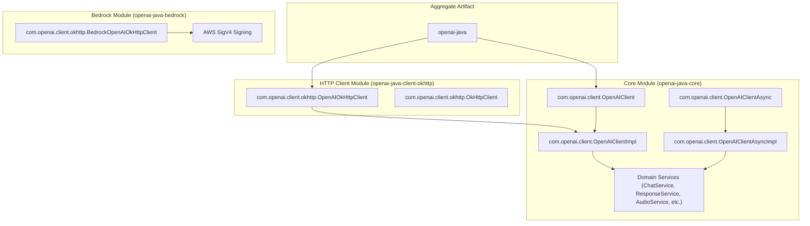

For details on the layered architecture, client layer, service layer, HTTP layer, and infrastructure components, see [Architecture](#1.1).

Sources: `[CONTRIBUTING.md:65-90]`, `[openai-java-core/src/main/kotlin/com/openai/client/OpenAIClient.kt:29-172]`, `[openai-java-core/src/main/kotlin/com/openai/client/OpenAIClientAsync.kt:29-174]`, `[openai-java-core/src/main/kotlin/com/openai/client/OpenAIClientImpl.kt:51-315]`, `[openai-java-client-okhttp/src/main/kotlin/com/openai/client/okhttp/OkHttpClient.kt:33-252]`

## Key Features

The SDK provides robust support for all major OpenAI capabilities, including the recommended Responses API, legacy Chat Completions, structured outputs via automatic JSON schema generation, function calling, real-time streaming with accumulator classes, multimodal content, Realtime API, evaluations, webhooks, and video/audio services.

For a high-level overview of major features including Chat Completions, Responses API, structured outputs, function calling, streaming, realtime, evaluations, webhooks, video, and safety, see [Features](#1.2).

Sources: `[README.md:50-92]`, `[CHANGELOG.md:1-108]`

---

# Page: Architecture

# Architecture

<details>
<summary>Relevant source files</summary>

The following files were used as context for generating this wiki page:

- [openai-java-core/src/main/kotlin/com/openai/client/OpenAIClient.kt](openai-java-core/src/main/kotlin/com/openai/client/OpenAIClient.kt)
- [openai-java-core/src/main/kotlin/com/openai/client/OpenAIClientAsync.kt](openai-java-core/src/main/kotlin/com/openai/client/OpenAIClientAsync.kt)
- [openai-java-core/src/main/kotlin/com/openai/client/OpenAIClientAsyncImpl.kt](openai-java-core/src/main/kotlin/com/openai/client/OpenAIClientAsyncImpl.kt)
- [openai-java-core/src/main/kotlin/com/openai/client/OpenAIClientImpl.kt](openai-java-core/src/main/kotlin/com/openai/client/OpenAIClientImpl.kt)
- [openai-java-core/src/main/kotlin/com/openai/core/http/HttpClient.kt](openai-java-core/src/main/kotlin/com/openai/core/http/HttpClient.kt)
- [openai-java-core/src/main/kotlin/com/openai/core/http/HttpRequestBody.kt](openai-java-core/src/main/kotlin/com/openai/core/http/HttpRequestBody.kt)
- [openai-java-core/src/main/kotlin/com/openai/core/http/StreamResponse.kt](openai-java-core/src/main/kotlin/com/openai/core/http/StreamResponse.kt)
- [openai-java-core/src/main/kotlin/com/openai/services/async/ModerationServiceAsync.kt](openai-java-core/src/main/kotlin/com/openai/services/async/ModerationServiceAsync.kt)
- [openai-java-core/src/main/kotlin/com/openai/services/blocking/ModerationService.kt](openai-java-core/src/main/kotlin/com/openai/services/blocking/ModerationService.kt)

</details>


This document provides a detailed technical overview of the OpenAI Java SDK architecture, covering the core components, design patterns, and how they work together to provide both synchronous and asynchronous API access. 

For information about specific features like structured outputs and function calling, see [Features](#1.2). For getting started with basic usage, see [Getting Started](#2).

## Overview

The OpenAI Java SDK follows a layered architecture with clear separation of concerns. The main architectural layers are:

- **Client Layer**: Entry point interfaces (`OpenAIClient`, `OpenAIClientAsync`) [openai-java-core/src/main/kotlin/com/openai/client/OpenAIClient.kt:48-48](), [openai-java-core/src/main/kotlin/com/openai/client/OpenAIClientAsync.kt:48-48]()
- **Service Layer**: API-specific service implementations (Chat, Audio, Images, etc.) [openai-java-core/src/main/kotlin/com/openai/client/OpenAIClientImpl.kt:78-148](), [openai-java-core/src/main/kotlin/com/openai/client/OpenAIClientAsyncImpl.kt:78-166]()
- **HTTP Transport Layer**: Abstract HTTP handling with retry logic and connection management [openai-java-core/src/main/kotlin/com/openai/core/http/HttpClient.kt:7-26]()
- **Core Infrastructure**: JSON processing, configuration, and utility components

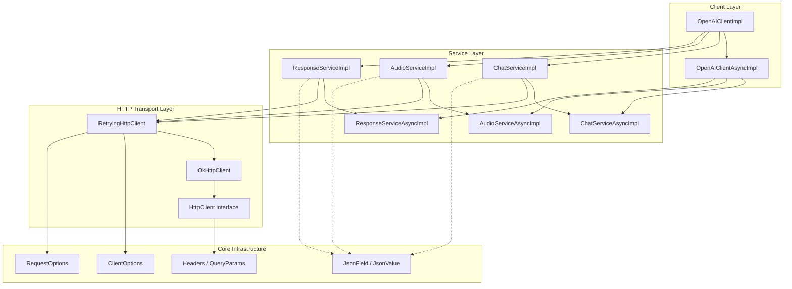

Sources: [openai-java-core/src/main/kotlin/com/openai/client/OpenAIClientImpl.kt:1-149](), [openai-java-core/src/main/kotlin/com/openai/client/OpenAIClientAsyncImpl.kt:1-166](), [openai-java-core/src/main/kotlin/com/openai/core/http/HttpClient.kt:1-26]()

## Client Architecture

The SDK provides dual client implementations supporting both synchronous and asynchronous execution patterns. Both clients share the same underlying resources and service implementations.

### Client Implementation Structure

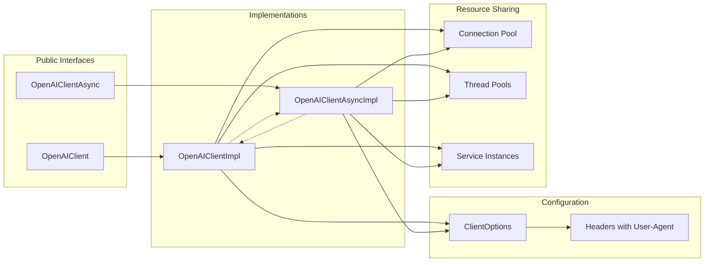

The client implementations use lazy initialization for service instances and automatically inject a `User-Agent` header if not already present [openai-java-core/src/main/kotlin/com/openai/client/OpenAIClientImpl.kt:61-149](), [openai-java-core/src/main/kotlin/com/openai/client/OpenAIClientAsyncImpl.kt:61-166](). Cross-references between sync and async clients enable seamless switching between execution modes.

Sources: [openai-java-core/src/main/kotlin/com/openai/client/OpenAIClientImpl.kt:61-149](), [openai-java-core/src/main/kotlin/com/openai/client/OpenAIClientAsyncImpl.kt:61-166]()

### Service Organization

Both client implementations expose the same set of services through lazy-initialized properties:

| Service Category | Core Services | Advanced Services |
|------------------|---------------|-------------------|
| Text Generation | `chat()`, `completions()`, `responses()` [openai-java-core/src/main/kotlin/com/openai/client/OpenAIClient.kt:74-76](), [openai-java-core/src/main/kotlin/com/openai/client/OpenAIClient.kt:124-124]() | `beta()` [openai-java-core/src/main/kotlin/com/openai/client/OpenAIClient.kt:113-113]() |
| Media Processing | `audio()`, `images()` [openai-java-core/src/main/kotlin/com/openai/client/OpenAIClient.kt:91-95]() | - |
| Data Management | `files()`, `uploads()` [openai-java-core/src/main/kotlin/com/openai/client/OpenAIClient.kt:88-88](), [openai-java-core/src/main/kotlin/com/openai/client/OpenAIClient.kt:119-119]() | `vectorStores()` [openai-java-core/src/main/kotlin/com/openai/client/OpenAIClient.kt:107-107]() |
| Model Operations | `models()`, `fineTuning()` [openai-java-core/src/main/kotlin/com/openai/client/OpenAIClient.kt:101-103]() | `batches()` [openai-java-core/src/main/kotlin/com/openai/client/OpenAIClient.kt:116-116]() |
| Evaluation | `moderations()` [openai-java-core/src/main/kotlin/com/openai/client/OpenAIClient.kt:98-98]() | `evals()`, `graders()` [openai-java-core/src/main/kotlin/com/openai/client/OpenAIClient.kt:105-105](), [openai-java-core/src/main/kotlin/com/openai/client/OpenAIClient.kt:134-134]() |
| Real-time | `realtime()`, `conversations()` [openai-java-core/src/main/kotlin/com/openai/client/OpenAIClient.kt:128-131]() | `webhooks()` [openai-java-core/src/main/kotlin/com/openai/client/OpenAIClient.kt:111-111]() |
| Utilities | `embeddings()` [openai-java-core/src/main/kotlin/com/openai/client/OpenAIClient.kt:82-82]() | `containers()` [openai-java-core/src/main/kotlin/com/openai/client/OpenAIClient.kt:136-136]() |

Each service has three variants:
- **Standard**: Normal response processing
- **WithRawResponse**: Access to raw HTTP responses and headers [openai-java-core/src/main/kotlin/com/openai/client/OpenAIClient.kt:61-61]()  
- **Async**: `CompletableFuture`-based non-blocking execution [openai-java-core/src/main/kotlin/com/openai/client/OpenAIClientAsync.kt:48-48]()

Sources: [openai-java-core/src/main/kotlin/com/openai/client/OpenAIClient.kt:74-141](), [openai-java-core/src/main/kotlin/com/openai/client/OpenAIClientAsync.kt:74-141]()

## HTTP Transport Layer

The HTTP transport layer provides an abstraction over the underlying HTTP client with retry logic, connection management, and request/response processing via the `HttpClient` interface [openai-java-core/src/main/kotlin/com/openai/core/http/HttpClient.kt:7-26]().

### HTTP Client Stack

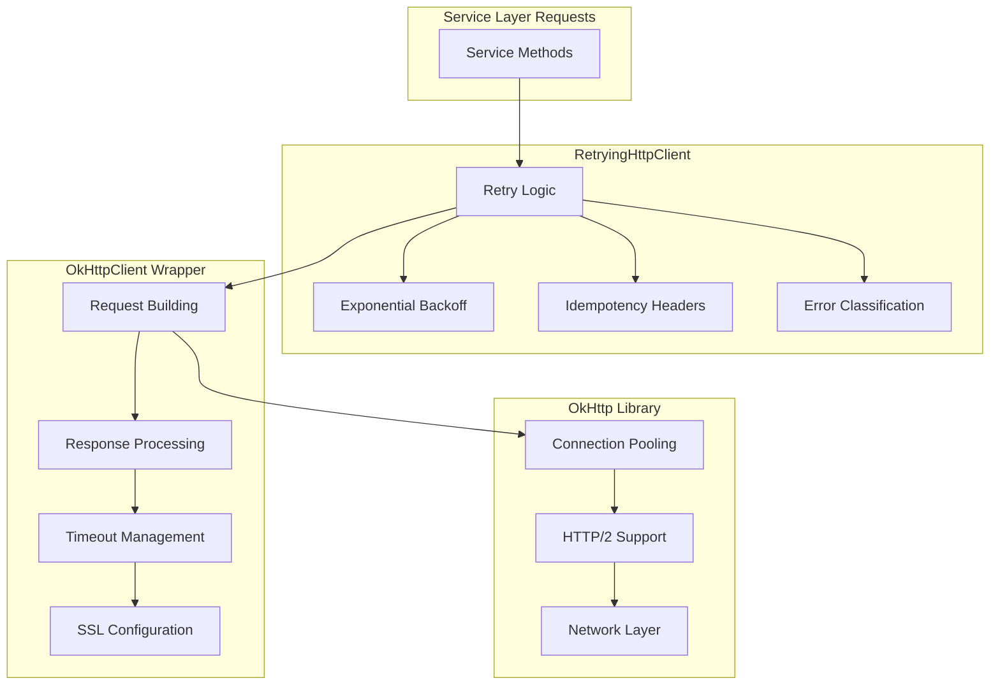

Sources: [openai-java-core/src/main/kotlin/com/openai/core/http/HttpClient.kt:7-26]()

## Service Layer Organization

The service layer follows a consistent pattern across all API endpoints with interface-implementation separation and support for both execution modes.

### Service Implementation Pattern

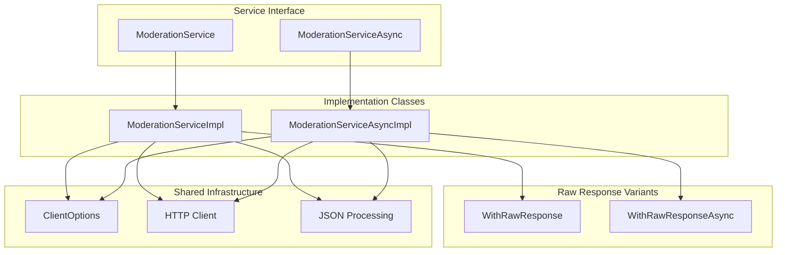

Sources: [openai-java-core/src/main/kotlin/com/openai/services/blocking/ModerationService.kt:14-68](), [openai-java-core/src/main/kotlin/com/openai/services/async/ModerationServiceAsync.kt:14-71]()

Each service implementation provides:
- **Standard Methods**: Return deserialized model objects [openai-java-core/src/main/kotlin/com/openai/services/blocking/ModerationService.kt:32-39]()
- **WithRawResponse Methods**: Return `HttpResponseFor<T>` with access to headers and status [openai-java-core/src/main/kotlin/com/openai/services/blocking/ModerationService.kt:58-66]()
- **Option Modification**: `withOptions()` methods for per-request configuration [openai-java-core/src/main/kotlin/com/openai/services/blocking/ModerationService.kt:26-26]()

### Service Method Signatures

Standard service methods follow consistent patterns:

```kotlin
// Synchronous version
fun create(params: ModerationCreateParams): ModerationCreateResponse
fun create(params: ModerationCreateParams, requestOptions: RequestOptions): ModerationCreateResponse

// Asynchronous version  
fun create(params: ModerationCreateParams): CompletableFuture<ModerationCreateResponse>
fun create(params: ModerationCreateParams, requestOptions: RequestOptions): CompletableFuture<ModerationCreateResponse>
```

Sources: [openai-java-core/src/main/kotlin/com/openai/services/blocking/ModerationService.kt:32-39](), [openai-java-core/src/main/kotlin/com/openai/services/async/ModerationServiceAsync.kt:32-39]()

## Core Infrastructure

### HTTP Body and Stream Transport Interfaces

The infrastructure provides foundational abstractions for request bodies and streaming responses that underpin all service operations [openai-java-core/src/main/kotlin/com/openai/core/http/HttpRequestBody.kt:6-25](), [openai-java-core/src/main/kotlin/com/openai/core/http/StreamResponse.kt:5-11]().

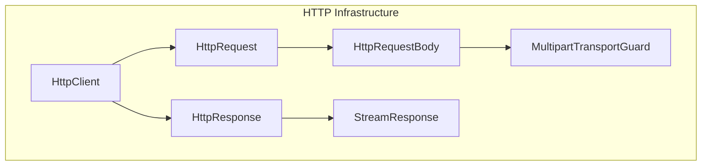

Sources: [openai-java-core/src/main/kotlin/com/openai/core/http/HttpClient.kt:7-26](), [openai-java-core/src/main/kotlin/com/openai/core/http/HttpRequestBody.kt:6-30](), [openai-java-core/src/main/kotlin/com/openai/core/http/StreamResponse.kt:5-11]()

---

# Page: Features

# Features

<details>
<summary>Relevant source files</summary>

The following files were used as context for generating this wiki page:

- [.castiron.stats.yml](.castiron.stats.yml)
- [.release-please-manifest.json](.release-please-manifest.json)
- [CHANGELOG.md](CHANGELOG.md)
- [CONTRIBUTING.md](CONTRIBUTING.md)
- [README.md](README.md)
- [api_reference/openapi.transformed.yml](api_reference/openapi.transformed.yml)
- [bedrock.md](bedrock.md)
- [build.gradle.kts](build.gradle.kts)
- [openai-java-core/src/main/kotlin/com/openai/models/AllModels.kt](openai-java-core/src/main/kotlin/com/openai/models/AllModels.kt)
- [openai-java-core/src/main/kotlin/com/openai/models/ChatModel.kt](openai-java-core/src/main/kotlin/com/openai/models/ChatModel.kt)
- [openai-java-core/src/main/kotlin/com/openai/models/ResponsesModel.kt](openai-java-core/src/main/kotlin/com/openai/models/ResponsesModel.kt)
- [openai-java-core/src/main/kotlin/com/openai/models/beta/responses/BetaResponse.kt](openai-java-core/src/main/kotlin/com/openai/models/beta/responses/BetaResponse.kt)
- [openai-java-core/src/main/kotlin/com/openai/models/beta/responses/BetaResponsesClientEvent.kt](openai-java-core/src/main/kotlin/com/openai/models/beta/responses/BetaResponsesClientEvent.kt)
- [openai-java-core/src/main/kotlin/com/openai/models/beta/responses/ResponseCompactParams.kt](openai-java-core/src/main/kotlin/com/openai/models/beta/responses/ResponseCompactParams.kt)
- [openai-java-core/src/main/kotlin/com/openai/models/beta/responses/ResponseCreateParams.kt](openai-java-core/src/main/kotlin/com/openai/models/beta/responses/ResponseCreateParams.kt)
- [openai-java-core/src/main/kotlin/com/openai/models/responses/ResponseCompactParams.kt](openai-java-core/src/main/kotlin/com/openai/models/responses/ResponseCompactParams.kt)

</details>


This document provides a comprehensive technical overview of the major features available in the OpenAI Java SDK (`openai-java`). It details the core API capabilities, type-safety mechanisms, dual-mode execution models, realtime WebSocket communication, and supporting infrastructure. For architecture details, see [1.1](), and for artifact-specific configurations, see [8]() and [9]().

Sources: [README.md:1-72](), [CONTRIBUTING.md:65-81]()

## Core API Features

The SDK provides access to major OpenAI API endpoints through dedicated service interfaces and strongly typed parameter builders.

### Chat Completions API

The Chat Completions API is the established standard interface for generating text from conversational inputs, configured via `ChatCompletionCreateParams`.

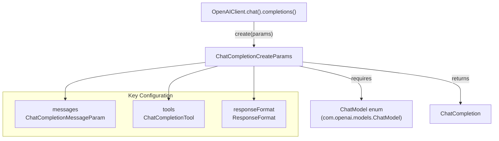

**Feature capabilities:**
- **Message types**: Supports system, user, assistant, tool, and function messages via `ChatCompletionMessageParam`
- **Model selection**: Extensive model enumeration through `ChatModel` including GPT-6, GPT-5, and O-series variants [openai-java-core/src/main/kotlin/com/openai/models/ChatModel.kt:23-115]()
- **Tool calling**: Function calling and custom tools via `ChatCompletionTool`
- **Response formatting**: Text, JSON object, or structured JSON schema via `ResponseFormat`
- **Reasoning control**: Configurable reasoning effort levels via `ReasoningEffort` enum
- **Token limits**: `maxCompletionTokens` for controlling output length and costs

Sources: [README.md:74-92](), [openai-java-core/src/main/kotlin/com/openai/models/ChatModel.kt:23-115]()

### Responses API

The Responses API is the recommended modern interface, offering advanced features for multi-turn conversations, background processing, compaction, and multi-modal content.

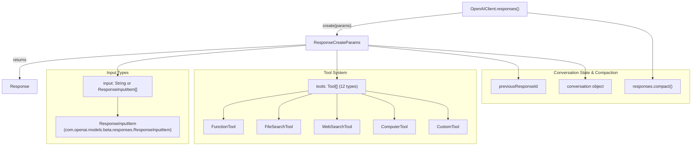

**Feature capabilities:**
- **Multi-modal inputs**: Text, images, files, and audio via `ResponseInputItem` union variants [openai-java-core/src/main/kotlin/com/openai/models/beta/responses/ResponseCreateParams.kt:113-127]()
- **Tool ecosystem**: 12 tool types including function calls, file search, web search, computer use, and MCP tools [openai-java-core/src/main/kotlin/com/openai/models/beta/responses/ResponseCreateParams.kt:37-47]()
- **Conversation management**: State tracking via `previousResponseId` or full `conversation` objects, alongside `ResponseCompactParams` for conversation compaction [openai-java-core/src/main/kotlin/com/openai/models/responses/ResponseCompactParams.kt:36-92]()
- **Background processing**: Asynchronous execution via `background(Boolean)` [openai-java-core/src/main/kotlin/com/openai/models/beta/responses/ResponseCreateParams.kt:66-74]()

Sources: [README.md:50-73](), [openai-java-core/src/main/kotlin/com/openai/models/responses/ResponseCompactParams.kt:36-92](), [openai-java-core/src/main/kotlin/com/openai/models/beta/responses/ResponseCreateParams.kt:37-127]()

### Assistants API (Deprecated)

The Assistants API is deprecated in favor of the Responses API but remains supported indefinitely for legacy thread-based workflows.

**Feature capabilities:**
- Assistant creation via `AssistantCreateParams` with model, instructions, and tool configurations [api_reference/openapi.transformed.yml:53-60]()
- Persistent conversation threads and run execution via `RunCreateParams`

Sources: [api_reference/openapi.transformed.yml:53-60]()

### Evaluations and Graders

The Evaluations API provides systematic testing of model performance across datasets.

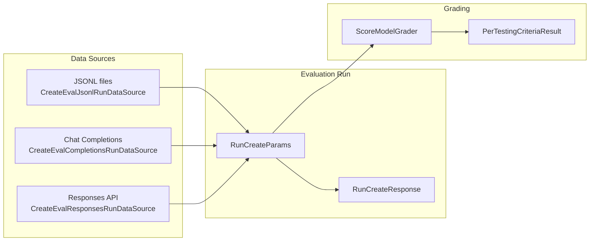

**Feature capabilities:**
- **Data source types**: JSONL files, chat completions, or responses API data via union types
- **Grading system**: Automated scoring via `ScoreModelGrader` with customizable input templates
- **Run management**: Create, retrieve, cancel, and list evaluation runs

Sources: [api_reference/openapi.transformed.yml:30-35]()

### Realtime and WebSocket API

The SDK supports persistent WebSocket connections for real-time bi-directional interactions, audio configuration, and streaming events via `BetaResponsesClientEvent` and client/server event wrappers [openai-java-core/src/main/kotlin/com/openai/models/beta/responses/BetaResponsesClientEvent.kt:34-92]().

**Feature capabilities:**
- **Response Creation**: Over persistent WebSocket connections using implicit streaming and `ResponseCreate` payloads [openai-java-core/src/main/kotlin/com/openai/models/beta/responses/BetaResponsesClientEvent.kt:45-55]()
- **Steering**: Queueing user input to steer active responses via `BetaResponseSteerEvent` [openai-java-core/src/main/kotlin/com/openai/models/beta/responses/BetaResponsesClientEvent.kt:57-84]()
- **Injection**: Atomic injection of input items (such as client-owned tool outputs) into active responses via `BetaResponseInjectEvent` [openai-java-core/src/main/kotlin/com/openai/models/beta/responses/BetaResponsesClientEvent.kt:86-92]()

Sources: [openai-java-core/src/main/kotlin/com/openai/models/beta/responses/BetaResponsesClientEvent.kt:34-92]()

### Webhooks, Video, and Safety Services

- **Webhooks**: Event unwrapping and signature verification helpers for webhook security.
- **Video Services**: APIs to create, edit, extend, and manage video generation assets.
- **Safety Services**: Moderation endpoints and safety cases management to screen inputs/outputs for potentially harmful content [api_reference/openapi.transformed.yml:46-48]().

Sources: [api_reference/openapi.transformed.yml:46-48]()

## Type-Safety Features

### Structured Outputs

Structured Outputs enable automatic JSON schema generation from Java classes and type-safe deserialization of model responses.

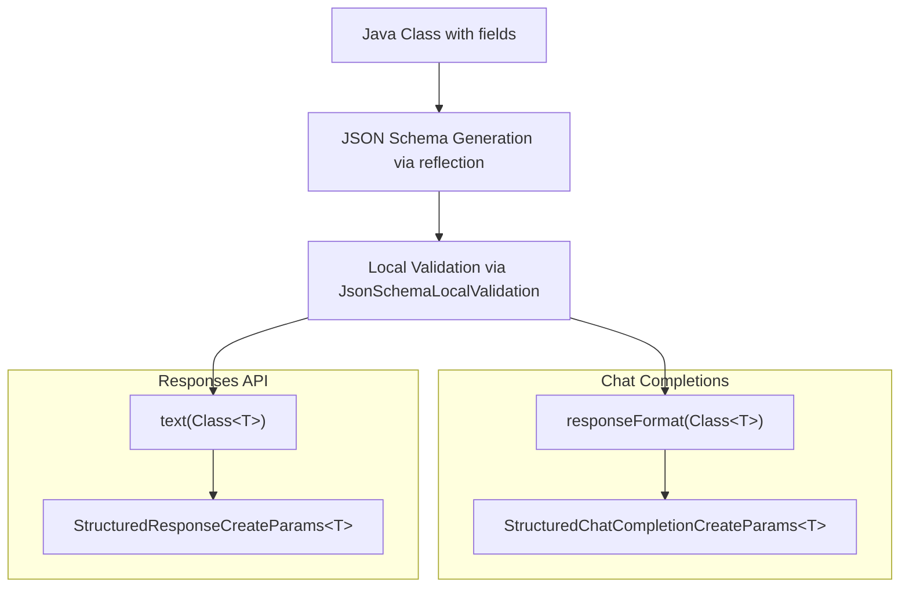

**Feature capabilities:**
- **Schema generation**: Automatic JSON schema derived from Java classes using reflection and Jackson annotations
- **Local validation**: Pre-request schema validation via `JsonSchemaLocalValidation`
- **Type-safe deserialization**: Automatic JSON-to-Java conversion with compile-time type safety

Sources: [README.md:50-92]()

### Function Calling

Function calling enables the model to invoke external functions by generating JSON arguments conforming to defined schemas.

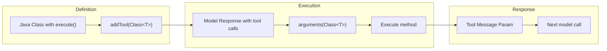

**Feature capabilities:**
- **Schema derivation**: Automatic function schema from Java class structure via `addTool(Class<T>)`
- **Parameter parsing**: Type-safe argument extraction via `arguments(Class<T>)` method on function objects
- **Result serialization**: Automatic JSON conversion via `contentAsJson(Object)`

Sources: [README.md:74-92]()

## Execution Modes

The SDK supports synchronous, asynchronous, and streaming execution modes across client implementations.

### Synchronous and Asynchronous Clients

- **Synchronous client**: `OpenAIClient` interface for blocking operations returning results directly [CONTRIBUTING.md:69-72]()
- **Asynchronous client**: `OpenAIClientAsync` interface returning `CompletableFuture<T>` for non-blocking execution [CONTRIBUTING.md:69-72]()

Sources: [CONTRIBUTING.md:69-72]()

### Streaming

Streaming processes response chunks as they arrive using `StreamResponse<T>` (synchronous) or `AsyncStreamResponse<T>` (asynchronous) paired with accumulators like `ChatCompletionAccumulator` and `ResponseAccumulator`.

Sources: [README.md:74-92]()

## Supporting Infrastructure

### Retry Logic and Error Handling

Automatic retry logic via `RetryingHttpClient` handles HTTP 408, 429, and 5xx status codes using exponential backoff with jitter and `Retry-After` header inspection.

Sources: [README.md:144-158]()

### Authentication and Configuration

Supports API key authentication, Azure credentials via `AzureApiKeyCredential`, and Amazon Bedrock SigV4 signing via `openai-java-bedrock` [bedrock.md:3-6](). Configuration is accepted via system properties, environment variables (`OPENAI_API_KEY`), or programmatic builders [README.md:83-146]().

Sources: [README.md:83-146](), [bedrock.md:3-6]()

### Resource Management

Manages connection pools, thread dispatchers, and automatic resource cleanup via the `PhantomReachable` pattern alongside explicit `close()` methods.

Sources: [CONTRIBUTING.md:69-81]()

## Model Support and Configuration

### Available Models

The SDK includes enums such as `ChatModel` providing constants for GPT-6 (`GPT_6_ASTRA`, `GPT_6_SOL`, `GPT_6_LUNA`), GPT-5 series (`GPT_5_6_SOL`), and O-series reasoning models [openai-java-core/src/main/kotlin/com/openai/models/ChatModel.kt:23-35]().

Sources: [openai-java-core/src/main/kotlin/com/openai/models/ChatModel.kt:23-35]()

### Reasoning Configuration

Models support configurable reasoning effort levels (`NONE`, `MINIMAL`, `LOW`, `MEDIUM`, `HIGH`, `XHIGH`) to balance execution speed, token cost, and output quality.

Sources: [openai-java-core/src/main/kotlin/com/openai/models/ChatModel.kt:23-35]()

---

# Page: Getting Started

# Getting Started

<details>
<summary>Relevant source files</summary>

The following files were used as context for generating this wiki page:

- [.release-please-manifest.json](.release-please-manifest.json)
- [CHANGELOG.md](CHANGELOG.md)
- [CONTRIBUTING.md](CONTRIBUTING.md)
- [README.md](README.md)
- [bedrock.md](bedrock.md)
- [build.gradle.kts](build.gradle.kts)

</details>


This page serves as a high-level guide for initializing, configuring, and executing your first requests with the OpenAI Java SDK. It outlines project setup, client configuration, and credential management.

For deep technical details, refer to the child pages:
- For dependency management, artifact coordinates, and runtime floors, see [Installation](#2.1).
- For advanced builder patterns, timeouts, and data residency, see [Configuration](#2.2).
- For credentials, bearer tokens, Azure keys, and workload identities, see [Authentication](#2.3).

Sources: [README.md:1-55](), [CONTRIBUTING.md:20-30]()

## Installation

The OpenAI Java SDK artifacts are distributed via Maven Central and require Java 8 or later for framework-neutral components [README.md:33-36](). The SDK consists of core logic (`openai-java-core`), the OkHttp transport layer (`openai-java-client-okhttp`), a unified facade (`openai-java`), and optional extensions like Amazon Bedrock (`openai-java-bedrock`) [README.md:11-30](), [CONTRIBUTING.md:67-81]().

For detailed dependency configurations, artifact versions, and runtime support policies, see [Installation](#2.1).

**Module Hierarchy**
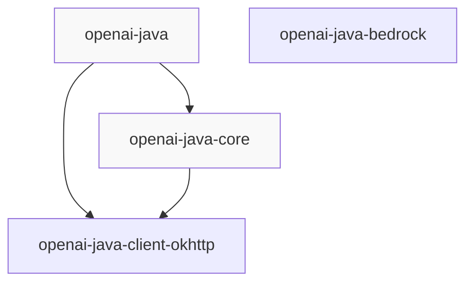

Sources: [README.md:11-30](), [CONTRIBUTING.md:67-81]()

## Configuration

Client initialization relies on the `ClientOptions` builder pattern, resolving settings from system properties, environment variables, or explicit programmatic parameters [README.md:123-160](). The SDK evaluates system properties first, followed by environment variables (`OPENAI_API_KEY`, `OPENAI_ORG_ID`, `OPENAI_PROJECT_ID`, `OPENAI_BASE_URL`), and finally programmatic setters.

For comprehensive details on base URLs, data residency, timeouts, and environment precedence, see [Configuration](#2.2).

**Configuration Resolution Flow**
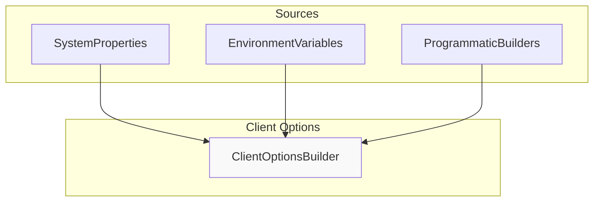

Sources: [README.md:123-169](), [openai-java-client-okhttp/src/main/kotlin/com/openai/client/okhttp/OpenAIOkHttpClient.kt:1-50]()

## Authentication

Authentication is handled through the `Credential` abstraction. The SDK supports standard bearer tokens (`BearerTokenCredential`), Azure API keys (`AzureApiKeyCredential`), and administrative keys [README.md:164-169](), [openai-java-core/src/main/kotlin/com/openai/credential/BearerTokenCredential.kt:1-36](). 

For advanced workload identity providers (Kubernetes, Azure Managed Identity, GCP ID tokens), X.509 mTLS transport, and Amazon Bedrock integration, see [Authentication](#2.3).

**Credential Resolution**
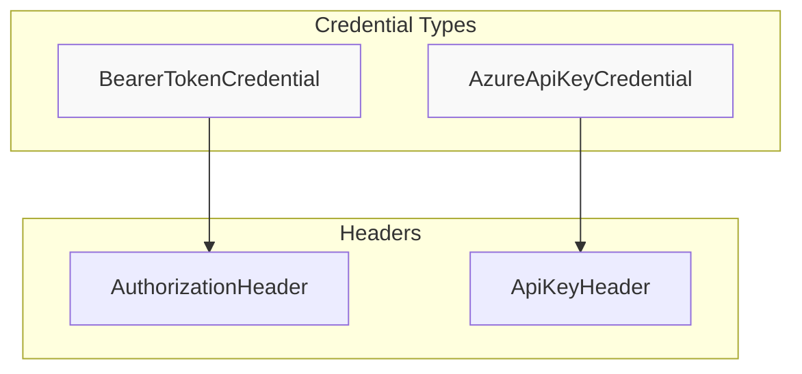

Sources: [README.md:164-169](), [openai-java-core/src/main/kotlin/com/openai/credential/BearerTokenCredential.kt:1-36]()

## Your First API Call

Once the client is configured using `OpenAIOkHttpClient.fromEnv()`, you can execute requests against the recommended [Responses API](https://platform.openai.com/docs/api-reference/responses) or the [Chat Completions API](https://platform.openai.com/docs/api-reference/chat) [README.md:50-92]().

```java
import com.openai.client.OpenAIClient;
import com.openai.client.okhttp.OpenAIOkHttpClient;
import com.openai.models.ChatModel;
import com.openai.models.responses.Response;
import com.openai.models.responses.ResponseCreateParams;

// Initialize client from environment variables
OpenAIClient client = OpenAIOkHttpClient.fromEnv();

// Build and execute a request
ResponseCreateParams params = ResponseCreateParams.builder()
        .input("Say this is a test")
        .model(ChatModel.GPT_5_2)
        .build();
Response response = client.responses().create(params);
```

Sources: [README.md:50-92]()

---

# Page: Installation

# Installation

<details>
<summary>Relevant source files</summary>

The following files were used as context for generating this wiki page:

- [.release-please-manifest.json](.release-please-manifest.json)
- [CHANGELOG.md](CHANGELOG.md)
- [CONTRIBUTING.md](CONTRIBUTING.md)
- [README.md](README.md)
- [bedrock.md](bedrock.md)
- [build.gradle.kts](build.gradle.kts)
- [buildSrc/src/test/kotlin/com/openai/gradle/GradleWrapperTest.kt](buildSrc/src/test/kotlin/com/openai/gradle/GradleWrapperTest.kt)
- [gradle.properties](gradle.properties)
- [scripts/gradle](scripts/gradle)

</details>


This page details how to add the OpenAI Java SDK as a dependency in your build system, explains the artifact coordinates and versioning policy, and outlines the supported Java runtime requirements.

## Artifact Coordinates and Versions

The OpenAI Java SDK is published to Maven Central under the group ID `com.openai`. The current stable release version is `4.69.3` [.release-please-manifest.json:2-2]().

### Gradle

To add the SDK to a Gradle project using Kotlin DSL, declare the implementation dependency [README.md:17-19]():

```kotlin
implementation("com.openai:openai-java:4.69.3")
```

### Maven

To add the SDK to a Maven project, include the dependency in your `pom.xml` [README.md:23-29]():

```xml
<dependency>
  <groupId>com.openai</groupId>
  <artifactId>openai-java</artifactId>
  <version>4.69.3</version>
</dependency>
```

### Optional Artifact: Amazon Bedrock Integration

To interact with OpenAI-compatible APIs on Amazon Bedrock using AWS credentials, include the optional `openai-java-bedrock` artifact instead of managing AWS SDK dependencies manually [README.md:94-116](), [bedrock.md:8-26]():

```kotlin
implementation("com.openai:openai-java-bedrock:4.69.3")
```

Sources: [README.md:17-29](), [.release-please-manifest.json:1-3](), [bedrock.md:8-26]()

---

## SDK Architecture and Module Structure

The SDK is structured as a multi-module Gradle project where each module serves a distinct architectural layer. The root artifact `openai-java` combines both core interfaces and the default OkHttp client implementation.

**SDK Module Architecture & Code Entities**
```mermaid
graph TD
    MainArtifact[""openai-java""[Maven Artifact]]
    CoreModule[""openai-java-core""[Core Module]]
    OkHttpModule[""com.openai.client.okhttp.OpenAIOkHttpClient""[OkHttp Client Module]]
    BedrockModule[""com.openai.client.okhttp.BedrockOpenAIOkHttpClient""[Bedrock Module]]
    
    MainArtifact -->|depends on| CoreModule
    MainArtifact -->|depends on| OkHttpModule
    OkHttpModule -->|depends on| CoreModule
    BedrockModule -->|depends on| OkHttpModule
    
    CoreModule -->|defines| OpenAIClient[""com.openai.client.OpenAIClient"""]
    CoreModule -->|defines| OpenAIClientAsync[""com.openai.client.OpenAIClientAsync"""]
    OkHttpModule -->|implements| OpenAIOkHttpClientImpl[""com.openai.client.okhttp.OpenAIOkHttpClient""]
    BedrockModule -->|implements| BedrockOpenAIOkHttpClientImpl[""com.openai.client.okhttp.BedrockOpenAIOkHttpClient""]
```

### Module Breakdown

| Module | Artifact ID | Purpose | Key Code Classes |
|--------|------------|---------|------------------|
| `openai-java-core` | `com.openai:openai-java-core` | Core models, client interfaces, and request builders without HTTP bindings | [`OpenAIClient`](), [`OpenAIClientAsync`](), `ChatCompletionCreateParams`, `ResponseCreateParams` [CONTRIBUTING.md:69-72]() |
| `openai-java-client-okhttp` | `com.openai:openai-java-client-okhttp` | OkHttp client bindings and synchronous/asynchronous execution pipelines | [`OpenAIOkHttpClient`](), [`OpenAIOkHttpClientAsync`](), `OkHttpClient` [CONTRIBUTING.md:73-75]() |
| `openai-java` | `com.openai:openai-java` | Combined public facade containing core and OkHttp artifacts | Exports all public interfaces [CONTRIBUTING.md:76-78]() |
| `openai-java-bedrock` | `com.openai:openai-java-bedrock` | AWS SigV4 request signing and credential provider integration for Bedrock | [`BedrockOpenAIOkHttpClient`](), `BedrockEndpoint` [README.md:94-116](), [bedrock.md:8-26]() |

*(Note: The legacy Spring Boot 2 starter is retired and excluded from active builds; its final snapshot remains available under the `v4.45.0` tag) [CONTRIBUTING.md:82-85]().*

Sources: [CONTRIBUTING.md:65-86](), [README.md:94-116](), [bedrock.md:8-26]()

---

## Supported Java Runtime Policy

The framework-neutral SDK artifacts require **Java 8 or later** at runtime [README.md:33-36](). Local development and compilation require **JDK 21** for the Kotlin toolchain [CONTRIBUTING.md:20-25]().

Runtime floors, target bytecode compatibility, and lifecycle states are programmatically verified by [`VerifyVersionSupportPolicyTask`] located in `buildSrc`, checking configuration properties defined in `gradle/version-support.properties` [build.gradle.kts:107-160]().

**Runtime Version Verification Flow**
```mermaid
graph LR
    Props[""gradle/version-support.properties""] --> VerifyTask[""VerifyVersionSupportPolicyTask""]
    BuildScript[""build.gradle.kts""] --> VerifyTask
    VerifyTask -->|validates bytecode version| MainClasses[""main SourceSet class files""]
    VerifyTask -->|asserts compatibility| RuntimeFloor[""Runtime Floor (Java 8+)""]
```

Sources: [README.md:33-36](), [build.gradle.kts:107-160](), [CONTRIBUTING.md:20-25]()

---

## Installation Verification

Once you have added the dependency to your build file, verify the installation by instantiating the client via environment variables or manual builder configuration [README.md:64-72](), [README.md:142-146]():

```java
import com.openai.client.OpenAIClient;
import com.openai.client.okhttp.OpenAIOkHttpClient;

// Verify installation by loading configuration from environment variables
OpenAIClient client = OpenAIOkHttpClient.fromEnv();
```

Sources: [README.md:64-72](), [README.md:142-146]()

---

# Page: Configuration

# Configuration

<details>
<summary>Relevant source files</summary>

The following files were used as context for generating this wiki page:

- [openai-java-client-okhttp/src/main/kotlin/com/openai/client/okhttp/OkHttpClient.kt](openai-java-client-okhttp/src/main/kotlin/com/openai/client/okhttp/OkHttpClient.kt)
- [openai-java-client-okhttp/src/main/kotlin/com/openai/client/okhttp/OpenAIOkHttpClient.kt](openai-java-client-okhttp/src/main/kotlin/com/openai/client/okhttp/OpenAIOkHttpClient.kt)
- [openai-java-client-okhttp/src/main/kotlin/com/openai/client/okhttp/OpenAIOkHttpClientAsync.kt](openai-java-client-okhttp/src/main/kotlin/com/openai/client/okhttp/OpenAIOkHttpClientAsync.kt)
- [openai-java-client-okhttp/src/test/kotlin/com/openai/client/okhttp/ProxyAuthenticationBoundaryTest.kt](openai-java-client-okhttp/src/test/kotlin/com/openai/client/okhttp/ProxyAuthenticationBoundaryTest.kt)
- [openai-java-client-okhttp/src/test/kotlin/com/openai/client/okhttp/RedirectCredentialBoundaryTest.kt](openai-java-client-okhttp/src/test/kotlin/com/openai/client/okhttp/RedirectCredentialBoundaryTest.kt)
- [openai-java-core/src/main/kotlin/com/openai/azure/AzureOpenAIServiceVersion.kt](openai-java-core/src/main/kotlin/com/openai/azure/AzureOpenAIServiceVersion.kt)
- [openai-java-core/src/main/kotlin/com/openai/azure/credential/AzureApiKeyCredential.kt](openai-java-core/src/main/kotlin/com/openai/azure/credential/AzureApiKeyCredential.kt)
- [openai-java-core/src/main/kotlin/com/openai/core/ClientOptions.kt](openai-java-core/src/main/kotlin/com/openai/core/ClientOptions.kt)
- [openai-java-core/src/main/kotlin/com/openai/core/Properties.kt](openai-java-core/src/main/kotlin/com/openai/core/Properties.kt)
- [openai-java-core/src/main/kotlin/com/openai/credential/BearerTokenCredential.kt](openai-java-core/src/main/kotlin/com/openai/credential/BearerTokenCredential.kt)
- [openai-java-core/src/main/kotlin/com/openai/credential/Credential.kt](openai-java-core/src/main/kotlin/com/openai/credential/Credential.kt)
- [openai-java-core/src/test/kotlin/com/openai/core/http/ClientOptionsTest.kt](openai-java-core/src/test/kotlin/com/openai/core/http/ClientOptionsTest.kt)

</details>


This document covers how to configure the OpenAI Java SDK client, including setting up credentials, base URLs, data residency, timeouts, retry behavior, and other client options. Configuration is handled through the builder pattern using `ClientOptions` and client builders.

For authentication details (API keys, Azure credentials), see [Authentication](#2.3). For installation and basic setup, see [Installation](#2.1).

## Configuration Overview

The SDK uses a builder pattern centered around `ClientOptions` defined in `openai-java-core/src/main/kotlin/com/openai/core/ClientOptions.kt` [openai-java-core/src/main/kotlin/com/openai/core/ClientOptions.kt:36-146](). Clients can be configured manually via builder methods or automatically using environment variables and system properties via `OpenAIOkHttpClient.fromEnv()` [openai-java-client-okhttp/src/main/kotlin/com/openai/client/okhttp/OpenAIOkHttpClient.kt:48]().

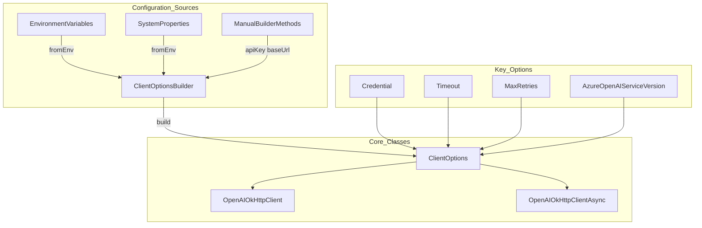
Sources: [openai-java-core/src/main/kotlin/com/openai/core/ClientOptions.kt:36-146](), [openai-java-client-okhttp/src/main/kotlin/com/openai/client/okhttp/OpenAIOkHttpClient.kt:38-49]()

## Basic Configuration Patterns

The SDK supports three main configuration approaches:

### Environment-Based Configuration
```java
// Automatically configures using environment variables and system properties
OpenAIClient client = OpenAIOkHttpClient.fromEnv();
```
Sources: [openai-java-client-okhttp/src/main/kotlin/com/openai/client/okhttp/OpenAIOkHttpClient.kt:48]()

### Manual Configuration
```java
OpenAIClient client = OpenAIOkHttpClient.builder()
    .apiKey("My API Key")
    .baseUrl("https://api.openai.com/v1")
    .maxRetries(3)
    .build();
```
Sources: [openai-java-client-okhttp/src/main/kotlin/com/openai/client/okhttp/OpenAIOkHttpClient.kt:41]()

### Mixed Configuration
```java
OpenAIClient client = OpenAIOkHttpClient.builder()
    .fromEnv()  // Load defaults from environment
    .apiKey("Override API Key")  // Override specific values
    .maxRetries(5)
    .build();
```
Sources: [openai-java-client-okhttp/src/main/kotlin/com/openai/client/okhttp/OpenAIOkHttpClient.kt:41-48]()

## Environment Variables and System Properties

The `fromEnv()` method configures `ClientOptions` by checking specific system properties and falling back to environment variables (system properties take precedence) [openai-java-core/src/main/kotlin/com/openai/core/ClientOptions.kt]().

| Configuration | System Property | Environment Variable | Required | Default |
|---------------|-----------------|---------------------|----------|---------|
| API Key | `openai.apiKey` | `OPENAI_API_KEY` | true* | - |
| Base URL | `openai.baseUrl` | `OPENAI_BASE_URL` | false | `https://api.openai.com/v1` |
| Organization | `openai.orgId` | `OPENAI_ORG_ID` | false | - |
| Project | `openai.projectId` | `OPENAI_PROJECT_ID` | false | - |
| Webhook Secret | `openai.webhookSecret` | `OPENAI_WEBHOOK_SECRET` | false | - |

*Required unless using Azure credentials via `AZURE_OPENAI_KEY`.

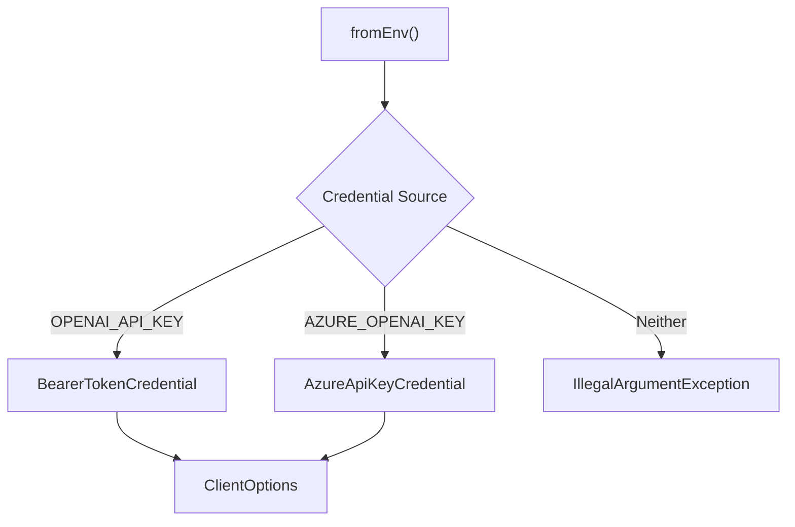
Sources: [openai-java-core/src/main/kotlin/com/openai/core/ClientOptions.kt:1-173](), [openai-java-core/src/test/kotlin/com/openai/core/http/ClientOptionsTest.kt:50-63]()

## Key Configuration Options

### Network Configuration

#### Base URL Configuration
The base URL defaults to the production endpoint `https://api.openai.com/v1` [openai-java-core/src/main/kotlin/com/openai/core/ClientOptions.kt:168-170](), but can be pointed to custom gateways or Azure deployments.
```java
.baseUrl("https://api.openai.com/v1")
.baseUrl("https://example.openai.azure.com")
```
Sources: [openai-java-core/src/main/kotlin/com/openai/core/ClientOptions.kt:166-170](), [openai-java-core/src/test/kotlin/com/openai/core/http/ClientOptionsTest.kt:26-32]()

#### Timeout Configuration
Timeouts control request lifecycles (connect, read, write, call) via `Timeout` [openai-java-core/src/main/kotlin/com/openai/core/ClientOptions.kt:107-112]().
```java
.timeout(Duration.ofMinutes(2))
```
Sources: [openai-java-core/src/main/kotlin/com/openai/core/ClientOptions.kt:107-112]()

#### Retry Configuration
`maxRetries` defaults to `2` and specifies the maximum number of times to retry failed requests on connection errors, 408, 409, 429, or 5xx status codes [openai-java-core/src/main/kotlin/com/openai/core/ClientOptions.kt:113-128]().
```java
.maxRetries(3)
```
Sources: [openai-java-core/src/main/kotlin/com/openai/core/ClientOptions.kt:113-128]()

### HTTP Client Configuration

#### Proxy and SSL Settings
Underlying OkHttp transport properties can be configured via `OpenAIOkHttpClient.Builder` [openai-java-client-okhttp/src/main/kotlin/com/openai/client/okhttp/OpenAIOkHttpClient.kt:52-168]().
```java
.proxy(new Proxy(Proxy.Type.HTTP, new InetSocketAddress("proxy.example.com", 8080)))
.sslSocketFactory(customSSLFactory, customTrustManager)
```
Sources: [openai-java-client-okhttp/src/main/kotlin/com/openai/client/okhttp/OpenAIOkHttpClient.kt:52-168]()

#### Headers and Query Parameters
```java
.putHeader("User-Agent", "CustomAgent/1.0")
.putQueryParam("beta", "true")
```
Sources: [openai-java-core/src/main/kotlin/com/openai/core/ClientOptions.kt:91-96]()

## Azure Configuration

Azure OpenAI integrations require specifying Azure service versions (`AzureOpenAIServiceVersion`) and URL path modes (`AzureUrlPathMode`) [openai-java-core/src/main/kotlin/com/openai/core/ClientOptions.kt:139-142]().

```java
.azureServiceVersion(AzureOpenAIServiceVersion.V2024_10_21)
.azureUrlPathMode(AzureUrlPathMode.LEGACY)
```
Valid URL path modes include `LEGACY`, `UNIFIED`, and `AUTO` [openai-java-core/src/test/kotlin/com/openai/core/http/ClientOptionsTest.kt:73-105]().

Sources: [openai-java-core/src/main/kotlin/com/openai/azure/AzureOpenAIServiceVersion.kt:5-46](), [openai-java-core/src/test/kotlin/com/openai/core/http/ClientOptionsTest.kt:73-105]()

## Temporary Configuration Changes

Clients support generating derived instances with overridden settings while sharing underlying connection pools using `withOptions()`:
```java
OpenAIClient modifiedClient = client.withOptions(optionsBuilder -> {
    optionsBuilder.maxRetries(5);
});
```
Sources: [openai-java-core/src/main/kotlin/com/openai/core/ClientOptions.kt:36-146]()

## ClientOptions Builder Architecture

The construction pipeline coordinates raw credentials, interceptors, and network settings into immutable `ClientOptions`.

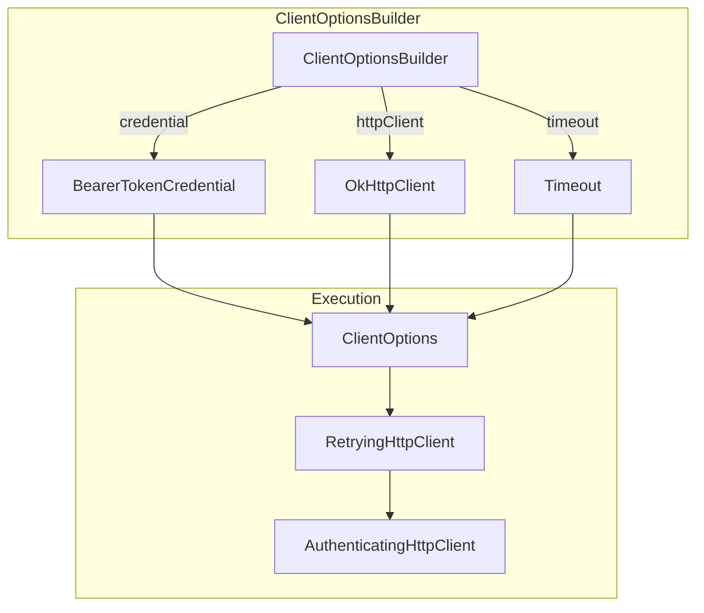
Sources: [openai-java-core/src/main/kotlin/com/openai/core/ClientOptions.kt:36-173](), [openai-java-client-okhttp/src/main/kotlin/com/openai/client/okhttp/OpenAIOkHttpClient.kt:41-49]()

---

# Page: Authentication

# Authentication

<details>
<summary>Relevant source files</summary>

The following files were used as context for generating this wiki page:

- [openai-java-client-okhttp/src/main/kotlin/com/openai/client/okhttp/OkHttpClient.kt](openai-java-client-okhttp/src/main/kotlin/com/openai/client/okhttp/OkHttpClient.kt)
- [openai-java-client-okhttp/src/main/kotlin/com/openai/client/okhttp/OpenAIOkHttpClient.kt](openai-java-client-okhttp/src/main/kotlin/com/openai/client/okhttp/OpenAIOkHttpClient.kt)
- [openai-java-client-okhttp/src/main/kotlin/com/openai/client/okhttp/OpenAIOkHttpClientAsync.kt](openai-java-client-okhttp/src/main/kotlin/com/openai/client/okhttp/OpenAIOkHttpClientAsync.kt)
- [openai-java-client-okhttp/src/test/kotlin/com/openai/client/okhttp/ProxyAuthenticationBoundaryTest.kt](openai-java-client-okhttp/src/test/kotlin/com/openai/client/okhttp/ProxyAuthenticationBoundaryTest.kt)
- [openai-java-client-okhttp/src/test/kotlin/com/openai/client/okhttp/RedirectCredentialBoundaryTest.kt](openai-java-client-okhttp/src/test/kotlin/com/openai/client/okhttp/RedirectCredentialBoundaryTest.kt)
- [openai-java-core/src/main/kotlin/com/openai/auth/AzureManagedIdentityTokenProvider.kt](openai-java-core/src/main/kotlin/com/openai/auth/AzureManagedIdentityTokenProvider.kt)
- [openai-java-core/src/main/kotlin/com/openai/auth/GcpIdTokenProvider.kt](openai-java-core/src/main/kotlin/com/openai/auth/GcpIdTokenProvider.kt)
- [openai-java-core/src/main/kotlin/com/openai/auth/K8sServiceAccountTokenProvider.kt](openai-java-core/src/main/kotlin/com/openai/auth/K8sServiceAccountTokenProvider.kt)
- [openai-java-core/src/main/kotlin/com/openai/auth/SubjectTokenProvider.kt](openai-java-core/src/main/kotlin/com/openai/auth/SubjectTokenProvider.kt)
- [openai-java-core/src/main/kotlin/com/openai/auth/TokenExchangeResponse.kt](openai-java-core/src/main/kotlin/com/openai/auth/TokenExchangeResponse.kt)
- [openai-java-core/src/main/kotlin/com/openai/auth/WorkloadIdentity.kt](openai-java-core/src/main/kotlin/com/openai/auth/WorkloadIdentity.kt)
- [openai-java-core/src/main/kotlin/com/openai/auth/WorkloadIdentityAuth.kt](openai-java-core/src/main/kotlin/com/openai/auth/WorkloadIdentityAuth.kt)
- [openai-java-core/src/main/kotlin/com/openai/azure/AzureOpenAIServiceVersion.kt](openai-java-core/src/main/kotlin/com/openai/azure/AzureOpenAIServiceVersion.kt)
- [openai-java-core/src/main/kotlin/com/openai/azure/credential/AzureApiKeyCredential.kt](openai-java-core/src/main/kotlin/com/openai/azure/credential/AzureApiKeyCredential.kt)
- [openai-java-core/src/main/kotlin/com/openai/core/ClientOptions.kt](openai-java-core/src/main/kotlin/com/openai/core/ClientOptions.kt)
- [openai-java-core/src/main/kotlin/com/openai/credential/BearerTokenCredential.kt](openai-java-core/src/main/kotlin/com/openai/credential/BearerTokenCredential.kt)
- [openai-java-core/src/main/kotlin/com/openai/credential/Credential.kt](openai-java-core/src/main/kotlin/com/openai/credential/Credential.kt)
- [openai-java-core/src/test/kotlin/com/openai/auth/WorkloadIdentityAuthTest.kt](openai-java-core/src/test/kotlin/com/openai/auth/WorkloadIdentityAuthTest.kt)
- [openai-java-core/src/test/kotlin/com/openai/core/ClientOptionsTest.kt](openai-java-core/src/test/kotlin/com/openai/core/ClientOptionsTest.kt)
- [openai-java-core/src/test/kotlin/com/openai/core/http/ClientOptionsTest.kt](openai-java-core/src/test/kotlin/com/openai/core/http/ClientOptionsTest.kt)

</details>


This page documents the authentication mechanisms supported by the OpenAI Java SDK. It covers the `Credential` interface, core credential implementations (`BearerTokenCredential` for OpenAI API, `AzureApiKeyCredential` for Azure OpenAI), admin API keys, and configuration methods.

For advanced workload identity providers (Kubernetes, Azure managed identity, GCP ID token), token exchange, and X.509 mTLS transport, see [Workload Identity and X.509](#2.3.1). For general client configuration beyond authentication, see [Configuration](#2.2). For Azure-specific configuration including service versions and URL path modes, see [Alternative Endpoints and Providers](#8).

---

## Authentication System Overview

The SDK uses a `Credential` interface to abstract authentication across different OpenAI deployment types and security schemes. This design allows client code to work with standard OpenAI APIs, administrative routes, and Azure OpenAI services using unified configuration patterns in `ClientOptions`.

### Credential Interface Architecture

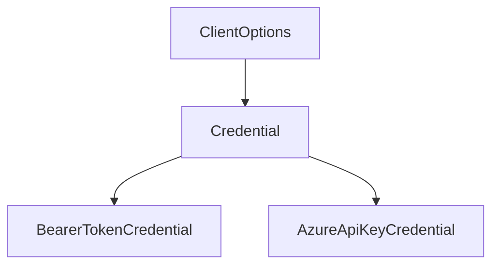

**Sources:** [openai-java-core/src/main/kotlin/com/openai/credential/Credential.kt:1-4](), [openai-java-core/src/main/kotlin/com/openai/core/ClientOptions.kt:136-146]()

### Supported Credential Types & Schemes

| Credential / Key Type | Use Case | Authentication Scheme | Header Applied |
|-----------------------|----------|----------------------|----------------|
| `BearerTokenCredential` | Standard OpenAI API | Bearer Token | `Authorization: Bearer {token}` |
| `AzureApiKeyCredential` | Azure OpenAI Service | API Key | `api-key: {apiKey}` |
| `adminApiKey` | Administrative / Org APIs | Bearer Token (Admin) | `Authorization: Bearer {adminApiKey}` |
| Workload Identity | Automated Cloud Deployments | Token Exchange / JWT | `Authorization: Bearer {exchangedToken}` |

**Sources:** [openai-java-core/src/main/kotlin/com/openai/core/ClientOptions.kt:137-139](), [openai-java-core/src/test/kotlin/com/openai/core/ClientOptionsTest.kt:29-111]()

---

## BearerTokenCredential (OpenAI API)

`BearerTokenCredential` authenticates requests against the standard OpenAI API. It implements the bearer token scheme where the secret key is transmitted via the `Authorization` header.

### Creating a BearerTokenCredential

You can instantiate a `BearerTokenCredential` directly or utilize convenience methods on `ClientOptions`:

```java
// Direct token string
Credential credential = BearerTokenCredential.create("sk-...");

// Via ClientOptions.apiKey() builder method
ClientOptions options = ClientOptions.builder()
    .httpClient(httpClient)
    .apiKey("sk-...")
    .build();

// Using a dynamic token supplier for rotation
Supplier<String> tokenSupplier = () -> retrieveTokenFromVault();
Credential credential = BearerTokenCredential.create(tokenSupplier);
```

**Sources:** [openai-java-core/src/main/kotlin/com/openai/credential/BearerTokenCredential.kt:1-36](), [openai-java-core/src/main/kotlin/com/openai/core/ClientOptions.kt:172-172]()

---

## Admin API Keys

For administrative services (such as organization management, user invites, audit logs, and project configurations), the SDK supports route-specific admin API keys via `adminApiKey` in `ClientOptions`.

### Configuration

You can configure an admin API key alongside or independently of standard API keys:

```java
ClientOptions options = ClientOptions.builder()
    .httpClient(httpClient)
    .apiKey("sk-standard-key")
    .adminApiKey("sk-admin-key")
    .build();
```

When admin-scoped requests are executed, the client applies the admin API key to the `Authorization` header instead of the standard bearer token.

**Sources:** [openai-java-core/src/main/kotlin/com/openai/core/ClientOptions.kt:138](), [openai-java-core/src/test/kotlin/com/openai/core/ClientOptionsTest.kt:76-111]()

---

## AzureApiKeyCredential (Azure OpenAI)

`AzureApiKeyCredential` is designed for authenticating with Azure OpenAI Service deployments. Azure endpoints expect the API key in a custom `api-key` header rather than the standard `Authorization` header.

### Creating and Updating an AzureApiKeyCredential

```java
Credential credential = AzureApiKeyCredential.create("your-azure-api-key");

ClientOptions options = ClientOptions.builder()
    .httpClient(httpClient)
    .credential(credential)
    .baseUrl("https://your-resource.openai.azure.com")
    .build();

// Updating the key at runtime
((AzureApiKeyCredential) credential).update("new-azure-api-key");
```

Upon creation or update, `AzureApiKeyCredential` validates that the key is non-empty, throwing an `IllegalArgumentException` if blank.

**Sources:** [openai-java-core/src/main/kotlin/com/openai/azure/credential/AzureApiKeyCredential.kt:1-26](), [openai-java-core/src/test/kotlin/com/openai/core/http/ClientOptionsTest.kt:66-70]()

---

## Workload Identity and Advanced Authentication

For environments running in Kubernetes, Azure, or GCP where static API keys should be avoided, the SDK supports `WorkloadIdentityCredential` backed by `WorkloadIdentityAuth` and various `SubjectTokenProvider` implementations. 

For full details on token exchange flows, cloud-specific providers (Kubernetes service accounts, Azure managed identities, GCP ID tokens), and X.509 mTLS transport configurations, see [Workload Identity and X.509](#2.3.1).

**Sources:** [openai-java-core/src/main/kotlin/com/openai/auth/WorkloadIdentityAuth.kt:30-70](), [openai-java-core/src/main/kotlin/com/openai/credential/WorkloadIdentityCredential.kt:1-9]()

---

## Configuration Methods and Precedence

The SDK resolves credentials using a strict precedence order across programmatic builders, environment variables, and system properties.

### Precedence Flow & Resolution

```mermaid
graph LR
    SystemProps["SystemProperties"]
    EnvVars["EnvironmentVariables"]
    Programmatic["ClientOptionsBuilder"]
    ClientOptions["ClientOptions"]
    
    SystemProps -->|"openai.apiKey"| Builder["Resolution Logic"]
    EnvVars -->|"OPENAI_API_KEY"| Builder
    Programmatic -->|"apiKey() credential()"| Builder
    Builder --> ClientOptions
```

### Configuration Vectors

1. **Programmatic Builders**: Explicitly invoke `.apiKey(String)`, `.adminApiKey(String)`, or `.credential(Credential)` on `ClientOptions.builder()` or client-specific builders like `OpenAIOkHttpClient.builder()`.
2. **Environment Variables**: Use `fromEnv()` to automatically parse `OPENAI_API_KEY`, `AZURE_OPENAI_KEY`, `OPENAI_ORG_ID`, and `OPENAI_PROJECT_ID`.
3. **System Properties**: Set JVM arguments such as `-Dopenai.apiKey=sk-...` which take precedence over environment variables.

**Sources:** [openai-java-core/src/main/kotlin/com/openai/core/ClientOptions.kt:457-488](), [openai-java-client-okhttp/src/main/kotlin/com/openai/client/okhttp/OpenAIOkHttpClient.kt:43-48]()

---

## Additional Authentication Headers

The SDK also injects organizational and project scoping headers when configured:

* **Organization Header (`OpenAI-Organization`)**: Configured via `.organization("org-...")` or `OPENAI_ORG_ID` / `openai.orgId`.
* **Project Header (`OpenAI-Project`)**: Configured via `.project("proj_...")` or `OPENAI_PROJECT_ID` / `openai.projectId`.

**Sources:** [openai-java-core/src/main/kotlin/com/openai/core/ClientOptions.kt:142-143](), [openai-java-core/src/main/kotlin/com/openai/core/ClientOptions.kt:535-536]()

---

# Page: Workload Identity and X.509

# Workload Identity and X.509

<details>
<summary>Relevant source files</summary>

The following files were used as context for generating this wiki page:

- [docs/x509-live-verification.md](docs/x509-live-verification.md)
- [openai-java-client-okhttp/src/main/kotlin/com/openai/client/okhttp/X509TokenExchange.kt](openai-java-client-okhttp/src/main/kotlin/com/openai/client/okhttp/X509TokenExchange.kt)
- [openai-java-client-okhttp/src/main/kotlin/com/openai/client/okhttp/X509WorkloadIdentity.kt](openai-java-client-okhttp/src/main/kotlin/com/openai/client/okhttp/X509WorkloadIdentity.kt)
- [openai-java-client-okhttp/src/main/kotlin/com/openai/client/okhttp/X509WorkloadIdentityAuthenticator.kt](openai-java-client-okhttp/src/main/kotlin/com/openai/client/okhttp/X509WorkloadIdentityAuthenticator.kt)
- [openai-java-client-okhttp/src/test/kotlin/com/openai/client/okhttp/OkHttpClientTest.kt](openai-java-client-okhttp/src/test/kotlin/com/openai/client/okhttp/OkHttpClientTest.kt)
- [openai-java-client-okhttp/src/test/kotlin/com/openai/client/okhttp/X509LiveVerificationTest.kt](openai-java-client-okhttp/src/test/kotlin/com/openai/client/okhttp/X509LiveVerificationTest.kt)
- [openai-java-client-okhttp/src/test/kotlin/com/openai/client/okhttp/X509TokenExchangeTest.kt](openai-java-client-okhttp/src/test/kotlin/com/openai/client/okhttp/X509TokenExchangeTest.kt)
- [openai-java-client-okhttp/src/test/kotlin/com/openai/client/okhttp/X509TransportTest.kt](openai-java-client-okhttp/src/test/kotlin/com/openai/client/okhttp/X509TransportTest.kt)
- [openai-java-client-okhttp/src/test/kotlin/com/openai/client/okhttp/X509WireTestInfrastructure.kt](openai-java-client-okhttp/src/test/kotlin/com/openai/client/okhttp/X509WireTestInfrastructure.kt)
- [openai-java-client-okhttp/src/test/kotlin/com/openai/client/okhttp/X509WorkloadIdentityIntegrationTest.kt](openai-java-client-okhttp/src/test/kotlin/com/openai/client/okhttp/X509WorkloadIdentityIntegrationTest.kt)
- [openai-java-client-okhttp/src/test/kotlin/com/openai/client/okhttp/X509WorkloadIdentityWireContractTest.kt](openai-java-client-okhttp/src/test/kotlin/com/openai/client/okhttp/X509WorkloadIdentityWireContractTest.kt)
- [openai-java-core/src/main/kotlin/com/openai/auth/AzureManagedIdentityTokenProvider.kt](openai-java-core/src/main/kotlin/com/openai/auth/AzureManagedIdentityTokenProvider.kt)
- [openai-java-core/src/main/kotlin/com/openai/auth/GcpIdTokenProvider.kt](openai-java-core/src/main/kotlin/com/openai/auth/GcpIdTokenProvider.kt)
- [openai-java-core/src/main/kotlin/com/openai/auth/K8sServiceAccountTokenProvider.kt](openai-java-core/src/main/kotlin/com/openai/auth/K8sServiceAccountTokenProvider.kt)
- [openai-java-core/src/main/kotlin/com/openai/auth/SubjectTokenProvider.kt](openai-java-core/src/main/kotlin/com/openai/auth/SubjectTokenProvider.kt)
- [openai-java-core/src/main/kotlin/com/openai/auth/TokenExchangeResponse.kt](openai-java-core/src/main/kotlin/com/openai/auth/TokenExchangeResponse.kt)
- [openai-java-core/src/main/kotlin/com/openai/auth/WorkloadIdentity.kt](openai-java-core/src/main/kotlin/com/openai/auth/WorkloadIdentity.kt)
- [openai-java-core/src/main/kotlin/com/openai/auth/WorkloadIdentityAuth.kt](openai-java-core/src/main/kotlin/com/openai/auth/WorkloadIdentityAuth.kt)
- [openai-java-core/src/test/kotlin/com/openai/auth/WorkloadIdentityAuthTest.kt](openai-java-core/src/test/kotlin/com/openai/auth/WorkloadIdentityAuthTest.kt)
- [openai-java-core/src/test/kotlin/com/openai/core/ClientOptionsTest.kt](openai-java-core/src/test/kotlin/com/openai/core/ClientOptionsTest.kt)
- [openai-java-example/src/main/java/com/openai/example/X509WorkloadIdentityExample.java](openai-java-example/src/main/java/com/openai/example/X509WorkloadIdentityExample.java)

</details>


## Purpose and Scope
This page documents the authentication and transport mechanisms for enterprise workload identities and certificate-based mutual TLS (mTLS) in the OpenAI Java SDK. It details `SubjectTokenProvider` implementations across cloud platforms (Kubernetes, Azure, GCP), OAuth token exchange protocols via `WorkloadIdentityAuth` and `X509TokenExchange`, and isolated mTLS transport management through `X509Transport`, `X509WorkloadIdentity`, and `X509WorkloadIdentityAuthenticator`.

---

## 1. Subject Token Providers and Cloud Workload Identity

The SDK supports obtaining subject tokens from various cloud environments to exchange for OpenAI API access tokens. These are driven by the `SubjectTokenProvider` abstraction and configured using `WorkloadIdentity`.

### Cloud Implementations
- **Kubernetes (`K8sServiceAccountTokenProvider`)**: Reads service account tokens from standard Kubernetes projected volume paths or token request APIs.
- **Azure Managed Identity (`AzureManagedIdentityTokenProvider`)**: Requests access tokens from the Azure Instance Metadata Service (IMDS) or managed identity endpoints.
- **GCP ID Token (`GcpIdTokenProvider`)**: Fetches OIDC identity tokens from the Google Cloud metadata server for workload identity federation.

```mermaid
graph TD
    subgraph "Cloud Providers"
        K8s["K8sServiceAccountTokenProvider"]
        Azure["AzureManagedIdentityTokenProvider"]
        Gcp["GcpIdTokenProvider"]
    end
    
    subgraph "Core Abstraction"
        WorkloadId["WorkloadIdentity"]
        SubjectProvider["SubjectTokenProvider"]
    end

    K8s -->|implements| SubjectProvider
    Azure -->|implements| SubjectProvider
    Gcp -->|implements| SubjectProvider
    SubjectProvider -->|configured by| WorkloadId

    classDef default stroke:#333,stroke-width:2px;
```
*Figure 1: SubjectTokenProvider hierarchy and cloud implementations.*

Sources: 
- `openai-java-core/src/test/kotlin/com/openai/core/ClientOptionsTest.kt:1-191()`
- `openai-java-core/src/main/kotlin/com/openai/auth/WorkloadIdentityAuth.kt:1-172()`

---

## 2. OAuth Token Exchange Flow

Once a subject token is acquired, or when authenticating via an X.509 client certificate, the SDK performs an IETF OAuth 2.0 token exchange (`urn:ietf:params:oauth:grant-type:token-exchange`).

### Token Exchange Classes
- `WorkloadIdentityAuth` (`[openai-java-core/src/main/kotlin/com/openai/auth/WorkloadIdentityAuth.kt:30-172]()`): Manages thread-safe token acquisition, expiration tracking, background/foreground refresh loops, and error mapping for cloud-based workload identities.
- `X509TokenExchange` (`[openai-java-client-okhttp/src/main/kotlin/com/openai/client/okhttp/X509TokenExchange.kt:1-100]()`): Handles certificate-backed exchanges against `https://auth.openai.com/oauth/token`.

```mermaid
sequenceDiagram
    participant App as "OpenAIClient"
    participant Auth as "WorkloadIdentityAuth"
    participant Provider as "SubjectTokenProvider"
    participant TokenEndpoint as "Token Exchange Endpoint"

    App->>Auth: getToken() / getTokenAsync()
    Auth->>Auth: Check cachedToken & expiry
    alt Token Expiring or Missing
        Auth->>Provider: getToken()
        Provider-->>Auth: subjectToken (JWT/ID token)
        Auth->>TokenEndpoint: POST /oauth/token (grant_type=token-exchange)
        TokenEndpoint-->>Auth: accessToken & expires_in
        Auth->>Auth: Cache token with refreshBuffer
    end
    Auth-->>App: Bearer accessToken
```
*Figure 2: Token exchange data flow and caching lifecycle.*

Sources: 
- `openai-java-core/src/main/kotlin/com/openai/auth/WorkloadIdentityAuth.kt:1-172()`
- `openai-java-client-okhttp/src/test/kotlin/com/openai/client/okhttp/X509TransportTest.kt:1-137()`

---

## 3. X.509 mTLS Transport and Client Binding

For high-security environments, mutual TLS (mTLS) with fixed X.509 client certificates can be used instead of standard API keys or bearer tokens.

### Key Components
- `X509Transport` (`[openai-java-client-okhttp/src/main/kotlin/com/openai/client/okhttp/X509Transport.kt:1-100]()`): Configures isolated `OkHttpClient` instances with custom `X509ExtendedKeyManager`, certificate aliases, and trust managers. Ensures direct, non-retrying, isolated connections without redirection.
- `X509WorkloadIdentity` (`[openai-java-client-okhttp/src/main/kotlin/com/openai/client/okhttp/X509WorkloadIdentity.kt:9-84]()`): Bundles `identityProviderId`, `serviceAccountId`, and `X509Transport` configuration.
- `X509WorkloadIdentityAuthenticator` (`[openai-java-client-okhttp/src/main/kotlin/com/openai/client/okhttp/X509WorkloadIdentityAuthenticator.kt:23-178]()`): Implements `HttpRequestAuthenticator` to inject the exchanged bearer token specifically into authorized mTLS origins (`mtls.api.openai.com` or `mtls-eu.api.openai.com`), handles automatic token refresh within the configured `refreshBuffer`, and rejects unauthorized hosts.

```mermaid
graph TD
    Client["OpenAIClient"] -->|delegates to| Authenticator["X509WorkloadIdentityAuthenticator"]
    Authenticator -->|exchanges token via| ExchangeClient["OkHttpClient (Token Exchange)"]
    Authenticator -->|injects bearer header| ApiClient["OkHttpClient (mTLS API)"]
    
    subgraph "X509Transport"
        ExchangeClient -->|presents client cert| AuthServer["https://auth.openai.com"]
        ApiClient -->|presents client cert| ApiServer["https://mtls.api.openai.com"]
    end

    classDef default stroke:#333,stroke-width:2px;
```
*Figure 3: X.509 transport isolation and request authentication binding.*

Sources: 
- `openai-java-client-okhttp/src/main/kotlin/com/openai/client/okhttp/X509WorkloadIdentity.kt:9-84()`
- `openai-java-client-okhttp/src/main/kotlin/com/openai/client/okhttp/X509WorkloadIdentityAuthenticator.kt:23-178()`
- `openai-java-client-okhttp/src/test/kotlin/com/openai/client/okhttp/X509TransportTest.kt:1-52()`

---

# Page: Client Interfaces

# Client Interfaces

<details>
<summary>Relevant source files</summary>

The following files were used as context for generating this wiki page:

- [openai-java-core/src/main/kotlin/com/openai/client/OpenAIClient.kt](openai-java-core/src/main/kotlin/com/openai/client/OpenAIClient.kt)
- [openai-java-core/src/main/kotlin/com/openai/client/OpenAIClientAsync.kt](openai-java-core/src/main/kotlin/com/openai/client/OpenAIClientAsync.kt)
- [openai-java-core/src/main/kotlin/com/openai/client/OpenAIClientAsyncImpl.kt](openai-java-core/src/main/kotlin/com/openai/client/OpenAIClientAsyncImpl.kt)
- [openai-java-core/src/main/kotlin/com/openai/client/OpenAIClientImpl.kt](openai-java-core/src/main/kotlin/com/openai/client/OpenAIClientImpl.kt)
- [openai-java-core/src/main/kotlin/com/openai/services/async/ModerationServiceAsync.kt](openai-java-core/src/main/kotlin/com/openai/services/async/ModerationServiceAsync.kt)
- [openai-java-core/src/main/kotlin/com/openai/services/blocking/ModerationService.kt](openai-java-core/src/main/kotlin/com/openai/services/blocking/ModerationService.kt)

</details>


This document covers the main client interfaces provided by the OpenAI Java SDK and their usage patterns. It explains the relationship between synchronous and asynchronous execution modes, raw response access, and service organization.

For detailed information about configuring clients, see [Configuration](#2.2). For authentication setup, see [Authentication](#2.3). For specific usage examples of synchronous and asynchronous APIs, see [Synchronous API](#3.1) and [Asynchronous API](#3.2).

## Overview

The OpenAI Java SDK provides two primary client interfaces: `OpenAIClient` for synchronous operations and `OpenAIClientAsync` for asynchronous operations. Both clients share the same underlying resources and provide access to identical OpenAI API services, differing only in their execution model.

## Client Interface Architecture

The following diagram shows the relationship between the main client interfaces and their implementations:

```mermaid
graph TB
    subgraph "Interface Layer"
        A["OpenAIClient"]
        B["OpenAIClientAsync"]
    end
    
    subgraph "Implementation Layer"
        C["OpenAIClientImpl"]
        D["OpenAIClientAsyncImpl"]
    end
    
    subgraph "Raw Response Views"
        E["OpenAIClient.WithRawResponse"]
        F["OpenAIClientAsync.WithRawResponse"]
    end
    
    A --> C
    B --> D
    C --> E
    D --> F
    C -.-> D
    D -.-> C
    
    C --> G["ClientOptions"]
    D --> G
```

**Sources:** [openai-java-core/src/main/kotlin/com/openai/client/OpenAIClient.kt](), [openai-java-core/src/main/kotlin/com/openai/client/OpenAIClientAsync.kt](), [openai-java-core/src/main/kotlin/com/openai/client/OpenAIClientImpl.kt](), [openai-java-core/src/main/kotlin/com/openai/client/OpenAIClientAsyncImpl.kt]()

## Client Interface Methods

Both client interfaces expose identical service methods, differing only in their return types. The synchronous client returns results directly, while the asynchronous client returns `CompletableFuture` objects.

```mermaid
graph LR
    subgraph "OpenAIClient Interface"
        A1["chat(): ChatService"]
        A2["completions(): CompletionService"]
        A3["responses(): ResponseService"]
        A4["files(): FileService"]
        A5["images(): ImageService"]
        A6["audio(): AudioService"]
        A7["embeddings(): EmbeddingService"]
        A8["models(): ModelService"]
        A9["fineTuning(): FineTuningService"]
        A10["moderations(): ModerationService"]
        A11["batches(): BatchService"]
        A12["vectorStores(): VectorStoreService"]
    end
    
    subgraph "OpenAIClientAsync Interface"
        B1["chat(): ChatServiceAsync"]
        B2["completions(): CompletionServiceAsync"]
        B3["responses(): ResponseServiceAsync"]
        B4["files(): FileServiceAsync"]
        B5["images(): ImageServiceAsync"]
        B6["audio(): AudioServiceAsync"]
        B7["embeddings(): EmbeddingServiceAsync"]
        B8["models(): ModelServiceAsync"]
        B9["fineTuning(): FineTuningServiceAsync"]
        B10["moderations(): ModerationServiceAsync"]
        B11["batches(): BatchServiceAsync"]
        B12["vectorStores(): VectorStoreServiceAsync"]
    end
```

**Sources:** [openai-java-core/src/main/kotlin/com/openai/client/OpenAIClient.kt:74-134](), [openai-java-core/src/main/kotlin/com/openai/client/OpenAIClientAsync.kt:74-134]()

## Core Client Interface Features

| Feature | `OpenAIClient` | `OpenAIClientAsync` |
|---------|----------------|-------------------|
| Execution Mode | Synchronous/Blocking | Asynchronous/Non-blocking |
| Return Types | Direct objects | `CompletableFuture<T>` |
| Resource Sharing | Shares with async() | Shares with sync() |
| Raw Response Access | `withRawResponse()` | `withRawResponse()` |
| Option Modification | `withOptions()` | `withOptions()` |
| Resource Management | `close()` | `close()` |

**Sources:** [openai-java-core/src/main/kotlin/com/openai/client/OpenAIClient.kt:34-47](), [openai-java-core/src/main/kotlin/com/openai/client/OpenAIClientAsync.kt:34-47]()

## Client Implementation Details

The client implementations use lazy initialization for services and maintain User-Agent headers automatically:

```mermaid
graph TB
    subgraph "OpenAIClientImpl Initialization"
        A["clientOptions: ClientOptions"]
        B["clientOptionsWithUserAgent"]
        C["User-Agent Header Generation"]
        D["Service Lazy Initialization"]
    end
    
    subgraph "Service Creation Pattern"
        E["ChatServiceImpl(clientOptionsWithUserAgent)"]
        F["ResponseServiceImpl(clientOptionsWithUserAgent)"]
        G["FileServiceImpl(clientOptionsWithUserAgent)"]
    end
    
    A --> B
    B --> C
    C --> D
    D --> E
    D --> F
    D --> G
```

The implementations automatically add User-Agent headers in the format `${javaClass.simpleName}/Java ${getPackageVersion()}` if not already present [openai-java-core/src/main/kotlin/com/openai/client/OpenAIClientImpl.kt:61-69](), [openai-java-core/src/main/kotlin/com/openai/client/OpenAIClientAsyncImpl.kt:61-69]().

**Sources:** [openai-java-core/src/main/kotlin/com/openai/client/OpenAIClientImpl.kt:61-148](), [openai-java-core/src/main/kotlin/com/openai/client/OpenAIClientAsyncImpl.kt:61-166]()

## Cross-Client Conversion

Both client types provide methods to convert between synchronous and asynchronous execution modes while sharing the same underlying resources:

| Client Type | Conversion Method | Shared Resources |
|-------------|------------------|------------------|
| `OpenAIClient` | `async()` | Connection pools, thread pools |
| `OpenAIClientAsync` | `sync()` | Connection pools, thread pools |

The conversion preserves the original `ClientOptions` configuration and ensures resource efficiency.

**Sources:** [openai-java-core/src/main/kotlin/com/openai/client/OpenAIClient.kt:50-57](), [openai-java-core/src/main/kotlin/com/openai/client/OpenAIClientAsync.kt:50-57](), [openai-java-core/src/main/kotlin/com/openai/client/OpenAIClientImpl.kt:61-73](), [openai-java-core/src/main/kotlin/com/openai/client/OpenAIClientAsyncImpl.kt:61-73]()

## WithRawResponse Interface Pattern

Both client types provide `WithRawResponse` views that expose the same service methods but return raw HTTP responses wrapped in `HttpResponseFor<T>` objects:

```mermaid
graph TB
    subgraph "Standard Interface"
        A["client.chat().create()"]
        B["Returns: ChatCompletion"]
    end
    
    subgraph "WithRawResponse Interface"  
        C["client.withRawResponse().chat().create()"]
        D["Returns: HttpResponseFor<ChatCompletion>"]
    end
    
    subgraph "Raw Response Contents"
        E["HTTP Status Code"]
        F["Response Headers"]
        G["Response Body"]
    end
    
    A --> B
    C --> D
    D --> E
    D --> F
    D --> G
```

For detailed usage, see [Raw Response Access](#3.3).

**Sources:** [openai-java-core/src/main/kotlin/com/openai/client/OpenAIClient.kt:58-62](), [openai-java-core/src/main/kotlin/com/openai/client/OpenAIClientAsync.kt:58-62](), [openai-java-core/src/main/kotlin/com/openai/client/OpenAIClientImpl.kt:74-76](), [openai-java-core/src/main/kotlin/com/openai/client/OpenAIClientAsyncImpl.kt:74-76]()

## Resource Management

Both client interfaces implement resource management through the `close()` method. The method is intentionally not inherited from `AutoCloseable` because clients are designed to be long-lived:

- Automatic resource cleanup occurs when threads and connections remain idle [openai-java-core/src/main/kotlin/com/openai/client/OpenAIClient.kt:44-52]()
- Manual cleanup is available via `close()` for applications requiring aggressive resource management [openai-java-core/src/main/kotlin/com/openai/client/OpenAIClient.kt:143-153]()
- Shared resources between sync/async clients are managed collectively [openai-java-core/src/main/kotlin/com/openai/client/OpenAIClient.kt:50-57]()

**Sources:** [openai-java-core/src/main/kotlin/com/openai/client/OpenAIClient.kt:143-154](), [openai-java-core/src/main/kotlin/com/openai/client/OpenAIClientAsync.kt:143-154](), [openai-java-core/src/main/kotlin/com/openai/client/OpenAIClientImpl.kt:61-73](), [openai-java-core/src/main/kotlin/com/openai/client/OpenAIClientAsyncImpl.kt:61-73]()

---

## Child Pages
- [Synchronous API](#3.1)
- [Asynchronous API](#3.2)
- [Raw Response Access](#3.3)
- [Pagination](#3.4)

---

# Page: Synchronous API

# Synchronous API

<details>
<summary>Relevant source files</summary>

The following files were used as context for generating this wiki page:

- [openai-java-core/src/main/kotlin/com/openai/client/OpenAIClient.kt](openai-java-core/src/main/kotlin/com/openai/client/OpenAIClient.kt)
- [openai-java-core/src/main/kotlin/com/openai/client/OpenAIClientAsync.kt](openai-java-core/src/main/kotlin/com/openai/client/OpenAIClientAsync.kt)
- [openai-java-core/src/main/kotlin/com/openai/client/OpenAIClientAsyncImpl.kt](openai-java-core/src/main/kotlin/com/openai/client/OpenAIClientAsyncImpl.kt)
- [openai-java-core/src/main/kotlin/com/openai/client/OpenAIClientImpl.kt](openai-java-core/src/main/kotlin/com/openai/client/OpenAIClientImpl.kt)
- [openai-java-core/src/main/kotlin/com/openai/services/async/CompletionServiceAsyncImpl.kt](openai-java-core/src/main/kotlin/com/openai/services/async/CompletionServiceAsyncImpl.kt)
- [openai-java-core/src/main/kotlin/com/openai/services/async/EmbeddingServiceAsyncImpl.kt](openai-java-core/src/main/kotlin/com/openai/services/async/EmbeddingServiceAsyncImpl.kt)
- [openai-java-core/src/main/kotlin/com/openai/services/async/ImageServiceAsyncImpl.kt](openai-java-core/src/main/kotlin/com/openai/services/async/ImageServiceAsyncImpl.kt)
- [openai-java-core/src/main/kotlin/com/openai/services/async/ModerationServiceAsync.kt](openai-java-core/src/main/kotlin/com/openai/services/async/ModerationServiceAsync.kt)
- [openai-java-core/src/main/kotlin/com/openai/services/async/ModerationServiceAsyncImpl.kt](openai-java-core/src/main/kotlin/com/openai/services/async/ModerationServiceAsyncImpl.kt)
- [openai-java-core/src/main/kotlin/com/openai/services/blocking/CompletionServiceImpl.kt](openai-java-core/src/main/kotlin/com/openai/services/blocking/CompletionServiceImpl.kt)
- [openai-java-core/src/main/kotlin/com/openai/services/blocking/EmbeddingServiceImpl.kt](openai-java-core/src/main/kotlin/com/openai/services/blocking/EmbeddingServiceImpl.kt)
- [openai-java-core/src/main/kotlin/com/openai/services/blocking/ImageServiceImpl.kt](openai-java-core/src/main/kotlin/com/openai/services/blocking/ImageServiceImpl.kt)
- [openai-java-core/src/main/kotlin/com/openai/services/blocking/ModerationService.kt](openai-java-core/src/main/kotlin/com/openai/services/blocking/ModerationService.kt)
- [openai-java-core/src/main/kotlin/com/openai/services/blocking/ModerationServiceImpl.kt](openai-java-core/src/main/kotlin/com/openai/services/blocking/ModerationServiceImpl.kt)

</details>


## Purpose and Scope

This page documents the `OpenAIClient` interface and its synchronous execution model within the OpenAI Java SDK. It details blocking operations, service accessors, client implementation details via `OpenAIClientImpl`, and guidelines for when to choose synchronous execution over asynchronous alternatives.

---

## The OpenAIClient Interface

The `OpenAIClient` interface is the primary entry point for synchronous API interactions. It provides blocking, thread-safe access to all OpenAI REST API endpoints and manages underlying HTTP connection pools and thread pools.

```mermaid
graph TB
    subgraph "Client Creation"
        Factory["OpenAIOkHttpClient.fromEnv()"]
        Builder["OpenAIOkHttpClient.builder()"]
    end
    
    subgraph "OpenAIClient Interface"
        Client["OpenAIClient<br/>(openai-java-core/src/main/kotlin/com/openai/client/OpenAIClient.kt)"]
        AsyncView["async(): OpenAIClientAsync"]
        RawView["withRawResponse(): WithRawResponse"]
        Options["withOptions(): OpenAIClient"]
    end
    
    subgraph "Service Access Methods"
        Chat["chat(): ChatService"]
        Responses["responses(): ResponseService"]
        Completions["completions(): CompletionService"]
        Files["files(): FileService"]
        Images["images(): ImageService"]
        Audio["audio(): AudioService"]
        Models["models(): ModelService"]
        Embeddings["embeddings(): EmbeddingService"]
        FineTuning["fineTuning(): FineTuningService"]
        Batches["batches(): BatchService"]
        Beta["beta(): BetaService"]
        Evals["evals(): EvalService"]
    end
    
    subgraph "Resource Management"
        Close["close(): Unit"]
    end
    
    Factory --> Client
    Builder --> Client
    
    Client --> AsyncView
    Client --> RawView
    Client --> Options
    
    Client --> Chat
    Client --> Responses
    Client --> Completions
    Client --> Files
    Client --> Images
    Client --> Audio
    Client --> Models
    Client --> Embeddings
    Client --> FineTuning
    Client --> Batches
    Client --> Beta
    Client --> Evals
    
    Client --> Close
```

Sources: [openai-java-core/src/main/kotlin/com/openai/client/OpenAIClient.kt:1-154]()

The interface defines three key categories of methods:

| Category | Methods | Purpose |
|----------|---------|---------|
| **Mode Switching** | `async()`, `withRawResponse()`, `withOptions()` | Switch execution modes or apply configuration |
| **Service Access** | `chat()`, `responses()`, `completions()`, etc. | Access specific API endpoints |
| **Resource Management** | `close()` | Release HTTP connections and threads |

Sources: [openai-java-core/src/main/kotlin/com/openai/client/OpenAIClient.kt:48-153]()

---

## Client Implementation Architecture

The `OpenAIClient` interface is implemented by `OpenAIClientImpl`, which coordinates all service implementations and manages shared configuration via `ClientOptions`.

```mermaid
graph TB
    subgraph "Client Layer"
        Interface["OpenAIClient"]
        Impl["OpenAIClientImpl<br/>(openai-java-core/src/main/kotlin/com/openai/client/OpenAIClientImpl.kt)"]
        Options["ClientOptions<br/>(configuration)"]
    end
    
    subgraph "Service Implementations"
        ChatImpl["ChatServiceImpl"]
        ResponseImpl["ResponseServiceImpl"]
        CompletionImpl["CompletionServiceImpl<br/>(openai-java-core/src/main/kotlin/com/openai/services/blocking/CompletionServiceImpl.kt)"]
        EmbeddingImpl["EmbeddingServiceImpl<br/>(openai-java-core/src/main/kotlin/com/openai/services/blocking/EmbeddingServiceImpl.kt)"]
    end
    
    subgraph "HTTP Layer"
        HttpClient["HttpClient"]
        OkHttp["OkHttpClient"]
    end
    
    subgraph "Lazy Initialization"
        LazyChat["private val chat: ChatService by lazy"]
        LazyResponses["private val responses: ResponseService by lazy"]
        LazyCompletions["private val completions: CompletionService by lazy"]
    end
    
    Interface -.implements.-> Impl
    Impl --> Options
    
    Impl --> LazyChat
    Impl --> LazyResponses
    Impl --> LazyCompletions
    
    LazyChat --> ChatImpl
    LazyResponses --> ResponseImpl
    LazyCompletions --> CompletionImpl
    
    ChatImpl --> Options
    ResponseImpl --> Options
    CompletionImpl --> Options
    EmbeddingImpl --> Options
    
    Options --> HttpClient
    HttpClient -.implements.-> OkHttp
```

Sources: [openai-java-core/src/main/kotlin/com/openai/client/OpenAIClientImpl.kt:1-156](), [openai-java-core/src/main/kotlin/com/openai/services/blocking/CompletionServiceImpl.kt:32-57]()

### Key Implementation Details

**Lazy Service Initialization:** All services are initialized lazily on first access to reduce startup overhead:

```kotlin
private val chat: ChatService by lazy { ChatServiceImpl(clientOptionsWithUserAgent) }
private val responses: ResponseService by lazy { ResponseServiceImpl(clientOptionsWithUserAgent) }
```

Sources: [openai-java-core/src/main/kotlin/com/openai/client/OpenAIClientImpl.kt:82-127]()

**User-Agent Header:** The implementation automatically injects a `User-Agent` header if one is not already present:

```kotlin
private val clientOptionsWithUserAgent =
    if (clientOptions.headers.names().contains("User-Agent")) clientOptions
    else
        clientOptions
            .toBuilder()
            .putHeader("User-Agent", "${javaClass.simpleName}/Java ${getPackageVersion()}")
            .build()
```

Sources: [openai-java-core/src/main/kotlin/com/openai/client/OpenAIClientImpl.kt:63-69]()

---

## Blocking Execution Model

The synchronous API blocks the calling thread until the HTTP request completes and the response is fully received, parsed, and validated.

```mermaid
sequenceDiagram
    participant App as "ApplicationThread"
    participant Client as "OpenAIClientImpl"
    participant Service as "CompletionServiceImpl"
    participant Http as "OkHttpClient"
    participant API as "OpenAI API (/completions)"
    
    App->>Client: client.completions().create(params)
    activate App
    Client->>Service: completions().create(params)
    Service->>Http: execute(request, requestOptions)
    Http->>API: HTTP POST /completions
    Note over App,API: Thread blocks synchronously here
    API-->>Http: HTTP 200 OK + JSON body
    Http-->>Service: HttpResponse
    Service-->>Client: Completion object
    Client-->>App: Completion object
    deactivate App
```

Sources: [openai-java-core/src/main/kotlin/com/openai/services/blocking/CompletionServiceImpl.kt:44-50]()

---

## Service Access

The `OpenAIClient` provides type-safe accessors for all API services.

### Available Services

| Method | Return Type | API Category |
|--------|-------------|--------------|
| `chat()` | `ChatService` | Chat completions |
| `responses()` | `ResponseService` | Responses API (recommended) |
| `completions()` | `CompletionService` | Legacy text completions |
| `embeddings()` | `EmbeddingService` | Text embeddings |
| `files()` | `FileService` | File upload and management |
| `images()` | `ImageService` | Image generation |
| `audio()` | `AudioService` | Speech and transcription |
| `models()` | `ModelService` | Model listing and management |
| `fineTuning()` | `FineTuningService` | Fine-tuning jobs |
| `beta()` | `BetaService` | Beta features |
| `batches()` | `BatchService` | Batch processing |
| `evals()` | `EvalService` | Model evaluations |
| `moderations()` | `ModerationService` | Content moderation |
| `vectorStores()` | `VectorStoreService` | Vector storage |

Sources: [openai-java-core/src/main/kotlin/com/openai/client/OpenAIClient.kt:74-135]()

---

## When to Use Synchronous Execution

### ✓ Use Synchronous When:
- Writing simple scripts, command-line tools, or blocking server apps (e.g., traditional servlet containers).
- Request-response flow is strictly sequential and thread blocking is acceptable.
- Prototyping or learning the SDK.

### ✗ Prefer Asynchronous When:
- High-throughput concurrency is required.
- Integrating with non-blocking architectures (reactive frameworks, Kotlin coroutines).
- Performing fan-out API calls where multiple requests must execute in parallel.

Sources: [openai-java-core/src/main/kotlin/com/openai/client/OpenAIClient.kt:34-47]()

---

## Switching Execution Modes and Options

### Asynchronous Switch
You can obtain an asynchronous equivalent of the client via `async()`:

```kotlin
val asyncClient: OpenAIClientAsync = client.async()
```

Sources: [openai-java-core/src/main/kotlin/com/openai/client/OpenAIClient.kt:56](), [openai-java-core/src/main/kotlin/com/openai/client/OpenAIClientImpl.kt:150]()

### Configuration Override via `withOptions()`
To create a derived client view with modified options without altering the parent instance:

```kotlin
val customClient = client.withOptions { builder ->
    builder.baseUrl("https://custom.endpoint.com/v1")
}
```

Sources: [openai-java-core/src/main/kotlin/com/openai/client/OpenAIClient.kt:68](), [openai-java-core/src/main/kotlin/com/openai/client/OpenAIClientImpl.kt:154-155]()

---

## Resource Management

The client manages shared connection pools and thread pools. While resources are released automatically when idle, explicit closure is available via `close()`:

```kotlin
client.close()
```

Sources: [openai-java-core/src/main/kotlin/com/openai/client/OpenAIClient.kt:143-153]()

---

# Page: Asynchronous API

# Asynchronous API

<details>
<summary>Relevant source files</summary>

The following files were used as context for generating this wiki page:

- [openai-java-core/src/main/kotlin/com/openai/client/OpenAIClient.kt](openai-java-core/src/main/kotlin/com/openai/client/OpenAIClient.kt)
- [openai-java-core/src/main/kotlin/com/openai/client/OpenAIClientAsync.kt](openai-java-core/src/main/kotlin/com/openai/client/OpenAIClientAsync.kt)
- [openai-java-core/src/main/kotlin/com/openai/client/OpenAIClientAsyncImpl.kt](openai-java-core/src/main/kotlin/com/openai/client/OpenAIClientAsyncImpl.kt)
- [openai-java-core/src/main/kotlin/com/openai/client/OpenAIClientImpl.kt](openai-java-core/src/main/kotlin/com/openai/client/OpenAIClientImpl.kt)
- [openai-java-core/src/main/kotlin/com/openai/core/PhantomReachable.kt](openai-java-core/src/main/kotlin/com/openai/core/PhantomReachable.kt)
- [openai-java-core/src/main/kotlin/com/openai/core/http/AsyncStreamResponse.kt](openai-java-core/src/main/kotlin/com/openai/core/http/AsyncStreamResponse.kt)
- [openai-java-core/src/main/kotlin/com/openai/core/http/PhantomReachableClosingAsyncStreamResponse.kt](openai-java-core/src/main/kotlin/com/openai/core/http/PhantomReachableClosingAsyncStreamResponse.kt)
- [openai-java-core/src/main/kotlin/com/openai/services/async/CompletionServiceAsync.kt](openai-java-core/src/main/kotlin/com/openai/services/async/CompletionServiceAsync.kt)
- [openai-java-core/src/main/kotlin/com/openai/services/async/ModerationServiceAsync.kt](openai-java-core/src/main/kotlin/com/openai/services/async/ModerationServiceAsync.kt)
- [openai-java-core/src/main/kotlin/com/openai/services/blocking/ModerationService.kt](openai-java-core/src/main/kotlin/com/openai/services/blocking/ModerationService.kt)
- [openai-java-core/src/test/kotlin/com/openai/core/http/AsyncStreamResponseTest.kt](openai-java-core/src/test/kotlin/com/openai/core/http/AsyncStreamResponseTest.kt)

</details>


The OpenAI Java SDK provides comprehensive asynchronous support through `OpenAIClientAsync` and related service interfaces, enabling non-blocking operations that return `CompletableFuture` objects. This allows for efficient concurrent processing and integration with reactive programming patterns.

For synchronous blocking operations, see [Synchronous API](#3.1). For accessing raw HTTP responses, see [Raw Response Access](#3.3).

## Getting an Async Client

You can obtain an async client in two ways: by converting from a synchronous client or by creating one directly.

### Converting from Sync Client

The most common approach is to call `async()` on an existing synchronous client:

```java
OpenAIClient syncClient = OpenAIOkHttpClient.fromEnv();
OpenAIClientAsync asyncClient = syncClient.async();
```
Sources: [openai-java-core/src/main/kotlin/com/openai/client/OpenAIClient.kt:56]()

### Creating Directly

Alternatively, create an async client directly using `OpenAIOkHttpClientAsync`:

```java
OpenAIClientAsync asyncClient = OpenAIOkHttpClientAsync.fromEnv();
```

Both clients share the same underlying resources (connection pools, thread pools), making conversion efficient.

**Client Relationship Architecture**

```mermaid
graph TB
    subgraph "Client Creation"
        A["OpenAIOkHttpClient.fromEnv()"] --> B["OpenAIClientImpl"]
        C["OpenAIOkHttpClientAsync.fromEnv()"] --> D["OpenAIClientAsyncImpl"]
    end
    
    subgraph "Client Conversion"
        B --> |".async()"| D
        D --> |".sync()"| B
    end
    
    subgraph "Shared Resources"
        E["ClientOptions"]
        F["HTTP Client"]
        G["Thread Pools"]
    end
    
    B --> E
    D --> E
    E --> F
    E --> G
    
    subgraph "Service Layer"
        H["ChatService"]
        I["ChatServiceAsync"]
        J["ModerationService"] 
        K["ModerationServiceAsync"]
    end
    
    B --> H
    B --> J
    D --> I
    D --> K
```

Sources: [openai-java-core/src/main/kotlin/com/openai/client/OpenAIClient.kt:56](), [openai-java-core/src/main/kotlin/com/openai/client/OpenAIClientAsync.kt:56](), [openai-java-core/src/main/kotlin/com/openai/client/OpenAIClientImpl.kt:72](), [openai-java-core/src/main/kotlin/com/openai/client/OpenAIClientAsyncImpl.kt:72]()

## Making Async Requests

All async service methods return `CompletableFuture` objects instead of blocking for results. The method signatures are identical to their synchronous counterparts, except for the return type.

### Basic Async Request Pattern

```java
CompletableFuture<ModerationCreateResponse> future = 
    asyncClient.moderations().create(params);

// Handle result asynchronously
future.thenAccept(response -> {
    System.out.println("Moderation result: " + response);
});
```
Sources: [openai-java-core/src/main/kotlin/com/openai/services/async/ModerationServiceAsync.kt:32-39]()

### Service Method Mapping

Each synchronous service has a corresponding async service with identical method names:

| Synchronous Service | Async Service | Return Type Change |
|-------------------|---------------|-------------------|
| `ChatService` | `ChatServiceAsync` | `ChatCompletion` → `CompletableFuture<ChatCompletion>` |
| `ModerationService` | `ModerationServiceAsync` | `ModerationCreateResponse` → `CompletableFuture<ModerationCreateResponse>` |
| `FileService` | `FileServiceAsync` | `FileObject` → `CompletableFuture<FileObject>` |

**Async Request Flow**

```mermaid
graph LR
    subgraph "Client Layer"
        A["OpenAIClientAsync"]
    end
    
    subgraph "Service Layer"
        B["ChatServiceAsync"]
        C["ModerationServiceAsync"]
        D["FileServiceAsync"]
    end
    
    subgraph "Implementation Layer"
        E["ChatServiceAsyncImpl"]
        F["ModerationServiceAsyncImpl"] 
        G["FileServiceAsyncImpl"]
    end
    
    subgraph "HTTP Layer"
        H["CompletableFuture<HttpResponse>"]
    end
    
    subgraph "Response Processing"
        I["CompletableFuture<ResponseType>"]
    end
    
    A --> B
    A --> C
    A --> D
    
    B --> E
    C --> F
    D --> G
    
    E --> H
    F --> H
    G --> H
    
    H --> I
```

Sources: [openai-java-core/src/main/kotlin/com/openai/client/OpenAIClientAsync.kt:74-140](), [openai-java-core/src/main/kotlin/com/openai/client/OpenAIClientAsyncImpl.kt:78-166](), [openai-java-core/src/main/kotlin/com/openai/services/async/ModerationServiceAsync.kt:32-39]()

## CompletableFuture Usage Patterns

The SDK returns standard `CompletableFuture` objects, enabling various composition and error handling patterns.

### Chaining Operations

```java
CompletableFuture<String> result = asyncClient
    .chat().completions().create(params)
    .thenApply(completion -> completion.choices().get(0).message().content())
    .thenApply(content -> "Processed: " + content);
```

### Combining Multiple Requests

```java
CompletableFuture<ChatCompletion> chat1 = asyncClient.chat().completions().create(params1);
CompletableFuture<ChatCompletion> chat2 = asyncClient.chat().completions().create(params2);

CompletableFuture<Void> combined = CompletableFuture.allOf(chat1, chat2);
combined.thenRun(() -> {
    // Both requests completed
});
```

### Error Handling

```java
asyncClient.chat().completions().create(params)
    .thenAccept(result -> processSuccess(result))
    .exceptionally(throwable -> {
        handleError(throwable);
        return null;
    });
```

## Async Streaming

Async streaming uses a different pattern from synchronous streaming, employing `AsyncStreamResponse` with subscription-based processing.

### Basic Streaming

```java
asyncClient.chat().completions().createStreaming(params).subscribe(chunk -> {
    System.out.println(chunk);
});
```
Sources: [openai-java-core/src/main/kotlin/com/openai/services/async/CompletionServiceAsync.kt:53-54]()

### Advanced Streaming with Handlers

```java
asyncClient.chat().completions().createStreaming(params).subscribe(
    new AsyncStreamResponse.Handler<>() {
        @Override
        public void onNext(ChatCompletionChunk chunk) {
            System.out.println(chunk);
        }

        @Override
        public void onComplete(Optional<Throwable> error) {
            if (error.isPresent()) {
                System.out.println("Stream error: " + error.get());
            } else {
                System.out.println("Stream completed");
            }
        }
    }
);
```
Sources: [openai-java-core/src/main/kotlin/com/openai/core/http/AsyncStreamResponse.kt:49-62]()

### Future-Based Streaming Completion

```java
asyncClient.chat().completions().createStreaming(params)
    .subscribe(chunk -> System.out.println(chunk))
    .onCompleteFuture()
    .whenComplete((unused, error) -> {
        if (error != null) {
            System.out.println("Stream failed");
        } else {
            System.out.println("Stream completed");
        }
    });
```
Sources: [openai-java-core/src/main/kotlin/com/openai/core/http/AsyncStreamResponse.kt:38]()

**Async Streaming Architecture**

```mermaid
graph TD
    subgraph "Stream Creation"
        A["createStreaming(params)"] --> B["AsyncStreamResponse<T>"]
    end
    
    subgraph "Subscription Patterns"
        B --> C["subscribe(chunk -> {...})"]
        B --> D["subscribe(Handler)"]
    end
    
    subgraph "Handler Interface"
        E["AsyncStreamResponse.Handler"]
        F["onNext(chunk)"]
        G["onComplete(Optional<Throwable>)"]
    end
    
    subgraph "Completion Handling"
        H["onCompleteFuture()"]
        I["CompletableFuture<Void>"]
    end
    
    D --> E
    E --> F
    E --> G
    C --> H
    H --> I
```

Sources: [openai-java-core/src/main/kotlin/com/openai/core/http/AsyncStreamResponse.kt:14-47](), [openai-java-core/src/main/kotlin/com/openai/services/async/CompletionServiceAsync.kt:53-60]()

## Thread Pool Management

Async streaming operations use a dedicated cached thread pool per client to handle stream processing without blocking the calling thread.

### Default Thread Pool

The SDK automatically provides a suitable thread pool for most use cases:

```java
// Uses default cached thread pool
asyncClient.chat().completions().createStreaming(params)
    .subscribe(chunk -> processChunk(chunk));
```
Sources: [openai-java-core/src/main/kotlin/com/openai/core/http/AsyncStreamResponse.kt:83-84]()

### Custom Thread Pool per Subscription

You can specify a custom executor for individual streaming operations:

```java
Executor customExecutor = Executors.newFixedThreadPool(4);

asyncClient.chat().completions().createStreaming(params)
    .subscribe(chunk -> processChunk(chunk), customExecutor);
```
Sources: [openai-java-core/src/main/kotlin/com/openai/core/http/AsyncStreamResponse.kt:86-89]()

### Global Thread Pool Configuration

Configure the thread pool globally when building the client:

```java
OpenAIClient client = OpenAIOkHttpClient.builder()
    .fromEnv()
    .streamHandlerExecutor(Executors.newFixedThreadPool(4))
    .build();
```

## Error Handling

Async operations require different error handling approaches compared to synchronous code, as exceptions are wrapped in `CompletableFuture` completion.

### CompletableFuture Exception Handling

```java
asyncClient.chat().completions().create(params)
    .handle((result, throwable) -> {
        if (throwable != null) {
            // Handle OpenAIException, networking errors, etc.
            logger.error("Request failed", throwable);
            return null;
        }
        return result;
    });
```

### Streaming Error Handling

Stream errors are reported through the completion callback:

```java
asyncClient.chat().completions().createStreaming(params)
    .subscribe(
        chunk -> processChunk(chunk),
        error -> handleStreamError(error)
    );
```
Sources: [openai-java-core/src/main/kotlin/com/openai/core/http/AsyncStreamResponse.kt:61]()

## Integration with Synchronous Client

The async and synchronous clients are designed to work together seamlessly, sharing resources and allowing easy conversion between modes.

### Shared Resource Management

Both client types share:
- HTTP connection pools
- Authentication configuration  
- Rate limiting state
- SSL/TLS configuration

### Conversion Patterns

```java
// Start with sync, convert to async for specific operations
OpenAIClient syncClient = OpenAIOkHttpClient.fromEnv();
CompletableFuture<ChatCompletion> asyncResult = 
    syncClient.async().chat().completions().create(params);

// Convert back to sync when needed
ChatCompletion syncResult = syncClient.chat().completions().create(otherParams);
```
Sources: [openai-java-core/src/main/kotlin/com/openai/client/OpenAIClient.kt:56](), [openai-java-core/src/main/kotlin/com/openai/client/OpenAIClientAsync.kt:56]()

### Resource Cleanup

Both clients use the same cleanup mechanism:

```java
// Closing either client releases shared resources
asyncClient.close(); // or syncClient.close()
```
Sources: [openai-java-core/src/main/kotlin/com/openai/client/OpenAIClient.kt:143-153](), [openai-java-core/src/main/kotlin/com/openai/client/OpenAIClientAsync.kt:143-153]()

**Shared Resource Architecture**

```mermaid
graph TB
    subgraph "Application Layer"
        A["Sync Operations"]
        B["Async Operations"]
    end
    
    subgraph "Client Layer"
        C["OpenAIClientImpl"]
        D["OpenAIClientAsyncImpl"]
    end
    
    subgraph "Shared Infrastructure"
        E["ClientOptions"]
        F["HTTP Connection Pool"]
        G["Authentication"]
        H["Rate Limiting"]
        I["SSL Configuration"]
    end
    
    A --> C
    B --> D
    
    C -.->|".async()"| D
    D -.->|".sync()"| C
    
    C --> E
    D --> E
    
    E --> F
    E --> G
    E --> H
    E --> I
```

Sources: [openai-java-core/src/main/kotlin/com/openai/client/OpenAIClientImpl.kt:61](), [openai-java-core/src/main/kotlin/com/openai/client/OpenAIClientAsyncImpl.kt:61]()

---

# Page: Raw Response Access

# Raw Response Access

<details>
<summary>Relevant source files</summary>

The following files were used as context for generating this wiki page:

- [openai-java-core/src/main/kotlin/com/openai/core/handlers/SseHandler.kt](openai-java-core/src/main/kotlin/com/openai/core/handlers/SseHandler.kt)
- [openai-java-core/src/main/kotlin/com/openai/core/handlers/StreamHandler.kt](openai-java-core/src/main/kotlin/com/openai/core/handlers/StreamHandler.kt)
- [openai-java-core/src/main/kotlin/com/openai/core/http/HttpResponse.kt](openai-java-core/src/main/kotlin/com/openai/core/http/HttpResponse.kt)
- [openai-java-core/src/main/kotlin/com/openai/core/http/HttpResponseFor.kt](openai-java-core/src/main/kotlin/com/openai/core/http/HttpResponseFor.kt)
- [openai-java-core/src/main/kotlin/com/openai/core/http/LoggingHttpClient.kt](openai-java-core/src/main/kotlin/com/openai/core/http/LoggingHttpClient.kt)
- [openai-java-core/src/main/kotlin/com/openai/core/http/SseMessage.kt](openai-java-core/src/main/kotlin/com/openai/core/http/SseMessage.kt)
- [openai-java-core/src/main/kotlin/com/openai/services/blocking/CompletionService.kt](openai-java-core/src/main/kotlin/com/openai/services/blocking/CompletionService.kt)
- [openai-java-core/src/test/kotlin/com/openai/core/handlers/SseHandlerTest.kt](openai-java-core/src/test/kotlin/com/openai/core/handlers/SseHandlerTest.kt)
- [openai-java-core/src/test/kotlin/com/openai/core/handlers/SseTerminalEventTest.kt](openai-java-core/src/test/kotlin/com/openai/core/handlers/SseTerminalEventTest.kt)
- [openai-java-core/src/test/kotlin/com/openai/core/handlers/StreamHandlerTest.kt](openai-java-core/src/test/kotlin/com/openai/core/handlers/StreamHandlerTest.kt)
- [openai-java-core/src/test/kotlin/com/openai/core/http/HttpResponseForTest.kt](openai-java-core/src/test/kotlin/com/openai/core/http/HttpResponseForTest.kt)
- [openai-java-core/src/test/kotlin/com/openai/core/http/LoggingHttpClientTest.kt](openai-java-core/src/test/kotlin/com/openai/core/http/LoggingHttpClientTest.kt)

</details>


This page documents the `WithRawResponse` pattern, which provides access to complete HTTP responses including status codes, headers, and raw response bodies. This feature is available for both synchronous and asynchronous client interfaces and applies to all service methods across the SDK.

For general client configuration and setup, see [Configuration](#2.2). For information about the base client interfaces, see [Synchronous API](#3.1) and [Asynchronous API](#3.2).

## Overview

By default, service methods in the OpenAI Java SDK return deserialized response objects (e.g., `ChatCompletion`, `Response`, `ModerationCreateResponse`). The `WithRawResponse` pattern provides an alternative view of each service that returns the complete HTTP response wrapped in an `HttpResponseFor<T>` type, allowing access to:

- HTTP status codes
- Response headers
- The deserialized response body
- Raw response metadata

## Access Pattern

Every client and service in the SDK exposes a `withRawResponse()` method that returns a view providing raw response access:

```mermaid
graph LR
    Client["OpenAIClient"]
    ClientWRR["OpenAIClient.WithRawResponse"]
    Service["ChatService"]
    ServiceWRR["ChatService.WithRawResponse"]
    
    Client -->|"withRawResponse()"| ClientWRR
    Client -->|"chat()"| Service
    ClientWRR -->|"chat()"| ServiceWRR
    
    Service -->|"withRawResponse()"| ServiceWRR
```

Sources: [openai-java-core/src/main/kotlin/com/openai/services/blocking/CompletionService.kt:23-24]()

## Client-Level Raw Response Access

Both `OpenAIClient` and `OpenAIClientAsync` provide a `withRawResponse()` method that returns a view of the entire client where all service methods return raw responses.

### Synchronous Client

The `OpenAIClient` interface defines the `withRawResponse()` method:

```kotlin
/**
 * Returns a view of this service that provides access to raw HTTP responses for each method.
 */
fun withRawResponse(): WithRawResponse
```

The `WithRawResponse` interface mirrors all service accessors from the main client. Each service accessor returns the corresponding `WithRawResponse` variant of that service.

### Asynchronous Client

The async client provides an identical pattern:

```kotlin
/**
 * Returns a view of this service that provides access to raw HTTP responses for each method.
 */
fun withRawResponse(): WithRawResponse
```

Sources: [openai-java-core/src/main/kotlin/com/openai/services/blocking/CompletionService.kt:23-24]()

## Implementation Architecture

The implementation follows a consistent pattern across all clients and services:

```mermaid
graph TB
    subgraph "Client Layer"
        OpenAIClient["OpenAIClient"]
        OpenAIClientImpl["OpenAIClientImpl"]
        WithRawResponseImpl["OpenAIClientImpl.WithRawResponseImpl"]
    end
    
    subgraph "Service Layer"
        CompletionService["CompletionService"]
        CompletionServiceImpl["CompletionServiceImpl"]
        CompletionServiceWRR["CompletionServiceImpl.WithRawResponseImpl"]
    end
    
    OpenAIClient -->|"implements"| OpenAIClientImpl
    OpenAIClient -->|"defines interface"| OpenAIClient_WithRawResponse["OpenAIClient.WithRawResponse"]
    OpenAIClient_WithRawResponse -->|"implemented by"| WithRawResponseImpl
    
    OpenAIClientImpl -->|"lazy-creates"| WithRawResponseImpl
    WithRawResponseImpl -->|"provides access to"| CompletionServiceWRR
    
    CompletionService -->|"implements"| CompletionServiceImpl
    CompletionService -->|"defines interface"| CompletionService_WithRawResponse["CompletionService.WithRawResponse"]
    CompletionService_WithRawResponse -->|"implemented by"| CompletionServiceWRR
    
    CompletionServiceImpl -->|"lazy-creates"| CompletionServiceWRR
```

Each service implementation contains a nested `WithRawResponseImpl` class that implements the raw response variant of the service interface. The main client's `WithRawResponseImpl` lazily instantiates these service-level implementations as needed.

Sources: [openai-java-core/src/main/kotlin/com/openai/services/blocking/CompletionService.kt:62-104]()

## Service-Level Raw Response Access

Every service interface provides its own `withRawResponse()` method, allowing you to obtain raw responses for a specific service without affecting others.

### Service Interface Pattern

Each service interface defines a `WithRawResponse` nested interface. For example, `CompletionService`:

[openai-java-core/src/main/kotlin/com/openai/services/blocking/CompletionService.kt:23-24]()

```kotlin
/**
 * Returns a view of this service that provides access to raw HTTP responses for each method.
 */
fun withRawResponse(): WithRawResponse
```

The nested `WithRawResponse` interface contains methods with identical signatures to the main service, but returning `HttpResponseFor<T>` instead of `T`:

[openai-java-core/src/main/kotlin/com/openai/services/blocking/CompletionService.kt:77-104]()

### Synchronous vs Asynchronous Return Types

| Client Type | Normal Method Return | Raw Response Method Return |
|------------|---------------------|---------------------------|
| Synchronous | `T` | `HttpResponseFor<T>` |
| Asynchronous | `CompletableFuture<T>` | `CompletableFuture<HttpResponseFor<T>>` |

For synchronous services, raw response methods are annotated with `@MustBeClosed` to ensure proper resource management:

[openai-java-core/src/main/kotlin/com/openai/services/blocking/CompletionService.kt:77-78]()

Sources: [openai-java-core/src/main/kotlin/com/openai/services/blocking/CompletionService.kt:77-104]()

## HttpResponseFor Type

The `HttpResponseFor<T>` type is the wrapper returned by all raw response methods. It provides access to:

- **Status Code**: The HTTP status code (e.g., 200, 201, 404) via `statusCode()` [openai-java-core/src/main/kotlin/com/openai/core/http/HttpResponse.kt:8]()
- **Headers**: All HTTP response headers via `headers()` [openai-java-core/src/main/kotlin/com/openai/core/http/HttpResponse.kt:10]()
- **Body**: The deserialized response body of type `T` via `parse()` [openai-java-core/src/main/kotlin/com/openai/core/http/HttpResponseFor.kt:8]()
- **Raw Body**: The original response body as an `InputStream` via `body()` [openai-java-core/src/main/kotlin/com/openai/core/http/HttpResponse.kt:19]()

The `HttpResponseFor` interface extends `HttpResponse` and adds the `parse()` method. The SDK provides an internal utility function `parseable()` [openai-java-core/src/main/kotlin/com/openai/core/http/HttpResponseFor.kt:11-32]() to create instances of `HttpResponseFor`.

Sources: [openai-java-core/src/main/kotlin/com/openai/core/http/HttpResponse.kt:6-28](), [openai-java-core/src/main/kotlin/com/openai/core/http/HttpResponseFor.kt:5-32]()

## Usage Patterns

### Pattern 1: Client-Level Raw Response Access

Obtain a raw response view of the entire client:

```mermaid
flowchart LR
    Create["Create OpenAIClient"]
    GetView["client.withRawResponse()"]
    AccessService["rawClient.completions()"]
    CallMethod["service.create(params)"]
    Extract["response.parse()"]
    
    Create --> GetView
    GetView --> AccessService
    AccessService --> CallMethod
    CallMethod --> Extract
```

This pattern is useful when you need raw response access across multiple services.

### Pattern 2: Service-Level Raw Response Access

Obtain a raw response view for a specific service:

```mermaid
flowchart LR
    Create["Create OpenAIClient"]
    GetService["client.completions()"]
    GetView["service.withRawResponse()"]
    CallMethod["rawService.create(params)"]
    Extract["response.parse()"]
    
    Create --> GetService
    GetService --> GetView
    GetView --> CallMethod
    CallMethod --> Extract
```

This pattern is useful when you only need raw response access for specific API calls.

### Pattern 3: Selective Raw Response Access

Mix normal and raw response calls within the same application:

```mermaid
flowchart TB
    Service["CompletionService"]
    Normal["service.create(params)"]
    Raw["service.withRawResponse().create(params)"]
    
    Service --> Normal
    Service --> Raw
    
    Normal --> NormalResult["Completion"]
    Raw --> RawResult["HttpResponseFor<Completion>"]
```

Sources: Patterns inferred from interface design [openai-java-core/src/main/kotlin/com/openai/services/blocking/CompletionService.kt:18-104]()

## withOptions Support

Both the main client and raw response views support the `withOptions()` method for per-request configuration changes:

[openai-java-core/src/main/kotlin/com/openai/services/blocking/CompletionService.kt:28-31]()

```kotlin
/**
 * Returns a view of this service with the given option modifications applied.
 *
 * The original service is not modified.
 */
fun withOptions(modifier: Consumer<ClientOptions.Builder>): CompletionService
```

This allows you to customize HTTP client options (e.g., timeouts, headers) while maintaining raw response access.

Sources: [openai-java-core/src/main/kotlin/com/openai/services/blocking/CompletionService.kt:28-31]()

## Resource Management

### Synchronous Clients

Synchronous raw response methods return `HttpResponseFor<T>` objects that may hold resources such as network connections. These methods are annotated with `@MustBeClosed`:

[openai-java-core/src/main/kotlin/com/openai/services/blocking/CompletionService.kt:77-78]()

The `@MustBeClosed` annotation indicates that the returned object should be closed after use, typically in a try-with-resources block or by explicitly calling `close()`. The `HttpResponseFor` implementation ensures that the underlying `HttpResponse` is closed when `HttpResponseFor.close()` is called [openai-java-core/src/main/kotlin/com/openai/core/http/HttpResponseFor.kt:27-31]().

### Asynchronous Clients

Asynchronous raw response methods return `CompletableFuture<HttpResponseFor<T>>`. The `CompletableFuture` handles resource management automatically, but you must still consume or close the `HttpResponseFor<T>` once the future completes.

Sources: [openai-java-core/src/main/kotlin/com/openai/services/blocking/CompletionService.kt:77-78](), [openai-java-core/src/main/kotlin/com/openai/core/http/HttpResponseFor.kt:27-31]()

## Service Coverage

The `WithRawResponse` pattern is implemented consistently across all services in the SDK:

| Service | Synchronous Interface | Asynchronous Interface |
|---------|----------------------|------------------------|
| Completions | `CompletionService.WithRawResponse` | `CompletionServiceAsync.WithRawResponse` |
| Chat | `ChatService.WithRawResponse` | `ChatServiceAsync.WithRawResponse` |
| Embeddings | `EmbeddingService.WithRawResponse` | `EmbeddingServiceAsync.WithRawResponse` |
| Files | `FileService.WithRawResponse` | `FileServiceAsync.WithRawResponse` |
| Images | `ImageService.WithRawResponse` | `ImageServiceAsync.WithRawResponse` |
| Audio | `AudioService.WithRawResponse` | `AudioServiceAsync.WithRawResponse` |
| Moderations | `ModerationService.WithRawResponse` | `ModerationServiceAsync.WithRawResponse` |
| Models | `ModelService.WithRawResponse` | `ModelServiceAsync.WithRawResponse` |
| Fine-tuning | `FineTuningService.WithRawResponse` | `FineTuningServiceAsync.WithRawResponse` |
| Responses | `ResponseService.WithRawResponse` | `ResponseServiceAsync.WithRawResponse` |
| Assistants (Beta) | `BetaService.WithRawResponse` | `BetaServiceAsync.WithRawResponse` |
| Batches | `BatchService.WithRawResponse` | `BatchServiceAsync.WithRawResponse` |
| Uploads | `UploadService.WithRawResponse` | `UploadServiceAsync.WithRawResponse` |
| Vector Stores | `VectorStoreService.WithRawResponse` | `VectorStoreServiceAsync.WithRawResponse` |
| Evals | `EvalService.WithRawResponse` | `EvalServiceAsync.WithRawResponse` |
| Realtime | `RealtimeService.WithRawResponse` | `RealtimeServiceAsync.WithRawResponse` |
| Conversations | `ConversationService.WithRawResponse` | `ConversationServiceAsync.WithRawResponse` |
| Containers | `ContainerService.WithRawResponse` | `ContainerServiceAsync.WithRawResponse` |
| Videos | `VideoService.WithRawResponse` | `VideoServiceAsync.WithRawResponse` |
| Graders | `GraderService.WithRawResponse` | `GraderServiceAsync.WithRawResponse` |
| Webhooks | `WebhookService.WithRawResponse` | `WebhookServiceAsync.WithRawResponse` |

Sources: [openai-java-core/src/main/kotlin/com/openai/services/blocking/CompletionService.kt:18-104]() (inferred from code generation pattern)

## Common Use Cases

### Rate Limit Inspection

Access rate limit headers from the response:

```mermaid
flowchart LR
    Call["API Call"]
    Response["HttpResponseFor<T>"]
    Headers["response.headers()"]
    RateLimit["Extract rate limit info"]
    
    Call --> Response
    Response --> Headers
    Headers --> RateLimit
```

Common rate limit headers include:
- `x-ratelimit-limit-requests`
- `x-ratelimit-remaining-requests`
- `x-ratelimit-reset-requests`
- `x-ratelimit-limit-tokens`
- `x-ratelimit-remaining-tokens`

### Status Code-Based Logic

Implement custom handling based on HTTP status codes:

```mermaid
flowchart TB
    Call["API Call"]
    Response["HttpResponseFor<T>"]
    Status["response.statusCode()"]
    
    Call --> Response
    Response --> Status
    
    Status -->|"200-299"| Success["Process body"]
    Status -->|"429"| RateLimit["Handle rate limit"]
    Status -->|"5xx"| Retry["Retry logic"]
    Status -->|"Other"| Error["Error handling"]
```

### Custom Error Handling

Access the raw error response for detailed error analysis when standard exception handling is insufficient.

### Debugging and Logging

Log complete HTTP responses including headers for troubleshooting API interactions. The `LoggingHttpClient` [openai-java-core/src/main/kotlin/com/openai/core/http/LoggingHttpClient.kt:25-49]() can be configured to log request and response details, including headers and body sizes, at different `LogLevel`s [openai-java-core/src/main/kotlin/com/openai/core/http/LoggingHttpClient.kt:91-142]().

Sources: [openai-java-core/src/main/kotlin/com/openai/core/http/LoggingHttpClient.kt:25-49](), [openai-java-core/src/main/kotlin/com/openai/core/http/LoggingHttpClient.kt:91-142]()

## Implementation Details

### Lazy Initialization

The `WithRawResponse` implementations are lazily initialized in both client and service implementations. This pattern ensures that raw response views are only created when needed, avoiding unnecessary object allocation.

### ClientOptions Sharing

The `WithRawResponse` implementations receive the same `ClientOptions` as the parent client or service. This ensures consistent configuration (authentication, base URL, timeout, etc.) between normal and raw response views.

Sources: [openai-java-core/src/main/kotlin/com/openai/services/blocking/CompletionService.kt:62-63]()

## Relationship to Other Features

The raw response pattern integrates with other SDK features:

- **Retry Logic**: Raw responses include the status codes and headers from the final successful response after any retries. See [Retry Logic](#9.2) for details on automatic retry behavior.
- **Error Handling**: Exceptions are still thrown for error responses, but raw response access allows inspection before exception processing. See [Error Handling](#9.1).
- **Streaming**: Raw response access is available for streaming methods, returning `HttpResponseFor<StreamResponse<T>>`. The `StreamResponse` itself provides a `Stream<T>` for iterating over events. For Server-Sent Events (SSE), the `SseHandler` [openai-java-core/src/main/kotlin/com/openai/core/handlers/SseHandler.kt:20-55]() processes the raw HTTP stream into `SseMessage` objects, which can then be mapped to specific types. The `StreamHandler` [openai-java-core/src/main/kotlin/com/openai/core/handlers/StreamHandler.kt:16-72]() is a generic handler for processing line-based streams.
- **Async Execution**: Raw responses work seamlessly with `CompletableFuture` in async clients. See [Asynchronous API](#3.2).

Sources: [openai-java-core/src/main/kotlin/com/openai/services/blocking/CompletionService.kt:92-104](), [openai-java-core/src/main/kotlin/com/openai/core/handlers/SseHandler.kt:20-55](), [openai-java-core/src/main/kotlin/com/openai/core/handlers/StreamHandler.kt:16-72]()

---

# Page: Pagination

# Pagination

<details>
<summary>Relevant source files</summary>

The following files were used as context for generating this wiki page:

- [openai-java-core/src/main/kotlin/com/openai/core/AutoPager.kt](openai-java-core/src/main/kotlin/com/openai/core/AutoPager.kt)
- [openai-java-core/src/main/kotlin/com/openai/core/AutoPagerAsync.kt](openai-java-core/src/main/kotlin/com/openai/core/AutoPagerAsync.kt)
- [openai-java-core/src/main/kotlin/com/openai/core/Page.kt](openai-java-core/src/main/kotlin/com/openai/core/Page.kt)
- [openai-java-core/src/main/kotlin/com/openai/core/PageAsync.kt](openai-java-core/src/main/kotlin/com/openai/core/PageAsync.kt)
- [openai-java-core/src/main/kotlin/com/openai/models/finetuning/checkpoints/permissions/PermissionCreatePage.kt](openai-java-core/src/main/kotlin/com/openai/models/finetuning/checkpoints/permissions/PermissionCreatePage.kt)
- [openai-java-core/src/main/kotlin/com/openai/models/finetuning/checkpoints/permissions/PermissionCreatePageAsync.kt](openai-java-core/src/main/kotlin/com/openai/models/finetuning/checkpoints/permissions/PermissionCreatePageAsync.kt)
- [openai-java-core/src/main/kotlin/com/openai/models/models/ModelListPage.kt](openai-java-core/src/main/kotlin/com/openai/models/models/ModelListPage.kt)
- [openai-java-core/src/main/kotlin/com/openai/models/models/ModelListPageAsync.kt](openai-java-core/src/main/kotlin/com/openai/models/models/ModelListPageAsync.kt)
- [openai-java-core/src/main/kotlin/com/openai/models/vectorstores/VectorStoreSearchPage.kt](openai-java-core/src/main/kotlin/com/openai/models/vectorstores/VectorStoreSearchPage.kt)
- [openai-java-core/src/main/kotlin/com/openai/models/vectorstores/VectorStoreSearchPageAsync.kt](openai-java-core/src/main/kotlin/com/openai/models/vectorstores/VectorStoreSearchPageAsync.kt)
- [openai-java-core/src/main/kotlin/com/openai/models/vectorstores/files/FileContentPage.kt](openai-java-core/src/main/kotlin/com/openai/models/vectorstores/files/FileContentPage.kt)
- [openai-java-core/src/main/kotlin/com/openai/models/vectorstores/files/FileContentPageAsync.kt](openai-java-core/src/main/kotlin/com/openai/models/vectorstores/files/FileContentPageAsync.kt)
- [openai-java-core/src/test/kotlin/com/openai/core/AutoPagerFirstPageFailureTest.kt](openai-java-core/src/test/kotlin/com/openai/core/AutoPagerFirstPageFailureTest.kt)

</details>


This page details the pagination mechanisms provided by the OpenAI Java SDK, including the `Page` and `PageAsync` abstractions, the `AutoPager` for simplified iteration, and the structure of page response models for list endpoints.

## Page and PageAsync Abstractions

The SDK provides two core interfaces for handling paginated responses: `Page<T>` for synchronous operations and `PageAsync<T>` for asynchronous operations. These interfaces abstract away the details of fetching subsequent pages, allowing developers to focus on processing the items.

### `Page<T>` (Synchronous)

The `Page<T>` interface represents a single page of results from a paginated endpoint. It provides methods to access the items on the current page and to retrieve the next page synchronously.

```kotlin
interface Page<T> {
    fun hasNextPage(): Boolean
    fun nextPage(): Page<T>
    fun items(): List<T>
}
```
[openai-java-core/src/main/kotlin/com/openai/core/Page.kt:10-31]()

*   `hasNextPage()`: This method checks if there is a subsequent page available. It typically does not make a network request and relies on information within the current page's response to determine if more data exists [openai-java-core/src/main/kotlin/com/openai/core/Page.kt:19-20]().
*   `nextPage()`: This method fetches the next page of results. Calling this method will trigger a new API request. An `IllegalStateException` is thrown if there is no next page, which can be avoided by first checking `hasNextPage()` [openai-java-core/src/main/kotlin/com/openai/core/Page.kt:22-27]().
*   `items()`: Returns the list of items contained within the current page [openai-java-core/src/main/kotlin/com/openai/core/Page.kt:30]().

### `PageAsync<T>` (Asynchronous)

The `PageAsync<T>` interface is the asynchronous counterpart to `Page<T>`, designed for non-blocking operations. It returns `CompletableFuture` for fetching the next page.

```kotlin
interface PageAsync<T> {
    fun hasNextPage(): Boolean
    fun nextPage(): CompletableFuture<PageAsync<T>>
    fun items(): List<T>
}
```
[openai-java-core/src/main/kotlin/com/openai/core/PageAsync.kt:10-31]()

*   `hasNextPage()`: Similar to its synchronous counterpart, this method indicates if a next page exists without making a network request [openai-java-core/src/main/kotlin/com/openai/core/PageAsync.kt:19-20]().
*   `nextPage()`: This method asynchronously fetches the next page, returning a `CompletableFuture` that will complete with the next `PageAsync<T>` instance. An `IllegalStateException` is thrown if there is no next page [openai-java-core/src/main/kotlin/com/openai/core/PageAsync.kt:22-27]().
*   `items()`: Returns the list of items contained within the current page [openai-java-core/src/main/kotlin/com/openai/core/PageAsync.kt:30]().

Sources:
- [openai-java-core/src/main/kotlin/com/openai/core/Page.kt:10-31]()
- [openai-java-core/src/main/kotlin/com/openai/core/PageAsync.kt:10-31]()

## AutoPager Iteration

The `AutoPager` and `AutoPagerAsync` classes provide a convenient way to iterate over all items across multiple pages without manually managing `nextPage()` calls.

### `AutoPager<T>` (Synchronous)

The `AutoPager<T>` class implements `Iterable<T>`, allowing it to be used directly in `for-each` loops or converted to a `Stream<T>`. It automatically fetches subsequent pages as needed.

```kotlin
class AutoPager<T> private constructor(private val firstPage: Page<T>) : Iterable<T> {
    companion object {
        fun <T> from(firstPage: Page<T>): AutoPager<T> = AutoPager(firstPage)
    }

    override fun iterator(): Iterator<T> =
        generateSequence(firstPage) { if (it.hasNextPage()) it.nextPage() else null }
            .flatMap { it.items() }
            .iterator()

    fun stream(): Stream<T> = StreamSupport.stream(spliterator(), false)
}
```
[openai-java-core/src/main/kotlin/com/openai/core/AutoPager.kt:6-19]()

The `iterator()` method uses `generateSequence` to repeatedly call `nextPage()` as long as `hasNextPage()` returns `true`, flattening the `items()` from each page into a single sequence [openai-java-core/src/main/kotlin/com/openai/core/AutoPager.kt:13-16]().

### `AutoPagerAsync<T>` (Asynchronous)

The `AutoPagerAsync<T>` class is designed for asynchronous iteration. It implements `AsyncStreamResponse<T>`, allowing consumers to subscribe to a stream of items.

```kotlin
class AutoPagerAsync<T>
private constructor(private val firstPage: PageAsync<T>, private val defaultExecutor: Executor) :
    AsyncStreamResponse<T> {

    // ... (constructor, companion object, state management)

    override fun subscribe(handler: AsyncStreamResponse.Handler<T>): AsyncStreamResponse<T> =
        subscribe(handler, defaultExecutor)

    override fun subscribe(
        handler: AsyncStreamResponse.Handler<T>,
        executor: Executor,
    ): AsyncStreamResponse<T> = apply {
        // ... (state check)

        fun PageAsync<T>.handle(): CompletableFuture<Void?> {
            if (state.get() == State.CLOSED) {
                return CompletableFuture.completedFuture(null)
            }

            items().forEach { handler.onNext(it) }
            return if (hasNextPage()) nextPage().thenCompose { it.handle() }
            else CompletableFuture.completedFuture(null)
        }

        executor.execute {
            CompletableFuture.completedFuture(firstPage)
                .thenCompose { it.handle() }
                .whenComplete { _, error ->
                    // ... (error handling and completion)
                }
        }
    }

    override fun onCompleteFuture(): CompletableFuture<Void?> = onCompleteFuture

    override fun close() {
        // ... (close logic)
    }
}
```
[openai-java-core/src/main/kotlin/com/openai/core/AutoPagerAsync.kt:10-82]()

The `subscribe` method takes an `AsyncStreamResponse.Handler<T>` and an `Executor`. It recursively calls `handle()` on each `PageAsync<T>`, emitting items via `handler.onNext()` and then fetching the `nextPage()` asynchronously using `thenCompose` [openai-java-core/src/main/kotlin/com/openai/core/AutoPagerAsync.kt:36-44](). The `onCompleteFuture()` provides a `CompletableFuture` that completes when all items have been processed or an error occurs [openai-java-core/src/main/kotlin/com/openai/core/AutoPagerAsync.kt:70]().

### AutoPager Flow Diagram

The following diagram illustrates the flow of items through the `AutoPagerAsync` when a client subscribes to it.

```mermaid
graph TD
    A[Client] --> B{AutoPagerAsync.subscribe()};
    B --> C{Executor.execute()};
    C --> D[CompletableFuture.completedFuture(firstPage)];
    D --> E{firstPage.handle()};
    E --> F{PageAsync.items()};
    F --> G[handler.onNext(item)];
    G --> H{PageAsync.hasNextPage()};
    H -- Yes --> I{PageAsync.nextPage()};
    I --> J{nextPage.handle()};
    J --> F;
    H -- No --> K[CompletableFuture.completedFuture(null)];
    K --> L{whenComplete()};
    L --> M[handler.onComplete()];
    M --> N[onCompleteFuture.complete()];
    N --> O[AutoPagerAsync.close()];
```
Sources:
- [openai-java-core/src/main/kotlin/com/openai/core/AutoPager.kt:6-19]()
- [openai-java-core/src/main/kotlin/com/openai/core/AutoPagerAsync.kt:10-82]()
- [openai-java-core/src/test/kotlin/com/openai/core/AutoPagerFirstPageFailureTest.kt:13-48]()

## List-Endpoint Page Response Models

For each list endpoint in the OpenAI API, the SDK generates specific page response models. These models encapsulate the `Page` or `PageAsync` interface and provide access to the list of items and other response-specific data.

These generated classes follow a consistent naming convention: `[Resource]ListPage` for synchronous and `[Resource]ListPageAsync` for asynchronous.

### Example: `ModelListPage` and `ModelListPageAsync`

The `ModelListPage` and `ModelListPageAsync` classes are examples of generated page response models for the `ModelService.list` endpoint.

#### `ModelListPage`
```kotlin
class ModelListPage
private constructor(
    private val service: ModelService,
    private val params: ModelListParams,
    private val response: ModelListPageResponse,
) : Page<Model> {

    fun data(): List<Model> = response._data().getOptional("data").getOrNull() ?: emptyList()

    fun object_(): JsonValue = response._object_()

    override fun items(): List<Model> = data()

    override fun hasNextPage(): Boolean = false // Example: This specific endpoint might not have pagination

    fun nextPageParams(): ModelListParams =
        throw IllegalStateException("Cannot construct next page params")

    override fun nextPage(): ModelListPage = service.list(nextPageParams())

    fun autoPager(): AutoPager<Model> = AutoPager.from(this)

    fun params(): ModelListParams = params

    fun response(): ModelListPageResponse = response

    // ... (builder, equals, hashCode, toString)
}
```
[openai-java-core/src/main/kotlin/com/openai/models/models/ModelListPage.kt:14-49]()

#### `ModelListPageAsync`
```kotlin
class ModelListPageAsync
private constructor(
    private val service: ModelServiceAsync,
    private val streamHandlerExecutor: Executor,
    private val params: ModelListParams,
    private val response: ModelListPageResponse,
) : PageAsync<Model> {

    fun data(): List<Model> = response._data().getOptional("data").getOrNull() ?: emptyList()

    fun object_(): JsonValue = response._object_()

    override fun items(): List<Model> = data()

    override fun hasNextPage(): Boolean = false // Example: This specific endpoint might not have pagination

    fun nextPageParams(): ModelListParams =
        throw IllegalStateException("Cannot construct next page params")

    override fun nextPage(): CompletableFuture<ModelListPageAsync> = service.list(nextPageParams())

    fun autoPager(): AutoPagerAsync<Model> = AutoPagerAsync.from(this, streamHandlerExecutor)

    fun params(): ModelListParams = params

    fun response(): ModelListPageResponse = response

    // ... (builder, equals, hashCode, toString)
}
```
[openai-java-core/src/main/kotlin/com/openai/models/models/ModelListPageAsync.kt:16-52]()

Key characteristics of these generated page models:

*   **Delegation**: They delegate to an internal `response` object (e.g., `ModelListPageResponse`) to extract the actual data items [openai-java-core/src/main/kotlin/com/openai/models/models/ModelListPage.kt:29]().
*   **Service Reference**: They hold a reference to the `Service` (e.g., `ModelService` or `ModelServiceAsync`) that was used to fetch the page, enabling the `nextPage()` method to make subsequent requests [openai-java-core/src/main/kotlin/com/openai/models/models/ModelListPage.kt:16]().
*   **Parameters**: They store the `params` used for the current request, which can be useful for debugging or constructing `nextPageParams()` [openai-java-core/src/main/kotlin/com/openai/models/models/ModelListPage.kt:17]().
*   **`hasNextPage()` Implementation**: The implementation of `hasNextPage()` varies based on the API endpoint's pagination strategy. For some endpoints, like listing models, there might not be traditional pagination, so `hasNextPage()` always returns `false` [openai-java-core/src/main/kotlin/com/openai/models/models/ModelListPage.kt:36](). For others, it might check for a `next_cursor` or similar field in the response.
*   **`autoPager()` Method**: Each page model provides an `autoPager()` method to easily create an `AutoPager` or `AutoPagerAsync` instance, simplifying iteration over all results [openai-java-core/src/main/kotlin/com/openai/models/models/ModelListPage.kt:40]().

### Other Examples of Page Response Models

The SDK generates similar page models for various list endpoints:

*   `PermissionCreatePage` / `PermissionCreatePageAsync` for fine-tuning checkpoint permissions [openai-java-core/src/main/kotlin/com/openai/models/finetuning/checkpoints/permissions/PermissionCreatePage.kt:14]()
*   `VectorStoreSearchPage` / `VectorStoreSearchPageAsync` for vector store searches [openai-java-core/src/main/kotlin/com/openai/models/vectorstores/VectorStoreSearchPage.kt:14]()
*   `FileContentPage` / `FileContentPageAsync` for vector store file content [openai-java-core/src/main/kotlin/com/openai/models/vectorstores/files/FileContentPage.kt:16]()

Sources:
- [openai-java-core/src/main/kotlin/com/openai/models/models/ModelListPage.kt:14-49]()
- [openai-java-core/src/main/kotlin/com/openai/models/models/ModelListPageAsync.kt:16-52]()
- [openai-java-core/src/main/kotlin/com/openai/models/finetuning/checkpoints/permissions/PermissionCreatePage.kt:14]()
- [openai-java-core/src/main/kotlin/com/openai/models/finetuning/checkpoints/permissions/PermissionCreatePageAsync.kt:16]()
- [openai-java-core/src/main/kotlin/com/openai/models/vectorstores/VectorStoreSearchPage.kt:14]()
- [openai-java-core/src/main/kotlin/com/openai/models/vectorstores/VectorStoreSearchPageAsync.kt:16]()
- [openai-java-core/src/main/kotlin/com/openai/models/vectorstores/files/FileContentPage.kt:16]()
- [openai-java-core/src/main/kotlin/com/openai/models/vectorstores/files/FileContentPageAsync.kt:16]()

### Page Model Structure

```mermaid
classDiagram
    direction LR
    class Page_T~T~ {
        <<interface>>
        +hasNextPage(): Boolean
        +nextPage(): Page_T~T~
        +items(): List~T~
    }
    class PageAsync_T~T~ {
        <<interface>>
        +hasNextPage(): Boolean
        +nextPage(): CompletableFuture~PageAsync_T~T~~
        +items(): List~T~
    }
    class AutoPager_T~T~ {
        -firstPage: Page_T~T~
        +from(firstPage: Page_T~T~): AutoPager_T~T~
        +iterator(): Iterator~T~
        +stream(): Stream~T~
    }
    class AutoPagerAsync_T~T~ {
        -firstPage: PageAsync_T~T~
        -defaultExecutor: Executor
        +from(firstPage: PageAsync_T~T~, defaultExecutor: Executor): AutoPagerAsync_T~T~
        +subscribe(handler: AsyncStreamResponse.Handler~T~): AsyncStreamResponse~T~
        +onCompleteFuture(): CompletableFuture~Void~
        +close()
    }
    class ModelListPage {
        -service: ModelService
        -params: ModelListParams
        -response: ModelListPageResponse
        +data(): List~Model~
        +object_(): JsonValue
        +items(): List~Model~
        +hasNextPage(): Boolean
        +nextPage(): ModelListPage
        +autoPager(): AutoPager~Model~
        +params(): ModelListParams
        +response(): ModelListPageResponse
    }
    class ModelListPageAsync {
        -service: ModelServiceAsync
        -streamHandlerExecutor: Executor
        -params: ModelListParams
        -response: ModelListPageResponse
        +data(): List~Model~
        +object_(): JsonValue
        +items(): List~Model~
        +hasNextPage(): Boolean
        +nextPage(): CompletableFuture~ModelListPageAsync~
        +autoPager(): AutoPagerAsync~Model~
        +params(): ModelListParams
        +response(): ModelListPageResponse
    }

    Page_T~T~ <|-- ModelListPage
    PageAsync_T~T~ <|-- ModelListPageAsync
    Iterable <|-- AutoPager_T~T~
    AsyncStreamResponse <|-- AutoPagerAsync_T~T~
    AutoPager_T~T~ "1" <-- "1" Page_T~T~ : "iterates over"
    AutoPagerAsync_T~T~ "1" <-- "1" PageAsync_T~T~ : "iterates over"
```

---

# Page: Chat Completions

# Chat Completions

<details>
<summary>Relevant source files</summary>

The following files were used as context for generating this wiki page:

- [openai-java-core/src/main/kotlin/com/openai/models/chat/completions/ChatCompletion.kt](openai-java-core/src/main/kotlin/com/openai/models/chat/completions/ChatCompletion.kt)
- [openai-java-core/src/main/kotlin/com/openai/models/chat/completions/ChatCompletionChunk.kt](openai-java-core/src/main/kotlin/com/openai/models/chat/completions/ChatCompletionChunk.kt)
- [openai-java-core/src/main/kotlin/com/openai/models/chat/completions/ChatCompletionCreateParams.kt](openai-java-core/src/main/kotlin/com/openai/models/chat/completions/ChatCompletionCreateParams.kt)
- [openai-java-core/src/main/kotlin/com/openai/models/responses/Response.kt](openai-java-core/src/main/kotlin/com/openai/models/responses/Response.kt)
- [openai-java-core/src/main/kotlin/com/openai/models/responses/ResponseCreateParams.kt](openai-java-core/src/main/kotlin/com/openai/models/responses/ResponseCreateParams.kt)
- [openai-java-core/src/main/kotlin/com/openai/models/responses/ResponsesClientEvent.kt](openai-java-core/src/main/kotlin/com/openai/models/responses/ResponsesClientEvent.kt)
- [openai-java-core/src/test/kotlin/com/openai/models/beta/responses/BetaResponsesClientEventTest.kt](openai-java-core/src/test/kotlin/com/openai/models/beta/responses/BetaResponsesClientEventTest.kt)
- [openai-java-core/src/test/kotlin/com/openai/models/beta/responses/ResponseCreateParamsTest.kt](openai-java-core/src/test/kotlin/com/openai/models/beta/responses/ResponseCreateParamsTest.kt)
- [openai-java-core/src/test/kotlin/com/openai/models/responses/ResponseCreateParamsTest.kt](openai-java-core/src/test/kotlin/com/openai/models/responses/ResponseCreateParamsTest.kt)
- [openai-java-core/src/test/kotlin/com/openai/models/responses/ResponsesClientEventTest.kt](openai-java-core/src/test/kotlin/com/openai/models/responses/ResponsesClientEventTest.kt)
- [openai-java-core/src/test/kotlin/com/openai/services/async/ResponseServiceAsyncTest.kt](openai-java-core/src/test/kotlin/com/openai/services/async/ResponseServiceAsyncTest.kt)
- [openai-java-core/src/test/kotlin/com/openai/services/blocking/ResponseServiceTest.kt](openai-java-core/src/test/kotlin/com/openai/services/blocking/ResponseServiceTest.kt)

</details>


This document covers the Chat Completions API functionality in the OpenAI Java SDK, including request creation, parameter configuration, message handling, and advanced features like function calling and structured outputs. Chat Completions enable conversational AI interactions by sending a series of messages and receiving model-generated responses.

For information about streaming chat completions, see [Streaming Chat Completions](#4.2). For structured outputs and function calling, see [Structured Outputs](#6). For the newer Responses API with advanced reasoning capabilities, see [Responses API](#5).

## Architecture Overview

The Chat Completions system is built around the `ChatCompletionCreateParams` class, which encapsulates all configuration options for a chat completion request. The system supports various message types, response formats, and advanced features like tool usage.

### Core Request Flow

```mermaid
graph TB
    Client["Client Application"]
    Builder["ChatCompletionCreateParams.Builder"]
    Params["ChatCompletionCreateParams"]
    ChatService["ChatService"]
    HttpClient["HTTP Transport Layer"]
    OpenAI["OpenAI API"]

    Client --> Builder
    Builder --> Params
    Params --> ChatService
    ChatService --> HttpClient
    HttpClient --> OpenAI

    OpenAI --> HttpClient
    HttpClient --> ChatService
    ChatService --> Client
```

**Core Chat Completion Request Processing**

Sources: [openai-java-core/src/main/kotlin/com/openai/models/chat/completions/ChatCompletionCreateParams.kt:1-100]()

### Code Entity Mapping

```mermaid
graph LR
    subgraph "Request Parameters"
        CCCP["ChatCompletionCreateParams"]
        Messages["messages: List<ChatCompletionMessageParam>"]
        Model["model: ChatModel"]
        Tools["tools: List<ChatCompletionTool>"]
        ResponseFormat["responseFormat: ResponseFormat"]
    end

    subgraph "Message Types"
        UserMsg["ChatCompletionUserMessageParam"]
        AssistantMsg["ChatCompletionAssistantMessageParam"]
        SystemMsg["ChatCompletionSystemMessageParam"]
        DevMsg["ChatCompletionDeveloperMessageParam"]
    end

    subgraph "Configuration"
        Temperature["temperature: Double"]
        MaxTokens["maxCompletionTokens: Long"]
        StreamOpts["streamOptions: ChatCompletionStreamOptions"]
        ToolChoice["toolChoice: ChatCompletionToolChoiceOption"]
    end

    CCCP --> Messages
    CCCP --> Model
    CCCP --> Tools
    CCCP --> ResponseFormat
    CCCP --> Temperature
    CCCP --> MaxTokens
    CCCP --> StreamOpts
    CCCP --> ToolChoice

    Messages --> UserMsg
    Messages --> AssistantMsg
    Messages --> SystemMsg
    Messages --> DevMsg
```

**Chat Completion Parameter Structure and Code Entities**

Sources: [openai-java-core/src/main/kotlin/com/openai/models/chat/completions/ChatCompletionCreateParams.kt:64-446]()

## Core Parameters

The `ChatCompletionCreateParams` class provides comprehensive configuration options for chat completion requests. The two required parameters are `messages` and `model`.

### Required Parameters

| Parameter | Type | Description |
|-----------|------|-------------|
| `messages()` | `List<ChatCompletionMessageParam>` | List of messages comprising the conversation |
| `model()` | `ChatModel` | Model ID like `gpt-4o` or `o3` |

### Key Optional Parameters

| Parameter | Type | Description |
|-----------|------|-------------|
| `temperature()` | `Optional<Double>` | Sampling temperature between 0 and 2 |
| `maxCompletionTokens()` | `Optional<Long>` | Upper bound for tokens including reasoning tokens |
| `tools()` | `Optional<List<ChatCompletionTool>>` | Function tools the model may call |
| `responseFormat()` | `Optional<ResponseFormat>` | Output format specification |
| `streamOptions()` | `Optional<ChatCompletionStreamOptions>` | Streaming configuration |

Sources: [openai-java-core/src/main/kotlin/com/openai/models/chat/completions/ChatCompletionCreateParams.kt:82-401]()

## Message Structure

Chat completions support multiple message types with different roles and content formats. The builder pattern provides convenient methods for adding various message types.

### Message Types and Roles

```mermaid
graph TD
    subgraph "Message Hierarchy"
        Base["ChatCompletionMessageParam"]
        User["ChatCompletionUserMessageParam"]
        Assistant["ChatCompletionAssistantMessageParam"]
        System["ChatCompletionSystemMessageParam"]
        Developer["ChatCompletionDeveloperMessageParam"]
    end

    subgraph "Content Types"
        TextContent["Text Content"]
        ImageContent["Image Content"]
        AudioContent["Audio Content"]
        ArrayContent["Array of Content Parts"]
    end

    subgraph "Builder Methods"
        AddMessage["addMessage()"]
        AddUserMessage["addUserMessage()"]
        AddSystemMessage["addSystemMessage()"]
        AddAssistantMessage["addAssistantMessage()"]
        AddDeveloperMessage["addDeveloperMessage()"]
    end

    Base --> User
    Base --> Assistant
    Base --> System
    Base --> Developer

    User --> TextContent
    User --> ImageContent
    User --> AudioContent
    User --> ArrayContent

    AddMessage --> AddUserMessage
    AddMessage --> AddSystemMessage
    AddMessage --> AddAssistantMessage
    AddMessage --> AddDeveloperMessage
```

**Message Types and Builder Methods**

### Builder Convenience Methods

The `ChatCompletionCreateParams.Builder` provides several convenience methods for adding messages:

- `addUserMessage(String text)` - Adds a simple text user message
- `addSystemMessage(String text)` - Adds a simple text system message
- `addAssistantMessage(Content content)` - Adds an assistant message
- `addDeveloperMessage(String text)` - Adds a developer message
- `addMessage(ChatCompletionMessage assistant)` - Converts from response message

Sources: [openai-java-core/src/main/kotlin/com/openai/models/chat/completions/ChatCompletionCreateParams.kt:770-888]()

## Advanced Configuration

### Token Management

The SDK provides multiple token-related parameters for controlling response length:

- `maxCompletionTokens()` - Modern parameter including reasoning tokens
- `maxTokens()` - Deprecated parameter not compatible with o-series models
- `n()` - Number of completion choices to generate

### Sampling Control

| Parameter | Range | Purpose |
|-----------|-------|---------|
| `temperature()` | 0.0 - 2.0 | Controls randomness vs determinism |
| `topP()` | 0.0 - 1.0 | Nucleus sampling probability mass |
| `presencePenalty()` | -2.0 - 2.0 | Penalizes new topics |
| `frequencyPenalty()` | -2.0 - 2.0 | Penalizes token repetition |

### Reasoning Models Support

For o-series reasoning models, the SDK provides specific parameters:

- `reasoningEffort()` - Controls reasoning effort (`minimal`, `low`, `medium`, `high`)
- `verbosity()` - Controls response verbosity (`low`, `medium`, `high`)

Sources: [openai-java-core/src/main/kotlin/com/openai/models/chat/completions/ChatCompletionCreateParams.kt:167-445]()

## Tools and Function Calling

The chat completion system supports function calling through the `tools` parameter, enabling models to invoke external functions during response generation.

### Tool Configuration

```mermaid
graph LR
    subgraph "Tool Setup"
        Tools["tools: List<ChatCompletionTool>"]
        ToolChoice["toolChoice: ChatCompletionToolChoiceOption"]
        ParallelCalls["parallelToolCalls: Boolean"]
    end

    subgraph "Function Definition"
        FuncDef["FunctionDefinition"]
        FuncParams["FunctionParameters"]
        Schema["JSON Schema"]
    end

    subgraph "Tool Choice Options"
        None["none - No function calls"]
        Auto["auto - Model decides"]
        Required["required - Must call function"]
        Specific["Specific function selection"]
    end

    Tools --> FuncDef
    FuncDef --> FuncParams
    FuncParams --> Schema

    ToolChoice --> None
    ToolChoice --> Auto
    ToolChoice --> Required
    ToolChoice --> Specific
```

**Function Calling Configuration Structure**

### Deprecated Function Parameters

The SDK maintains backward compatibility with deprecated function calling parameters:

- `functions()` - Deprecated in favor of `tools`
- `functionCall()` - Deprecated in favor of `toolChoice`

Sources: [openai-java-core/src/main/kotlin/com/openai/models/chat/completions/ChatCompletionCreateParams.kt:132-143](), [openai-java-core/src/main/kotlin/com/openai/models/chat/completions/ChatCompletionCreateParams.kt:380-401]()

## Response Format Control

### Structured Output Options

The `responseFormat` parameter enables structured JSON responses:

```mermaid
graph TD
    ResponseFormat["responseFormat"]
    JsonObject["JSON Object Mode"]
    JsonSchema["JSON Schema Mode"]
    TextMode["Text Mode (default)"]

    JsonSchema --> StructuredOutput["Structured Outputs"]
    JsonSchema --> SchemaValidation["Schema Validation"]
    JsonSchema --> TypeSafety["Type Safety"]

    JsonObject --> LegacyJson["Legacy JSON Mode"]

    ResponseFormat --> JsonObject
    ResponseFormat --> JsonSchema
    ResponseFormat --> TextMode
```

**Response Format Options and Capabilities**

- **JSON Schema Mode**: Uses `ResponseFormatJsonSchema` for structured outputs with validation
- **JSON Object Mode**: Uses `ResponseFormatJsonObject` for basic JSON responses
- **Text Mode**: Uses `ResponseFormatText` for plain text responses

Sources: [openai-java-core/src/main/kotlin/com/openai/models/chat/completions/ChatCompletionCreateParams.kt:279-293]()

## Streaming Configuration

For streaming responses, the `streamOptions` parameter configures streaming behavior:

- `includeUsage` - Whether to include token usage in stream
- Various streaming-specific settings for real-time response processing

Sources: [openai-java-core/src/main/kotlin/com/openai/models/chat/completions/ChatCompletionCreateParams.kt:362-367]()

## Audio and Multimodal Support

The chat completion system supports multimodal inputs including audio:

### Audio Parameters

- `audio()` - Audio output parameters via `ChatCompletionAudioParam`
- `modalities()` - Output types like `["text"]` or `["text", "audio"]`

### Multimodal Content

The `gpt-4o-audio-preview` model supports generating both text and audio responses when configured with appropriate modalities.

Sources: [openai-java-core/src/main/kotlin/com/openai/models/chat/completions/ChatCompletionCreateParams.kt:96-218]()

## Service Tier and Processing

### Service Tier Options

The `serviceTier` parameter controls request processing:

- `auto` - Uses project default settings
- `default` - Standard pricing and performance
- `flex` - Flexible processing tier
- `priority` - Priority processing tier

### Caching and Optimization

- `promptCacheKey()` - Optimizes cache hit rates for similar requests
- `user()` - Deprecated identifier replaced by `safetyIdentifier` and `promptCacheKey`
- `safetyIdentifier()` - Helps detect policy violations

Sources: [openai-java-core/src/main/kotlin/com/openai/models/chat/completions/ChatCompletionCreateParams.kt:318-435]()

---

# Page: Basic Chat Completions

# Basic Chat Completions

<details>
<summary>Relevant source files</summary>

The following files were used as context for generating this wiki page:

- [openai-java-core/src/main/kotlin/com/openai/models/chat/completions/ChatCompletion.kt](openai-java-core/src/main/kotlin/com/openai/models/chat/completions/ChatCompletion.kt)
- [openai-java-core/src/main/kotlin/com/openai/models/chat/completions/ChatCompletionChunk.kt](openai-java-core/src/main/kotlin/com/openai/models/chat/completions/ChatCompletionChunk.kt)
- [openai-java-core/src/main/kotlin/com/openai/models/chat/completions/ChatCompletionCreateParams.kt](openai-java-core/src/main/kotlin/com/openai/models/chat/completions/ChatCompletionCreateParams.kt)
- [openai-java-core/src/main/kotlin/com/openai/models/embeddings/Embedding.kt](openai-java-core/src/main/kotlin/com/openai/models/embeddings/Embedding.kt)
- [openai-java-core/src/main/kotlin/com/openai/models/embeddings/EmbeddingCreateParams.kt](openai-java-core/src/main/kotlin/com/openai/models/embeddings/EmbeddingCreateParams.kt)
- [openai-java-core/src/main/kotlin/com/openai/models/responses/Response.kt](openai-java-core/src/main/kotlin/com/openai/models/responses/Response.kt)
- [openai-java-core/src/main/kotlin/com/openai/models/responses/ResponseCreateParams.kt](openai-java-core/src/main/kotlin/com/openai/models/responses/ResponseCreateParams.kt)
- [openai-java-core/src/main/kotlin/com/openai/models/responses/ResponsesClientEvent.kt](openai-java-core/src/main/kotlin/com/openai/models/responses/ResponsesClientEvent.kt)
- [openai-java-core/src/test/kotlin/com/openai/models/beta/responses/BetaResponsesClientEventTest.kt](openai-java-core/src/test/kotlin/com/openai/models/beta/responses/BetaResponsesClientEventTest.kt)
- [openai-java-core/src/test/kotlin/com/openai/models/beta/responses/ResponseCreateParamsTest.kt](openai-java-core/src/test/kotlin/com/openai/models/beta/responses/ResponseCreateParamsTest.kt)
- [openai-java-core/src/test/kotlin/com/openai/models/chat/completions/ChatCompletionCreateParamsTest.kt](openai-java-core/src/test/kotlin/com/openai/models/chat/completions/ChatCompletionCreateParamsTest.kt)
- [openai-java-core/src/test/kotlin/com/openai/models/embeddings/EmbeddingTest.kt](openai-java-core/src/test/kotlin/com/openai/models/embeddings/EmbeddingTest.kt)
- [openai-java-core/src/test/kotlin/com/openai/models/embeddings/EmbeddingValueTest.kt](openai-java-core/src/test/kotlin/com/openai/models/embeddings/EmbeddingValueTest.kt)
- [openai-java-core/src/test/kotlin/com/openai/models/responses/ResponseCreateParamsTest.kt](openai-java-core/src/test/kotlin/com/openai/models/responses/ResponseCreateParamsTest.kt)
- [openai-java-core/src/test/kotlin/com/openai/models/responses/ResponsesClientEventTest.kt](openai-java-core/src/test/kotlin/com/openai/models/responses/ResponsesClientEventTest.kt)
- [openai-java-core/src/test/kotlin/com/openai/services/async/ResponseServiceAsyncTest.kt](openai-java-core/src/test/kotlin/com/openai/services/async/ResponseServiceAsyncTest.kt)
- [openai-java-core/src/test/kotlin/com/openai/services/blocking/ResponseServiceTest.kt](openai-java-core/src/test/kotlin/com/openai/services/blocking/ResponseServiceTest.kt)

</details>


This page covers creating and configuring basic (non-streaming) chat completion requests using the OpenAI Java SDK. It focuses on the fundamental patterns for constructing requests with messages, models, and essential parameters. For streaming chat completions, see [Streaming Chat Completions](#4.2). For advanced features like structured outputs and function calling, see [Structured Outputs](#6) and [Function Calling](#6.2).

## Core Components Overview

The basic chat completion system centers around building request parameters and executing them through the client. The main components work together to transform user intent into API calls and responses.

```mermaid
graph TB
    subgraph "Request Construction"
        CCCP["ChatCompletionCreateParams"]
        Builder["ChatCompletionCreateParams.Builder"]
        Messages["ChatCompletionMessageParam"]
        Model["ChatModel"]
    end
    
    subgraph "Client Execution"
        Client["OpenAIClient"]
        ChatService["client.chat()"]
        CompletionsService["completions()"]
        CreateMethod["create()"]
    end
    
    subgraph "Response Handling"
        Response["ChatCompletion"]
        Choices["ChatCompletion.Choice"]
        Message["ChatCompletion.Message"]
    end
    
    Builder --> CCCP
    Messages --> Builder
    Model --> Builder
    
    Client --> ChatService
    ChatService --> CompletionsService
    CompletionsService --> CreateMethod
    CCCP --> CreateMethod
    
    CreateMethod --> Response
    Response --> Choices
    Choices --> Message
```
Sources: [openai-java-core/src/main/kotlin/com/openai/models/chat/completions/ChatCompletionCreateParams.kt:67-72]()

## Request Parameter Construction

Chat completion requests are built using the builder pattern with `ChatCompletionCreateParams.Builder`. The builder provides a fluent interface for setting all request parameters before creating the immutable params object.

```mermaid
graph LR
    Start["Request Intent"] --> Builder["ChatCompletionCreateParams.builder()"]
    Builder --> AddMessages["addUserMessage() / addSystemMessage() / addAssistantMessage()"]
    Builder --> SetModel["model(ChatModel)"]
    Builder --> SetParams["maxCompletionTokens() / temperature() / etc."]
    AddMessages --> Build["build()"]
    SetModel --> Build
    SetParams --> Build
    Build --> Params["ChatCompletionCreateParams"]
    Params --> Execute["client.chat().completions().create(params)"]
```
Sources: [openai-java-core/src/main/kotlin/com/openai/models/chat/completions/ChatCompletionCreateParams.kt:230-243]()

## Message Configuration

Messages form the core of chat completions, representing the conversation history sent to the model. The SDK provides convenient builder methods for different message roles.

### Message Types and Builder Methods

| Method | Purpose | Role | Content Types |
|--------|---------|------|---------------|
| `addUserMessage()` | User input | `user` | Text, images, audio |
| `addSystemMessage()` | System instructions | `system` | Text only |
| `addAssistantMessage()` | Assistant responses | `assistant` | Text, tool calls |

### Basic Message Example

The simplest approach uses the convenience methods on the builder:

```java
ChatCompletionCreateParams params = ChatCompletionCreateParams.builder()
    .addUserMessage("Say this is a test")
    .model(ChatModel.GPT_5)
    .build();
```

### Complex Message Construction

For more complex scenarios, messages can be constructed explicitly using `ChatCompletionMessageParam`:

```java
ChatCompletionUserMessageParam userMessage = ChatCompletionUserMessageParam.builder()
    .role(ChatCompletionUserMessageParam.Role.USER)
    .content("Your message content here")
    .build();

ChatCompletionCreateParams params = ChatCompletionCreateParams.builder()
    .addMessage(userMessage)
    .model(ChatModel.GPT_5)
    .build();
```
Sources: [openai-java-core/src/main/kotlin/com/openai/models/chat/completions/ChatCompletionCreateParams.kt:84]()

## Model Selection

Models are specified using the `ChatModel` enum, which provides type-safe constants for available models. The model determines the capabilities, cost, and performance characteristics of the request.

### Common Models

| Model Constant | Description | Use Case |
|---------------|-------------|----------|
| `ChatModel.GPT_5` | Latest GPT-5 model | General purpose, highest capability |
| `ChatModel.GPT_4_1` | GPT-4 Turbo | Balanced performance and cost |
| `ChatModel.GPT_3_5_TURBO` | GPT-3.5 Turbo | Cost-effective for simpler tasks |

### Model Configuration

```java
ChatCompletionCreateParams params = ChatCompletionCreateParams.builder()
    .addUserMessage("Hello, world!")
    .model(ChatModel.GPT_5)  // Type-safe model selection
    .build();
```

For Azure deployments or custom models, use the string-based model method:

```java
.model("my-custom-deployment-name")
```
Sources: [openai-java-core/src/main/kotlin/com/openai/models/chat/completions/ChatCompletionCreateParams.kt:95]()

## Essential Parameters

Beyond messages and model, several key parameters control the behavior of chat completions:

### Token Limits

```java
.maxCompletionTokens(1000)  // Limit response length
```

### Randomness Control

```java
.temperature(0.7)           // Controls randomness (0.0 to 2.0)
.topP(0.9)                 // Nucleus sampling parameter
```

### Response Behavior

```java
.n(1)                      // Number of completions to generate
.stop(Arrays.asList("END", "STOP"))  // Stop sequences
```

### Advanced Options

```java
.presencePenalty(0.1)      // Reduce repetition
.frequencyPenalty(0.1)     // Discourage frequent tokens
.logprobs(true)           // Include log probabilities
.topLogprobs(5)           // Number of logprobs to return
```
Sources: [openai-java-core/src/main/kotlin/com/openai/models/chat/completions/ChatCompletionCreateParams.kt:175-176](), [openai-java-core/src/main/kotlin/com/openai/models/chat/completions/ChatCompletionCreateParams.kt:369-374]()

## Complete Request Flow

The following diagram shows the complete flow from request construction to response handling:

```mermaid
sequenceDiagram
    participant App as "Application Code"
    participant Builder as "ChatCompletionCreateParams.Builder"
    participant Client as "OpenAIClient"
    participant API as "OpenAI API"
    
    App->>Builder: builder()
    App->>Builder: addUserMessage("Hello")
    App->>Builder: model(ChatModel.GPT_5)
    App->>Builder: maxCompletionTokens(100)
    Builder->>App: build() returns ChatCompletionCreateParams
    
    App->>Client: chat().completions().create(params)
    Client->>API: HTTP POST /chat/completions
    API-->>Client: ChatCompletion response
    Client-->>App: ChatCompletion object
    
    App->>App: response.choices().get(0).message().content()
```
Sources: [openai-java-core/src/main/kotlin/com/openai/models/chat/completions/ChatCompletionCreateParams.kt:67-72]()

## Response Handling

The `create()` method returns a `ChatCompletion` object containing the model's response. The response structure mirrors the OpenAI API format:

### Accessing Response Content

```java
ChatCompletion response = client.chat().completions().create(params);

// Get the first (and typically only) choice
String content = response.choices().get(0).message().content().orElse("");

// Access metadata
String model = response.model();
CompletionUsage usage = response.usage();
String systemFingerprint = response.systemFingerprint().orElse("");
```
Sources: [openai-java-core/src/main/kotlin/com/openai/models/chat/completions/ChatCompletion.kt:96](), [openai-java-core/src/main/kotlin/com/openai/models/chat/completions/ChatCompletion.kt:118](), [openai-java-core/src/main/kotlin/com/openai/models/chat/completions/ChatCompletion.kt:124]()

### Multiple Choices

When `n > 1`, multiple response choices are available:

```java
for (ChatCompletion.Choice choice : response.choices()) {
    String content = choice.message().content().orElse("");
    String finishReason = choice.finishReason().toString();
    // Process each choice
}
```
Sources: [openai-java-core/src/main/kotlin/com/openai/models/chat/completions/ChatCompletion.kt:96]()

## Error Handling

Basic error handling should account for API errors and network issues:

```java
try {
    ChatCompletion response = client.chat().completions().create(params);
    // Process response
} catch (OpenAIException e) {
    // Handle API errors (rate limits, invalid requests, etc.)
    System.err.println("API Error: " + e.getMessage());
} catch (Exception e) {
    // Handle network or other errors
    System.err.println("Request failed: " + e.getMessage());
}
```

---

# Page: Streaming Chat Completions

# Streaming Chat Completions

<details>
<summary>Relevant source files</summary>

The following files were used as context for generating this wiki page:

- [openai-java-core/src/main/kotlin/com/openai/core/handlers/SseHandler.kt](openai-java-core/src/main/kotlin/com/openai/core/handlers/SseHandler.kt)
- [openai-java-core/src/main/kotlin/com/openai/core/handlers/StreamHandler.kt](openai-java-core/src/main/kotlin/com/openai/core/handlers/StreamHandler.kt)
- [openai-java-core/src/main/kotlin/com/openai/core/http/HttpResponse.kt](openai-java-core/src/main/kotlin/com/openai/core/http/HttpResponse.kt)
- [openai-java-core/src/main/kotlin/com/openai/core/http/HttpResponseFor.kt](openai-java-core/src/main/kotlin/com/openai/core/http/HttpResponseFor.kt)
- [openai-java-core/src/main/kotlin/com/openai/core/http/LoggingHttpClient.kt](openai-java-core/src/main/kotlin/com/openai/core/http/LoggingHttpClient.kt)
- [openai-java-core/src/main/kotlin/com/openai/core/http/SseMessage.kt](openai-java-core/src/main/kotlin/com/openai/core/http/SseMessage.kt)
- [openai-java-core/src/main/kotlin/com/openai/helpers/ChatCompletionAccumulator.kt](openai-java-core/src/main/kotlin/com/openai/helpers/ChatCompletionAccumulator.kt)
- [openai-java-core/src/main/kotlin/com/openai/services/blocking/CompletionService.kt](openai-java-core/src/main/kotlin/com/openai/services/blocking/CompletionService.kt)
- [openai-java-core/src/main/kotlin/com/openai/services/blocking/chat/ChatCompletionService.kt](openai-java-core/src/main/kotlin/com/openai/services/blocking/chat/ChatCompletionService.kt)
- [openai-java-core/src/test/kotlin/com/openai/core/handlers/SseHandlerTest.kt](openai-java-core/src/test/kotlin/com/openai/core/handlers/SseHandlerTest.kt)
- [openai-java-core/src/test/kotlin/com/openai/core/handlers/SseTerminalEventTest.kt](openai-java-core/src/test/kotlin/com/openai/core/handlers/SseTerminalEventTest.kt)
- [openai-java-core/src/test/kotlin/com/openai/core/handlers/StreamHandlerTest.kt](openai-java-core/src/test/kotlin/com/openai/core/handlers/StreamHandlerTest.kt)
- [openai-java-core/src/test/kotlin/com/openai/core/http/HttpResponseForTest.kt](openai-java-core/src/test/kotlin/com/openai/core/http/HttpResponseForTest.kt)
- [openai-java-core/src/test/kotlin/com/openai/core/http/LoggingHttpClientTest.kt](openai-java-core/src/test/kotlin/com/openai/core/http/LoggingHttpClientTest.kt)
- [openai-java-core/src/test/kotlin/com/openai/helpers/ChatCompletionAccumulatorTest.kt](openai-java-core/src/test/kotlin/com/openai/helpers/ChatCompletionAccumulatorTest.kt)
- [openai-java-core/src/test/kotlin/com/openai/helpers/FragmentedCompletionTextTest.kt](openai-java-core/src/test/kotlin/com/openai/helpers/FragmentedCompletionTextTest.kt)
- [openai-java-example/src/main/java/com/openai/example/StructuredOutputsStreamingExample.java](openai-java-example/src/main/java/com/openai/example/StructuredOutputsStreamingExample.java)

</details>


This page documents the streaming capabilities of the Chat Completions API in the OpenAI Java SDK. Streaming allows you to process chat completion responses incrementally as they are generated, rather than waiting for the complete response. This enables real-time user experiences and lower perceived latency.

For information about non-streaming (blocking) chat completions, see [Basic Chat Completions](#4.1). For streaming with the Responses API instead of Chat Completions, see [Response Streaming](#5.2).

---

## Overview

The SDK provides streaming support for chat completions through specialized response types and helper classes. Streaming methods are identified by the `Streaming` suffix in their method names, such as `createStreaming()`.

### Streaming Architecture

```mermaid
graph TB
    App["Application Code"]

    subgraph "Client Layer"
        SyncClient["OpenAIClient<br/>chat().completions()"]
        AsyncClient["OpenAIClientAsync<br/>chat().completions()"]
    end

    subgraph "Streaming Methods"
        CreateStreaming["createStreaming(params)"]
        Method1["Returns StreamResponse"]
        Method2["Returns AsyncStreamResponse"]
    end

    subgraph "Stream Types"
        StreamResp["StreamResponse&lt;ChatCompletionChunk&gt;<br/>Synchronous Stream"]
        AsyncStreamResp["AsyncStreamResponse&lt;ChatCompletionChunk&gt;<br/>Asynchronous Stream"]
    end

    subgraph "Response Chunks"
        Chunk["ChatCompletionChunk<br/>Individual response delta"]
        Delta["ChatCompletionDelta<br/>Incremental content"]
    end

    subgraph "Helper Classes"
        Accumulator["ChatCompletionAccumulator<br/>Accumulates chunks"]
        FinalCompletion["ChatCompletion<br/>Complete response object"]
    end

    App --> SyncClient
    App --> AsyncClient

    SyncClient --> CreateStreaming
    AsyncClient --> CreateStreaming

    CreateStreaming --> Method1
    CreateStreaming --> Method2

    Method1 --> StreamResp
    Method2 --> AsyncStreamResp

    StreamResp --> Chunk
    AsyncStreamResp --> Chunk

    Chunk --> Delta

    Chunk --> Accumulator
    Accumulator --> FinalCompletion
```

**Sources:** [README.md:219-282](), [openai-java-core/src/main/kotlin/com/openai/core/http/StreamResponse.kt](), [openai-java-core/src/main/kotlin/com/openai/core/http/AsyncStreamResponse.kt]()

---

## Synchronous Streaming

Synchronous streaming returns a `StreamResponse<ChatCompletionChunk>` that wraps a Java `Stream` API for processing chunks sequentially. This approach blocks the current thread while processing each chunk.

### Core Components

| Component | Type | Purpose |
|-----------|------|---------|
| `StreamResponse` | Wrapper class | Provides Java Stream API access to chunks |
| `ChatCompletionChunk` | Data class | Individual delta in the streaming response |
| `stream()` | Method | Returns `Stream<ChatCompletionChunk>` |

### Using Synchronous Streaming

The synchronous streaming method `createStreaming()` is called on `client.chat().completions()`. The returned `StreamResponse` must be closed after use (it implements `AutoCloseable`):

```java
try (StreamResponse<ChatCompletionChunk> streamResponse =
        client.chat().completions().createStreaming(params)) {
    streamResponse.stream().forEach(chunk -> {
        System.out.println(chunk);
    });
    System.out.println("No more chunks!");
}
```

### Processing Stream Content

Each `ChatCompletionChunk` contains a `delta` field with incremental content. To extract text content from the stream:

```java
try (StreamResponse<ChatCompletionChunk> streamResponse =
        client.chat().completions().createStreaming(params)) {
    streamResponse.stream()
        .flatMap(completion -> completion.choices().stream())
        .flatMap(choice -> choice.delta().content().stream())
        .forEach(System.out::print);
}
```

This pattern:
1. Flattens choices from each chunk
2. Extracts the delta content from each choice
3. Prints each content piece as it arrives

**Sources:** [README.md:225-237](), [openai-java-core/src/main/kotlin/com/openai/core/http/StreamResponse.kt]()

---

## Asynchronous Streaming

Asynchronous streaming returns an `AsyncStreamResponse<ChatCompletionChunk>` that uses callbacks and a dedicated executor for non-blocking stream processing.

### Async Stream Processing Flow

```mermaid
graph LR
    Client["client.async()<br/>.chat().completions()<br/>.createStreaming(params)"]
    AsyncStream["AsyncStreamResponse<br/>&lt;ChatCompletionChunk&gt;"]
    Subscribe["subscribe(handler)"]
    Executor["StreamHandlerExecutor<br/>(configurable thread pool)"]
    Callback["Handler callbacks:<br/>onNext(chunk)<br/>onComplete(error)"]

    Client --> AsyncStream
    AsyncStream --> Subscribe
    Subscribe --> Executor
    Executor --> Callback
```

### Basic Callback Pattern

The simplest async streaming pattern uses a lambda that processes each chunk:

```java
client.async().chat().completions().createStreaming(params).subscribe(chunk -> {
    System.out.println(chunk);
});
```

### Advanced Handler Pattern

For handling completion and errors, implement the `AsyncStreamResponse.Handler` interface:

```java
client.async().chat().completions().createStreaming(params)
    .subscribe(new AsyncStreamResponse.Handler<>() {
        @Override
        public void onNext(ChatCompletionChunk chunk) {
            System.out.println(chunk);
        }

        @Override
        public void onComplete(Optional<Throwable> error) {
            if (error.isPresent()) {
                System.out.println("Something went wrong!");
                throw new RuntimeException(error.get());
            } else {
                System.out.println("No more chunks!");
            }
        }
    });
```

### Using CompletableFuture

The async stream can be converted to a `CompletableFuture` for integration with async pipelines:

```java
client.async().chat().completions().createStreaming(params)
    .subscribe(chunk -> {
        System.out.println(chunk);
    })
    .onCompleteFuture()
    .whenComplete((unused, error) -> {
        if (error != null) {
            System.out.println("Something went wrong!");
            throw new RuntimeException(error);
        } else {
            System.out.println("No more chunks!");
        }
    });
```

### Custom Executor Configuration

By default, async streaming uses a cached thread pool. To configure a custom executor:

**Per-request configuration:**
```java
Executor executor = Executors.newFixedThreadPool(4);
client.async().chat().completions().createStreaming(params)
    .subscribe(chunk -> System.out.println(chunk), executor);
```

**Global client configuration:**
```java
OpenAIClient client = OpenAIOkHttpClient.builder()
    .fromEnv()
    .streamHandlerExecutor(Executors.newFixedThreadPool(4))
    .build();
```

**Sources:** [README.md:239-309](), [openai-java-core/src/main/kotlin/com/openai/core/http/AsyncStreamResponse.kt]()

---

## ChatCompletionAccumulator

The `ChatCompletionAccumulator` is a helper class that reconstructs a complete `ChatCompletion` object from streaming chunks. This is useful when you need both real-time streaming and the final complete response.

### Accumulator Architecture

```mermaid
graph TD
    Chunk1["ChatCompletionChunk #1"]
    Chunk2["ChatCompletionChunk #2"]
    ChunkN["ChatCompletionChunk #N"]

    Accumulator["ChatCompletionAccumulator<br/>accumulate(chunk)"]

    Complete["chatCompletion()<br/>Returns complete ChatCompletion"]

    Chunk1 --> Accumulator
    Chunk2 --> Accumulator
    ChunkN --> Accumulator

    Accumulator --> Complete
```

The `ChatCompletionAccumulator` manages the state of the accumulating chat completion. It maintains internal builders for the `ChatCompletion`, its `Choice` elements, `ChatCompletionMessage`s, and `Logprobs` [openai-java-core/src/main/kotlin/com/openai/helpers/ChatCompletionAccumulator.kt:25-65](). It also tracks the accumulated content and refusal for each message using `StringBuilder` [openai-java-core/src/main/kotlin/com/openai/helpers/ChatCompletionAccumulator.kt:51-58](). Tool calls and their arguments are also accumulated incrementally [openai-java-core/src/main/kotlin/com/openai/helpers/ChatCompletionAccumulator.kt:70-90](). The `isFinished` map tracks the completion status of each choice [openai-java-core/src/main/kotlin/com/openai/helpers/ChatCompletionAccumulator.kt:97-99]().

### Using with Synchronous Streams

The accumulator is added to the stream pipeline using `Stream.peek()`:

```java
import com.openai.helpers.ChatCompletionAccumulator;
import com.openai.models.chat.completions.ChatCompletion;

ChatCompletionAccumulator chatCompletionAccumulator =
    ChatCompletionAccumulator.create();

try (StreamResponse<ChatCompletionChunk> streamResponse =
        client.chat().completions().createStreaming(createParams)) {
    streamResponse.stream()
            .peek(chatCompletionAccumulator::accumulate)
            .flatMap(completion -> completion.choices().stream())
            .flatMap(choice -> choice.delta().content().stream())
            .forEach(System.out::print);
}

ChatCompletion chatCompletion = chatCompletionAccumulator.chatCompletion();
```

Key points:
- `peek()` is used for side effects without modifying the stream
- The accumulator builds up the complete response as chunks arrive
- After stream processing, `chatCompletion()` returns the reconstructed object

### Using with Asynchronous Streams

For async streams, pass the accumulator's `accumulate` method to the subscribe callback:

```java
ChatCompletionAccumulator chatCompletionAccumulator =
    ChatCompletionAccumulator.create();

client.chat()
        .completions()
        .createStreaming(createParams)
        .subscribe(chunk -> chatCompletionAccumulator.accumulate(chunk)
                .choices().stream()
                .flatMap(choice -> choice.delta().content().stream())
                .forEach(System.out::print))
        .onCompleteFuture()
        .join();

ChatCompletion chatCompletion = chatCompletionAccumulator.chatCompletion();
```

### Accumulator with Structured Outputs

When using structured outputs with streaming (see [Structured Outputs](#6)), the accumulator can convert the accumulated result to a typed `StructuredChatCompletion`:

```java
ChatCompletionAccumulator accumulator = ChatCompletionAccumulator.create();

// ... stream and accumulate chunks ...

StructuredChatCompletion<BookList> structured =
    accumulator.chatCompletion(BookList.class);
```

The `chatCompletion(Class<T>)` method deserializes the accumulated JSON content into instances of the specified class [openai-java-core/src/main/kotlin/com/openai/helpers/ChatCompletionAccumulator.kt:139-141]().

**Sources:** [README.md:311-361](), [openai-java-core/src/main/kotlin/com/openai/helpers/ChatCompletionAccumulator.kt]()

---

## Stream Options Configuration

The `ChatCompletionStreamOptions` parameter controls streaming-specific behavior and is only applicable when streaming is enabled.

### Available Stream Options

| Option | Type | Purpose |
|--------|------|---------|
| `includeUsage` | Boolean | Include token usage statistics in the final chunk |

### Setting Stream Options

Stream options are set on the `ChatCompletionCreateParams` using the `streamOptions()` builder method:

```java
ChatCompletionCreateParams params = ChatCompletionCreateParams.builder()
    .addUserMessage("Tell me a story")
    .model(ChatModel.GPT_4_1)
    .streamOptions(ChatCompletionStreamOptions.builder()
        .includeUsage(true)
        .build())
    .build();
```

When `includeUsage(true)` is set, the final chunk in the stream will include a `usage` field with token counts for the complete response.

**Sources:** [openai-java-core/src/main/kotlin/com/openai/models/chat/completions/ChatCompletionCreateParams.kt:379-384]()

---

## Relationship to Non-Streaming API

The streaming and non-streaming chat completions APIs share the same parameter structure through `ChatCompletionCreateParams`, but differ in their method invocation and return types.

### Comparison Table

| Aspect | Non-Streaming | Streaming |
|--------|---------------|-----------|
| Method | `create(params)` | `createStreaming(params)` |
| Return Type (Sync) | `ChatCompletion` | `StreamResponse<ChatCompletionChunk>` |
| Return Type (Async) | `CompletableFuture<ChatCompletion>` | `AsyncStreamResponse<ChatCompletionChunk>` |
| Response Model | Complete response | Incremental deltas |
| Latency | Higher (waits for completion) | Lower (first chunk arrives quickly) |
| Use Case | Simple requests | Real-time UX, long responses |

### Parameter Compatibility

Both streaming and non-streaming modes use the same `ChatCompletionCreateParams` builder. The only streaming-specific parameter is `streamOptions()`, which is ignored in non-streaming mode.

**Sources:** [README.md:70-88](), [README.md:219-282](), [openai-java-core/src/main/kotlin/com/openai/models/chat/completions/ChatCompletionCreateParams.kt]()

---

## Error Handling

### Synchronous Stream Errors

Errors in synchronous streams are thrown as exceptions during stream processing. Always use try-with-resources to ensure proper cleanup:

```java
try (StreamResponse<ChatCompletionChunk> streamResponse =
        client.chat().completions().createStreaming(params)) {
    streamResponse.stream().forEach(chunk -> {
        // Process chunk
    });
} catch (OpenAIException e) {
    // Handle API errors
} catch (IOException e) {
    // Handle network errors
}
```

The `StreamResponse` implements `AutoCloseable`, ensuring that underlying resources are released even if an exception occurs.
The `SseHandler` [openai-java-core/src/main/kotlin/com/openai/core/handlers/SseHandler.kt:20-55]() is responsible for parsing SSE messages. If an `error` property is found in the JSON payload, it throws an `SseException` [openai-java-core/src/main/kotlin/com/openai/core/handlers/SseHandler.kt:38-51](). Network I/O errors during stream processing are wrapped in `OpenAIIoException` by `IOExceptionWrappingSequence` [openai-java-core/src/main/kotlin/com/openai/core/handlers/StreamHandler.kt:89-90]().

### Asynchronous Stream Errors

Errors in asynchronous streams are delivered through the `onComplete()` callback:

```java
client.async().chat().completions().createStreaming(params)
    .subscribe(new AsyncStreamResponse.Handler<>() {
        @Override
        public void onNext(ChatCompletionChunk chunk) {
            // Process chunk
        }

        @Override
        public void onComplete(Optional<Throwable> error) {
            if (error.isPresent()) {
                Throwable throwable = error.get();
                if (throwable instanceof OpenAIException) {
                    // Handle API errors
                } else if (throwable instanceof IOException) {
                    // Handle network errors
                }
            }
        }
    });
```

When using `CompletableFuture`, errors propagate through the future's exception handling:

```java
client.async().chat().completions().createStreaming(params)
    .subscribe(chunk -> { /* process */ })
    .onCompleteFuture()
    .exceptionally(throwable -> {
        // Handle errors
        return null;
    });
```

**Sources:** [openai-java-core/src/main/kotlin/com/openai/core/http/StreamResponse.kt](), [openai-java-core/src/main/kotlin/com/openai/core/http/AsyncStreamResponse.kt](), [openai-java-core/src/main/kotlin/com/openai/core/handlers/SseHandler.kt:38-51](), [openai-java-core/src/main/kotlin/com/openai/core/handlers/StreamHandler.kt:89-90]()

---

## HTTP Layer Implementation

The streaming implementation relies on the underlying HTTP client's support for server-sent events (SSE). The SDK uses OkHttp as the default HTTP client implementation.

### Streaming Request Flow

```mermaid
graph TD
    CreateStreaming["createStreaming(params)"]
    RetryClient["RetryingHttpClient"]
    OkHttp["OkHttpClient<br/>executeAsync()"]
    SSEHandler["SseHandler<br/>(SSE parsing)"]
    StreamHandler["StreamHandler<br/>(Line-by-line processing)"]
    SseMessage["SseMessage<br/>(Parsed SSE event)"]
    ChatCompletionChunk["ChatCompletionChunk<br/>(Deserialized JSON)"]
    StreamResp["StreamResponse or<br/>AsyncStreamResponse"]

    CreateStreaming --> RetryClient
    RetryClient --> OkHttp
    OkHttp --> StreamHandler
    StreamHandler --> SSEHandler
    SSEHandler --> SseMessage
    SseMessage --> ChatCompletionChunk
    ChatCompletionChunk --> StreamResp
```

### Key Implementation Details

- **SSE Protocol**: Streaming responses use the SSE (Server-Sent Events) format, where each chunk is a separate JSON object. The `SseHandler` [openai-java-core/src/main/kotlin/com/openai/core/handlers/SseHandler.kt:20-55]() is responsible for decoding raw SSE lines into `SseMessage` objects [openai-java-core/src/main/kotlin/com/openai/core/handlers/SseHandler.kt:65-129]().
- **Line-by-line Processing**: The `StreamHandler` [openai-java-core/src/main/kotlin/com/openai/core/handlers/StreamHandler.kt:16-73]() reads the HTTP response body line by line and passes them to the `SseHandler`. It wraps the underlying `InputStream` with `IOExceptionWrappingSequence` to catch and rethrow `IOException` as `OpenAIIoException` [openai-java-core/src/main/kotlin/com/openai/core/handlers/StreamHandler.kt:76-98]().
- **JSON Parsing**: Each `SseMessage` contains a `data` field, which is then parsed into a `ChatCompletionChunk` using `jsonMapper` [openai-java-core/src/main/kotlin/com/openai/core/http/SseMessage.kt:42-55]().
- **Terminal Event**: The `SseHandler` recognizes `data: [DONE]` as a terminal event, marking the body as complete and closing the response [openai-java-core/src/main/kotlin/com/openai/core/handlers/SseHandler.kt:26-29]().
- **Retry Support**: The `RetryingHttpClient` layer does **not** retry streaming requests by default.
- **Connection Pooling**: The underlying `OkHttpClient` maintains connection pools for efficiency.
- **Logging**: The `LoggingHttpClient` can log streaming requests and responses at various levels. At `DEBUG` level, it logs request and response headers and body content [openai-java-core/src/main/kotlin/com/openai/core/http/LoggingHttpClient.kt:110-111]().

**Sources:** [openai-java-client-okhttp/src/main/kotlin/com/openai/client/okhttp/OkHttpClient.kt](), [README.md:219-222](), [openai-java-core/src/main/kotlin/com/openai/core/handlers/SseHandler.kt](), [openai-java-core/src/main/kotlin/com/openai/core/handlers/StreamHandler.kt](), [openai-java-core/src/main/kotlin/com/openai/core/http/SseMessage.kt:42-55](), [openai-java-core/src/main/kotlin/com/openai/core/handlers/SseHandler.kt:26-29](), [openai-java-core/src/main/kotlin/com/openai/core/http/LoggingHttpClient.kt:110-111]()

---

# Page: Chat Models

# Chat Models

<details>
<summary>Relevant source files</summary>

The following files were used as context for generating this wiki page:

- [.castiron.stats.yml](.castiron.stats.yml)
- [api_reference/openapi.transformed.yml](api_reference/openapi.transformed.yml)
- [openai-java-core/src/main/kotlin/com/openai/models/AllModels.kt](openai-java-core/src/main/kotlin/com/openai/models/AllModels.kt)
- [openai-java-core/src/main/kotlin/com/openai/models/ChatModel.kt](openai-java-core/src/main/kotlin/com/openai/models/ChatModel.kt)
- [openai-java-core/src/main/kotlin/com/openai/models/ResponsesModel.kt](openai-java-core/src/main/kotlin/com/openai/models/ResponsesModel.kt)
- [openai-java-core/src/main/kotlin/com/openai/models/beta/responses/BetaResponse.kt](openai-java-core/src/main/kotlin/com/openai/models/beta/responses/BetaResponse.kt)
- [openai-java-core/src/main/kotlin/com/openai/models/beta/responses/BetaResponsesClientEvent.kt](openai-java-core/src/main/kotlin/com/openai/models/beta/responses/BetaResponsesClientEvent.kt)
- [openai-java-core/src/main/kotlin/com/openai/models/beta/responses/ResponseCompactParams.kt](openai-java-core/src/main/kotlin/com/openai/models/beta/responses/ResponseCompactParams.kt)
- [openai-java-core/src/main/kotlin/com/openai/models/beta/responses/ResponseCreateParams.kt](openai-java-core/src/main/kotlin/com/openai/models/beta/responses/ResponseCreateParams.kt)
- [openai-java-core/src/main/kotlin/com/openai/models/responses/ResponseCompactParams.kt](openai-java-core/src/main/kotlin/com/openai/models/responses/ResponseCompactParams.kt)

</details>


This page documents the `ChatModel` class and its role in representing OpenAI's chat models within the OpenAI Java SDK. It covers the detailed implementation of `ChatModel` as an extensible enum class, the union types `AllModels` and `ResponsesModel` which encapsulate `ChatModel` among others, and outlines the model families and their specific capabilities.

For usage of chat models in request parameters, see section [Basic Chat Completions](#4.1). For details on models specific to the Responses API, see section [Responses API](#5).

---

## Overview

The `ChatModel` class acts as a robust, type-safe enumeration representing OpenAI chat models. Unlike a traditional Java `enum`, it utilizes a custom pattern based on the SDK's `Enum` interface and wraps a `JsonField<String>`. This approach enables forward compatibility by allowing unknown model identifiers (e.g., models released in the future) to be safely handled without breaking existing client code.

The class includes a large set of static final constants for all known chat models at the time of SDK generation, including latest GPT-5 variants, GPT-4o optimized models, O-series reasoning models, GPT-4 legacy models, and GPT-3.5 models.

In addition to `ChatModel`, the SDK defines union types like `AllModels` and `ResponsesModel` which can hold either a `ChatModel` or other model types (e.g., `ResponsesOnlyModel`) or plain strings, enabling flexible API model identification.

**Sources:** [openai-java-core/src/main/kotlin/com/openai/models/ChatModel.kt:1-552](), [openai-java-core/src/main/kotlin/com/openai/models/AllModels.kt:1-193](), [openai-java-core/src/main/kotlin/com/openai/models/ResponsesModel.kt:1-198]()

---

## ChatModel Implementation Details

The `ChatModel` class wraps a `JsonField<String>` which holds the raw model identifier value. It exposes a rich companion object filled with predefined static constants for known models:

- Examples include `GPT_5_2` for "gpt-5.2", `GPT_4O` for "gpt-4o", and `O1` for "o1".
- It provides a factory method `of(String)` to create instances from arbitrary strings, enabling representation of unknown or custom models.

### Core Methods

- `_value()`: Returns the internal raw `JsonField<String>`.
- `asString()`: Get the raw string value.
- `value()`: Returns a `Value` enum which is either a known model constant or `_UNKNOWN` if not recognized.
- `known()`: Returns a `Known` enum for known models or throws `OpenAIInvalidDataException` for unknown.
- `validate()`: Invokes `known()` internally to assert the model is recognized.
- `isValid()`: Boolean check if model is known.
- `validity()`: Returns an integer score (1 for known, 0 for unknown).

### Static Constants Overview

The companion object defines over 70 models, grouped by families. See the next section for details.

```mermaid
graph TB
    ChatModelClass["ChatModel class"]
    JsonValue["Internal: JsonField<String> value"]
    CompanionObj["Companion Object<br/>Static model constants & factory method"]
    Methods["Key Methods:<br/>of(), asString(), value(), known(), validate()"]

    ChatModelClass --> JsonValue
    ChatModelClass --> CompanionObj
    ChatModelClass --> Methods
```

**Sources:** [openai-java-core/src/main/kotlin/com/openai/models/ChatModel.kt:10-552]()

---

## Model Families

The `ChatModel` class defines multiple model families, each catering to different use cases, capabilities, or optimization goals.

### GPT-5 Series

Latest generation models with various versions and sizes:

| Constant                  | Identifier                 | Description                       |
|--------------------------|----------------------------|---------------------------------|
| `GPT_5_2`                | `"gpt-5.2"`                | Latest GPT-5.2 model             |
| `GPT_5_2_2025_12_11`     | `"gpt-5.2-2025-12-11"`     | Dated snapshot release           |
| `GPT_5_2_CHAT_LATEST`     | `"gpt-5.2-chat-latest"`     | Chat-optimized variant           |
| `GPT_5_2_PRO`             | `"gpt-5.2-pro"`             | Pro version                     |
| `GPT_5_1`                | `"gpt-5.1"`                | GPT-5.1 base                    |
| `GPT_5_1_CODEX`           | `"gpt-5.1-codex"`           | Code-specialized model           |
| `GPT_5_1_MINI`            | `"gpt-5.1-mini"`            | Small variant                   |
| `GPT_5`                   | `"gpt-5"`                   | Base GPT-5                     |
| `GPT_5_MINI`              | `"gpt-5-mini"`              | Mini variant                    |
| `GPT_5_NANO`              | `"gpt-5-nano"`              | Nano-sized model                |

### GPT-4.1 Series

Next generation in GPT-4 line, with mini & nano sizes:

| Constant                  | Identifier                 |
|--------------------------|----------------------------|
| `GPT_4_1`                | `"gpt-4.1"`                |
| `GPT_4_1_MINI`            | `"gpt-4.1-mini"`            |
| `GPT_4_1_NANO`            | `"gpt-4.1-nano"`            |
| `GPT_4_1_2025_04_14`     | `"gpt-4.1-2025-04-14"`     |

### O-Series (Reasoning Models)

Models specialized for reasoning with extended context and features:

| Constant                  | Identifier                  | Description               |
|--------------------------|-----------------------------|-------------------------|
| `O4_MINI`                | `"o4-mini"`                | Mini variant of O4       |
| `O3`                     | `"o3"`                     | O3 reasoning model       |
| `O3_MINI`                | `"o3-mini"`                | Mini variant             |
| `O1`                     | `"o1"`                     | Base reasoning model     |
| `O1_PREVIEW`             | `"o1-preview"`             | Preview                  |
| `O1_MINI`                | `"o1-mini"`                | Mini variant             |

### GPT-4o Series (Optimized & Multimodal)

Multimodal and optimized GPT-4o models with audio and search previews:

| Constant                      | Identifier                      | Capabilities               |
|------------------------------|--------------------------------|----------------------------|
| `GPT_4O`                    | `"gpt-4o"`                    | Base GPT-4o                |
| `GPT_4O_2024_11_20`         | `"gpt-4o-2024-11-20"`         | Snapshot version           |
| `GPT_4O_MINI`               | `"gpt-4o-mini"`               | Mini (smaller/faster)      |
| `GPT_4O_AUDIO_PREVIEW`      | `"gpt-4o-audio-preview"`      | Audio input/output support |
| `GPT_4O_SEARCH_PREVIEW`     | `"gpt-4o-search-preview"`     | Web search integration     |
| `CHATGPT_4O_LATEST`         | `"chatgpt-4o-latest"`         | Latest ChatGPT model       |
| `CODEX_MINI_LATEST`         | `"codex-mini-latest"`         | Latest Codex model         |

### GPT-4 Series (Legacy)

Classic GPT-4 and Turbo models:

| Constant                  | Identifier                     | Features/Context Window    |
|--------------------------|-------------------------------|----------------------------|
| `GPT_4`                  | `"gpt-4"`                     | Standard GPT-4             |
| `GPT_4_TURBO`            | `"gpt-4-turbo"`               | Turbo for faster inference |
| `GPT_4_32K`              | `"gpt-4-32k"`                 | Extended 32K tokens context|
| `GPT_4_VISION_PREVIEW`   | `"gpt-4-vision-preview"`      | Vision multimodal preview  |

### GPT-3.5 Series (Legacy)

Earlier powerful chat models with turbo versions:

| Constant                  | Identifier               |
|--------------------------|--------------------------|
| `GPT_3_5_TURBO`          | `"gpt-3.5-turbo"`        |
| `GPT_3_5_TURBO_16K`      | `"gpt-3.5-turbo-16k"`    |

*This extensive list helps developers distinctly select models for their use cases with type safety.*

**Sources:** [openai-java-core/src/main/kotlin/com/openai/models/ChatModel.kt:23-200]()

---

## Integration in API Requests

### Setting the ChatModel in ChatCompletion Requests

The typical usage of `ChatModel` is in constructing chat completion parameters via `ChatCompletionCreateParams`:

```mermaid
graph LR
    Builder["ChatCompletionCreateParams.builder()"]
    SetModel["model(ChatModel)"]
    ModelConst["e.g. ChatModel.GPT_5_2"]
    Build["build()"]

    Builder --> SetModel
    ModelConst --> SetModel
    SetModel --> Build
```

Example code snippet for setting:

```kotlin
val chatCompletionParams = ChatCompletionCreateParams.builder()
    .addMessage(ChatCompletionMessage.builder()
        .content("Hello, world!")
        .build())
    .model(ChatModel.GPT_5_2)
    .build()
```

This parameter object is serialized to JSON, with the `model` field represented as the string value of the selected `ChatModel`, e.g., `"gpt-5.2"`.

**Sources:** [openai-java-core/src/test/kotlin/com/openai/models/chat/completions/ChatCompletionCreateParamsTest.kt:18-114](), [openai-java-core/src/test/kotlin/com/openai/services/blocking/chat/ChatCompletionServiceTest.kt:35-137]()

---

## Union Types: AllModels and ResponsesModel

The SDK defines two important union wrappers for model identifiers:

### AllModels

`AllModels` can encapsulate:

- A raw `String` representing arbitrary model IDs.
- A `ChatModel` instance.
- A `ResponsesOnlyModel` instance (a model used exclusively by the Responses API).

This union type provides methods to test which variant it holds and safely extract the contained model.

```mermaid
graph LR
    AllModels["AllModels"]
    StringVariant["String variant"]
    ChatVariant["ChatModel variant"]
    ResponsesOnlyVariant["ResponsesOnlyModel variant"]

    AllModels --> StringVariant
    AllModels --> ChatVariant
    AllModels --> ResponsesOnlyVariant
```

Developers can create an `AllModels` instance by choosing one variant, e.g. `AllModels.ofChatModel(ChatModel.GPT_4O)`, or `AllModels.ofString("custom-model-id")`.

### ResponsesModel

Similarly, `ResponsesModel` union encapsulates:

- A raw `String`
- A `ChatModel`
- A `ResponsesOnlyModel`

It enables flexibility for specifying models in the Responses API.

Example:

```kotlin
val model1 = ResponsesModel.ofChat(ChatModel.GPT_4O)
val model2 = ResponsesModel.ofOnly(ResponsesOnlyModel.O1_PRO)
val model3 = ResponsesModel.ofString("custom-responses-model")
```

The unions aid in deserialization and validation while maintaining type safety.

**Sources:** [openai-java-core/src/main/kotlin/com/openai/models/AllModels.kt:24-182](), [openai-java-core/src/main/kotlin/com/openai/models/ResponsesModel.kt:24-180]()

---

## Validation and Unknown Models Handling

`ChatModel` supports robust validation to safely handle unknown or new models:

- `value()` returns a `Value` enum where known model constants are enumerated, and unknown models return `_UNKNOWN`.
- `known()` either returns the specific `Known` enum for recognized models or throws `OpenAIInvalidDataException` if unknown.
- `validate()` calls `known()` to ensure validity.
- `isValid()` checks if the model is known.
- `validity()` returns 1 for known models and 0 otherwise.

**Handling unknown models** is critical for forward compatibility when the OpenAI API returns newer model identifiers that the current SDK doesn't know. Developers can fallback to using `asString()` to access the raw identifier in these cases.

Example validation flow:

```kotlin
val model = ChatModel.of("gpt-6") // Possibly unknown to SDK

if (model.isValid()) {
    val knownModel = model.known()
    // Safe to use switch-case or pattern match
} else {
    println("Unknown model: ${model.asString()}")
    // Fallback or logging
}
```

```mermaid
flowchart TB
    A[ChatModel instance with raw string] --> B{Is model known?}
    B -->|Yes| C[Return Known enum value]
    B -->|No| D[Return Value._UNKNOWN; throw on known()]
    C --> E[Use model safely in logic]
    D --> F[Use raw string fallback with asString()]
```

**Sources:** [openai-java-core/src/main/kotlin/com/openai/models/ChatModel.kt:341-532]()

---

## Serialization and Deserialization Details

`ChatModel` employs custom Jackson serializers:

- **Serialization:** Converts the `ChatModel` instance to its raw string value for JSON transmission.
- **Deserialization:** Interprets JSON strings into static constants if known; otherwise creates an instance marked unknown but preserves the raw string value.

This ensures that both requests and responses serialize and deserialize `ChatModel` consistently and support future models transparently.

**Sources:** [openai-java-core/src/main/kotlin/com/openai/models/ChatModel.kt:10-20]()

---

## Recommended Usage Patterns

1. **Use static constants** for known models to benefit from type safety and IDE tooling:

   ```kotlin
   val model = ChatModel.GPT_4O
   ```

2. **Use the `of()` factory method** when working with custom or unknown model strings:

   ```kotlin
   val customModel = ChatModel.of("ft:gpt-4o:example:custom:123")
   ```

3. **Validate models when input is external:**

   ```kotlin
   try {
       val model = ChatModel.of(userProvidedString)
       model.validate()
       // safe to use
   } catch (e: OpenAIInvalidDataException) {
       // handle invalid or unrecognized model
   }
   ```

4. **Check validity before usage:**

   ```kotlin
   if (!model.isValid()) {
       logger.warn("Model not recognized: ${model.asString()}")
   }
   ```

5. **Handle unknown models gracefully** when processing responses, falling back on the raw string value as needed.

---

## Summary Diagram: From User to ChatModel and API

```mermaid
flowchart TD
    UserInput["User specifies model name (string)"]
    Factory["Call ChatModel.of(String) factory"]
    ChatModelInstance["ChatModel instance<br/>(wraps raw string)"]

    KnownCheck{"Is model known (in SDK)?"}
    UseKnown["Use ChatModel.<constant> or known()"]
    UseUnknown["Use asString() fallback for unknown"]

    ParamSet["Set model in ChatCompletionCreateParams"]
    JSONSerialize["Serialize as JSON string"]
    APICall["Send API request to OpenAI"]

    APIResponse["API returns response with model field"]
    ResponseDeser["Deserialize model field<br/>to ChatModel instance"]

    ClientCheck{"Is model known by SDK?"}
    UseResponseKnown["Use known() safely"]
    UseResponseUnknown["Handle raw string"]

    UserInput --> Factory --> ChatModelInstance
    ChatModelInstance --> KnownCheck
    KnownCheck -->|Yes| UseKnown --> ParamSet
    KnownCheck -->|No| UseUnknown --> ParamSet
    ParamSet --> JSONSerialize --> APICall
    APICall --> APIResponse --> ResponseDeser --> ClientCheck
    ClientCheck -->|Yes| UseResponseKnown
    ClientCheck -->|No| UseResponseUnknown
```

---

# References

- `ChatModel.kt` - primary enum-like class defining chat models [openai-java-core/src/main/kotlin/com/openai/models/ChatModel.kt:1-552]()
- `AllModels.kt` and `ResponsesModel.kt` - union types encapsulating multiple model representations [openai-java-core/src/main/kotlin/com/openai/models/AllModels.kt:1-193](), [openai-java-core/src/main/kotlin/com/openai/models/ResponsesModel.kt:1-180]()
- Test usage samples in `ChatCompletionCreateParamsTest.kt` and `ChatCompletionServiceTest.kt` [openai-java-core/src/test/kotlin/com/openai/models/chat/completions/ChatCompletionCreateParamsTest.kt:18-114](), [openai-java-core/src/test/kotlin/com/openai/services/blocking/chat/ChatCompletionServiceTest.kt:35-137]()

---

This completes the technical documentation of the `ChatModel` enum class, its integration in the client SDK, union types for flexible model specification, and model family classification in the OpenAI Java SDK.

---

# Page: Responses API

# Responses API

<details>
<summary>Relevant source files</summary>

The following files were used as context for generating this wiki page:

- [openai-java-core/src/main/kotlin/com/openai/models/responses/ResponseRetrieveParams.kt](openai-java-core/src/main/kotlin/com/openai/models/responses/ResponseRetrieveParams.kt)
- [openai-java-core/src/main/kotlin/com/openai/models/responses/inputtokens/InputTokenCountResponse.kt](openai-java-core/src/main/kotlin/com/openai/models/responses/inputtokens/InputTokenCountResponse.kt)
- [openai-java-core/src/main/kotlin/com/openai/services/ResponseStreamEventValidation.kt](openai-java-core/src/main/kotlin/com/openai/services/ResponseStreamEventValidation.kt)
- [openai-java-core/src/main/kotlin/com/openai/services/async/ResponseServiceAsync.kt](openai-java-core/src/main/kotlin/com/openai/services/async/ResponseServiceAsync.kt)
- [openai-java-core/src/main/kotlin/com/openai/services/async/ResponseServiceAsyncImpl.kt](openai-java-core/src/main/kotlin/com/openai/services/async/ResponseServiceAsyncImpl.kt)
- [openai-java-core/src/main/kotlin/com/openai/services/async/responses/InputTokenServiceAsync.kt](openai-java-core/src/main/kotlin/com/openai/services/async/responses/InputTokenServiceAsync.kt)
- [openai-java-core/src/main/kotlin/com/openai/services/async/responses/InputTokenServiceAsyncImpl.kt](openai-java-core/src/main/kotlin/com/openai/services/async/responses/InputTokenServiceAsyncImpl.kt)
- [openai-java-core/src/main/kotlin/com/openai/services/blocking/ResponseService.kt](openai-java-core/src/main/kotlin/com/openai/services/blocking/ResponseService.kt)
- [openai-java-core/src/main/kotlin/com/openai/services/blocking/ResponseServiceImpl.kt](openai-java-core/src/main/kotlin/com/openai/services/blocking/ResponseServiceImpl.kt)
- [openai-java-core/src/main/kotlin/com/openai/services/blocking/responses/InputTokenService.kt](openai-java-core/src/main/kotlin/com/openai/services/blocking/responses/InputTokenService.kt)
- [openai-java-core/src/main/kotlin/com/openai/services/blocking/responses/InputTokenServiceImpl.kt](openai-java-core/src/main/kotlin/com/openai/services/blocking/responses/InputTokenServiceImpl.kt)
- [openai-java-core/src/test/kotlin/com/openai/services/ResponseStreamEventValidationTest.kt](openai-java-core/src/test/kotlin/com/openai/services/ResponseStreamEventValidationTest.kt)

</details>


The Responses API is the primary interface for generating model responses in the OpenAI Java SDK. It allows you to send text, image, or file inputs to OpenAI models and receive text or structured JSON outputs. The API supports multi-turn conversations, streaming responses, tool calling (including function calls, web search, file search, and MCP integrations), and background job processing.

For information about the deprecated Assistants API, see [Assistants (Beta - Deprecated)](#7.1). For structured outputs specifically, see [Structured Outputs](#6). For function calling details, see [Function Calling](#6.2).

---

## Architecture Overview

The Responses API is accessed through the synchronous `ResponseService` interface or the asynchronous `ResponseServiceAsync` interface, each providing methods for creating, retrieving, streaming, and managing model responses. These services build requests with parameter models like `ResponseCreateParams` and return response models such as `Response` or `ResponseStreamEvent`.

```mermaid
graph TB
    subgraph "Client Layer"
        OpenAIClient["OpenAIClient"]
        OpenAIClientAsync["OpenAIClientAsync"]
    end
    
    subgraph "Service Layer"
        ResponseService["ResponseService"]
        ResponseServiceAsync["ResponseServiceAsync"]
    end
    
    subgraph "Parameter Models"
        ResponseCreateParams["ResponseCreateParams"]
        StructuredResponseCreateParams["StructuredResponseCreateParams<T>"]
        ResponseRetrieveParams["ResponseRetrieveParams"]
        ResponseCompactParams["ResponseCompactParams"]
    end
    
    subgraph "Response Models"
        Response["Response"]
        StructuredResponse["StructuredResponse<T>"]
        ResponseStreamEvent["ResponseStreamEvent"]
        CompactedResponse["CompactedResponse"]
    end
    
    subgraph "HTTP Layer"
        StreamResponse["StreamResponse<ResponseStreamEvent>"]
        AsyncStreamResponse["AsyncStreamResponse<ResponseStreamEvent>"]
    end
    
    OpenAIClient --> ResponseService
    OpenAIClientAsync --> ResponseServiceAsync
    
    ResponseService --> ResponseCreateParams
    ResponseService --> StructuredResponseCreateParams
    ResponseService --> ResponseRetrieveParams
    ResponseService --> ResponseCompactParams
    
    ResponseCreateParams --> Response
    StructuredResponseCreateParams --> StructuredResponse
    
    ResponseService --> StreamResponse
    ResponseServiceAsync --> AsyncStreamResponse
    
    StreamResponse --> ResponseStreamEvent
    AsyncStreamResponse --> ResponseStreamEvent
```

**Architecture: Responses API Component Structure**

Sources: [openai-java-core/src/main/kotlin/com/openai/services/blocking/ResponseService.kt:1-154](), [openai-java-core/src/main/kotlin/com/openai/services/async/ResponseServiceAsync.kt:1-152]()

---

## Core Operations

### Creating a Response

The central operation is creating a response by calling `create()` with `ResponseCreateParams`. The parameters specify the model, inputs, instructions, tools, and configuration options. Upon creation, you receive a `Response` object containing the model's output and metadata.

```mermaid
graph LR
    subgraph "1. Build Parameters"
        Builder["ResponseCreateParams.builder()"]
        SetModel[".model(ChatModel)"]
        SetInput[".input(String or List<ResponseInputItem>)"]
        SetInstructions[".instructions(String)"]
        SetTools[".addTool(Tool)"]
    end
    
    subgraph "2. Execute Request"
        Create["client.responses().create(params)"]
    end
    
    subgraph "3. Process Response"
        Response["Response object"]
        Output["response.output()"]
        OutputItem["List<ResponseOutputItem>"]
    end
    
    Builder --> SetModel
    SetModel --> SetInput
    SetInput --> SetInstructions
    SetInstructions --> SetTools
    SetTools --> Create
    Create --> Response
    Response --> Output
    Output --> OutputItem
```

You can call create in three principal ways:

- `create()` — without parameters, for a minimal response.
- `create(params)` — with detailed parameters for specific behavior.
- `create(structuredParams)` — for structured output deserialized into a typed Java class.

Sources: [openai-java-core/src/main/kotlin/com/openai/services/blocking/ResponseService.kt:67-90](), [openai-java-core/src/main/kotlin/com/openai/models/responses/ResponseCreateParams.kt:52-373]()

### Retrieving a Response

Retrieve an existing response by ID to get the latest status and outputs:

```java
Response response = client.responses().retrieve("resp_677efb5139a88190b512bc3fef8e535d");

// Or with additional include parameters:
Response response = client.responses().retrieve(
    ResponseRetrieveParams.builder()
        .responseId("resp_677efb5139a88190b512bc3fef8e535d")
        .addInclude(ResponseIncludable.FILE_SEARCH_CALL_RESULTS)
        .build()
);
```

Sources: [openai-java-core/src/main/kotlin/com/openai/services/blocking/ResponseService.kt:82-90, 146-173](), [openai-java-core/src/main/kotlin/com/openai/models/responses/ResponseRetrieveParams.kt:4-158]()

### Deleting a Response

To delete a stored response and free resources:

```java
client.responses().delete(ResponseDeleteParams.builder().responseId("resp_xxx").build());
```

Sources: [openai-java-core/src/main/kotlin/com/openai/services/blocking/ResponseService.kt:96-99]()

### Cancelling a Background Response

For responses created as background jobs (see below), cancellation is possible:

```java
Response cancelledResponse = client.responses().cancel(
    ResponseCancelParams.builder().responseId("resp_xxx").build()
);
```

Sources: [openai-java-core/src/main/kotlin/com/openai/services/blocking/ResponseService.kt:101-104]()

### Compacting Conversation History

To optimize conversations and reduce token usage, use the compact operation:

```java
CompactedResponse compacted = client.responses().compact(
    ResponseCompactParams.builder()
        .model(ResponseCompactParams.Model.GPT_5_2)
        .previousResponseId("resp_123")
        .build()
);
```

Sources: [openai-java-core/src/main/kotlin/com/openai/services/blocking/ResponseService.kt:105-110](), [openai-java-core/src/main/kotlin/com/openai/models/responses/ResponseCompactParams.kt]()

---

## Request Parameters Overview

`ResponseCreateParams` holds the bulk of options for custom response creation. It covers model selection, input content, instructions, tools, conversation management, and output configuration.

```mermaid
graph TB
    subgraph "ResponseCreateParams Key Components"
        Model["model: ResponsesModel<br/>(gpt-4o, o3, etc)"]
        Input["input: ResponseInput (String or List<ResponseInputItem>)"]
        Instructions["instructions: String<br/>(system message)"]
        TextConfig["text: ResponseTextConfig<br/>(format, verbosity)"]
        Tools["tools: List<Tool><br/>(functions, file search, web search, MCP, etc)"]

        subgraph "Conversation"
            PreviousResponseId["previousResponseId: String"]
            ConversationObject["conversation: Conversation"]
            Truncation["truncation: Truncation (auto/disabled)"]
        end

        subgraph "Generation Settings"
            Temperature["temperature: Double"]
            MaxTokens["maxOutputTokens: Long"]
            TopP["topP: Double"]
            TopLogprobs["topLogprobs: Long"]
            StopSequences["stopSequences: List<String>"]
        end

        subgraph "Tool System"
            ToolChoice["toolChoice: ToolChoice (auto/none/required/specific)"]
            ParallelCalls["parallelToolCalls: Boolean"]
            MaxToolCalls["maxToolCalls: Long"]
        end

        subgraph "Advanced/Other"
            Background["background: Boolean (background jobs)"]
            Store["store: Boolean (store response)"]
            Reasoning["reasoning: Reasoning (gpt-5, o-series)"]
            Metadata["metadata: Map<String, String>"]
            StreamOptions["streamOptions: StreamOptions"]
            IncludeParams["include: List<ResponseIncludable>"]
        end
    end
```

### Essential Parameters

| Parameter          | Type              | Description                                                |
|--------------------|-------------------|------------------------------------------------------------|
| `model`            | `ResponsesModel`  | Model ID to use, e.g. `ChatModel.GPT_4_O` or `ChatModel.O3` |
| `input`            | `Input` (String or List of input items) | Text or multi-modal inputs to the model                     |
| `instructions`     | `String`          | System or developer instructions to guide model behavior    |

### Output and Sampling Options

| Parameter           | Type                 | Description                                                     |
|---------------------|----------------------|-----------------------------------------------------------------|
| `text`              | `ResponseTextConfig` | Output formatting and verbosity                                 |
| `temperature`       | `Double`             | Sampling temperature (0-2)                                    |
| `maxOutputTokens`   | `Long`               | Max number of tokens to generate (including reasoning tokens)  |
| `topP`              | `Double`             | Nucleus sampling parameter                                     |
| `topLogprobs`       | `Long`               | Number of most probable tokens to report with logprobs         |

### Tool Options

| Parameter           | Type       | Description                                                  |
|---------------------|------------|--------------------------------------------------------------|
| `tools`             | List<Tool> | Array of tool definitions including functions, searches, MCP  |
| `toolChoice`        | ToolChoice | How the model selects tools (auto, none, required, specific) |
| `parallelToolCalls` | Boolean    | Allow parallel tool executions across multiple tools         |
| `maxToolCalls`      | Long       | Maximum allowed number of total tool calls                   |

### Conversation and State

| Parameter          | Type       | Description                                               |
|--------------------|------------|-----------------------------------------------------------|
| `previousResponseId` | String    | ID of the prior response for multi-turn continuation      |
| `conversation`     | Conversation | Conversation object, alternative to previousResponseId   |
| `truncation`       | Truncation | Strategy to truncate conversation when exceeding context window |

### Advanced / Background

| Parameter          | Type          | Description                                           |
|--------------------|---------------|-------------------------------------------------------|
| `background`       | Boolean       | Run generation as a background job                     |
| `store`            | Boolean       | Whether to store the response (default true)          |
| `reasoning`        | Reasoning     | Configuration for reasoning models like GPT-5 or O-series |
| `metadata`         | Map<String,String> | Custom key-value metadata attached with the request |
| `streamOptions`    | StreamOptions | Streaming-specific options                             |
| `include`          | List<ResponseIncludable> | Extra fields to include in retrieval or streaming |

Sources: [openai-java-core/src/main/kotlin/com/openai/models/responses/ResponseCreateParams.kt:42-373]()

---

## Response Structure

The `Response` object returned by the API encapsulates the generated content, status, usage, and conversation metadata.

```mermaid
graph TB
    subgraph "Response Object"
        ID["id: String (resp_xxx)"]
        CreatedAt["createdAt: Double (Unix timestamp)"]
        Model["model: ResponsesModel"]
        Status["status: ResponseStatus (completed/failed/in_progress/cancelled)"]

        subgraph "Output Content"
            Output["output: List<ResponseOutputItem>"]
            OutputItems["Types include:<br/>ResponseMessageOutputItem,<br/>ResponseReasoning,<br/>ResponseToolCallOutputItem,..."]
        end

        subgraph "Metadata and Conversation"
            Usage["usage: ResponseUsage (token counts)"]
            Error["error: ResponseError (if failed)"]
            PreviousResponseId["previousResponseId: String"]
            Conversation["conversation: Conversation"]
        end

        subgraph "Request Echo"
            Instructions["instructions: String"]
            Tools["tools: List<Tool>"]
            Temperature["temperature: Double"]
        end
    end
    
    Response --> Output
    Output --> OutputItems
```

### Core Fields

| Field                 | Type               | Description                                           |
|-----------------------|--------------------|-----------------------------------------------------|
| `id`                  | String             | Unique identifier for the response                    |
| `createdAt`           | Double (timestamp)  | Epoch time of response creation                        |
| `model`               | ResponsesModel     | Model used to generate the response                   |
| `status`              | ResponseStatus     | Response status (`completed`, `failed`, `in_progress`, `cancelled`) |
| `output`              | List<ResponseOutputItem> | Generated content items                               |

### Output Items

Output consists of heterogeneous items, for example:

- `ResponseMessageOutputItem`: Text message output
- `ResponseReasoning`: Reasoning tokens (for certain models)
- Various tool call output items:
  - Function tool calls
  - Web search calls
  - File search calls
  - Code interpreter outputs
  - MCP tool call outputs
  - Custom tool outputs

### Usage and Error

| Field                 | Type           | Description                                        |
|-----------------------|----------------|--------------------------------------------------|
| `usage.inputTokens`   | Long           | Tokens consumed from input                        |
| `usage.outputTokens`  | Long           | Tokens produced in output                         |
| `usage.totalTokens`   | Long           | Combined total tokens used                         |
| `usage.reasoningTokens` | Long         | Tokens used by reasoning models                    |
| `error`               | ResponseError  | Error information if any                           |

Sources: [openai-java-core/src/main/kotlin/com/openai/models/responses/Response.kt:37-1018]()

---

## Streaming Responses

Streaming responses send generated content incrementally as a sequence of `ResponseStreamEvent`s, allowing your application to process output in real-time.

```mermaid
sequenceDiagram
    participant App as Application
    participant Service as ResponseService
    participant Stream as StreamResponse
    participant Event as ResponseStreamEvent
    
    App->>Service: createStreaming(params)
    Service->>Stream: Open stream
    
    loop On each chunk
        Stream->>Event: Emit chunk event
        Event->>App: Handle event (e.g., output text delta)
    end
    
    Stream->>App: Stream complete
    App->>Stream: close()
```

### Synchronous Streaming Example

```java
try (StreamResponse<ResponseStreamEvent> stream = client.responses().createStreaming(params)) {
    stream.stream().forEach(event -> {
        event.outputTextDelta().ifPresent(delta -> System.out.print(delta.delta()));
        // Handle other event types similarly
    });
}
```

### Asynchronous Streaming Example

```java
client.async().responses().createStreaming(params)
    .subscribe(event -> {
        event.outputTextDelta().ifPresent(delta -> System.out.print(delta.delta()));
    })
    .onCompleteFuture()
    .whenComplete((unused, error) -> {
        if (error != null) {
            System.err.println("Stream error: " + error);
        } else {
            System.out.println("Stream completed");
        }
    });
```

### Stream Event Types

Typical event getters include:

| Method           | Description                             |
|------------------|-------------------------------------|
| `outputTextDelta()` | Partial incremental text change     |
| `outputItem()`     | Start of a new output item           |
| `outputItemDone()` | End of an output item                 |
| `usage()`          | Usage statistics at stream end       |
| `error()`          | Details on generation failure        |

### ResponseAccumulator

The `ResponseAccumulator` aids in reconstructing a full `Response` by accumulating streamed events for easier consumption.

Sources: [openai-java-core/src/main/kotlin/com/openai/services/blocking/ResponseService.kt:134-154](), [openai-java-core/src/test/kotlin/com/openai/services/ResponseStreamEventValidationTest.kt:1-174]()

---

## Conversation Management

The Responses API supports two main ways to manage multi-turn conversation state:

```mermaid
graph TB
    subgraph "Approach 1: previousResponseId"
        Req1["Request 1 (no previousResponseId)"]
        Resp1["Response 1 (id=resp_A)"]
        Req2["Request 2 (previousResponseId=resp_A)"]
        Resp2["Response 2 (id=resp_B)"]
        Req3["Request 3 (previousResponseId=resp_B)"]
        
        Req1 --> Resp1
        Resp1 --> Req2
        Req2 --> Resp2
        Resp2 --> Req3
    end
    
    subgraph "Approach 2: conversation Object"
        ReqA1["Request 1 (conversation=conv_X)"]
        RespA1["Response 1 (conversation=conv_X)"]
        ReqA2["Request 2 (conversation=conv_X)"]
        RespA2["Response 2 (conversation=conv_X)"]
        ReqA3["Request 3 (conversation=conv_X)"]
        
        ReqA1 --> RespA1
        RespA1 --> ReqA2
        ReqA2 --> RespA2
        RespA2 --> ReqA3
    end
```

### Using `previousResponseId`

- Chains responses by referencing the previously generated response ID.
- Each subsequent request uses `previousResponseId` to continue the conversation context.
- The API automatically includes prior input/output items.
- Suitable for simple linear dialogues.
- Cannot be used with the `conversation` parameter simultaneously.

Example:

```java
Response first = client.responses().create(
  ResponseCreateParams.builder()
    .model(ChatModel.GPT_4_O)
    .input("Hello, who won the World Cup in 2022?")
    .build()
);

Response second = client.responses().create(
  ResponseCreateParams.builder()
    .model(ChatModel.GPT_4_O)
    .previousResponseId(first.id())
    .input("And who was the top scorer?")
    .build()
);
```

### Using `conversation` Object

- All responses share the same conversation identifier.
- Items are appended to the conversation automatically.
- Supports managing multiple parallel conversation threads.
- Convenient for associating state and history in one place.
- Cannot be combined with `previousResponseId`.

Example:

```java
Response first = client.responses().create(
  ResponseCreateParams.builder()
    .model(ChatModel.GPT_4_O)
    .conversation("conv-1234")
    .input("Tell me a joke.")
    .build()
);

Response second = client.responses().create(
  ResponseCreateParams.builder()
    .model(ChatModel.GPT_4_O)
    .conversation("conv-1234")
    .input("Another one, please.")
    .build()
);
```

### Context Window Management and Truncation

To handle inputs exceeding model context windows, the `truncation` parameter controls behavior:

| Value      | Behavior                                                         |
|------------|------------------------------------------------------------------|
| `auto`     | Automatically drop oldest items to fit within token limits       |
| `disabled` | By default, fails with an error if the conversation is too long  |

Sources: [openai-java-core/src/main/kotlin/com/openai/models/responses/ResponseCreateParams.kt:177-186, 349-360]()

---

## Multi-modal Content

The `input` parameter accepts either simple text or array of multi-modal `ResponseInputItem`s handling text, images, audio, files, messages, and tool call results.

```mermaid
graph TB
    subgraph "Input Variants"
        StringInput["String (simple text)"]
        ArrayInput["List<ResponseInputItem> (multi-modal)"]
    end
    
    subgraph "ResponseInputItem Types"
        Text["ResponseInputText (text content)"]
        Image["ResponseInputImage (image URL or file ID)"]
        File["ResponseInputFile (uploaded file)"]
        Audio["ResponseInputAudio (audio data)"]
        Message["ResponseInputMessage (role + message content)"]
        ToolCall["ResponseInputToolCallResult (tool call results)"]
    end

    StringInput -.-> Input
    ArrayInput -.-> Input

    Input --> Text
    Input --> Image
    Input --> File
    Input --> Audio
    Input --> Message
    Input --> ToolCall
```

### Example: Text Input

```java
ResponseCreateParams.builder()
    .input("What is the weather today?")
    .build();
```

Or with `ResponseInputText` wrapper:

```java
ResponseCreateParams.builder()
    .inputOfResponseInputItems(List.of(
        ResponseInputItem.ofText(
            ResponseInputText.builder().text("Explain this image").build()
        )
    ))
    .build();
```

### Example: Image Input

Via image URL:

```java
ResponseInputItem.ofImage(
    ResponseInputImage.builder()
        .image(ResponseInputImage.Image.ofUrl(
            ResponseInputImageUrl.builder().url("https://example.com/image.jpg").build()
        ))
        .build()
)
```

Or from a previously uploaded file:

```java
ResponseInputItem.ofImage(
    ResponseInputImage.builder()
        .image(ResponseInputImage.Image.ofFileId("file-xxx"))
        .build()
)
```

### Example: File Input

For PDF or other document file:

```java
ResponseInputItem.ofFile(
    ResponseInputFile.builder().fileId("file-xxx").build()
)
```

### Example: Message Input

For role-based conversation input:

```java
ResponseInputItem.ofMessage(
    ResponseInputMessage.builder()
        .role(ResponseInputMessage.Role.USER)
        .addContent(ResponseInputMessageContent.ofText(
            ResponseInputText.builder().text("Hello").build()
        ))
        .build()
)
```

Sources: [openai-java-core/src/main/kotlin/com/openai/models/responses/ResponseCreateParams.kt:99-111]()

---

## Tool System

The Responses API extends model capability by letting the model call various "tools" indexed by the `tools` parameter and controlled by `toolChoice`.

```mermaid
graph TB
    subgraph "Tool Categories"
        Function["Function Tool (custom code with typed args)"]
        FileSearch["File Search Tool (query uploaded files)"]
        WebSearch["Web Search Tool (query web)"]
        Computer["Computer Tool (computer control operations)"]
        CodeInterpreter["Code Interpreter (execute Python code)"]
        MCP["MCP Tool (Model Context Protocol)"]
        Custom["Custom Tool (user-defined)"]
    end
    
    subgraph "Tool Configuration"
        ToolsList["tools: List<Tool>"]
        ToolChoiceParam["toolChoice: ToolChoice (auto/none/required/specific)"]
        ParallelCallsOpt["parallelToolCalls: Boolean"]
        MaxToolCallsOpt["maxToolCalls: Long"]
    end
    
    ToolsList --> Function
    ToolsList --> FileSearch
    ToolsList --> WebSearch
    ToolsList --> Computer
    ToolsList --> CodeInterpreter
    ToolsList --> MCP
    ToolsList --> Custom
```

### Defining Function Tools

Example function tool definition:

```java
Tool.ofFunction(
    FunctionTool.builder()
        .name("get_weather")
        .description("Get weather for a location")
        .parameters(
            FunctionTool.Parameters.builder()
                .putAdditionalProperty("type", JsonValue.from("object"))
                .putAdditionalProperty("properties", JsonValue.from(Map.of(
                    "location", Map.of("type", "string")
                )))
                .build()
        )
        .build()
);
```

### Built-in Tools Usage

```java
Tool.ofFileSearch(FileSearchTool.builder().build());
Tool.ofWebSearch(WebSearchTool.builder().build());
Tool.ofCodeInterpreter(CodeInterpreterTool.builder().build());
```

### Tool Choice Controls

| Option | Description                                |
|--------|--------------------------------------------|
| `auto` | Model chooses tools automatically (default) |
| `none` | No tool calls allowed                       |
| `required` | At least one tool call is enforced      |
| `specific` | Force usage of a particular tool        |

Example forcing a specific tool:

```java
.toolChoice(ToolChoice.ofFunction(
    ToolChoiceFunction.builder()
        .name("get_weather")
        .build()
));
```

### Handling Tool Call Outputs

In the response output items, tool call results appear as specialized output items that you can parse and act upon:

```java
response.output().stream()
    .filter(item -> item.isFunctionToolCall())
    .map(item -> item.asFunctionToolCall())
    .forEach(toolCall -> {
        String functionName = toolCall.name();
        JsonValue arguments = toolCall.arguments();
        // Handle the function call
    });
```

Sources: [openai-java-core/src/main/kotlin/com/openai/models/responses/ResponseCreateParams.kt:306-326]()

---

## Structured Outputs

For type-safe JSON structured outputs, the SDK supports using `StructuredResponseCreateParams<T>` allowing you to bind the response to a Java class with JSON schema validation and deserialization.

Example usage:

```java
// Define your Java response model
class BookList {
    List<Book> books;
}

// Create structured response parameters
StructuredResponseCreateParams<BookList> params = 
    StructuredResponseCreateParams.<BookList>builder()
        .responseType(BookList.class)
        .rawParams(
            ResponseCreateParams.builder()
                .model(ChatModel.GPT_4_O)
                .input("List popular novels")
                .build()
        )
        .build();

// Create and parse structured response
StructuredResponse<BookList> response = client.responses().create(params);
BookList bookList = response.content();
```

For details, see the [Structured Outputs](#6) child page.

Sources: [README.md:551-608]()

---

## Background Job Processing

Setting `background: true` in `ResponseCreateParams` runs model response generation asynchronously as a background job. The immediate response will have a status of `in_progress`, and you can poll for completion.

Example:

```java
Response response = client.responses().create(
    ResponseCreateParams.builder()
        .model(ChatModel.GPT_4_O)
        .input("Long essay prompt")
        .background(true)
        .build()
);

while (response.status() == ResponseStatus.IN_PROGRESS) {
    Thread.sleep(1000);
    response = client.responses().retrieve(response.id());
}

// Cancel if needed
client.responses().cancel(response.id());
```

Sources: [openai-java-core/src/main/kotlin/com/openai/models/responses/ResponseCreateParams.kt:60-66](), [openai-java-core/src/main/kotlin/com/openai/services/blocking/ResponseService.kt:101-104]()

---

## Asynchronous Client Support

All synchronous `ResponseService` operations are mirrored asynchronously in `ResponseServiceAsync`, returning `CompletableFuture<T>` or `AsyncStreamResponse<T>`.

Example asynchronous create:

```java
CompletableFuture<Response> future = client.async().responses().create(params);
future.thenAccept(response -> {
    System.out.println("Received response: " + response.id());
});
```

Streaming asynchronously:

```java
client.async().responses().createStreaming(params)
    .subscribe(event -> {
        event.outputTextDelta().ifPresent(delta -> System.out.print(delta.delta()));
    })
    .onCompleteFuture()
    .join();
```

Sources: [openai-java-core/src/main/kotlin/com/openai/services/async/ResponseServiceAsync.kt:27-152]()

---

## HTTP Client and Raw Response Access

The Responses API uses the configured HTTP client for requests. Request options like timeouts can be overridden per call using `RequestOptions`.

To get access to raw HTTP responses, use the `withRawResponse()` method. This allows access to HTTP status codes, headers, and unparsed response bodies.

Example:

```java
HttpResponseFor<Response> httpResponse =
    client.responses().withRawResponse().create(params);

int status = httpResponse.response().statusCode();
Headers headers = httpResponse.response().headers();
Response body = httpResponse.body();
```

Sources: [openai-java-core/src/main/kotlin/com/openai/services/blocking/ResponseService.kt:26-60, 112-162]()

---

## Usage Patterns Summary

- **Basic text generation:**

```java
Response response = client.responses().create(
    ResponseCreateParams.builder()
        .model(ChatModel.GPT_4_O)
        .input("Explain quantum computing")
        .build()
);
```

- **Multi-turn input using previous response ID:**

```java
Response r1 = client.responses().create(
    ResponseCreateParams.builder()
        .input("What's 2+2?")
        .model(ChatModel.GPT_4_O)
        .build());

Response r2 = client.responses().create(
    ResponseCreateParams.builder()
        .previousResponseId(r1.id())
        .input("What about 3+3?")
        .model(ChatModel.GPT_4_O)
        .build());
```

- **Streaming with tools enabled:**

```java
try (StreamResponse<ResponseStreamEvent> stream = client.responses().createStreaming(
        ResponseCreateParams.builder()
            .model(ChatModel.GPT_4_O)
            .input("Search the web for latest AI news")
            .addTool(Tool.ofWebSearch(WebSearchTool.builder().build()))
            .build())) {
    stream.stream().forEach(event ->
        event.outputTextDelta().ifPresent(delta -> System.out.print(delta.delta()))
    );
}
```

- **Multi-modal image analysis:**

```java
Response response = client.responses().create(
    ResponseCreateParams.builder()
        .model(ChatModel.GPT_4_O)
        .inputOfResponseInputItems(List.of(
            ResponseInputItem.ofText(
                ResponseInputText.builder().text("What's in this image?").build()
            ),
            ResponseInputItem.ofImage(
                ResponseInputImage.builder()
                    .image(ResponseInputImage.Image.ofUrl(
                        ResponseInputImageUrl.builder()
                            .url("https://example.com/photo.jpg")
                            .build()
                    ))
                    .build()
            )
        ))
        .build()
);
```

Sources: [openai-java-core/src/test/kotlin/com/openai/services/blocking/ResponseServiceTest.kt:1-120]()

---

## Key Files Reference

| File                                                       | Description                                        |
|------------------------------------------------------------|--------------------------------------------------|
| `ResponseService.kt`                                        | Synchronous service interface                      |
| `ResponseServiceAsync.kt`                                   | Asynchronous service interface                     |
| `ResponseCreateParams.kt`                                   | Builder for response creation parameters           |
| `Response.kt`                                              | Model for the API response object                   |
| `ResponseStreamEvent.kt`                                    | Model for streaming events                          |
| `ResponseCompactParams.kt`                                  | Parameters for conversation compaction             |
| `StructuredResponseCreateParams.kt`                         | Structured output creation parameters               |
| `StructuredResponse.kt`                                     | Type-safe structured response wrapper               |

Sources: [openai-java-core/src/main/kotlin/com/openai/services/blocking/ResponseService.kt](), [openai-java-core/src/main/kotlin/com/openai/services/async/ResponseServiceAsync.kt](), [openai-java-core/src/main/kotlin/com/openai/models/responses/ResponseCreateParams.kt](), [openai-java-core/src/main/kotlin/com/openai/models/responses/Response.kt]()

---

# Page: Basic Response Creation

# Basic Response Creation

<details>
<summary>Relevant source files</summary>

The following files were used as context for generating this wiki page:

- [openai-java-core/src/main/kotlin/com/openai/models/chat/completions/ChatCompletion.kt](openai-java-core/src/main/kotlin/com/openai/models/chat/completions/ChatCompletion.kt)
- [openai-java-core/src/main/kotlin/com/openai/models/chat/completions/ChatCompletionChunk.kt](openai-java-core/src/main/kotlin/com/openai/models/chat/completions/ChatCompletionChunk.kt)
- [openai-java-core/src/main/kotlin/com/openai/models/chat/completions/ChatCompletionCreateParams.kt](openai-java-core/src/main/kotlin/com/openai/models/chat/completions/ChatCompletionCreateParams.kt)
- [openai-java-core/src/main/kotlin/com/openai/models/responses/Response.kt](openai-java-core/src/main/kotlin/com/openai/models/responses/Response.kt)
- [openai-java-core/src/main/kotlin/com/openai/models/responses/ResponseCreateParams.kt](openai-java-core/src/main/kotlin/com/openai/models/responses/ResponseCreateParams.kt)
- [openai-java-core/src/main/kotlin/com/openai/models/responses/ResponsesClientEvent.kt](openai-java-core/src/main/kotlin/com/openai/models/responses/ResponsesClientEvent.kt)
- [openai-java-core/src/main/kotlin/com/openai/models/responses/inputtokens/InputTokenCountParams.kt](openai-java-core/src/main/kotlin/com/openai/models/responses/inputtokens/InputTokenCountParams.kt)
- [openai-java-core/src/test/kotlin/com/openai/models/beta/responses/BetaResponsesClientEventTest.kt](openai-java-core/src/test/kotlin/com/openai/models/beta/responses/BetaResponsesClientEventTest.kt)
- [openai-java-core/src/test/kotlin/com/openai/models/beta/responses/ResponseCreateParamsTest.kt](openai-java-core/src/test/kotlin/com/openai/models/beta/responses/ResponseCreateParamsTest.kt)
- [openai-java-core/src/test/kotlin/com/openai/models/responses/ResponseCreateParamsTest.kt](openai-java-core/src/test/kotlin/com/openai/models/responses/ResponseCreateParamsTest.kt)
- [openai-java-core/src/test/kotlin/com/openai/models/responses/ResponsesClientEventTest.kt](openai-java-core/src/test/kotlin/com/openai/models/responses/ResponsesClientEventTest.kt)
- [openai-java-core/src/test/kotlin/com/openai/models/responses/inputtokens/InputTokenCountParamsTest.kt](openai-java-core/src/test/kotlin/com/openai/models/responses/inputtokens/InputTokenCountParamsTest.kt)
- [openai-java-core/src/test/kotlin/com/openai/services/async/ResponseServiceAsyncTest.kt](openai-java-core/src/test/kotlin/com/openai/services/async/ResponseServiceAsyncTest.kt)
- [openai-java-core/src/test/kotlin/com/openai/services/async/responses/InputTokenServiceAsyncTest.kt](openai-java-core/src/test/kotlin/com/openai/services/async/responses/InputTokenServiceAsyncTest.kt)
- [openai-java-core/src/test/kotlin/com/openai/services/blocking/ResponseServiceTest.kt](openai-java-core/src/test/kotlin/com/openai/services/blocking/ResponseServiceTest.kt)
- [openai-java-core/src/test/kotlin/com/openai/services/blocking/responses/InputTokenServiceTest.kt](openai-java-core/src/test/kotlin/com/openai/services/blocking/responses/InputTokenServiceTest.kt)

</details>


## Purpose and Scope

This page documents the process for creating a model response using the Responses API with the OpenAI Java SDK. It explains how to construct instances of the immutable `ResponseCreateParams` class, invoke synchronous and asynchronous service methods to create a response, and interpret the structure of the returned `Response` object. Additionally, this page covers how the SDK supports input token counting to estimate usage.

For streaming response creation, see [Response Streaming](#5.2). For handling multi-modal inputs, see [Multi-modal Content](#5.3). For integrating tools, see [Tool System](#5.4). For managing conversation state, see [Conversation Management](#5.5).

---

## Overview

The Responses API provides a rich interface to generate responses involving text, images, or files as inputs. Unlike previous Assistants API versions, the new Responses API consolidates model response creation into a flexible request/response pattern, optionally supporting stateful conversations.

This SDK models the response creation using immutable parameter classes (`ResponseCreateParams`) built via the builder pattern, with service interfaces exposing synchronous (`ResponseService`) and asynchronous (`ResponseServiceAsync`) methods to create responses.

### Core Classes and Interfaces

| Component | Description | Source Location |
| --------- | ----------- | --------------- |
| `ResponseCreateParams` | Immutable container for request parameters for creating a response | [openai-java-core/src/main/kotlin/com/openai/models/responses/ResponseCreateParams.kt:52-583]() |
| `ResponseCreateParams.Builder` | Builder class for creating `ResponseCreateParams` instances with fluent setters | [openai-java-core/src/main/kotlin/com/openai/models/responses/ResponseCreateParams.kt:586-2629]() |
| `Response` | Immutable model for the response returned by the API, encapsulating output and metadata | [openai-java-core/src/main/kotlin/com/openai/models/responses/Response.kt:37-1543]() |
| `ResponseService` | Synchronous service interface for response creation | [openai-java-core/src/main/kotlin/com/openai/services/blocking/ResponseService.kt:25-283]() |
| `ResponseServiceAsync` | Asynchronous service interface for response creation returning `CompletableFuture` | [openai-java-core/src/main/kotlin/com/openai/services/async/ResponseServiceAsync.kt:27-283]() |

---

## Response Creation Flow

The creation of a Response involves building a request parameter object, sending it via the service, and receiving the deserialized `Response` model:

```mermaid
flowchart TB
    A["Application Code"]
    B["ResponseCreateParams.Builder"]
    C["ResponseCreateParams (Immutable)"]
    D["ResponseService.create()"]
    E["RetryingHttpClient"]
    F["POST /responses API Endpoint"]
    G["Response (Immutable)"]

    A -->|1. builder()| B
    B -->|2. Set parameters, e.g. input, model, tools| B
    B -->|3. build(), validate parameters| C
    A -->|4. Call create(params)| D
    C --> D
    D -->|5. Send HTTP request| E
    E -->|6. POST request| F
    F -->|7. JSON response| E
    E -->|8. Deserialize JSON| G
    D -->|9. Return| A
```

This flow reflects the immutable design of request objects with builders, the layered service abstraction, and the communication with the OpenAI API.

**Sources:** [openai-java-core/src/test/kotlin/com/openai/services/blocking/ResponseServiceTest.kt:26-109](), [openai-java-core/src/main/kotlin/com/openai/models/responses/ResponseCreateParams.kt:575-583]()

---

## Creating a Response

### Synchronous Example

```java
Response response = client.responses().create(
    ResponseCreateParams.builder()
        .input("What is the capital of France?")
        .model(ChatModel.GPT_4O)
        .build()
);

String outputText = response.outputText();
System.out.println(outputText);
```

### Asynchronous Example

```java
CompletableFuture<Response> future = client.responses().create(
    ResponseCreateParams.builder()
        .input("What is the capital of France?")
        .model(ChatModel.GPT_4O)
        .build()
);

Response response = future.get();
```

### Expanded Parameters Example

```java
Response response = client.responses().create(
    ResponseCreateParams.builder()
        .input("Explain quantum computing")
        .instructions("You are a helpful physics tutor")
        .model(ChatModel.GPT_5_1)
        .temperature(0.7)
        .maxOutputTokens(1000L)
        .store(true)
        .build()
);
```

**Sources:** [openai-java-core/src/test/kotlin/com/openai/services/blocking/ResponseServiceTest.kt:26-109]()

---

## Request Parameters Structure

### Class Relationships Overview

```mermaid
classDiagram
    class ResponseCreateParams {
        +input() Optional~Input~
        +model() Optional~ResponsesModel~
        +instructions() Optional~String~
        +temperature() Optional~Double~
        +topP() Optional~Double~
        +maxOutputTokens() Optional~Long~
        +tools() Optional~List~Tool~~
        +toolChoice() Optional~ToolChoice~
        +text() Optional~ResponseTextConfig~
        +conversation() Optional~Conversation~
        +previousResponseId() Optional~String~
        +background() Optional~Boolean~
        +store() Optional~Boolean~
        +metadata() Optional~Metadata~
        +reasoning() Optional~Reasoning~
        +parallelToolCalls() Optional~Boolean~
        +maxToolCalls() Optional~Long~
        +Builder builder()
    }
    
    class Builder {
        +input(Input) Builder
        +input(String) Builder
        +model(ResponsesModel) Builder
        +model(ChatModel) Builder
        +instructions(String) Builder
        +temperature(Double) Builder
        +maxOutputTokens(Long) Builder
        +addTool(Tool) Builder
        +build() ResponseCreateParams
    }
    
    class Input {
        <<union>>
        +ofText(String) Input
        +ofResponse(List~ResponseInputItem~) Input
    }
    
    class ResponsesModel {
        <<union>>
        +ofChat(ChatModel) ResponsesModel
        +ofString(String) ResponsesModel
    }
    
    ResponseCreateParams --> Builder : creates
    Builder --> Input : uses
    Builder --> ResponsesModel : uses
```

The `ResponseCreateParams` class is immutable and built with a fluent `Builder` pattern. It supports multiple option types for key parameters using union types, enabling flexible inputs and model specification.

**Sources:** [openai-java-core/src/main/kotlin/com/openai/models/responses/ResponseCreateParams.kt:52-583](), [openai-java-core/src/main/kotlin/com/openai/models/responses/ResponseCreateParams.kt:586-2629]()

---

### Core Parameters

| Parameter            | Type                   | Description                                                | Required? |
|----------------------|------------------------|------------------------------------------------------------|-----------|
| `input`              | `Input` (union)        | Text, image, or file inputs, either simple string or list  | No        |
| `model`              | `ResponsesModel`       | Model identifier (e.g. GPT-4O, GPT-5.1, or custom string)  | No        |
| `instructions`       | `String`               | System or developer message inserted into the model context | No        |
| `temperature`        | `Double`               | Sampling temperature, influences randomness (0.0 - 2.0)   | No        |
| `topP`               | `Double`               | Alternative nucleus sampling parameter                      | No        |
| `maxOutputTokens`    | `Long`                 | Max tokens generated including reasoning tokens            | No        |

**Sources:** [openai-java-core/src/main/kotlin/com/openai/models/responses/ResponseCreateParams.kt:99-347]()

---

### Tool and Function Parameters

| Parameter           | Type            | Description                                                     |
|---------------------|-----------------|-----------------------------------------------------------------|
| `tools`             | `List<Tool>`    | List of tools available to the model (functions, web/file search, etc.) |
| `toolChoice`        | `ToolChoice`    | Defines how the model selects which tools to use (auto, none, specific) |
| `parallelToolCalls` | `Boolean`       | Whether to allow executing multiple tools concurrently          |
| `maxToolCalls`      | `Long`          | Maximum number of built-in tool calls allowed per response      |

**Sources:** [openai-java-core/src/main/kotlin/com/openai/models/responses/ResponseCreateParams.kt:297-326]()

---

### Conversation State Parameters

| Parameter         | Type          | Description                                           | Mutually Exclusive With |
|-------------------|---------------|-------------------------------------------------------|------------------------|
| `previousResponseId` | `String`      | Previous response ID for multi-turn conversations      | `conversation`          |
| `conversation`    | `Conversation` | Explicit conversation object containing context items | `previousResponseId`    |

This allows multi-turn conversations either via a previous response reference or an explicit conversation object.

**Sources:** [openai-java-core/src/main/kotlin/com/openai/models/responses/ResponseCreateParams.kt:69-186]()

---

### Output Configuration Parameters

| Parameter        | Type                    | Description                                                       |
|------------------|-------------------------|-------------------------------------------------------------------|
| `text`           | `ResponseTextConfig`    | Configuration options for the text output (format, verbosity)     |
| `include`        | `List<ResponseIncludable>` | Additional output data flags (e.g., file sources, reasoning tokens) |
| `reasoning`      | `Reasoning`             | Settings for reasoning models including effort and summary options |

**Sources:** [openai-java-core/src/main/kotlin/com/openai/models/responses/ResponseCreateParams.kt:78-296]()

---

### Advanced Parameters

| Parameter             | Type                 | Description                                                          |
|-----------------------|----------------------|----------------------------------------------------------------------|
| `background`          | `Boolean`            | Run response processing in the background (cancellable)             |
| `store`               | `Boolean`            | Store the response for later retrieval                               |
| `metadata`            | `Metadata`           | Freeform structured key-value data (max 16 pairs)                   |
| `serviceTier`         | `ServiceTier`        | Processing tier (auto, default, flex, priority)                     |
| `truncation`          | `Truncation`         | Strategy for handling context size exceeding model limits           |
| `safetyIdentifier`    | `String`             | Stable identifier for abuse detection and tracing                    |
| `promptCacheKey`      | `String`             | Cache key for similar request reuse                                  |
| `promptCacheRetention`| `PromptCacheRetention`| Cache retention policy                                               |

**Sources:** [openai-java-core/src/main/kotlin/com/openai/models/responses/ResponseCreateParams.kt:59-372]()

---

## Builder Pattern Usage

### Builder Method Chaining Flow

```mermaid
flowchart LR
    Start["ResponseCreateParams.builder()"]
    Bld1["Builder instance (empty)"]
    SetInput["input('text')"]
    Bld2["Builder updated"]
    SetModel["model(ChatModel.GPT_4O)"]
    Bld3["Builder updated"]
    SetTemp["temperature(0.7)"]
    Bld4["Builder updated"]
    Build["build()"]
    Validate["validate required parameters"]
    Result["ResponseCreateParams (Immutable)"]

    Start --> Bld1
    Bld1 --> SetInput
    SetInput --> Bld2
    Bld2 --> SetModel
    SetModel --> Bld3
    Bld3 --> SetTemp
    SetTemp --> Bld4
    Bld4 --> Build
    Build --> Validate
    Validate --> Result
```

Each setter returns the builder instance, enabling chained method calls. The `build()` method performs validations before producing the immutable request object.

**Sources:** [openai-java-core/src/main/kotlin/com/openai/models/responses/ResponseCreateParams.kt:586-2629]()

---

### Input Parameter Variants

The `input` parameter is a union type and may be set as either:

- A plain text string:
  
```java
params.builder()
    .input("Tell me a joke")
    .build();
```

- A structured list of `ResponseInputItem` instances for multi-modal inputs:

```java
params.builder()
    .inputOfResponse(List.of(
        ResponseInputItem.ofMessageInputItem(
            MessageInputItem.builder()
                .content("Analyze this image")
                .build()
        )
    ))
    .build();
```

**Sources:** [openai-java-core/src/main/kotlin/com/openai/models/responses/ResponseCreateParams.kt:709-735,1838-1982]()

---

### Model Parameter Variants

The `model` parameter can be specified via:

- Predefined `ChatModel` constant (recommended):

```java
params.builder()
    .model(ChatModel.GPT_4O)
    .build();
```

- Using the `ResponsesModel` wrapper for other supported models:

```java
params.builder()
    .model(ResponsesModel.ofChat(ChatModel.GPT_5_1))
    .build();
```

- String literal for new or unsupported models:

```java
params.builder()
    .model("gpt-5-new-model")
    .build();
```

**Sources:** [openai-java-core/src/main/kotlin/com/openai/models/responses/ResponseCreateParams.kt:839-898]()

---

### Adding Tools

Several tool types can be incorporated that extend model capabilities, like function calls, web search, file search, shell commands, etc. Add tools via `addTool()`:

```java
params.builder()
    .addTool(
        FunctionTool.builder()
            .name("get_weather")
            .parameters(
                FunctionTool.Parameters.builder()
                    .putAdditionalProperty("type", JsonValue.from("object"))
                    .putAdditionalProperty("properties", JsonValue.from(/* JSON schema *))
                    .build()
            )
            .build()
    )
    .addTool(WebSearchTool.builder().build())
    .addTool(FileSearchTool.builder().build())
    .build();
```

**Sources:** [openai-java-core/src/test/kotlin/com/openai/services/blocking/ResponseServiceTest.kt:89-100](), [openai-java-core/src/main/kotlin/com/openai/models/responses/ResponseCreateParams.kt:1384-1418]()

---

## Response Object Structure

### Class Relationship Diagram

```mermaid
classDiagram
    class Response {
        +id() String
        +createdAt() Double
        +model() ResponsesModel
        +output() List~ResponseOutputItem~
        +outputText() String
        +status() Optional~ResponseStatus~
        +error() Optional~ResponseError~
        +usage() Optional~ResponseUsage~
        +tools() List~Tool~
        +toolChoice() ToolChoice
        +parallelToolCalls() Boolean
        +temperature() Optional~Double~
        +topP() Optional~Double~
        +conversation() Optional~Conversation~
        +previousResponseId() Optional~String~
        +instructions() Optional~Instructions~
        +text() Optional~ResponseTextConfig~
        +reasoning() Optional~Reasoning~
        +metadata() Optional~Metadata~
    }
    
    class ResponseOutputItem {
        <<union>>
        +isMessage() boolean
        +isToolCall() boolean
        +isReasoning() boolean
        +asMessage() MessageOutputItem
        +asToolCall() ResponseToolCall
        +asReasoning() ReasoningOutputItem
    }
    
    class ResponseUsage {
        +inputTokens() Long
        +outputTokens() Long
        +totalTokens() Long
        +outputTokensDetails() OutputTokensDetails
    }
    
    class ResponseStatus {
        <<enum>>
        COMPLETED
        FAILED
        IN_PROGRESS
        CANCELLED
        QUEUED
        INCOMPLETE
    }
    
    Response --> ResponseOutputItem : contains
    Response --> ResponseUsage : contains
    Response --> ResponseStatus : contains
```

The `Response` class encapsulates returned content and metadata. Its output consists of a heterogeneous list of `ResponseOutputItem`, representing either messages, tool calls, or reasoning outputs.

**Sources:** [openai-java-core/src/main/kotlin/com/openai/models/responses/Response.kt:37-183]()

---

### Key Response Fields

| Field            | Type                   | Description                                    | Present Always |
|------------------|------------------------|------------------------------------------------|----------------|
| `id`             | `String`               | Unique identifier of the response               | ✓              |
| `createdAt`       | `Double`               | Creation timestamp (Unix time in seconds)      | ✓              |
| `model`          | `ResponsesModel`        | Model used to create the response               | ✓              |
| `output`          | `List<ResponseOutputItem>` | List of output items (messages, tool calls)    | ✓              |
| `tools`           | `List<Tool>`           | Tools used or available during generation       | ✓              |
| `toolChoice`      | `ToolChoice`           | Tool selection mode employed                     | ✓              |
| `parallelToolCalls` | `Boolean`             | Whether parallel tool calls were executed        | ✓              |

### Optional Fields

| Field               | Type                 | Description                            |
|---------------------|----------------------|-------------------------------------|
| `status`            | `ResponseStatus`      | Completion status (completed, failed, canceled etc.) |
| `error`             | `ResponseError`       | Error details if the response failed  |
| `usage`             | `ResponseUsage`       | Token usage statistics                |
| `temperature`       | `Double`             | Temperature setting used in generation |
| `topP`              | `Double`             | Nucleus sampling factor used          |
| `conversation`      | `Conversation`       | Associated conversation object        |
| `previousResponseId`| `String`             | Previous response ID linked to this one |

**Sources:** [openai-java-core/src/main/kotlin/com/openai/models/responses/Response.kt:184-523]()

---

### Accessing Output Content

Output items may represent one of several types. Typically, for text output, the SDK provides a convenience method:

```java
String allOutputText = response.outputText();
```

Alternatively, iterate over output items for detailed processing:

```java
for (ResponseOutputItem item : response.output()) {
    if (item.isMessage()) {
        MessageOutputItem message = item.asMessage();
        // Process message content
    } else if (item.isToolCall()) {
        ResponseToolCall toolCall = item.asToolCall();
        // Process tool invocation
    } else if (item.isReasoning()) {
        ReasoningOutputItem reasoning = item.asReasoning();
        // Process reasoning data
    }
}
```

**Sources:** [openai-java-core/src/main/kotlin/com/openai/models/responses/Response.kt:266-276]()

---

### Usage Statistics

The `usage` field provides token count details:

```java
response.usage().ifPresent(usage -> {
    long inputTokens = usage.inputTokens();
    long outputTokens = usage.outputTokens();
    long totalTokens = usage.totalTokens();
    
    usage.outputTokensDetails().ifPresent(details -> {
        long textTokens = details.textTokens().orElse(0L);
        long reasoningTokens = details.reasoningTokens().orElse(0L);
    });
});
```

**Sources:** [openai-java-core/src/main/kotlin/com/openai/models/responses/Response.kt:504-511]()

---

## Service Interface Methods

### Synchronous API (`ResponseService`)

```mermaid
classDiagram
    class ResponseService {
        +create() Response
        +create(ResponseCreateParams) Response
        +create(ResponseCreateParams, RequestOptions) Response
        +create(StructuredResponseCreateParams~T~) StructuredResponse~T~
        +createStreaming() StreamResponse~ResponseStreamEvent~
        +createStreaming(ResponseCreateParams) StreamResponse~ResponseStreamEvent~
        +retrieve(String) Response
        +delete(String) void
        +cancel(String) Response
        +compact(ResponseCompactParams) CompactedResponse
        +withRawResponse() WithRawResponse
        +withOptions(Consumer~Builder~) ResponseService
    }
    
    class WithRawResponse {
        +create() HttpResponseFor~Response~
        +create(ResponseCreateParams) HttpResponseFor~Response~
        +createStreaming() HttpResponseFor~StreamResponse~
        +retrieve(String) HttpResponseFor~Response~
    }
    
    ResponseService --> WithRawResponse : provides
```

`create()` supports multiple overloads for convenience, including passing parameters with per-request options and raw HTTP access.

**Sources:** [openai-java-core/src/main/kotlin/com/openai/services/blocking/ResponseService.kt:25-283]()

---

### Asynchronous API (`ResponseServiceAsync`)

Async methods return a `CompletableFuture` to be combined or awaited asynchronously:

```java
CompletableFuture<Response> future = asyncService.create(
    ResponseCreateParams.builder()
        .input("Hello")
        .build()
);

future.thenAccept(response -> {
    System.out.println(response.outputText());
}).exceptionally(error -> {
    error.printStackTrace();
    return null;
});

// Blocking to get result
Response response = future.get();
```

**Sources:** [openai-java-core/src/main/kotlin/com/openai/services/async/ResponseServiceAsync.kt:56-95]()

---

### Raw HTTP Response Access

Using `withRawResponse()`, callers can retrieve HTTP status and headers alongside the parsed body:

```java
HttpResponseFor<Response> httpResponse = service
    .withRawResponse()
    .create(params);

Response response = httpResponse.body();
int statusCode = httpResponse.statusCode();
Headers headers = httpResponse.headers();

String rateLimitRemaining = headers.get("x-ratelimit-remaining");
```

**Sources:** [openai-java-core/src/main/kotlin/com/openai/services/blocking/ResponseService.kt:284-309]()

---

## Common Usage Patterns

### Simple Text Generation

```java
Response response = client.responses().create(
    ResponseCreateParams.builder()
        .input("Write a haiku about programming")
        .model(ChatModel.GPT_4O)
        .build()
);

System.out.println(response.outputText());
```

### With System Instructions

```java
Response response = client.responses().create(
    ResponseCreateParams.builder()
        .input("Explain recursion")
        .instructions("You are a patient computer science tutor. Use simple analogies.")
        .model(ChatModel.GPT_4O)
        .temperature(0.7)
        .build()
);
```

### Controlling Output Length

```java
Response response = client.responses().create(
    ResponseCreateParams.builder()
        .input("Summarize quantum mechanics")
        .maxOutputTokens(500L)  // Approx ~375 words limit
        .model(ChatModel.GPT_4O)
        .build()
);

// Optionally log tokens used
response.usage().ifPresent(usage -> {
    System.out.println("Tokens used: " + usage.totalTokens());
});
```

### Background Processing

For lengthy operations, background mode can be enabled to receive immediate response with `IN_PROGRESS` status:

```java
Response response = client.responses().create(
    ResponseCreateParams.builder()
        .input("Analyze this large document")
        .background(true)
        .store(true)
        .build()
);

String responseId = response.id();

// Poll for completion later
Response completed = client.responses().retrieve(responseId);
if (completed.status().orElse(null) == ResponseStatus.COMPLETED) {
    System.out.println(completed.outputText());
}

// Cancel if needed
client.responses().cancel(responseId);
```

### Metadata Tracking

Add custom key-value metadata to trace or annotate responses:

```java
Response response = client.responses().create(
    ResponseCreateParams.builder()
        .input("Hello")
        .metadata(
            ResponseCreateParams.Metadata.builder()
                .putAdditionalProperty("user_id", JsonValue.from("user123"))
                .putAdditionalProperty("session_id", JsonValue.from("sess456"))
                .putAdditionalProperty("feature", JsonValue.from("chat"))
                .build()
        )
        .build()
);

response.metadata().ifPresent(meta -> {
    // Metadata echoed back in response
});
```

### Error Handling

API-level errors return in the `error` field on `Response`. SDK/network errors throw exceptions.

```java
try {
    Response response = client.responses().create(params);
    if (response.error().isPresent()) {
        ResponseError error = response.error().get();
        System.err.println("API Error: " + error.message());
    }
} catch (OpenAIException e) {
    System.err.println("SDK Error: " + e.getMessage());
}
```

---

## Input Token Counting

To estimate input tokens before creating responses, the SDK provides `InputTokenCountParams`:

- Supports same parameters as response creation (`input`, `conversation`, `instructions`, `model`).
- Returns an object with `input_tokens` count, helpful for cost optimization.

This is exposed via the `ResponseInputTokenService` interface, with synchronous and asynchronous methods.

```java
InputTokenCountParams params = InputTokenCountParams.builder()
    .input("Sample text input")
    .model("gpt-4o")
    .build();

InputTokenCountResponse response = client.inputTokens().create(params);
long tokens = response.inputTokens();
```

**Sources:** [openai-java-core/src/main/kotlin/com/openai/models/responses/inputtokens/InputTokenCountParams.kt:63-155]()


---

# Appendix: Natural Language to Code Entity Mapping

### User Model for Response Creation

```mermaid
flowchart TD
    User["User / Developer"]
    SDK["OpenAI Java SDK"]
    Builder["ResponseCreateParams.Builder"]
    Params["ResponseCreateParams"]
    Service["ResponseService / ResponseServiceAsync"]
    HTTP["HTTP Layer (RetryingHttpClient)"]
    API["OpenAI Responses API Endpoint (POST /v1/responses)"]
    Response["Response"]
    
    User -->|Calls builder()| Builder
    Builder -->|Sets params| Builder
    Builder -->|build()| Params
    User -->|calls create(params)| Service
    Service -->|executes HTTP request| HTTP
    HTTP -->|POST to endpoint| API
    API -->|JSON response| HTTP
    HTTP -->|Deserialize to| Response
    Service -->|Returns Response| User
```

### Core Classes and Components in Code

```mermaid
classDiagram
    class ResponseCreateParams {
        +Builder builder()
        +Optional<Input> input()
        +Optional<ResponsesModel> model()
        +Optional<String> instructions()
        +Optional<Double> temperature()
        +Optional<Long> maxOutputTokens()
        +Optional<List<Tool>> tools()
        +Optional<ToolChoice> toolChoice()
        +Optional<Boolean> background()
        +Optional<Boolean> store()
        +Optional<Metadata> metadata()
    }
    
    class ResponseCreateParamsBuilder {
        +input(String)
        +input(Input)
        +model(ChatModel)
        +model(ResponsesModel)
        +instructions(String)
        +temperature(Double)
        +addTool(Tool)
        +build()
    }

    class ResponseService {
        +create(ResponseCreateParams) Response
        +create() Response
    }
    
    class Response {
        +id() String
        +output() List<ResponseOutputItem>
        +outputText() String
        +usage() Optional<ResponseUsage>
        +status() Optional<ResponseStatus>
        +error() Optional<ResponseError>
    }
    
    ResponseCreateParams --> ResponseCreateParamsBuilder : builder()
    ResponseService --> Response : create(params)
    Response --> ResponseOutputItem : output()
```

---

**Sources:**  
- [openai-java-core/src/main/kotlin/com/openai/models/responses/ResponseCreateParams.kt:1-2629]()  
- [openai-java-core/src/main/kotlin/com/openai/models/responses/Response.kt:1-1543]()  
- [openai-java-core/src/test/kotlin/com/openai/services/blocking/ResponseServiceTest.kt:1-147]()  
- [openai-java-core/src/test/kotlin/com/openai/services/async/ResponseServiceAsyncTest.kt:1-110]()  
- [openai-java-core/src/main/kotlin/com/openai/models/responses/inputtokens/InputTokenCountParams.kt:1-155]()

---

# Page: Response Streaming

# Response Streaming

<details>
<summary>Relevant source files</summary>

The following files were used as context for generating this wiki page:

- [openai-java-core/src/main/kotlin/com/openai/helpers/ResponseAccumulator.kt](openai-java-core/src/main/kotlin/com/openai/helpers/ResponseAccumulator.kt)
- [openai-java-core/src/main/kotlin/com/openai/models/audio/transcriptions/TranscriptionStreamEvent.kt](openai-java-core/src/main/kotlin/com/openai/models/audio/transcriptions/TranscriptionStreamEvent.kt)
- [openai-java-core/src/main/kotlin/com/openai/models/beta/agents/AgentSessionEnvironmentResetEvent.kt](openai-java-core/src/main/kotlin/com/openai/models/beta/agents/AgentSessionEnvironmentResetEvent.kt)
- [openai-java-core/src/main/kotlin/com/openai/models/beta/agents/AgentSessionEvent.kt](openai-java-core/src/main/kotlin/com/openai/models/beta/agents/AgentSessionEvent.kt)
- [openai-java-core/src/main/kotlin/com/openai/models/beta/assistants/AssistantStreamEvent.kt](openai-java-core/src/main/kotlin/com/openai/models/beta/assistants/AssistantStreamEvent.kt)
- [openai-java-core/src/main/kotlin/com/openai/models/beta/responses/BetaResponseStreamEvent.kt](openai-java-core/src/main/kotlin/com/openai/models/beta/responses/BetaResponseStreamEvent.kt)
- [openai-java-core/src/main/kotlin/com/openai/models/beta/responses/BetaResponsesServerEvent.kt](openai-java-core/src/main/kotlin/com/openai/models/beta/responses/BetaResponsesServerEvent.kt)
- [openai-java-core/src/main/kotlin/com/openai/models/images/ImageEditStreamEvent.kt](openai-java-core/src/main/kotlin/com/openai/models/images/ImageEditStreamEvent.kt)
- [openai-java-core/src/main/kotlin/com/openai/models/images/ImageGenStreamEvent.kt](openai-java-core/src/main/kotlin/com/openai/models/images/ImageGenStreamEvent.kt)
- [openai-java-core/src/main/kotlin/com/openai/models/live/forks/ForkServerEvent.kt](openai-java-core/src/main/kotlin/com/openai/models/live/forks/ForkServerEvent.kt)
- [openai-java-core/src/main/kotlin/com/openai/models/responses/ResponseStreamEvent.kt](openai-java-core/src/main/kotlin/com/openai/models/responses/ResponseStreamEvent.kt)
- [openai-java-core/src/main/kotlin/com/openai/models/responses/ResponsesServerEvent.kt](openai-java-core/src/main/kotlin/com/openai/models/responses/ResponsesServerEvent.kt)
- [openai-java-core/src/test/kotlin/com/openai/helpers/ResponseAccumulatorTest.kt](openai-java-core/src/test/kotlin/com/openai/helpers/ResponseAccumulatorTest.kt)
- [openai-java-core/src/test/kotlin/com/openai/models/beta/responses/BetaResponseStreamEventTest.kt](openai-java-core/src/test/kotlin/com/openai/models/beta/responses/BetaResponseStreamEventTest.kt)
- [openai-java-core/src/test/kotlin/com/openai/models/beta/responses/BetaResponsesServerEventTest.kt](openai-java-core/src/test/kotlin/com/openai/models/beta/responses/BetaResponsesServerEventTest.kt)
- [openai-java-core/src/test/kotlin/com/openai/models/responses/ResponseCompletedEventTest.kt](openai-java-core/src/test/kotlin/com/openai/models/responses/ResponseCompletedEventTest.kt)
- [openai-java-core/src/test/kotlin/com/openai/models/responses/ResponseCreatedEventTest.kt](openai-java-core/src/test/kotlin/com/openai/models/responses/ResponseCreatedEventTest.kt)
- [openai-java-core/src/test/kotlin/com/openai/models/responses/ResponseFailedEventTest.kt](openai-java-core/src/test/kotlin/com/openai/models/responses/ResponseFailedEventTest.kt)
- [openai-java-core/src/test/kotlin/com/openai/models/responses/ResponseInProgressEventTest.kt](openai-java-core/src/test/kotlin/com/openai/models/responses/ResponseInProgressEventTest.kt)
- [openai-java-core/src/test/kotlin/com/openai/models/responses/ResponseIncompleteEventTest.kt](openai-java-core/src/test/kotlin/com/openai/models/responses/ResponseIncompleteEventTest.kt)
- [openai-java-core/src/test/kotlin/com/openai/models/responses/ResponseQueuedEventTest.kt](openai-java-core/src/test/kotlin/com/openai/models/responses/ResponseQueuedEventTest.kt)
- [openai-java-core/src/test/kotlin/com/openai/models/responses/ResponseStreamEventTest.kt](openai-java-core/src/test/kotlin/com/openai/models/responses/ResponseStreamEventTest.kt)
- [openai-java-core/src/test/kotlin/com/openai/models/responses/ResponseTest.kt](openai-java-core/src/test/kotlin/com/openai/models/responses/ResponseTest.kt)
- [openai-java-core/src/test/kotlin/com/openai/models/responses/ResponsesServerEventTest.kt](openai-java-core/src/test/kotlin/com/openai/models/responses/ResponsesServerEventTest.kt)

</details>


This page provides an in-depth technical explanation of response streaming support in the OpenAI Java SDK for the Responses API. It covers the incremental streaming of model outputs via `ResponseStreamEvent` and `ResponsesServerEvent` classes, handling these events, and accumulating them into final `Response` objects using the `ResponseAccumulator`. Streaming enables applications to process and react to partial model outputs in real time.

## Overview

Response streaming allows the SDK user to interact with partial incremental results delivered from the API, instead of waiting for a complete response batch. The Responses API returns a sequence of streaming events (`ResponseStreamEvent`) that represent fragments or status changes of the overall response.

This streaming capability is available synchronously and asynchronously:

- **Synchronous Streaming:** Uses `StreamResponse<ResponseStreamEvent>`, which implements Java `Stream` and `AutoCloseable`. The user iterates over events synchronously.

- **Asynchronous Streaming:** Uses `AsyncStreamResponse<ResponseStreamEvent>`, allowing non-blocking subscription with callback handlers, custom executor configuration, and completion futures.

The streaming events encapsulate detailed state updates such as partial text deltas, tool call progress, reasoning updates, and terminal status notifications. An accumulator class consolidates these into a complete `Response` struct.

**Key classes for streaming:**

| Class/Interface          | Description                                   |
|-------------------------|-----------------------------------------------|
| `ResponseStreamEvent`   | Represents a single streaming response event |
| `ResponsesServerEvent`  | Server events model for WebSocket transport (beta) |
| `ResponseAccumulator`   | Aggregates a sequence of events into a final Response |

Sources: [openai-java-core/src/main/kotlin/com/openai/models/responses/ResponseStreamEvent.kt:21-114](), [openai-java-core/src/main/kotlin/com/openai/models/responses/ResponsesServerEvent.kt:32-113](), [openai-java-core/src/main/kotlin/com/openai/helpers/ResponseAccumulator.kt]().

---

## Streaming Architecture and Data Flow

```mermaid
graph TB
    subgraph "Application Layer"
        App["Application Code"]
    end

    subgraph "Service Layer"
        SyncService["ResponseService (Synchronous)"]
        AsyncService["ResponseServiceAsync (Asynchronous)"]
    end

    subgraph "Streaming Requests"
        CreateStreaming["createStreaming(ResponseCreateParams)"]
        RetrieveStreaming["retrieveStreaming(ResponseRetrieveParams)"]
    end

    subgraph "Streaming Response Types"
        StreamResponse["StreamResponse<ResponseStreamEvent> (Sync)"]
        AsyncStreamResponse["AsyncStreamResponse<ResponseStreamEvent> (Async)"]
    end

    subgraph "Event Processing"
        ResponseStreamEvent["ResponseStreamEvent (Individual event)"]
        ResponseAccumulator["ResponseAccumulator (Aggregation)"]
        FinalResponse["Response (Aggregated final response)"]
    end

    subgraph "HTTP Layer"
        OkHttpClient["OkHttpClient (SSE/JSONL streaming)"]
    end

    App --> SyncService
    App --> AsyncService

    SyncService --> CreateStreaming
    SyncService --> RetrieveStreaming
    AsyncService --> CreateStreaming
    AsyncService --> RetrieveStreaming

    CreateStreaming --> StreamResponse
    RetrieveStreaming --> StreamResponse
    CreateStreaming --> AsyncStreamResponse
    RetrieveStreaming --> AsyncStreamResponse

    StreamResponse --> ResponseStreamEvent
    AsyncStreamResponse --> ResponseStreamEvent

    ResponseStreamEvent --> ResponseAccumulator
    ResponseAccumulator --> FinalResponse

    StreamResponse --> OkHttpClient
    AsyncStreamResponse --> OkHttpClient
```

**Explanation:**

- The Application layer calls synchronous or asynchronous service methods to request streaming responses.
- The methods `createStreaming()` and `retrieveStreaming()` return streaming response wrappers.
- Under the hood, HTTP streaming (SSE or JSON Lines) is handled by the OkHttp client.
- Incoming JSON events are deserialized into `ResponseStreamEvent` instances.
- Each event can be processed individually or accumulated into a full `Response` via `ResponseAccumulator`.
- Accumulation allows traditional, non-streaming style access to the final response after streaming ends.

Sources: [openai-java-core/src/main/kotlin/com/openai/services/blocking/ResponseService.kt:102-215](), [openai-java-core/src/main/kotlin/com/openai/services/async/ResponseServiceAsync.kt:108-213](), [openai-java-core/src/main/kotlin/com/openai/helpers/ResponseAccumulator.kt]()

---

## ResponseStreamEvent Class and Event Types

Each `ResponseStreamEvent` represents a distinct fragment or status update from the server during streaming. It is an immutable model class with numerous optional properties representing different event types.

### Key Event Type Accessors on `ResponseStreamEvent`

| Method                           | Return Type                      | Description                                           |
|---------------------------------|---------------------------------|-------------------------------------------------------|
| `audioDelta()`                  | `Optional<ResponseAudioDeltaEvent>`  | Partial audio response fragment                       |
| `audioDone()`                   | `Optional<ResponseAudioDoneEvent>`   | Audio response completion event                       |
| `outputTextDelta()`             | `Optional<ResponseTextDeltaEvent>`   | Partial incremental text output                       |
| `outputTextDone()`              | `Optional<ResponseTextDoneEvent>`    | Completion of text output                             |
| `outputItemAdded()`             | `Optional<ResponseOutputItemAddedEvent>` | New output item added (e.g., message, tool call)      |
| `outputItemDone()`              | `Optional<ResponseOutputItemDoneEvent>` | Output item completed                                 |
| `completed()`                  | `Optional<ResponseCompletedEvent>`  | Full response completion notification                 |
| `error()`                     | `Optional<ResponseErrorEvent>`      | Error information if streaming failed                 |
| `inProgress()`                | `Optional<ResponseInProgressEvent>` | Ongoing response status                                |
| `failed()`                    | `Optional<ResponseFailedEvent>`     | Response failure details                               |

The `ResponseStreamEvent` offers optional getters for a large set of event types covering audio, code interpreter status, file search, shell commands, reasoning, refusal, web search, image generation, MCP calls, and custom tool inputs among others.

### Usage Synopsis

A typical streaming event handler inspects available event types and processes accordingly:

```java
streamResponse.stream().forEach(event -> {
    event.outputTextDelta().ifPresent(textDelta -> {
        System.out.print(textDelta.delta());
    });

    event.error().ifPresent(errEvent -> {
        System.err.println("Error: " + errEvent.error().message());
    });

    event.completed().ifPresent(completed -> {
        System.out.println("Response completed with ID: " + completed.response().id());
    });
});
```

Sources: [openai-java-core/src/main/kotlin/com/openai/models/responses/ResponseStreamEvent.kt:24-114](), [openai-java-core/src/test/kotlin/com/openai/models/responses/ResponseStreamEventTest.kt:19-86]()

---

## ResponsesServerEvent for WebSocket Streaming (Beta)

The SDK also supports WebSocket streaming via the `ResponsesServerEvent` class, which models server events sent over a persistent WebSocket connection. This class mirrors many of the event types in `ResponseStreamEvent` but is used specifically when streaming via WebSockets (beta Responses models and transport).

Key design:

- Uses similar event properties prefixed with `response` (e.g., `responseAudioDelta()`, `responseCompleted()`).
- Has additional support for steering events and injection feedback (`responseSteerAccepted()`, etc.).

This model is similar in concept but handles the complexity of WebSocket server event multiplexing.

Sources: [openai-java-core/src/main/kotlin/com/openai/models/responses/ResponsesServerEvent.kt:32-113](), [openai-java-core/src/test/kotlin/com/openai/models/responses/ResponsesServerEventTest.kt:19-90]()

---

## Synchronous Streaming Usage

The synchronous streaming interface is based on the `StreamResponse<ResponseStreamEvent>` class.

### Characteristics

- Returns a `Stream<ResponseStreamEvent>` representing the streaming events.
- Implements `AutoCloseable` for resource management.
- Uses the Java Stream API for consuming and processing events.

### Example

```java
StreamResponse<ResponseStreamEvent> streamResponse =
    client.responses().createStreaming(
        ResponseCreateParams.builder()
            .input("Summarize this text")
            .model(ChatModel.GPT_4_1)
            .build());

try (streamResponse) {
    streamResponse.stream().forEach(event -> {
        event.outputTextDelta().ifPresent(textDelta -> System.out.print(textDelta.delta()));
    });
}
```

The stream must be closed after use to free network and system resources, typically via try-with-resources.

### Stream API Usage

Since `StreamResponse.stream()` returns a normal stream, users can apply filtering, mapping, and other Stream operations:

```java
try (StreamResponse<ResponseStreamEvent> streamResponse =
        client.responses().createStreaming(params)) {

    streamResponse.stream()
        .filter(event -> event.outputTextDelta().isPresent())
        .map(event -> event.outputTextDelta().get().delta())
        .forEach(System.out::print);
}
```

Sources: [openai-java-core/src/main/kotlin/com/openai/services/blocking/ResponseService.kt:102-144](), [openai-java-core/src/test/kotlin/com/openai/services/blocking/ResponseServiceTest.kt:112-196]()

---

## Asynchronous Streaming Usage

The asynchronous streaming interface uses `AsyncStreamResponse<ResponseStreamEvent>` which supports non-blocking subscription.

### Basic Subscribe Pattern

```java
AsyncStreamResponse<ResponseStreamEvent> asyncStream =
    client.async().responses().createStreaming(params);

asyncStream.subscribe(event -> {
    event.outputTextDelta().ifPresent(textDelta -> System.out.print(textDelta.delta()));
});
```

### Full Handler with Completion and Error Handling

```java
asyncStream.subscribe(new AsyncStreamResponse.Handler<>() {
    @Override
    public void onNext(ResponseStreamEvent event) {
        event.outputTextDelta().ifPresent(textDelta -> System.out.print(textDelta.delta()));
    }

    @Override
    public void onComplete(Optional<Throwable> error) {
        if (error.isPresent()) {
            System.err.println("Streaming failed: " + error.get());
        } else {
            System.out.println("\nStreaming completed successfully");
        }
    }
});
```

### CompletableFuture Usage

```java
CompletableFuture<Void> future = asyncStream
    .subscribe(event -> processEvent(event))
    .onCompleteFuture();

future.whenComplete((res, error) -> {
    if (error != null) {
        System.err.println("Error during streaming: " + error.getMessage());
    } else {
        System.out.println("Streaming finished.");
    }
});
```

### Executor Customization

Users may supply a custom executor for callback execution:

```java
Executor executor = Executors.newFixedThreadPool(4);
asyncStream.subscribe(event -> handle(event), executor);
```

Or configure globally via builder:

```java
OpenAIClient client = OpenAIOkHttpClient.builder()
    .fromEnv()
    .streamHandlerExecutor(Executors.newCachedThreadPool())
    .build();
```

Sources: [openai-java-core/src/main/kotlin/com/openai/services/async/ResponseServiceAsync.kt:108-144](), [openai-java-core/src/test/kotlin/com/openai/services/async/ResponseServiceAsyncTest.kt:113-197]()

---

## ResponseAccumulator

The `ResponseAccumulator` class provides a way to accumulate incremental streaming events into a complete `Response` object, which is useful for post-stream processing.

### Roles and Methods

| Method                | Description                                       |
|-----------------------|-------------------------------------------------|
| `create()`            | Factory method to instantiate the accumulator   |
| `accumulate(event)`   | Accepts a `ResponseStreamEvent` and updates state |
| `response()`          | Retrieves the aggregated final `Response` instance after completion |

### Internal Structure

```mermaid
graph TB
    subgraph "ResponseAccumulator"
        Create["create()"]
        Accumulate["accumulate(ResponseStreamEvent)"]
        GetResponse["response()"]
    end

    subgraph "Internal State"
        EventList["List<ResponseStreamEvent>"]
        TextBuffer["StringBuilder (aggregated text)"]
        ItemList["List<ResponseOutputItem> (collected output items)"]
    end

    Create --> Accumulate
    Accumulate --> EventList
    Accumulate --> TextBuffer
    Accumulate --> ItemList

    GetResponse --> EventList
    GetResponse --> TextBuffer
    GetResponse --> ItemList

    GetResponse --> AggregatedResponse["Response"]
```

### Example Usage (Synchronous)

```java
ResponseAccumulator accumulator = ResponseAccumulator.create();

try (StreamResponse<ResponseStreamEvent> streamResponse =
        client.responses().createStreaming(params)) {

    streamResponse.stream()
        .peek(accumulator::accumulate)
        .flatMap(event -> event.outputTextDelta().stream())
        .forEach(textDelta -> System.out.print(textDelta.delta()));
}

Response finalResponse = accumulator.response();
System.out.println("\nResponse ID: " + finalResponse.id());
```

### Example Usage (Asynchronous)

```java
ResponseAccumulator accumulator = ResponseAccumulator.create();

client.async().responses()
    .createStreaming(params)
    .subscribe(event -> {
        accumulator.accumulate(event);
        event.outputTextDelta().ifPresent(textDelta -> System.out.print(textDelta.delta()));
    })
    .onCompleteFuture()
    .join();

Response finalResponse = accumulator.response();
```

### Structured Response Accumulation

The accumulator also supports deserializing the final aggregated response into structured Java types when structured output is used.

Sources: [openai-java-core/src/main/kotlin/com/openai/helpers/ResponseAccumulator.kt](), [openai-java-core/src/test/kotlin/com/openai/helpers/ResponseAccumulatorTest.kt]()

---

## Streaming Options in ResponseCreateParams

The `ResponseCreateParams` class accepts a `streamOptions` parameter which configures streaming behaviors for the response.

### Supported Options

| Option               | Type      | Description                                                              |
|----------------------|-----------|--------------------------------------------------------------------------|
| `includeObfuscation` | `Boolean` | Includes encrypted reasoning tokens in reasoning output items — important for stateless multi-turn conversations with reasoning models |

### Example Configuration

```java
ResponseCreateParams params = ResponseCreateParams.builder()
    .input("Explain quantum computing")
    .model(ChatModel.GPT_4_1)
    .streamOptions(
        ResponseCreateParams.StreamOptions.builder()
            .includeObfuscation(true)
            .build()
    )
    .build();
```

This setting allows reasoning models to securely pass encrypted reasoning tokens between turns in a stateless multi-turn conversation.

Sources: [openai-java-core/src/main/kotlin/com/openai/models/responses/ResponseCreateParams.kt:269-274](), [openai-java-core/src/test/kotlin/com/openai/services/blocking/ResponseServiceTest.kt:76-79](), [openai-java-core/src/test/kotlin/com/openai/services/async/ResponseServiceAsyncTest.kt:76-79]()

---

## Structured Outputs with Streaming

Structured outputs provide type-safe mapping of the model's JSON responses to Java classes. Streaming structured responses arrive incrementally in event chunks and require accumulation before deserialization.

### Streaming a Structured Output Example

```java
// Define structured output classes
class BookList {
    public List<Book> books;
}
class Book {
    public String title;
    public String author;
}

// Build structured response create params with type class
StructuredResponseCreateParams<BookList> params =
    ResponseCreateParams.builder()
        .input("List famous 20th century novels")
        .model(ChatModel.GPT_4_1)
        .text(BookList.class)
        .build();

// Accumulate streaming events
ResponseAccumulator accumulator = ResponseAccumulator.create();

try (StreamResponse<ResponseStreamEvent> streamResponse =
        client.responses().createStreaming(params)) {

    streamResponse.stream()
        .peek(accumulator::accumulate)
        .flatMap(event -> event.outputTextDelta().stream())
        .forEach(textDelta -> System.out.print(textDelta.delta()));
}

// Deserialize accumulated response into structured type
StructuredResponse<BookList> structuredResponse = accumulator.response(BookList.class);

BookList books = structuredResponse.output().get(0).content();
books.books.forEach(book ->
    System.out.println(book.title + " by " + book.author)
);
```

This approach combines the real-time benefit of streaming with the type-safety of structured output after the stream concludes.

Sources: [openai-java-core/src/main/kotlin/com/openai/services/blocking/ResponseService.kt:124-144](), [openai-java-core/src/main/kotlin/com/openai/services/async/ResponseServiceAsync.kt:126-144]()

---

## Retrieve Streaming

Besides creating a new streamed response, the SDK supports retrieve streaming of an existing response.

### Use Cases

- Resume streaming after a partial/failed connection
- Incrementally re-fetch response content by event index
- Include additional auxiliary response data during retrieval

### Basic Retrieve Streaming Example

```java
StreamResponse<ResponseStreamEvent> streamResponse = 
    client.responses().retrieveStreaming("resp_abc123");

try (streamResponse) {
    streamResponse.stream().forEach(event -> {
        event.outputTextDelta().ifPresent(textDelta -> System.out.print(textDelta.delta()));
    });
}
```

### With Parameters

```java
ResponseRetrieveParams params = ResponseRetrieveParams.builder()
    .responseId("resp_abc123")
    .addInclude(ResponseIncludable.FILE_SEARCH_CALL_RESULTS)
    .includeObfuscation(true)
    .startingAfter(5L)  // Skip first 5 events
    .build();

StreamResponse<ResponseStreamEvent> streamResponse =
    client.responses().retrieveStreaming(params);
```

### Asynchronous Retrieve Streaming Example

```java
AsyncStreamResponse<ResponseStreamEvent> asyncStream =
    client.async().responses().retrieveStreaming("resp_abc123");

asyncStream.subscribe(event -> processEvent(event)).onCompleteFuture().join();
```

Sources: [openai-java-core/src/main/kotlin/com/openai/services/blocking/ResponseService.kt:175-215](), [openai-java-core/src/main/kotlin/com/openai/services/async/ResponseServiceAsync.kt:178-213](), [openai-java-core/src/test/kotlin/com/openai/services/blocking/ResponseServiceTest.kt:220-242]()

---

## Error Handling

### Synchronous Streaming Errors

Errors may be surfaced in two ways:

- Exceptions thrown during stream iteration (e.g., network failures, HTTP errors)
- `error()` events embedded in the stream representing API-side failures

Example handling:

```java
try (StreamResponse<ResponseStreamEvent> stream = client.responses().createStreaming(params)) {
    stream.stream().forEach(event -> {
        event.error().ifPresent(errorEvt -> {
            System.err.println("API error: " + errorEvt.error().message());
        });
    });
} catch (OpenAIException e) {
    System.err.println("OpenAI API exception: " + e.getMessage());
} catch (IOException e) {
    System.err.println("I/O exception: " + e.getMessage());
}
```

### Asynchronous Streaming Errors

Multiple error handling options exist:

- In the `AsyncStreamResponse.Handler.onComplete(Optional<Throwable>)`
- Receiving an `error()` event in the stream itself
- CompletableFuture exceptionally callbacks

Example:

```java
asyncStream.subscribe(new AsyncStreamResponse.Handler<>() {
    @Override
    public void onNext(ResponseStreamEvent event) {
        event.error().ifPresent(errorEvt -> {
            System.err.println("Stream error: " + errorEvt.error().message());
        });
    }

    @Override
    public void onComplete(Optional<Throwable> error) {
        if (error.isPresent()) {
            System.err.println("Streaming failed: " + error.get());
        }
    }
});
```

Or via future:

```java
asyncStream.subscribe(event -> process(event))
           .onCompleteFuture()
           .exceptionally(err -> {
               System.err.println("Stream error: " + err.getMessage());
               return null;
           });
```

Sources: [openai-java-core/src/main/kotlin/com/openai/services/blocking/ResponseService.kt:102-144](), [openai-java-core/src/main/kotlin/com/openai/services/async/ResponseServiceAsync.kt:108-144]()

---

## HTTP Streaming Implementation Details

The SDK leverages the OkHttpClient for HTTP layer streaming, utilizing Server-Sent Events (SSE) or JSON Lines over HTTP to receive incremental JSON event messages.

```mermaid
graph TB
    subgraph "SDK Client Layer"
        ServiceMethod["createStreaming()/retrieveStreaming()"]
    end
    subgraph "HTTP Layer"
        RetryingHttpClient["RetryingHttpClient"]
        OkHttpClient["OkHttpClient.execute()"]
    end
    subgraph "Network"
        SSEStream["SSE / JSON Lines Stream"]
    end
    subgraph "Event Processing"
        StreamResponse["StreamResponse<ResponseStreamEvent>"]
        JsonParser["Jackson JSON Deserializer"]
        ResponseStreamEvent["ResponseStreamEvent objects"]
    end

    ServiceMethod --> RetryingHttpClient
    RetryingHttpClient --> OkHttpClient
    OkHttpClient --> SSEStream
    SSEStream --> StreamResponse
    StreamResponse --> JsonParser
    JsonParser --> ResponseStreamEvent
```

- The `OkHttpClient` executes HTTP calls supporting SSE or JSONL formats.
- The incoming stream is processed line-by-line as JSON events.
- Events are deserialized into `ResponseStreamEvent` instances by Jackson.
- Streaming wrappers expose typed event streams to SDK users.

### Connection Lifecycle Management

- Synchronous streaming requires explicit closing of the `StreamResponse`, ideally via try-with-resources.
- Asynchronous streaming closes connections when streams complete or encounter errors automatically.
- The underlying HTTP client manages connection pooling and resource cleanup.

Example synchronous safe usage:

```java
try (StreamResponse<ResponseStreamEvent> stream = client.responses().createStreaming(params)) {
    stream.stream().forEach(this::process);
} // Closes automatically here
```

Sources: [openai-java-client-okhttp/src/main/kotlin/com/openai/client/okhttp/OkHttpClient.kt:36-81](), [openai-java-core/src/main/kotlin/com/openai/core/http/StreamResponse.kt]().

---

# Summary

This page has detailed the low-level and high-level implementation, usage, and handling of response streaming in the OpenAI Java SDK Responses API:

- `ResponseStreamEvent` and `ResponsesServerEvent` provide rich streaming event models.
- Synchronous streaming offers Java Stream-based access, with explicit resource management.
- Asynchronous streaming supports non-blocking callbacks, completion futures, and configurable executors.
- `ResponseAccumulator` aggregates sequence of events into a final `Response` object.
- Structured outputs are compatible with streaming via post-accumulation conversion.
- Retrieval streaming supports incremental re-reading of existing responses.
- Robust error handling mechanisms exist for both sync and async modes.
- Underlying SSE/JSONL streaming is implemented atop OkHttp with Jackson deserialization.

This detailed understanding enables developers integrating the OpenAI Java SDK to fully harness streaming capabilities for responsive, incremental AI experiences.

Sources:

- [openai-java-core/src/main/kotlin/com/openai/models/responses/ResponseStreamEvent.kt]()
- [openai-java-core/src/main/kotlin/com/openai/models/responses/ResponsesServerEvent.kt]()
- [openai-java-core/src/main/kotlin/com/openai/helpers/ResponseAccumulator.kt]()
- [openai-java-core/src/main/kotlin/com/openai/services/blocking/ResponseService.kt:102-215]()
- [openai-java-core/src/main/kotlin/com/openai/services/async/ResponseServiceAsync.kt:108-213]()
- [openai-java-client-okhttp/src/main/kotlin/com/openai/client/okhttp/OkHttpClient.kt:36-81]()
- [openai-java-core/src/test/kotlin/com/openai/models/responses/ResponseStreamEventTest.kt:19-86]()
- [openai-java-core/src/test/kotlin/com/openai/models/responses/ResponsesServerEventTest.kt:19-90]()
- [openai-java-core/src/test/kotlin/com/openai/helpers/ResponseAccumulatorTest.kt]()

---

# Page: Multi-modal Content

# Multi-modal Content

<details>
<summary>Relevant source files</summary>

The following files were used as context for generating this wiki page:

- [openai-java-core/src/main/kotlin/com/openai/models/conversations/items/ConversationItem.kt](openai-java-core/src/main/kotlin/com/openai/models/conversations/items/ConversationItem.kt)
- [openai-java-core/src/main/kotlin/com/openai/models/responses/CustomTool.kt](openai-java-core/src/main/kotlin/com/openai/models/responses/CustomTool.kt)
- [openai-java-core/src/main/kotlin/com/openai/models/responses/ResponseContent.kt](openai-java-core/src/main/kotlin/com/openai/models/responses/ResponseContent.kt)
- [openai-java-core/src/main/kotlin/com/openai/models/responses/ResponseInputContent.kt](openai-java-core/src/main/kotlin/com/openai/models/responses/ResponseInputContent.kt)
- [openai-java-core/src/main/kotlin/com/openai/models/responses/ResponseInputFile.kt](openai-java-core/src/main/kotlin/com/openai/models/responses/ResponseInputFile.kt)
- [openai-java-core/src/main/kotlin/com/openai/models/responses/ResponseInputFileContent.kt](openai-java-core/src/main/kotlin/com/openai/models/responses/ResponseInputFileContent.kt)
- [openai-java-core/src/main/kotlin/com/openai/models/responses/ResponseInputItem.kt](openai-java-core/src/main/kotlin/com/openai/models/responses/ResponseInputItem.kt)
- [openai-java-core/src/main/kotlin/com/openai/models/responses/ResponseInputMessageItem.kt](openai-java-core/src/main/kotlin/com/openai/models/responses/ResponseInputMessageItem.kt)
- [openai-java-core/src/main/kotlin/com/openai/models/responses/ResponseItem.kt](openai-java-core/src/main/kotlin/com/openai/models/responses/ResponseItem.kt)
- [openai-java-core/src/main/kotlin/com/openai/models/responses/ResponseOutputItem.kt](openai-java-core/src/main/kotlin/com/openai/models/responses/ResponseOutputItem.kt)
- [openai-java-core/src/test/kotlin/com/openai/models/conversations/ComputerScreenshotContentTest.kt](openai-java-core/src/test/kotlin/com/openai/models/conversations/ComputerScreenshotContentTest.kt)
- [openai-java-core/src/test/kotlin/com/openai/models/conversations/items/ConversationItemTest.kt](openai-java-core/src/test/kotlin/com/openai/models/conversations/items/ConversationItemTest.kt)
- [openai-java-core/src/test/kotlin/com/openai/models/responses/ResponseContentTest.kt](openai-java-core/src/test/kotlin/com/openai/models/responses/ResponseContentTest.kt)
- [openai-java-core/src/test/kotlin/com/openai/models/responses/ResponseFunctionCallOutputItemTest.kt](openai-java-core/src/test/kotlin/com/openai/models/responses/ResponseFunctionCallOutputItemTest.kt)
- [openai-java-core/src/test/kotlin/com/openai/models/responses/ResponseInputContentTest.kt](openai-java-core/src/test/kotlin/com/openai/models/responses/ResponseInputContentTest.kt)
- [openai-java-core/src/test/kotlin/com/openai/models/responses/ResponseInputFileContentTest.kt](openai-java-core/src/test/kotlin/com/openai/models/responses/ResponseInputFileContentTest.kt)
- [openai-java-core/src/test/kotlin/com/openai/models/responses/ResponseInputFileTest.kt](openai-java-core/src/test/kotlin/com/openai/models/responses/ResponseInputFileTest.kt)
- [openai-java-core/src/test/kotlin/com/openai/models/responses/ResponseInputImageContentTest.kt](openai-java-core/src/test/kotlin/com/openai/models/responses/ResponseInputImageContentTest.kt)
- [openai-java-core/src/test/kotlin/com/openai/models/responses/ResponseInputImageTest.kt](openai-java-core/src/test/kotlin/com/openai/models/responses/ResponseInputImageTest.kt)
- [openai-java-core/src/test/kotlin/com/openai/models/responses/ResponseInputItemTest.kt](openai-java-core/src/test/kotlin/com/openai/models/responses/ResponseInputItemTest.kt)
- [openai-java-core/src/test/kotlin/com/openai/models/responses/ResponseInputMessageItemTest.kt](openai-java-core/src/test/kotlin/com/openai/models/responses/ResponseInputMessageItemTest.kt)
- [openai-java-core/src/test/kotlin/com/openai/models/responses/ResponseItemTest.kt](openai-java-core/src/test/kotlin/com/openai/models/responses/ResponseItemTest.kt)
- [openai-java-core/src/test/kotlin/com/openai/models/responses/ResponseOutputItemTest.kt](openai-java-core/src/test/kotlin/com/openai/models/responses/ResponseOutputItemTest.kt)
- [openai-java-core/src/test/kotlin/com/openai/models/responses/StructuredResponseOutputItemTest.kt](openai-java-core/src/test/kotlin/com/openai/models/responses/StructuredResponseOutputItemTest.kt)
- [openai-java-core/src/test/kotlin/com/openai/models/responses/inputitems/ResponseItemListTest.kt](openai-java-core/src/test/kotlin/com/openai/models/responses/inputitems/ResponseItemListTest.kt)
- [openai-java-core/src/test/kotlin/com/openai/models/videos/ImageInputReferenceParamTest.kt](openai-java-core/src/test/kotlin/com/openai/models/videos/ImageInputReferenceParamTest.kt)

</details>


## Purpose and Scope

This page documents the multi-modal content union types used in the Responses API for both input and output. The Responses API supports rich, multi-modal conversations that can include text, images, files, tool calls, reasoning traces, and more. These content types are represented by the `ResponseInputItem` and `ResponseOutputItem` union types.

For further details on tool definitions and interactions, refer to [Tool System](#5.4). For conversation state and item management, see [Conversation Management](#5.5).

---

## Overview

The Responses API leverages two main union types to represent multi-modal content flexibly:

- **`ResponseInputItem`**: Represents 26 possible content variants sent as input to the model.
- **`ResponseOutputItem`**: Represents 18 possible content variants output from the model.

Each union type provides clear and type-safe abstractions for various content forms including messages, tool calls and outputs, reasoning components, compact conversation state, and other specialized items. These types are backed by generated Kotlin classes with static factory methods aiding creation and validation.

### Union Type Architecture

```mermaid
graph TB
    subgraph "Input_to_Model"
        InputUnion["ResponseInputItem<br/>(26 variants)"]
        InputMsg["Messages<br/>3 variants"]
        InputTools["Tool Calls & Outputs<br/>15 variants"]
        InputSpecial["Other Items<br/>8 variants"]

        InputUnion --> InputMsg
        InputUnion --> InputTools
        InputUnion --> InputSpecial

        InputMsg --> EasyInput["EasyInputMessage"]
        InputMsg --> MsgInput["Message"]
        InputMsg --> RespOutputMsg["ResponseOutputMessage"]

        InputTools --> FuncCall["ResponseFunctionToolCall"]
        InputTools --> FuncOutput["FunctionCallOutput"]
        InputTools --> FileSearchCall["ResponseFileSearchToolCall"]
        InputTools --> WebSearchCall["ResponseFunctionWebSearch"]
        InputTools --> ComputerCall["ResponseComputerToolCall"]
        InputTools --> CompOutput["ComputerCallOutput"]
        InputTools --> CodeInterpreter["ResponseCodeInterpreterToolCall"]
        InputTools --> ImageGenCall["ImageGenerationCall"]
        InputTools --> LocalShellCall["LocalShellCall"]
        InputTools --> LocalShellOut["LocalShellCallOutput"]
        InputTools --> ShellCall["ShellCall"]
        InputTools --> ShellOut["ShellCallOutput"]
        InputTools --> ApplyPatchCall["ApplyPatchCall"]
        InputTools --> ApplyPatchOut["ApplyPatchCallOutput"]
        InputTools --> McpCall["McpCall"]
        InputTools --> CustomToolCall["ResponseCustomToolCall"]
        InputTools --> CustomToolOut["ResponseCustomToolCallOutput"]

        InputSpecial --> ReasoningItem["ResponseReasoningItem"]
        InputSpecial --> CompactionParam["ResponseCompactionItemParam"]
        InputSpecial --> McpListTools["McpListTools"]
        InputSpecial --> McpApprovalReq["McpApprovalRequest"]
        InputSpecial --> McpApprovalResp["McpApprovalResponse"]
        InputSpecial --> ItemReference["ItemReference"]
        InputSpecial --> CompactionTrigger["CompactionTrigger"]
        InputSpecial --> Program["Program"]
        InputSpecial --> ProgramOutput["ProgramOutput"]
    end

    subgraph "Output_from_Model"
        OutputUnion["ResponseOutputItem<br/>(18 variants)"]
        OutputMsg["Messages<br/>1 variant"]
        OutputTools["Tool Calls & Outputs<br/>14 variants"]
        OutputSpecial["Other Items<br/>3 variants"]

        OutputUnion --> OutputMsg
        OutputUnion --> OutputTools
        OutputUnion --> OutputSpecial

        OutputMsg --> RespOutputMsg["ResponseOutputMessage"]

        OutputTools --> FuncCall["ResponseFunctionToolCall"]
        OutputTools --> FileSearchCall["ResponseFileSearchToolCall"]
        OutputTools --> WebSearchCall["ResponseFunctionWebSearch"]
        OutputTools --> ComputerCall["ResponseComputerToolCall"]
        OutputTools --> CompOutput["ResponseComputerToolCallOutputItem"]
        OutputTools --> CodeInterpreter["ResponseCodeInterpreterToolCall"]
        OutputTools --> LocalShellCall["LocalShellCall"]
        OutputTools --> LocalShellOut["LocalShellCallOutput"]
        OutputTools --> ShellCall["ResponseFunctionShellToolCall"]
        OutputTools --> ShellOut["ResponseFunctionShellToolCallOutput"]
        OutputTools --> ApplyPatchCall["ResponseApplyPatchToolCall"]
        OutputTools --> ApplyPatchOut["ResponseApplyPatchToolCallOutput"]
        OutputTools --> McpCall["McpCall"]
        OutputTools --> CustomToolCall["ResponseCustomToolCall"]
        OutputTools --> CustomToolOut["ResponseCustomToolCallOutput"]

        OutputSpecial --> ReasoningItem["ResponseReasoningItem"]
        OutputSpecial --> CompactionItem["ResponseCompactionItem"]
        OutputSpecial --> ImageGenCall["ImageGenerationCall"]
    end
```

**Sources:** [ResponseInputItem.kt:35-79](), [ResponseOutputItem.kt:33-153](), [ResponseOutputItemTest.kt:15-154]()

---

## Content Categories

Multi-modal content is organized broadly into three categories:

| Category          | Description                                    | Input Variants                         | Output Variants                        |
|-------------------|------------------------------------------------|--------------------------------------|--------------------------------------|
| **Messages**      | User, assistant, or system messages including text, images, and files | `EasyInputMessage`, `Message`, `ResponseOutputMessage` | `ResponseOutputMessage`               |
| **Tool Interactions** | Calls to tools and their outputs for extending capabilities: file search, web search, function execution, shell calls, image generation, etc. | 15 tool-call & output-related types | 14 tool-call & output-related types   |
| **Special Items** | Reasoning, conversation compaction, item references, MCP approvals | `ResponseReasoningItem`, `ResponseCompactionItemParam`, `ItemReference`, `McpListTools`, `McpApprovalRequest`, `McpApprovalResponse`, etc. | `ResponseReasoningItem`, `ResponseCompactionItem`, `ImageGenerationCall` |

**Sources:** [ResponseInputItem.kt:35-79](), [ResponseOutputItem.kt:33-153]()

---

## Message Content Types

### Text Messages

Text-based messages are the fundamental unit of conversation and can be used as input or output.

#### EasyInputMessage

A simplified representation of text input, primarily used for straightforward user instructions.

```java
// Example usage creating EasyInputMessage input item
ResponseInputItem item = ResponseInputItem.ofEasyInputMessage(
    EasyInputMessage.builder()
        .content("Hello, how can you help me?")
        .role(EasyInputMessage.Role.USER)
        .type(EasyInputMessage.Type.MESSAGE)
        .build()
);
```

This class supports roles (`user`, `developer`, `system`, `assistant`), and distinguishes message type and phase.

**Sources:** [ResponseInputItemTest.kt:18-63]()

#### Message (Advanced Multi-modal Input)

The `Message` type is a richer structure allowing embedding of various content types like text, images, files, audio, or video all within one message.

```java
ResponseInputItem item = ResponseInputItem.ofMessage(
    ResponseInputItem.Message.builder()
        .addContent(
            ResponseInputContent.ofInputText(
                ResponseInputText.builder().text("What's the weather?").build()
            )
        )
        .role(ResponseInputItem.Message.Role.USER)
        .status(ResponseInputItem.Message.Status.IN_PROGRESS)
        .type(ResponseInputItem.Message.Type.MESSAGE)
        .build()
);
```

The contents are encapsulated in `ResponseInputContent` union types which represent:

- Text
- Image
- File
- Audio
- Video

**Sources:** [ResponseInputItemTest.kt:87-139](), [ResponseInputContentTest.kt:15-155]()

#### ResponseOutputMessage (Used as Input and Output)

Output messages generated by the model are represented as `ResponseOutputMessage`. They can also be re-used as input items for subsequent requests.

```java
ResponseInputItem inputFromOutput = ResponseInputItem.ofResponseOutputMessage(
    ResponseOutputMessage.builder()
        .id("message-id")
        .addContent(
            ResponseOutputText.builder()
                .text("Hello, how can I assist?")
                .build()
        )
        .status(ResponseOutputMessage.Status.IN_PROGRESS)
        .build()
);
```

Output messages contain arrays of `ResponseContent` providing fine-grained annotations (e.g., file citations, logprobs).

**Sources:** [ResponseOutputItemTest.kt:18-85](), [ResponseInputItemTest.kt:140-201]()

### Output Messages

Outputs from the model are aggregated into `ResponseOutputMessage` instances, containing:

- An ordered list of content items (`ResponseContent[]`)
- Status indicators (`in_progress`, `completed`)
- Unique message IDs
- Optional token-level logprobabilities for detailed generation analytics

```mermaid
graph LR
    ResponseOutputMessage["ResponseOutputMessage"]
    ContentArray["content[]<br/>Array of ResponseContent"]
    TextContent["ResponseOutputText"]
    FileAnnotations["annotations[]<br/>File citations"]
    TokenLogProbs["logprobs[]<br/>Token probabilities"]

    ResponseOutputMessage --> ContentArray
    ResponseOutputMessage --> Status["status (in_progress/completed)"]
    ResponseOutputMessage --> ID["id (unique)"]

    ContentArray --> TextContent
    TextContent --> FileAnnotations
    TextContent --> TokenLogProbs
```

**Sources:** [ResponseOutputItemTest.kt:15-85]()

---

## `ResponseInputItem` Variants

`ResponseInputItem` is a union type allowing 26 different content item variants. Each variant corresponds to a specific input content type.

### Message Variants

| Factory Method            | Underlying Type             | Description                        |
|--------------------------|-----------------------------|----------------------------------|
| `ofEasyInputMessage()`    | `EasyInputMessage`           | Simple user/system messages       |
| `ofMessage()`             | `Message`                    | Rich messages supporting multi-modal contents |
| `ofResponseOutputMessage()`| `ResponseOutputMessage`     | Output messages reused as input   |

**Sources:** [ResponseInputItem.kt:700-747]()

### Tool Call Variants

These variants represent various tool invocation requests from the model:

| Factory Method                | Type                         | Usage                                    |
|------------------------------|------------------------------|------------------------------------------|
| `ofFunctionCall()`            | `ResponseFunctionToolCall`   | Custom function call                     |
| `ofFileSearchCall()`          | `ResponseFileSearchToolCall` | Query uploaded files                     |
| `ofWebSearchCall()`           | `ResponseFunctionWebSearch`  | Perform web searches                     |
| `ofComputerCall()`            | `ResponseComputerToolCall`   | Computer use (e.g., mouse, keyboard)    |
| `ofCodeInterpreterCall()`     | `ResponseCodeInterpreterToolCall` | Python code execution                    |
| `ofImageGenerationCall()`     | `ImageGenerationCall`        | Image generation requests                |
| `ofLocalShellCall()`          | `LocalShellCall`             | Local shell commands                     |
| `ofShellCall()`               | `ShellCall`                  | Shell commands in managed environment   |
| `ofApplyPatchCall()`          | `ApplyPatchCall`             | File diff patch operations               |
| `ofMcpCall()`                 | `McpCall`                    | MCP tool server calls                    |
| `ofCustomToolCall()`          | `ResponseCustomToolCall`     | User-defined custom tool calls           |

**Sources:** [ResponseInputItem.kt:749-860]()

### Tool Output Variants

These represent results returned from executed tool calls:

| Factory Method                   | Type                          | Usage                           |
|---------------------------------|-------------------------------|---------------------------------|
| `ofFunctionCallOutput()`         | `FunctionCallOutput`           | Function execution results      |
| `ofComputerCallOutput()`         | `ComputerCallOutput`           | Computer tool call results      |
| `ofLocalShellCallOutput()`       | `LocalShellCallOutput`         | Local shell command output      |
| `ofShellCallOutput()`            | `ShellCallOutput`              | Managed shell command output    |
| `ofApplyPatchCallOutput()`       | `ApplyPatchCallOutput`         | File patch operation results    |
| `ofCustomToolCallOutput()`       | `ResponseCustomToolCallOutput` | Custom tool output              |

**Sources:** [ResponseInputItem.kt:790-857]()

### Special Item Variants

Special content related to state management or analytics:

| Factory Method          | Type                         | Explanation                         |
|------------------------|------------------------------|-----------------------------------|
| `ofReasoning()`         | `ResponseReasoningItem`       | Chain-of-thought reasoning traces |
| `ofCompaction()`        | `ResponseCompactionItemParam` | Compressed conversation state     |
| `ofMcpListTools()`      | `McpListTools`                | List available MCP tools           |
| `ofMcpApprovalRequest()`| `McpApprovalRequest`          | MCP tool approval requests         |
| `ofMcpApprovalResponse()`| `McpApprovalResponse`        | MCP tool approval responses        |
| `ofItemReference()`     | `ItemReference`               | Internal reference to other items  |

**Sources:** [ResponseInputItem.kt:790-863]()

---

## `ResponseOutputItem` Variants

The output union type supports 18 variants representing the model-generated content and tool outputs.

| Factory Method               | Type                          | Category      |
|-----------------------------|-------------------------------|---------------|
| `ofMessage()`               | `ResponseOutputMessage`        | Message       |
| `ofFunctionCall()`          | `ResponseFunctionToolCall`     | Tool Call     |
| `ofFileSearchCall()`        | `ResponseFileSearchToolCall`   | Tool Call     |
| `ofWebSearchCall()`         | `ResponseFunctionWebSearch`    | Tool Call     |
| `ofComputerCall()`          | `ResponseComputerToolCall`     | Tool Call     |
| `ofComputerCallOutput()`    | `ResponseComputerToolCallOutputItem` | Tool Output   |
| `ofCodeInterpreterCall()`   | `ResponseCodeInterpreterToolCall` | Tool Call  |
| `ofImageGenerationCall()`   | `ImageGenerationCall`          | Special       |
| `ofLocalShellCall()`        | `LocalShellCall`               | Tool Call     |
| `ofLocalShellCallOutput()`  | `LocalShellCallOutput`         | Tool Output   |
| `ofShellCall()`             | `ResponseFunctionShellToolCall` | Tool Call   |
| `ofShellCallOutput()`       | `ResponseFunctionShellToolCallOutput` | Tool Output |
| `ofApplyPatchCall()`        | `ResponseApplyPatchToolCall`   | Tool Call     |
| `ofApplyPatchCallOutput()`  | `ResponseApplyPatchToolCallOutput` | Tool Output  |
| `ofMcpCall()`               | `McpCall`                      | Tool Call     |
| `ofMcpListTools()`          | `McpListTools`                 | Special       |
| `ofMcpApprovalRequest()`    | `McpApprovalRequest`           | Special       |
| `ofCustomToolCall()`        | `ResponseCustomToolCall`       | Tool Call     |
| `ofCustomToolCallOutput()`  | `ResponseCustomToolCallOutputItem` | Tool Output  |
| `ofReasoning()`             | `ResponseReasoningItem`        | Special       |
| `ofCompaction()`            | `ResponseCompactionItem`       | Special       |

**Sources:** [ResponseOutputItemTest.kt:15-600]()

---

## Working with Union Types

### Creating Input Items

Use factory methods from `ResponseInputItem` to instantiate specific variants:

```java
// Creating a simple user text input message
ResponseInputItem userMessage = ResponseInputItem.ofEasyInputMessage(
    EasyInputMessage.builder()
        .content("What is the weather?")
        .role(EasyInputMessage.Role.USER)
        .build()
);

// Creating a function call output input item
ResponseInputItem functionOutput = ResponseInputItem.ofFunctionCallOutput(
    FunctionCallOutput.builder()
        .id("output1")
        .callId("call_abc123")
        .output("{\"temperature\": 72, \"condition\": \"sunny\"}")
        .build()
);
```

**Sources:** [ResponseInputItemTest.kt:18-54]()

### Checking Variant Types

Use predicate methods like `isFunctionCall()` on a union instance to determine active variant:

```java
ResponseInputItem item = // item from API or creation

if (item.isFunctionCall()) {
    ResponseFunctionToolCall call = item.asFunctionCall();
    // Process function call
} else if (item.isReasoning()) {
    ResponseReasoningItem reasoning = item.asReasoning();
    // Process reasoning content
}
```

**Sources:** [ResponseInputItem.kt:190-242]()

### Visitor Pattern

For structured variant handling, use the visitor pattern:

```java
String description = item.accept(new ResponseInputItem.Visitor<String>() {
    @Override
    public String visitEasyInputMessage(EasyInputMessage msg) {
        return "User message: " + msg.content();
    }
    @Override
    public String visitFunctionCall(ResponseFunctionToolCall call) {
        return "Function call: " + call.name();
    }
    @Override
    public String visitReasoning(ResponseReasoningItem reasoning) {
        return "Reasoning content";
    }
    @Override
    public String unknown(JsonValue json) {
        return "Unknown variant";
    }
});
```

**Sources:** [ResponseInputItem.kt:367-397]()

---

## Using Multi-modal Content in API Calls

### Sending Input Items

Input items are provided in the `input()` parameter of `ResponseCreateParams`. This parameter accepts a string for simple input or a union wrapping a list of `ResponseInputItem` instances.

```java
// Simple text input
ResponseCreateParams params = ResponseCreateParams.builder()
    .input("What is 2 + 2?")
    .model(ChatModel.GPT_4O)
    .build();

// Multi-modal input with several items
ResponseCreateParams multiParams = ResponseCreateParams.builder()
    .input(
        ResponseCreateParams.Input.ofItems(List.of(
            ResponseInputItem.ofEasyInputMessage(
                EasyInputMessage.builder()
                    .content("Analyze this image")
                    .role(EasyInputMessage.Role.USER)
                    .build()
            ),
            ResponseInputItem.ofMessage(
                ResponseInputItem.Message.builder()
                    .addContent(ResponseInputContent.ofInputImage(
                        ResponseInputImage.builder()
                            .imageUrl("https://example.com/image.png")
                            .build()
                    ))
                    .role(ResponseInputItem.Message.Role.USER)
                    .build()
            )
        ))
    )
    .model(ChatModel.GPT_4O)
    .build();
```

**Sources:** [ResponseCreateParams.kt:80-111](), [ResponseServiceTest.kt:36-106]()

### Processing Output Items

When responses arrive, their outputs are returned as an array of `ResponseOutputItem` instances. Typical processing involves iterating and pattern matching on the variant:

```java
Response response = client.responses().create(params);

for (ResponseOutputItem item : response.output()) {
    if (item.isMessage()) {
        ResponseOutputMessage message = item.asMessage();
        // Handle text, images, annotations
    } else if (item.isFunctionCall()) {
        ResponseFunctionToolCall call = item.asFunctionCall();
        // Execute function call and prepare output
    }
    // ... handle other variants accordingly
}
```

**Sources:** [Response.kt:260-280]()

---

## Multi-modal Content Data Flow

```mermaid
graph TB
    subgraph "Application_Code"
        App["Application Layer"]
        BuildInput["Build ResponseInputItem[]"]
        ProcessOutput["Process ResponseOutputItem[]"]
    end

    subgraph "Request_Preparation"
        ParamBuilder["ResponseCreateParams.builder()"]
        InputUnion["Input union (string or items)"]
        SimpleText["Input.ofText(string)"]
        ListInput["Input.ofItems(List<ResponseInputItem>)"]
    end

    subgraph "OpenAI_API"
        SendRequest["POST /responses"]
        ModelProc["Model + Tools Processing"]
        ResponseGen["Generate ResponseOutputItems"]
    end

    subgraph "Response_Processing"
        ResponseObj["Response object"]
        OutputArray["output: ResponseOutputItem[]"]
        Msgs["ResponseOutputMessages"]
        ToolCalls["Tool Calls"]
        Reasoning["Reasoning Items"]
    end

    App --> BuildInput
    BuildInput --> ParamBuilder
    ParamBuilder --> InputUnion

    InputUnion --> SimpleText
    InputUnion --> ListInput

    SimpleText --> SendRequest
    ListInput --> SendRequest

    SendRequest --> ModelProc
    ModelProc --> ResponseGen
    ResponseGen --> ResponseObj

    ResponseObj --> OutputArray
    OutputArray --> Msgs
    OutputArray --> ToolCalls
    OutputArray --> Reasoning

    Msgs --> ProcessOutput
    ToolCalls --> ProcessOutput
    Reasoning --> ProcessOutput

    ProcessOutput --> App
```

This diagram shows the multi-layer data flow starting from the application building input items, passing them through the request parameter builder, invoking the OpenAI API with input unions, model processing generating multi-modal outputs, and finally processing outputs back in the application.

**Sources:** [ResponseCreateParams.kt:80-111](), [Response.kt:260-280]()

---

## Reasoning Items

Reasoning items represent the chain-of-thought or explanation traces generated by reasoning-capable models (e.g., o1, o3, GPT-5 series). These are useful for advanced diagnostics, fine-grained context, or stateless conversation management.

### Structure Overview

- **id**: Unique identifier for the reasoning item
- **content**: Array of reasoning content items (text and/or other annotations)
- **summary**: Optional summary list of strings
- **encrypted_content**: Optional encrypted payload for stateless usage
- **status**: Status like `in_progress` or `completed`

### Example Usage

```java
ResponseInputItem reasoningInput = ResponseInputItem.ofReasoning(
    ResponseReasoningItem.builder()
        .id("reasoning_123")
        .addContent(
            ResponseReasoningItem.Content.builder()
                .text("First, I consider the factors...")
                .build()
        )
        .status(ResponseReasoningItem.Status.COMPLETED)
        .build()
);
```

Enable encrypted reasoning content in responses using includes:

```java
ResponseCreateParams params = ResponseCreateParams.builder()
    .addInclude(ResponseIncludable.REASONING_ENCRYPTED_CONTENT)
    .build();
```

**Sources:** [ResponseInputItemTest.kt:570-622](), [ResponseCreateParams.kt:70-96]()

---

## Compaction Items

Compaction items provide compressed conversation state useful in long-lived sessions or stateless clients.

### Input Compaction

Create a compaction input item with encrypted state:

```java
ResponseInputItem compactionInput = ResponseInputItem.ofCompaction(
    ResponseCompactionItemParam.builder()
        .id("compaction_123")
        .encryptedContent("encrypted_state_blob")
        .createdBy("model_id")
        .build()
);
```

### Creating Compactions via API

Generate compactions with the compact API method:

```java
CompactedResponse compacted = client.responses().compact(
    ResponseCompactParams.builder()
        .model(ResponseCompactParams.Model.GPT_5_2)
        .input("conversation text or history")
        .previousResponseId("resp_123")
        .build()
);
```

**Sources:** [ResponseCompactParams.kt:30-50](), [ResponseServiceTest.kt:270-290]()

---

## Summary

The OpenAI Java SDK represents multi-modal content in the Responses API through sophisticated union types:

- **`ResponseInputItem`** — supports 26 distinct variants spanning messages, tool calls, specialized reasoning content, and conversation state.
- **`ResponseOutputItem`** — supports 18 variants representing rich model outputs and tool responses.

These union abstractions enable flexible, extensible, and type-safe multi-modal conversation handling including:

- Text, image, audio, video, and file messages
- Extensive tool call and output support (function calls, file/web searches, shell commands, code interpreters, MCP tools, and custom tools)
- Advanced reasoning and chain-of-thought tracing
- Conversation compaction for efficiency

Developers create input items via static factories on `ResponseInputItem`, then pass them in request parameters as unions. Outputs are parsed into `ResponseOutputItem` instances, where variant type can be tested and handled using visitor patterns or type predicates.

The design provides a comprehensive foundation for building multi-modal conversational AI applications with OpenAI services in Java.

**Sources:** [ResponseInputItem.kt](), [ResponseOutputItem.kt](), [ResponseInputItemTest.kt](), [ResponseOutputItemTest.kt]()

---

# Page: Tool System

# Tool System

<details>
<summary>Relevant source files</summary>

The following files were used as context for generating this wiki page:

- [openai-java-core/src/main/kotlin/com/openai/models/beta/responses/BetaResponseFunctionWebSearch.kt](openai-java-core/src/main/kotlin/com/openai/models/beta/responses/BetaResponseFunctionWebSearch.kt)
- [openai-java-core/src/main/kotlin/com/openai/models/beta/responses/BetaWebSearchPreviewTool.kt](openai-java-core/src/main/kotlin/com/openai/models/beta/responses/BetaWebSearchPreviewTool.kt)
- [openai-java-core/src/main/kotlin/com/openai/models/beta/responses/BetaWebSearchTool.kt](openai-java-core/src/main/kotlin/com/openai/models/beta/responses/BetaWebSearchTool.kt)
- [openai-java-core/src/main/kotlin/com/openai/models/images/ImageEditParams.kt](openai-java-core/src/main/kotlin/com/openai/models/images/ImageEditParams.kt)
- [openai-java-core/src/main/kotlin/com/openai/models/images/ImageGenerateParams.kt](openai-java-core/src/main/kotlin/com/openai/models/images/ImageGenerateParams.kt)
- [openai-java-core/src/main/kotlin/com/openai/models/images/ImageModel.kt](openai-java-core/src/main/kotlin/com/openai/models/images/ImageModel.kt)
- [openai-java-core/src/main/kotlin/com/openai/models/responses/NamespaceTool.kt](openai-java-core/src/main/kotlin/com/openai/models/responses/NamespaceTool.kt)
- [openai-java-core/src/main/kotlin/com/openai/models/responses/ResponseFunctionWebSearch.kt](openai-java-core/src/main/kotlin/com/openai/models/responses/ResponseFunctionWebSearch.kt)
- [openai-java-core/src/main/kotlin/com/openai/models/responses/Tool.kt](openai-java-core/src/main/kotlin/com/openai/models/responses/Tool.kt)
- [openai-java-core/src/main/kotlin/com/openai/models/responses/WebSearchPreviewTool.kt](openai-java-core/src/main/kotlin/com/openai/models/responses/WebSearchPreviewTool.kt)
- [openai-java-core/src/main/kotlin/com/openai/models/responses/WebSearchTool.kt](openai-java-core/src/main/kotlin/com/openai/models/responses/WebSearchTool.kt)
- [openai-java-core/src/test/kotlin/com/openai/models/beta/responses/BetaResponseFunctionWebSearchTest.kt](openai-java-core/src/test/kotlin/com/openai/models/beta/responses/BetaResponseFunctionWebSearchTest.kt)
- [openai-java-core/src/test/kotlin/com/openai/models/images/ImageCreateVariationParamsTest.kt](openai-java-core/src/test/kotlin/com/openai/models/images/ImageCreateVariationParamsTest.kt)
- [openai-java-core/src/test/kotlin/com/openai/models/images/ImageEditParamsTest.kt](openai-java-core/src/test/kotlin/com/openai/models/images/ImageEditParamsTest.kt)
- [openai-java-core/src/test/kotlin/com/openai/models/images/ImageGenerateParamsTest.kt](openai-java-core/src/test/kotlin/com/openai/models/images/ImageGenerateParamsTest.kt)
- [openai-java-core/src/test/kotlin/com/openai/models/responses/NamespaceToolTest.kt](openai-java-core/src/test/kotlin/com/openai/models/responses/NamespaceToolTest.kt)
- [openai-java-core/src/test/kotlin/com/openai/models/responses/ResponseFunctionWebSearchTest.kt](openai-java-core/src/test/kotlin/com/openai/models/responses/ResponseFunctionWebSearchTest.kt)
- [openai-java-core/src/test/kotlin/com/openai/models/responses/ToolTest.kt](openai-java-core/src/test/kotlin/com/openai/models/responses/ToolTest.kt)
- [openai-java-core/src/test/kotlin/com/openai/services/async/ImageServiceAsyncTest.kt](openai-java-core/src/test/kotlin/com/openai/services/async/ImageServiceAsyncTest.kt)
- [openai-java-core/src/test/kotlin/com/openai/services/blocking/ImageServiceTest.kt](openai-java-core/src/test/kotlin/com/openai/services/blocking/ImageServiceTest.kt)

</details>


## Purpose and Scope

The Tool System enables models to extend their capabilities by invoking external functions, searching files or the web, controlling virtual computers, running shell commands, applying patches, using Model Context Protocol (MCP) integrations, generating images, and supporting custom tools. This document details the `Tool` union type that encapsulates all supported tool variants, explains the integration of tools in the Responses API, and describes data flow and usage patterns.

For related content on multi-modal inputs and outputs, see the [Multi-modal Content](#5.3) page. For function calling specifics and structured output validation, see [Function Calling](#6.2).

---

## Tool Union Type Architecture

The core concept of the Tool System is the `Tool` union type, a polymorphic container class that represents 12 distinct tool variants. Each variant corresponds to a specific tool capability exposed to the language model.

```mermaid
graph TB
    Tool["Tool Union Type"]

    subgraph "Built-in Tools"
        FileSearch["FileSearchTool<br/>file_search"]
        WebSearch["WebSearchTool<br/>web_search"]
        WebSearchPreview["WebSearchPreviewTool<br/>web_search_preview"]
        ComputerUsePreview["ComputerUsePreviewTool<br/>computer_use_preview"]
        CodeInterpreter["CodeInterpreter<br/>code_interpreter"]
        ImageGeneration["ImageGeneration<br/>image_generation"]
        ApplyPatch["ApplyPatchTool<br/>apply_patch"]
    end

    subgraph "Function Calling"
        Function["FunctionTool<br/>function"]
        Custom["CustomTool<br/>custom"]
    end

    subgraph "MCP Integration"
        MCP["Mcp<br/>mcp"]
    end

    subgraph "Shell Tools"
        LocalShell["LocalShell<br/>local_shell"]
        Shell["FunctionShellTool<br/>shell"]
    end

    Tool --> Function
    Tool --> FileSearch
    Tool --> ComputerUsePreview
    Tool --> WebSearch
    Tool --> MCP
    Tool --> CodeInterpreter
    Tool --> ProgrammaticToolCalling["ProgrammaticToolCalling<br/>(JsonValue)"]
    Tool --> ImageGeneration
    Tool --> LocalShell
    Tool --> Shell
    Tool --> Custom
    Tool --> NamespaceTool["NamespaceTool<br/>namespace"]
    Tool --> ToolSearchTool["ToolSearchTool<br/>search"]
    Tool --> WebSearchPreview
    Tool --> ApplyPatch
```

The `Tool` class uses optional fields to hold instances of each variant. Accessor methods return `Optional` wrappers for type-safe retrieval, e.g., `function()`, `fileSearch()`, `webSearch()`, etc. Tool presence is checked via `isFunction()`, `isFileSearch()`, and analogous boolean methods.

**Discriminated Union Deserialization**: The SDK tries deserialization to each known tool subtype. It ranks success by validity of required fields and selects the best-matching variant. This ensures flexibility and robust parsing even if new tool types arrive or partial data is received.

**Sources:**  
[openai-java-core/src/main/kotlin/com/openai/models/responses/Tool.kt:34-162]()

---

## Tool Categories

### Built-in Tools

These tools are bundled with the platform, providing core enhanced capabilities without requiring custom user code:

- **FunctionTool**: Represents user-defined functions with typed JSON-schema based argument definitions.
- **FileSearchTool**: Enables semantic search over uploaded files using vector stores.
- **ComputerUsePreviewTool**: Controls and interacts with a virtual computer environment.
- **WebSearchTool**: Performs internet searches with configurable filters and context.
- **CodeInterpreter**: Executes Python code for computations or data analysis.
- **ImageGeneration**: Creates images using specialized GPT image models.
- **ApplyPatchTool**: Allows creating, deleting, or updating files via unified diffs.
- **WebSearchPreviewTool**: A preview variant of the web search tool.

These are accessible via their respective accessor methods on `Tool`.

**Sources:**  
[openai-java-core/src/main/kotlin/com/openai/models/responses/Tool.kt:38-56](),  
[openai-java-core/src/main/kotlin/com/openai/models/responses/WebSearchTool.kt:1-175]()  

---

### MCP Tools

Model Context Protocol (MCP) tools let the model interact with remote MCP servers or predefined connectors (Google Drive, SharePoint, etc.). Configuration fields include:

- `serverLabel`: Identifier for the MCP server.
- `allowedTools`: Either `ALL` or a list of named tools allowed from the server.
- Connector IDs for well-known connectors like `GOOGLE_DRIVE`, `SHAREPOINT`, `GITHUB`.
- Authentication details, URLs, headers, and approval requirements.

This enables rich data integrations beyond the immediate tool set.

**Sources:**  
[openai-java-core/src/main/kotlin/com/openai/models/responses/Tool.kt:640-767]()

---

### Function Calling (Custom Tools)

To let models execute custom business logic, function and custom tools are offered.

- **FunctionTool**: Defines a function with a name, parameters specified as a flexible JSON schema (supporting properties, required fields), descriptions, and call-mode constraints (sync/async, strict validation, allowed callers).
- **CustomTool**: Allows specification of tools with input format constraints either as raw text (unconstrained text) or via an EBNF grammar format, useful for strictly parsing input.

Function tools have a well-defined builder pattern for specifying JSON schema parameters. Custom tools support two input format classes (`Text` or `Grammar`).

**Sources:**  
[openai-java-core/src/main/kotlin/com/openai/models/responses/Tool.kt:39-40](),  
[openai-java-core/src/main/kotlin/com/openai/models/responses/CustomTool.kt:1-310]()  

---

### Shell Tools

Two variants exist:

- **LocalShell**: A minimal shell tool to run commands locally; represented as a simple JSON object.
- **FunctionShellTool**: A more configurable shell tool modeled after function tools.

**Sources:**  
[openai-java-core/src/main/kotlin/com/openai/models/responses/Tool.kt:428-434]()

---

## Specifying Tools in API Requests

Tools are configured when creating a response via the `ResponseCreateParams` builder.

### Adding Tools

You can add individual or multiple tools:

```mermaid
graph LR
    Builder["ResponseCreateParams.Builder"]
    AddTool["addTool(Tool)"]
    Tools["tools(List<Tool>)"]
    ToolList["JsonField<List<Tool>>"]

    Builder --> AddTool
    Builder --> Tools
    AddTool --> ToolList
    Tools --> ToolList
```

Example usage:

```java
ResponseCreateParams.builder()
    .addTool(
        FunctionTool.builder()
            .name("get_weather")
            .parameters(/* JSON schema here *)
            .build()
    )
    .addTool(
        FileSearchTool.builder()
            .addVectorStoreId("vs_abc123")
            .maxNumResults(5L)
            .build()
    )
    .build();
```

**Sources:**  
[openai-java-core/src/main/kotlin/com/openai/models/responses/ResponseCreateParams.kt:1056-1119]()

---

### Tool Choice

The `toolChoice` parameter controls how the model is allowed or directed to call tools with the following options:

```mermaid
graph TB
    ToolChoice["ResponseCreateParams.ToolChoice"]

    Options["ToolChoiceOptions"]
    Specific["ToolChoiceSpecific"]

    ToolChoice --> Options
    ToolChoice --> Specific

    Options --> AUTO["AUTO (Model decides)"]
    Options --> REQUIRED["REQUIRED (Must call tools)"]
    Options --> NONE["NONE (No tools)"]

    Specific --> Name["name: String"]
    Specific --> Type["type: function/file_search/etc"]
```

- **AUTO**: Model decides on tool usage autonomously.
- **REQUIRED**: Model must call at least one tool.
- **NONE**: Model is prohibited from calling any tools.

Use `ToolChoiceSpecific` to restrict calls to a named tool by name and type.

Example:

```java
ResponseCreateParams.builder()
    .toolChoice(
        ToolChoiceSpecific.builder()
            .name("get_weather")
            .type(ToolChoiceSpecific.Type.FUNCTION)
            .build()
    )
    .build();
```

**Sources:**  
[openai-java-core/src/main/kotlin/com/openai/models/responses/ResponseCreateParams.kt:3534-4073]()

---

### Tool Call Limits and Parallelism

- **maxToolCalls**: Restricts the total number of tool calls across all tools during response generation.

  ```java
  ResponseCreateParams.builder()
      .maxToolCalls(10L) // Maximum 10 calls total
      .build();
  ```

- **parallelToolCalls**: Indicates whether the model can execute multiple tool calls in parallel.

  ```java
  ResponseCreateParams.builder()
      .parallelToolCalls(true) // Enable parallel execution
      .build();
  ```

**Sources:**  
[openai-java-core/src/main/kotlin/com/openai/models/responses/ResponseCreateParams.kt:136-175]()

---

## Tool Calls in Responses

When a model calls a tool during generation, calls and results appear as `ResponseOutputItem` entries in the response's output array. These outputs are union types discriminated by tool call or tool output variants.

```mermaid
graph TB
    ResponseOutputItem["ResponseOutputItem Union"]

    ToolCall["Tool Call Items"]
    ToolOutput["Tool Output Items"]

    ResponseOutputItem --> ToolCall
    ResponseOutputItem --> ToolOutput

    ToolCall --> FunctionCall["ResponseFunctionToolCall (Function invocation)"]
    ToolCall --> FileSearchCall["ResponseFileSearchToolCall (File search request)"]
    ToolCall --> WebSearchCall["ResponseWebSearchToolCall (Web search request)"]
    ToolCall --> ComputerCall["ResponseComputerToolCall (Computer action)"]
    ToolCall --> CodeInterpCall["ResponseCodeInterpreterToolCall (Code execution)"]
    ToolCall --> ImageGenCall["ResponseImageGenerationToolCall (Image creation)"]

    ToolOutput --> FunctionOutput["ResponseFunctionToolCallOutput (Function result)"]
    ToolOutput --> FileSearchOutput["ResponseFileSearchToolCallOutput (Search results)"]
    ToolOutput --> WebSearchOutput["ResponseWebSearchToolCallOutput (Web results)"]
    ToolOutput --> ComputerOutput["ResponseComputerToolCallOutput (Computer result)"]
    ToolOutput --> CodeInterpOutput["ResponseCodeInterpreterToolCallOutput (Execution result)"]
    ToolOutput --> ImageGenOutput["ResponseImageGenerationToolCallOutput (Generated image)"]
```

Calls and their outputs share a unique `id` for correlating requests and results.

**Sources:**  
[openai-java-core/src/main/kotlin/com/openai/models/responses/ResponseOutputItem.kt:1-100]()  

---

### Data Flow for Tool Calls

```mermaid
sequenceDiagram
    participant App as Application
    participant SDK as ResponseService (SDK)
    participant API as OpenAI API

    App->>SDK: createResponse(ResponseCreateParams with tools)
    SDK->>API: POST /responses with tools array

    alt Model calls tool
        API-->>SDK: Response with tool call objects in output
        SDK-->>App: Response.output includes ResponseFunctionToolCall etc.
        
        App->>App: Execute function / tool call locally or remotely
        App->>SDK: createResponse(With tool call results)
        SDK->>API: POST /responses with previous_response_id + results
        
        API-->>SDK: Response with final output
        SDK-->>App: Final response output (text, images)
    else Model returns normal text
        API-->>SDK: Response output with text only
        SDK-->>App: Display text output
    end
```

This flow shows the iterative exchange where the model requests tool execution via output items and client applications provide results in subsequent requests.

**Sources:**  
[openai-java-core/src/main/kotlin/com/openai/models/responses/ResponseCreateParams.kt:97-111](),  
[openai-java-core/src/main/kotlin/com/openai/models/responses/ResponseOutputItem.kt:1-100]()  

---

## Validation and Type Safety

Each tool variant validates its fields and nested objects to ensure correctness. The `Tool` union type provides:

- `validate()`: Throws `OpenAIInvalidDataException` if the tool is structurally invalid.
- `isValid()`: Returns boolean flag for quick validity checks.
- `validity()`: Internal scoring for deserialization.

Example:

```java
Tool tool = Tool.ofFunction(myFunctionTool);
tool.validate(); // Throws if invalid

if (tool.isValid()) {
    // Safe to use the tool
}
```

Validation is recursively performed on nested tool data, enforcing required fields and known enum values.

**Discriminated union deserialization** uses this validity scoring to pick the best matching tool variant when parsing from JSON.

**Sources:**  
[openai-java-core/src/main/kotlin/com/openai/models/responses/Tool.kt:213-276](),  
[openai-java-core/src/main/kotlin/com/openai/models/responses/Tool.kt:588-609]()  

---

## Reference Diagrams Bridging Natural Language to Code Entities

### Mapping Tool System in Natural Language to Core Classes

```mermaid
graph LR
    NL1["Natural Language: Function calling tools"]
    NL2["Natural Language: File search tools"]
    NL3["Natural Language: Web search tools"]
    NL4["Natural Language: MCP integration"]
    NL5["Natural Language: Shell tools"]
    NL6["Natural Language: Custom tools"]

    ToolClass["com.openai.models.responses.Tool"]

    FunctionTool["com.openai.models.responses.FunctionTool"]
    FileSearchTool["com.openai.models.responses.FileSearchTool"]
    WebSearchTool["com.openai.models.responses.WebSearchTool"]
    McpTool["com.openai.models.responses.Mcp"]
    ShellTool["com.openai.models.responses.FunctionShellTool"]
    CustomTool["com.openai.models.responses.CustomTool"]

    NL1 -->|maps to| FunctionTool
    NL2 -->|maps to| FileSearchTool
    NL3 -->|maps to| WebSearchTool
    NL4 -->|maps to| McpTool
    NL5 -->|maps to| ShellTool
    NL6 -->|maps to| CustomTool

    FunctionTool --> ToolClass
    FileSearchTool --> ToolClass
    WebSearchTool --> ToolClass
    McpTool --> ToolClass
    ShellTool --> ToolClass
    CustomTool --> ToolClass
```

### Tool Usage Flow From Request to Response Entities

```mermaid
graph LR
    ReqBuilder["ResponseCreateParams.Builder"]
    ToolSpec["Tool specification (FunctionTool, FileSearchTool, etc)"]
    ReqPayload["JSON request with tools array"]
    ApiEndpoint["OpenAI API /responses"]
    RespJson["JSON response with output array (ResponseOutputItems)"]
    OutputItems["ResponseOutputItem subclasses (calls, outputs)"]
    AppHandling["Application logic executes tool calls"]
    NextRequest["Next ResponseCreateParams with tool call results"]

    ReqBuilder --> ToolSpec
    ToolSpec --> ReqPayload
    ReqPayload --> ApiEndpoint
    ApiEndpoint --> RespJson
    RespJson --> OutputItems
    OutputItems --> AppHandling
    AppHandling --> NextRequest
    NextRequest --> ApiEndpoint
```

---

# Summary

The Tool System in the OpenAI Java SDK provides a rich, extensible union type `Tool` that unifies 12 different tool variants — from native tools like file and web search, code interpreters, shells, image generation, and MCP connectors, to custom user-defined functions and grammar-based custom tools.

Tools are specified easily in request builders and enable the language model to perform complex tasks by invoking external capabilities. Tool calls and results are transmitted transparently via structured response output items, enabling iterative exchanges between client and model.

Robust validation and union deserialization logic ensure reliability and extensibility. The Tool System's architecture balances flexibility, strong typing, and ease of integration for applications extending model functionality.

---

## Sources

- openai-java-core/src/main/kotlin/com/openai/models/responses/Tool.kt:1-164,213-276,588-609,639-767,1174-1453,1591-1774  
- openai-java-core/src/main/kotlin/com/openai/models/responses/WebSearchTool.kt:1-175,415-467  
- openai-java-core/src/main/kotlin/com/openai/models/responses/ResponseCreateParams.kt:97-111,1056-1119,136-175,3534-4073  
- openai-java-core/src/main/kotlin/com/openai/models/responses/ResponseOutputItem.kt:1-100  
- openai-java-core/src/main/kotlin/com/openai/models/responses/Response.kt:266-276,303-325  
- openai-java-core/src/main/kotlin/com/openai/models/responses/CustomTool.kt:1-310

---

# Page: Conversation Management

# Conversation Management

<details>
<summary>Relevant source files</summary>

The following files were used as context for generating this wiki page:

- [openai-java-core/src/main/kotlin/com/openai/models/CustomToolInputFormat.kt](openai-java-core/src/main/kotlin/com/openai/models/CustomToolInputFormat.kt)
- [openai-java-core/src/main/kotlin/com/openai/models/conversations/ConversationCreateParams.kt](openai-java-core/src/main/kotlin/com/openai/models/conversations/ConversationCreateParams.kt)
- [openai-java-core/src/main/kotlin/com/openai/models/conversations/Message.kt](openai-java-core/src/main/kotlin/com/openai/models/conversations/Message.kt)
- [openai-java-core/src/main/kotlin/com/openai/models/conversations/SummaryTextContent.kt](openai-java-core/src/main/kotlin/com/openai/models/conversations/SummaryTextContent.kt)
- [openai-java-core/src/main/kotlin/com/openai/models/conversations/items/ItemCreateParams.kt](openai-java-core/src/main/kotlin/com/openai/models/conversations/items/ItemCreateParams.kt)
- [openai-java-core/src/main/kotlin/com/openai/models/responses/ComputerAction.kt](openai-java-core/src/main/kotlin/com/openai/models/responses/ComputerAction.kt)
- [openai-java-core/src/main/kotlin/com/openai/models/responses/ResponseCodeInterpreterToolCall.kt](openai-java-core/src/main/kotlin/com/openai/models/responses/ResponseCodeInterpreterToolCall.kt)
- [openai-java-core/src/main/kotlin/com/openai/models/responses/ResponseComputerToolCall.kt](openai-java-core/src/main/kotlin/com/openai/models/responses/ResponseComputerToolCall.kt)
- [openai-java-core/src/main/kotlin/com/openai/models/responses/ResponseComputerToolCallOutputItem.kt](openai-java-core/src/main/kotlin/com/openai/models/responses/ResponseComputerToolCallOutputItem.kt)
- [openai-java-core/src/main/kotlin/com/openai/models/responses/ResponseContentPartAddedEvent.kt](openai-java-core/src/main/kotlin/com/openai/models/responses/ResponseContentPartAddedEvent.kt)
- [openai-java-core/src/main/kotlin/com/openai/models/responses/ResponseContentPartDoneEvent.kt](openai-java-core/src/main/kotlin/com/openai/models/responses/ResponseContentPartDoneEvent.kt)
- [openai-java-core/src/test/kotlin/com/openai/models/conversations/MessageTest.kt](openai-java-core/src/test/kotlin/com/openai/models/conversations/MessageTest.kt)
- [openai-java-core/src/test/kotlin/com/openai/models/conversations/items/ConversationItemListTest.kt](openai-java-core/src/test/kotlin/com/openai/models/conversations/items/ConversationItemListTest.kt)
- [openai-java-core/src/test/kotlin/com/openai/models/conversations/items/ItemCreateParamsTest.kt](openai-java-core/src/test/kotlin/com/openai/models/conversations/items/ItemCreateParamsTest.kt)
- [openai-java-core/src/test/kotlin/com/openai/models/conversations/items/ItemListParamsTest.kt](openai-java-core/src/test/kotlin/com/openai/models/conversations/items/ItemListParamsTest.kt)
- [openai-java-core/src/test/kotlin/com/openai/models/conversations/items/ItemRetrieveParamsTest.kt](openai-java-core/src/test/kotlin/com/openai/models/conversations/items/ItemRetrieveParamsTest.kt)
- [openai-java-core/src/test/kotlin/com/openai/models/responses/ComputerActionTest.kt](openai-java-core/src/test/kotlin/com/openai/models/responses/ComputerActionTest.kt)
- [openai-java-core/src/test/kotlin/com/openai/models/responses/ResponseComputerToolCallTest.kt](openai-java-core/src/test/kotlin/com/openai/models/responses/ResponseComputerToolCallTest.kt)
- [openai-java-core/src/test/kotlin/com/openai/models/responses/ResponseConversationParamTest.kt](openai-java-core/src/test/kotlin/com/openai/models/responses/ResponseConversationParamTest.kt)
- [openai-java-core/src/test/kotlin/com/openai/models/responses/inputitems/InputItemListParamsTest.kt](openai-java-core/src/test/kotlin/com/openai/models/responses/inputitems/InputItemListParamsTest.kt)
- [openai-java-core/src/test/kotlin/com/openai/services/async/conversations/ItemServiceAsyncTest.kt](openai-java-core/src/test/kotlin/com/openai/services/async/conversations/ItemServiceAsyncTest.kt)
- [openai-java-core/src/test/kotlin/com/openai/services/blocking/conversations/ItemServiceTest.kt](openai-java-core/src/test/kotlin/com/openai/services/blocking/conversations/ItemServiceTest.kt)

</details>


This document describes the conversation state management mechanisms in the Responses API of the OpenAI Java SDK. It explains the two available approaches: using `previousResponseId` for stateless chaining versus using `conversation` objects for server-managed stateful conversations. Additionally, it covers conversation items, the `compact` operation for summarization, and key constraints to keep in mind.

## Overview

Conversation management is critical for maintaining multi-turn dialogues where context continuity is desired. The Responses API supports two mutually exclusive modes for maintaining conversation history:

- **Stateless chaining via `previousResponseId`**: The client explicitly references the prior response ID to link conversation turns.
- **Stateful session via `conversation` object**: The server tracks and aggregates conversation items in a conversation session, automatically managing context.

Clients choose one approach based on use case. Both enable multiple turns with context preservation, but differ in where state is stored and how context is constructed.

## Conversation State Mechanisms

### Using `previousResponseId`

This approach chains conversation turns statelessly. Each request supplies the `previousResponseId`, referencing the prior response's unique ID. The server reconstructs context using the referenced response and its history items.

```mermaid
graph LR
    Request1["ResponseCreateParams<br/>input='Hello'"] --> Response1["Response id='resp_1'"]
    Request2["ResponseCreateParams<br/>input='Follow up'<br/>previousResponseId='resp_1'"] --> Response2["Response id='resp_2'<br/>previousResponseId='resp_1'"]
    Request3["ResponseCreateParams<br/>input='Another'<br/>previousResponseId='resp_2'"] --> Response3["Response id='resp_3'<br/>previousResponseId='resp_2'"]
    
    Response1 -.context.-> Request2
    Response2 -.context.-> Request3
```

- The server prepends the previous response's input and output items as context for the new interaction.
- `instructions` field is **not** carried over automatically: this allows changing system behavior between turns by explicitly setting new instructions.
- This provides flexibility for branching conversations by referencing different prior responses.
- The client fully controls linking by setting the `previousResponseId` explicitly on each request.

### Using `conversation` Objects

Alternatively, stateful management uses a server-side conversation object. This object aggregates all conversation items, and the server automatically prepends accumulated conversation items to each request.

```mermaid
graph TB
    subgraph Server-Managed State
        Conv["Conversation Object<br/>Accumulates all items"]
    end
    
    Request1["ResponseCreateParams<br/>input='Hello'<br/>conversation=conv"] --> Response1["Response<br/>conversation=conv"]
    Request2["ResponseCreateParams<br/>input='Follow up'<br/>conversation=conv"] --> Response2["Response<br/>conversation=conv"]
    Request3["ResponseCreateParams<br/>input='Another'<br/>conversation=conv"] --> Response3["Response<br/>conversation=conv"]
    
    Response1 --> Conv
    Response2 --> Conv
    Response3 --> Conv
    Conv -.automatic context.-> Request2
    Conv -.automatic context.-> Request3
```

- Input and output items automatically append to the conversation after each response completes.
- Server maintains full conversation history and prepends accumulated items as context for subsequent turns.
- The `conversation` object returned from the response can be reused for continued dialog.
- No need for passed `previousResponseId`; server-side state is authoritative and managed.

## Conversation Type Structure

The `conversation` field in `ResponseCreateParams` is defined as a union type to support two variants:

| Variant                         | Type                  | Description                                    |
|--------------------------------|-----------------------|------------------------------------------------|
| `Id` (String)                  | `String`              | A conversation ID referencing an existing conversation.|
| `ResponseConversationParam`    | Object                | A parameter object representing a conversation.|

Convenience builder methods in `ResponseCreateParams.Builder` allow specifying the conversation as either a String ID or a dedicated conversation object (union wrapping done automatically):

```java
// Using conversation ID string directly
.responseCreateParamsBuilder().conversation("conv_123");

// Using explicit conversation union object wrapping
.responseCreateParamsBuilder().conversation(Conversation.ofId("conv_123"));

// Using a ResponseConversationParam object
.responseCreateParamsBuilder().conversation(responseConversationParam);
```

The SDK internally wraps string IDs into the union `Conversation.Id` variant.

## Key Constraints and Rules

### Mutual Exclusivity of `previousResponseId` and `conversation`

```mermaid
graph TD
    Params["ResponseCreateParams"]
    Params --> Choice{Choose One}
    Choice -->|Option A| PrevId["previousResponseId<br/>(Stateless)"]
    Choice -->|Option B| Conv["conversation<br/>(Stateful)"]
    Choice -->|Option C| Neither["Neither<br/>(New conversation)"]
    
    PrevId --> Error1["❌ Cannot also set<br/>conversation"]
    Conv --> Error2["❌ Cannot also set<br/>previousResponseId"]
```

- `previousResponseId` and `conversation` are **mutually exclusive** and must not be set together in the same request.
- Use `previousResponseId` for stateless chaining, or `conversation` for server-managed conversation. Do not mix.
- Starting a new conversation is done by leaving both unset.

### Instructions Field Behavior

With `previousResponseId`, the `instructions` field is **not automatically carried forward** from previous responses. This allows:

- Swapping system prompt or instructions dynamically between turns.
- Avoiding unexpected layering or duplication of instructions automatically.

Example:

```java
// First turn with instructions
ResponseCreateParams.builder()
    .input("Hello")
    .instructions("You are a helpful assistant.")
    .build();

// Second turn, instructions are NOT inherited automatically
ResponseCreateParams.builder()
    .input("Follow up")
    .previousResponseId("resp_1")
    .instructions("You are now a pirate.")  // override instructions explicitly
    .build();
```

Explicitly supply instructions on each turn if using `previousResponseId`.

## Conversation Compaction

The SDK supports a compaction operation to summarize a long conversation chain into a concise state to reduce token size and maintain context efficiently.

```mermaid
graph LR
    subgraph Before Compact
        LongConv["Long Conversation<br/>Many accumulated items<br/>High token usage"]
    end

    subgraph Compact Operation
        CompactParams["ResponseCompactParams<br/>.model(gpt-5.2)<br/>.previousResponseId('resp_n')"]
    end

    subgraph After Compact
        CompactedResp["CompactedResponse<br/>Summarized context<br/>Reduced token count"]
    end

    LongConv --> CompactParams
    CompactParams --> CompactedResp
```

### `ResponseCompactParams` Structure

| Field              | Type                         | Required | Description                         |
|--------------------|------------------------------|----------|-----------------------------------|
| `model`            | `ResponseCompactParams.Model` | Yes      | Model to use for compaction.       |
| `input`            | `ResponseCompactParams.Input` | No       | Additional input context.           |
| `instructions`     | `String`                     | No       | System instructions for compaction.|
| `previousResponseId`| `String`                    | No       | Response ID reference to compact.  |

### Usage Example

```java
// Compact a long conversation chain
CompactedResponse compacted = client.responses().compact(
    ResponseCompactParams.builder()
        .model(ResponseCompactParams.Model.GPT_5_2)
        .previousResponseId("resp_123")
        .instructions("Summarize the key points")
        .build()
);

// Continue conversation using compacted response state
Response nextResponse = client.responses().create(
    ResponseCreateParams.builder()
        .input("Continue the discussion")
        .previousResponseId(compacted.id())
        .build()
);
```

Compaction helps manage token limits by summarizing conversation history without loss of key context.

## Service Methods for Conversation Management

### `ResponseService` Interface (Blocking)

| Method       | Parameters            | Return Type         | Description                          |
|--------------|-----------------------|---------------------|------------------------------------|
| `create()`   | `ResponseCreateParams` | `Response`          | Creates a new response. Supports both stateless and stateful modes. |
| `retrieve()` | `responseId: String`   | `Response`          | Retrieves an existing response by ID. |
| `compact()`  | `ResponseCompactParams`| `CompactedResponse` | Performs conversation compaction. |

### `ResponseServiceAsync` Interface (Async)

Equivalent async methods returning `CompletableFuture<T>` with identical signatures.

## Example: Multi-Turn Conversation Flow

```mermaid
sequenceDiagram
    participant Client
    participant API as Responses API
    
    Client->>API: create(input="What is Java?")
    API-->>Client: Response{id="resp_1"}
    
    Client->>API: create(input="Show example",<br/>previousResponseId="resp_1")
    API-->>Client: Response{id="resp_2",<br/>previousResponseId="resp_1"}
    
    Client->>API: create(input="Explain more",<br/>previousResponseId="resp_2")
    API-->>Client: Response{id="resp_3",<br/>previousResponseId="resp_2"}
    
    Note over Client,API: Conversation grows,<br/>may reach token limits
    
    Client->>API: compact(previousResponseId="resp_3")
    API-->>Client: CompactedResponse{id="resp_4"}
    
    Client->>API: create(input="Continue",<br/>previousResponseId="resp_4")
    API-->>Client: Response{id="resp_5"}
```

This illustrates a typical usage with chained responses using `previousResponseId`, followed by compaction to shrink conversation state and continuation.

## Conversation Items

Conversation history consists of **items** representing messages or other response elements. The API defines:

- `ItemCreateParams`: Parameters to add items to an existing conversation by ID.
- `ResponseInputItem` and its variants represent discrete conversation inputs.
- `ResponseOutputMessage` and related classes represent outputs attached to conversation items.

Client code typically uses `items()` to manage input parts of the conversation (up to 20 per request).

### Adding Items Example

```kotlin
val params = ItemCreateParams.builder()
    .conversationId("conv_123")
    .addItem(
        EasyInputMessage.builder()
            .content("Hello, this is a follow-up message.")
            .role(EasyInputMessage.Role.USER)
            .phase(EasyInputMessage.Phase.COMMENTARY)
            .type(EasyInputMessage.Type.MESSAGE)
            .build()
    )
    .build()

val responseItems = itemService.create(params)
```

## Summary

- **`previousResponseId`** implements stateless chaining by explicitly referencing the prior response ID manually, giving full control on the client side.
- **`conversation` objects** manage state on the server, aggregating and prepending conversation items automatically.
- These two options are mutually exclusive and cannot be mixed.
- The `compact` operation is available for summarizing long conversations to reduce token usage.
- Conversation items and messages consist of structured input/output types for flexible conversation representation.

---

## Key Classes and Files

| Class                        | Package                          | Description                                   |
|------------------------------|---------------------------------|-----------------------------------------------|
| `ResponseCreateParams`        | `com.openai.models.responses`   | Parameters for creating a response including conversation linkage. |
| `Response`                   | `com.openai.models.responses`   | Response object containing conversation state info. |
| `ResponseCompactParams`       | `com.openai.models.responses`   | Parameters for conversation compaction.       |
| `CompactedResponse`          | `com.openai.models.responses`   | The result of compaction operation.            |
| `Conversation`               | `com.openai.models.responses`   | Union type representing conversation references. |
| `ResponseConversationParam`  | `com.openai.models.responses`   | Param object for conversation details.         |
| `ItemCreateParams`           | `com.openai.models.conversations.items` | Parameters for adding items to a conversation.  |
| `ResponseInputItem`          | `com.openai.models.responses`   | Input item variant used in conversations.      |
| `ResponseOutputMessage`      | `com.openai.models.responses`   | Output message items attached to conversations. |
| `ResponseService`            | `com.openai.services.blocking`  | Blocking API interface for response operations. |
| `ResponseServiceAsync`       | `com.openai.services.async`     | Async API interface for response operations.    |

---

Sources:  
- [openai-java-core/src/main/kotlin/com/openai/models/responses/ResponseCreateParams.kt:60-180, 600-670]()  
- [openai-java-core/src/main/kotlin/com/openai/models/responses/Response.kt:300-400]()  
- [openai-java-core/src/main/kotlin/com/openai/models/responses/ResponseCompactParams.kt:35-470]()  
- [openai-java-core/src/test/kotlin/com/openai/services/blocking/ResponseServiceTest.kt:20-110, 260-295]()  
- [openai-java-core/src/test/kotlin/com/openai/services/async/ResponseServiceAsyncTest.kt:20-300]()  
- [openai-java-core/src/main/kotlin/com/openai/models/conversations/items/ItemCreateParams.kt:40-160]()  
- [openai-java-core/src/test/kotlin/com/openai/models/conversations/items/ItemCreateParamsTest.kt:10-130]()

---

# Page: Beta Responses and WebSocket Transport

# Beta Responses and WebSocket Transport

<details>
<summary>Relevant source files</summary>

The following files were used as context for generating this wiki page:

- [buildSrc/src/main/kotlin/com/openai/gradle/CoreCompilationShards.kt](buildSrc/src/main/kotlin/com/openai/gradle/CoreCompilationShards.kt)
- [docs/responses-websocket.md](docs/responses-websocket.md)
- [openai-java-client-okhttp/src/main/kotlin/com/openai/client/okhttp/BoundedWebSocket.kt](openai-java-client-okhttp/src/main/kotlin/com/openai/client/okhttp/BoundedWebSocket.kt)
- [openai-java-client-okhttp/src/main/kotlin/com/openai/client/okhttp/X509Transport.kt](openai-java-client-okhttp/src/main/kotlin/com/openai/client/okhttp/X509Transport.kt)
- [openai-java-client-okhttp/src/test/kotlin/com/openai/client/okhttp/ResponsesWebSocketLifecycleTest.kt](openai-java-client-okhttp/src/test/kotlin/com/openai/client/okhttp/ResponsesWebSocketLifecycleTest.kt)
- [openai-java-client-okhttp/src/test/kotlin/com/openai/client/okhttp/ResponsesWebSocketLiveTest.kt](openai-java-client-okhttp/src/test/kotlin/com/openai/client/okhttp/ResponsesWebSocketLiveTest.kt)
- [openai-java-client-okhttp/src/test/kotlin/com/openai/client/okhttp/ResponsesWebSocketTest.kt](openai-java-client-okhttp/src/test/kotlin/com/openai/client/okhttp/ResponsesWebSocketTest.kt)
- [openai-java-client-okhttp/src/test/kotlin/com/openai/client/okhttp/X509WebSocketTest.kt](openai-java-client-okhttp/src/test/kotlin/com/openai/client/okhttp/X509WebSocketTest.kt)
- [openai-java-core/src/main/kotlin/com/openai/models/beta/responses/BetaResponseInputItem.kt](openai-java-core/src/main/kotlin/com/openai/models/beta/responses/BetaResponseInputItem.kt)
- [openai-java-core/src/main/kotlin/com/openai/models/beta/responses/BetaResponseItem.kt](openai-java-core/src/main/kotlin/com/openai/models/beta/responses/BetaResponseItem.kt)
- [openai-java-core/src/main/kotlin/com/openai/models/beta/responses/BetaResponseOutputItem.kt](openai-java-core/src/main/kotlin/com/openai/models/beta/responses/BetaResponseOutputItem.kt)
- [openai-java-core/src/test/kotlin/com/openai/models/beta/responses/BetaResponseInputItemTest.kt](openai-java-core/src/test/kotlin/com/openai/models/beta/responses/BetaResponseInputItemTest.kt)
- [openai-java-core/src/test/kotlin/com/openai/models/beta/responses/BetaResponseItemTest.kt](openai-java-core/src/test/kotlin/com/openai/models/beta/responses/BetaResponseItemTest.kt)
- [openai-java-core/src/test/kotlin/com/openai/models/beta/responses/BetaResponseOutputItemTest.kt](openai-java-core/src/test/kotlin/com/openai/models/beta/responses/BetaResponseOutputItemTest.kt)
- [openai-java-core/src/test/kotlin/com/openai/services/async/beta/ResponseServiceAsyncTest.kt](openai-java-core/src/test/kotlin/com/openai/services/async/beta/ResponseServiceAsyncTest.kt)
- [openai-java-core/src/test/kotlin/com/openai/services/blocking/beta/ResponseServiceTest.kt](openai-java-core/src/test/kotlin/com/openai/services/blocking/beta/ResponseServiceTest.kt)

</details>


## Purpose and Scope

This page documents the implementation details of the beta Responses models and the persistent WebSocket transport layer in the OpenAI Java SDK. It covers the key code entities representing beta Responses (`BetaResponse`, `BetaTool`, client and server events), as well as the WebSocket transport components used for efficient streaming interactions, including advanced features such as steering and injection of requests. We provide an in-depth technical overview suitable for developers extending or integrating with the beta Responses API using this SDK.

---

## 1. Beta Responses Models

The beta Responses API introduces a rich, flexible set of models to represent inputs and outputs included in conversational and multi-modal responses. These models allow for structured tool integration, reasoning traces, multi-agent coordination, and more.  

### 1.1 Core Model Classes

- **`BetaResponseInputItem`**  
  Represents diverse input types to a response including messages with roles, tool calls (function, web search, file search, computer use, shell, patching), agent messages, and configuration updates. This class encapsulates all possible shapes of an input item, and contains many optional fields wrapped in `Optional` to allow flexible data representations.  

- **`BetaResponseItem`**  
  Represents a general content item used to generate a response, with variants for input messages, output messages, tool calls, reasoning, compaction, etc. This class acts as a unified container for all response fragments exchanged or produced by the model.

- **`BetaResponseOutputItem`**  
  Represents output messages or tool results generated by the model. Like `BetaResponseItem` but focused on produced content.

- **`BetaTool` and `BetaFunctionTool`**  
  Represent the tools the model can call or is aware of. These may include functions, file search, web search, computer tools, and customized extensions.

### 1.2 Design Approach

These model classes use Jackson annotations for JSON serialization and deserialization and leverage a union-type style, where exactly one of many possible properties is set to define the item's type. Builders and factory methods are provided for common subclasses such as messages or tool calls.  

They provide rich metadata fields such as roles (`user`, `system`, `developer`, `assistant`), status (`in_progress`, `completed`), and phases (`commentary`, etc) to enable precise control and observation of the response generation process.

### Example: `BetaResponseInputItem`

```kotlin
class BetaResponseInputItem private constructor(
    private val betaEasyInputMessage: BetaEasyInputMessage? = null,
    private val message: Message? = null,
    private val betaResponseOutputMessage: BetaResponseOutputMessage? = null,
    private val fileSearchCall: BetaResponseFileSearchToolCall? = null,
    private val computerCall: BetaResponseComputerToolCall? = null,
    // ... many more variants omitted for brevity
)
```
Each optional field corresponds to a different possible input item type. Accessors return `Optional<T>` for safer null handling.

### Example: `BetaResponseItem`

```kotlin
class BetaResponseItem private constructor(
    private val betaResponseInputMessageItem: BetaResponseInputMessageItem? = null,
    private val betaResponseOutputMessage: BetaResponseOutputMessage? = null,
    private val fileSearchCall: BetaResponseFileSearchToolCall? = null,
    private val computerCall: BetaResponseComputerToolCall? = null,
    // ...
)
```

### Class Relationships Diagram

```mermaid
classDiagram
  class BetaResponseInputItem {
    <<union>>
    +Optional<BetaEasyInputMessage> betaEasyInputMessage()
    +Optional<Message> message()
    +Optional<BetaResponseOutputMessage> betaResponseOutputMessage()
    +Optional<BetaResponseFileSearchToolCall> fileSearchCall()
    +Optional<BetaResponseComputerToolCall> computerCall()
    ...
  }
  class BetaResponseItem {
    <<union>>
    +Optional<BetaResponseInputMessageItem> betaResponseInputMessageItem()
    +Optional<BetaResponseOutputMessage> betaResponseOutputMessage()
    +Optional<BetaResponseFileSearchToolCall> fileSearchCall()
    ...
  }
  class BetaResponseOutputItem {
    <<union>>
    +Optional<BetaResponseOutputMessage> message()
    +Optional<BetaResponseFileSearchToolCall> fileSearchCall()
    ...
  }
  class BetaTool {
    <<abstract>>
  }
  class BetaFunctionTool {
    +String name
    +String description
    +List<Parameter> parameters
  }

  BetaResponseInputItem --> BetaResponseOutputMessage : optional field
  BetaResponseItem --> BetaResponseInputMessageItem : optional field
  BetaResponseItem --> BetaResponseOutputMessage : optional field
  BetaResponseOutputItem --> BetaResponseOutputMessage : optional field
  BetaTool <|-- BetaFunctionTool

```

Sources:  
- `openai-java-core/src/main/kotlin/com/openai/models/beta/responses/BetaResponseInputItem.kt:1-146`  
- `openai-java-core/src/main/kotlin/com/openai/models/beta/responses/BetaResponseItem.kt:1-147`  
- `openai-java-core/src/main/kotlin/com/openai/models/beta/responses/BetaResponseOutputItem.kt:1-148`  

---

## 2. Client and Server Events for Responses

The communication protocol for the Responses API over WebSocket and HTTP streaming is event-driven. Events are modeled as typed Java objects for safe deserialization and processing.

### 2.1 `ResponsesClientEvent`

This class represents events sent by the client to the server, corresponding to actions such as:  

- Creating a response with specified parameters and inputs  
- Steering commands that influence ongoing responses  
- Cancelation or other control commands

### 2.2 `ResponsesServerEvent`

These are events received from the server, containing:  

- Streaming partial or complete response fragments (`response.chunk`)  
- Terminal response states (`response.completed`, `response.failed`, `response.incomplete`)  
- Protocol or transport signaling events  

### 2.3 Event Handling

The client and server events are marshalled as JSON objects over the WebSocket connection, and deserialized into their respective types using Jackson's polymorphic support. Events carry fields such as `type`, `sequence_number`, and embedded response state snapshots.

Sources:  
- `openai-java-client-okhttp/src/test/kotlin/com/openai/client/okhttp/ResponsesWebSocketTest.kt:6-126`  
- `docs/responses-websocket.md:1-40`  

---

## 3. Persistent WebSocket Transport Layer

The SDK employs a persistent WebSocket connection to efficiently stream Responses events and commands. This transport provides low-latency interaction, event multiplexing lanes, steering commands, reconnect handling, and more.

### 3.1 `ResponseConnection` and Lane Management

- **Lanes**: Each streaming response can be associated with a lane identified by a stream ID. Lanes multiplex over a single WebSocket connection, providing isolation of request/response flows.
- Clients register lanes before sending commands on those lanes.
- Events received from the server include a matching `stream_id` to route to the appropriate lane handler.
- Closing a lane releases resources for that lane but does not close the entire connection.

### 3.2 Connect and Lifecycle

- `connect()` establishes a new WebSocket connection with headers inherited and augmented from the client.
- The connection supports `send()` and `receive()` of typed events.
- Terminal response events end a response within a lane but keep the connection available for new requests.
- `reconnect()` can replace the underlying socket with updated headers or credentials while preserving lane registrations.

### 3.3 Limits and Features

- The connection enforces a maximum message size (`maxMessageBytes`), protecting against large message resource exhaustion.
- The WebSocket transport disables negotiated extensions to prevent compressed-message amplification attacks.
- Native OkHttp constraints apply (e.g., 16MiB max message size).
- Ping intervals for liveness probes default to zero (no pings sent).
- Cancellation and closure semantics are carefully managed to maintain consistent resource release and terminal event signaling.

### 3.4 Architecture: WebSocket Handling (`BoundedWebSocket`)

The internal `BoundedWebSocket` component wraps OkHttp WebSocket clients with bounded timeouts and disallows forbidden WebSocket extensions. It manages native socket lifecycle, exposes completion stages for connection states, and serializes event callbacks on a dedicated dispatcher thread pool to avoid blocking the OkHttp HTTP dispatcher.

---

## 4. Event and Connection Interaction Flow

Below is a sequence diagram illustrating the typical interaction steps using the Responses WebSocket transport for sending commands and receiving streamed responses:

```mermaid
sequenceDiagram
    participant ClientApp
    participant SDK_ResponseConnection
    participant OkHttp_WebSocket
    participant OpenAI_Server

    ClientApp->>SDK_ResponseConnection: connect(options)
    SDK_ResponseConnection->>OkHttp_WebSocket: Open WebSocket with headers
    OkHttp_WebSocket->>OpenAI_Server: WebSocket Upgrade Request
    OpenAI_Server->>OkHttp_WebSocket: WebSocket Upgrade Response (101)
    OkHttp_WebSocket->>SDK_ResponseConnection: Connection established

    ClientApp->>SDK_ResponseConnection: lane("stream1").send(response.create)
    SDK_ResponseConnection->>OkHttp_WebSocket: send(JSON command)
    OpenAI_Server->>OkHttp_WebSocket: stream response events (response.chunk, response.completed, ...)
    OkHttp_WebSocket->>SDK_ResponseConnection: receive(event JSON)
    SDK_ResponseConnection->>ClientApp: lane("stream1").receive() delivers typed event

    ClientApp->>SDK_ResponseConnection: lane("stream1").finalResponse()
    SDK_ResponseConnection->>OpenAI_Server: --wait for final terminal event
    OpenAI_Server->>OkHttp_WebSocket: response.completed event
    OkHttp_WebSocket->>SDK_ResponseConnection: receive(final event)
    SDK_ResponseConnection->>ClientApp: finalResponse returns terminal event

    ClientApp->>SDK_ResponseConnection: reconnect(newOptions)
    SDK_ResponseConnection->>OkHttp_WebSocket: close previous socket
    SDK_ResponseConnection->>OkHttp_WebSocket: open new socket with new headers
    OkHttp_WebSocket->>OpenAI_Server: new upgrade request
```

---

## 5. Steering and Request Injection

The persistent WebSocket connection supports **steering commands**. These commands can modify or influence the state of an ongoing response by sending new `ResponsesClientEvent` objects containing steering instructions or injections such as:

- Altering tool choices  
- Supplying inline instructions  
- Adjusting configuration updates  
- Injecting additional context or reasoning directives  

The connection maintains the original `stream_id` to associate steering commands with their target response. This allows fine-grained control of response generation mid-flight.

---

## 6. Summary Table of Key Classes and Roles

| System Concept             | Java Entity                          | Description                                                                                   |
|----------------------------|------------------------------------|-----------------------------------------------------------------------------------------------|
| Beta Responses Input Item  | `BetaResponseInputItem`             | Union-type class representing various input types (messages, tool calls, config changes).     |
| Beta Responses Response Item| `BetaResponseItem`                  | Union-type class encapsulating response fragment (input or output).                           |
| Beta Tool Definition       | `BetaTool`, `BetaFunctionTool`      | Tools callable by the model, including functions and integration primitives.                   |
| Client Event               | `ResponsesClientEvent`              | Events sent from client over WebSocket to initiate or steer responses.                        |
| Server Event               | `ResponsesServerEvent`              | Events received from server containing partial or terminal responses.                         |
| Response WebSocket Connection| `ResponseConnection` (conceptual) | Persistent WebSocket used to send/receive streamed events with lane multiplexing.             |
| WebSocket Transport        | `BoundedWebSocket` (internal)       | OkHttp-based WebSocket wrapper enforcing limits and handling lifecycle with custom dispatcher.|

---

## 7. Additional Notes on Implementation and Testing

- Numerous comprehensive integration tests simulate client-server interactions over WebSocket to validate compliance with response event contracts and lifecycle behaviors. Among them is `ResponsesWebSocketTest`, which covers synchronous and asynchronous modes, verifies event sequences, and error handling on the transport layer.
- The models leverage advanced JSON handling including unknown field preservation and extensible union-type deserialization.
- The WebSocket transport uses a dedicated cached thread pool dispatcher for native socket reading to avoid blocking critical OkHttp resources.
- A strict policy disables WebSocket extension negotiation (e.g., no compression) for security and message size safety.

---

# Summary

This documentation has detailed the beta Responses domain models representing structured inputs, outputs, and tools; the event-based client-server communication layer; and the underlying persistent WebSocket transport harnessed by the OpenAI Java SDK. The design reflects a modern, extensible API client capable of concurrent multiplexed streaming with steering and injection, enabling advanced conversational use cases and efficient real-time interactions.

---

# Sources

- `openai-java-core/src/main/kotlin/com/openai/models/beta/responses/BetaResponseInputItem.kt:1-146`  
- `openai-java-core/src/main/kotlin/com/openai/models/beta/responses/BetaResponseItem.kt:1-147`  
- `openai-java-core/src/main/kotlin/com/openai/models/beta/responses/BetaResponseOutputItem.kt:1-148`  
- `openai-java-client-okhttp/src/test/kotlin/com/openai/client/okhttp/ResponsesWebSocketTest.kt:1-126`  
- `docs/responses-websocket.md:1-40`  
- `openai-java-client-okhttp/src/main/kotlin/com/openai/client/okhttp/BoundedWebSocket.kt:1-158`

---

# Page: Structured Outputs

# Structured Outputs

<details>
<summary>Relevant source files</summary>

The following files were used as context for generating this wiki page:

- [openai-java-core/src/main/kotlin/com/openai/models/chat/completions/StructuredChatCompletionCreateParams.kt](openai-java-core/src/main/kotlin/com/openai/models/chat/completions/StructuredChatCompletionCreateParams.kt)
- [openai-java-core/src/main/kotlin/com/openai/models/responses/StructuredResponse.kt](openai-java-core/src/main/kotlin/com/openai/models/responses/StructuredResponse.kt)
- [openai-java-core/src/main/kotlin/com/openai/models/responses/StructuredResponseCreateParams.kt](openai-java-core/src/main/kotlin/com/openai/models/responses/StructuredResponseCreateParams.kt)
- [openai-java-core/src/main/kotlin/com/openai/models/responses/StructuredResponseOutputItem.kt](openai-java-core/src/main/kotlin/com/openai/models/responses/StructuredResponseOutputItem.kt)
- [openai-java-core/src/test/kotlin/com/openai/models/chat/completions/StructuredChatCompletionCreateParamsTest.kt](openai-java-core/src/test/kotlin/com/openai/models/chat/completions/StructuredChatCompletionCreateParamsTest.kt)
- [openai-java-core/src/test/kotlin/com/openai/models/responses/StructuredResponseCreateParamsTest.kt](openai-java-core/src/test/kotlin/com/openai/models/responses/StructuredResponseCreateParamsTest.kt)
- [openai-java-core/src/test/kotlin/com/openai/models/responses/StructuredResponseTest.kt](openai-java-core/src/test/kotlin/com/openai/models/responses/StructuredResponseTest.kt)

</details>


Structured Outputs enables type-safe JSON responses by automatically generating JSON schemas from Java/Kotlin classes and deserializing API responses into strongly-typed objects. This feature ensures the AI model's output conforms to predefined data structures, eliminating the need for manual JSON parsing and runtime error-prone handling.

For basic response handling without structured outputs, see [Responses API](#5). For function calling with structured parameters, see [Function Calling](#6.2).

---

## Overview

Structured Outputs provides a streamlined integration between natural language model output and type-safe code models. The SDK does this by:

- Deriving JSON schemas automatically from arbitrary Java/Kotlin classes via reflection.
- Injecting those JSON schemas into a request's response format configuration, constraining the AI output to the specified schema.
- Receiving the API response in a JSON format guaranteed to match this schema.
- Deserializing that JSON response directly into strong typed Java objects of the specified class.

This approach enables developers to work with rich, complex typed data directly in Java, improving correctness and development speed.

```mermaid
graph TD
    JavaClass["Java/Kotlin Class"]
    JsonSchema["JSON Schema Generation"]
    ApiRequest["API Request with Response Schema"]
    ApiResponse["Raw JSON Response"]
    TypeSafeObject["Type-Safe Deserialized Object"]

    JavaClass --> JsonSchema
    JsonSchema --> ApiRequest
    ApiRequest --> ApiResponse
    ApiResponse --> TypeSafeObject

    JsonSchema -.-> Validation["Local JSON Schema Validation"]
```

**Structured Outputs High-Level Workflow**

Sources: [openai-java-core/src/main/kotlin/com/openai/models/responses/StructuredResponseCreateParams.kt:16-24]()

---

## Core Components

The Structured Outputs system centers on wrapper classes that delegate most behavior to the core API classes while adding strong typing. The primary players are structured request parameter wrappers, structured response wrappers, and structured output item wrappers.

```mermaid
graph TB
    subgraph "Request Building"
        SRCP["StructuredResponseCreateParams<T>"]
        RCP["ResponseCreateParams"]
        SRCP -.-> RCP
    end

    subgraph "Response Handling"
        SR["StructuredResponse<T>"]
        R["Response"]
        SR -.-> R
    end

    subgraph "Output Processing"
        SROI["StructuredResponseOutputItem<T>"]
        ROI["ResponseOutputItem"]
        SROI -.-> ROI
    end

    SRCP --> SR
    SR --> SROI
```

| Structured Class                 | Delegates To         | Role                                   |
|---------------------------------|---------------------|----------------------------------------|
| `StructuredResponseCreateParams<T>` | `ResponseCreateParams` | Type-safe request parameter construction |
| `StructuredResponse<T>`          | `Response`           | Type-safe access to response data       |
| `StructuredResponseOutputItem<T>` | `ResponseOutputItem` | Typed access to response output elements |

Sources:  
- [StructuredResponseCreateParams.kt:25-32]()  
- [StructuredResponse.kt:18-21]()  
- [StructuredResponseOutputItem.kt:18-21]()

---

## Creating Structured Requests

### `StructuredResponseCreateParams`

The `StructuredResponseCreateParams<T>` class wraps the vanilla `ResponseCreateParams` builder and adds a type parameter `T` representing the expected structured response type. It records this `responseType` to generate the corresponding JSON schema for request configuration.

Its `Builder` supports delegating almost all API parameter methods to the wrapped `ResponseCreateParams.Builder`, ensuring comprehensive parameter coverage while adding JSON schema generation for structured outputs.

```mermaid
graph LR
    Builder["StructuredResponseCreateParams.Builder<T>"]
    ResponseType["responseType: Class<T>"]
    ParamsBuilder["ResponseCreateParams.Builder"]
    TextConfig["ResponseTextConfig (Schema Injection)"]

    Builder --> ResponseType
    Builder --> ParamsBuilder
    Builder --> TextConfig

    TextConfig --> JsonSchema["JSON Schema Generation from Class"]
```

Key methods include:

- `text(Class<T>, JsonSchemaLocalValidation)` to automatically generate the JSON schema and attach it to the request.
- `text(StructuredResponseTextConfig<T>)` to supply a preconfigured schema object.

This enables requests to tightly specify the expected response format based on the target POJO class.

Sources: [StructuredResponseCreateParams.kt:39-68](), [StructuredResponseCreateParams.kt:346-364]()

---

### Delegation Pattern for Request Building

Over 80 builder methods delegate from `StructuredResponseCreateParams.Builder<T>` to the wrapped `ResponseCreateParams.Builder`. This pattern retains full functionality and parameter compatibility while simplifying structured output configuration.

```mermaid
graph TD
    Client["Client Code"]
    SRCPB["StructuredResponseCreateParams.Builder<T>"]
    RCPB["ResponseCreateParams.Builder"]

    Client --> SRCPB
    SRCPB --> RCPB

    subgraph Delegated Methods
        Input["input(...)"]
        Model["model(...)"]
        Tools["tools(...)"]
        Headers["headers(...)"]
    end

    SRCPB -.-> Input
    SRCPB -.-> Model
    SRCPB -.-> Tools
    SRCPB -.-> Headers
```

Sources: [openai-java-core/src/test/kotlin/com/openai/models/responses/StructuredResponseCreateParamsTest.kt:114-255]()

---

## Processing Structured Responses

### `StructuredResponse`

The `StructuredResponse<T>` class wraps a raw `Response` and provides type-safe access to its output items. Its key feature is overriding the `output()` accessor:

- Instead of raw `ResponseOutputItem` objects, it returns `StructuredResponseOutputItem<T>` wrappers parameterized by the expected response type `T`.
- The conversion happens lazily and safely maps the raw output into structured typed objects.

```mermaid
graph TB
    RawResponse["Response rawResponse"]
    StructuredResp["StructuredResponse<T>"]
    OutputLazy["Lazy val output"]
    OutputItems["List<StructuredResponseOutputItem<T>>"]

    RawResponse --> StructuredResp
    StructuredResp --> OutputLazy
    OutputLazy --> OutputItems

    OutputLazy -.-> "Mapping: rawResponse._output().map { it.map { StructuredResponseOutputItem<T>(responseType, it) } }"
```

Sources: [StructuredResponse.kt:46-54]()

---

### `StructuredResponseOutputItem`

The `StructuredResponseOutputItem<T>` wraps `ResponseOutputItem` to provide type-safe, class-based access to the JSON message content.

Key features:

- Lazy extraction and wrapping of the contained message into a `StructuredResponseOutputMessage<T>`.
- Strong typing accessors such as `message()`, `fileSearchCall()`, `functionCall()`, etc.
- Supports a visitor pattern with `accept(Visitor)` to properly handle various output item types.
- Type-safe access to the structured JSON content deserialized as an instance of `T`.

```mermaid
graph TD
    SROI["StructuredResponseOutputItem<T>"]
    ROI["ResponseOutputItem rawOutputItem"]
    MessageLazy["Lazy val message"]
    SROM["StructuredResponseOutputMessage<T>"]

    SROI --> ROI
    SROI --> MessageLazy
    MessageLazy --> SROM

    subgraph Access Methods
        IsMessage["isMessage()"]
        GetMessage["message()"]
        AcceptVisitor["accept(Visitor)"]
    end

    SROI -.-> Access Methods
```

Sources: [StructuredResponseOutputItem.kt:22-27](), [StructuredResponseOutputItem.kt:157-173]()

---

## JSON Schema Configuration

### ResponseTextConfig Formats

The SDK uses `ResponseTextConfig` for specifying the textual format of responses. Structured Outputs build on this by allowing a JSON schema to be supplied, describing the expected structured response format.

Supported format variants in `ResponseTextConfig.Builder.format()` include:

- `ResponseFormatText` — plain text output (default fallback).
- `ResponseFormatTextJsonSchemaConfig` — recommended structured outputs JSON schema.
- `ResponseFormatJsonObject` — legacy JSON mode.

```mermaid
graph TD
    RTC["ResponseTextConfig"]
    Format["format (polymorphic)"]

    subgraph FormatTypes
        Text["ResponseFormatText"]
        JsonSchema["ResponseFormatTextJsonSchemaConfig"]
        JsonObject["ResponseFormatJsonObject"]
    end

    RTC --> Format
    Format --> Text
    Format --> JsonSchema
    Format --> JsonObject

    JsonSchema --> StructuredOutputs["Structured Outputs (Recommended)"]
    JsonObject --> JsonMode["JSON Mode (Legacy)"]
```

Providing a type-safe class-based schema injects the schema in `text(Class<T>)` calls for structured outputs.

Sources: [openai-java-core/src/main/kotlin/com/openai/models/responses/ResponseTextConfig.kt:177-181]()

---

## Function Calling Integration

### Type-Safe Function Argument Parsing

Structured Outputs integrates with function calling to allow type-safe deserialization of function call arguments.

The key API point is the `ChatCompletionMessageFunctionToolCall.Function` class:

- It provides `arguments()` returning raw JSON string.
- It supports `arguments(Class<T>)` which deserializes the JSON arguments to the specified structured type `T`.
- Internally uses the response type from the JSON to object mapper for parsing.

```mermaid
graph LR
    FunctionCall["ChatCompletionMessageFunctionToolCall"]
    Function["Function"]
    ArgsStr["arguments(): String"]
    ArgsTyped["arguments(Class<T>): T"]

    FunctionCall --> Function
    Function --> ArgsStr
    Function --> ArgsTyped

    ArgsTyped --> Parsing["Deserialize JSON to T"]
```

This enables compile-time validation of function call input parameters from JSON.

Sources: [openai-java-core/src/main/kotlin/com/openai/models/chat/completions/ChatCompletionMessageFunctionToolCall.kt:279-280]()

---

## Validation and Error Handling

### Local JSON Schema Validation

Structured Outputs support both local and remote JSON schema validation:

| Validation Mode           | Description                          | Notes                         |
|---------------------------|------------------------------------|-------------------------------|
| `JsonSchemaLocalValidation.YES` | Validates JSON schema locally before request send | Catch schema generation issues early |
| `JsonSchemaLocalValidation.NO`  | Skips local validation            | Relies only on server validation  |

### Validation Method Flow

Structured classes include `validate()` and `isValid()` methods:

- `validate()` delegates to the wrapped raw response validation and additionally validates all structured output items.
- `isValid()` returns boolean success, swallowing any `OpenAIInvalidDataException` thrown by `validate()`.

```mermaid
graph TD
    Validate["validate()"]
    OutputValidation["output().forEach { it.validate() }"]
    DelegateValidation["rawResponse.validate()"]
    IsValid["isValid()"]
    ExceptionHandling["try { validate() } catch(OpenAIInvalidDataException) { false }"]

    Validate --> OutputValidation
    Validate --> DelegateValidation
    IsValid --> Validate
    IsValid --> ExceptionHandling
```

These validations ensure the structured output strictly matches schema expectations.

Sources:  
- [StructuredResponse.kt:209-222]()  
- [StructuredResponseOutputItem.kt:177-252]()

---

# See Also

- [JSON Schema Generation](#6.1) — Detailed explanation of automatic JSON schema generation and local validation utilities.
- [Function Calling](#6.2) — Details on how structured outputs integrate with function calling, argument parsing, and passing results back to the model.

---

# Summary

Structured Outputs in the OpenAI Java SDK provide an elegant, type-safe integration for receiving model output as strongly-typed Java objects. By leveraging JSON schema generation from Java classes and comprehensive wrapper components, developers gain robust compile-time guarantees and easier JSON handling when working with AI-generated responses.

The system unifies request building, response processing, function calling, validation, and error handling around structured data contracts derived from code entities, bridging the model-generated natural language space into well-defined typed code domains.

Sources Summary:  
- [StructuredResponseCreateParams.kt:1-165]()  
- [StructuredResponse.kt:1-184]()  
- [StructuredResponseOutputItem.kt:1-161]()  
- [StructuredChatCompletionCreateParams.kt:1-155]()  
- [StructuredResponseCreateParamsTest.kt:1-134]()  
- [StructuredChatCompletionCreateParamsTest.kt:1-146]()  
- [ResponseTextConfig.kt:177-181]()  
- [ChatCompletionMessageFunctionToolCall.kt:279-280]()

---

# Page: JSON Schema Generation

# JSON Schema Generation

<details>
<summary>Relevant source files</summary>

The following files were used as context for generating this wiki page:

- [openai-java-core/src/main/kotlin/com/openai/core/JsonSchemaValidator.kt](openai-java-core/src/main/kotlin/com/openai/core/JsonSchemaValidator.kt)
- [openai-java-core/src/main/kotlin/com/openai/core/StructuredOutputs.kt](openai-java-core/src/main/kotlin/com/openai/core/StructuredOutputs.kt)
- [openai-java-core/src/main/kotlin/com/openai/models/responses/StructuredResponseOutputMessage.kt](openai-java-core/src/main/kotlin/com/openai/models/responses/StructuredResponseOutputMessage.kt)
- [openai-java-core/src/test/kotlin/com/openai/core/StructuredOutputsTest.kt](openai-java-core/src/test/kotlin/com/openai/core/StructuredOutputsTest.kt)
- [openai-java-core/src/test/kotlin/com/openai/core/StructuredOutputsTestUtils.kt](openai-java-core/src/test/kotlin/com/openai/core/StructuredOutputsTestUtils.kt)
- [openai-java-core/src/test/kotlin/com/openai/models/responses/StructuredResponseOutputMessageTest.kt](openai-java-core/src/test/kotlin/com/openai/models/responses/StructuredResponseOutputMessageTest.kt)
- [openai-java-example/src/main/java/com/openai/example/StructuredOutputsExample.java](openai-java-example/src/main/java/com/openai/example/StructuredOutputsExample.java)

</details>


This page documents how JSON schemas are automatically generated from Java classes to support OpenAI's [Structured Outputs](https://platform.openai.com/docs/guides/structured-outputs) feature using the OpenAI Java SDK. It details the process of schema generation from Java types, local validation of schemas according to OpenAI API restrictions, and the SDK helpers for configuring response formats and text configurations with generated schemas.

Structured outputs enable calling models with a JSON schema describing the expected output structure, with seamless serialization/deserialization to and from Java types while enforcing response shape constraints.

## Purpose and Scope

The JSON schema generation facility in the SDK automatically:

1. Converts Java classes to JSON schemas by introspecting their fields, methods, and relevant annotations.
2. Validates the generated schema locally before sending requests to ensure compliance with OpenAI API schema restrictions.
3. Integrates the generated schema into API request payloads for structured output enforcement.
4. Deserializes model responses into instances of the original Java classes, enabling type-safe access.

This process automates and simplifies enabling structured outputs, eliminating manual schema authoring and boosting developer productivity.

**Sources:**  
[openai-java-core/src/main/kotlin/com/openai/core/StructuredOutputs.kt:25-111]()

---

## Schema Generation Architecture

```mermaid
graph TB
    subgraph "Java Class Input"
        JavaClass["Java Class<br/>fields, methods, annotations"]
    end

    subgraph "Schema Generation Pipeline"
        Reflection["Class Introspection via Reflection"]
        PropertyExtraction["Property Extraction<br/>public fields & getters"]
        AnnotationProcessing["Annotation Processing<br/>Jackson & Swagger Annotations"]
        SchemaBuilder["JSON Schema Builder<br/>textConfigFromClass() / responseFormatFromClass()"]
    end

    subgraph "Local Validation"
        JsonSchemaValidator["JsonSchemaValidator<br/>OpenAI JSON Schema Restriction Rules"]
        ValidationResult["Valid or Exception thrown"]
    end

    subgraph "Schema Output"
        ResponseFormatJsonSchema["ResponseFormatJsonSchema"]
        ResponseTextConfig["ResponseTextConfig (wraps schema)"]
        FunctionDefinition["FunctionDefinition (for function calling)"]
    end

    subgraph "SDK API Integration"
        ChatCompletionCreateParams["ChatCompletionCreateParams<br/>responseFormat(Class<T>)"]
        ResponseCreateParams["ResponseCreateParams<br/>text(Class<T>)"]
        FunctionCallingTool["ChatCompletionCreateParams.addTool(Class<T>)"]
    end

    JavaClass --> Reflection --> PropertyExtraction --> AnnotationProcessing --> SchemaBuilder
    SchemaBuilder --> JsonSchemaValidator -->|Valid| ValidationResult
    ValidationResult --> ResponseFormatJsonSchema
    ValidationResult --> ResponseTextConfig
    ValidationResult --> FunctionDefinition

    ResponseFormatJsonSchema --> ChatCompletionCreateParams
    ResponseTextConfig --> ResponseCreateParams
    FunctionDefinition --> FunctionCallingTool
```

**Key Classes & Functions:**

- `textConfigFromClass(Class<T>, JsonSchemaLocalValidation)`  
  Generates a `ResponseFormatTextJsonSchemaConfig` wrapping the schema derived from a class.

- `responseFormatFromClass(Class<T>, JsonSchemaLocalValidation)`  
  Generates a `ResponseFormatJsonSchema` wrapping the schema for use in chat completions.

- `extractFunctionInfo(Class<T>, JsonSchemaLocalValidation)`  
  Extracts function name, description, and parameters schema from a class for function calling.

- `JsonSchemaValidator`  
  Performs local validation on generated schemas enforcing OpenAI API constraints.

**Sources:**  
[openai-java-core/src/main/kotlin/com/openai/core/StructuredOutputs.kt:40-159]()  
[openai-java-core/src/main/kotlin/com/openai/core/JsonSchemaValidator.kt:7-155]()  

---

## Property Extraction from Java Classes

Schema generation relies on Java reflection and annotations to infer the JSON schema properties.

```mermaid
graph LR
    subgraph "Java Class Structure"
        PublicFields["public fields"]
        PublicGetters["public getters"]
        PrivateFields["private fields"]
        PrivateGetters["private getters"]
    end

    subgraph "Inclusion Rules"
        DefaultInclude["Include public fields and public getters"]
        DefaultExclude["Exclude private fields and private getters"]
        JsonPropertyIncluded["@JsonProperty forces inclusion"]
        JsonIgnoreExcluded["@JsonIgnore forces exclusion"]
    end

    PublicFields --> DefaultInclude
    PublicGetters --> DefaultInclude
    PrivateFields --> DefaultExclude
    PrivateGetters --> DefaultExclude

    JsonPropertyIncluded --> DefaultInclude
    JsonIgnoreExcluded --> DefaultExclude
```

### Property Naming

- Public fields are used as property names directly.
- Public getters following Java bean conventions define properties named after the getter (e.g. `getName()` → `"name"`).
- Non-public fields/getters are excluded by default unless annotated with `@JsonProperty` to override exclusion.
- `@JsonIgnore` explicitly excludes a public field/getter from the schema.

### Supported Types

- Primitive types (int, long, double, boolean) and their boxed counterparts.
- `String`
- `java.util.Optional<T>` to mark optional properties.
- Collection types `List<T>`, `Set<T>` (generic parameter type preserved).
- Nested classes (recursively encoded as nested JSON schema objects).
- `Map<K, V>` is encoded as an object with no named properties (an empty `"properties"` block).

### Optionality

- Properties wrapped in `Optional<T>` are not included in the `required` list. 
- All other properties are implicitly required.

**Sources:**  
[openai-java-core/src/main/kotlin/com/openai/core/StructuredOutputs.kt:1-111]()  
[openai-java-core/src/test/kotlin/com/openai/core/StructuredOutputsTest.kt:79-150]()  

---

## Annotation-Based Schema Customization

The SDK leverages Jackson and OpenAPI Swagger annotations to customize generated schemas.

### Jackson Annotations

| Annotation                     | Purpose                                   | Usage                 |
|-------------------------------|-------------------------------------------|-----------------------|
| `@JsonIgnore`                 | Exclude field/getter from schema          | Field or getter method|
| `@JsonProperty`               | Force inclusion of non-public property    | Field or getter method|
| `@JsonPropertyDescription`   | Adds description to a JSON property       | Field or getter method|
| `@JsonClassDescription`      | Adds description at class schema level    | Class declaration      |

```java
@JsonClassDescription("Book with author details")
class Book {
    @JsonPropertyDescription("Title of the book")
    public String title;

    @JsonIgnore
    public String internalId; // Not included in schema

    @JsonProperty
    private String isbn; // Included despite private access
}
```

### OpenAPI Swagger (io.swagger.v3.oas.annotations)

Adds schema constraints like min/max for arrays, pattern/format for strings, and min/max for numbers.

| Annotation                     | Supported Constraints                    | Usage example                                 |
|-------------------------------|-----------------------------------------|-----------------------------------------------|
| `@ArraySchema(minItems=..., maxItems=...)` | Array size limits                        | `@ArraySchema(minItems=1, maxItems=10)`       |
| `@Schema(pattern=..., format=..., minimum=..., maximum=...)` | Various field constraints                  | `@Schema(pattern="^[A-Z]+$", minimum="0")`    |

The generated schema respects these constraints and includes them as keywords.

### Precedence

If both Jackson and Swagger annotations define the same property (e.g., description), the Jackson value takes precedence.

**Sources:**  
[openai-java-core/src/test/kotlin/com/openai/core/StructuredOutputsTest.kt:3-108]()  
[README.md:636-728]()  

---

## Local Schema Validation

Before sending a request with a generated JSON schema, the SDK performs local validation to ensure compliance with OpenAI's schema restrictions.

```mermaid
graph TB
    subgraph "Input"
        UserRequest["User creates API request params with class-based schema"]
        ValidationMode["JsonSchemaLocalValidation (YES by default)"]    
    end
    subgraph "Process"
        GenerateSchema["Generate JSON Schema from Class"]
        LocalValidation["Validate schema with JsonSchemaValidator"]
        ValidationPass["Validation passes (continue)"]
        ValidationFail["Validation fails (throw exception)"]
        APIServer["Send request to OpenAI API"]
        ServerValidation["Server-side validation (final check)"]
    end

    UserRequest --> GenerateSchema --> LocalValidation
    ValidationMode --> LocalValidation
    LocalValidation -->|valid| ValidationPass --> APIServer --> ServerValidation
    LocalValidation -->|invalid| ValidationFail
```

### Validation Behavior

- The default is `JsonSchemaLocalValidation.YES`, which performs synchronous, in-process validation.
- If the schema is invalid per OpenAI restrictions, an exception is thrown before the network call, preventing unnecessary API traffic.
- Validation includes checks on:
  - Schema nesting depth,
  - Allowed keywords,
  - Supported data types,
  - Maximum total string lengths,
  - Required properties presence.
- Constraint *values* are not checked for correctness (e.g., an invalid `format` string will pass local validation).
- Users can opt out of local validation by specifying `JsonSchemaLocalValidation.NO`, forwarding schema validation responsibility solely to the API.

### Example Usage

```java
StructuredChatCompletionCreateParams<BookList> params =
    ChatCompletionCreateParams.builder()
        .model(ChatModel.GPT_4O_MINI)
        .addUserMessage("List famous novels")
        .responseFormat(BookList.class, JsonSchemaLocalValidation.NO)  // disable local validation
        .build();

StructuredResponseCreateParams<BookList> params =
    ResponseCreateParams.builder()
        .input("List famous novels")
        .model(ChatModel.GPT_4O_MINI)
        .text(BookList.class, JsonSchemaLocalValidation.YES)  // default, with validation
        .build();
```

**Sources:**  
[openai-java-core/src/main/kotlin/com/openai/core/JsonSchemaValidator.kt:7-155]()  
[openai-java-core/src/main/kotlin/com/openai/core/StructuredOutputs.kt:63-86]()  
[openai-java-core/src/main/kotlin/com/openai/models/responses/StructuredResponseCreateParams.kt:356-369]()  

---

## Integration with API Endpoints

The SDK seamlessly integrates JSON schema generation and validation with the API request builders for both the Chat Completions and Responses APIs.

### Chat Completions API Integration

- The `ChatCompletionCreateParams` builder exposes a `responseFormat(Class<T>)` method.
- When specified, it generates a JSON schema for the class `T` and wraps it in `ResponseFormatJsonSchema`.
- The builder returns a specialized `StructuredChatCompletionCreateParams.Builder<T>` to enforce type propagation.
- The schema is sent as part of the `response_format` field in the API request.
- Responses are deserialized automatically to instances of `T`.

```mermaid
graph LR
    Builder["ChatCompletionCreateParams.builder()"]
    AddUserMsg["addUserMessage(...)"]
    SetModel["model(ChatModel)"]
    AddResponseFormat["responseFormat(Class<T>)"]
    SchemaGen["Generate JSON schema (textConfigFromClass)"]
    TypeSafeBuilder["StructuredChatCompletionCreateParams.Builder<T>"]
    Build["build()"]
    HttpRequest["POST /v1/chat/completions with response_format"]
    HttpResponse["JSON response"]
    Deserialize["Deserialize to Class<T>"]
    TypedAccess["Typed access via message().content()"]

    Builder --> AddUserMsg --> SetModel --> AddResponseFormat
    AddResponseFormat --> SchemaGen --> TypeSafeBuilder --> Build --> HttpRequest --> HttpResponse --> Deserialize --> TypedAccess
```

**Example snippet:**

```java
StructuredChatCompletionCreateParams<BookList> params =
    ChatCompletionCreateParams.builder()
        .addUserMessage("List famous 20th century novels")
        .model(ChatModel.GPT_4O_MINI)
        .responseFormat(BookList.class) // triggers schema gen
        .build();

client.chat().completions().create(params)
    .choices().stream()
    .flatMap(choice -> choice.message().content().stream())
    .flatMap(bookList -> bookList.books.stream())
    .forEach(book -> System.out.println(book.title + " by " + book.author.name));
```

**Sources:**  
[openai-java-core/src/main/kotlin/com/openai/models/responses/StructuredResponseCreateParams.kt:7-20]()  
[openai-java-core/src/test/kotlin/com/openai/core/StructuredOutputsTest.kt:79-150]()  
[openai-java-example/src/main/java/com/openai/example/StructuredOutputsExample.java:14-75]()  

---

### Responses API Integration

- The `ResponseCreateParams` builder has a `text(Class<T>)` method to specify that the response text should conform to a JSON schema derived from `T`.
- This internally calls `textConfigFromClass(Class<T>)` to generate a compatible `ResponseFormatTextJsonSchemaConfig`.
- The builder returns a specialized `StructuredResponseCreateParams.Builder<T>` enforcing typing.
- The schema is sent in the `text` field inside the request payload.
- Responses are deserialized back to `T`.

```mermaid
graph LR
    Builder["ResponseCreateParams.builder()"]
    SetInput["input(...)"]
    SetModel["model(ResponsesModel)"]
    TextSchema["text(Class<T>) (schema generation)"]
    StructuredBuilder["StructuredResponseCreateParams.Builder<T>"]
    Build["build()"]
    HttpRequest["POST /v1/responses with JSON schema"]
    HttpResponse["API JSON response"]
    Deserialize["Deserialize to Class<T>"]
    TypedAccess["Typed access via Response"]

    Builder --> SetInput --> SetModel --> TextSchema --> StructuredBuilder --> Build --> HttpRequest --> HttpResponse --> Deserialize --> TypedAccess
```

There is also an option to build a `ResponseTextConfig` explicitly with `.format(Class<T>)` to separately configure verbosity or other text config options.

**Example snippet:**

```java
StructuredResponseCreateParams<BookList> params =
    ResponseCreateParams.builder()
        .input("List famous 20th century novels")
        .model(ChatModel.GPT_4O_MINI)
        .text(BookList.class) // triggers schema generation
        .build();

Response response = client.responses().create(params);
```

**Sources:**  
[openai-java-core/src/main/kotlin/com/openai/models/responses/StructuredResponseCreateParams.kt:344-380]()  

---

### Function Calling Integration

- The SDK supports defining a function tool by passing a Java class representing the function's input parameters.
- The schema derived from the class is used to define the function's parameter JSON schema.
- The class's simple name or `@JsonTypeName` annotation provides the function name.
- The class-level `@JsonClassDescription` (if present) becomes the function description.
- The function definition is wrapped in `ChatCompletionFunctionTool` and added via `addTool(Class<T>)` on the chat completion request builder.

**Example snippet:**

```java
@JsonClassDescription("Gets the quality of the given SDK")
class GetSdkQuality {
    @JsonPropertyDescription("The name of the SDK")
    public String name;

    public SdkQuality execute() {
        return new SdkQuality(name, name.contains("OpenAI") ? "Robust!" : "*shrug*");
    }
}

ChatCompletionCreateParams params = ChatCompletionCreateParams.builder()
    .model(ChatModel.GPT_3_5_TURBO)
    .addUserMessage("How good is the OpenAI Java SDK?")
    .addTool(GetSdkQuality.class) // schema generated for function params
    .build();
```

**Sources:**  
[openai-java-core/src/main/kotlin/com/openai/core/StructuredOutputs.kt:114-159]()  

---

## Generic Type Erasure Limitations

```mermaid
graph TB
    ClassField["class BookList { List<Book> books; }"]
    FieldMetadata["Generic type metadata preserved"]
    SchemaWorks["✓ Schema generation works"]

    LocalVar["List<Book> books = new ArrayList<>()"]
    TypeErasure["Generic type erased at runtime"]
    SchemaFails["✗ Schema generation fails"]

    ClassField --> FieldMetadata --> SchemaWorks
    LocalVar --> TypeErasure --> SchemaFails
```

Because Java erases generic type information at runtime, generic types declared in local variables or parameters lose actual generic type parameters, causing schema generation to fail or produce incomplete schemas.

**Recommended Practice:**

- Always wrap generic containers within a named class to preserve generic type information for schema generation.

```java
class BookList {
  public List<Book> books; // generic info retained in class metadata
}

StructuredResponseCreateParams<BookList> params =
    ResponseCreateParams.builder()
        .text(BookList.class) // succeeds
        .build();
```

**Sources:**  
[openai-java-core/src/test/kotlin/com/openai/core/StructuredOutputsTest.kt:117-149]()  

---

## Summary Table of Schema Generation Flow

| Step                       | Component / Function                                         | Location (File:lines)                                    | Description                         |
|----------------------------|-------------------------------------------------------------|----------------------------------------------------------|-----------------------------------|
| 1. Java class as input      | User-supplied Class<T>                                      | User code                                                | Defines schema structure           |
| 2. Generate schema         | `textConfigFromClass`, `responseFormatFromClass`           | `openai-java-core/src/main/kotlin/com/openai/core/StructuredOutputs.kt:40-111` | Builds JSON schema from class     |
| 3. Local validation        | `JsonSchemaValidator`                                        | `openai-java-core/src/main/kotlin/com/openai/core/JsonSchemaValidator.kt:7-155` | Checks restrictions compliance    |
| 4. Wrap as SDK type        | `ResponseFormatJsonSchema`, `ResponseFormatTextJsonSchemaConfig`, `FunctionDefinition` | Various                                                    | Wraps JSON schema for API fields  |
| 5. Build request params    | `StructuredChatCompletionCreateParams.Builder`, `StructuredResponseCreateParams.Builder` | `openai-java-core/src/main/kotlin/com/openai/models/responses/StructuredResponseCreateParams.kt:320-380` | Incorporate schema into request    |
| 6. Send HTTP request       | `/v1/chat/completions` or `/v1/responses`                   | HTTP layer                                               | JSON schema embedded in payload    |
| 7. Receive JSON response   | Model output JSON                                           | OpenAI API                                               | Output conforms to schema          |
| 8. Deserialize response    | Jackson ObjectMapper                                         | Core serialization                                       | JSON to Java type deserialization  |
| 9. Typed access            | `StructuredResponseOutputMessage<T>`, `StructuredChatCompletion<T>` | `openai-java-core/src/main/kotlin/com/openai/models/responses/StructuredResponseOutputMessage.kt:1-176` | Type-safe getters for output       |

**Sources:**  
[openai-java-core/src/main/kotlin/com/openai/core/StructuredOutputs.kt]()  
[openai-java-core/src/main/kotlin/com/openai/core/JsonSchemaValidator.kt]()  
[openai-java-core/src/main/kotlin/com/openai/models/responses/StructuredResponseCreateParams.kt]()  

---

This completes the technical overview of JSON Schema Generation within the OpenAI Java SDK, covering schema derivation from classes, local validation with OpenAI restrictions, and integration with Chat Completions, Responses API, and function calling features.

---

# Page: Function Calling

# Function Calling

<details>
<summary>Relevant source files</summary>

The following files were used as context for generating this wiki page:

- [openai-java-core/src/main/kotlin/com/openai/models/beta/responses/BetaResponseFunctionToolCallOutputItem.kt](openai-java-core/src/main/kotlin/com/openai/models/beta/responses/BetaResponseFunctionToolCallOutputItem.kt)
- [openai-java-core/src/main/kotlin/com/openai/models/chat/completions/StructuredChatCompletionCreateParams.kt](openai-java-core/src/main/kotlin/com/openai/models/chat/completions/StructuredChatCompletionCreateParams.kt)
- [openai-java-core/src/main/kotlin/com/openai/models/responses/ResponseFunctionToolCallOutputItem.kt](openai-java-core/src/main/kotlin/com/openai/models/responses/ResponseFunctionToolCallOutputItem.kt)
- [openai-java-core/src/main/kotlin/com/openai/models/responses/StructuredResponse.kt](openai-java-core/src/main/kotlin/com/openai/models/responses/StructuredResponse.kt)
- [openai-java-core/src/main/kotlin/com/openai/models/responses/StructuredResponseCreateParams.kt](openai-java-core/src/main/kotlin/com/openai/models/responses/StructuredResponseCreateParams.kt)
- [openai-java-core/src/main/kotlin/com/openai/models/responses/StructuredResponseOutputItem.kt](openai-java-core/src/main/kotlin/com/openai/models/responses/StructuredResponseOutputItem.kt)
- [openai-java-core/src/test/kotlin/com/openai/models/beta/responses/BetaResponseFunctionToolCallOutputItemTest.kt](openai-java-core/src/test/kotlin/com/openai/models/beta/responses/BetaResponseFunctionToolCallOutputItemTest.kt)
- [openai-java-core/src/test/kotlin/com/openai/models/chat/completions/StructuredChatCompletionCreateParamsTest.kt](openai-java-core/src/test/kotlin/com/openai/models/chat/completions/StructuredChatCompletionCreateParamsTest.kt)
- [openai-java-core/src/test/kotlin/com/openai/models/responses/ResponseFunctionToolCallOutputItemTest.kt](openai-java-core/src/test/kotlin/com/openai/models/responses/ResponseFunctionToolCallOutputItemTest.kt)
- [openai-java-core/src/test/kotlin/com/openai/models/responses/StructuredResponseCreateParamsTest.kt](openai-java-core/src/test/kotlin/com/openai/models/responses/StructuredResponseCreateParamsTest.kt)
- [openai-java-core/src/test/kotlin/com/openai/models/responses/StructuredResponseTest.kt](openai-java-core/src/test/kotlin/com/openai/models/responses/StructuredResponseTest.kt)

</details>


This page documents the Function Calling feature in the OpenAI Java SDK, enabling models to invoke external functions defined in your Java application code. This functionality enables bidirectional communication where the model can request a function call with parameters, and your application executes the function and returns results back to the model. It applies to both the Chat Completions API and the Responses API.

For related information on JSON schema generation and structured outputs, see [JSON Schema Generation](#6.1).

## Purpose and Scope

Function calling supports integrating custom logic directly into language model interactions by:

- Defining functions using Java classes annotated to describe parameters and purpose
- Registering these Java function classes as tools in API requests via `addTool(Class<T>)`
- Parsing function calls from model responses, including argument deserialization
- Executing corresponding Java functions with parsed arguments
- Returning function call results to the model by embedding them in tool response messages

## Function Calling Architecture

```mermaid
flowchart TB
    subgraph "1. Define Functions as Java Classes"
        JavaClass["Java Class<br/>(e.g., GetSdkQuality)"]
        Fields["Public Fields<br/>(parameters)"]
        Annotations["@JsonClassDescription<br/>@JsonPropertyDescription"]
        JavaClass --> Fields
        JavaClass --> Annotations
    end
    
    subgraph "2. Register Functions with addTool(Class<T>)"
        addTool["addTool(Class<T>) on Request Builder"]
        FunctionTool["FunctionTool instance"]
        JSONSchema["Generated JSON Schema for parameters"]
        addTool --> FunctionTool
        FunctionTool --> JSONSchema
    end
    
    subgraph "3. API Request Preparation"
        RequestBuilder["ChatCompletionCreateParams.Builder or ResponseCreateParams.Builder"]
        ToolsList["tools: List<Tool>"]
        RequestBuilder --> ToolsList
    end
    
    subgraph "4. Model Response with Function Call"
        ModelResp["ChatCompletion / Response"]
        ToolCalls["tool_calls list in message"]
        FunctionName["function.name"]
        FunctionArgs["function.arguments (JSON string)"]
        ModelResp --> ToolCalls
        ToolCalls --> FunctionName
        ToolCalls --> FunctionArgs
    end
    
    subgraph "5. Parsing and Execution"
        ParseArgs["Function.arguments(Class<T>)"]
        JavaObj["Java Instance with parameters"]
        Exec["execute() method on Java instance"]
        Result["Function call result"]
        ParseArgs --> JavaObj
        JavaObj --> Exec
        Exec --> Result
    end
    
    subgraph "6. Returning Results"
        ToolMessageParam["ChatCompletionToolMessageParam.Builder"]
        contentAsJson["contentAsJson(Object)"]
        FollowUpReq["Next Request with result message"]
        ToolMessageParam --> contentAsJson
        contentAsJson --> FollowUpReq
    end
    
    JavaClass --> addTool
    FunctionTool --> ToolsList
    FunctionArgs --> ParseArgs
    Result --> ToolMessageParam
```

The process involves generating a JSON schema from the Java class representing the function’s parameters and attaching this as a tool to the API request. When the model responds with function call requests including argument JSON strings, the SDK parses these into Java instances, executes the function logic, and sends results back using structured messages.

**Sources:** [README.md:729-806](), [openai-java-core/src/main/kotlin/com/openai/models/responses/Tool.kt:34-527]()

---

## Defining Functions with Java Classes

Functions are declared using Java classes following these principles:

- The class name is used as the function name.
- Public fields in the class define the parameters accepted by the function.
- Optional Jackson annotations provide human-readable descriptions for the function and its parameters to improve model understanding.
- An optional `execute()` method can implement actual function logic, returning a result object or primitive.

### Example: Basic Function Definition

```java
@JsonClassDescription("Gets the quality of the given SDK.")
static class GetSdkQuality {
    @JsonPropertyDescription("The name of the SDK.")
    public String name;

    public SdkQuality execute() {
        return new SdkQuality(
            name, 
            name.contains("OpenAI") ? "It's robust and polished!" : "*shrug*"
        );
    }
}
```

Here, the class `GetSdkQuality` corresponds to a function named `"GetSdkQuality"` with a single `name` parameter and an `execute()` method providing the logic.

### Key Requirements for Functions

| Aspect           | Requirement                                     | Details                                                                        |
|------------------|------------------------------------------------|--------------------------------------------------------------------------------|
| Class Name       | Required                                       | Used as the function name                                                      |
| Fields           | Public fields or annotated getters/setters    | Parameters exposed to the model                                               |
| Field Types      | JSON-compatible types                           | Primitive types, String, Lists, nested classes                                |
| Annotations      | Optional but recommended                        | `@JsonClassDescription` for the class, `@JsonPropertyDescription` for fields   |
| Execute Method   | Optional                                       | Convenience method for function logic returning results                       |

### Example: Multiple Function Classes

```java
@JsonClassDescription("Gets the quality of the given SDK.")
static class GetSdkQuality {
    @JsonPropertyDescription("The name of the SDK.")
    public String name;

    public SdkQuality execute() {
        return new SdkQuality(
            name, 
            name.contains("OpenAI") ? "It's robust and polished!" : "*shrug*"
        );
    }
}

@JsonClassDescription("Gets the review score (out of 10) for the named SDK.")
static class GetSdkScore {
    public String name;

    public int execute() {
        return name.contains("OpenAI") ? 10 : 3;
    }
}
```

---

## Adding Functions to Requests

To use your defined functions, add them as tools on the request builder using `addTool(Class<T>)`.

### Example: Adding Tools to Chat Completion Request

```java
ChatCompletionCreateParams.Builder builder = ChatCompletionCreateParams.builder()
    .model(ChatModel.GPT_3_5_TURBO)
    .maxCompletionTokens(2048)
    .addTool(GetSdkQuality.class)
    .addTool(GetSdkScore.class)
    .addUserMessage("What's the quality and score of the OpenAI Java SDK?")
    .build();
```

This automatically translates the Java classes into `FunctionTool` definitions with JSON schema parameters included.

### Detailed Flow of addTool()

```mermaid
flowchart LR
    ClassT["Class<T> (e.g., GetSdkQuality.class)"]
    Reflection["Reflect on class fields and annotations"]
    GenerateSchema["Generate JSON Schema from class"]
    BuildFunctionDef["Build FunctionDefinition object"]
    CreateTool["Create ChatCompletionTool wrapping FunctionDefinition"]
    InsertToolsList["Add tool to ChatCompletionCreateParams.Builder.tools list"]
    
    ClassT --> Reflection
    Reflection --> GenerateSchema
    GenerateSchema --> BuildFunctionDef
    BuildFunctionDef --> CreateTool
    CreateTool --> InsertToolsList
```

The SDK reflects on the Java class, generates JSON Schema for the parameters including any field and class descriptions, constructs a `FunctionDefinition`, wraps it in a `ChatCompletionTool`, then adds the tool to the list in the request parameters.

**Sources:** [README.md:797-801](), [README.md:729-747]()

---

## Processing Function Call Responses

When the model calls a function, the response includes tool calls describing functions to invoke.

### Response Structure Key Classes

```mermaid
classDiagram
    class ChatCompletion {
        +List~ChatCompletionChoice~ choices()
    }
    
    class ChatCompletionChoice {
        +ChatCompletionMessage message()
    }
    
    class ChatCompletionMessage {
        +Optional~List~ChatCompletionMessageToolCall~~ toolCalls()
    }
    
    class ChatCompletionMessageToolCall {
        +String id()
        +Function function()
    }
    
    class Function {
        +String name()
        +String arguments()
        +T arguments(Class<T>)
    }
    
    ChatCompletion --> ChatCompletionChoice
    ChatCompletionChoice --> ChatCompletionMessage
    ChatCompletionMessage --> ChatCompletionMessageToolCall
    ChatCompletionMessageToolCall --> Function
```

### Parsing Function Arguments

The function call includes arguments as a JSON string. Use `Function.arguments(Class<T>)` to deserialize:

```java
List<ChatCompletionMessageToolCall> toolCalls = chatCompletion.choices().get(0).message().toolCalls().orElse(Collections.emptyList());

for (ChatCompletionMessageToolCall call : toolCalls) {
    String functionName = call.function().name();
    if ("GetSdkQuality".equals(functionName)) {
        GetSdkQuality params = call.function().arguments(GetSdkQuality.class);
        String sdkName = params.name;
        // Now call execute() or other logic
    }
}
```

`arguments(Class<T>)` returns an instance of your Java parameter class populated with values from the model's JSON arguments.

**Sources:** [README.md:798-799]()

---

## Executing Functions and Returning Results

After receiving a function call and parsing its arguments, your application typically executes the function logic and sends the results back to the model in a follow-up message.

### Execution and Response Flow

```mermaid
sequenceDiagram
    participant Client as Your Application
    participant Model as OpenAI Model

    Client->>Model: Initial request with functions/tools
    Model->>Client: Response with tool_calls and arguments

    loop For each tool call
        Client->>Client: Parse arguments(Class<T>)
        Client->>Client: Execute function logic (e.g., execute())
        Client->>Client: Serialize result to JSON
        Client->>Model: Submit follow-up request with result as tool response
    end

    Model->>Client: Final assembled response incorporating function results
```

### Returning Results via `contentAsJson()`

Results can be returned to the model by creating a `ChatCompletionToolMessageParam` whose content is the function's result serialized automatically to JSON:

```java
GetSdkQuality params = toolCall.function().arguments(GetSdkQuality.class);
SdkQuality result = params.execute();

ChatCompletionToolMessageParam toolMessage = ChatCompletionToolMessageParam.builder()
    .toolCallId(toolCall.id())
    .contentAsJson(result)  // Converts object to JSON automatically
    .build();

List<ChatCompletionMessageParam> messages = new ArrayList<>();
messages.add(chatCompletion.choices().get(0).message());
messages.add(toolMessage);

ChatCompletionCreateParams followUp = ChatCompletionCreateParams.builder()
    .model(ChatModel.GPT_3_5_TURBO)
    .messages(messages)
    .build();

ChatCompletion finalResponse = client.chat().completions().create(followUp);
```

### `contentAsJson()` Accepts

- Custom objects (e.g., `SdkQuality` instance)
- Simple types like `String`, boxed primitives
- Collections: `List`, `Map`, etc.
- Any Jackson-serializable object

**Sources:** [README.md:802-806]()

---

## Complete Function Calling Example

### 1. Define Function Classes

```java
@JsonClassDescription("Gets the quality of the given SDK.")
static class GetSdkQuality {
    @JsonPropertyDescription("The name of the SDK.")
    public String name;

    public SdkQuality execute() {
        return new SdkQuality(
            name,
            name.contains("OpenAI") ? "It's robust and polished!" : "*shrug*"
        );
    }
}

static class SdkQuality {
    public String quality;

    public SdkQuality(String name, String evaluation) {
        quality = name + ": " + evaluation;
    }
}
```

### 2. Build Initial Request with Functions

```java
ChatCompletionCreateParams params = ChatCompletionCreateParams.builder()
    .model(ChatModel.GPT_3_5_TURBO)
    .addTool(GetSdkQuality.class)
    .addUserMessage("What's the quality of the OpenAI Java SDK?")
    .build();

ChatCompletion chatCompletion = client.chat().completions().create(params);
```

### 3. Parse and Execute Function Calls

```java
List<ChatCompletionMessageToolCall> toolCalls = chatCompletion.choices().get(0).message().toolCalls().orElse(Collections.emptyList());
List<ChatCompletionMessageParam> messages = new ArrayList<>();
messages.add(chatCompletion.choices().get(0).message()); // Keep previous messages

for (ChatCompletionMessageToolCall toolCall : toolCalls) {
    GetSdkQuality params = toolCall.function().arguments(GetSdkQuality.class);
    SdkQuality result = params.execute();

    ChatCompletionToolMessageParam toolMessage = ChatCompletionToolMessageParam.builder()
        .toolCallId(toolCall.id())
        .contentAsJson(result)
        .build();

    messages.add(toolMessage);
}
```

### 4. Submit Follow-up Request with Results

```java
ChatCompletionCreateParams followUp = ChatCompletionCreateParams.builder()
    .model(ChatModel.GPT_3_5_TURBO)
    .messages(messages)
    .build();

ChatCompletion finalResponse = client.chat().completions().create(followUp);
String answer = finalResponse.choices().get(0).message().content().orElse("");
```

**Sources:** [README.md:764-806]()

---

## Advanced Topics

### Using Annotations for Better Descriptions

Providing class and field annotations enhances function discoverability and usability by the model.

```java
@JsonClassDescription("Retrieves current weather information for a specified location")
static class GetWeather {
    @JsonPropertyDescription("The city name, e.g., 'San Francisco'")
    public String city;
    
    @JsonPropertyDescription("Temperature unit: 'celsius' or 'fahrenheit'")
    public String unit;
}
```

### Complex Parameter Types

Function parameters can be more complex objects with nested structures and collections:

```java
static class SearchDocuments {
    public String query;
    public List<String> categories;
    public FilterOptions filters;
    public Optional<Integer> maxResults;
}

static class FilterOptions {
    public String dateRange;
    public List<String> tags;
}
```

### Low-Level API Alternative

You can manually create `ChatCompletionTool` and `FunctionDefinition` instances bypassing `addTool(Class<T>)`, but this forfeits the automatic type-safe JSON schema generation.

```java
ChatCompletionTool tool = ChatCompletionTool.builder()
    .function(
        FunctionDefinition.builder()
            .name("get_weather")
            .description("Get current weather")
            .parameters(
                FunctionDefinition.Parameters.builder()
                    .putAdditionalProperty("type", JsonValue.from("object"))
                    .putAdditionalProperty(
                        "properties",
                        JsonValue.from(Map.of("city", Map.of("type", "string")))
                    )
                    .build()
            )
            .build()
    )
    .build();
```

**Sources:** [README.md:738-747](), [README.md:764-774]()

---

## Function Calling and Custom Tools

The SDK supports a rich set of tool types represented by the union type `Tool`. Function calling corresponds to the `FunctionTool` variant.

| Tool Type             | Purpose                              | Usage                          |
|-----------------------|------------------------------------|--------------------------------|
| **`FunctionTool`**      | User-defined application functions | Use `addTool(Class<T>)`          |
| **`FileSearchTool`**    | Search uploaded files               | Built-in                      |
| **`WebSearchTool`**     | Search the web                     | Built-in                      |
| **`CustomTool`**        | Custom input format handling       | Advanced use                   |
| **`CodeInterpreter`**   | Running Python code dynamically     | Built-in                      |
| Others                 | Computer use, MCP, shell, patches  | Various built-in               |

Function calling is the standard way to integrate bespoke Java logic into the model interaction flow.

**Sources:** [openai-java-core/src/main/kotlin/com/openai/models/responses/Tool.kt:34-527](), [openai-java-core/src/main/kotlin/com/openai/models/responses/CustomTool.kt:21-304]()

---

## Key Classes and Methods Reference

| Class                              | Description                                             | Location / Notes                             |
|-----------------------------------|---------------------------------------------------------|----------------------------------------------|
| `ChatCompletionCreateParams`      | Request parameters builder for chat completions         | Includes `addTool(Class<T>)` method          |
| `ChatCompletion`                  | Represents chat completion API response                  | Has choices, each with a message              |
| `ChatCompletionMessageToolCall`  | Represents tool call invocation in chat response        | Includes `Function` with call details         |
| `Function`                       | Function call details including name and JSON arguments  | Method `arguments(Class<T>)` to parse arguments |
| `ChatCompletionToolMessageParam` | Builder for tool response messages                        | Method `contentAsJson(Object)` to set result content |
| `FunctionTool`                   | Represents a function tool included in a request          | Created automatically by `addTool`             |
| `Tool`                           | Union type for various tool kinds                        | Wraps `FunctionTool` and other tool types     |

**Sources:** [README.md:729-806](), [openai-java-core/src/main/kotlin/com/openai/models/responses/Tool.kt:34-527]()

---

## Best Practices

### 1. Use Descriptive Names and Annotations

Provide precise names and descriptive annotations to improve function discoverability and correct usage by the model.

```java
@JsonClassDescription("Calculates total price including tax and discounts")
static class CalculateTotal {
    @JsonPropertyDescription("The base price before any calculations")
    public double basePrice;
    
    @JsonPropertyDescription("Tax rate as decimal (e.g. 0.08 for 8%)")
    public double taxRate;
}
```

### 2. Handle Cases when Model Does Not Call Functions

Always check for the presence of tool calls before attempting to handle them:

```java
Optional<List<ChatCompletionMessageToolCall>> toolCallsOpt = chatCompletion.choices()
    .get(0).message().toolCalls();

if (toolCallsOpt.isEmpty()) {
    // Model chose not to invoke any function; process text response instead
    String textResponse = chatCompletion.choices().get(0).message().content().orElse("");
}
```

### 3. Validate and Sanitize Function Results

Ensure the function results conform to expectations before sending:

```java
try {
    SdkQuality result = params.execute();
    if (result == null || result.quality == null) {
        // Handle invalid results gracefully
        result = new SdkQuality("error", "Could not determine quality");
    }
    toolMessage.contentAsJson(result);
} catch (Exception e) {
    // Handle errors by returning informative error messages
    toolMessage.contentAsJson(Map.of("error", e.getMessage()));
}
```

### 4. Keep Parameter Schemas Simple and Clear

Avoid overly complicated schemas which can confuse the model. Favor simple, flat JSON structures with explicit field descriptions.

---

# Summary

The OpenAI Java SDK provides a robust function calling mechanism that bridges between natural language prompts and type-safe Java code execution. Using `addTool(Class<T>)`, your function Java classes become callable tools by the model, enabling flexible and reliable integrations. Functions are executed locally with parsed arguments and their results passed back to the model in tool response messages, maintaining a clear and maintainable workflow.

**Sources:**  
- [README.md:729-806]()  
- [openai-java-core/src/main/kotlin/com/openai/models/responses/Tool.kt:34-527]()  
- [openai-java-core/src/main/kotlin/com/openai/models/chat/completions/StructuredChatCompletionCreateParams.kt:1-155]()  
- [openai-java-core/src/main/kotlin/com/openai/models/responses/StructuredResponseCreateParams.kt:1-165]()

---

# Page: Other API Services

# Other API Services

<details>
<summary>Relevant source files</summary>

The following files were used as context for generating this wiki page:

- [openai-java-core/src/main/kotlin/com/openai/client/OpenAIClient.kt](openai-java-core/src/main/kotlin/com/openai/client/OpenAIClient.kt)
- [openai-java-core/src/main/kotlin/com/openai/client/OpenAIClientAsync.kt](openai-java-core/src/main/kotlin/com/openai/client/OpenAIClientAsync.kt)
- [openai-java-core/src/main/kotlin/com/openai/client/OpenAIClientAsyncImpl.kt](openai-java-core/src/main/kotlin/com/openai/client/OpenAIClientAsyncImpl.kt)
- [openai-java-core/src/main/kotlin/com/openai/client/OpenAIClientImpl.kt](openai-java-core/src/main/kotlin/com/openai/client/OpenAIClientImpl.kt)
- [openai-java-core/src/main/kotlin/com/openai/services/async/ModerationServiceAsync.kt](openai-java-core/src/main/kotlin/com/openai/services/async/ModerationServiceAsync.kt)
- [openai-java-core/src/main/kotlin/com/openai/services/blocking/ModerationService.kt](openai-java-core/src/main/kotlin/com/openai/services/blocking/ModerationService.kt)

</details>


This page provides an overview of API services available in the OpenAI Java SDK beyond the primary Chat Completions and Responses APIs. These services support specialized use cases including audio processing, image and video generation, embeddings, evaluations, file and vector store management, fine-tuning, moderation, and more.

For information about Chat Completions, see [Chat Completions](#4). For information about the Responses API, see [Responses API](#5). For structured outputs and function calling patterns that work across multiple services, see [Structured Outputs](#6).

## Service Architecture

All services in the SDK are accessed through the main client interfaces `OpenAIClient` (synchronous) and `OpenAIClientAsync` (asynchronous). These clients provide logically grouped services, instantiated lazily on demand.

The diagram below illustrates how application code interacts with the client and its numerous service APIs:

```mermaid
graph TB
    App["Application Code"]
    
    subgraph "Client Entry Point"
        SyncClient["OpenAIClient"]
        AsyncClient["OpenAIClientAsync"]
    end
    
    subgraph "Core Services"
        Completions["completions()"]
        Chat["chat()"]
        Embeddings["embeddings()"]
        Responses["responses()"]
    end
    
    subgraph "Media Services"
        Audio["audio()"]
        Images["images()"]
        Videos["videos()"]
    end
    
    subgraph "Storage & Management"
        Files["files()"]
        VectorStores["vectorStores()"]
        Uploads["uploads()"]
        Batches["batches()"]
    end
    
    subgraph "Model Operations"
        Models["models()"]
        FineTuning["fineTuning()"]
    end
    
    subgraph "Evaluation & Testing"
        Evals["evals()"]
        Graders["graders()"]
    end
    
    subgraph "Advanced Features"
        Beta["beta() - Assistants"]
        Realtime["realtime()"]
        Conversations["conversations()"]
        Moderations["moderations()"]
        Webhooks["webhooks()"]
        Containers["containers()"]
        Admin["admin()"]
        Safety["safety()"]
        Skills["skills()"]
        Live["live()"]
    end
    
    App --> SyncClient
    App --> AsyncClient
    
    SyncClient --> Completions
    SyncClient --> Chat
    SyncClient --> Embeddings
    SyncClient --> Responses
    SyncClient --> Audio
    SyncClient --> Images
    SyncClient --> Videos
    SyncClient --> Files
    SyncClient --> VectorStores
    SyncClient --> Uploads
    SyncClient --> Batches
    SyncClient --> Models
    SyncClient --> FineTuning
    SyncClient --> Evals
    SyncClient --> Graders
    SyncClient --> Beta
    SyncClient --> Realtime
    SyncClient --> Conversations
    SyncClient --> Moderations
    SyncClient --> Webhooks
    SyncClient --> Containers
    SyncClient --> Admin
    SyncClient --> Safety
    SyncClient --> Skills
    SyncClient --> Live
    
    AsyncClient --> Completions
    AsyncClient --> Chat
    AsyncClient --> Embeddings
    AsyncClient --> Responses
    AsyncClient --> Audio
    AsyncClient --> Images
    AsyncClient --> Videos
    AsyncClient --> Files
    AsyncClient --> VectorStores
    AsyncClient --> Uploads
    AsyncClient --> Batches
    AsyncClient --> Models
    AsyncClient --> FineTuning
    AsyncClient --> Evals
    AsyncClient --> Graders
    AsyncClient --> Beta
    AsyncClient --> Realtime
    AsyncClient --> Conversations
    AsyncClient --> Moderations
    AsyncClient --> Webhooks
    AsyncClient --> Containers
    AsyncClient --> Admin
    AsyncClient --> Safety
    AsyncClient --> Skills
    AsyncClient --> Live
```

**Sources:** [openai-java-core/src/main/kotlin/com/openai/client/OpenAIClient.kt:43-172](), [openai-java-core/src/main/kotlin/com/openai/client/OpenAIClientImpl.kt:51-177]()

## Service Categories

The SDK organizes the API services into distinct categories to address different use cases:

| Category           | Services                                                                                   | Purpose                                                        |
|--------------------|--------------------------------------------------------------------------------------------|----------------------------------------------------------------|
| **Core Text Generation** | `chat()`, `completions()`, `responses()`                                                 | Primary model interaction for text generation                  |
| **Media Processing**    | `audio()`, `images()`, `videos()`                                                        | Audio transcription, text-to-speech, image & video generation  |
| **Storage & Data**      | `files()`, `vectorStores()`, `uploads()`, `batches()`                                   | File and vector store management, batch operations              |
| **Model Management**    | `models()`, `fineTuning()`                                                               | Listing models, fine-tuning operations                          |
| **Evaluation**          | `evals()`, `graders()`                                                                   | Model evaluation and grading                                   |
| **Embeddings**          | `embeddings()`                                                                           | Vector representations of text for ML                          |
| **Advanced Features**   | `beta()`, `realtime()`, `conversations()`, `moderations()`, `webhooks()`, `containers()`, `admin()`, `safety()`, `skills()`, `live()` | Assistants (deprecated), real-time APIs, conversation management, content moderation, webhooks, container services, admin & safety management |

**Sources:** [openai-java-core/src/main/kotlin/com/openai/client/OpenAIClient.kt:65-105](), [openai-java-core/src/main/kotlin/com/openai/client/OpenAIClientImpl.kt:68-126]()

## Service Implementation Pattern

Each API service is implemented with a consistent pattern providing:

- **Synchronous service interface** with blocking methods.
- **Asynchronous service interface** returning `CompletableFuture`.
- **Raw HTTP response access** via nested `WithRawResponse` interfaces.

The following diagram illustrates the service interface and implementation relationships for a typical service such as `ModerationService`:

```mermaid
graph LR
    subgraph "Service Interface Pattern"
        ServiceInterface["ServiceInterface<br/>(e.g., ModerationService)"]
        ServiceAsync["ServiceAsync<br/>(e.g., ModerationServiceAsync)"]
        
        ServiceImpl["ServiceImpl<br/>Synchronous Implementation"]
        ServiceAsyncImpl["ServiceAsyncImpl<br/>Asynchronous Implementation"]
        
        WithRawResponse["WithRawResponse<br/>Interface"]
        WithRawResponseImpl["WithRawResponseImpl<br/>Implementation"]
    end
    
    subgraph "HTTP Client Layer"
        RetryingHttpClient["RetryingHttpClient"]
        ClientOptions["ClientOptions"]
    end
    
    ServiceInterface --> ServiceImpl
    ServiceAsync --> ServiceAsyncImpl
    
    ServiceImpl --> WithRawResponseImpl
    ServiceAsyncImpl --> WithRawResponseImpl
    
    ServiceImpl --> RetryingHttpClient
    ServiceAsyncImpl --> RetryingHttpClient
    
    ServiceImpl --> ClientOptions
    ServiceAsyncImpl --> ClientOptions
    
    WithRawResponse --> WithRawResponseImpl
```

**Sources:** [openai-java-core/src/main/kotlin/com/openai/services/blocking/ModerationService.kt:13-67](), [openai-java-core/src/main/kotlin/com/openai/services/async/ModerationServiceAsync.kt:13-70]()

---

## Assistants API (Beta - Deprecated)

The Assistants API, previously available under the `beta()` namespace in the client, is now deprecated in favor of the newer and more flexible Responses API. 

Clients that still use assistants instantiate parameters like `AssistantCreateParams` and manage conversation threads, runs, and steps. However, it is strongly recommended to migrate to the Responses API, which supports richer multi-modal and tool-driven interactions.

For complete details, see the child page [Assistants (Beta - Deprecated)](#7.1).

**Sources:** [openai-java-core/src/main/kotlin/com/openai/models/beta/assistants/AssistantCreateParams.kt:1-50](), [openai-java-core/src/main/kotlin/com/openai/models/beta/threads/runs/RunCreateParams.kt:1-70]()

---

## Evaluations and Graders

The evaluations system enables comprehensive testing of model performance. It supports the creation of evaluation runs with varied data sources including JSONL files, completion data, and response objects. Grader models assist by providing automated scoring based on input messages, reasoning effort, and output sampling configuration.

**Evaluation Run Lifecycle**

```mermaid
stateDiagram-v2
    [*] --> Creating: "Create run with RunCreateParams"
    Creating --> Running: "RunCreateResponse"
    Running --> Completed: "Success"
    Running --> Failed: "Error"
    Running --> Cancelled: "RunCancelResponse"
    
    Completed --> [*]
    Failed --> [*]
    Cancelled --> [*]
```

**Evaluation Data Source Types**

```mermaid
graph TB
    DataSource["DataSource (Union Type)"]
    
    subgraph "JSONL Sources"
        JsonlFile["CreateEvalJsonlRunDataSource"]
        JsonlFileContent["Source.FileContent - Inline JSONL"]
        JsonlFileId["Source.FileId - Uploaded file reference"]
    end
    
    subgraph "Completions Sources"
        CompletionsSource["CreateEvalCompletionsRunDataSource"]
        CompletionsFileContent["Source.FileContent - Inline completions"]
        CompletionsFileId["Source.FileId"]
        StoredCompletions["Source.StoredCompletions"]
    end
    
    subgraph "Responses Sources"
        ResponsesSource["CreateEvalResponsesRunDataSource"]
        ResponsesFileContent["Source.FileContent"]
        ResponsesFileId["Source.FileId"]
        ResponsesStored["Source.Responses"]
    end
    
    DataSource --> JsonlFile
    DataSource --> CompletionsSource
    DataSource --> ResponsesSource
```

**Grader Model Example - ScoreModelGrader**

| Component         | Type                    | Description                             |
|-------------------|-------------------------|-------------------------------------|
| `input`           | List of input messages   | Inputs to grade (text/audio/images)  |
| `model`           | String                  | Model used for grading (e.g., "o3-mini") |
| `name`            | String                  | Grader name                         |
| `type`            | `"score_model"`         | Fixed value representing grader type |
| `range`           | List<Double>            | Score range, defaults to [0,1]      |
| `samplingParams`  | Sampling parameters     | Optional tuning (temperature, tokens, reasoning effort)|

For full details on evaluations and graders, see the child page [Evaluations and Graders](#7.2).

**Sources:** [openai-java-core/src/main/kotlin/com/openai/models/evals/runs/RunCreateParams.kt:50-380](), [openai-java-core/src/main/kotlin/com/openai/models/graders/gradermodels/ScoreModelGrader.kt:38-48]()

---

## Fine-Tuning and Models

Fine-tuning capabilities enable users to customize models tailored to specific tasks. The SDK provides interfaces for creating fine-tuning jobs, monitoring their progress, listing available models, and managing model permissions and checkpoints.

See the child page [Fine-Tuning and Models](#7.3) for details about job creation parameters, hyperparameters, and grader alpha API integration.

**Sources:** [openai-java-core/src/main/kotlin/com/openai/client/OpenAIClient.kt:100-110](), [openai-java-core/src/main/kotlin/com/openai/client/OpenAIClientImpl.kt:90-110]()

---

## Audio Services

Audio processing in the SDK covers:

- Speech-to-text transcription, including diarization and streaming
- Audio translation
- Text-to-speech generation

The `audio()` service provides these features with synchronous and asynchronous variants.

For advanced usage, see [Audio Services](#7.4).

**Sources:** [openai-java-core/src/main/kotlin/com/openai/client/OpenAIClient.kt:95-97](), [openai-java-core/src/main/kotlin/com/openai/client/OpenAIClientImpl.kt:90-100]()

---

## Image and Video Services

SDK support for visual media includes:

- Image generation, editing, and variation through `images()`
- Video creation, editing, extension, and character management through `videos()`

For detailed documentation, see [Image and Video Services](#7.5).

**Sources:** [openai-java-core/src/main/kotlin/com/openai/client/OpenAIClient.kt:90-95](), [openai-java-core/src/main/kotlin/com/openai/client/OpenAIClientImpl.kt:78-82](), [openai-java-core/src/main/kotlin/com/openai/client/OpenAIClient.kt:140-142]()

---

## Files, Uploads, Containers, and Vector Stores

The SDK provides rich file and storage management facilities:

- Uploading, retrieving, and deleting files (`files()` service)
- Managing multipart uploads and upload parts (`uploads()`)
- Container file management (`containers()`)
- Vector store creation and batch operations involving vectors and files (`vectorStores()` and `batches()`)

See [Files, Uploads, Containers and Vector Stores](#7.6) for a complete guide.

**Sources:** [openai-java-core/src/main/kotlin/com/openai/client/OpenAIClient.kt:85-120](), [openai-java-core/src/main/kotlin/com/openai/client/OpenAIClientImpl.kt:78-115]()

---

## Embeddings, Completions, Moderations, and Batches

These core services include:

- `embeddings()`: Generate vector representations of text for ML applications.
- Legacy `completions()`: Classic text completions API.
- `moderations()`: Content moderation for text and images.
- `batches()`: Batch API requests for asynchronous processing.

See [Embeddings, Completions, Moderations and Batches](#7.7) for extensive details.

**Moderation Service Usage:**

```java
ModerationCreateResponse response = client.moderations().create(
    ModerationCreateParams.builder()
        .input("Text to moderate")
        .build()
);
```

**Sources:** [openai-java-core/src/main/kotlin/com/openai/services/blocking/ModerationService.kt:13-67](), [openai-java-core/src/main/kotlin/com/openai/client/OpenAIClient.kt:77-79]()

---

## Realtime API

The `realtime()` service supports bi-directional applications allowing client-server event handling, audio configuration, and low-latency interactivity. This can be used for streaming conversations, live interactions, and other real-time scenarios.

For more information, see [Realtime API](#7.8).

**Sources:** [openai-java-core/src/main/kotlin/com/openai/client/OpenAIClient.kt:128-134]()

---

## Webhooks

The SDK supports webhook event handling through `webhooks()`. This service manages event unwrapping, signature verification, and classification of webhook event types.

For details, see [Webhooks](#7.9).

**Sources:** [openai-java-core/src/main/kotlin/com/openai/client/OpenAIClient.kt:110-116]()

---

## Admin, Safety, and Agents (Beta)

Advanced API areas include:

- Admin service (`admin()`): project management, API key management, audit logs, usage monitoring, invites, and external storage.
- Safety service (`safety()`): safety case management and automated checks.
- Beta Agents (`beta()`): agent sessions, environments, and credential vaults.

See [Admin, Safety and Agents (Beta)](#7.10) for detailed guidance.

**Sources:** [openai-java-core/src/main/kotlin/com/openai/client/OpenAIClient.kt:105-125]()

---

## Resource Management

All services share underlying client resources such as HTTP connection pools, thread pools, retry logic, and rate limiting. The SDK encourages reusing a single `OpenAIClient` instance to optimize resource usage.

```mermaid
graph TB
    Client["OpenAIClient<br/>Single Instance"]
    
    subgraph "Shared Resources"
        ConnectionPool["HTTP Connection Pool<br/>Reused by all services"]
        ThreadPool["Thread Pool<br/>Async operations"]
        RetryLogic["Exponential Backoff Retry Logic"]
        RateLimiting["Rate Limiting per Client"]
    end
    
    subgraph "All Services"
        Audio["audio()"]
        Images["images()"]
        Files["files()"]
        Evals["evals()"]
        Models["models()"]
        Others["... other services"]
    end
    
    Client --> ConnectionPool
    Client --> ThreadPool
    Client --> RetryLogic
    Client --> RateLimiting
    
    Audio --> ConnectionPool
    Images --> ConnectionPool
    Files --> ConnectionPool
    Evals --> ConnectionPool
    Models --> ConnectionPool
    Others --> ConnectionPool
    
    Audio --> ThreadPool
    Images --> ThreadPool
    Files --> ThreadPool
```

The SDK uses the `PhantomReachableExecutorService` pattern to automatically release resources when clients are no longer referenced, but clients can also be manually closed via `client.close()`.

**Sources:** [openai-java-core/src/main/kotlin/com/openai/client/OpenAIClient.kt:29-42]()

---

## API Coverage Summary

The OpenAI Java SDK provides comprehensive coverage of OpenAI REST API endpoints, implementing over 130 endpoints across all service categories, ensuring extensive feature availability.

---

For detailed API usage and examples, consult the respective child pages:

- [Assistants (Beta - Deprecated)](#7.1)
- [Evaluations and Graders](#7.2)
- [Fine-Tuning and Models](#7.3)
- [Audio Services](#7.4)
- [Image and Video Services](#7.5)
- [Files, Uploads, Containers and Vector Stores](#7.6)
- [Embeddings, Completions, Moderations and Batches](#7.7)
- [Realtime API](#7.8)
- [Webhooks](#7.9)
- [Admin, Safety and Agents (Beta)](#7.10)

---

This concludes the overview of Other API Services in the OpenAI Java SDK.

**Sources:**  
- [openai-java-core/src/main/kotlin/com/openai/client/OpenAIClient.kt:1-184]()  
- [openai-java-core/src/main/kotlin/com/openai/client/OpenAIClientImpl.kt:1-158]()  
- [openai-java-core/src/main/kotlin/com/openai/services/blocking/ModerationService.kt:1-68]()  
- [openai-java-core/src/main/kotlin/com/openai/services/async/ModerationServiceAsync.kt:1-70]()  
- [openai-java-core/src/main/kotlin/com/openai/models/beta/assistants/AssistantCreateParams.kt:1-50]()  
- [openai-java-core/src/main/kotlin/com/openai/models/beta/threads/runs/RunCreateParams.kt:1-70]()  
- [openai-java-core/src/main/kotlin/com/openai/models/evals/runs/RunCreateParams.kt:50-380]()  
- [openai-java-core/src/main/kotlin/com/openai/models/graders/gradermodels/ScoreModelGrader.kt:30-60]()

---

# Page: Assistants (Beta - Deprecated)

# Assistants (Beta - Deprecated)

<details>
<summary>Relevant source files</summary>

The following files were used as context for generating this wiki page:

- [openai-java-core/src/main/kotlin/com/openai/models/ReasoningEffort.kt](openai-java-core/src/main/kotlin/com/openai/models/ReasoningEffort.kt)
- [openai-java-core/src/main/kotlin/com/openai/models/beta/assistants/AssistantCreateParams.kt](openai-java-core/src/main/kotlin/com/openai/models/beta/assistants/AssistantCreateParams.kt)
- [openai-java-core/src/main/kotlin/com/openai/models/beta/assistants/AssistantUpdateParams.kt](openai-java-core/src/main/kotlin/com/openai/models/beta/assistants/AssistantUpdateParams.kt)
- [openai-java-core/src/main/kotlin/com/openai/models/beta/threads/ThreadCreateAndRunParams.kt](openai-java-core/src/main/kotlin/com/openai/models/beta/threads/ThreadCreateAndRunParams.kt)
- [openai-java-core/src/main/kotlin/com/openai/models/beta/threads/ThreadCreateParams.kt](openai-java-core/src/main/kotlin/com/openai/models/beta/threads/ThreadCreateParams.kt)
- [openai-java-core/src/main/kotlin/com/openai/models/beta/threads/runs/RunCreateParams.kt](openai-java-core/src/main/kotlin/com/openai/models/beta/threads/runs/RunCreateParams.kt)
- [openai-java-core/src/main/kotlin/com/openai/models/chat/completions/ChatCompletionListParams.kt](openai-java-core/src/main/kotlin/com/openai/models/chat/completions/ChatCompletionListParams.kt)
- [openai-java-core/src/main/kotlin/com/openai/models/finetuning/jobs/FineTuningJob.kt](openai-java-core/src/main/kotlin/com/openai/models/finetuning/jobs/FineTuningJob.kt)
- [openai-java-core/src/main/kotlin/com/openai/services/async/beta/AssistantServiceAsyncImpl.kt](openai-java-core/src/main/kotlin/com/openai/services/async/beta/AssistantServiceAsyncImpl.kt)
- [openai-java-core/src/main/kotlin/com/openai/services/async/beta/ThreadServiceAsyncImpl.kt](openai-java-core/src/main/kotlin/com/openai/services/async/beta/ThreadServiceAsyncImpl.kt)
- [openai-java-core/src/main/kotlin/com/openai/services/async/beta/threads/MessageServiceAsyncImpl.kt](openai-java-core/src/main/kotlin/com/openai/services/async/beta/threads/MessageServiceAsyncImpl.kt)
- [openai-java-core/src/main/kotlin/com/openai/services/async/beta/threads/RunServiceAsyncImpl.kt](openai-java-core/src/main/kotlin/com/openai/services/async/beta/threads/RunServiceAsyncImpl.kt)
- [openai-java-core/src/main/kotlin/com/openai/services/async/beta/threads/runs/StepServiceAsyncImpl.kt](openai-java-core/src/main/kotlin/com/openai/services/async/beta/threads/runs/StepServiceAsyncImpl.kt)
- [openai-java-core/src/main/kotlin/com/openai/services/blocking/beta/AssistantServiceImpl.kt](openai-java-core/src/main/kotlin/com/openai/services/blocking/beta/AssistantServiceImpl.kt)
- [openai-java-core/src/main/kotlin/com/openai/services/blocking/beta/ThreadServiceImpl.kt](openai-java-core/src/main/kotlin/com/openai/services/blocking/beta/ThreadServiceImpl.kt)
- [openai-java-core/src/main/kotlin/com/openai/services/blocking/beta/threads/MessageServiceImpl.kt](openai-java-core/src/main/kotlin/com/openai/services/blocking/beta/threads/MessageServiceImpl.kt)
- [openai-java-core/src/main/kotlin/com/openai/services/blocking/beta/threads/RunServiceImpl.kt](openai-java-core/src/main/kotlin/com/openai/services/blocking/beta/threads/RunServiceImpl.kt)
- [openai-java-core/src/main/kotlin/com/openai/services/blocking/beta/threads/runs/StepServiceImpl.kt](openai-java-core/src/main/kotlin/com/openai/services/blocking/beta/threads/runs/StepServiceImpl.kt)
- [openai-java-core/src/test/kotlin/com/openai/models/beta/assistants/AssistantCreateParamsTest.kt](openai-java-core/src/test/kotlin/com/openai/models/beta/assistants/AssistantCreateParamsTest.kt)
- [openai-java-core/src/test/kotlin/com/openai/models/beta/assistants/AssistantUpdateParamsTest.kt](openai-java-core/src/test/kotlin/com/openai/models/beta/assistants/AssistantUpdateParamsTest.kt)
- [openai-java-core/src/test/kotlin/com/openai/models/beta/threads/ThreadCreateAndRunParamsTest.kt](openai-java-core/src/test/kotlin/com/openai/models/beta/threads/ThreadCreateAndRunParamsTest.kt)
- [openai-java-core/src/test/kotlin/com/openai/models/beta/threads/runs/RunCreateParamsTest.kt](openai-java-core/src/test/kotlin/com/openai/models/beta/threads/runs/RunCreateParamsTest.kt)
- [openai-java-core/src/test/kotlin/com/openai/services/async/CompletionServiceAsyncTest.kt](openai-java-core/src/test/kotlin/com/openai/services/async/CompletionServiceAsyncTest.kt)
- [openai-java-core/src/test/kotlin/com/openai/services/async/beta/AssistantServiceAsyncTest.kt](openai-java-core/src/test/kotlin/com/openai/services/async/beta/AssistantServiceAsyncTest.kt)
- [openai-java-core/src/test/kotlin/com/openai/services/async/beta/ThreadServiceAsyncTest.kt](openai-java-core/src/test/kotlin/com/openai/services/async/beta/ThreadServiceAsyncTest.kt)
- [openai-java-core/src/test/kotlin/com/openai/services/async/beta/threads/RunServiceAsyncTest.kt](openai-java-core/src/test/kotlin/com/openai/services/async/beta/threads/RunServiceAsyncTest.kt)
- [openai-java-core/src/test/kotlin/com/openai/services/async/chat/ChatCompletionServiceAsyncTest.kt](openai-java-core/src/test/kotlin/com/openai/services/async/chat/ChatCompletionServiceAsyncTest.kt)
- [openai-java-core/src/test/kotlin/com/openai/services/blocking/beta/AssistantServiceTest.kt](openai-java-core/src/test/kotlin/com/openai/services/blocking/beta/AssistantServiceTest.kt)
- [openai-java-core/src/test/kotlin/com/openai/services/blocking/beta/ThreadServiceTest.kt](openai-java-core/src/test/kotlin/com/openai/services/blocking/beta/ThreadServiceTest.kt)
- [openai-java-core/src/test/kotlin/com/openai/services/blocking/beta/threads/RunServiceTest.kt](openai-java-core/src/test/kotlin/com/openai/services/blocking/beta/threads/RunServiceTest.kt)
- [openai-java-core/src/test/kotlin/com/openai/services/blocking/chat/ChatCompletionServiceTest.kt](openai-java-core/src/test/kotlin/com/openai/services/blocking/chat/ChatCompletionServiceTest.kt)

</details>


## Purpose and Scope

This page documents the deprecated Assistants API in the OpenAI Java SDK. **The Assistants API is deprecated in favor of the Responses API.** For new projects, use the [Responses API](#5) instead, which provides enhanced capabilities including better conversation management, multi-modal support, and improved tool handling.

This page covers:

- Assistant creation and configuration via `AssistantCreateParams`
- Thread runs via `RunCreateParams`
- Tool integration with code interpreter, file search, and function calling tools
- Assistant-specific configuration options and reasoning effort tuning

For information about the recommended Responses API, see [Responses API](#5). For general chat completions without persistent state, see [Chat Completions](#4).

**Sources:** [openai-java-core/src/main/kotlin/com/openai/models/beta/threads/runs/RunCreateParams.kt:53]()

---

## Deprecation Notice

```mermaid
graph LR
    AssistantsAPI["Assistants API<br/>(Deprecated)"]
    ResponsesAPI["Responses API<br/>(Recommended)"]
    
    AssistantsAPI -->|"Migrate to"| ResponsesAPI
    
    AssistantsAPI -->|"Limitations"| L1["Complex thread management"]
    AssistantsAPI -->|"Limitations"| L2["Limited multi-modal support"]
    
    ResponsesAPI -->|"Benefits"| B1["Simpler conversation state"]
    ResponsesAPI -->|"Benefits"| B2["Enhanced tool system"]
    ResponsesAPI -->|"Benefits"| B3["Better multi-modal handling"]
```

- The Assistants API is marked deprecated in the code with the `@Deprecated` annotation.
- The new Responses API offers significant improvements and should be preferred.

**Sources:** [openai-java-core/src/main/kotlin/com/openai/models/beta/threads/runs/RunCreateParams.kt:53]()

---

## Architecture Overview

The Assistants API is structured into multiple layered components that represent assistants, conversation threads, runs (executions), and tools. This API manages persistent state and complex interactions involving tools.

```mermaid
graph TB
    subgraph "Assistant Layer"
        Assistant["Assistant<br/>com.openai.models.beta.assistants.Assistant"]
        AssistantCreateParams["AssistantCreateParams"]
        AssistantUpdateParams["AssistantUpdateParams"]
    end
    
    subgraph "Thread Layer"
        Thread["Thread<br/>Conversation Container"]
        Message["Message<br/>Individual Messages"]
    end
    
    subgraph "Run Layer"
        Run["Run<br/>Execution Instance"]
        RunCreateParams["RunCreateParams"]
        RunStep["RunStep<br/>Tool Invocations"]
    end
    
    subgraph "Tool Layer"
        AssistantTool["AssistantTool<br/>Union Type"]
        CodeInterpreter["CodeInterpreterTool"]
        FileSearch["FileSearchTool"]
        FunctionTool["FunctionTool"]
    end
    
    AssistantCreateParams -->|"Creates"| Assistant
    Assistant -->|"Executes in"| Thread
    Thread -->|"Contains"| Message
    RunCreateParams -->|"Creates"| Run
    Run -->|"Executes"| Assistant
    Run -->|"Generates"| RunStep
    Assistant -->|"Uses"| AssistantTool
    AssistantTool -->|"Variants"| CodeInterpreter
    AssistantTool -->|"Variants"| FileSearch
    AssistantTool -->|"Variants"| FunctionTool
```

**Sources:**  
- [openai-java-core/src/main/kotlin/com/openai/models/beta/assistants/AssistantCreateParams.kt:1-50]()  
- [openai-java-core/src/main/kotlin/com/openai/models/beta/threads/runs/RunCreateParams.kt:52-62]()

---

## Core Components

### Assistant

An Assistant is a configured AI agent instance with persistent instructions, tools, parameters, and optional metadata.

- **`AssistantCreateParams`**: Builder for assistant creation, including model, instructions, tools, and metadata.
- **`AssistantUpdateParams`**: Supports updates to an existing assistant.
- **`Assistant`**: Represents an assistant instance returned from the service.

**Sources:** [openai-java-core/src/main/kotlin/com/openai/models/beta/assistants/AssistantCreateParams.kt:42-48]()

### Thread

A Thread represents a persistent conversation container, holding messages and state between runs.

### Run

A Run is a single execution of an Assistant on a Thread. It may involve multiple steps such as tool invocations.

- **`RunCreateParams`**: Builder to create a run, specifying assistant, thread, instructions, tokens, tools, and overrides.
- **`Run`**: The returned object representing the execution outcome.
- **`RunStep`**: Represents granular steps such as tool calls within a run.

**Sources:** [openai-java-core/src/main/kotlin/com/openai/models/beta/threads/runs/RunCreateParams.kt:52-62]()

---

## Creating Assistants

### Basic Assistant Creation Flow

```mermaid
graph LR
    Builder["AssistantCreateParams.builder()"]
    Model["model(ChatModel)"]
    Instructions["instructions(String)"]
    Tools["tools(List&lt;AssistantTool&gt;)"]
    Build["build()"]
    API["client.beta.assistants().create()"]
    
    Builder --> Model
    Model --> Instructions
    Instructions --> Tools
    Tools --> Build
    Build --> API
```

#### Required Parameters

| Field | Type | Description |
|-------|------|-------------|
| `model` | `ChatModel` | Model ID to use (e.g., `gpt-4o`) |

#### Optional Parameters

| Field | Type | Description | Max Length |
|-------|------|-------------|------------|
| `instructions` | `String` | System instructions to guide assistant behavior | 256,000 chars |
| `name` | `String` | Assistant name for identification | 256 chars |
| `description` | `String` | Human-readable description | 512 chars |
| `tools` | `List<AssistantTool>` | Enabled assistant tools (max 128) | - |
| `toolResources` | `ToolResources` | Resources required by tools | - |
| `metadata` | `Metadata` | Key-value data for structured info (max 16 pairs) | - |
| `temperature` | `Double` | Sampling temperature (0 to 2) | - |
| `topP` | `Double` | Nucleus sampling parameter | - |
| `responseFormat` | `AssistantResponseFormatOption` | Expected format of model output | - |
| `reasoningEffort` | `ReasoningEffort` | Effort level for reasoning models | - |

**Sources:** [openai-java-core/src/main/kotlin/com/openai/models/beta/assistants/AssistantCreateParams.kt:50-180]()

### Reasoning Effort Configuration

The `reasoningEffort` parameter adjusts the computational effort used by reasoning models:

| Value | Supported Models | Description |
|-------|------------------|-------------|
| `NONE` | GPT-5.1+ | No reasoning performed, fastest, least tokens |
| `MINIMAL` | Most | Minimal reasoning effort |
| `LOW` | GPT-5.1+ | Low reasoning effort |
| `MEDIUM` | Most (pre-GPT-5.1) | Default level for older models |
| `HIGH` | GPT-5.1+ | High reasoning effort |
| `XHIGH` | GPT-5.1-Codex-max+ | Maximum reasoning effort |

**Model-specific defaults:**

- `gpt-5.1` models start at `NONE` (recommended)
- Older models default to `MEDIUM` and don't support `NONE`
- `gpt-5-pro` defaults to `HIGH` only

**Sources:**  
- [openai-java-core/src/main/kotlin/com/openai/models/beta/assistants/AssistantCreateParams.kt:99-110]()  
- [openai-java-core/src/main/kotlin/com/openai/models/ReasoningEffort.kt:10-21]()

---

## Running Assistants

### Run Creation Flow

```mermaid
graph TB
    Start["RunCreateParams.builder()"]
    AssistantId["assistantId(String)"]
    ThreadId["threadId(String)"]
    Optional["Optional Configurations"]
    Build["build()"]
    Execute["client.beta.threads().runs().create()"]
    Response["Run Response"]
    
    Start --> AssistantId
    AssistantId --> ThreadId
    ThreadId --> Optional
    Optional --> Build
    Build --> Execute
    Execute --> Response
    
    Optional -->|"additionalInstructions"| O1["Per-run instructions"]
    Optional -->|"additionalMessages"| O2["Add messages before run"]
    Optional -->|"maxCompletionTokens"| O3["Limit completion tokens"]
    Optional -->|"toolChoice"| O4["Tool selection mode"]
```

### Run Configuration Parameters

#### Required:

| Field | Type | Description |
|-------|------|-------------|
| `assistantId` | `String` | ID of the assistant to execute |
| `threadId` | `String` | ID of the conversation thread |

#### Optional Overrides:

| Field | Type | Description |
|-------|------|-------------|
| `model` | `ChatModel` | Override assistant's default model |
| `instructions` | `String` | Override assistant's instructions |
| `additionalInstructions` | `String` | Additional per-run instructions appended |
| `additionalMessages` | `List<AdditionalMessage>` | Add messages to thread before the run starts |
| `tools` | `List<AssistantTool>` | Override the set of enabled tools |
| `metadata` | `Metadata` | Metadata for current run |

#### Token Limits:

| Field | Type | Description |
|-------|------|-------------|
| `maxCompletionTokens` | `Long` | Maximum tokens for completions across all turns |
| `maxPromptTokens` | `Long` | Maximum tokens for prompts across all turns |

**Sources:** [openai-java-core/src/main/kotlin/com/openai/models/beta/threads/runs/RunCreateParams.kt:80-235]()

### Tool Control and Invocation

```mermaid
graph LR
    ToolChoice["toolChoice param"]
    
    ToolChoice -->|"none"| None["No tools called; model outputs message directly"]
    ToolChoice -->|"auto"| Auto["Model dynamically decides to use tools or message"]
    ToolChoice -->|"required"| Required["Model must call one or more tools"]
    ToolChoice -->|"specific"| Specific["Force specific tool call"]
    
    Specific --> AssistantToolChoice["AssistantToolChoice<br/>(type + function name)"]
```

- Tool choice options allow controlling whether and how the model calls tools.
- `parallelToolCalls` flag enables parallel invocation of multiple tools by the model.

**Sources:** [openai-java-core/src/main/kotlin/com/openai/models/beta/threads/runs/RunCreateParams.kt:217-230]()

---

## Tools and Resources

### Tool Types

```mermaid
graph TB
    AssistantTool["AssistantTool (Union Type)"]
    
    AssistantTool -->|"code_interpreter"| CodeInterpreter["CodeInterpreterTool"]
    AssistantTool -->|"file_search"| FileSearch["FileSearchTool"]
    AssistantTool -->|"function"| FunctionTool["FunctionTool"]
    
    CodeInterpreter -->|"Requires"| CodeResources["ToolResources with fileIds"]
    FileSearch -->|"Requires"| FileSearchResources["ToolResources with vectorStoreIds"]
    FunctionTool -->|"Defines"| FuncDef["FunctionDefinition with parameters, schema"]
```

**Sources:** [openai-java-core/src/main/kotlin/com/openai/models/beta/assistants/AssistantCreateParams.kt:161-167]()

### Code Interpreter Tool

- Type: `code_interpreter`
- Requires file IDs in `ToolResources.codeInterpreter.fileIds`
- Enables execution of code and handling of file inputs/outputs

### File Search Tool

- Type: `file_search`
- Requires vector stores or vector store IDs describing indexed documents
- Configurable ranking and retrieval parameters

### Function Tool

- Type: `function`
- Defines callable functions with:
  - `name`: Function name
  - `description`: Optional function description
  - `parameters`: JSON schema describing the function arguments
  - `strict`: Whether strict adherence to schema is enforced

**Function Definition Structure:**

| Field | Type | Required | Description |
|-------|------|----------|-------------|
| `name` | `String` | Yes | Unique function identifier |
| `description` | `String` | No | Human-readable description |
| `parameters` | `FunctionParameters` | No | JSON schema describing args |
| `strict` | `Boolean` | No | Strict mode for schema validation |

**Sources:** [openai-java-core/src/main/kotlin/com/openai/models/beta/assistants/AssistantCreateParams.kt:161-167]()

---

## Tool Resources

### ToolResources Structure

```mermaid
graph TB
    ToolResources["ToolResources"]
    
    ToolResources -->|"codeInterpreter"| CodeIntRes["CodeInterpreter<br/>fileIds: List<String>"]
    ToolResources -->|"fileSearch"| FileSearchRes["FileSearch"]
    
    FileSearchRes -->|"vectorStoreIds"| VectorIds["List<String> - existing vector stores"]
    FileSearchRes -->|"vectorStores"| VectorDefs["List<VectorStoreConfig> - create new"]
    
    VectorDefs --> FileIds["fileIds inside VectorStoreConfig"]
    VectorDefs --> ChunkingStrategy["chunkingStrategy"]
    VectorDefs --> Metadata["metadata"]
```

**Code Interpreter Example:**

```kotlin
ToolResources.builder()
    .codeInterpreter(
        CodeInterpreter.builder()
            .fileIds(listOf("file-123", "file-456"))
            .build()
    )
    .build()
```

**File Search Example:**

```kotlin
ToolResources.builder()
    .fileSearch(
        FileSearch.builder()
            .vectorStoreIds(listOf("vs_abc123"))
            .build()
    )
    .build()
```

Or define new vector stores inline.

**Sources:** [openai-java-core/src/main/kotlin/com/openai/models/beta/assistants/AssistantCreateParams.kt:143-158]()

---

## Response Format Configuration

### Supported Response Formats

```mermaid
graph LR
    ResponseFormat["AssistantResponseFormatOption (Union)"]
    
    ResponseFormat -->|"auto"| Auto["Auto (default)"]
    ResponseFormat -->|"text"| Text["ResponseFormatText"]
    ResponseFormat -->|"json_object"| JsonObject["ResponseFormatJsonObject"]
    ResponseFormat -->|"json_schema"| JsonSchema["ResponseFormatJsonSchema"]
    
    JsonSchema --> SchemaDetails["Fields: name, schema, strict"]
```

| Format Type | Description | Notes |
|-------------|-------------|-------|
| `auto` | Model selects best output | Default mode |
| `text` | Plain text output | Basic response |
| `json_object` | Valid JSON output | Model produces JSON document |
| `json_schema` | Strict JSON with validation | Enables type-safe structured output with JSON Schema |

**Important:** When using `json_object` mode, you must instruct the model explicitly in the messages to respond with valid JSON, otherwise the model may produce continuous whitespace or truncated data.

**Sources:** [openai-java-core/src/main/kotlin/com/openai/models/beta/assistants/AssistantCreateParams.kt:116-139]()

---

## Metadata and Tracking

Metadata can be attached to both assistants and runs, useful for structured tracking or querying in API/dashboard.

- Maximum 16 key-value pairs
- Keys max 64 characters
- Values max 512 characters

Common uses:

- User identification
- Request source tracking
- Audit or business metrics tags
- Cost tracking

**Sources:**  
- [openai-java-core/src/main/kotlin/com/openai/models/beta/assistants/AssistantCreateParams.kt:77-88]()  
- [openai-java-core/src/main/kotlin/com/openai/models/beta/threads/runs/RunCreateParams.kt:134-145]()

---

## Run Steps and Execution Details

### RunStep Inclusion in Responses

When creating runs, you can specify extra fields to include for detailed step data, such as tool call outputs.

```mermaid
graph LR
    RunCreateParams["RunCreateParams"]
    IncludeParam["include parameter"]
    
    IncludeParam -->| "RunStepInclude" | FileSearchDetails["step_details.tool_calls[*].file_search.results[*].content"]
    
    FileSearchDetails --> ContentFetched["Includes detailed file search result content"]
```

- The `include` list supports values such as `step_details.tool_calls[*].file_search.results[*].content`.
- This fetches detailed content of tool call results like file search.

**Sources:** [openai-java-core/src/main/kotlin/com/openai/models/beta/threads/runs/RunCreateParams.kt:65-74]()

---

## Code Entity Reference

### Main Classes and Packages

| Class | Package | Description |
|-------|---------|-------------|
| `AssistantCreateParams` | `com.openai.models.beta.assistants` | Assistant creation parameters builder |
| `AssistantUpdateParams` | `com.openai.models.beta.assistants` | Parameters for assistant updates |
| `RunCreateParams` | `com.openai.models.beta.threads.runs` | Run creation parameters builder |
| `AssistantTool` | `com.openai.models.beta.assistants` | Union type describing assistant tools |
| `CodeInterpreterTool` | `com.openai.models.beta.assistants` | Tool configuration for code execution |
| `FileSearchTool` | `com.openai.models.beta.assistants` | Tool configuration for file search |
| `FunctionTool` | `com.openai.models.beta.assistants` | Tool configuration for function calls |
| `AssistantToolChoice` | `com.openai.models.beta.threads` | Tool choice options for runs |
| `AssistantResponseFormatOption` | `com.openai.models.beta.threads` | Union type for response format |
| `ReasoningEffort` | `com.openai.models` | Enum for reasoning effort levels |

**Sources:**  
- [openai-java-core/src/main/kotlin/com/openai/models/beta/assistants/AssistantCreateParams.kt:1-50]()  
- [openai-java-core/src/main/kotlin/com/openai/models/beta/threads/runs/RunCreateParams.kt:1-50]()  
- [openai-java-core/src/main/kotlin/com/openai/models/ReasoningEffort.kt:1-50]()

---

## Migration to Responses API

### Key Differences

```mermaid
graph TB
    subgraph "Assistants API (Deprecated)"
        A1["Assistant (persistent)"]
        A2["Thread (persistent)"]
        A3["Run (execution)"]
        A4["Complex state management"]
        
        A1 --> A2
        A2 --> A3
    end
    
    subgraph "Responses API (Recommended)"
        R1["Response (stateless)"]
        R2["previousResponseId or conversation object"]
        R3["Simpler state model"]
        R4["Enhanced tools (>12 types)"]
        
        R1 --> R2
        R2 --> R3
    end
    
    A3 -->|"Migrate to"| R1
    A4 -->|"Simplifies to"| R3
```

### Migration Checklist

To migrate from Assistants API to Responses API:

1. Replace `AssistantCreateParams` with `ResponseCreateParams`.
2. Remove explicit Thread management; use `previousResponseId` or conversation objects instead.
3. Update tool definitions to the new `Tool` union type (more than 12 tool variants available).
4. Replace `RunCreateParams` usage with direct response creation methods.
5. Align tool resource configuration with new Response API format.

### Benefits of Responses API

- Simplified conversation state without complex thread/run concepts
- Richer multi-modal content support including images, video, and tools
- Expanded tool system supporting a variety of function calls and external actions
- Improved streaming and performance capabilities
- Enhanced developer experience with less boilerplate and simpler API surface

For detailed migration steps and updated usage patterns, see [Responses API](#5).

**Sources:** [openai-java-core/src/main/kotlin/com/openai/models/beta/threads/runs/RunCreateParams.kt:53]()

---

## Summary

The Assistants API delivers a stateful, persistent conversation model with assistant, thread, and run abstractions that support tool usage and rich interaction models. However, it is now **deprecated** in favor of the more advanced and simplified Responses API.

Developers are encouraged to adopt the Responses API for new implementations to benefit from enhanced functionality, simpler usage, and ongoing support.

---

## References

- `AssistantCreateParams`: [openai-java-core/src/main/kotlin/com/openai/models/beta/assistants/AssistantCreateParams.kt]()
- `AssistantUpdateParams`: [openai-java-core/src/main/kotlin/com/openai/models/beta/assistants/AssistantUpdateParams.kt]()
- `RunCreateParams`: [openai-java-core/src/main/kotlin/com/openai/models/beta/threads/runs/RunCreateParams.kt]()
- `RunServiceImpl`: Managing run lifecycle [openai-java-core/src/main/kotlin/com/openai/services/blocking/beta/threads/RunServiceImpl.kt]()
- `ThreadServiceImpl`: Managing threads [openai-java-core/src/main/kotlin/com/openai/services/blocking/beta/ThreadServiceImpl.kt]()
- `RunServiceAsyncImpl`: Asynchronous run service [openai-java-core/src/main/kotlin/com/openai/services/async/beta/threads/RunServiceAsyncImpl.kt]()
- Test examples (Assistant creation, run creation): [openai-java-core/src/test/kotlin/com/openai/services/blocking/beta/AssistantServiceTest.kt](), [openai-java-core/src/test/kotlin/com/openai/services/blocking/beta/threads/RunServiceTest.kt]()

---

# End of Assistants (Beta - Deprecated) Documentation

---

# Page: Evaluations and Graders

# Evaluations and Graders

<details>
<summary>Relevant source files</summary>

The following files were used as context for generating this wiki page:

- [openai-java-core/src/main/kotlin/com/openai/models/evals/EvalCreateParams.kt](openai-java-core/src/main/kotlin/com/openai/models/evals/EvalCreateParams.kt)
- [openai-java-core/src/main/kotlin/com/openai/models/evals/EvalCreateResponse.kt](openai-java-core/src/main/kotlin/com/openai/models/evals/EvalCreateResponse.kt)
- [openai-java-core/src/main/kotlin/com/openai/models/evals/EvalListResponse.kt](openai-java-core/src/main/kotlin/com/openai/models/evals/EvalListResponse.kt)
- [openai-java-core/src/main/kotlin/com/openai/models/evals/EvalRetrieveResponse.kt](openai-java-core/src/main/kotlin/com/openai/models/evals/EvalRetrieveResponse.kt)
- [openai-java-core/src/main/kotlin/com/openai/models/evals/EvalUpdateResponse.kt](openai-java-core/src/main/kotlin/com/openai/models/evals/EvalUpdateResponse.kt)
- [openai-java-core/src/main/kotlin/com/openai/models/evals/runs/CreateEvalCompletionsRunDataSource.kt](openai-java-core/src/main/kotlin/com/openai/models/evals/runs/CreateEvalCompletionsRunDataSource.kt)
- [openai-java-core/src/main/kotlin/com/openai/models/evals/runs/RunCancelResponse.kt](openai-java-core/src/main/kotlin/com/openai/models/evals/runs/RunCancelResponse.kt)
- [openai-java-core/src/main/kotlin/com/openai/models/evals/runs/RunCreateParams.kt](openai-java-core/src/main/kotlin/com/openai/models/evals/runs/RunCreateParams.kt)
- [openai-java-core/src/main/kotlin/com/openai/models/evals/runs/RunCreateResponse.kt](openai-java-core/src/main/kotlin/com/openai/models/evals/runs/RunCreateResponse.kt)
- [openai-java-core/src/main/kotlin/com/openai/models/evals/runs/RunListResponse.kt](openai-java-core/src/main/kotlin/com/openai/models/evals/runs/RunListResponse.kt)
- [openai-java-core/src/main/kotlin/com/openai/models/evals/runs/RunRetrieveResponse.kt](openai-java-core/src/main/kotlin/com/openai/models/evals/runs/RunRetrieveResponse.kt)
- [openai-java-core/src/main/kotlin/com/openai/models/graders/gradermodels/EvalContentItem.kt](openai-java-core/src/main/kotlin/com/openai/models/graders/gradermodels/EvalContentItem.kt)
- [openai-java-core/src/main/kotlin/com/openai/models/graders/gradermodels/LabelModelGrader.kt](openai-java-core/src/main/kotlin/com/openai/models/graders/gradermodels/LabelModelGrader.kt)
- [openai-java-core/src/main/kotlin/com/openai/models/graders/gradermodels/ScoreModelGrader.kt](openai-java-core/src/main/kotlin/com/openai/models/graders/gradermodels/ScoreModelGrader.kt)

</details>


The Evaluations API enables systematic testing and validation of model performance using structured data sources and configurable grading criteria. This page details the implementation, data flow, and key entities/classes for working with evaluations, runs, and graders in the OpenAI Java SDK.

---

## Purpose and Scope

This page explains the **Evaluations API** in the OpenAI Java SDK, including:

- Creating and managing **Evaluations** that define test criteria and data source schemas
- Executing **Runs** that apply these evaluations to specific models and datasets
- Configuring **Data Sources** for evaluation runs
- Using **Grader Models** to automatically score or label model outputs
- Understanding response data structures and error reporting

This section is a **leaf** page focusing on technical details of the evaluation-related data model and service interactions.

---

## Evaluations API Overview

The Evaluations API provides a framework to define tasks that test model responses systematically:

- **Evaluations**: Templates specifying data source configurations and testing criteria (graders)
- **Runs**: Executions of evaluations on actual models with real data, producing graded results and metrics

This API is accessed through the `OpenAIClient` and `OpenAIClientAsync` interfaces:

```mermaid
graph TD
    OC["OpenAIClient"] --> E["EvalService"]
    OCA["OpenAIClientAsync"] --> EA["EvalServiceAsync"]
    
    E --> R["RunService"]
    EA --> RA["RunServiceAsync"]
    
    E -->|create, retrieve, update, list, delete| EvalOps["Evaluation Operations"]
    R -->|create, retrieve, list, cancel| RunOps["Run Operations"]
```

---

## Core Concepts

### Evaluations vs Runs

```mermaid
graph TD
    Eval["Evaluation"] --> DataSourceConfig["DataSourceConfig"]
    Eval --> Criteria["TestingCriteria (Graders)"]
    Eval --> Run["Run"]

    Run -->|uses| RunDataSource["DataSource"]
    Run -->|results in| RunResults["Results"]

    DataSourceConfig -->|validates| RunDataSource
    Criteria -->|grades| RunResults
```

- **Evaluation**: Defines the testing framework including the data schema (`DataSourceConfig`) and graders (`TestingCriteria`).
- **Run**: An individual test of a model against an evaluation with concrete data and model parameters.

---

## Evaluation Creation (`EvalCreateParams`)

Evaluations are constructed via the `EvalCreateParams` class, which contains:

- `dataSourceConfig()`: Configuration describing the data source schema used for runs.
- `testingCriteria()`: A list of graders specifying how model outputs are evaluated.
- Optional metadata and name fields.

```mermaid
classDiagram
    class EvalCreateParams {
        +dataSourceConfig() DataSourceConfig
        +testingCriteria() List~TestingCriterion~
        +metadata() Optional~Metadata~
        +name() Optional~String~
        +builder() Builder
    }
    class Builder {
        +dataSourceConfig(DataSourceConfig)
        +testingCriteria(List~TestingCriterion~)
        +metadata(Metadata)
        +name(String)
        +build() EvalCreateParams
    }
    EvalCreateParams <|-- Builder
```

- The builder pattern enforces required fields and structured construction.

Sources:  
- [openai-java-core/src/main/kotlin/com/openai/models/evals/EvalCreateParams.kt:51-167]()

---

## Grader Models (`TestingCriterion`)

Grading during evaluations is performed by **graders**, which automatically assess model outputs. Key grader types include:

### ScoreModelGrader

- Uses a separate model to assign a numeric score for the input.
- Fields:
  - `input()`: List of input messages supporting various content types (text, audio, images).
  - `model()`: Model name to use for scoring.
  - `name()`: Identifier for the grader.
  - `range()`: Optional score range (default `[0,1]`).
  - `samplingParams()`: Optional sampling configuration such as temperature.

```mermaid
classDiagram
    class ScoreModelGrader {
        +input() List~Input~
        +model() String
        +name() String
        +range() Optional~List~Double~~
        +samplingParams() Optional~SamplingParams~
        +builder() Builder
    }

    class Input {
        +content() Content
        +role() Role
        +_type() Optional~Type~
    }
    ScoreModelGrader --> Input
```

Sources:  
- [openai-java-core/src/main/kotlin/com/openai/models/graders/gradermodels/ScoreModelGrader.kt:37-114]()

### LabelModelGrader

- Assigns categorical labels to evaluation items.
- Requires a list of valid labels and passing labels.
- Uses a model that supports structured outputs.

Sources:  
- [openai-java-core/src/main/kotlin/com/openai/models/graders/gradermodels/LabelModelGrader.kt:37-148]()

Other grader types include `StringCheckGrader`, `PythonGrader`, and `TextSimilarityGrader`.

---

## Evaluation Runs (`RunCreateParams`)

Runs are concrete executions of evaluations:

- Represented by the `RunCreateParams` class with:
  - `evalId()`: ID of the evaluation to run.
  - `dataSource()`: Specific data source to use for this run, validated against the evaluation's schema.
  - Optional metadata and name.

```mermaid
classDiagram
    class RunCreateParams {
        +evalId() Optional~String~
        +dataSource() DataSource
        +metadata() Optional~Metadata~
        +name() Optional~String~
        +_pathParam(int) String
        +builder() Builder
    }

    class DataSource {
        +ofCreateEvalJsonlRun(CreateEvalJsonlRunDataSource) DataSource
        +ofCreateEvalCompletionsRun(CreateEvalCompletionsRunDataSource) DataSource  
        +ofCreateEvalResponsesRun(CreateEvalResponsesRunDataSource) DataSource
    }

    RunCreateParams --> DataSource
```

- The `evalId` is used as a path parameter in HTTP requests (`_pathParam(0)`).

Sources:  
- [openai-java-core/src/main/kotlin/com/openai/models/evals/runs/RunCreateParams.kt:63-125]()

### Run Lifecycle and Status

Evaluation runs progress through states, observable via their `status()` field:

```mermaid
stateDiagram-v2
    [*] --> queued : created
    queued --> in_progress : processing starts
    in_progress --> completed : success
    in_progress --> failed : error occurs
    in_progress --> cancelled : cancelled explicitly

    completed --> [*]
    failed --> [*]
    cancelled --> [*]
    
    note right of completed
      - Results and usage available
      - Report URL accessible
    end note
    
    note right of failed
      - Error object available with code, message, type
    end note
```

Sources:  
- [openai-java-core/src/main/kotlin/com/openai/models/evals/runs/RunCreateResponse.kt:113-234]()  
- [openai-java-core/src/main/kotlin/com/openai/models/evals/runs/RunCancelResponse.kt:113-234]()

---

## Run Response Structures

Run response types (`RunCreateResponse`, `RunRetrieveResponse`, `RunListResponse`, `RunCancelResponse`) share a consistent data model exposing:

| Method | Description |
|--------|-------------|
| `id()` | Unique ID of the run |
| `createdAt()` | Creation timestamp (Unix seconds) |
| `dataSource()` | Data source info used in the run |
| `error()` | Evaluation API error if failed |
| `evalId()` | Related evaluation ID |
| `metadata()` | Optional key-value metadata |
| `model()` | Model used in this run |
| `name()` | Name of the run |
| `perModelUsage()` | Token usage statistics per model |
| `perTestingCriteriaResults()` | Results for each testing criterion |
| `reportUrl()` | URL to detailed report dashboard |
| `resultCounts()` | Summary statistics of results |
| `status()` | Current run status string |

All provide safe JSON accessors for raw JSON values prefixed with `_`.

Sources:  
- [openai-java-core/src/main/kotlin/com/openai/models/evals/runs/RunCreateResponse.kt:55-234]()  
- [openai-java-core/src/main/kotlin/com/openai/models/evals/runs/RunRetrieveResponse.kt:55-234]()  
- [openai-java-core/src/main/kotlin/com/openai/models/evals/runs/RunListResponse.kt:55-234]()  
- [openai-java-core/src/main/kotlin/com/openai/models/evals/runs/RunCancelResponse.kt:55-234]()

---

## Data Source Types

Run data sources specify where evaluation data originates. Supported types include:

### CreateEvalCompletionsRunDataSource

Used for sampling model completions during evaluation runs.

```mermaid
classDiagram
    class CreateEvalCompletionsRunDataSource {
        +source() Source
        +type() Type
        +inputMessages() Optional~InputMessages~
        +model() Optional~String~
        +samplingParams() Optional~SamplingParams~
        +builder() Builder
    }
    
    class Source {
        +ofFileContent(Source.FileContent) Source
        +ofFileId(Source.FileId) Source
        +ofStoredCompletions(Source.StoredCompletions) Source
    }
    
    class InputMessages {
        +ofTemplate(InputMessages.Template) InputMessages
        +ofItemReference(InputMessages.ItemReference) InputMessages
    }
    
    class SamplingParams {
        +maxCompletionTokens() Optional~Long~
        +reasoningEffort() Optional~ReasoningEffort~
        +responseFormat() Optional~ResponseFormat~
        +seed() Optional~Long~
        +temperature() Optional~Double~
        +tools() Optional~List~Tool~~
        +topP() Optional~Double~
    }
    
    CreateEvalCompletionsRunDataSource --> Source
    CreateEvalCompletionsRunDataSource --> InputMessages
    CreateEvalCompletionsRunDataSource --> SamplingParams
```

- `source`: Defines the input data to sample completions from (file content, file ID, or stored completions)
- `type`: Always `COMPLETIONS`
- `inputMessages`: Defines the messages to prompt the model, either templated or referencing stored data
- `model`: The model name for sampling completions
- `samplingParams`: Parameters steering the generation such as max tokens, temperature, and tools

Builder convenience methods simplify construction from `fileContent` or `fileId` sources.

Sources:  
- [openai-java-core/src/main/kotlin/com/openai/models/evals/runs/CreateEvalCompletionsRunDataSource.kt:44-172]()

---

## Example: Creating an Evaluation Run

```kotlin
val runCreateParams = RunCreateParams.builder()
    .evalId("eval_abc123")
    .dataSource(
        DataSource.ofCreateEvalCompletionsRun(
            CreateEvalCompletionsRunDataSource.builder()
                .source(Source.ofFileId(Source.FileId.builder().id("file_xyz").build()))
                .type(CreateEvalCompletionsRunDataSource.Type.COMPLETIONS)
                .model("gpt-4o-mini")
                .build()
        )
    )
    .name("Example Run")
    .build()

val runResponse = evalClient.runs().create(runCreateParams)
```

This example shows how to create a run referencing a file data source and a specific model for evaluation.

---

## Service Method Summary

| Service | Method | Arguments | Return Type | Description |
|---------|--------|-----------|-------------|-------------|
| EvalService | `create(EvalCreateParams)` | `EvalCreateParams` | `EvalCreateResponse` | Create a new evaluation template |
| EvalService | `retrieve(String evalId)` | Evaluation ID | `EvalRetrieveResponse` | Fetch evaluation details |
| EvalService | `update(String evalId, EvalUpdateParams)` | Evaluation ID, update params | `EvalUpdateResponse` | Update an existing evaluation |
| EvalService | `list()` | - | List of `EvalListResponse` | List existing evaluations |
| EvalService | `delete(String evalId)` | Evaluation ID | `void` | Delete evaluation |

| Service | Method | Arguments | Return Type | Description |
|---------|--------|-----------|-------------|-------------|
| RunService | `create(RunCreateParams)` | Run creation params | `RunCreateResponse` | Start an evaluation run |
| RunService | `retrieve(String evalId, String runId)` | Eval ID, run ID | `RunRetrieveResponse` | Get run status and results |
| RunService | `list(String evalId)` | Eval ID | List of `RunListResponse` | List runs for an evaluation |
| RunService | `cancel(String evalId, String runId)` | Eval ID, run ID | `RunCancelResponse` | Cancel a run in progress |

Sources:  
- [openai-java-core/src/main/kotlin/com/openai/models/evals/runs/RunCreateParams.kt:53-125]()

---

## Data Flow Diagram: From Natural Language Test Case to Evaluation Run

```mermaid
graph LR
    NL["Natural Language Test Case"] --> CC["ChatCompletionCreateParams (with store=true)"]
    CC --> SC["Stored Completions (Saved by SDK/API)"]
    SC --> DS["CreateEvalCompletionsRunDataSource (Source.StoredCompletions)"]
    DS --> RCP["RunCreateParams (dataSource=DS)"]
    RCP --> Run["Evaluation Run"]
    Run --> Results["Run Results & Grading"]
```

- User test inputs as chat completion requests with storage enabled
- Stored completions reused as data sources in evaluation runs
- Runs execute and produce graded results

Sources:  
- [openai-java-core/src/main/kotlin/com/openai/models/chat/completions/ChatCompletionCreateParams.kt:360-380]()  
- [openai-java-core/src/main/kotlin/com/openai/models/evals/runs/CreateEvalCompletionsRunDataSource.kt:40-80]()  
- [openai-java-core/src/main/kotlin/com/openai/models/evals/runs/RunCreateParams.kt:60-90]()

---

## Summary

The OpenAI Java SDK's Evaluations API offers a modular, type-safe approach to defining evaluation templates and running them against models and datasets. By leveraging data source schemas and grader models, developers can automate detailed model quality assessments with flexible, reusable components.

- **Evaluations** define the structured testing criteria and data schema
- **Runs** apply these configurations to specific model data and produce rich graded output
- Model-based **graders** like `ScoreModelGrader` enable automated scoring
- The SDK supports multiple data source types including stored completions for replay and testing
- The client API offers rich synchronous and asynchronous operation support

This architecture enables thorough, repeatable model evaluation workflows integrated natively in Java applications.

---

## Sources

- [openai-java-core/src/main/kotlin/com/openai/models/evals/EvalCreateParams.kt:51-167]()  
- [openai-java-core/src/main/kotlin/com/openai/models/evals/runs/RunCreateParams.kt:53-125]()  
- [openai-java-core/src/main/kotlin/com/openai/models/evals/runs/CreateEvalCompletionsRunDataSource.kt:44-172]()  
- [openai-java-core/src/main/kotlin/com/openai/models/graders/gradermodels/ScoreModelGrader.kt:37-114]()  
- [openai-java-core/src/main/kotlin/com/openai/models/evals/runs/RunCreateResponse.kt:55-234]()  
- [openai-java-core/src/main/kotlin/com/openai/models/evals/runs/RunCancelResponse.kt:55-234]()  
- [openai-java-core/src/main/kotlin/com/openai/models/chat/completions/ChatCompletionCreateParams.kt:360-380]()

---

# Page: Fine-Tuning and Models

# Fine-Tuning and Models

<details>
<summary>Relevant source files</summary>

The following files were used as context for generating this wiki page:

- [openai-java-core/src/main/kotlin/com/openai/models/finetuning/checkpoints/permissions/PermissionRetrieveResponse.kt](openai-java-core/src/main/kotlin/com/openai/models/finetuning/checkpoints/permissions/PermissionRetrieveResponse.kt)
- [openai-java-core/src/main/kotlin/com/openai/services/async/finetuning/JobServiceAsyncImpl.kt](openai-java-core/src/main/kotlin/com/openai/services/async/finetuning/JobServiceAsyncImpl.kt)
- [openai-java-core/src/main/kotlin/com/openai/services/async/finetuning/alpha/GraderServiceAsyncImpl.kt](openai-java-core/src/main/kotlin/com/openai/services/async/finetuning/alpha/GraderServiceAsyncImpl.kt)
- [openai-java-core/src/main/kotlin/com/openai/services/async/finetuning/checkpoints/PermissionServiceAsync.kt](openai-java-core/src/main/kotlin/com/openai/services/async/finetuning/checkpoints/PermissionServiceAsync.kt)
- [openai-java-core/src/main/kotlin/com/openai/services/async/finetuning/checkpoints/PermissionServiceAsyncImpl.kt](openai-java-core/src/main/kotlin/com/openai/services/async/finetuning/checkpoints/PermissionServiceAsyncImpl.kt)
- [openai-java-core/src/main/kotlin/com/openai/services/blocking/finetuning/JobServiceImpl.kt](openai-java-core/src/main/kotlin/com/openai/services/blocking/finetuning/JobServiceImpl.kt)
- [openai-java-core/src/main/kotlin/com/openai/services/blocking/finetuning/alpha/GraderServiceImpl.kt](openai-java-core/src/main/kotlin/com/openai/services/blocking/finetuning/alpha/GraderServiceImpl.kt)
- [openai-java-core/src/main/kotlin/com/openai/services/blocking/finetuning/checkpoints/PermissionService.kt](openai-java-core/src/main/kotlin/com/openai/services/blocking/finetuning/checkpoints/PermissionService.kt)
- [openai-java-core/src/main/kotlin/com/openai/services/blocking/finetuning/checkpoints/PermissionServiceImpl.kt](openai-java-core/src/main/kotlin/com/openai/services/blocking/finetuning/checkpoints/PermissionServiceImpl.kt)
- [openai-java-core/src/test/kotlin/com/openai/models/finetuning/checkpoints/permissions/PermissionRetrieveResponseTest.kt](openai-java-core/src/test/kotlin/com/openai/models/finetuning/checkpoints/permissions/PermissionRetrieveResponseTest.kt)
- [openai-java-core/src/test/kotlin/com/openai/services/async/finetuning/checkpoints/PermissionServiceAsyncTest.kt](openai-java-core/src/test/kotlin/com/openai/services/async/finetuning/checkpoints/PermissionServiceAsyncTest.kt)
- [openai-java-core/src/test/kotlin/com/openai/services/blocking/finetuning/checkpoints/PermissionServiceTest.kt](openai-java-core/src/test/kotlin/com/openai/services/blocking/finetuning/checkpoints/PermissionServiceTest.kt)

</details>


This page documents the Fine-Tuning job creation, hyperparameters, checkpoints with permissions, the grader alpha API, and model management functionality in the OpenAI Java SDK. Fine-tuning enables customizing OpenAI models with your own training data to improve performance on tailored tasks. The SDK provides synchronous and asynchronous service interfaces, well-defined data models, and management utilities for fine-tuning workflows.

---

## Overview

The Fine-Tuning and Model components in the SDK provide comprehensive capabilities including:

- **Fine-Tuning Job Management:** Create, retrieve, list, cancel, pause, and resume fine-tuning jobs via `JobService` and `JobServiceAsync`.
- **Checkpoint and Permissions Management:** Manage fine-tuned model checkpoints and organization-level permissions to share models.
- **Grader Alpha API:** Submit grader runs and validations with experimental API endpoints.
- **Model Management:** List, retrieve, and delete models including fine-tuned custom models.
- **Hyperparameters & Training Methods:** Specify fine-tuning hyperparameters and support for multiple training methods e.g. supervised, DPO, RL.

The SDK exposes rich data models (`FineTuningJob`, `Permission*`, `Grader*` classes) aligned with OpenAI’s backend API schema, and consistent HTTP request/response handling patterns.

Sources:
- [openai-java-core/src/main/kotlin/com/openai/services/async/finetuning/JobServiceAsyncImpl.kt:39-106]()
- [openai-java-core/src/main/kotlin/com/openai/services/blocking/finetuning/JobServiceImpl.kt:38-87]()
- [openai-java-core/src/main/kotlin/com/openai/services/async/finetuning/checkpoints/PermissionServiceAsyncImpl.kt:35-138]()
- [openai-java-core/src/main/kotlin/com/openai/services/blocking/finetuning/checkpoints/PermissionServiceImpl.kt:34-133]()
- [openai-java-core/src/main/kotlin/com/openai/services/async/finetuning/alpha/GraderServiceAsyncImpl.kt:27-135]()

---

## Architecture

The fine-tuning and model management features adhere to the layered SDK architecture:

```mermaid
graph TB
    subgraph "Client Layer"
        OC["OpenAIClient"]
        OCA["OpenAIClientAsync"]
    end

    subgraph "Service Interfaces"
        JobS["JobService / JobServiceAsync"]
        CheckpointS["CheckpointService / CheckpointServiceAsync"]
        PermissionS["PermissionService / PermissionServiceAsync"]
        GraderS["GraderService (alpha) / GraderServiceAsync"]
        ModelS["ModelService / ModelServiceAsync"]
    end

    subgraph "Service Implementations"
        JobSI["JobServiceImpl / JobServiceAsyncImpl"]
        CheckpointSI["CheckpointServiceImpl / CheckpointServiceAsyncImpl"]
        PermissionSI["PermissionServiceImpl / PermissionServiceAsyncImpl"]
        GraderSI["GraderServiceImpl / GraderServiceAsyncImpl"]
        ModelSI["ModelServiceImpl / ModelServiceAsyncImpl"]
    end

    subgraph "Data Models"
        FTJob["FineTuningJob"]
        PermissionModels["PermissionCreateParams, PermissionListParams, ..."]
        GraderModels["GraderRunParams, GraderValidateParams"]
        ModelModels["Model, ModelListPage, ModelDeleted"]
    end

    subgraph "HTTP Layer"
        HC["HttpClient"]
        EH["errorHandler"]
        JH["jsonHandler"]
    end

    OC --> JobS
    OC --> ModelS
    OCA --> JobS
    OCA --> ModelS

    JobS --> JobSI
    JobSI --> CheckpointSI
    JobSI --> PermissionSI
    JobSI --> HC
    CheckpointS --> CheckpointSI
    PermissionS --> PermissionSI
    GraderS --> GraderSI
    ModelS --> ModelSI

    JobSI --> FTJob
    PermissionSI --> PermissionModels
    GraderSI --> GraderModels
    ModelSI --> ModelModels

    JobSI --> EH
    PermissionSI --> EH
    GraderSI --> EH
    ModelSI --> EH
    EH --> JH
    HC --> EH
    HC --> JH
```

Sources:
- [openai-java-core/src/main/kotlin/com/openai/services/async/finetuning/JobServiceAsyncImpl.kt:39-107]()
- [openai-java-core/src/main/kotlin/com/openai/services/async/finetuning/checkpoints/PermissionServiceAsyncImpl.kt:35-138]()
- [openai-java-core/src/main/kotlin/com/openai/services/async/finetuning/alpha/GraderServiceAsyncImpl.kt:27-135]()
- [openai-java-core/src/main/kotlin/com/openai/services/blocking/ModelServiceImpl.kt:29-40]()

---

## Fine-Tuning Job Creation and Management

### Job Service Interface

The `JobService` and `JobServiceAsync` interfaces provide operations for:

- Creating fine-tuning jobs (`create()`)
- Retrieving job details (`retrieve()`)
- Listing all jobs (`list()`)
- Canceling (`cancel()`), pausing (`pause()`), and resuming (`resume()`) jobs
- Listing job events
- Accessing checkpoint sub-service (`checkpoints()`)

Example flow for creating a fine-tuning job:

```kotlin
// Example: Creating a fine-tuning job asynchronously
val jobFuture: CompletableFuture<FineTuningJob> = jobServiceAsync.create(jobCreateParams, requestOptions)
jobFuture.thenAccept { job ->
    println("Created job with ID: ${job.id()}")
}
```

Each method corresponds to an HTTP endpoint under `/fine_tuning/jobs` in the OpenAI API. The SDK implementation builds and executes requests, then parses responses into `FineTuningJob` objects.

### Checkpoint and Permissions

Checkpoints represent saved states of fine-tuned models. The SDK provides fine-grained permission management over checkpoints via the `PermissionService` and `PermissionServiceAsync`.

Supported operations:

- Create permissions to share checkpoints with other projects/organizations
- List existing permissions (paginated)
- Retrieve (deprecated)
- Delete permissions

**Permissions require special admin API keys** that authorize modifying access at the organizational level.

### Data Flow for Fine-Tuning Job Creation

```mermaid
sequenceDiagram
    participant App as Application
    participant Client as OpenAIClientAsync
    participant JobS as JobServiceAsync
    participant HTTP as HttpClientAsync
    participant API as OpenAI API

    App->>Client: jobServiceAsync.create(params)
    Client->>JobS: create(params)
    JobS->>HTTP: executeAsync(POST /fine_tuning/jobs)
    HTTP->>API: POST with job params
    API->>HTTP: 200 OK + FineTuningJob JSON
    HTTP->>JobS: HttpResponse
    JobS->>Client: parsed FineTuningJob
    Client->>App: CompletableFuture<FineTuningJob>
```

Sources:
- [openai-java-core/src/main/kotlin/com/openai/services/async/finetuning/JobServiceAsyncImpl.kt:58-105]()
- [openai-java-core/src/main/kotlin/com/openai/services/blocking/finetuning/JobServiceImpl.kt:38-87]()

---

## Fine-Tuning Job Hyperparameters and Methods

Fine-tuning jobs support specification of crucial hyperparameters via the `hyperparameters()` field in `FineTuningJob`. These hyperparameters include parameters controlling learning rate, batch size, training steps, and early stopping.

### Training Methods

Three primary training methods are supported:

- **Supervised Learning:** Classic fine-tuning with labeled training data
- **DPO (Direct Preference Optimization):** Preference-based adjustment methods
- **Reinforcement Learning:** Using custom graders for feedback-based training

The `method()` field identifies the method in use, with associated hyperparameters.

Example fields in `FineTuningJob` related to hyperparameters:

| Field             | Description                        |
|-------------------|----------------------------------|
| `hyperparameters()`| Hyperparameters configuration    |
| `method()`        | Optional training method          |
| `seed()`          | Random seed for initialization   |

Sources:
- [openai-java-core/src/main/kotlin/com/openai/models/finetuning/jobs/FineTuningJob.kt:126-298]()
- [openai-java-core/src/main/kotlin/com/openai/models/finetuning/jobs/FineTuningJob.kt:267-289]()

---

## Checkpoints and Permissions Management

### Permission Service Overview

The `PermissionService` and `PermissionServiceAsync` interfaces manage permissions for fine-tuned model checkpoints. Key points:

- Permissions enable sharing checkpoints across projects or organizations.
- Operations include create, list (paginated), deprecated retrieve, and delete.
- Calls require an **admin API key** due to elevated privileges.

### Permission Service API Calls

- **Create Permission:** POST `/fine_tuning/checkpoints/{fine_tuned_model_checkpoint}/permissions`
- **List Permissions:** GET `/fine_tuning/checkpoints/{fine_tuned_model_checkpoint}/permissions`
- **Delete Permission:** DELETE `/fine_tuning/checkpoints/{fine_tuned_model_checkpoint}/permissions/{permission_id}`

All methods handle API interaction and response parsing with validation.

### Code Flow Example (Synchronous Create)

```kotlin
override fun create(params: PermissionCreateParams, requestOptions: RequestOptions): PermissionCreatePage {
    checkRequired("fineTunedModelCheckpoint", params.fineTunedModelCheckpoint().getOrNull())
    val request = HttpRequest.builder()
        .method(HttpMethod.POST)
        .baseUrl(clientOptions.baseUrl())
        .addPathSegments("fine_tuning", "checkpoints", params._pathParam(0), "permissions")
        .body(json(clientOptions.jsonMapper, params._body()))
        .build()
        .prepare(clientOptions, params, SecurityOptions.builder().adminApiKeyAuth(true).build())
    val response = clientOptions.httpClient.execute(request, requestOptions)
    return errorHandler.handle(response).parseable {
        response.use { createHandler.handle(it) }.also {
            if (requestOptions.responseValidation!!) it.validate()
        }.let {
            PermissionCreatePage.builder()
                .service(PermissionServiceImpl(clientOptions))
                .params(params)
                .response(it)
                .build()
        }
    }
}
```

Sources:
- [openai-java-core/src/main/kotlin/com/openai/services/blocking/finetuning/checkpoints/PermissionServiceImpl.kt:34-133]()
- [openai-java-core/src/main/kotlin/com/openai/services/async/finetuning/checkpoints/PermissionServiceAsyncImpl.kt:35-138]()

---

## Grader Alpha API

The Grader alpha API offers experimental endpoints to run and validate graders for reinforcement learning or quality evaluation during fine-tuning.

### Service Interface

- `GraderService` and `GraderServiceAsync` provide:

  - `run(GraderRunParams, RequestOptions)`: Run a grader evaluation asynchronously or synchronously.
  - `validate(GraderValidateParams, RequestOptions)`: Validate a grader configuration or data.

### API Endpoint Paths

- `/fine_tuning/alpha/graders/run` (POST)
- `/fine_tuning/alpha/graders/validate` (POST)

### Example Usage (Asynchronous Run)

```kotlin
val graderRunResponseFuture = graderServiceAsync.run(graderRunParams, requestOptions)
graderRunResponseFuture.thenAccept { response ->
    println("Grader run id: ${response.id()}")
}
```

### Implementation Details

The SDK builds and sends JSON body payloads, handles HTTP response errors, and parses JSON responses into respective response objects.

Sources:
- [openai-java-core/src/main/kotlin/com/openai/services/async/finetuning/alpha/GraderServiceAsyncImpl.kt:27-135]()
- [openai-java-core/src/main/kotlin/com/openai/services/blocking/finetuning/alpha/GraderServiceImpl.kt:26-126]()

---

## Model Management

### Supported Operations

The SDK provides `ModelService` and `ModelServiceAsync` for managing models, including:

- Listing all models (`list()`)
- Retrieving model details (`retrieve()`)
- Deleting fine-tuned/custom models (`delete()`)

These operations correspond to OpenAI API endpoints under `/models`.

### Typical Request Flow for Model Listing

```mermaid
sequenceDiagram
    participant App as Application
    participant Client as OpenAIClient
    participant ModelS as ModelService
    participant HTTP as HttpClient
    participant API as OpenAI API

    App->>Client: modelService.list()
    Client->>ModelS: list(params)
    ModelS->>HTTP: HTTP GET /models
    HTTP->>API: Request
    API->>HTTP: JSON response
    HTTP->>ModelS: HttpResponse
    ModelS->>Client: Parsed ModelListPage
    Client->>App: ModelListPage
```

### HTTP Request Sample for Model Retrieval

```kotlin
checkRequired("model", params.model().getOrNull())
val request = HttpRequest.builder()
    .method(HttpMethod.GET)
    .baseUrl(clientOptions.baseUrl())
    .addPathSegments("models", params._pathParam(0))
    .build()
```

### Model Deletion Handling

For deleting custom models:

- HTTP DELETE method on `/models/{model}`
- Request body optionally included for deletion context
- Requires proper authorization

Sources:
- [openai-java-core/src/main/kotlin/com/openai/services/blocking/ModelServiceImpl.kt:66-157]()
- [openai-java-core/src/main/kotlin/com/openai/services/async/ModelServiceAsyncImpl.kt:78-177]()

---

## Summary Diagram: Fine-Tuning and Model Workflow in Code

```mermaid
graph TB
    subgraph "Application Layer"
        APP["User Application"]
        CLIENT["OpenAIClient / OpenAIClientAsync"]
    end

    subgraph "Fine-Tuning Services"
        JOB["JobService / JobServiceAsync"]
        CHECKPOINT["CheckpointService / CheckpointServiceAsync"]
        PERMISSION["PermissionService / PermissionServiceAsync"]
        GRADER["GraderService (alpha) / GraderServiceAsync"]
    end

    subgraph "Model Services"
        MODEL["ModelService / ModelServiceAsync"]
    end

    subgraph "Backend API"
        API_FINE_TUNING["OpenAI Fine-Tuning API"]
        API_MODELS["OpenAI Models API"]
    end

    APP --> CLIENT
    CLIENT --> JOB
    CLIENT --> MODEL
    JOB --> CHECKPOINT
    JOB --> PERMISSION
    JOB --> GRADER
    JOB --> API_FINE_TUNING
    MODEL --> API_MODELS
```

---

# References

- `JobServiceImpl` / `JobServiceAsyncImpl` for fine-tuning job management [blocking/async JobServiceImpl:38-106]()
- `PermissionServiceImpl` / `PermissionServiceAsyncImpl` for checkpoint permissions [blocking/async PermissionServiceImpl:34-133]()
- `GraderServiceImpl` / `GraderServiceAsyncImpl` for grader alpha endpoints [blocking/async GraderServiceImpl:26-126]()
- `ModelServiceImpl` / `ModelServiceAsyncImpl` for model operations [blocking/async ModelServiceImpl:29-157]()
- `FineTuningJob` data model including hyperparameters [models/finetuning/jobs/FineTuningJob.kt:126-298]()

---

This page covers fine-tuning job lifecycle management, checkpoint permissions, grader alpha API endpoints, and model management, offering a detailed technical view of SDK internals and their correspondence to OpenAI APIs.

---

# Page: Audio Services

# Audio Services

<details>
<summary>Relevant source files</summary>

The following files were used as context for generating this wiki page:

- [openai-java-client-okhttp/src/test/kotlin/com/openai/client/okhttp/AudioTranscriptionResponseTest.kt](openai-java-client-okhttp/src/test/kotlin/com/openai/client/okhttp/AudioTranscriptionResponseTest.kt)
- [openai-java-client-okhttp/src/test/kotlin/com/openai/client/okhttp/AudioTranslationMediaTest.kt](openai-java-client-okhttp/src/test/kotlin/com/openai/client/okhttp/AudioTranslationMediaTest.kt)
- [openai-java-core/src/main/kotlin/com/openai/models/Reasoning.kt](openai-java-core/src/main/kotlin/com/openai/models/Reasoning.kt)
- [openai-java-core/src/main/kotlin/com/openai/models/audio/AudioResponseFormat.kt](openai-java-core/src/main/kotlin/com/openai/models/audio/AudioResponseFormat.kt)
- [openai-java-core/src/main/kotlin/com/openai/models/audio/transcriptions/Transcription.kt](openai-java-core/src/main/kotlin/com/openai/models/audio/transcriptions/Transcription.kt)
- [openai-java-core/src/main/kotlin/com/openai/models/audio/transcriptions/TranscriptionCreateParams.kt](openai-java-core/src/main/kotlin/com/openai/models/audio/transcriptions/TranscriptionCreateParams.kt)
- [openai-java-core/src/main/kotlin/com/openai/models/audio/transcriptions/TranscriptionTextDeltaEvent.kt](openai-java-core/src/main/kotlin/com/openai/models/audio/transcriptions/TranscriptionTextDeltaEvent.kt)
- [openai-java-core/src/main/kotlin/com/openai/models/audio/transcriptions/TranscriptionVerbose.kt](openai-java-core/src/main/kotlin/com/openai/models/audio/transcriptions/TranscriptionVerbose.kt)
- [openai-java-core/src/main/kotlin/com/openai/models/audio/translations/TranslationCreateParams.kt](openai-java-core/src/main/kotlin/com/openai/models/audio/translations/TranslationCreateParams.kt)
- [openai-java-core/src/main/kotlin/com/openai/models/beta/realtime/ConversationItemInputAudioTranscriptionCompletedEvent.kt](openai-java-core/src/main/kotlin/com/openai/models/beta/realtime/ConversationItemInputAudioTranscriptionCompletedEvent.kt)
- [openai-java-core/src/main/kotlin/com/openai/models/containers/files/FileCreateParams.kt](openai-java-core/src/main/kotlin/com/openai/models/containers/files/FileCreateParams.kt)
- [openai-java-core/src/main/kotlin/com/openai/models/files/FileCreateParams.kt](openai-java-core/src/main/kotlin/com/openai/models/files/FileCreateParams.kt)
- [openai-java-core/src/main/kotlin/com/openai/models/files/FileObject.kt](openai-java-core/src/main/kotlin/com/openai/models/files/FileObject.kt)
- [openai-java-core/src/main/kotlin/com/openai/models/images/ImageCreateVariationParams.kt](openai-java-core/src/main/kotlin/com/openai/models/images/ImageCreateVariationParams.kt)
- [openai-java-core/src/main/kotlin/com/openai/models/responses/ResponseMcpCallArgumentsDeltaEvent.kt](openai-java-core/src/main/kotlin/com/openai/models/responses/ResponseMcpCallArgumentsDeltaEvent.kt)
- [openai-java-core/src/main/kotlin/com/openai/models/responses/ResponseMcpCallArgumentsDoneEvent.kt](openai-java-core/src/main/kotlin/com/openai/models/responses/ResponseMcpCallArgumentsDoneEvent.kt)
- [openai-java-core/src/main/kotlin/com/openai/models/responses/ResponseOutputTextAnnotationAddedEvent.kt](openai-java-core/src/main/kotlin/com/openai/models/responses/ResponseOutputTextAnnotationAddedEvent.kt)
- [openai-java-core/src/main/kotlin/com/openai/models/uploads/parts/PartCreateParams.kt](openai-java-core/src/main/kotlin/com/openai/models/uploads/parts/PartCreateParams.kt)
- [openai-java-core/src/main/kotlin/com/openai/services/AudioResponseHandlers.kt](openai-java-core/src/main/kotlin/com/openai/services/AudioResponseHandlers.kt)
- [openai-java-core/src/main/kotlin/com/openai/services/async/FileServiceAsync.kt](openai-java-core/src/main/kotlin/com/openai/services/async/FileServiceAsync.kt)
- [openai-java-core/src/main/kotlin/com/openai/services/async/audio/TranscriptionServiceAsyncImpl.kt](openai-java-core/src/main/kotlin/com/openai/services/async/audio/TranscriptionServiceAsyncImpl.kt)
- [openai-java-core/src/main/kotlin/com/openai/services/async/audio/TranslationServiceAsyncImpl.kt](openai-java-core/src/main/kotlin/com/openai/services/async/audio/TranslationServiceAsyncImpl.kt)
- [openai-java-core/src/main/kotlin/com/openai/services/blocking/FileService.kt](openai-java-core/src/main/kotlin/com/openai/services/blocking/FileService.kt)
- [openai-java-core/src/main/kotlin/com/openai/services/blocking/audio/TranscriptionServiceImpl.kt](openai-java-core/src/main/kotlin/com/openai/services/blocking/audio/TranscriptionServiceImpl.kt)
- [openai-java-core/src/main/kotlin/com/openai/services/blocking/audio/TranslationServiceImpl.kt](openai-java-core/src/main/kotlin/com/openai/services/blocking/audio/TranslationServiceImpl.kt)
- [openai-java-core/src/test/kotlin/com/openai/models/audio/transcriptions/TranscriptionCreateResponseTest.kt](openai-java-core/src/test/kotlin/com/openai/models/audio/transcriptions/TranscriptionCreateResponseTest.kt)
- [openai-java-core/src/test/kotlin/com/openai/models/audio/transcriptions/TranscriptionTextDeltaEventTest.kt](openai-java-core/src/test/kotlin/com/openai/models/audio/transcriptions/TranscriptionTextDeltaEventTest.kt)
- [openai-java-core/src/test/kotlin/com/openai/models/audio/transcriptions/TranscriptionVerboseTest.kt](openai-java-core/src/test/kotlin/com/openai/models/audio/transcriptions/TranscriptionVerboseTest.kt)
- [openai-java-core/src/test/kotlin/com/openai/services/blocking/FileServiceTest.kt](openai-java-core/src/test/kotlin/com/openai/services/blocking/FileServiceTest.kt)
- [openai-java-example/src/main/java/com/openai/example/AudioTranscriptionsVttExample.java](openai-java-example/src/main/java/com/openai/example/AudioTranscriptionsVttExample.java)

</details>


The Audio Services in the OpenAI Java SDK provide comprehensive functionality to perform audio transcription (speech-to-text), audio translation, and text-to-speech (speech synthesis). This includes support for synchronous and asynchronous usage, streaming transcription, diarization, multiple response formats, and model selection.

This page documents the architecture, core interfaces, data flow, and implementation details of the Audio Services, with a focus on:

- Audio transcription, including diarization and streaming support
- Audio translation
- Text-to-speech capabilities (speech generation)
- Key parameters, response formats, and models
- Error handling and response validation
- Multipart form handling for audio file uploads

---

## Overview

The Audio Services module comprises statically typed service interfaces and implementations to facilitate interaction with the OpenAI audio-related REST endpoints.

Clients can use both synchronous (`TranscriptionService`, `TranslationService`) and asynchronous (`TranscriptionServiceAsync`, `TranslationServiceAsync`) APIs. These interfaces allow submitting audio files for transcription or translation, receiving responses in various formats, and optionally consuming transcription streams for real-time partial results.

### High-Level Audio Service Architecture

```mermaid
graph TB
    subgraph "Client Layer"
        OC[OpenAIClient]
        OCA[OpenAIClientAsync]
    end

    subgraph "Audio Services"
        TS[TranscriptionService]
        TSA[TranscriptionServiceAsync]
        TL[TranslationService]
        TLA[TranslationServiceAsync]
        SS[SpeechService] 
        SSA[SpeechServiceAsync]
    end

    subgraph "Implementations"
        TSI[TranscriptionServiceImpl]
        TSAI[TranscriptionServiceAsyncImpl]
        TLI[TranslationServiceImpl]
        TLAI[TranslationServiceAsyncImpl]
        SSI[SpeechServiceImpl]
        SSAI[SpeechServiceAsyncImpl]
    end

    OC --> TS
    OCA --> TSA
    OC --> TL
    OCA --> TLA
    OC --> SS
    OCA --> SSA
    TS --> TSI
    TSA --> TSAI
    TL --> TLI
    TLA --> TLAI
    SS --> SSI
    SSA --> SSAI
```

Sources:  
[openai-java-core/src/main/kotlin/com/openai/client/OpenAIClientImpl.kt:82](),  
[openai-java-core/src/main/kotlin/com/openai/client/OpenAIClientAsyncImpl.kt:84-86](),  
[openai-java-core/src/main/kotlin/com/openai/services/blocking/audio/TranscriptionServiceImpl.kt:31-56](),  
[openai-java-core/src/main/kotlin/com/openai/services/async/audio/TranscriptionServiceAsyncImpl.kt:33-62](),  
[openai-java-core/src/main/kotlin/com/openai/services/blocking/audio/TranslationServiceImpl.kt:25-38](),  
[openai-java-core/src/main/kotlin/com/openai/services/async/audio/TranslationServiceAsyncImpl.kt:26-43]()

---

## Audio Transcription Service

The transcription service converts spoken audio into text. It supports multiple models (like Whisper and GPT-4o transcription variants), a variety of audio input formats, and response formats such as `json`, `text`, `srt`, `verbose_json`, and `vtt`. It also supports speaker diarization and partial streaming results.

### Core Interfaces

- **Synchronous:**
  - `TranscriptionService`  
  - `TranscriptionService.WithRawResponse`
- **Asynchronous:**  
  - `TranscriptionServiceAsync`  
  - `TranscriptionServiceAsync.WithRawResponse`

These interfaces provide:

- `create(params, requestOptions)`: Transcribes audio synchronously or asynchronously and returns full transcription results.
- `createStreaming(params, requestOptions)`: Provides real-time streaming transcription results.

Both synchronous and async versions accept `TranscriptionCreateParams` which includes audio file input, chosen model, response format, language, diarization options, and more.

### Data Flow for Synchronous Transcription

```mermaid
flowchart TD
    A[TranscriptionCreateParams] --> B[Prepare Multipart FormData]
    B --> C[Build HTTP POST Request to /audio/transcriptions]
    C --> D[Execute HTTP Request synchronously]
    D --> E[HTTP Response]
    E --> F{Response Format?}
    F -- json, diarized_json, verbose_json --> G[Parse JSON using TranscriptionResponseHandler]
    F -- text, srt, vtt --> H[Parse plain text response]
    G --> I[TranscriptionCreateResponse]
    H --> I
```

Example method call:  
`synchronousService.create(params, requestOptions) -> TranscriptionCreateResponse`

Sources:  
[openai-java-core/src/main/kotlin/com/openai/services/blocking/audio/TranscriptionServiceImpl.kt:43-56, 70-103](),  
[openai-java-core/src/main/kotlin/com/openai/models/audio/transcriptions/TranscriptionCreateParams.kt:44-151](),  
[openai-java-core/src/main/kotlin/com/openai/services/AudioResponseHandlers.kt:14-30]()

### Asynchronous Transcription Flow

```mermaid
flowchart TD
    A[TranscriptionCreateParams] --> B[Prepare HTTP POST async]
    B --> C[Execute HTTP Request asynchronously]
    C --> D[CompletableFuture<HttpResponse>]
    D --> E[Apply TranscriptionResponseHandler]
    E --> F[CompletableFuture<TranscriptionCreateResponse>]
```

With streaming transcription:

```mermaid
flowchart TD
    A[TranscriptionCreateParams + stream=true] --> B[Multipart Form Data]
    B --> C[POST /audio/transcriptions with "Accept: text/event-stream"]
    C --> D[SSE Response Stream]
    D --> E[Parsed TranscriptionStreamEvent objects]
    E --> F[AsyncStreamResponse<TranscriptionStreamEvent>]
```

Example async method:  
`transcriptionServiceAsync.createStreaming(params, requestOptions)`

Sources:  
[openai-java-core/src/main/kotlin/com/openai/services/async/audio/TranscriptionServiceAsyncImpl.kt:46-62, 115-153]()

### Parameters Highlights (`TranscriptionCreateParams`)

Key parameters for transcription requests include:

| Parameter                | Description                                                                               | Required/Optional           |
|--------------------------|-------------------------------------------------------------------------------------------|-----------------------------|
| `file`                   | The audio file input as an InputStream in supported formats (e.g. wav, mp3, flac, etc.)   | Required                    |
| `model`                  | The transcription model to use (e.g. `gpt-transcribe`, `whisper-1`, `gpt-4o-transcribe`)  | Required                    |
| `responseFormat`         | Preferred response format (`json`, `text`, `srt`, `verbose_json`, `vtt`)                 | Optional (default is `json`) |
| `language`               | Language code ISO-639-1 for audio input (improves accuracy)                              | Optional                    |
| `chunkingStrategy`       | Strategy to segment audio into chunks, e.g. `"auto"` for VAD-based chunking               | Optional (required for diarize in long audio) |
| `include`                | List of extra information to include, like logprobs                                      | Optional                    |
| `knownSpeakerNames`      | List of known speaker labels for diarization                                             | Optional                    |
| `knownSpeakerReferences` | Audio samples of known speakers for diarization                                         | Optional                    |
| `prompt`                 | Text prompt to guide transcription style                                                | Optional                    |

Sources:  
[openai-java-core/src/main/kotlin/com/openai/models/audio/transcriptions/TranscriptionCreateParams.kt:44-151]()

### Streaming Transcription Events

Streaming transcription produces `TranscriptionStreamEvent` objects, representing partial transcription results as they arrive from the server via Server-Sent Events (SSE).

Consumers can process these streaming events to show partial subtitles or live transcripts with minimal latency.

### Response Handling

The `TranscriptionResponseHandler` class parses and maps HTTP responses into typed `TranscriptionCreateResponse` instances, dispatching to:

- Basic transcription result (`TranscriptionCreateResponse.ofTranscription()`)
- Diarized JSON result (`TranscriptionCreateResponse.ofDiarized()`)
- Verbose JSON with metadata (`TranscriptionCreateResponse.ofVerbose()`)

Depending on the `response_format` in the request.

Sources:  
[openai-java-core/src/main/kotlin/com/openai/services/AudioResponseHandlers.kt:14-30]()

---

## Audio Translation Service

The translation service transcribes audio and translates it into English. Currently, only the `whisper-1` model is supported.

### Core Interfaces

- `TranslationService` (sync)
- `TranslationServiceAsync` (async)

They expose a single `create()` method that takes `TranslationCreateParams` and returns `TranslationCreateResponse`.

### Communication Flow

```mermaid
flowchart TD
    A[TranslationCreateParams] --> B[Multipart Form Data for /audio/translations]
    B --> C[HTTP POST Request]
    C --> D[HTTP Response]
    D --> E[TranslationResponseHandler]
    E --> F[TranslationCreateResponse]
```

Parameters include audio file input, model, optional prompt, response format, and temperature.

The response handler can parse both JSON and plain text response formats.

Sources:  
[openai-java-core/src/main/kotlin/com/openai/services/blocking/audio/TranslationServiceImpl.kt:25-92](),  
[openai-java-core/src/main/kotlin/com/openai/services/async/audio/TranslationServiceAsyncImpl.kt:26-97](),  
[openai-java-core/src/main/kotlin/com/openai/models/audio/translations/TranslationCreateParams.kt:30-177](),  
[openai-java-core/src/main/kotlin/com/openai/services/AudioResponseHandlers.kt:31-45]()

---

## Text-to-Speech (Speech) Services

The speech service allows generation of audio from text input using configured voice models (e.g., `tts-1`, `tts-1-hd`, `gpt-4o-mini-tts`).

While implementations and detailed API documentation are not included in the provided files, the SDK follows the pattern observed for transcription and translation:

- Synchronous and asynchronous `SpeechService` interfaces and implementations.
- Use of parameters specifying text input and voice configuration.
- Support for raw response access and options customization.

---

## Implementation Details

### Multipart Form Data Handling

Audio transcription and translation requests use multipart form data encoding to upload:

- Audio files (as `InputStream`, validated formats)
- Model ID and other parameters as form fields
- Optional streaming flag for streaming requests (`stream=true`)

The multipart payload is built via a utility method `multipartFormData(jsonMapper, body)` where `body` is a map representing parameters extracted from the `Params` object.

Example multipart building snippet (conceptual):  

```kotlin
val requestBody = multipartFormData(jsonMapper, params._body())
```

For streaming transcription:

```kotlin
val requestBody = multipartFormData(
    jsonMapper,
    params._body() + ("stream" to MultipartField.of(true))
)
```

Sources:  
[openai-java-core/src/main/kotlin/com/openai/services/blocking/audio/TranscriptionServiceImpl.kt:86-92, 120-123](),  
[openai-java-core/src/main/kotlin/com/openai/services/async/audio/TranscriptionServiceAsyncImpl.kt:128-132]()

---

### Error Handling and Response Validation

Audio services integrate layered error and response validation handling:

- `errorHandler` to process non-2xx HTTP statuses including body parsing.
- `errorBodyHandler` for reading error response bodies.
- Optionally enabled per request, `ResponseValidation` verifies that the data model is consistent.

Streaming responses support validation per streamed event when enabled.

These handlers ensure robust failure detection and simplified error propagation to client code.

Sources:  
[openai-java-core/src/main/kotlin/com/openai/services/blocking/audio/TranscriptionServiceImpl.kt:60-61, 95-103, 137-142](),  
[openai-java-core/src/main/kotlin/com/openai/services/async/audio/TranscriptionServiceAsyncImpl.kt:66-68, 143-152]()

---

### Asynchronous Streaming Model

The asynchronous transcription streaming API returns an `AsyncStreamResponse<TranscriptionStreamEvent>`. This abstraction wraps SSE event parsing into domain model events and provides hooks to handle streamed partial results.

The stream handlers leverage the client's `streamHandlerExecutor` executor for concurrency.

---

# Summary Mermaid Diagram: Natural Language Space to Code Entity Space Mapping

```mermaid
graph TD
    subgraph "Natural Language Space"
        NL1["Audio Transcription"]
        NL2["Audio Translation"]
        NL3["Text-to-Speech (Speech Synthesis)"]
        NL4["Streaming Transcription"]
        NL5["Multipart Audio Upload"]
        NL6["Response Formats (json, text, etc.)"]
        NL7["Models (whisper-1, gpt-4o-transcribe)"]
    end

    subgraph "Code Entity Space"
        CE1[TranscriptionService / TranscriptionServiceAsync]
        CE2[TranslationService / TranslationServiceAsync]
        CE3[SpeechService / SpeechServiceAsync]
        CE4[createStreaming() methods]
        CE5[multipartFormData()]
        CE6[TranscriptionResponseHandler / TranslationResponseHandler]
        CE7[AudioModel.kt / AudioResponseFormat.kt enums]
        CE8[TranscriptionCreateParams / TranslationCreateParams]
    end

    NL1 --> CE1
    NL2 --> CE2
    NL3 --> CE3
    NL4 --> CE4
    NL5 --> CE5
    NL6 --> CE6
    NL7 --> CE7
    NL1 --> CE8
    NL2 --> CE8
```

Sources:  
All code files cited page-wide.

---

# Summary Tables

## Supported Audio Models

| Model Enum (AudioModel)      | String Value                     | Usage              |
|-----------------------------|---------------------------------|--------------------|
| `WHISPER_1`                 | `whisper-1`                     | Whisper-based general model |
| `GPT_4O_TRANSCRIBE`         | `gpt-4o-transcribe`             | GPT-4o advanced transcription (JSON only) |
| `GPT_4O_MINI_TRANSCRIBE`    | `gpt-4o-mini-transcribe`        | Smaller GPT-4o transcription |
| `GPT_4O_TRANSCRIBE_DIARIZE` | `gpt-4o-transcribe-diarize`     | GPT-4o with diarization support |

Sources:  
[openai-java-core/src/main/kotlin/com/openai/models/audio/AudioModel.kt:23-28]()

## Supported Audio Response Formats

| Format Enum (AudioResponseFormat) | String Value      | Description                              | JSON Response? |
|----------------------------------|-------------------|----------------------------------------|---------------|
| `JSON`                           | `json`            | Standard JSON transcription output      | Yes           |
| `TEXT`                           | `text`            | Plain text transcription output        | No            |
| `SRT`                            | `srt`             | SubRip subtitle format                  | No            |
| `VERBOSE_JSON`                   | `verbose_json`    | JSON with extra metadata                | Yes           |
| `VTT`                            | `vtt`             | WebVTT subtitle format                  | No            |

Sources:  
[openai-java-core/src/main/kotlin/com/openai/models/audio/AudioResponseFormat.kt:28-36, 146-154]()

---

# Example: Synchronous Transcription Usage

```kotlin
val transcriptionService: TranscriptionService = client.audio().transcriptions()

val params = TranscriptionCreateParams.builder()
    .file(audioInputStream)
    .model(AudioModel.WHISPER_1)
    .responseFormat(AudioResponseFormat.JSON)
    .language("en")
    .build()

val response: TranscriptionCreateResponse = transcriptionService.create(params, RequestOptions.none())

println("Transcribed text: ${response.text()}")
```

# Example: Asynchronous Streaming Transcription Usage

```kotlin
val transcriptionAsync: TranscriptionServiceAsync = client.audio().transcriptionsAsync()

val params = TranscriptionCreateParams.builder()
    .file(audioInputStream)
    .model(AudioModel.WHISPER_1)
    .build()

val streamResponse = transcriptionAsync.createStreaming(params, RequestOptions.none())
streamResponse.onEvent { event ->
    println("Partial transcription: ${event.text()}")
}
streamResponse.awaitCompletion()
```

---

# References and Further Reading

- [TranscriptionServiceImpl.kt](openai-java-core/src/main/kotlin/com/openai/services/blocking/audio/TranscriptionServiceImpl.kt)  
- [TranscriptionServiceAsyncImpl.kt](openai-java-core/src/main/kotlin/com/openai/services/async/audio/TranscriptionServiceAsyncImpl.kt)  
- [TranslationServiceImpl.kt](openai-java-core/src/main/kotlin/com/openai/services/blocking/audio/TranslationServiceImpl.kt)  
- [TranslationServiceAsyncImpl.kt](openai-java-core/src/main/kotlin/com/openai/services/async/audio/TranslationServiceAsyncImpl.kt)  
- [AudioResponseHandlers.kt](openai-java-core/src/main/kotlin/com/openai/services/AudioResponseHandlers.kt)  
- [TranscriptionCreateParams.kt](openai-java-core/src/main/kotlin/com/openai/models/audio/transcriptions/TranscriptionCreateParams.kt)  
- [TranslationCreateParams.kt](openai-java-core/src/main/kotlin/com/openai/models/audio/translations/TranslationCreateParams.kt)  
- [AudioModel.kt](openai-java-core/src/main/kotlin/com/openai/models/audio/AudioModel.kt)  
- [AudioResponseFormat.kt](openai-java-core/src/main/kotlin/com/openai/models/audio/AudioResponseFormat.kt)  

---

# Conclusion

The OpenAI Java SDK’s Audio Services module provides robust support for audio transcription and translation with flexible synchronous and asynchronous APIs, rich response format support, streaming capabilities, and comprehensive error handling, all powered by a unified multipart upload and response handler infrastructure. This enables Java developers to seamlessly integrate speech-to-text and text-to-speech functionality in their applications.


Sources:  
[openai-java-core/src/main/kotlin/com/openai/services/blocking/audio/TranscriptionServiceImpl.kt:31-145](),  
[openai-java-core/src/main/kotlin/com/openai/services/async/audio/TranscriptionServiceAsyncImpl.kt:33-153](),  
[openai-java-core/src/main/kotlin/com/openai/models/audio/transcriptions/TranscriptionCreateParams.kt:44-151](),  
[openai-java-core/src/main/kotlin/com/openai/models/audio/translations/TranslationCreateParams.kt:30-177](),  
[openai-java-core/src/main/kotlin/com/openai/services/AudioResponseHandlers.kt:14-45](),  
[openai-java-core/src/main/kotlin/com/openai/services/blocking/audio/TranslationServiceImpl.kt:25-92](),  
[openai-java-core/src/main/kotlin/com/openai/services/async/audio/TranslationServiceAsyncImpl.kt:26-97]()

---

# Page: Image and Video Services

# Image and Video Services

<details>
<summary>Relevant source files</summary>

The following files were used as context for generating this wiki page:

- [openai-java-core/src/main/kotlin/com/openai/models/audio/AudioModel.kt](openai-java-core/src/main/kotlin/com/openai/models/audio/AudioModel.kt)
- [openai-java-core/src/main/kotlin/com/openai/models/audio/speech/SpeechCreateParams.kt](openai-java-core/src/main/kotlin/com/openai/models/audio/speech/SpeechCreateParams.kt)
- [openai-java-core/src/main/kotlin/com/openai/models/audio/speech/SpeechModel.kt](openai-java-core/src/main/kotlin/com/openai/models/audio/speech/SpeechModel.kt)
- [openai-java-core/src/main/kotlin/com/openai/models/realtime/AudioTranscription.kt](openai-java-core/src/main/kotlin/com/openai/models/realtime/AudioTranscription.kt)
- [openai-java-core/src/main/kotlin/com/openai/models/responses/ResponseFunctionShellToolCallOutput.kt](openai-java-core/src/main/kotlin/com/openai/models/responses/ResponseFunctionShellToolCallOutput.kt)
- [openai-java-core/src/main/kotlin/com/openai/models/videos/Video.kt](openai-java-core/src/main/kotlin/com/openai/models/videos/Video.kt)
- [openai-java-core/src/main/kotlin/com/openai/models/videos/VideoCreateCharacterParams.kt](openai-java-core/src/main/kotlin/com/openai/models/videos/VideoCreateCharacterParams.kt)
- [openai-java-core/src/main/kotlin/com/openai/models/videos/VideoCreateParams.kt](openai-java-core/src/main/kotlin/com/openai/models/videos/VideoCreateParams.kt)
- [openai-java-core/src/main/kotlin/com/openai/models/videos/VideoEditParams.kt](openai-java-core/src/main/kotlin/com/openai/models/videos/VideoEditParams.kt)
- [openai-java-core/src/main/kotlin/com/openai/models/videos/VideoExtendParams.kt](openai-java-core/src/main/kotlin/com/openai/models/videos/VideoExtendParams.kt)
- [openai-java-core/src/main/kotlin/com/openai/models/videos/VideoGetCharacterParams.kt](openai-java-core/src/main/kotlin/com/openai/models/videos/VideoGetCharacterParams.kt)
- [openai-java-core/src/main/kotlin/com/openai/services/async/CompletionServiceAsyncImpl.kt](openai-java-core/src/main/kotlin/com/openai/services/async/CompletionServiceAsyncImpl.kt)
- [openai-java-core/src/main/kotlin/com/openai/services/async/EmbeddingServiceAsyncImpl.kt](openai-java-core/src/main/kotlin/com/openai/services/async/EmbeddingServiceAsyncImpl.kt)
- [openai-java-core/src/main/kotlin/com/openai/services/async/ImageServiceAsyncImpl.kt](openai-java-core/src/main/kotlin/com/openai/services/async/ImageServiceAsyncImpl.kt)
- [openai-java-core/src/main/kotlin/com/openai/services/async/ModerationServiceAsyncImpl.kt](openai-java-core/src/main/kotlin/com/openai/services/async/ModerationServiceAsyncImpl.kt)
- [openai-java-core/src/main/kotlin/com/openai/services/async/VideoServiceAsync.kt](openai-java-core/src/main/kotlin/com/openai/services/async/VideoServiceAsync.kt)
- [openai-java-core/src/main/kotlin/com/openai/services/async/VideoServiceAsyncImpl.kt](openai-java-core/src/main/kotlin/com/openai/services/async/VideoServiceAsyncImpl.kt)
- [openai-java-core/src/main/kotlin/com/openai/services/blocking/CompletionServiceImpl.kt](openai-java-core/src/main/kotlin/com/openai/services/blocking/CompletionServiceImpl.kt)
- [openai-java-core/src/main/kotlin/com/openai/services/blocking/EmbeddingServiceImpl.kt](openai-java-core/src/main/kotlin/com/openai/services/blocking/EmbeddingServiceImpl.kt)
- [openai-java-core/src/main/kotlin/com/openai/services/blocking/ImageServiceImpl.kt](openai-java-core/src/main/kotlin/com/openai/services/blocking/ImageServiceImpl.kt)
- [openai-java-core/src/main/kotlin/com/openai/services/blocking/ModerationServiceImpl.kt](openai-java-core/src/main/kotlin/com/openai/services/blocking/ModerationServiceImpl.kt)
- [openai-java-core/src/main/kotlin/com/openai/services/blocking/VideoService.kt](openai-java-core/src/main/kotlin/com/openai/services/blocking/VideoService.kt)
- [openai-java-core/src/main/kotlin/com/openai/services/blocking/VideoServiceImpl.kt](openai-java-core/src/main/kotlin/com/openai/services/blocking/VideoServiceImpl.kt)
- [openai-java-core/src/test/kotlin/com/openai/models/responses/ResponseFunctionShellToolCallOutputTest.kt](openai-java-core/src/test/kotlin/com/openai/models/responses/ResponseFunctionShellToolCallOutputTest.kt)
- [openai-java-core/src/test/kotlin/com/openai/models/videos/VideoCreateParamsTest.kt](openai-java-core/src/test/kotlin/com/openai/models/videos/VideoCreateParamsTest.kt)
- [openai-java-core/src/test/kotlin/com/openai/models/videos/VideoEditParamsTest.kt](openai-java-core/src/test/kotlin/com/openai/models/videos/VideoEditParamsTest.kt)
- [openai-java-core/src/test/kotlin/com/openai/models/videos/VideoExtendParamsTest.kt](openai-java-core/src/test/kotlin/com/openai/models/videos/VideoExtendParamsTest.kt)
- [openai-java-core/src/test/kotlin/com/openai/services/async/VideoServiceAsyncTest.kt](openai-java-core/src/test/kotlin/com/openai/services/async/VideoServiceAsyncTest.kt)
- [openai-java-core/src/test/kotlin/com/openai/services/blocking/VideoServiceTest.kt](openai-java-core/src/test/kotlin/com/openai/services/blocking/VideoServiceTest.kt)

</details>


This section documents the image and video generation, editing, and variation capabilities provided by the OpenAI Java SDK. It covers the image generation/edit/variation services powered by DALL-E models as well as the Video API, including video creation, editing, extending, remixing, character management, and content downloading features.

---

## Overview

The SDK provides comprehensive support for the following:

- **Image Services:** Generate images from descriptions, edit images with masks, create variations of images, both synchronously and asynchronously.
- **Video Services:** Create new videos from prompts and references, edit existing videos, extend videos, remix videos, manage video characters, download video content, all through a dedicated Video service interface.
- Both services follow the SDK's layered architecture pattern, with separate interfaces for synchronous and asynchronous modes, shared request/response models, built-in multipart form-data handling for binary uploads, configured retry and error handling, and a raw response access pattern for advanced use cases.

This page provides in-depth technical details on implementation classes, request/response data flow, key data types, and usage.

---

## Image Services Architecture

The Image Services implement the generation, editing, and variation endpoints of the OpenAI API. They provide:

- **`ImageService` (sync)** and **`ImageServiceAsync` (async)** interfaces for clients.
- Implementations: `ImageServiceImpl` and `ImageServiceAsyncImpl`.
- Use request parameter models: `ImageGenerateParams`, `ImageEditParams`, `ImageCreateVariationParams`.
- Return response model `ImagesResponse`.
- Make HTTP calls via an underlying HTTP client supporting retries and error handling.

```mermaid
graph TB
    subgraph "Client Layer"
        SyncClient["OpenAIClient"]
        AsyncClient["OpenAIClientAsync"]
    end
    
    subgraph "Image Service Interfaces"
        ImageService["ImageService<br/>(Synchronous Interface)"]
        ImageServiceAsync["ImageServiceAsync<br/>(Asynchronous Interface)"]
    end
    
    subgraph "Image Service Implementations"
        ImageServiceImpl["ImageServiceImpl<br/>(Blocking Implementation)"]
        ImageServiceAsyncImpl["ImageServiceAsyncImpl<br/>(Async Implementation)"]
    end
    
    subgraph "Request Models"
        ImageGenerateParams["ImageGenerateParams"]
        ImageEditParams["ImageEditParams"]
        ImageCreateVariationParams["ImageCreateVariationParams"]
    end
    
    subgraph "Response Models"
        ImagesResponse["ImagesResponse"]
        ImageObject["Image"]
    end
    
    subgraph "HTTP Layer"
        RetryingClient["RetryingHttpClient"]
    end
    
    SyncClient --> ImageService
    AsyncClient --> ImageServiceAsync
    
    ImageService --> ImageServiceImpl
    ImageServiceAsync --> ImageServiceAsyncImpl
    
    ImageServiceImpl --> ImageGenerateParams
    ImageServiceImpl --> ImageEditParams
    ImageServiceImpl --> ImageCreateVariationParams
    
    ImageServiceAsyncImpl --> ImageGenerateParams
    ImageServiceAsyncImpl --> ImageEditParams
    ImageServiceAsyncImpl --> ImageCreateVariationParams
    
    ImageServiceImpl --> RetryingClient
    ImageServiceAsyncImpl --> RetryingClient
    
    RetryingClient --> ImagesResponse
    ImagesResponse --> ImageObject
```

**Sources:** [openai-java-core/src/main/kotlin/com/openai/services/blocking/ImageServiceImpl.kt:35-78](), [openai-java-core/src/main/kotlin/com/openai/services/async/ImageServiceAsyncImpl.kt:39-93]()

---

## Accessing Image Services

The users access image capabilities from the client as follows:

### Synchronous Access

```mermaid
graph LR
    Client["OpenAIClient"] --> images["images()"]
    images --> Service["ImageService"]
    Service --> generate["generate(params)"]
    Service --> edit["edit(params)"]
    Service --> createVariation["createVariation(params)"]
```

### Asynchronous Access

```mermaid
graph LR
    Client["OpenAIClientAsync"] --> images["images()"]
    images --> Service["ImageServiceAsync"]
    Service --> generate["generate(params)"]
    Service --> edit["edit(params)"]
    Service --> createVariation["createVariation(params)"]
    generate --> Future["CompletableFuture<ImagesResponse>"]
    edit --> Future
    createVariation --> Future
```

**Sources:** [openai-java-core/src/main/kotlin/com/openai/client/OpenAIClient.kt:73](), [openai-java-core/src/main/kotlin/com/openai/client/OpenAIClientAsync.kt:73]()

---

## Image Generation, Editing, and Variation Flows

The Image API supports three main operations: generate, edit, and create variation. Internally these map to HTTP POST calls to `/images/generations`, `/images/edits`, and `/images/variations` respectively, with multipart form data bodies for uploads when necessary.

Below diagrams show request parameter building, HTTP dispatch, and response parsing flows:

### Image Generation Flow

```mermaid
flowchart LR
    subgraph "Prepare Request"
        ParamsBuilder["ImageGenerateParams.builder()"]
        SetPrompt["prompt(String)"]
        SetModel["model(String)"]
        SetSize["size(String)"]
        SetOtherParams["(quality, n, responseFormat, etc.)"]
    end
    
    subgraph "Send Request"
        ImageService["ImageService.generate()"]
        HttpClient["RetryingHttpClient"]
        ApiEndpoint["POST /images/generations"]
    end
    
    subgraph "Process Response"
        RawHttpResponse["HttpResponse"]
        ParseJson["Parse JSON to ImagesResponse"]
        ImagesResponse["ImagesResponse"]
    end
    
    ParamsBuilder --> SetPrompt --> SetModel --> SetSize --> SetOtherParams --> ImageService
    ImageService --> HttpClient --> ApiEndpoint --> RawHttpResponse --> ParseJson --> ImagesResponse
```

### Image Editing Flow

```mermaid
flowchart LR
    subgraph "Prepare Request"
        ParamsBuilder["ImageEditParams.builder()"]
        SetImage["image(byte[])"]
        SetPrompt["prompt(String)"]
        SetMask["mask(byte[]), optional"]
        SetModel["model(String)"]
        SetOtherParams["(n, size, responseFormat)"]
    end
    
    subgraph "Multipart Form Data"
        MultipartBody["Multipart Form Data Builder"]
        AddImagePart["Add 'image' part"]
        AddMaskPart["Add 'mask' part (optional)"]
        AddTextParts["Add textual parts"]
    end
    
    subgraph "Send Request"
        ImageService["ImageService.edit()"]
        HttpClient["RetryingHttpClient"]
        ApiEndpoint["POST /images/edits"]
    end

    subgraph "Process Response"
        RawHttpResponse["HttpResponse"]
        ParseJson["Parse JSON to ImagesResponse"]
        ImagesResponse["ImagesResponse"]
    end
    
    ParamsBuilder --> SetImage --> SetPrompt --> SetMask --> SetModel --> SetOtherParams --> MultipartBody
    MultipartBody --> AddImagePart --> AddMaskPart --> AddTextParts --> ImageService
    ImageService --> HttpClient --> ApiEndpoint --> RawHttpResponse --> ParseJson --> ImagesResponse
```

### Image Variation Flow

```mermaid
flowchart LR
    subgraph "Prepare Request"
        ParamsBuilder["ImageCreateVariationParams.builder()"]
        SetImage["image(byte[])"]
        SetModel["model(String)"]
        SetOtherParams["(n, size, responseFormat)"]
    end
    
    subgraph "Multipart Form Data"
        MultipartBody["Multipart Form Data Builder"]
        AddImagePart["Add 'image' part"]
        AddTextParts["Add textual parts"]
    end
    
    subgraph "Send Request"
        ImageService["ImageService.createVariation()"]
        HttpClient["RetryingHttpClient"]
        ApiEndpoint["POST /images/variations"]
    end

    subgraph "Process Response"
        RawHttpResponse["HttpResponse"]
        ParseJson["Parse JSON to ImagesResponse"]
        ImagesResponse["ImagesResponse"]
    end
    
    ParamsBuilder --> SetImage --> SetModel --> SetOtherParams --> MultipartBody
    MultipartBody --> AddImagePart --> AddTextParts --> ImageService
    ImageService --> HttpClient --> ApiEndpoint --> RawHttpResponse --> ParseJson --> ImagesResponse
```

**Sources:** [openai-java-core/src/main/kotlin/com/openai/services/blocking/ImageServiceImpl.kt:47-114](), [openai-java-core/src/main/kotlin/com/openai/services/async/ImageServiceAsyncImpl.kt:51-140]()

---

## Raw Response Pattern in Image Services

Both synchronous and asynchronous ImageService interfaces expose a `WithRawResponse` sub-interface. This allows clients to:

- Access underlying HTTP response details such as status code and headers.
- Parse the response body on demand.
- Support advanced use cases like logging, debugging, metrics, and custom retry logic.

```mermaid
graph TB
    StandardUsage["ImageService"]
    RawUsage["ImageService.WithRawResponse"]
    
    StandardUsage -- "generate(params)" --> ImagesResponse["ImagesResponse"]
    
    RawUsage -- "generate(params)" --> HttpResponseForImagesResponse["HttpResponseFor<ImagesResponse>"]
    HttpResponseForImagesResponse --> StatusCode["statusCode()"]
    HttpResponseForImagesResponse --> Headers["headers()"]
    HttpResponseForImagesResponse --> Body["body() (parsed JSON)"]
```

**Sources:** [openai-java-core/src/main/kotlin/com/openai/services/blocking/ImageServiceImpl.kt:79-121]()

---

## Video Services Architecture

The Video API offers rich video generation and manipulation, including:

- Creating new videos based on prompts and optional input references.
- Editing existing videos by specifying prompt instructions and source video.
- Extending completed videos by generating additional segments.
- Remixing videos to produce variation clips.
- Managing video characters (creating and retrieving).
- Downloading video content or variants.

The API is currently marked deprecated with the Sora API scheduled for shutdown in 2026, but the SDK supports it fully until then.

---

### Video Service Interfaces and Implementation Overview

There are both synchronous and asynchronous interfaces:

- `VideoService` / `VideoServiceImpl` (blocking)
- `VideoServiceAsync` / `VideoServiceAsyncImpl` (async)

Each defines methods corresponding to API endpoints and takes typed request parameters modeled by classes such as:

- `VideoCreateParams` — Parameters for creating videos from prompts.
- `VideoEditParams` — Parameters for editing videos.
- `VideoExtendParams` — Parameters for extending video duration.
- `VideoRemixParams` — Parameters for remixing videos.
- `VideoCreateCharacterParams` — For character creation.
- `VideoDownloadContentParams` — For downloading video content/variants.

Responses are represented by the `Video` and `VideoCharacter` classes, among others.

```mermaid
graph TB
    subgraph "Client Layer"
        SyncClient["OpenAIClient"]
        AsyncClient["OpenAIClientAsync"]
    end
    
    subgraph "Video Service Interfaces"
        VideoService["VideoService (Synchronous)"]
        VideoServiceAsync["VideoServiceAsync (Asynchronous)"]
    end
    
    subgraph "Video Service Implementations"
        VideoServiceImpl["VideoServiceImpl"]
        VideoServiceAsyncImpl["VideoServiceAsyncImpl"]
    end
    
    subgraph "Request Models"
        VideoCreateParams["VideoCreateParams"]
        VideoEditParams["VideoEditParams"]
        VideoExtendParams["VideoExtendParams"]
        VideoRemixParams["VideoRemixParams"]
        VideoCreateCharacterParams["VideoCreateCharacterParams"]
        VideoDownloadContentParams["VideoDownloadContentParams"]
    end
    
    subgraph "Response Models"
        Video["Video"]
        VideoCharacter["VideoCharacter"]
    end
    
    subgraph "HTTP Layer"
        RetryingClient["RetryingHttpClient"]
    end
    
    SyncClient --> VideoService
    AsyncClient --> VideoServiceAsync
    
    VideoService --> VideoServiceImpl
    VideoServiceAsync --> VideoServiceAsyncImpl
    
    VideoServiceImpl --> VideoCreateParams
    VideoServiceImpl --> VideoEditParams
    VideoServiceImpl --> VideoExtendParams
    VideoServiceImpl --> VideoRemixParams
    VideoServiceImpl --> VideoCreateCharacterParams
    VideoServiceImpl --> VideoDownloadContentParams
    
    VideoServiceAsyncImpl --> VideoCreateParams
    VideoServiceAsyncImpl --> VideoEditParams
    VideoServiceAsyncImpl --> VideoExtendParams
    VideoServiceAsyncImpl --> VideoRemixParams
    VideoServiceAsyncImpl --> VideoCreateCharacterParams
    VideoServiceAsyncImpl --> VideoDownloadContentParams
    
    VideoServiceImpl --> RetryingClient
    VideoServiceAsyncImpl --> RetryingClient
    
    RetryingClient --> Video
    RetryingClient --> VideoCharacter
```

**Sources:** [openai-java-core/src/main/kotlin/com/openai/services/blocking/VideoServiceImpl.kt:35-80](), [openai-java-core/src/main/kotlin/com/openai/services/async/VideoServiceAsyncImpl.kt:35-65]()

---

## Video API Method Flows

### Video Creation

- Construct a `VideoCreateParams` object specifying:
  - Required `prompt` string describing the video content.
  - Optional `inputReference` input stream or file guiding generation.
  - Optional model version (e.g., `sora-2`, default).
  - Duration `seconds` (4, 8, or 12).
  - Resolution `size`.
- Call `videoService.create(params, requestOptions)` (sync) or async variant.
- SDK sends multipart/form-data request to `/videos/create`.
- Response parsed into a `Video` instance representing the generated video job.

### Video Editing

- Use `VideoEditParams` to provide:
  - Required `prompt` string describing the edit instructions.
  - Required `video` reference (file, input stream, or `VideoReferenceInputParam`) identifying source video.
- Call `videoService.edit(params, requestOptions)` which sends a multipart POST request to `/videos/edit`.
- Response is parsed to `Video`.

### Video Extending

- Use `VideoExtendParams` to provide:
  - Required `prompt` for the extension.
  - Duration `seconds` for new segment.
  - Required `video` (existing video reference).
- Call `videoService.extend(params, requestOptions)` for extending the video.

### Remixing Videos

- Submit `VideoRemixParams` with remix-specific fields, including source video and prompt.
- Call `videoService.remix(params, requestOptions)` to get remixed video.

### Video Character Management

- Create character jobs with `VideoCreateCharacterParams` (specifying name and video).
- Retrieve character info by character ID.

### Downloading Video Content

- Use `VideoDownloadContentParams` to specify the video ID and variant type (e.g., video, thumbnail).
- Call `videoService.downloadContent(params, requestOptions)` to obtain the binary content response.

---

### Parameter Class Highlights

Example: `VideoCreateParams` encapsulates multipart form data parameters:

- Prompt text (`String`).
- Optional `inputReference` supporting an input stream or byte array.
- Optional enums for model, seconds, size.
- Builders allow setting raw multipart fields for advanced usage.
- Additional headers and query params can be included.

This flexible builder pattern is consistent across video parameter classes.

---

### Technical Details and Data Flow for Video Creation (Simplified)

```mermaid
flowchart LR
    subgraph "Parameter Building"
        Builder["VideoCreateParams.Builder"]
        SetPrompt["prompt(String)"]
        SetInputReference["inputReference(InputStream)"]
        SetModel["model(VideoModel)"]
        SetSeconds["seconds(VideoSeconds)"]
        SetSize["size(VideoSize)"]
    end
    
    subgraph "Multipart Form Encoding"
        MultipartBody["Multipart Form Data Builder"]
    end
    
    subgraph "Execution"
        VideoService["VideoService.create()"]
        HttpClient["RetryingHttpClient"]
        ApiEndpoint["POST /videos/create"]
    end
    
    subgraph "Response Handling"
        HttpResponse["HttpResponse"]
        ParseJson["Deserialize to Video"]
        VideoObj["Video"]
    end
    
    Builder --> SetPrompt --> SetInputReference --> SetModel --> SetSeconds --> SetSize --> MultipartBody
    MultipartBody --> VideoService
    VideoService --> HttpClient --> ApiEndpoint --> HttpResponse --> ParseJson --> VideoObj
```

---

### Example Sync Method Signature for Video Creation

```kotlin
fun create(params: VideoCreateParams, requestOptions: RequestOptions): Video
```

### Implementation Snippet (Sync)

The synchronous `VideoServiceImpl` builds the HTTP request, sets multipart body from `params._body()`, prepares the request with authentication, executes using the HTTP client, handles errors, and parses the response into a `Video`.

**Same pattern applies for other video methods including edit, extend, remix, and character operations.**

---

## Synchronous vs Asynchronous Video Services

### Synchronous Usage

- Methods block the calling thread until the response arrives.
- Return domain models directly (`Video`, `VideoCharacter`).
- Suitable for CLI apps or simple workflows.

### Asynchronous Usage

- Methods return `CompletableFuture<Video>` or `CompletableFuture<VideoCharacter>`.
- Use CompletableFuture chaining, composition, or reactive integration.
- Do not block threads; suitable for highly concurrent or UI applications.

---

## Summary Table of Video API Methods and Corresponding Parameters

| Operation           | Request Parameter Class         | Return Type | HTTP Endpoint          |
|---------------------|-------------------------------|-------------|-----------------------|
| Create Video        | `VideoCreateParams`             | `Video`     | POST `/videos/create`  |
| Edit Video          | `VideoEditParams`               | `Video`     | POST `/videos/edit`    |
| Extend Video        | `VideoExtendParams`             | `Video`     | POST `/videos/extend`  |
| Remix Video         | `VideoRemixParams`              | `Video`     | POST `/videos/remix`   |
| Create Character    | `VideoCreateCharacterParams`   | `VideoCharacter` | POST `/videos/characters` |
| Get Character       | `VideoGetCharacterParams`       | `VideoCharacter` | GET `/videos/characters/{id}` |
| Download Content    | `VideoDownloadContentParams`    | `HttpResponse` (binary) | GET `/videos/{videoId}/content` |

---

## WithRawResponse for Video Service

The video service also supports the `WithRawResponse` pattern, enabling access to raw HTTP metadata:

```mermaid
graph TB
    VideoService["VideoService"]
    VideoRaw["VideoService.WithRawResponse"]
    VideoResponse["Video"]
    HttpRawResponse["HttpResponseFor<Video>"]

    VideoService --> VideoResponse
    VideoRaw --> HttpRawResponse
    HttpRawResponse -->|statusCode, headers| VideoRaw
    HttpRawResponse -->|body parse| VideoResponse
```

---

# Summary

This page has detailed the **Image Services** and **Video Services** of the OpenAI Java SDK:

- Image Services support generation, editing, and variation with DALL-E, providing both synchronous and asynchronous clients.
- Video Services wrap the Sora video API for creating, editing, extending, remixing videos, managing characters, and downloading content.
- Both services use a multipart form-data approach for image/video file uploads alongside textual parameters.
- The SDK implementations handle HTTP request lifecycle with retries, error handling, JSON parsing, and expose raw response interfaces for advanced usage.
- Complete type-safe parameter models and response classes provide a reliable developer experience.

---

**Sources:**

- Image Service: [openai-java-core/src/main/kotlin/com/openai/services/blocking/ImageServiceImpl.kt:35-121](), [openai-java-core/src/main/kotlin/com/openai/services/async/ImageServiceAsyncImpl.kt:39-140]()
- Video Service: [openai-java-core/src/main/kotlin/com/openai/services/blocking/VideoServiceImpl.kt:30-230](), [openai-java-core/src/main/kotlin/com/openai/services/async/VideoServiceAsyncImpl.kt:26-204](), [openai-java-core/src/main/kotlin/com/openai/models/videos/VideoCreateParams.kt:30-179](), [openai-java-core/src/main/kotlin/com/openai/models/videos/VideoEditParams.kt:30-174](), [openai-java-core/src/main/kotlin/com/openai/models/videos/VideoExtendParams.kt:30-176]()

---

# Page: Files, Uploads, Containers and Vector Stores

# Files, Uploads, Containers and Vector Stores

<details>
<summary>Relevant source files</summary>

The following files were used as context for generating this wiki page:

- [openai-java-core/src/main/kotlin/com/openai/models/vectorstores/filebatches/FileBatchCreateParams.kt](openai-java-core/src/main/kotlin/com/openai/models/vectorstores/filebatches/FileBatchCreateParams.kt)
- [openai-java-core/src/main/kotlin/com/openai/models/vectorstores/files/FileCreateParams.kt](openai-java-core/src/main/kotlin/com/openai/models/vectorstores/files/FileCreateParams.kt)
- [openai-java-core/src/main/kotlin/com/openai/services/async/BatchServiceAsyncImpl.kt](openai-java-core/src/main/kotlin/com/openai/services/async/BatchServiceAsyncImpl.kt)
- [openai-java-core/src/main/kotlin/com/openai/services/async/ContainerServiceAsyncImpl.kt](openai-java-core/src/main/kotlin/com/openai/services/async/ContainerServiceAsyncImpl.kt)
- [openai-java-core/src/main/kotlin/com/openai/services/async/FileServiceAsyncImpl.kt](openai-java-core/src/main/kotlin/com/openai/services/async/FileServiceAsyncImpl.kt)
- [openai-java-core/src/main/kotlin/com/openai/services/async/ModelServiceAsyncImpl.kt](openai-java-core/src/main/kotlin/com/openai/services/async/ModelServiceAsyncImpl.kt)
- [openai-java-core/src/main/kotlin/com/openai/services/async/UploadServiceAsyncImpl.kt](openai-java-core/src/main/kotlin/com/openai/services/async/UploadServiceAsyncImpl.kt)
- [openai-java-core/src/main/kotlin/com/openai/services/async/containers/FileServiceAsyncImpl.kt](openai-java-core/src/main/kotlin/com/openai/services/async/containers/FileServiceAsyncImpl.kt)
- [openai-java-core/src/main/kotlin/com/openai/services/async/containers/files/ContentServiceAsync.kt](openai-java-core/src/main/kotlin/com/openai/services/async/containers/files/ContentServiceAsync.kt)
- [openai-java-core/src/main/kotlin/com/openai/services/async/containers/files/ContentServiceAsyncImpl.kt](openai-java-core/src/main/kotlin/com/openai/services/async/containers/files/ContentServiceAsyncImpl.kt)
- [openai-java-core/src/main/kotlin/com/openai/services/blocking/BatchServiceImpl.kt](openai-java-core/src/main/kotlin/com/openai/services/blocking/BatchServiceImpl.kt)
- [openai-java-core/src/main/kotlin/com/openai/services/blocking/ContainerServiceImpl.kt](openai-java-core/src/main/kotlin/com/openai/services/blocking/ContainerServiceImpl.kt)
- [openai-java-core/src/main/kotlin/com/openai/services/blocking/FileServiceImpl.kt](openai-java-core/src/main/kotlin/com/openai/services/blocking/FileServiceImpl.kt)
- [openai-java-core/src/main/kotlin/com/openai/services/blocking/ModelServiceImpl.kt](openai-java-core/src/main/kotlin/com/openai/services/blocking/ModelServiceImpl.kt)
- [openai-java-core/src/main/kotlin/com/openai/services/blocking/UploadServiceImpl.kt](openai-java-core/src/main/kotlin/com/openai/services/blocking/UploadServiceImpl.kt)
- [openai-java-core/src/main/kotlin/com/openai/services/blocking/containers/FileServiceImpl.kt](openai-java-core/src/main/kotlin/com/openai/services/blocking/containers/FileServiceImpl.kt)
- [openai-java-core/src/main/kotlin/com/openai/services/blocking/containers/files/ContentService.kt](openai-java-core/src/main/kotlin/com/openai/services/blocking/containers/files/ContentService.kt)
- [openai-java-core/src/main/kotlin/com/openai/services/blocking/containers/files/ContentServiceImpl.kt](openai-java-core/src/main/kotlin/com/openai/services/blocking/containers/files/ContentServiceImpl.kt)
- [openai-java-core/src/test/kotlin/com/openai/services/async/containers/files/ContentServiceAsyncTest.kt](openai-java-core/src/test/kotlin/com/openai/services/async/containers/files/ContentServiceAsyncTest.kt)
- [openai-java-core/src/test/kotlin/com/openai/services/blocking/containers/files/ContentServiceTest.kt](openai-java-core/src/test/kotlin/com/openai/services/blocking/containers/files/ContentServiceTest.kt)

</details>


This page documents the file management, multipart uploads, container files, and vector store/file batch management aspects of the OpenAI Java SDK. These capabilities enable managing files for diverse use cases such as fine-tuning, assistants, evaluations, batch processing, and large file uploads via multipart.

---

## Overview

The OpenAI Java SDK provides three primary service groups related to file data:

- **FileService**: Basic file CRUD (create, retrieve, list, delete) and file content retrieval for documents used in various API features.
- **UploadService**: Multipart upload support for large files split into multiple parts, with management for creating, uploading parts, completing, and canceling uploads.
- **Container File Service**: Management of files within containers including content retrieval from container files.
- **VectorStoreService**: Management of vector stores which organize file embeddings and support adding/removing files individually or in batches.

These services support both synchronous and asynchronous execution models, adopting a `withRawResponse()` pattern to allow access to HTTP details alongside parsed domain objects.

---

## FileService - File Uploads, Retrieval, Deletion

`FileService` manages files uploaded to the OpenAI platform, representing document resources that can be used with fine-tuning, assistants, evaluations, and batch processing.

### Key Features

- **Create Files** by uploading file data multipart encoded with associated metadata.
- **Retrieve Files** for metadata inspection or content download.
- **List Files** with filtering options based on purpose.
- **Delete Files** permanently by ID.
- **Retrieve Content** as binary streams.

### Data Flow and Methods

Operations use HTTP methods against `/files` endpoints. Requests are constructed via `HttpRequest` with correct HTTP methods and multipart form data or query parameters.

The `FileServiceImpl` and `FileServiceAsyncImpl` provide implementations, utilizing handlers for error processing and JSON serialization/deserialization.

Key methods include:

| Method           | HTTP Endpoint          | Description                       |
|------------------|-----------------------|---------------------------------|
| `create`         | POST `/files`          | Upload a new file                |
| `retrieve`       | GET `/files/{file_id}` | Get file metadata                |
| `list`           | GET `/files`           | List files                      |
| `delete`         | DELETE `/files/{file_id}` | Delete a file                  |
| `content`        | GET `/files/{file_id}/content` | Download file content      |

### Internal Behavior

- Uploads use `multipartFormData` to prepare the request body.
- Retrieving content sets the `Accept` header to `application/binary`.
- All calls require authentication configured with bearer tokens.
- Response handlers parse JSON into `FileObject` or related models and validate responses optionally.

### Example Class and Methods
- `FileServiceImpl` (blocking) delegates to `WithRawResponseImpl` which sends the HTTP request and processes response [openai-java-core/src/main/kotlin/com/openai/services/blocking/FileServiceImpl.kt:37-164]()
- `FileServiceAsyncImpl` (async) behavior mirrors blocking but returns `CompletableFuture` [openai-java-core/src/main/kotlin/com/openai/services/async/FileServiceAsyncImpl.kt:38-164]()

```mermaid
flowchart LR
    A["Client Call (Create)"] --> B["FileServiceImpl.create"]
    B --> C["Construct HttpRequest POST /files with multipart body"]
    C --> D["HttpClient execute request"]
    D --> E["Response parsed to FileObject"]
    E --> F["Return FileObject to client"]
```

**Sources:**
- [openai-java-core/src/main/kotlin/com/openai/services/blocking/FileServiceImpl.kt:37-164]()
- [openai-java-core/src/main/kotlin/com/openai/services/async/FileServiceAsyncImpl.kt:38-164]()


---

## UploadService - Multipart Uploads and Parts

`UploadService` enables uploading large files by splitting them into multiple parts. This service provides control for creating uploads, adding parts, completing uploads, or cancelling them.

### Multipart Upload Lifecycle

1. **Create Upload**: Initializes an upload session (POST `/uploads`).
2. **Add Parts**: Upload separate parts independently, each becoming an `UploadPart`.
3. **Complete Upload**: Finalizes the multipart upload (POST `/uploads/{upload_id}/complete`), triggering file assembly and processing.
4. **Cancel Upload**: Aborts an ongoing upload, deleting any parts.

Parts are managed through the nested `PartService` accessible from the upload service, enabling modular operations.

### Implementation Highlights

- `UploadServiceImpl` and `UploadServiceAsyncImpl` manage the lifecycle with `WithRawResponseImpl` for raw HTTP operations [openai-java-core/src/main/kotlin/com/openai/services/blocking/UploadServiceImpl.kt:31-157](), [openai-java-core/src/main/kotlin/com/openai/services/async/UploadServiceAsyncImpl.kt:31-159]()
- `PartService` and `PartServiceAsync` handle part uploads separately (referenced from within UploadService).

---

### Multipart Upload Sequence Diagram

```mermaid
sequenceDiagram
    participant Client as Client
    participant UploadSrv as UploadService
    participant PartSrv as PartService
    participant FileSrv as FileService

    Client->>UploadSrv: create(UploadCreateParams)
    UploadSrv->>Client: Upload object with uploadId
    
    loop Upload Parts
        Client->>PartSrv: addPart(uploadId, data)
        PartSrv->>Client: UploadPart response
    end
    
    Client->>UploadSrv: complete(uploadId)
    UploadSrv->>FileSrv: process upload parts & assemble file
    FileSrv->>Client: File object produced
    
    alt Cancel upload
        Client->>UploadSrv: cancel(uploadId)
        UploadSrv->>Client: Cancelled upload response
    end
```

**Sources:**
- [openai-java-core/src/main/kotlin/com/openai/services/blocking/UploadServiceImpl.kt:31-157]()
- [openai-java-core/src/main/kotlin/com/openai/services/async/UploadServiceAsyncImpl.kt:31-159]()

---

## Containers and Container Files

Files can be managed within **containers**, which group multiple files into a single logical scope. Container files have their own service, primarily exposing content retrieval.

### Container File Content Retrieval

- Supported by the `ContentService` and `ContentServiceAsync`.
- Retrieve file content with GET `/containers/{container_id}/files/{file_id}/content`.
- The request includes the container and file identifier path segments.
- The response is binary, indicated by the `"Accept: application/binary"` header.

### Implementation

- `ContentServiceImpl` (blocking) and `ContentServiceAsyncImpl` (async) contain the logic for content retrieval, handling error and HTTP response [openai-java-core/src/main/kotlin/com/openai/services/blocking/containers/files/ContentServiceImpl.kt:20-81](), [openai-java-core/src/main/kotlin/com/openai/services/async/containers/files/ContentServiceAsyncImpl.kt:21-84]()

### Container Files Diagram

```mermaid
flowchart LR
    Client["Client Call (retrieveContent)"] --> ContentService["ContentService.retrieve()"]
    ContentService --> HttpReq["HttpRequest GET /containers/{container_id}/files/{file_id}/content"]
    HttpReq --> HttpClient["HttpClient executes request"]
    HttpClient --> Response["Binary file content response"]
    Response --> Client
```

**Sources:**
- [openai-java-core/src/main/kotlin/com/openai/services/blocking/containers/files/ContentServiceImpl.kt:20-81]()
- [openai-java-core/src/main/kotlin/com/openai/services/async/containers/files/ContentServiceAsyncImpl.kt:21-84]()


---

## VectorStoreService and File Batches

Vector stores enable indexing and searching large document collections via embeddings. Files are added to vector stores either individually or in batches.

### Key Concepts

- **Vector Store**: A collection of files processed into embeddings.
- **Vector Store Files**: Individual files attached to a vector store.
- **File Batches**: Multiple files uploaded and attached in one batch operation, improving ingestion efficiency.

### Vector Store File Batch Creation

- Represented via `FileBatchCreateParams`, allowing specification of multiple files or file IDs alongside optional chunking strategies and attributes.
- Supports global or file-specific metadata and chunking strategies.
- The SDK models chunking strategies: auto or static chunking with token size and overlap parameters.

### Vector Store File and File Batch Flows

- Creating files or batches calls respective API endpoints under the vector stores resource hierarchy.
- Vector store files will eventually transition through processing states (in progress, completed, failed).

---

### Vector Store and File Batches Diagram

```mermaid
graph LR
    VSCreate["VectorStoreService.create()"] --> VSObj["VectorStore Object"]
    VSObj --> AddFile["VectorStoreFileService.create()"]
    AddFile --> VSFile["VectorStoreFile Object"]
    VSObj --> FileBatch["VectorStoreFileBatchService.create()"]
    FileBatch --> VSFileBatch["VectorStoreFileBatch Object"]
    VSFileBatch --> VSFile["VectorStoreFile Objects (multiple)"]
```

---

## Summary of Key Classes and Interfaces

| Feature Area              | Key Classes/Interfaces                               | Description                                    |
|---------------------------|-----------------------------------------------------|------------------------------------------------|
| File Management           | `FileServiceImpl`, `FileServiceAsyncImpl`, `FileCreateParams`, `FileObject` | File CRUD, content retrieval                    |
| Multipart Uploads          | `UploadServiceImpl`, `UploadServiceAsyncImpl`, `UploadCreateParams`, `PartService` | Multipart upload lifecycle                       |
| Container Files           | `ContentServiceImpl`, `ContentServiceAsyncImpl`, `ContentRetrieveParams` | File content in containers                      |
| Vector Stores and Batches | `FileBatchCreateParams`, `FileCreateParams`, VectorStore services (not shown fully) | Manage vector store files and batch ingestion  |

---

## Service Relationships and Client Access

Clients provide access to these services for both blocking and async usage:

```mermaid
graph TB
    subgraph "OpenAIClient (Blocking and Async)"
        Client["OpenAIClient / OpenAIClientAsync"]
    end
    
    subgraph "File Management"
        File["FileService / FileServiceAsync"]
        Upload["UploadService / UploadServiceAsync"]
        Content["ContentService / ContentServiceAsync"]
        VectorStore["VectorStoreService / VectorStoreServiceAsync"]
    end
    
    Client --> File
    Client --> Upload
    Client --> Content
    Client --> VectorStore
    
    Upload --> Part["PartService / PartServiceAsync (nested under Upload)"]
    VectorStore --> FileBatch["FileBatchService (batch operations)"]
```

---

# References

- `FileServiceImpl.kt` and `FileServiceAsyncImpl.kt` handle the core file operations [lines 37-164]
- `UploadServiceImpl.kt` and `UploadServiceAsyncImpl.kt` manage multipart upload lifecycles [lines 31-159]
- `ContentServiceImpl.kt` and `ContentServiceAsyncImpl.kt` for container file content retrieval [lines 20-85]
- `FileBatchCreateParams.kt` defines vector store file batch creation parameters [lines 1-159]

**Sources:**

- [openai-java-core/src/main/kotlin/com/openai/services/blocking/FileServiceImpl.kt:37-164]()
- [openai-java-core/src/main/kotlin/com/openai/services/async/FileServiceAsyncImpl.kt:38-164]()
- [openai-java-core/src/main/kotlin/com/openai/services/blocking/UploadServiceImpl.kt:31-157]()
- [openai-java-core/src/main/kotlin/com/openai/services/async/UploadServiceAsyncImpl.kt:31-159]()
- [openai-java-core/src/main/kotlin/com/openai/services/blocking/containers/files/ContentServiceImpl.kt:20-81]()
- [openai-java-core/src/main/kotlin/com/openai/services/async/containers/files/ContentServiceAsyncImpl.kt:21-84]()
- [openai-java-core/src/main/kotlin/com/openai/models/vectorstores/filebatches/FileBatchCreateParams.kt:1-159]()

---

# Page: Embeddings, Completions, Moderations and Batches

# Embeddings, Completions, Moderations and Batches

<details>
<summary>Relevant source files</summary>

The following files were used as context for generating this wiki page:

- [openai-java-core/src/main/kotlin/com/openai/models/embeddings/Embedding.kt](openai-java-core/src/main/kotlin/com/openai/models/embeddings/Embedding.kt)
- [openai-java-core/src/main/kotlin/com/openai/models/embeddings/EmbeddingCreateParams.kt](openai-java-core/src/main/kotlin/com/openai/models/embeddings/EmbeddingCreateParams.kt)
- [openai-java-core/src/main/kotlin/com/openai/services/async/CompletionServiceAsyncImpl.kt](openai-java-core/src/main/kotlin/com/openai/services/async/CompletionServiceAsyncImpl.kt)
- [openai-java-core/src/main/kotlin/com/openai/services/async/EmbeddingServiceAsyncImpl.kt](openai-java-core/src/main/kotlin/com/openai/services/async/EmbeddingServiceAsyncImpl.kt)
- [openai-java-core/src/main/kotlin/com/openai/services/async/ImageServiceAsyncImpl.kt](openai-java-core/src/main/kotlin/com/openai/services/async/ImageServiceAsyncImpl.kt)
- [openai-java-core/src/main/kotlin/com/openai/services/async/ModerationServiceAsyncImpl.kt](openai-java-core/src/main/kotlin/com/openai/services/async/ModerationServiceAsyncImpl.kt)
- [openai-java-core/src/main/kotlin/com/openai/services/blocking/CompletionServiceImpl.kt](openai-java-core/src/main/kotlin/com/openai/services/blocking/CompletionServiceImpl.kt)
- [openai-java-core/src/main/kotlin/com/openai/services/blocking/EmbeddingServiceImpl.kt](openai-java-core/src/main/kotlin/com/openai/services/blocking/EmbeddingServiceImpl.kt)
- [openai-java-core/src/main/kotlin/com/openai/services/blocking/ImageServiceImpl.kt](openai-java-core/src/main/kotlin/com/openai/services/blocking/ImageServiceImpl.kt)
- [openai-java-core/src/main/kotlin/com/openai/services/blocking/ModerationServiceImpl.kt](openai-java-core/src/main/kotlin/com/openai/services/blocking/ModerationServiceImpl.kt)
- [openai-java-core/src/test/kotlin/com/openai/models/chat/completions/ChatCompletionCreateParamsTest.kt](openai-java-core/src/test/kotlin/com/openai/models/chat/completions/ChatCompletionCreateParamsTest.kt)
- [openai-java-core/src/test/kotlin/com/openai/models/embeddings/EmbeddingTest.kt](openai-java-core/src/test/kotlin/com/openai/models/embeddings/EmbeddingTest.kt)
- [openai-java-core/src/test/kotlin/com/openai/models/embeddings/EmbeddingValueTest.kt](openai-java-core/src/test/kotlin/com/openai/models/embeddings/EmbeddingValueTest.kt)
- [openai-java-core/src/test/kotlin/com/openai/services/ErrorHandlingTest.kt](openai-java-core/src/test/kotlin/com/openai/services/ErrorHandlingTest.kt)
- [openai-java-core/src/test/kotlin/com/openai/services/ServiceParamsTest.kt](openai-java-core/src/test/kotlin/com/openai/services/ServiceParamsTest.kt)
- [openai-java-core/src/test/kotlin/com/openai/services/blocking/BatchServiceTest.kt](openai-java-core/src/test/kotlin/com/openai/services/blocking/BatchServiceTest.kt)
- [openai-java-core/src/test/kotlin/com/openai/services/blocking/CompletionServiceTest.kt](openai-java-core/src/test/kotlin/com/openai/services/blocking/CompletionServiceTest.kt)
- [openai-java-core/src/test/kotlin/com/openai/services/blocking/EmbeddingServiceTest.kt](openai-java-core/src/test/kotlin/com/openai/services/blocking/EmbeddingServiceTest.kt)
- [openai-java-core/src/test/kotlin/com/openai/services/blocking/ModerationServiceTest.kt](openai-java-core/src/test/kotlin/com/openai/services/blocking/ModerationServiceTest.kt)

</details>


## Purpose and Scope

This page documents the Embeddings, legacy Completions, Moderations, and Batch API services in the OpenAI Java SDK. These services provide key functionality for generating vector embeddings, performing legacy-style text completions, content moderation, and batch processing operations. Each API is accessible through both synchronous and asynchronous clients and integrates with the SDK's infrastructure features such as request retries, raw HTTP response access, and per-request configuration.

This page details the implementation structure, data flow, key classes/functions, and includes diagrams that link natural language API concepts to their corresponding code entities.

---

## 1. Embeddings Service

### Overview

The Embeddings API generates vector representations of input text, which can be used for semantic search, clustering, or recommendation tasks. The SDK exposes both synchronous (`EmbeddingService`) and asynchronous (`EmbeddingServiceAsync`) interfaces to invoke the embeddings endpoint.

### Architecture and Data Flow

```mermaid
graph TB
  subgraph "Client Layer"
    OC["OpenAIClient"]
    OCA["OpenAIClientAsync"]
  end

  subgraph "Service Layer"
    ES["EmbeddingService (Sync)"]
    ESA["EmbeddingServiceAsync (Async)"]
    ESImpl["EmbeddingServiceImpl (Sync Implementation)"]
    ESAImpl["EmbeddingServiceAsyncImpl (Async Implementation)"]
  end

  subgraph "Request/Response Layer"
    Params["EmbeddingCreateParams"]
    Response["CreateEmbeddingResponse"]
    EmbeddingObj["Embedding (Vector)"]
  end

  subgraph "HTTP Layer & Infrastructure"
    RetryClient["RetryingHttpClient"]
    ReqOptions["RequestOptions / SecurityOptions"]
  end

  OC -->|embeddings()| ES
  OCA -->|embeddings()| ESA

  ES -.implements.- ESImpl
  ESA -.implements.- ESAImpl

  ESImpl --> Params
  ESAImpl --> Params

  ESImpl --> RetryClient
  ESAImpl --> RetryClient

  Params --> ReqOptions
  RetryClient --> Response
  Response --> EmbeddingObj
```

### Key Classes

- `EmbeddingService` and `EmbeddingServiceAsync`: Public service interfaces offering methods like `create()` to request embeddings.
- `EmbeddingServiceImpl` and `EmbeddingServiceAsyncImpl`: Concrete implementations making HTTP calls to the `/embeddings` endpoint.
- `EmbeddingCreateParams`: Immutable builder class to specify input text, model, encoding formats, dimensions, etc.
- `CreateEmbeddingResponse`: Encapsulates the response containing embeddings vectors.
- `Embedding`: Represents a single embedding vector with index and float array.

### Example Usage

**Synchronous:**
```java
EmbeddingService embeddingService = client.embeddings();
CreateEmbeddingResponse response = embeddingService.create(
    EmbeddingCreateParams.builder()
        .input("The quick brown fox jumped over the lazy dog")
        .model(EmbeddingModel.TEXT_EMBEDDING_3_SMALL)
        .build()
);
List<Embedding> embeddings = response.data();
```

**Asynchronous:**
```java
EmbeddingServiceAsync embeddingService = client.embeddings();
CompletableFuture<CreateEmbeddingResponse> future = embeddingService.create(
    EmbeddingCreateParams.builder()
        .input("The quick brown fox jumped over the lazy dog")
        .model(EmbeddingModel.TEXT_EMBEDDING_3_SMALL)
        .build()
);

future.thenAccept(response -> {
    List<Embedding> embeddings = response.data();
});
```

**Sources:**  
[openai-java-core/src/main/kotlin/com/openai/services/blocking/EmbeddingServiceImpl.kt:1-85](),  
[openai-java-core/src/main/kotlin/com/openai/services/async/EmbeddingServiceAsyncImpl.kt:1-83](),  
[openai-java-core/src/test/kotlin/com/openai/services/blocking/EmbeddingServiceTest.kt:13-38](),  
[openai-java-core/src/test/kotlin/com/openai/models/embeddings/EmbeddingTest.kt:10-33](),  
[openai-java-core/src/test/kotlin/com/openai/models/embeddings/EmbeddingValueTest.kt:6-61]()  

---

## 2. Completions Service (Legacy)

### Overview

The Completions API provides legacy-style text completions given a prompt. This API predates the Chat Completions API and supports multiple completions, token probabilities, and streaming output.

### Architecture and Data Flow

```mermaid
graph TB
  subgraph "Client Layer"
    OC["OpenAIClient"]
    OCA["OpenAIClientAsync"]
  end

  subgraph "Service Layer"
    CS["CompletionService (Sync)"]
    CSA["CompletionServiceAsync (Async)"]
    CSImpl["CompletionServiceImpl (Sync Implementation)"]
    CSAImpl["CompletionServiceAsyncImpl (Async Implementation)"]
  end

  subgraph "Request/Response Layer"
    Params["CompletionCreateParams"]
    Response["Completion"]
  end

  subgraph "HTTP Layer & Infrastructure"
    RetryClient["RetryingHttpClient"]
    ReqOptions["RequestOptions / SecurityOptions"]
  end

  OC -->|completions()| CS
  OCA -->|completions()| CSA

  CS -.implements.- CSImpl
  CSA -.implements.- CSAImpl

  CSImpl --> Params
  CSAImpl --> Params

  CSImpl --> RetryClient
  CSAImpl --> RetryClient

  Params --> ReqOptions
  RetryClient --> Response
```

### Key Classes and Methods

- `CompletionService` and `CompletionServiceAsync`: Provide methods for creating completions (`create()`, `createStreaming()`).
- `CompletionServiceImpl` and `CompletionServiceAsyncImpl`: Internal classes making POST requests to `/completions`.
- `CompletionCreateParams`: Builder for parameters such as prompt text, max tokens, temperature, stop sequences, log probabilities, etc.
- `Completion`: Response model representing generated text completions.
- Streaming support for responses handled via `StreamResponse<Completion>` and `AsyncStreamResponse<Completion>`.

### Implementation Details

- Requests are constructed using JSON bodies.
- Streaming mode is enabled by setting `"stream": true` inside the request body and sending an `Accept: text/event-stream` header.
- Response parsing uses JSON handlers or SSE handlers for streaming.
- Both synchronous and asynchronous versions reuse infrastructure for request building, error handling, and HTTP execution.

### Example Snippet (Sync)

```java
CompletionService completionService = client.completions();
Completion completion = completionService.create(
    CompletionCreateParams.builder()
        .model(CompletionCreateParams.Model.GPT_3_5_TURBO_INSTRUCT)
        .prompt("This is a test.")
        .maxTokens(16L)
        .build()
);
```

**Sources:**  
[openai-java-core/src/main/kotlin/com/openai/services/blocking/CompletionServiceImpl.kt:25-147](),  
[openai-java-core/src/main/kotlin/com/openai/services/async/CompletionServiceAsyncImpl.kt:4-159](),  
[openai-java-core/src/test/kotlin/com/openai/services/blocking/CompletionServiceTest.kt:15-109]()  

---

## 3. Moderation Service

### Overview

The Moderation API provides content moderation capabilities to classify input text against policy violations and ensure safety in generated content.

### Architecture and Data Flow

Uses similar layered structure:

```mermaid
graph TB
  subgraph "Client Layer"
    OC["OpenAIClient"]
    OCA["OpenAIClientAsync"]
  end

  subgraph "Service Layer"
    MS["ModerationService (Sync)"]
    MSA["ModerationServiceAsync (Async)"]
    MSImpl["ModerationServiceImpl (Sync)"]
    MSAImpl["ModerationServiceAsyncImpl (Async)"]
  end

  subgraph "Request/Response Layer"
    Params["ModerationCreateParams"]
    Response["ModerationResponse"]
  end

  subgraph "HTTP Layer & Infrastructure"
    RetryClient["RetryingHttpClient"]
    ReqOptions["RequestOptions / SecurityOptions"]
  end

  OC -->|moderations()| MS
  OCA -->|moderations()| MSA

  MS -.implements.- MSImpl
  MSA -.implements.- MSAImpl

  MSImpl --> Params
  MSAImpl --> Params

  MSImpl --> RetryClient
  MSAImpl --> RetryClient

  Params --> ReqOptions
  RetryClient --> Response
```

### Implementation Summary

- Parameters specify input text(s).
- The `create()` methods call POST on `/moderations`.
- Responses classify content into categories with severity scores.
- The service adheres to request options and supports raw response access.
  
### Example Usage (Sync)

```java
ModerationService moderationService = client.moderations();
ModerationResponse response = moderationService.create(
    ModerationCreateParams.builder()
        .input("some text to check")
        .model("latest")
        .build()
);
```

**Sources:**  
[openai-java-core/src/main/kotlin/com/openai/services/blocking/ModerationServiceImpl.kt:1-55](),  
[openai-java-core/src/main/kotlin/com/openai/services/async/ModerationServiceAsyncImpl.kt:1-70](),  
[openai-java-core/src/test/kotlin/com/openai/services/blocking/ModerationServiceTest.kt:8-35]()  

---

## 4. Batch Service

### Overview

The Batch API supports batch processing requests to endpoints such as `/v1/responses`, enabling asynchronous and large-scale operations with input and output files.

### Architecture and Data Flow

```mermaid
graph TB
  subgraph "Client Layer"
    OC["OpenAIClient"]
  end

  subgraph "Service Layer"
    BS["BatchService"]
    BSImpl["BatchServiceImpl"]
  end

  subgraph "Request/Response Layer"
    Params["BatchCreateParams"]
    Response["Batch"]
  end

  subgraph "HTTP Layer & Infrastructure"
    RetryClient["RetryingHttpClient"]
    ReqOptions["RequestOptions / SecurityOptions"]
  end

  OC -->|batches()| BS
  BS -.implements.- BSImpl

  BSImpl --> Params
  BSImpl --> RetryClient

  Params --> ReqOptions
  RetryClient --> Response
```

### Key Operations

- `create()`: Submit a batch job with input file, endpoint, completion window, metadata, and expiration.
- `retrieve(String id)`: Get batch job status and details.
- `list()`: List batch jobs with pagination support.
- `cancel(String id)`: Cancel a running batch job.

### Example Usage (Sync)

```java
BatchService batchService = client.batches();

Batch batch = batchService.create(
    BatchCreateParams.builder()
        .inputFileId("input_file_id")
        .endpoint(BatchCreateParams.Endpoint.V1_RESPONSES)
        .completionWindow(BatchCreateParams.CompletionWindow._24H)
        .build()
);

Batch retrievedBatch = batchService.retrieve(batch.id());
```

**Sources:**  
[openai-java-core/src/main/kotlin/com/openai/services/blocking/BatchServiceImpl.kt:1-85](),  
[openai-java-core/src/test/kotlin/com/openai/services/blocking/BatchServiceTest.kt:3-89]()  

---

## 5. Implementation Details and Common Infrastructure

### Service Interface Pattern

The Embeddings, Completions, Moderations, and Batch services follow a common SDK interface pattern:

- Each service exposes a main interface (`EmbeddingService`, `CompletionService`, etc.) with key operation methods (e.g., `create()`).
- Each supports a `.withOptions()` method to create a new service instance with modified client options.
- Each supports a `.withRawResponse()` variant exposing HTTP details.
- Synchronous and asynchronous versions are implemented separately but share request construction and error handling code.
- Request parameters use immutable builder classes.

### Request-Response Handling

- HTTP requests are built using `HttpRequest.builder()` setting method, URL path segments, headers, and body.
- The request is prepared with client credentials using `prepare()` or `prepareAsync()`.
- Response handlers deserialize JSON or parse stream responses (SSE for streaming completions).
- Error handlers intercept HTTP error codes and throw detailed exceptions accordingly.

### Retry and Error Handling

- Requests are executed via `RetryingHttpClient` to automatically handle retries on transient failures such as timeouts and rate limits.
- Exceptions thrown extend `OpenAIException` hierarchy and include status code, error messages, and error details.
- Raw HTTP response access supports custom handling/logging.

### Service Lifecycle and Resource Management

- Service instances are lightweight, sharing underlying `ClientOptions` and HTTP clients.
- Asynchronous clients manage thread pools and executors with mechanisms like `PhantomReachableExecutorService` for automatic cleanup.
- Connection pools and thread pools are shared globally in the client.
- It is recommended to reuse clients and services rather than create per-request instances.

---

## 6. Bridging Natural Language Features to Code Entities

### Embeddings Service Bridge Diagram

```mermaid
graph TD
  NL["Natural Language Space"]
  CE["Code Entity Space"]

  NL -->|Request Embeddings| EmbeddingsAPI["Embeddings API: /v1/embeddings"]
  EmbeddingsAPI -->|SDK Client Access| Client["OpenAIClient / OpenAIClientAsync"]
  Client -->|Call embeddings()| EmbeddingServiceInterface["EmbeddingService / EmbeddingServiceAsync"]
  EmbeddingServiceInterface -->|Calls Implementation| EmbeddingServiceImpl["EmbeddingServiceImpl / EmbeddingServiceAsyncImpl"]
  EmbeddingServiceImpl -->|Uses| Params["EmbeddingCreateParams (Builder)"]
  EmbeddingServiceImpl -->|Makes HTTP calls via| HttpClient["RetryingHttpClient"]
  HttpClient -->|Executes Request| HttpRequest["HTTP POST /v1/embeddings"]
  HttpRequest -->|Response JSON| Response["CreateEmbeddingResponse (Embedding data)"]

  CE ---|Model Representation| EmbeddingModel["EmbeddingModel Enum"]
  CE ---|Response Model| Embedding["Embedding (vector floats)"]

  style NL fill:#fff,stroke:#000,stroke-width:1px;
  style CE fill:#fff,stroke:#000,stroke-width:1px;
```

### Completions Service Bridge Diagram

```mermaid
graph TD
  NL2["Natural Language Space"]
  CE2["Code Entity Space"]

  NL2 -->|Request Legacy Completion| CompletionAPI["Completions API: /v1/completions"]
  CompletionAPI -->|SDK Access| Client2["OpenAIClient / OpenAIClientAsync"]
  Client2 -->|Call completions()| CompletionServiceInterface["CompletionService / CompletionServiceAsync"]
  CompletionServiceInterface -->|Calls Impl| CompletionServiceImpl["CompletionServiceImpl / CompletionServiceAsyncImpl"]
  CompletionServiceImpl -->|Uses| Params2["CompletionCreateParams (Builder)"]
  CompletionServiceImpl -->|HTTP via| HttpClient2["RetryingHttpClient"]
  HttpClient2 -->|Executes Request| HttpRequest2["HTTP POST /v1/completions"]
  HttpRequest2 -->|Response JSON| CompletionResponse["Completion Response Model"]

  CE2 ---|Model Parameter| CompletionModel["CompletionCreateParams.Model Enum"]
  CE2 ---|Response Model| Completion["Completion"]

  style NL2 fill:#fff,stroke:#000,stroke-width:1px;
  style CE2 fill:#fff,stroke:#000,stroke-width:1px;
```

---

## 7. Summary Table of Main Services

| Service           | Endpoint          | Key Request Param Class        | Response Model                 | Sync Interface          | Async Interface             |
|-------------------|-------------------|-------------------------------|-------------------------------|-------------------------|-----------------------------|
| Embeddings        | `/v1/embeddings`  | `EmbeddingCreateParams`        | `CreateEmbeddingResponse`      | `EmbeddingService`      | `EmbeddingServiceAsync`      |
| Completions       | `/v1/completions` | `CompletionCreateParams`       | `Completion`                   | `CompletionService`     | `CompletionServiceAsync`     |
| Moderations       | `/v1/moderations` | `ModerationCreateParams`       | `ModerationResponse`           | `ModerationService`     | `ModerationServiceAsync`     |
| Batches           | `/v1/batches`     | `BatchCreateParams`            | `Batch`                       | `BatchService`          | (No async variant listed)    |

---

## References and Further Reading

- See [Chat Completions](#4) for detailed modern chat completion usage.
- For Streaming, consult `StreamResponse` and `AsyncStreamResponse` types employed in completion streaming.
- Error Handling patterns are standardized and detailed in the [Error Handling](#9.1) section.
- For alternative endpoints, see Azure and Bedrock integration in [Alternative Endpoints and Providers](#8).

---

## Sources

- openai-java-core/src/main/kotlin/com/openai/services/blocking/EmbeddingServiceImpl.kt:1-85  
- openai-java-core/src/main/kotlin/com/openai/services/async/EmbeddingServiceAsyncImpl.kt:1-83  
- openai-java-core/src/test/kotlin/com/openai/services/blocking/EmbeddingServiceTest.kt:13-38  
- openai-java-core/src/main/kotlin/com/openai/services/blocking/CompletionServiceImpl.kt:1-147  
- openai-java-core/src/main/kotlin/com/openai/services/async/CompletionServiceAsyncImpl.kt:1-160  
- openai-java-core/src/test/kotlin/com/openai/services/blocking/CompletionServiceTest.kt:15-109  
- openai-java-core/src/main/kotlin/com/openai/services/blocking/ModerationServiceImpl.kt:1-55  
- openai-java-core/src/main/kotlin/com/openai/services/async/ModerationServiceAsyncImpl.kt:1-70  
- openai-java-core/src/test/kotlin/com/openai/services/blocking/ModerationServiceTest.kt:8-53  
- openai-java-core/src/main/kotlin/com/openai/services/blocking/BatchServiceImpl.kt:1-85  
- openai-java-core/src/test/kotlin/com/openai/services/blocking/BatchServiceTest.kt:3-90

---

# Page: Realtime API

# Realtime API

<details>
<summary>Relevant source files</summary>

The following files were used as context for generating this wiki page:

- [openai-java-core/src/main/kotlin/com/openai/core/http/MultipartEncoding.kt](openai-java-core/src/main/kotlin/com/openai/core/http/MultipartEncoding.kt)
- [openai-java-core/src/main/kotlin/com/openai/models/beta/responses/BetaTool.kt](openai-java-core/src/main/kotlin/com/openai/models/beta/responses/BetaTool.kt)
- [openai-java-core/src/main/kotlin/com/openai/models/realtime/RealtimeResponseCreateMcpTool.kt](openai-java-core/src/main/kotlin/com/openai/models/realtime/RealtimeResponseCreateMcpTool.kt)
- [openai-java-core/src/main/kotlin/com/openai/models/realtime/RealtimeSession.kt](openai-java-core/src/main/kotlin/com/openai/models/realtime/RealtimeSession.kt)
- [openai-java-core/src/main/kotlin/com/openai/models/realtime/RealtimeSessionCreateRequest.kt](openai-java-core/src/main/kotlin/com/openai/models/realtime/RealtimeSessionCreateRequest.kt)
- [openai-java-core/src/main/kotlin/com/openai/models/realtime/RealtimeToolsConfigUnion.kt](openai-java-core/src/main/kotlin/com/openai/models/realtime/RealtimeToolsConfigUnion.kt)
- [openai-java-core/src/main/kotlin/com/openai/models/realtime/RealtimeTracingConfig.kt](openai-java-core/src/main/kotlin/com/openai/models/realtime/RealtimeTracingConfig.kt)
- [openai-java-core/src/main/kotlin/com/openai/models/realtime/calls/CallCreateParams.kt](openai-java-core/src/main/kotlin/com/openai/models/realtime/calls/CallCreateParams.kt)
- [openai-java-core/src/main/kotlin/com/openai/models/realtime/clientsecrets/RealtimeSessionCreateResponse.kt](openai-java-core/src/main/kotlin/com/openai/models/realtime/clientsecrets/RealtimeSessionCreateResponse.kt)
- [openai-java-core/src/main/kotlin/com/openai/models/responses/ResponseIncludable.kt](openai-java-core/src/main/kotlin/com/openai/models/responses/ResponseIncludable.kt)
- [openai-java-core/src/main/kotlin/com/openai/services/async/beta/realtime/SessionServiceAsyncImpl.kt](openai-java-core/src/main/kotlin/com/openai/services/async/beta/realtime/SessionServiceAsyncImpl.kt)
- [openai-java-core/src/main/kotlin/com/openai/services/async/beta/realtime/TranscriptionSessionServiceAsyncImpl.kt](openai-java-core/src/main/kotlin/com/openai/services/async/beta/realtime/TranscriptionSessionServiceAsyncImpl.kt)
- [openai-java-core/src/main/kotlin/com/openai/services/async/realtime/CallServiceAsync.kt](openai-java-core/src/main/kotlin/com/openai/services/async/realtime/CallServiceAsync.kt)
- [openai-java-core/src/main/kotlin/com/openai/services/async/realtime/CallServiceAsyncImpl.kt](openai-java-core/src/main/kotlin/com/openai/services/async/realtime/CallServiceAsyncImpl.kt)
- [openai-java-core/src/main/kotlin/com/openai/services/blocking/beta/realtime/SessionServiceImpl.kt](openai-java-core/src/main/kotlin/com/openai/services/blocking/beta/realtime/SessionServiceImpl.kt)
- [openai-java-core/src/main/kotlin/com/openai/services/blocking/beta/realtime/TranscriptionSessionServiceImpl.kt](openai-java-core/src/main/kotlin/com/openai/services/blocking/beta/realtime/TranscriptionSessionServiceImpl.kt)
- [openai-java-core/src/main/kotlin/com/openai/services/blocking/realtime/CallService.kt](openai-java-core/src/main/kotlin/com/openai/services/blocking/realtime/CallService.kt)
- [openai-java-core/src/main/kotlin/com/openai/services/blocking/realtime/CallServiceImpl.kt](openai-java-core/src/main/kotlin/com/openai/services/blocking/realtime/CallServiceImpl.kt)
- [openai-java-core/src/test/kotlin/com/openai/core/http/MultipartEncodingTest.kt](openai-java-core/src/test/kotlin/com/openai/core/http/MultipartEncodingTest.kt)
- [openai-java-core/src/test/kotlin/com/openai/models/realtime/RealtimeAudioConfigTest.kt](openai-java-core/src/test/kotlin/com/openai/models/realtime/RealtimeAudioConfigTest.kt)
- [openai-java-core/src/test/kotlin/com/openai/models/realtime/RealtimeClientEventTest.kt](openai-java-core/src/test/kotlin/com/openai/models/realtime/RealtimeClientEventTest.kt)
- [openai-java-core/src/test/kotlin/com/openai/models/realtime/RealtimeResponseCreateMcpToolTest.kt](openai-java-core/src/test/kotlin/com/openai/models/realtime/RealtimeResponseCreateMcpToolTest.kt)
- [openai-java-core/src/test/kotlin/com/openai/models/realtime/RealtimeServerEventTest.kt](openai-java-core/src/test/kotlin/com/openai/models/realtime/RealtimeServerEventTest.kt)
- [openai-java-core/src/test/kotlin/com/openai/models/realtime/RealtimeSessionCreateRequestTest.kt](openai-java-core/src/test/kotlin/com/openai/models/realtime/RealtimeSessionCreateRequestTest.kt)
- [openai-java-core/src/test/kotlin/com/openai/models/realtime/RealtimeSessionTest.kt](openai-java-core/src/test/kotlin/com/openai/models/realtime/RealtimeSessionTest.kt)
- [openai-java-core/src/test/kotlin/com/openai/models/realtime/RealtimeToolsConfigUnionTest.kt](openai-java-core/src/test/kotlin/com/openai/models/realtime/RealtimeToolsConfigUnionTest.kt)
- [openai-java-core/src/test/kotlin/com/openai/models/realtime/SessionCreatedEventTest.kt](openai-java-core/src/test/kotlin/com/openai/models/realtime/SessionCreatedEventTest.kt)
- [openai-java-core/src/test/kotlin/com/openai/models/realtime/SessionUpdateEventTest.kt](openai-java-core/src/test/kotlin/com/openai/models/realtime/SessionUpdateEventTest.kt)
- [openai-java-core/src/test/kotlin/com/openai/models/realtime/SessionUpdatedEventTest.kt](openai-java-core/src/test/kotlin/com/openai/models/realtime/SessionUpdatedEventTest.kt)
- [openai-java-core/src/test/kotlin/com/openai/models/realtime/calls/CallAcceptParamsTest.kt](openai-java-core/src/test/kotlin/com/openai/models/realtime/calls/CallAcceptParamsTest.kt)
- [openai-java-core/src/test/kotlin/com/openai/models/realtime/calls/CallCreateParamsTest.kt](openai-java-core/src/test/kotlin/com/openai/models/realtime/calls/CallCreateParamsTest.kt)
- [openai-java-core/src/test/kotlin/com/openai/models/realtime/clientsecrets/ClientSecretCreateParamsTest.kt](openai-java-core/src/test/kotlin/com/openai/models/realtime/clientsecrets/ClientSecretCreateParamsTest.kt)
- [openai-java-core/src/test/kotlin/com/openai/models/responses/ResponseRetrieveParamsTest.kt](openai-java-core/src/test/kotlin/com/openai/models/responses/ResponseRetrieveParamsTest.kt)
- [openai-java-core/src/test/kotlin/com/openai/services/async/realtime/CallServiceAsyncTest.kt](openai-java-core/src/test/kotlin/com/openai/services/async/realtime/CallServiceAsyncTest.kt)
- [openai-java-core/src/test/kotlin/com/openai/services/async/realtime/ClientSecretServiceAsyncTest.kt](openai-java-core/src/test/kotlin/com/openai/services/async/realtime/ClientSecretServiceAsyncTest.kt)
- [openai-java-core/src/test/kotlin/com/openai/services/blocking/realtime/CallServiceTest.kt](openai-java-core/src/test/kotlin/com/openai/services/blocking/realtime/CallServiceTest.kt)
- [openai-java-core/src/test/kotlin/com/openai/services/blocking/realtime/ClientSecretServiceTest.kt](openai-java-core/src/test/kotlin/com/openai/services/blocking/realtime/ClientSecretServiceTest.kt)

</details>


The Realtime API provides real-time bidirectional audio communication capabilities with AI models through WebSocket connections. This system enables voice conversations with enhanced features including audio transcription, turn detection, function calling, and streaming responses. The API supports various audio formats and offers comprehensive session management with an event-driven communication model.

This page documents the Realtime API implementation details in the OpenAI Java SDK, covering core entities such as sessions, client secrets, calls, events from client and server, and audio configurations.

---

## Architecture Overview

The Realtime API is architected around event-driven bidirectional communication implemented over WebSocket connections. The key components include client secret management for secure access, realtime session configurations for model and audio parameters, calls for media negotiation, and a rich set of client and server events to maintain conversational state and stream data.

```mermaid
graph TB
    subgraph ClientApplication
        Client["Client Application"]
        ClientSecretSvc["ClientSecretService"]
        ClientEvents["RealtimeClientEvent"]
    end
    
    subgraph SessionManagement
        ClientSecretParams["ClientSecretCreateParams"]
        SessionCreateRequest["RealtimeSessionCreateRequest"]
        Session["RealtimeSession"]
    end
    
    subgraph EventSystem
        ServerEvents["RealtimeServerEvent"]
        ConversationItemCreated["ConversationItemCreatedEvent"]
        SessionUpdated["SessionUpdatedEvent"]
        ResponseCreated["ResponseCreatedEvent"]
    end
    
    subgraph AudioProcessing
        AudioConfig["RealtimeAudioConfig"]
        AudioTranscription["AudioTranscription"]
        TurnDetection["TurnDetection"]
        NoiseReduction["NoiseReductionType"]
    end

    Client --> ClientSecretSvc
    ClientSecretSvc --> ClientSecretParams
    ClientSecretParams --> Session
    Session --> SessionCreateRequest
    Client --> ClientEvents
    ClientEvents --> ServerEvents
    ServerEvents --> ConversationItemCreated
    ServerEvents --> SessionUpdated
    ServerEvents --> ResponseCreated
    Session --> AudioConfig
    AudioConfig --> AudioTranscription
    AudioConfig --> TurnDetection
    AudioConfig --> NoiseReduction
```

Sources:  
[openai-java-core/src/main/kotlin/com/openai/models/realtime/RealtimeSession.kt:1-162](),  
[openai-java-core/src/test/kotlin/com/openai/models/realtime/RealtimeServerEventTest.kt:1-134](),  
[openai-java-core/src/test/kotlin/com/openai/services/async/realtime/ClientSecretServiceAsyncTest.kt:5-136]()

---

## Session Management

### Realtime Session Configuration

`RealtimeSession` represents the core configuration and metadata for a realtime interaction session. Each session is uniquely identified and stores model selection, audio configuration, instructions, token limits, enabled tools, and output modalities.

```mermaid
graph LR
    subgraph "Realtime Session Flow"
        ClientSecretCreateParams["ClientSecretCreateParams"]
        RealtimeSessionCreateRequest["RealtimeSessionCreateRequest"]
        RealtimeSession["RealtimeSession"]
        SessionCreatedEvent["SessionCreatedEvent"]
    end
    
    subgraph "Session Config Components"
        AudioConfig["RealtimeAudioConfig"]
        FunctionTool["RealtimeFunctionTool"]
        ResponsePrompt["ResponsePrompt"]
        Truncation["RealtimeTruncation"]
    end
    
    ClientSecretCreateParams --> RealtimeSessionCreateRequest
    RealtimeSessionCreateRequest --> RealtimeSession
    RealtimeSession --> SessionCreatedEvent
    RealtimeSessionCreateRequest --> AudioConfig
    RealtimeSessionCreateRequest --> FunctionTool
    RealtimeSessionCreateRequest --> ResponsePrompt
    RealtimeSessionCreateRequest --> Truncation
```

Important session properties include:

| Property                  | Type                             | Description                                                             |
|---------------------------|---------------------------------|-------------------------------------------------------------------------|
| `id`                      | `String`                        | Unique session ID (e.g., `sess_1234567890abcdef`)                      |
| `model`                   | `Model`                        | The model used for the realtime interaction (e.g., `gpt-realtime`)     |
| `inputAudioFormat`        | `InputAudioFormat`             | Input audio data format (`pcm16`, `g711_ulaw`, `g711_alaw`)            |
| `outputAudioFormat`       | `OutputAudioFormat`            | Output audio format, similar options as input                          |
| `voice`                   | `Voice`                       | Voice profile for speech synthesis (`alloy`, `ash`, `ballad`, etc.)    |
| `instructions`            | `String`                      | Optional system instructions to guide model behavior                   |
| `temperature`             | `Double`                      | Sampling temperature (recommended range 0.6-1.2, 0.8 default for audio)|
| `maxResponseOutputTokens` | `MaxResponseOutputTokens`      | Token limit for responses (range 1-4096 or `inf`)                      |
| `tools`                   | `List<RealtimeFunctionTool>`  | Optional functions/tools enabled in the session                        |
| `truncation`              | `RealtimeTruncation`           | Controls truncation behavior                                           |

#### Construction and Validation

`RealtimeSession` is instantiated internally from a `RealtimeSessionCreateRequest` object that the client prepares and sends to the server. The response received is then deserialized into a `RealtimeSession` object reflecting finalized parameters for the session.

Sources:  
[openai-java-core/src/main/kotlin/com/openai/models/realtime/RealtimeSession.kt:34-162](),  
[openai-java-core/src/main/kotlin/com/openai/models/realtime/RealtimeSessionCreateRequest.kt:1-164](),  
[openai-java-core/src/test/kotlin/com/openai/models/realtime/RealtimeSessionTest.kt:1-75]()

---

## Audio Configuration

The Realtime API supports rich audio input/output configuration, including various audio encodings, noise reduction, turn detection mechanisms, and transcription settings.

```mermaid
graph TB
    subgraph "Audio Input"
        RawInput["Raw Audio Input"]
        NoiseReduction["InputAudioNoiseReduction"]
        TurnDetection["TurnDetection"]
        Transcription["AudioTranscription"]
    end
    
    subgraph "Audio Output"
        ModelResponse["Model Response Generation"]
        OutputFormat["OutputAudioFormat"]
        VoiceProfile["Voice Selection"]
        SpeedControl["Playback Speed"]
    end
    
    RawInput --> NoiseReduction
    NoiseReduction --> TurnDetection
    TurnDetection --> Transcription
    
    ModelResponse --> OutputFormat
    OutputFormat --> VoiceProfile
    VoiceProfile --> SpeedControl
```

Key features:

- **Noise Reduction Types:**  
  - `NEAR_FIELD`: Optimized for headphone/mic (close range) scenarios  
  - `FAR_FIELD`: For room microphone environments

- **Turn Detection** supports two modes:

  - **Server VAD (Voice Activity Detection):** Detects audio volume activity to cue end of user speech. Parameters include threshold, silence duration, and idle timeout.
  
  - **Semantic VAD:** Uses model-based intelligence to estimate when a user has finished speaking, providing natural and adaptive turn-taking with conversational context.

- **Audio Formats:**  
  - PCM16 (16-bit little-endian PCM at 24kHz)  
  - G.711 μ-law (`g711_ulaw`) and A-law (`g711_alaw`) codecs  

- **Transcription Support:** Optional asynchronous transcriptions are performed and streamed back via special events. The client configures transcription models, languages, and delay modes.

- **Output Options:** Voice profiles and output speed are configurable to convey different tonal styles and speaking rates.

Sources:  
[openai-java-core/src/main/kotlin/com/openai/models/realtime/RealtimeSession.kt:1375-1530](),  
[openai-java-core/src/main/kotlin/com/openai/models/realtime/RealtimeSessionCreateRequest.kt:60-135](),  
[openai-java-core/src/test/kotlin/com/openai/models/realtime/RealtimeSessionCreateRequestTest.kt:10-67]()

---

## Client and Server Events

### Client Events (`RealtimeClientEvent`)

These represent events or data sent from the client to the server during a realtime session. Important event types include:

- `ConversationItemCreateEvent`
- `ConversationItemDeleteEvent`
- `InputAudioBufferAppendEvent`
- `ResponseCreateEvent`
- `SessionUpdateEvent`
- `ResponseCancelEvent`
- Audio buffer management events such as clearing and committing input/output buffers

```mermaid
graph LR
    ConversationCreate["ConversationItemCreateEvent"]
    ConversationDelete["ConversationItemDeleteEvent"]
    AudioBufferAppend["InputAudioBufferAppendEvent"]
    ResponseCreate["ResponseCreateEvent"]
    SessionUpdate["SessionUpdateEvent"]
    ResponseCancel["ResponseCancelEvent"]
    InputClear["InputAudioBufferClearEvent"]
    InputCommit["InputAudioBufferCommitEvent"]
    OutputClear["OutputAudioBufferClearEvent"]
    
    ConversationCreate --> RealtimeClientEvent
    ConversationDelete --> RealtimeClientEvent
    AudioBufferAppend --> RealtimeClientEvent
    ResponseCreate --> RealtimeClientEvent
    SessionUpdate --> RealtimeClientEvent
    ResponseCancel --> RealtimeClientEvent
    InputClear --> RealtimeClientEvent
    InputCommit --> RealtimeClientEvent
    OutputClear --> RealtimeClientEvent
```

Sources:  
[openai-java-core/src/test/kotlin/com/openai/models/realtime/RealtimeClientEventTest.kt:19-54]()

---

### Server Events (`RealtimeServerEvent`)

These represent messages from the server back to clients and include:

| Event Type                            | Purpose                                  |
|-------------------------------------|------------------------------------------|
| `ConversationCreatedEvent`           | Initialization of a new conversation     |
| `ConversationItemCreatedEvent`       | New item (message, action) added          |
| `ResponseCreatedEvent`                | Model response initiation                 |
| `ResponseDoneEvent`                  | Completion of model response              |
| `SessionCreatedEvent`                | Session established confirmation          |
| `SessionUpdatedEvent`                | Updated session parameters notification   |
| `InputAudioBufferSpeechStartedEvent`| Start of speech detection on input audio |
| `InputAudioBufferSpeechStoppedEvent`| End of speech detection                    |
| Audio transcription and function call events                   |
| MCP tool-related events                                      |

Sources:  
[openai-java-core/src/test/kotlin/com/openai/models/realtime/RealtimeServerEventTest.kt:18-134]()

---

## Client Secret Management

Client secrets are short-lived secure tokens used to authorize realtime session access.

### Client Secret Creation (`ClientSecretCreateParams`)

The SDK supports creating client secrets with configurable expiration anchored to a specific time.

```mermaid
graph TB
    ClientSecretParams["ClientSecretCreateParams"]
    ExpiresAfterConfig["ExpiresAfter Configuration"]
    AnchorCreatedAt["Anchor: CREATED_AT"]
    DurationSeconds["Duration in Seconds"]
    Expiration["Automatic Expiration"]
    RealtimeSessionRequest["RealtimeSessionCreateRequest"]
    ClientSecretGenerated["Client Secret"]

    ClientSecretParams --> ExpiresAfterConfig
    ExpiresAfterConfig --> AnchorCreatedAt
    ExpiresAfterConfig --> DurationSeconds
    ExpiresAfterConfig --> Expiration

    ClientSecretParams --> RealtimeSessionRequest
    ClientSecretParams --> ClientSecretGenerated
```

- `anchor` is usually set to `CREATED_AT` indicating expiration countdown starts at creation time.
- `seconds` defines how long the secret remains valid (e.g., 10 seconds for testing).
- The client secret enables access to realtime session endpoints under controlled time validity.

Sources:  
[openai-java-core/src/test/kotlin/com/openai/models/realtime/clientsecrets/ClientSecretCreateParamsTest.kt:24-113](),  
[openai-java-core/src/test/kotlin/com/openai/services/async/realtime/ClientSecretServiceAsyncTest.kt:27-136]()

---

## Turn Detection and Conversation Flow

Realtime turn detection supports two key mechanisms to optimize natural dialog flow:

### Server Voice Activity Detection (VAD)

Detects start and end of speech segments in input audio based on configured thresholds and timeouts.

- **Parameters:**
  - `threshold`: Audio volume level to detect speech start
  - `prefixPaddingMs`: Milliseconds to pad before detected speech start
  - `silenceDurationMs`: Silence duration to detect speech end
  - `idleTimeoutMs`: Maximum idle duration to timeout pending speech
  - `createResponse`: Whether to auto-generate a response upon detecting speech end
  - `interruptResponse`: Whether the current response can be interrupted by new speech

### Semantic VAD

A model-driven turn detection using semantic understanding to predict user speech completion dynamically. This approach enables more natural interactions by adapting timeouts based on speech probability and contextual signals.

Sources:  
[openai-java-core/src/main/kotlin/com/openai/models/realtime/RealtimeSession.kt:312-327](),  
[openai-java-core/src/test/kotlin/com/openai/models/realtime/RealtimeSessionTest.kt:61-75]()

---

## Function Calling Integration

Realtime API supports function calling integrated through `RealtimeFunctionTool`s, enabling models to execute predefined functions with structured arguments.

```mermaid
graph LR
    FunctionTool["RealtimeFunctionTool"]
    FunctionDescription["Function Description"]
    FunctionParameters["Function Parameters (JSON Schema)"]
    FunctionName["Function Name"]
    
    ToolChoiceOptionsAuto["ToolChoiceOptions.AUTO"]
    ToolChoiceOptionsNone["ToolChoiceOptions.NONE"]
    ToolChoiceOptionsRequired["ToolChoiceOptions.REQUIRED"]
    SpecificFunction["Specific Function Selection"]

    FunctionTool --> FunctionDescription
    FunctionTool --> FunctionParameters
    FunctionTool --> FunctionName

    ToolChoiceOptionsAuto --> ToolChoiceConfig["ToolChoiceConfig"]
    ToolChoiceOptionsNone --> ToolChoiceConfig
    ToolChoiceOptionsRequired --> ToolChoiceConfig
    SpecificFunction --> ToolChoiceConfig
```

Function call arguments are streamed incrementally via events like `ResponseFunctionCallArgumentsDeltaEvent` and finalized with `ResponseFunctionCallArgumentsDoneEvent`. The SDK manages encoding and validation of function parameters to ensure type safety and correctness during invocation.

Sources:  
[openai-java-core/src/main/kotlin/com/openai/models/realtime/RealtimeFunctionTool.kt:1-150](),  
[openai-java-core/src/test/kotlin/com/openai/models/realtime/RealtimeServerEventTest.kt:55-60]()

---

## Call Management

The Realtime API enables multistep WebRTC call lifecycle management through calls endpoints:

- `CallCreateParams` to initiate calls with SDP offers.
- `CallAcceptParams` and `CallRejectParams` to handle incoming call signaling.
- `CallReferParams` for transferring or referring calls.

Calls enable streaming audio/video setup aligned with realtime sessions.

Sources:  
[openai-java-core/src/main/kotlin/com/openai/models/realtime/calls/CallCreateParams.kt:1-130](),  
[openai-java-core/src/main/kotlin/com/openai/services/blocking/realtime/CallServiceImpl.kt:43-126]()

---

# Summary

The Realtime API in the OpenAI Java SDK is structured around robust session configurations, secured by ephemeral client secrets, and powered by a sophisticated event system supporting realtime audio communication, transcription, turn management, function calling, and call handling. The SDK provides detailed models for session and audio configuration and patterns for streaming conversation events over WebSocket. This design enables seamless AI-powered voice interactions with low latency, contextual awareness, and extensibility.

---

Sources summary:  
- openai-java-core/src/main/kotlin/com/openai/models/realtime/RealtimeSession.kt:1-162  
- openai-java-core/src/main/kotlin/com/openai/models/realtime/RealtimeSessionCreateRequest.kt:1-164  
- openai-java-core/src/main/kotlin/com/openai/models/realtime/RealtimeClientEvent.kt  
- openai-java-core/src/main/kotlin/com/openai/models/realtime/RealtimeServerEvent.kt  
- openai-java-core/src/test/kotlin/com/openai/models/realtime/RealtimeServerEventTest.kt:1-134  
- openai-java-core/src/test/kotlin/com/openai/models/realtime/RealtimeClientEventTest.kt:19-54  
- openai-java-core/src/test/kotlin/com/openai/services/async/realtime/ClientSecretServiceAsyncTest.kt:27-136  
- openai-java-core/src/main/kotlin/com/openai/models/realtime/RealtimeToolsConfigUnion.kt:1-187  
- openai-java-core/src/main/kotlin/com/openai/models/realtime/RealtimeResponseCreateMcpTool.kt:1-166  
- openai-java-core/src/main/kotlin/com/openai/models/beta/responses/BetaTool.kt:1-164  
- openai-java-core/src/main/kotlin/com/openai/services/blocking/realtime/CallServiceImpl.kt:43-126  
- openai-java-core/src/test/kotlin/com/openai/models/realtime/RealtimeSessionTest.kt:1-75  
- openai-java-core/src/main/kotlin/com/openai/models/realtime/RealtimeFunctionTool.kt  
- openai-java-core/src/main/kotlin/com/openai/models/realtime/RealtimeAudioConfig.kt  
- openai-java-core/src/main/kotlin/com/openai/models/realtime/clientsecrets/RealtimeSessionCreateResponse.kt

---

# Page: Webhooks

# Webhooks

<details>
<summary>Relevant source files</summary>

The following files were used as context for generating this wiki page:

- [openai-java-core/src/main/kotlin/com/openai/errors/InvalidWebhookSignatureException.kt](openai-java-core/src/main/kotlin/com/openai/errors/InvalidWebhookSignatureException.kt)
- [openai-java-core/src/main/kotlin/com/openai/models/webhooks/LiveCallIncomingWebhookEvent.kt](openai-java-core/src/main/kotlin/com/openai/models/webhooks/LiveCallIncomingWebhookEvent.kt)
- [openai-java-core/src/main/kotlin/com/openai/models/webhooks/LiveTransportIncomingWebhookEvent.kt](openai-java-core/src/main/kotlin/com/openai/models/webhooks/LiveTransportIncomingWebhookEvent.kt)
- [openai-java-core/src/main/kotlin/com/openai/models/webhooks/RealtimeCallIncomingWebhookEvent.kt](openai-java-core/src/main/kotlin/com/openai/models/webhooks/RealtimeCallIncomingWebhookEvent.kt)
- [openai-java-core/src/main/kotlin/com/openai/models/webhooks/SafetyDeactivationIssuedWebhookEvent.kt](openai-java-core/src/main/kotlin/com/openai/models/webhooks/SafetyDeactivationIssuedWebhookEvent.kt)
- [openai-java-core/src/main/kotlin/com/openai/models/webhooks/SafetyWarningIssuedWebhookEvent.kt](openai-java-core/src/main/kotlin/com/openai/models/webhooks/SafetyWarningIssuedWebhookEvent.kt)
- [openai-java-core/src/main/kotlin/com/openai/models/webhooks/UnwrapWebhookEvent.kt](openai-java-core/src/main/kotlin/com/openai/models/webhooks/UnwrapWebhookEvent.kt)
- [openai-java-core/src/main/kotlin/com/openai/models/webhooks/WebhookVerificationParams.kt](openai-java-core/src/main/kotlin/com/openai/models/webhooks/WebhookVerificationParams.kt)
- [openai-java-core/src/main/kotlin/com/openai/services/WebhookVerification.kt](openai-java-core/src/main/kotlin/com/openai/services/WebhookVerification.kt)
- [openai-java-core/src/main/kotlin/com/openai/services/async/WebhookServiceAsync.kt](openai-java-core/src/main/kotlin/com/openai/services/async/WebhookServiceAsync.kt)
- [openai-java-core/src/main/kotlin/com/openai/services/async/WebhookServiceAsyncImpl.kt](openai-java-core/src/main/kotlin/com/openai/services/async/WebhookServiceAsyncImpl.kt)
- [openai-java-core/src/main/kotlin/com/openai/services/blocking/WebhookService.kt](openai-java-core/src/main/kotlin/com/openai/services/blocking/WebhookService.kt)
- [openai-java-core/src/main/kotlin/com/openai/services/blocking/WebhookServiceImpl.kt](openai-java-core/src/main/kotlin/com/openai/services/blocking/WebhookServiceImpl.kt)
- [openai-java-core/src/test/kotlin/com/openai/helpers/SafetyWebhookVisitorCompatibilityTest.kt](openai-java-core/src/test/kotlin/com/openai/helpers/SafetyWebhookVisitorCompatibilityTest.kt)
- [openai-java-core/src/test/kotlin/com/openai/models/webhooks/LiveCallIncomingWebhookEventTest.kt](openai-java-core/src/test/kotlin/com/openai/models/webhooks/LiveCallIncomingWebhookEventTest.kt)
- [openai-java-core/src/test/kotlin/com/openai/models/webhooks/LiveTransportIncomingWebhookEventTest.kt](openai-java-core/src/test/kotlin/com/openai/models/webhooks/LiveTransportIncomingWebhookEventTest.kt)
- [openai-java-core/src/test/kotlin/com/openai/models/webhooks/RealtimeCallIncomingWebhookEventTest.kt](openai-java-core/src/test/kotlin/com/openai/models/webhooks/RealtimeCallIncomingWebhookEventTest.kt)
- [openai-java-core/src/test/kotlin/com/openai/models/webhooks/SafetyDeactivationIssuedWebhookEventTest.kt](openai-java-core/src/test/kotlin/com/openai/models/webhooks/SafetyDeactivationIssuedWebhookEventTest.kt)
- [openai-java-core/src/test/kotlin/com/openai/models/webhooks/SafetyWarningIssuedWebhookEventTest.kt](openai-java-core/src/test/kotlin/com/openai/models/webhooks/SafetyWarningIssuedWebhookEventTest.kt)
- [openai-java-core/src/test/kotlin/com/openai/models/webhooks/UnwrapWebhookEventTest.kt](openai-java-core/src/test/kotlin/com/openai/models/webhooks/UnwrapWebhookEventTest.kt)
- [openai-java-core/src/test/kotlin/com/openai/services/WebhookSignatureVerificationTest.kt](openai-java-core/src/test/kotlin/com/openai/services/WebhookSignatureVerificationTest.kt)
- [openai-java-core/src/test/kotlin/com/openai/services/WebhookVerificationTest.kt](openai-java-core/src/test/kotlin/com/openai/services/WebhookVerificationTest.kt)
- [openai-java-core/src/test/kotlin/com/openai/services/async/WebhookServiceAsyncTest.kt](openai-java-core/src/test/kotlin/com/openai/services/async/WebhookServiceAsyncTest.kt)
- [openai-java-core/src/test/kotlin/com/openai/services/blocking/WebhookServiceTest.kt](openai-java-core/src/test/kotlin/com/openai/services/blocking/WebhookServiceTest.kt)

</details>


This section documents the webhook handling capabilities in the OpenAI Java SDK, focusing on webhook event unwrapping, signature verification, and supported webhook event types. Webhooks provide a mechanism for your application to receive asynchronous notifications from the OpenAI API about various system events such as response completions, batch jobs, safety alerts, and realtime call sessions.

---

## 1. Purpose and Scope

Webhook support in the SDK enables:

- **Validation and Verification** of webhook payload authenticity using signature verification.
- **Unwrapping and Parsing** webhook JSON payloads into strongly typed Java event objects.
- Access to **Event Types** for subscription and management of webhook events.
- Support for both **synchronous** and **asynchronous** client APIs.

This ensures secure, reliable processing of OpenAI webhook notifications in your Java applications.

---

## 2. Webhook Event Unwrapping

### Overview

Webhook events are received as serialized JSON payloads in HTTP requests. To work with these events programmatically, they must be unwrapped into SDK-specific Java model classes representing the event data.

The key entry point for this is the `WebhookService` interface, particularly the `unwrap` method, which:

1. Verifies the webhook signature (security check).
2. Parses the JSON payload into an `UnwrapWebhookEvent` object, which acts as a type-safe union over all possible webhook event types.

### Implementation Details

- The `WebhookServiceImpl` class implements this behavior synchronously.
- The `unwrap` method takes `WebhookVerificationParams` containing:
  - Raw payload bytes.
  - HTTP headers from the webhook request.
  - The webhook secret (used for signature verification).
  - Optional tolerance for clock skew.

- It first calls `verifySignature(params)` to ensure authenticity.
- On passing verification, it uses the configured `ObjectMapper` (`jsonMapper`) to parse the JSON into the `UnwrapWebhookEvent` sealed union type.
- Parsing errors are wrapped into `OpenAIInvalidDataException` for clarity.

```kotlin
override fun unwrap(params: WebhookVerificationParams): UnwrapWebhookEvent {
    verifySignature(params)

    val bodyString = String(params.payload, StandardCharsets.UTF_8)
    return try {
        clientOptions.jsonMapper.readValue(bodyString, jacksonTypeRef<UnwrapWebhookEvent>())
    } catch (e: Exception) {
        throw OpenAIInvalidDataException("Error parsing body", e)
    }
}
```

The asynchronous version (`WebhookServiceAsyncImpl`) follows similar logic with asynchronous support.

### Event Model: `UnwrapWebhookEvent`

- This class is a discriminated union representing all supported webhook event variants.
- Each variant corresponds to a specific event type (e.g., `BatchCompletedWebhookEvent`, `ResponseCompletedWebhookEvent`, `RealtimeCallIncomingWebhookEvent`, etc.).
- Provides optional accessors for each event type, for example:

```java
Optional<BatchCompletedWebhookEvent> batchCompleted();
Optional<ResponseCompletedWebhookEvent> responseCompleted();
Optional<RealtimeCallIncomingWebhookEvent> realtimeCallIncoming();
```

This design allows handling the webhook event generically at first, then branching for specific event types.

---

## 3. Signature Verification

### Purpose

To ensure security, webhook payloads are signed by OpenAI. The SDK verifies these signatures to authenticate the source and prevent replay attacks.

### Verification Logic Summary

- Extracts webhook headers:
  - `webhook-signature`
  - `webhook-timestamp`
  - `webhook-id`
- Ensures each header is present and correctly formatted.
- Validates timestamp to disallow stale or future requests beyond the configured tolerance window (default 5 minutes).
- Decodes the webhook secret if base64-encoded and prefixed (`whsec_`).
- Constructs a signed message string:  
  `"<webhook_id>.<webhook_timestamp>.<payload>"`
- Computes the HMAC-SHA256 signature over this string using the secret.
- Compares the computed signature against one or more signatures present in the header using a timing-safe comparison.
- Throws `InvalidWebhookSignatureException` on any failure.

### Implementation Details

This logic is implemented in the internal `verifyWebhookSignature` function used by `WebhookServiceImpl.verifySignature()`:

```kotlin
internal fun verifyWebhookSignature(
    clientOptions: ClientOptions,
    params: WebhookVerificationParams,
) {
    val webhookSecret = getWebhookSecret(params, clientOptions)
    val signatureHeader = getRequiredHeader(params.headers, "webhook-signature")
    val timestampHeader = getRequiredHeader(params.headers, "webhook-timestamp")
    val webhookId = getRequiredHeader(params.headers, "webhook-id")

    val timestampSeconds = timestampHeader.toLongOrThrow()
    validateTimestamp(clientOptions.clock, timestampSeconds, params.tolerance)

    val signedPayload = "$webhookId.$timestampHeader.${String(params.payload, StandardCharsets.UTF_8)}"
    val expectedSignature = computeHmacSha256(webhookSecret, signedPayload)

    val signatureMatches = signatureHeader
        .split(whitespace)
        .map { it.removePrefix("v1,") }
        .any { timingSafeEquals(expectedSignature, it) }

    if (!signatureMatches) {
        throw InvalidWebhookSignatureException("The given webhook signature does not match the expected signature")
    }
}
```

Key points:

- The secret may come from per-call params or the global client config.
- Multiple signatures are supported in the header (space-separated).
- The timestamp check uses the client's clock and the tolerance duration to prevent replay.

---

## 4. Supported Webhook Event Types

The SDK includes generated model classes for each webhook event type, each representing particular event webs:

- **Batch-related:**
  - `BatchCancelledWebhookEvent`
  - `BatchCompletedWebhookEvent`
  - `BatchExpiredWebhookEvent`
  - `BatchFailedWebhookEvent`

- **Eval Runs:**
  - `EvalRunCanceledWebhookEvent`
  - `EvalRunFailedWebhookEvent`
  - `EvalRunSucceededWebhookEvent`

- **Fine-tuning jobs:**
  - `FineTuningJobCancelledWebhookEvent`
  - `FineTuningJobFailedWebhookEvent`
  - `FineTuningJobSucceededWebhookEvent`

- **Response events:**
  - `ResponseCancelledWebhookEvent`
  - `ResponseCompletedWebhookEvent`
  - `ResponseFailedWebhookEvent`
  - `ResponseIncompleteWebhookEvent`

- **Safety alerts and warnings:**
  - `SafetyAlertCreatedWebhookEvent`
  - `SafetyDeactivationIssuedWebhookEvent`
  - `SafetyOrgAlertCreatedWebhookEvent`
  - `SafetyWarningIssuedWebhookEvent`

- **Realtime/Live call events:**
  - `LiveCallIncomingWebhookEvent` (deprecated)
  - `LiveTransportIncomingWebhookEvent`
  - `RealtimeCallIncomingWebhookEvent`

Each event class provides strongly typed access to relevant fields such as `id`, `createdAt`, `data`, and `type`. Some events are marked deprecated to guide migration.

### Example: `RealtimeCallIncomingWebhookEvent`

- Sent when an incoming API SIP session is available for realtime acceptance.
- Contains data including session ID and SIP headers.
- Has accessor methods with validation for required fields like `id()` and `createdAt()`.

---

## 5. SDK API & Usage

### Webhook Service Interface Summary

`WebhookService` exposes key methods including:

- `unwrap(WebhookVerificationParams)`: Parses and verifies a webhook payload.
- `verifySignature(WebhookVerificationParams)`: Validates signature only.
- `eventTypes()`: Accesses webhook event types service.
- CRUD operations on webhook endpoints (`create()`, `retrieve()`, `update()`, `list()`, `delete()`, `rotateSecret()`, `test()`).

Both synchronous (`WebhookServiceImpl`) and asynchronous (`WebhookServiceAsyncImpl`) implementations are available.

### Typical Usage Flow

1. Receive webhook HTTP request.
2. Extract raw payload bytes and HTTP headers.
3. Call `webhookService.unwrap()` passing `WebhookVerificationParams` with payload, headers, and secret.
4. Handle the returned `UnwrapWebhookEvent` by checking which event is present.
5. Act on the specific event data.

Example snippet of unwrap and validation in a blocking context:

```kotlin
val event = webhookService.unwrap(
    WebhookVerificationParams.builder()
        .payload(rawPayload)
        .headers(requestHeaders)
        .secret(webhookSecret)
        .build()
).validate()

if (event.isResponseCompleted()) {
    // Process ResponseCompletedWebhookEvent
}
```

---

## 6. Mermaid Diagrams

### 6.1 Webhook Event Processing Flow

```mermaid
flowchart TD
    A[Webhook HTTP POST] --> B[Receive Headers + Payload]
    B --> C[Create WebhookVerificationParams]
    C --> D[WebhookService.unwrap(params)]
    D --> E[verifySignature(params)]
    E -- valid --> F[Parse JSON into UnwrapWebhookEvent]
    E -- invalid --> G[Throw InvalidWebhookSignatureException]
    F --> H[Return UnwrapWebhookEvent]
    H --> I[User code handles event type]

    style G fill:#fff,stroke:#000,stroke-width:1px,stroke-dasharray: 5 5
```

### 6.2 Mapping Natural Language to Code Entities

```mermaid
graph TD
    subgraph NaturalLanguageSpace["Natural Language Description"]
        NL1["Webhook Payload (JSON)"]
        NL2["Signature Headers"]
        NL3["Webhook Event Type"]
        NL4["Validation & Parsing"]
        NL5["Event Processing"]
    end
   
    subgraph CodeEntitySpace["Code Entity Space"]
        CE1["WebhookVerificationParams"]
        CE2["WebhookService.unwrap()"]
        CE3["verifyWebhookSignature()"]
        CE4["UnwrapWebhookEvent"]
        CE5["Webhook Event Model Classes"]
    end

    NL1 --> CE1
    NL2 --> CE1
    CE1 --> CE2
    CE2 --> CE3
    CE3 --> CE2
    CE2 --> CE4
    NL3 --> CE4
    CE4 --> CE5
    CE5 --> NL5
```

---

## 7. Additional Details

- The SDK includes **extensive tests** for webhook handling, both for synchronous and asynchronous clients, validating correct signature verification, event unwrapping, and error cases.
- The signature verification supports **multiple concatenated signatures** in the header for key rotation safety.
- The webhook secret can be supplied:
  - Per request (`WebhookVerificationParams.secret`).
  - Globally on the client builder (`OpenAIOkHttpClient.builder().webhookSecret()`).
  - Via environment variables (`OPENAI_WEBHOOK_SECRET`).

---

# Summary

The OpenAI Java SDK offers robust webhook support:

- Securely verify webhook authenticity using HMAC-SHA256 of the concatenated payload including `webhook-id` and `webhook-timestamp`.
- Deserialize verified webhook JSON payloads into convenient, strongly typed event classes via `unwrap`.
- Provides a comprehensive set of event types covering batch jobs, evaluations, realtime calls, responses, and safety alerts.
- Supports both synchronous and asynchronous invocation patterns.
- Well-tested functionality ensures correctness and reliability.

Integrating webhooks with this SDK allows Java applications to react promptly and securely to asynchronous events from OpenAI services.

---

## Sources

- `openai-java-core/src/main/kotlin/com/openai/services/blocking/WebhookServiceImpl.kt:44-74, 79-100, 87-131`  
- `openai-java-core/src/main/kotlin/com/openai/models/webhooks/UnwrapWebhookEvent.kt:21-138`  
- `openai-java-core/src/main/kotlin/com/openai/services/WebhookVerification.kt:1-101`  
- `openai-java-core/src/main/kotlin/com/openai/models/webhooks/RealtimeCallIncomingWebhookEvent.kt:23-178`  
- `openai-java-core/src/test/kotlin/com/openai/services/blocking/WebhookServiceTest.kt:23-73, 75-96`  
- `openai-java-core/src/test/kotlin/com/openai/services/WebhookSignatureVerificationTest.kt:1-186`  
- `openai-java-core/src/test/kotlin/com/openai/services/WebhookVerificationTest.kt:1-163`  
- `openai-java-core/src/test/kotlin/com/openai/services/async/WebhookServiceAsyncTest.kt:1-85`

---

# Page: Admin, Safety and Agents (Beta)

# Admin, Safety and Agents (Beta)

<details>
<summary>Relevant source files</summary>

The following files were used as context for generating this wiki page:

- [openai-java-core/src/main/kotlin/com/openai/models/admin/organization/auditlogs/AuditLogListParams.kt](openai-java-core/src/main/kotlin/com/openai/models/admin/organization/auditlogs/AuditLogListParams.kt)
- [openai-java-core/src/main/kotlin/com/openai/models/admin/organization/auditlogs/AuditLogListResponse.kt](openai-java-core/src/main/kotlin/com/openai/models/admin/organization/auditlogs/AuditLogListResponse.kt)
- [openai-java-core/src/main/kotlin/com/openai/models/admin/organization/externalstorage/ExternalStorageDeleteParams.kt](openai-java-core/src/main/kotlin/com/openai/models/admin/organization/externalstorage/ExternalStorageDeleteParams.kt)
- [openai-java-core/src/main/kotlin/com/openai/models/admin/organization/invites/InviteCreateParams.kt](openai-java-core/src/main/kotlin/com/openai/models/admin/organization/invites/InviteCreateParams.kt)
- [openai-java-core/src/main/kotlin/com/openai/models/admin/organization/projects/serviceaccounts/apikeys/ApiKeyCreateParams.kt](openai-java-core/src/main/kotlin/com/openai/models/admin/organization/projects/serviceaccounts/apikeys/ApiKeyCreateParams.kt)
- [openai-java-core/src/main/kotlin/com/openai/models/admin/organization/projects/serviceaccounts/apikeys/ApiKeyCreateResponse.kt](openai-java-core/src/main/kotlin/com/openai/models/admin/organization/projects/serviceaccounts/apikeys/ApiKeyCreateResponse.kt)
- [openai-java-core/src/main/kotlin/com/openai/models/admin/organization/usage/UsageAudioSpeechesResponse.kt](openai-java-core/src/main/kotlin/com/openai/models/admin/organization/usage/UsageAudioSpeechesResponse.kt)
- [openai-java-core/src/main/kotlin/com/openai/models/admin/organization/usage/UsageAudioTranscriptionsResponse.kt](openai-java-core/src/main/kotlin/com/openai/models/admin/organization/usage/UsageAudioTranscriptionsResponse.kt)
- [openai-java-core/src/main/kotlin/com/openai/models/admin/organization/usage/UsageCodeInterpreterSessionsResponse.kt](openai-java-core/src/main/kotlin/com/openai/models/admin/organization/usage/UsageCodeInterpreterSessionsResponse.kt)
- [openai-java-core/src/main/kotlin/com/openai/models/admin/organization/usage/UsageCompletionsResponse.kt](openai-java-core/src/main/kotlin/com/openai/models/admin/organization/usage/UsageCompletionsResponse.kt)
- [openai-java-core/src/main/kotlin/com/openai/models/admin/organization/usage/UsageCostsResponse.kt](openai-java-core/src/main/kotlin/com/openai/models/admin/organization/usage/UsageCostsResponse.kt)
- [openai-java-core/src/main/kotlin/com/openai/models/admin/organization/usage/UsageEmbeddingsResponse.kt](openai-java-core/src/main/kotlin/com/openai/models/admin/organization/usage/UsageEmbeddingsResponse.kt)
- [openai-java-core/src/main/kotlin/com/openai/models/admin/organization/usage/UsageImagesResponse.kt](openai-java-core/src/main/kotlin/com/openai/models/admin/organization/usage/UsageImagesResponse.kt)
- [openai-java-core/src/main/kotlin/com/openai/models/admin/organization/usage/UsageModerationsResponse.kt](openai-java-core/src/main/kotlin/com/openai/models/admin/organization/usage/UsageModerationsResponse.kt)
- [openai-java-core/src/main/kotlin/com/openai/models/admin/organization/usage/UsageVectorStoresResponse.kt](openai-java-core/src/main/kotlin/com/openai/models/admin/organization/usage/UsageVectorStoresResponse.kt)
- [openai-java-core/src/main/kotlin/com/openai/models/beta/agents/EnvironmentParam.kt](openai-java-core/src/main/kotlin/com/openai/models/beta/agents/EnvironmentParam.kt)
- [openai-java-core/src/main/kotlin/com/openai/models/beta/agents/environments/templates/TemplateCreateParams.kt](openai-java-core/src/main/kotlin/com/openai/models/beta/agents/environments/templates/TemplateCreateParams.kt)
- [openai-java-core/src/main/kotlin/com/openai/models/beta/agents/environments/templates/TemplateUpdateParams.kt](openai-java-core/src/main/kotlin/com/openai/models/beta/agents/environments/templates/TemplateUpdateParams.kt)
- [openai-java-core/src/main/kotlin/com/openai/models/beta/agents/sessions/SessionUpdateParams.kt](openai-java-core/src/main/kotlin/com/openai/models/beta/agents/sessions/SessionUpdateParams.kt)
- [openai-java-core/src/main/kotlin/com/openai/models/beta/agents/vaults/Vault.kt](openai-java-core/src/main/kotlin/com/openai/models/beta/agents/vaults/Vault.kt)
- [openai-java-core/src/main/kotlin/com/openai/models/beta/agents/vaults/credentials/Credential.kt](openai-java-core/src/main/kotlin/com/openai/models/beta/agents/vaults/credentials/Credential.kt)
- [openai-java-core/src/main/kotlin/com/openai/models/beta/agents/vaults/credentials/CredentialAuth.kt](openai-java-core/src/main/kotlin/com/openai/models/beta/agents/vaults/credentials/CredentialAuth.kt)
- [openai-java-core/src/main/kotlin/com/openai/models/beta/agents/vaults/credentials/CredentialAuthCreateParam.kt](openai-java-core/src/main/kotlin/com/openai/models/beta/agents/vaults/credentials/CredentialAuthCreateParam.kt)
- [openai-java-core/src/main/kotlin/com/openai/models/beta/agents/vaults/credentials/CredentialAuthRotateParam.kt](openai-java-core/src/main/kotlin/com/openai/models/beta/agents/vaults/credentials/CredentialAuthRotateParam.kt)
- [openai-java-core/src/main/kotlin/com/openai/models/beta/agents/vaults/credentials/CredentialCreateParams.kt](openai-java-core/src/main/kotlin/com/openai/models/beta/agents/vaults/credentials/CredentialCreateParams.kt)
- [openai-java-core/src/main/kotlin/com/openai/models/beta/agents/vaults/credentials/CredentialNetworking.kt](openai-java-core/src/main/kotlin/com/openai/models/beta/agents/vaults/credentials/CredentialNetworking.kt)
- [openai-java-core/src/main/kotlin/com/openai/models/beta/agents/vaults/credentials/CredentialNetworkingParam.kt](openai-java-core/src/main/kotlin/com/openai/models/beta/agents/vaults/credentials/CredentialNetworkingParam.kt)
- [openai-java-core/src/main/kotlin/com/openai/models/beta/agents/vaults/credentials/CredentialUpdateParams.kt](openai-java-core/src/main/kotlin/com/openai/models/beta/agents/vaults/credentials/CredentialUpdateParams.kt)
- [openai-java-core/src/main/kotlin/com/openai/models/safety/cases/CaseRetrieveParams.kt](openai-java-core/src/main/kotlin/com/openai/models/safety/cases/CaseRetrieveParams.kt)
- [openai-java-core/src/main/kotlin/com/openai/models/safety/cases/SafetyCase.kt](openai-java-core/src/main/kotlin/com/openai/models/safety/cases/SafetyCase.kt)
- [openai-java-core/src/main/kotlin/com/openai/services/async/SafetyServiceAsync.kt](openai-java-core/src/main/kotlin/com/openai/services/async/SafetyServiceAsync.kt)
- [openai-java-core/src/main/kotlin/com/openai/services/async/SafetyServiceAsyncImpl.kt](openai-java-core/src/main/kotlin/com/openai/services/async/SafetyServiceAsyncImpl.kt)
- [openai-java-core/src/main/kotlin/com/openai/services/async/admin/OrganizationServiceAsync.kt](openai-java-core/src/main/kotlin/com/openai/services/async/admin/OrganizationServiceAsync.kt)
- [openai-java-core/src/main/kotlin/com/openai/services/async/admin/OrganizationServiceAsyncImpl.kt](openai-java-core/src/main/kotlin/com/openai/services/async/admin/OrganizationServiceAsyncImpl.kt)
- [openai-java-core/src/main/kotlin/com/openai/services/async/admin/organization/ExternalStorageServiceAsync.kt](openai-java-core/src/main/kotlin/com/openai/services/async/admin/organization/ExternalStorageServiceAsync.kt)
- [openai-java-core/src/main/kotlin/com/openai/services/async/beta/agents/SessionServiceAsync.kt](openai-java-core/src/main/kotlin/com/openai/services/async/beta/agents/SessionServiceAsync.kt)
- [openai-java-core/src/main/kotlin/com/openai/services/async/safety/CaseServiceAsync.kt](openai-java-core/src/main/kotlin/com/openai/services/async/safety/CaseServiceAsync.kt)
- [openai-java-core/src/main/kotlin/com/openai/services/async/safety/CaseServiceAsyncImpl.kt](openai-java-core/src/main/kotlin/com/openai/services/async/safety/CaseServiceAsyncImpl.kt)
- [openai-java-core/src/main/kotlin/com/openai/services/blocking/SafetyService.kt](openai-java-core/src/main/kotlin/com/openai/services/blocking/SafetyService.kt)
- [openai-java-core/src/main/kotlin/com/openai/services/blocking/SafetyServiceImpl.kt](openai-java-core/src/main/kotlin/com/openai/services/blocking/SafetyServiceImpl.kt)
- [openai-java-core/src/main/kotlin/com/openai/services/blocking/admin/OrganizationService.kt](openai-java-core/src/main/kotlin/com/openai/services/blocking/admin/OrganizationService.kt)
- [openai-java-core/src/main/kotlin/com/openai/services/blocking/admin/OrganizationServiceImpl.kt](openai-java-core/src/main/kotlin/com/openai/services/blocking/admin/OrganizationServiceImpl.kt)
- [openai-java-core/src/main/kotlin/com/openai/services/blocking/admin/organization/ExternalStorageService.kt](openai-java-core/src/main/kotlin/com/openai/services/blocking/admin/organization/ExternalStorageService.kt)
- [openai-java-core/src/main/kotlin/com/openai/services/blocking/beta/agents/SessionService.kt](openai-java-core/src/main/kotlin/com/openai/services/blocking/beta/agents/SessionService.kt)
- [openai-java-core/src/main/kotlin/com/openai/services/blocking/safety/CaseService.kt](openai-java-core/src/main/kotlin/com/openai/services/blocking/safety/CaseService.kt)
- [openai-java-core/src/test/kotlin/com/openai/models/admin/organization/auditlogs/AuditLogListPageResponseTest.kt](openai-java-core/src/test/kotlin/com/openai/models/admin/organization/auditlogs/AuditLogListPageResponseTest.kt)
- [openai-java-core/src/test/kotlin/com/openai/models/admin/organization/auditlogs/AuditLogListParamsTest.kt](openai-java-core/src/test/kotlin/com/openai/models/admin/organization/auditlogs/AuditLogListParamsTest.kt)
- [openai-java-core/src/test/kotlin/com/openai/models/admin/organization/auditlogs/AuditLogListResponseTest.kt](openai-java-core/src/test/kotlin/com/openai/models/admin/organization/auditlogs/AuditLogListResponseTest.kt)
- [openai-java-core/src/test/kotlin/com/openai/models/admin/organization/projects/serviceaccounts/apikeys/ApiKeyCreateParamsTest.kt](openai-java-core/src/test/kotlin/com/openai/models/admin/organization/projects/serviceaccounts/apikeys/ApiKeyCreateParamsTest.kt)
- [openai-java-core/src/test/kotlin/com/openai/models/admin/organization/projects/serviceaccounts/apikeys/ApiKeyCreateResponseTest.kt](openai-java-core/src/test/kotlin/com/openai/models/admin/organization/projects/serviceaccounts/apikeys/ApiKeyCreateResponseTest.kt)
- [openai-java-core/src/test/kotlin/com/openai/models/beta/agents/sessions/SessionUpdateParamsTest.kt](openai-java-core/src/test/kotlin/com/openai/models/beta/agents/sessions/SessionUpdateParamsTest.kt)
- [openai-java-core/src/test/kotlin/com/openai/models/beta/agents/sessions/SessionUpdateSerializationTest.kt](openai-java-core/src/test/kotlin/com/openai/models/beta/agents/sessions/SessionUpdateSerializationTest.kt)
- [openai-java-core/src/test/kotlin/com/openai/models/evals/EvalCustomDataSourceConfigTest.kt](openai-java-core/src/test/kotlin/com/openai/models/evals/EvalCustomDataSourceConfigTest.kt)
- [openai-java-core/src/test/kotlin/com/openai/services/async/admin/organization/projects/serviceaccounts/ApiKeyServiceAsyncTest.kt](openai-java-core/src/test/kotlin/com/openai/services/async/admin/organization/projects/serviceaccounts/ApiKeyServiceAsyncTest.kt)
- [openai-java-core/src/test/kotlin/com/openai/services/async/beta/agents/SessionServiceAsyncTest.kt](openai-java-core/src/test/kotlin/com/openai/services/async/beta/agents/SessionServiceAsyncTest.kt)
- [openai-java-core/src/test/kotlin/com/openai/services/blocking/admin/organization/projects/serviceaccounts/ApiKeyServiceTest.kt](openai-java-core/src/test/kotlin/com/openai/services/blocking/admin/organization/projects/serviceaccounts/ApiKeyServiceTest.kt)
- [openai-java-core/src/test/kotlin/com/openai/services/blocking/beta/agents/SessionServiceTest.kt](openai-java-core/src/test/kotlin/com/openai/services/blocking/beta/agents/SessionServiceTest.kt)

</details>


This section documents the **Admin and Organization APIs**, the **Safety Service**, and the **Beta Agents** service as implemented in the OpenAI Java SDK. These APIs enable managing organization-level administrative operations (projects, API keys, invites, usage, audit logs, external storage), handling safety cases, and interacting with the beta Agent framework for sessions, environments, and vaults/credentials.

---

## 1. Admin / Organization APIs

The **Admin/Organization** APIs provide comprehensive management capabilities for an OpenAI organization. The SDK exposes these APIs through the `OrganizationService` interface and its asynchronous counterpart `OrganizationServiceAsync`, each providing services for various organization management domains: projects, API keys, invites, usage, audit logs, certificates, external storage, spend limits and alerts, roles, groups, users, and data retention.

### Key Interfaces and Implementations

- **Synchronous Service Interface**: `OrganizationService`  
- **Asynchronous Service Interface**: `OrganizationServiceAsync`  
- **Blocking Service Implementation**: `OrganizationServiceImpl`  
- **Async Service Implementation**: `OrganizationServiceAsyncImpl`  

These service interfaces provide entry points to sub-services such as `auditLogs()`, `adminApiKeys()`, `projects()`, etc., each returning interfaces to their respective sub-APIs.

Both sync and async interfaces support:

- Access to raw HTTP response views via `.withRawResponse()`.
- Functional options pattern for per-request customization via `.withOptions()`.

### Sub-services Include

- **Audit Logs**: List user actions and configuration changes within the organization.
- **Admin API Keys**: Create, update, and manage API keys for the organization.
- **Invites**: Manage user invitation flows.
- **Usage**: View organization-wide usage metrics and statistics.
- **Projects**: Manage organization projects.
- **Users & Groups**: Manage organization users and groups.
- **Roles**: Manage role-based access control.
- **Certificates**: Manage authentication certificates.
- **External Storage**: Manage integrations with external storage providers.
- **Spend Limits & Alerts**: Control and monitor usage spending.

### Data Flow & Architecture

1. **Client Construction**: The client creates an instance of `OrganizationServiceImpl` or `OrganizationServiceAsyncImpl` with shared `ClientOptions`.
2. **Lazy Initialization**: Each sub-service is lazily instantiated on demand and configured with current client options.
3. **Method Calls**: Calls to methods like `projects()` retrieve the corresponding sub-service interface.
4. **Request Execution**: Sub-service methods ultimately execute HTTP API calls via client infrastructure, handle API responses, and return strongly typed model objects.

### Diagram: Organization API Services to Implementation Classes

```mermaid
graph LR
  "OrganizationService" --> "OrganizationServiceImpl"
  "OrganizationServiceAsync" --> "OrganizationServiceAsyncImpl"

  "OrganizationServiceImpl" --> "AuditLogServiceImpl"
  "OrganizationServiceImpl" --> "AdminApiKeyServiceImpl"
  "OrganizationServiceImpl" --> "ProjectServiceImpl"
  "OrganizationServiceImpl" --> "InviteServiceImpl"
  "OrganizationServiceImpl" --> "UsageServiceImpl"
  "OrganizationServiceImpl" --> "UserServiceImpl"
  "OrganizationServiceImpl" --> "GroupServiceImpl"
  "OrganizationServiceImpl" --> "RoleServiceImpl"
  "OrganizationServiceImpl" --> "CertificateServiceImpl"
  "OrganizationServiceImpl" --> "ExternalStorageServiceImpl"
  "OrganizationServiceImpl" --> "SpendLimitServiceImpl"
  "OrganizationServiceImpl" --> "SpendAlertServiceImpl"
  "OrganizationServiceAsyncImpl" --> "AuditLogServiceAsyncImpl"
  "OrganizationServiceAsyncImpl" --> "AdminApiKeyServiceAsyncImpl"
  "OrganizationServiceAsyncImpl" --> "ProjectServiceAsyncImpl"
  "OrganizationServiceAsyncImpl" --> "InviteServiceAsyncImpl"
  "OrganizationServiceAsyncImpl" --> "UsageServiceAsyncImpl"
  "OrganizationServiceAsyncImpl" --> "UserServiceAsyncImpl"
  "OrganizationServiceAsyncImpl" --> "GroupServiceAsyncImpl"
  "OrganizationServiceAsyncImpl" --> "RoleServiceAsyncImpl"
  "OrganizationServiceAsyncImpl" --> "CertificateServiceAsyncImpl"
  "OrganizationServiceAsyncImpl" --> "ExternalStorageServiceAsyncImpl"
  "OrganizationServiceAsyncImpl" --> "SpendLimitServiceAsyncImpl"
  "OrganizationServiceAsyncImpl" --> "SpendAlertServiceAsyncImpl"
```

Sources:  
- `openai-java-core/src/main/kotlin/com/openai/services/blocking/admin/OrganizationService.kt` (lines 21-103)  
- `openai-java-core/src/main/kotlin/com/openai/services/async/admin/OrganizationServiceAsync.kt` (lines 21-104)  
- `openai-java-core/src/main/kotlin/com/openai/services/blocking/admin/OrganizationServiceImpl.kt` (lines 34-103)  
- `openai-java-core/src/main/kotlin/com/openai/services/async/admin/OrganizationServiceAsyncImpl.kt` (lines 33-110)  

---

### Audit Logs API

The Audit Logs API surfaces detailed logs of user actions and configuration changes within an organization. It supports querying logs using flexible parameters such as actor email/ID, event types, time ranges, project/resource filters, etc.

- **Query Parameters** are encapsulated in `AuditLogListParams`.
- Logs are strongly typed with various event subtype payloads reflecting different organizational events (e.g., API key creation, project updates).

The API responses are represented by `AuditLogListResponse` data model objects.

Sources:  
- `openai-java-core/src/main/kotlin/com/openai/models/admin/organization/auditlogs/AuditLogListParams.kt` (lines 18-156)  
- `openai-java-core/src/main/kotlin/com/openai/models/admin/organization/auditlogs/AuditLogListResponse.kt` (lines 36-132)  

---

### Example Usage of Organization API Client

```java
OrganizationService orgService = client.admin().organization();

List<AuditLogListResponse> logs = orgService.auditLogs()
    .list(AuditLogListParams.builder()
        .limit(50L)
        .build());

orgService.projects()
    .create(ProjectCreateParams.builder()
        .name("New Project")
        .build());
```

---

## 2. Safety Service and Cases

The Safety API offers capabilities to manage safety-related cases and alerts within an organization.

### Service Structure

- The `SafetyService` interface (sync) and `SafetyServiceAsync` interface (async) expose two main sub-services:
  - `cases()`: For managing safety cases.
  - `alerts()`: For managing safety alerts.

- Each supports a `.withRawResponse()` view and `.withOptions()` method for customization.

### Implementation Details

- Implemented by `SafetyServiceImpl` and `SafetyServiceAsyncImpl`.
- Lazy initialization of `CaseService` and `AlertService`.
- Raw response views implemented as nested classes within service implementations.

### Data Flow

1. The client initializes the Safety service with options.
2. Calls to `cases()` or `alerts()` provide interfaces for managing respective resources.
3. Service methods internally handle HTTP requests and responses mapping to models like `SafetyCase`.

### Diagram: Safety Service to Sub-services Mapping

```mermaid
graph TD
  "SafetyService" --> "CaseService"
  "SafetyService" --> "AlertService"
  "SafetyServiceImpl" --> "CaseServiceImpl"
  "SafetyServiceImpl" --> "AlertServiceImpl"
  "SafetyServiceAsync" --> "CaseServiceAsync"
  "SafetyServiceAsync" --> "AlertServiceAsync"
  "SafetyServiceAsyncImpl" --> "CaseServiceAsyncImpl"
  "SafetyServiceAsyncImpl" --> "AlertServiceAsyncImpl"
```

Sources:  
- `openai-java-core/src/main/kotlin/com/openai/services/blocking/SafetyService.kt` (lines 10-42)  
- `openai-java-core/src/main/kotlin/com/openai/services/blocking/SafetyServiceImpl.kt` (lines 12-54)  
- `openai-java-core/src/main/kotlin/com/openai/services/async/SafetyServiceAsync.kt` (lines 10-46)  
- `openai-java-core/src/main/kotlin/com/openai/services/async/SafetyServiceAsyncImpl.kt` (lines 12-54)  

---

### Safety Case Management

The Safety API handles cases representing flagged or monitored incidents requiring attention.

- Case models, retrieval parameters, and operations are defined in dedicated packages (not fully shown here) such as `CaseRetrieveParams` and `SafetyCase` model classes.
- Services wrap these models and implement the API calls for listing, retrieving, updating cases.

---

## 3. Beta Agents Framework

The Agents Beta API is a new framework that enables programmatic management and execution of autonomous agents. Key concepts include:

- **Sessions**: Live agent instances managing conversation and state.
- **Environments**: Execution contexts for agents; can be OpenAI-hosted or self-hosted.
- **Vaults and Credentials**: Securely stored credentials needed for agent actions.

---

### Key Agent Model Classes

- `EnvironmentParam`: Encapsulates the agent's execution environment, which can be:
  - None (no environment)
  - OpenAI-hosted environment (existing or template based)
  - Self-hosted environment (application-managed)
  This class uses a sealed union pattern with visitor interfaces for variant handling.

- `TemplateUpdateParams`: For updating reusable environment templates, supporting fields like plugins, skills, environment variables, files, network policies, and setup commands.

- Credential and Vault related classes manage secure storage of agent credentials and secret data.

---

### Service Structure

- `SessionService` and `SessionServiceAsync` provide access to managing agent sessions.
- Environment template services allow creating and updating reusable environment configurations.
- Vault services manage credentials and secrets for agents.

---

### Execution Environment Details (`EnvironmentParam`)

- Defined as a sealed class with variants `none`, `openaiHosted`, and `selfHosted`.
- Offers validation and visitor pattern APIs to safely operate on specific variants.
- Supports JSON serialization/deserialization for communication with the backend.

---

### Data Flow in Agent Session Management

1. Client creates or updates an agent session specifying an environment.
2. If using reusable environments, a template is referenced or updated using `TemplateUpdateParams`.
3. Credentials needed by the agent (e.g., API keys, tokens) are stored in vaults with secure access controls.
4. Agent sessions execute in the defined environment, interact with skills/plugins, and maintain state.

---

### Diagram: Agents Natural Language Concepts to Code Entities

```mermaid
graph TB
  subgraph Natural_Language_Space
    NL_Sessions["Agent Sessions"]
    NL_Environments["Execution Environments"]
    NL_Vaults["Credential Vaults"]
  end

  subgraph Code_Entity_Space
    SessionService["SessionService/SessionServiceAsync"]
    EnvironmentParam["EnvironmentParam (sealed union)"]
    TemplateUpdateParams["TemplateUpdateParams"]
    Vault["Vault Model Classes"]
    Credential["Credential & Auth Models"]
  end

  NL_Sessions -->|Manage| SessionService
  NL_Environments -->|Represented by| EnvironmentParam
  NL_Environments -->|Reused Configurations| TemplateUpdateParams
  NL_Vaults -->|Store Credentials| Vault
  NL_Vaults --> Credential

  SessionService -. interacts with .-> EnvironmentParam
  SessionService -. accesses .-> Vault
```

Sources:  
- `openai-java-core/src/main/kotlin/com/openai/models/beta/agents/EnvironmentParam.kt` (lines 33-184)  
- `openai-java-core/src/main/kotlin/com/openai/models/beta/agents/environments/templates/TemplateUpdateParams.kt` (lines 30-180)  

---

## Summary

The Admin, Safety, and Agents Beta packages in the OpenAI Java SDK provide extensive programmatic access to:

- Manage organizational structures, API keys, projects, users, and audit logs for governance and compliance.
- Manage safety-related cases and alerts for risk mitigation.
- Develop, configure, and run autonomous agents with dedicated session, environment, and credential management APIs under the Beta program.

These are implemented via carefully layered service abstractions with both synchronous and asynchronous APIs, leveraging strongly typed model classes to ensure data consistency and integration safety.

---

# Table: Admin, Safety and Agents Key Services and Models Overview

| Domain              | Service Interface          | Implementation Class          | Key Models                                      | Description                                   |
|---------------------|----------------------------|-------------------------------|-------------------------------------------------|-----------------------------------------------|
| Organization Admin  | `OrganizationService`       | `OrganizationServiceImpl`     | `AuditLogListParams`, `AuditLogListResponse`    | Manage projects, API keys, invites, usage, audit logs, storage |
| Safety              | `SafetyService`             | `SafetyServiceImpl`           | `CaseService`, `AlertService`, `SafetyCase`     | Manage safety alerts and cases                 |
| Agents (Beta)       | `SessionService`            | (Beta agents impl, not shown) | `EnvironmentParam`, `TemplateUpdateParams`, `Vault`, `Credential` | Agent sessions, environments, vaults & credentials |

---

This completes the documentation on the Admin, Safety, and Beta Agents services available in the OpenAI Java SDK.

---

# References and Sources

- `openai-java-core/src/main/kotlin/com/openai/services/blocking/admin/OrganizationService.kt`  
- `openai-java-core/src/main/kotlin/com/openai/services/async/admin/OrganizationServiceAsync.kt`  
- `openai-java-core/src/main/kotlin/com/openai/services/blocking/admin/OrganizationServiceImpl.kt`  
- `openai-java-core/src/main/kotlin/com/openai/services/async/admin/OrganizationServiceAsyncImpl.kt`  
- `openai-java-core/src/main/kotlin/com/openai/models/admin/organization/auditlogs/AuditLogListParams.kt`  
- `openai-java-core/src/main/kotlin/com/openai/models/admin/organization/auditlogs/AuditLogListResponse.kt`  
- `openai-java-core/src/main/kotlin/com/openai/services/blocking/SafetyService.kt`  
- `openai-java-core/src/main/kotlin/com/openai/services/blocking/SafetyServiceImpl.kt`  
- `openai-java-core/src/main/kotlin/com/openai/services/async/SafetyServiceAsync.kt`  
- `openai-java-core/src/main/kotlin/com/openai/services/async/SafetyServiceAsyncImpl.kt`  
- `openai-java-core/src/main/kotlin/com/openai/models/beta/agents/EnvironmentParam.kt`  
- `openai-java-core/src/main/kotlin/com/openai/models/beta/agents/environments/templates/TemplateUpdateParams.kt`

---

# Page: Alternative Endpoints and Providers

# Alternative Endpoints and Providers

<details>
<summary>Relevant source files</summary>

The following files were used as context for generating this wiki page:

- [.release-please-manifest.json](.release-please-manifest.json)
- [CHANGELOG.md](CHANGELOG.md)
- [CONTRIBUTING.md](CONTRIBUTING.md)
- [README.md](README.md)
- [bedrock.md](bedrock.md)
- [build.gradle.kts](build.gradle.kts)

</details>


This section provides a high-level overview of the alternative endpoints and providers supported by the OpenAI Java SDK beyond the default OpenAI API service. The SDK supports seamless integration with prominent alternative platforms such as Azure OpenAI and Amazon Bedrock. These integrations allow you to target different hosted OpenAI-compatible endpoints with specialized authentication, request routing, and configuration requirements, all while maintaining a consistent client programming model.

The purpose of this section is to introduce these alternative providers, summarize their distinct characteristics, and link to detailed child pages covering their configuration, usage, and implementation specifics.

---

## 8.1 Azure OpenAI Support (Child page)

The SDK fully supports Azure OpenAI services, which host OpenAI models in Microsoft Azure cloud environments. Integration with Azure OpenAI requires specific handling for authentication, endpoint formatting, and API versioning that differ from the default OpenAI platform.

- **Authentication**: Azure OpenAI uses API keys sent in the `api-key` header via the `AzureApiKeyCredential` class, distinct from the bearer tokens in standard OpenAI.
- **Endpoint Configuration**: Azure endpoints use unique hostnames, and often require adding `/openai/v1` URL segments depending on the URL style mode (`LEGACY` or `UNIFIED`).
- **API Versioning**: Azure mandates specifying an `api-version` query parameter, managed via the `AzureOpenAIServiceVersion` class in the SDK.
- **Automatic Endpoint Detection**: The SDK auto-detects Azure endpoints by hostname pattern and configures request paths and authentication accordingly.

This child page contains detailed documentation on these topics and includes code examples, environment variable support, URL categorization logic, and a discussion of differences from standard OpenAI integration.

For details, see [Azure OpenAI Support](#8.1).

---

## 8.2 Amazon Bedrock Integration (Child page)

Amazon Bedrock provides OpenAI-compatible APIs hosted on AWS infrastructure, accessible via standard AWS credential chains. The SDK supports Bedrock with a dedicated `openai-java-bedrock` artifact that extends the core client functionality.

Key features:

- **AWS Credential Integration**: Uses the AWS SDK credential provider chain, including environment credentials, profiles, IAM roles, and Workload Identity.
- **SigV4 Signing**: Requests to Bedrock endpoints are signed with AWS SigV4 on every call.
- **Endpoint Selection**: Supports multiple Bedrock endpoints (`Mantle`, `Runtime`) with region-specific DNS suffixes and signing service names.
- **Compatibility**: Supports existing Bearer Token auth for backward compatibility.
- **Client Construction**: `BedrockOpenAIOkHttpClient` wraps the OkHttp client with Bedrock-specific signing and endpoint resolution.

Bedrock integration supports all standard OpenAI APIs and models adapted for AWS-hosted inference profiles.

For details, see [Amazon Bedrock Integration](#8.2).

---

## Relationship and Comparison

The SDK design abstracts over endpoint and provider differences to present a unified programming interface (`OpenAIClient` and `OpenAIClientAsync`), while specialized modules implement provider-specific authentication and request shaping.

```mermaid
graph LR
    subgraph "Natural Language Space"
        A[Standard OpenAI API]
        B[Azure OpenAI Service]
        C[Amazon Bedrock]
    end

    subgraph "Code Entity Space"
        D[OpenAIOkHttpClient]
        E[AzureApiKeyCredential]
        F[AzureUrlCategory, AzureOpenAIServiceVersion]
        G[BedrockOpenAIOkHttpClient]
        H[BedrockEndpoint, SigV4 Signing]
    end

    A --> D
    B --> E
    B --> F
    C --> G
    C --> H
    D --- E
    D --- F
    G --- H
```

This diagram shows how the natural service names map to concrete code modules and classes in the SDK.

---

## Using Alternative Providers

### Selecting Azure OpenAI

You configure the client with Azure credentials and endpoint URLs. The SDK detects Azure endpoints and applies Azure-specific authentication and request routing automatically.

Example snippet:

```java
OpenAIClient client = OpenAIOkHttpClient.builder()
    .baseUrl("https://myresource.openai.azure.com")
    .credential(AzureApiKeyCredential.create("azure-api-key"))
    .azureServiceVersion(AzureOpenAIServiceVersion.V2024_10_21)
    .azureUrlPathMode(AzureUrlPathMode.UNIFIED)
    .build();
```

### Selecting Amazon Bedrock

Add the `openai-java-bedrock` artifact, then build the client specifying AWS credentials and the Bedrock endpoint.

Example snippet:

```java
OpenAIClient client = BedrockOpenAIOkHttpClient.builder()
    .awsRegion("us-east-1")
    .build();
```

Requests are signed with AWS SigV4, and endpoint and model names follow Bedrock conventions.

---

## Summary Table

| Provider        | Primary Artifact               | Authentication                   | Endpoint Features                             | Additional Configuration                                                                 |
|-----------------|-------------------------------|---------------------------------|-----------------------------------------------|-----------------------------------------------------------------------------------------|
| OpenAI (default) | `openai-java` / `openai-java-core` | Bearer token (`Authorization: Bearer`) | Standard `https://api.openai.com/v1` endpoints | Uses standard OpenAI API keys and optional organization/project IDs                       |
| Azure OpenAI    | `openai-java-core` + OkHttp client | API key via `api-key` header     | Distinct hostnames & routes, requires `api-version` param | Supports legacy/unified URL path modes, automatically detects Azure endpoints            |
| Amazon Bedrock  | `openai-java-bedrock`          | AWS SigV4 signing or bearer token | Region-aware endpoints (Mantle, Runtime)      | Uses AWS credential chain; supports profiles, workload identities, explicit credentials  |

---

## Further Reading

- For in-depth details about how to configure and use Azure OpenAI endpoints, refer to the child page: [Azure OpenAI Support](#8.1).
- For detailed instructions and explanations of Amazon Bedrock integration, including credentialing and endpoint selection, see the child page: [Amazon Bedrock Integration](#8.2).

---

# Appendix: Detailed Component Mapping - Azure vs Bedrock

```mermaid
graph TB
    subgraph AzureIntegration
        CO[ClientOptions.Builder]
        AZK[AzureApiKeyCredential]
        URLCAT[AzureUrlCategory]
        SV[AzureOpenAIServiceVersion]
        OPTS(ClientOptions)
        REQEXT[HttpRequestBuilderExtensions]
        CLIENT[OpenAIOkHttpClient.Builder]
    end

    subgraph BedrockIntegration
        BCLIENT[BedrockOpenAIOkHttpClient.Builder]
        BENDPOINT(BedrockEndpoint)
        AWS_CRED(AwsCredentialsProvider)
        SIGV4[SigV4SigningInterceptor]
    end

    CLIENT --> OPTS
    OPTS --> AZK
    OPTS --> URLCAT
    OPTS --> SV
    OPTS --> REQEXT

    BCLIENT --> AWS_CRED
    BCLIENT --> BENDPOINT
    BCLIENT --> SIGV4
```

This diagram clarifies crucial classes and components involved in alternate endpoint support.

---

Sources:  
- [README.md:94-121]()  
- [bedrock.md:1-183]()  
- [openai-java-core/src/main/kotlin/com/openai/core/ClientOptions.kt:400-580]()  
- [openai-java-core/src/main/kotlin/com/openai/azure/credential/AzureApiKeyCredential.kt]()  
- [openai-java-core/src/main/kotlin/com/openai/azure/AzureOpenAIServiceVersion.kt]()  
- [openai-java-core/src/main/kotlin/com/openai/azure/AzureUrlCategory.kt]()  
- [openai-java-core/src/main/kotlin/com/openai/azure/AzureUrlPathMode.kt]()  
- [openai-java-client-okhttp/src/main/kotlin/com/openai/client/okhttp/OpenAIOkHttpClient.kt:25-70,200-220,315-340]()  
- [bedrock.md]()

---

# Page: Azure OpenAI Support

# Azure OpenAI Support

<details>
<summary>Relevant source files</summary>

The following files were used as context for generating this wiki page:

- [openai-java-client-okhttp/src/main/kotlin/com/openai/client/okhttp/OkHttpClient.kt](openai-java-client-okhttp/src/main/kotlin/com/openai/client/okhttp/OkHttpClient.kt)
- [openai-java-client-okhttp/src/main/kotlin/com/openai/client/okhttp/OpenAIOkHttpClient.kt](openai-java-client-okhttp/src/main/kotlin/com/openai/client/okhttp/OpenAIOkHttpClient.kt)
- [openai-java-client-okhttp/src/main/kotlin/com/openai/client/okhttp/OpenAIOkHttpClientAsync.kt](openai-java-client-okhttp/src/main/kotlin/com/openai/client/okhttp/OpenAIOkHttpClientAsync.kt)
- [openai-java-client-okhttp/src/test/kotlin/com/openai/client/okhttp/ProxyAuthenticationBoundaryTest.kt](openai-java-client-okhttp/src/test/kotlin/com/openai/client/okhttp/ProxyAuthenticationBoundaryTest.kt)
- [openai-java-client-okhttp/src/test/kotlin/com/openai/client/okhttp/RedirectCredentialBoundaryTest.kt](openai-java-client-okhttp/src/test/kotlin/com/openai/client/okhttp/RedirectCredentialBoundaryTest.kt)
- [openai-java-core/src/main/kotlin/com/openai/azure/AzureOpenAIServiceVersion.kt](openai-java-core/src/main/kotlin/com/openai/azure/AzureOpenAIServiceVersion.kt)
- [openai-java-core/src/main/kotlin/com/openai/azure/HttpRequestBuilderExtensions.kt](openai-java-core/src/main/kotlin/com/openai/azure/HttpRequestBuilderExtensions.kt)
- [openai-java-core/src/main/kotlin/com/openai/azure/credential/AzureApiKeyCredential.kt](openai-java-core/src/main/kotlin/com/openai/azure/credential/AzureApiKeyCredential.kt)
- [openai-java-core/src/main/kotlin/com/openai/core/ClientOptions.kt](openai-java-core/src/main/kotlin/com/openai/core/ClientOptions.kt)
- [openai-java-core/src/main/kotlin/com/openai/core/http/WorkloadIdentityHttpClient.kt](openai-java-core/src/main/kotlin/com/openai/core/http/WorkloadIdentityHttpClient.kt)
- [openai-java-core/src/main/kotlin/com/openai/credential/BearerTokenCredential.kt](openai-java-core/src/main/kotlin/com/openai/credential/BearerTokenCredential.kt)
- [openai-java-core/src/main/kotlin/com/openai/credential/Credential.kt](openai-java-core/src/main/kotlin/com/openai/credential/Credential.kt)
- [openai-java-core/src/test/kotlin/com/openai/core/RemovedCredentialHeadersTest.kt](openai-java-core/src/test/kotlin/com/openai/core/RemovedCredentialHeadersTest.kt)
- [openai-java-core/src/test/kotlin/com/openai/core/http/ClientOptionsTest.kt](openai-java-core/src/test/kotlin/com/openai/core/http/ClientOptionsTest.kt)

</details>


This page documents how the OpenAI Java SDK supports integration with Azure OpenAI services. It covers authentication mechanisms, endpoint configuration, API version management, and how to properly configure the client for Azure OpenAI usage.

## Purpose and Scope

This document explains how to use the OpenAI Java SDK with Azure OpenAI services, including:

- Authentication with Azure API keys
- Configuring Azure-specific endpoints
- Managing API versions
- Differences between standard OpenAI and Azure OpenAI usage

For information about general SDK configuration, see [Configuration](#2.2).

## Overview of Azure OpenAI Integration

The OpenAI Java SDK provides built-in support for Azure OpenAI services, allowing developers to use the same client interface while connecting to Azure-hosted OpenAI models.

```mermaid
flowchart TB
    subgraph "Client Options"
        CO["ClientOptions"]
        CRED["Credential Interface"]
        AZURE["AzureOpenAIServiceVersion"]
    end

    subgraph "Authentication"
        BT["BearerTokenCredential"]
        AZ["AzureApiKeyCredential"]
    end

    subgraph "Endpoint Detection"
        ED["AzureUrlCategory.categorizeBaseUrl()"]
        QP["api-version Parameter"]
    end

    CO --> CRED
    CRED --> BT
    CRED --> AZ
    CO --> AZURE
    CO --> ED
    ED --> QP
```

Sources:  
- [openai-java-core/src/main/kotlin/com/openai/core/ClientOptions.kt:36-173]()  
- [openai-java-core/src/main/kotlin/com/openai/azure/credential/AzureApiKeyCredential.kt:1-26]()  
- [openai-java-core/src/main/kotlin/com/openai/credential/BearerTokenCredential.kt]()  
- [openai-java-core/src/main/kotlin/com/openai/credential/Credential.kt:1-4]()

## Authentication with Azure OpenAI

Azure OpenAI services use a different authentication mechanism than standard OpenAI services. Instead of the `Authorization: Bearer` token header, Azure OpenAI uses an API key passed in the `api-key` header.

### Authentication Mechanisms

The SDK supports two primary credential implementations:

1. **Standard OpenAI Authentication**: Uses `BearerTokenCredential` with an OpenAI API key  
2. **Azure OpenAI Authentication**: Uses `AzureApiKeyCredential` with an Azure API key

```mermaid
classDiagram
    class Credential {
        <<interface>>
    }
    
    class BearerTokenCredential {
        -tokenSupplier: Supplier~String~
        +create(token: String): Credential
        +create(tokenSupplier: Supplier~String~): Credential
        +token(): String
    }
    
    class AzureApiKeyCredential {
        -apiKey: String
        +create(apiKey: String): Credential
        +apiKey(): String
        +update(apiKey: String): AzureApiKeyCredential
    }
    
    Credential <|-- BearerTokenCredential
    Credential <|-- AzureApiKeyCredential
```

Sources:  
- [openai-java-core/src/main/kotlin/com/openai/credential/Credential.kt:1-4]()  
- [openai-java-core/src/main/kotlin/com/openai/credential/BearerTokenCredential.kt]()  
- [openai-java-core/src/main/kotlin/com/openai/azure/credential/AzureApiKeyCredential.kt:1-26]()

### Setting Up Azure Authentication

There are two main ways to configure Azure authentication in the SDK:

#### 1. Using Environment Variables

Using the environment variables:

- `AZURE_OPENAI_KEY`: Azure OpenAI API key  
- `OPENAI_BASE_URL`: Azure OpenAI endpoint URL (e.g., https://your-resource-name.openai.azure.com)

Example usage:

```java
// Uses AZURE_OPENAI_KEY and OPENAI_BASE_URL from environment variables
OpenAIClient client = OpenAIOkHttpClient.fromEnv();
```

The SDK detects `AZURE_OPENAI_KEY` and configures the client with `AzureApiKeyCredential` automatically.

Sources:  
- [openai-java-core/src/main/kotlin/com/openai/core/ClientOptions.kt:254-279]()  
- [openai-java-client-okhttp/src/main/kotlin/com/openai/client/okhttp/OpenAIOkHttpClient.kt:40-49]()

#### 2. Using Builder Pattern

```java
OpenAIClient client = OpenAIOkHttpClient.builder()
    .baseUrl("https://your-resource-name.openai.azure.com")
    .credential(AzureApiKeyCredential.create("your-azure-api-key"))
    .build();
```

Sources:  
- [openai-java-client-okhttp/src/main/kotlin/com/openai/client/okhttp/OpenAIOkHttpClient.kt:26-29]()  
- [openai-java-core/src/main/kotlin/com/openai/azure/credential/AzureApiKeyCredential.kt:12-14]()

## Azure OpenAI Endpoints and URL Categorization

The SDK categorizes endpoints to handle Azure OpenAI URLs appropriately.

### Azure URL Categories

Azure OpenAI URLs fall into three categories:

| Category       | Description                                  | Example URL                            |
|----------------|----------------------------------------------|--------------------------------------|
| AZURE_LEGACY   | Old-style Azure endpoints not ending with `/openai/v1`  | https://example.openai.azure.com     |
| AZURE_UNIFIED  | Azure endpoints ending with `/openai/v1`    | https://example.openai.azure.com/openai/v1 |
| NON_AZURE      | Standard OpenAI or other endpoints           | https://api.openai.com/v1             |

The SDK recognizes Azure URLs by matching host suffixes such as `.openai.azure.com`, `.azure-api.net`, `.cognitiveservices.azure.com`, etc.

### URL Path Modes

The SDK uses `AzureUrlPathMode` enum to determine how to interpret the base URL:

- `LEGACY`: Always treat Azure endpoints as legacy style
- `UNIFIED`: Use unified style if URL ends with `/openai/v1`, else legacy
- `AUTO`: Default mode that auto-detects based on the URL structure

### Path Construction for Azure Legacy URLs

For legacy endpoints, the SDK automatically inserts path segments:

- Adds `"openai"` path segment to the base URL  
- Adds `"deployments/{model-name}"` path segments dynamically when building requests

This behavior adjusts endpoint URLs to conform with Azure legacy expectations.

### Path Construction Logic Overview

```mermaid
flowchart TD
    A["baseUrl"] --> B["AzureUrlCategory.categorizeBaseUrl(baseUrl, pathMode)"]
    B --> C{"Is URL Azure?"}
    C -->|No| D["NON_AZURE"]
    C -->|Yes| E{"AzureUrlPathMode"}
    E -->|LEGACY| F["AZURE_LEGACY"]
    E -->|UNIFIED| G{"Does URL end with /openai/v1?"}
    G -->|Yes| H["AZURE_UNIFIED"]
    G -->|No| I["AZURE_LEGACY"]
    
    F --> J["Add 'openai' path segment\nAdd 'deployments/{model}' segment"]
    H --> K["Use URL as-is"]
    D --> L["Standard OpenAI URL handling"]
```

Sources:  
- [openai-java-core/src/main/kotlin/com/openai/azure/AzureUrlCategory.kt:6-44]()  
- [openai-java-core/src/main/kotlin/com/openai/azure/AzureUrlPathMode.kt:1-10]()  
- [openai-java-core/src/main/kotlin/com/openai/core/ClientOptions.kt:468-512]()  
- [openai-java-core/src/main/kotlin/com/openai/azure/HttpRequestBuilderExtensions.kt:7-19]()

## API Version Management

Azure OpenAI services mandate specifying an API version as a query parameter (`api-version`).

### Azure OpenAI Service Versions

The SDK provides the `AzureOpenAIServiceVersion` class for managing supported API versions. It enumerates several stable and preview versions:

| Version String           | Stability    |
|-------------------------|--------------|
| `2022-12-01`            | Stable       |
| `2023-05-15`            | Stable       |
| `2024-02-01`            | Stable       |
| `2024-06-01`            | Stable       |
| `2024-10-21` (latest)   | Latest stable|
| `2023-06-01-preview`    | Preview      |
| `2023-07-01-preview`    | Preview      |
| `2024-02-15-preview`    | Preview      |
| ...                     | ...          |
| `2025-03-01-preview`    | Latest preview|

```mermaid
classDiagram
    class AzureOpenAIServiceVersion {
        -value: String
        +latestStableVersion(): AzureOpenAIServiceVersion
        +latestPreviewVersion(): AzureOpenAIServiceVersion
        +fromString(version: String): AzureOpenAIServiceVersion
    }
    note for AzureOpenAIServiceVersion "Latest stable: V2024_10_21\nLatest preview: V2025_03_01_PREVIEW"
```

Sources:  
- [openai-java-core/src/main/kotlin/com/openai/azure/AzureOpenAIServiceVersion.kt:1-54]()

### API Version Usage

- For `AZURE_LEGACY` endpoints, the `api-version` query parameter is **mandatory** and added automatically if not specified by the user (defaults to latest stable version).
- For `AZURE_UNIFIED` endpoints, `api-version` is added only if explicitly specified in configuration.
- For non-Azure endpoints, no API version parameter is added.

Example client configuration with specified API version and path mode:

```java
OpenAIClient client = OpenAIOkHttpClient.builder()
    .baseUrl("https://your-resource-name.openai.azure.com")
    .credential(AzureApiKeyCredential.create("your-azure-api-key"))
    .azureServiceVersion(AzureOpenAIServiceVersion.V2024_10_21)
    .azureUrlPathMode(AzureUrlPathMode.UNIFIED)
    .build();
```

Sources:  
- [openai-java-core/src/main/kotlin/com/openai/core/ClientOptions.kt:468-512]()  
- [openai-java-core/src/main/kotlin/com/openai/azure/AzureOpenAIServiceVersion.kt:12-15]()  
- [openai-java-client-okhttp/src/main/kotlin/com/openai/client/okhttp/OpenAIOkHttpClient.kt:199-210]()

## Client Configuration Flow

Azure OpenAI integration involves several key components working together to manage credentials, endpoint categorization, URL path adjustments, and API version insertion.

### Configuration Flow Diagram

```mermaid
sequenceDiagram
    participant App as Application
    participant Builder as "OpenAIOkHttpClient.Builder"
    participant Options as "ClientOptions.Builder"
    participant Category as "AzureUrlCategory"
    participant Client as OpenAIClient
    
    App->>Builder: builder()
    App->>Builder: baseUrl(azureUrl)
    App->>Builder: credential(AzureApiKeyCredential)
    App->>Builder: azureServiceVersion(version)
    App->>Builder: azureUrlPathMode(mode)
    
    Builder->>Options: clientOptions.build()
    Options->>Category: categorizeBaseUrl(baseUrl, pathMode)
    Category-->>Options: AZURE_LEGACY | AZURE_UNIFIED | NON_AZURE
    
    alt Azure Legacy
        Options->>Options: Add api-version (mandatory)
        Options->>Options: Use api-key header
    else Azure Unified  
        Options->>Options: Add api-version if specified
        Options->>Options: Use api-key header
    else Non-Azure
        Options->>Options: Use Authorization Bearer header
    end
    
    Options-->>Builder: Return ClientOptions
    Builder->>Client: Create OpenAIClient instance
    Client-->>App: Return configured client
```

### Key Configuration Components

| Component                  | Role                                      | File Location                                                      |
|----------------------------|-------------------------------------------|-------------------------------------------------------------------|
| `ClientOptions.Builder`    | Main client configuration builder        | [openai-java-core/src/main/kotlin/com/openai/core/ClientOptions.kt:154-556]() |
| `AzureUrlCategory`         | Endpoint URL categorization logic         | [openai-java-core/src/main/kotlin/com/openai/azure/AzureUrlCategory.kt:6-44]() |
| `AzureApiKeyCredential`    | Azure API key credential                   | [openai-java-core/src/main/kotlin/com/openai/azure/credential/AzureApiKeyCredential.kt:6-26]() |
| `AzureUrlPathMode`         | Azure URL path mode enum                   | [openai-java-core/src/main/kotlin/com/openai/azure/AzureUrlPathMode.kt]() |
| `HttpRequest.Builder` Extensions | Extend HTTP requests for Azure-specific path insertion and authentication replacement | [openai-java-core/src/main/kotlin/com/openai/azure/HttpRequestBuilderExtensions.kt:7-34]() |

Sources:  
- [openai-java-core/src/main/kotlin/com/openai/core/ClientOptions.kt:468-556]()  
- [openai-java-core/src/main/kotlin/com/openai/azure/AzureUrlCategory.kt:6-44]()  
- [openai-java-core/src/main/kotlin/com/openai/azure/credential/AzureApiKeyCredential.kt:6-26]()  
- [openai-java-core/src/main/kotlin/com/openai/azure/HttpRequestBuilderExtensions.kt:7-34]()  
- [openai-java-client-okhttp/src/main/kotlin/com/openai/client/okhttp/OpenAIOkHttpClient.kt:300-335]()

### Request Processing Pipeline for Azure

```mermaid
graph LR
    Request["HttpRequest"] --> Builder["HttpRequest.Builder"]
    Builder --> AddAzureSegments["addPathSegmentsForAzure(clientOptions, deploymentModel)"]
    Builder --> ReplaceToken["replaceBearerTokenForAzure(clientOptions)"]
    
    AddAzureSegments --> AzureCategory["AzureUrlCategory.categorizeBaseUrl()"]
    AzureCategory -->|Legacy| AddDeploymentSegments["Add 'openai' and 'deployments/{model}' path segments"]
    AzureCategory -->|Unified/Non-Azure| UseBaseUrl["Use base URL as-is"]
    
    ReplaceToken --> CheckCredential["If credential is BearerTokenCredential && Azure"]
    CheckCredential -->|True| ReplaceAuthHeader["Replace Authorization with Bearer token header"]
    CheckCredential -->|False| NoChange["Keep existing headers"]
    
    AddDeploymentSegments --> FinalRequest["Final HttpRequest"]
    UseBaseUrl --> FinalRequest
    ReplaceAuthHeader --> FinalRequest
    NoChange --> FinalRequest
```

Sources:  
- [openai-java-core/src/main/kotlin/com/openai/core/ClientOptions.kt:468-512]()  
- [openai-java-core/src/main/kotlin/com/openai/azure/HttpRequestBuilderExtensions.kt:8-34]()  
- [openai-java-client-okhttp/src/main/kotlin/com/openai/client/okhttp/OpenAIOkHttpClient.kt:320-335]()

## Usage Examples

### Creating a Client Using Environment Variables

```java
// Set environment variables:
// AZURE_OPENAI_KEY=your-azure-api-key
// OPENAI_BASE_URL=https://your-resource-name.openai.azure.com

OpenAIClient client = OpenAIOkHttpClient.fromEnv();
```

### Creating a Client with Explicit Configuration

```java
import com.openai.azure.AzureOpenAIServiceVersion;
import com.openai.azure.AzureUrlPathMode;
import com.openai.azure.credential.AzureApiKeyCredential;
import com.openai.client.OpenAIClient;
import com.openai.client.okhttp.OpenAIOkHttpClient;

OpenAIClient client = OpenAIOkHttpClient.builder()
    .baseUrl("https://your-resource-name.openai.azure.com")
    .credential(AzureApiKeyCredential.create("your-azure-api-key"))
    .azureServiceVersion(AzureOpenAIServiceVersion.V2024_10_21)
    .azureUrlPathMode(AzureUrlPathMode.LEGACY)
    .build();
```

### Example: Using Structured Outputs with Azure OpenAI

```java
// Configure client from environment variables using Azure credentials
OpenAIClient client = OpenAIOkHttpClient.fromEnv();

// Use deployed model name in Azure
StructuredChatCompletionCreateParams<BookList> params = ChatCompletionCreateParams.builder()
        .model("your-azure-model-deployment")
        .maxCompletionTokens(2048)
        .responseFormat(BookList.class)
        .addUserMessage("List some famous late twentieth century novels.")
        .build();

var response = client.chat().completions().create(params);
response.choices().stream()
        .flatMap(choice -> choice.message().content().stream())
        .flatMap(bookList -> bookList.books.stream())
        .forEach(book -> System.out.println(" - " + book));
```

Sources:  
- [openai-java-example/src/main/java/com/openai/example/StructuredOutputsExample.java:58-74]()  
- [openai-java-core/src/main/kotlin/com/openai/core/ClientOptions.kt:254-279]()

## Differences: Standard OpenAI vs Azure OpenAI

| Feature            | Standard OpenAI                          | Azure OpenAI                                         |
|--------------------|----------------------------------------|-----------------------------------------------------|
| Authentication     | `Authorization: Bearer {API_KEY}`      | `api-key: {AZURE_API_KEY}`                           |
| Base URL           | https://api.openai.com/v1               | https://{resource}.openai.azure.com or unified path |
| API Version        | Not required                           | Required via `api-version` query parameter           |
| Model Naming       | Model names like `gpt-4`                | Deployment names configured in Azure portal          |
| Env Variable Key   | `OPENAI_API_KEY`                        | `AZURE_OPENAI_KEY`                                   |

Sources:  
- [openai-java-core/src/main/kotlin/com/openai/core/ClientOptions.kt:254-279]()  
- [openai-java-core/src/main/kotlin/com/openai/core/ClientOptions.kt:310-321]()

## Environment Variable Configuration and Validation

The SDK's `ClientOptions.Builder.fromEnv()` method reads environment variables to auto-configure credentials and endpoints, with safeguards to detect conflicts such as setting both Azure and OpenAI keys simultaneously:

```kotlin
when {
    !openAIKey.isNullOrEmpty() && !azureOpenAIKey.isNullOrEmpty() -> {
        throw IllegalArgumentException("Both OpenAI and Azure OpenAI keys are set. Specify only one.")
    }
    !openAIKey.isNullOrEmpty() -> {
        credential(BearerTokenCredential.create(openAIKey))
    }
    !azureOpenAIKey.isNullOrEmpty() -> {
        credential(AzureApiKeyCredential.create(azureOpenAIKey))
    }
}
```

This mechanism prevents misconfiguration and ensures the client uses a consistent authentication mode.

Sources:  
- [openai-java-core/src/main/kotlin/com/openai/core/ClientOptions.kt:422-453]()  
- [openai-java-client-okhttp/src/main/kotlin/com/openai/client/okhttp/OpenAIOkHttpClient.kt:43-43]()

## Troubleshooting

- **Missing API Version**: For `AZURE_LEGACY` endpoints, failing to provide an `api-version` results in the SDK using the latest stable version by default. Specify the version explicitly to control behavior.
- **Invalid Credentials**: Using an empty or invalid Azure API key will fail. The SDK validates the key on creation.
- **Endpoint Detection**: Non-standard Azure endpoints (custom domains or uncommon hosts) may not be auto-detected as Azure by the SDK. You will need to configure `api-version` manually.

Sources:  
- [openai-java-core/src/main/kotlin/com/openai/core/ClientOptions.kt:323-333]()  
- [openai-java-core/src/main/kotlin/com/openai/azure/credential/AzureApiKeyCredential.kt:15-17]()

## Summary

The OpenAI Java SDK supports Azure OpenAI seamlessly by:

- Providing the `AzureApiKeyCredential` for API key authentication unique to Azure.  
- Detecting Azure endpoint URLs and adjusting request paths and headers accordingly.  
- Managing Azure API versions through `AzureOpenAIServiceVersion`, supporting both stable and preview versions.  
- Maintaining a consistent client interface for both standard and Azure-based OpenAI calls.  

This support ensures developers can integrate with Azure-hosted OpenAI models using familiar SDK constructs while adhering to Azure's specific requirements.

---

Sources:  
- [openai-java-core/src/main/kotlin/com/openai/core/ClientOptions.kt]()  
- [openai-java-core/src/main/kotlin/com/openai/azure/AzureOpenAIServiceVersion.kt]()  
- [openai-java-core/src/main/kotlin/com/openai/azure/credential/AzureApiKeyCredential.kt]()  
- [openai-java-core/src/main/kotlin/com/openai/azure/HttpRequestBuilderExtensions.kt]()  
- [openai-java-core/src/main/kotlin/com/openai/azure/AzureUrlCategory.kt]()  
- [openai-java-core/src/main/kotlin/com/openai/azure/AzureUrlPathMode.kt]()  
- [openai-java-client-okhttp/src/main/kotlin/com/openai/client/okhttp/OpenAIOkHttpClient.kt]()

---

# Page: Amazon Bedrock Integration

# Amazon Bedrock Integration

<details>
<summary>Relevant source files</summary>

The following files were used as context for generating this wiki page:

- [.release-please-manifest.json](.release-please-manifest.json)
- [CHANGELOG.md](CHANGELOG.md)
- [CONTRIBUTING.md](CONTRIBUTING.md)
- [README.md](README.md)
- [bedrock.md](bedrock.md)
- [build.gradle.kts](build.gradle.kts)
- [buildSrc/src/main/kotlin/openai.wiremock-test.gradle.kts](buildSrc/src/main/kotlin/openai.wiremock-test.gradle.kts)
- [openai-java-bedrock/build.gradle.kts](openai-java-bedrock/build.gradle.kts)
- [openai-java-core/src/main/kotlin/com/openai/core/ObjectMappers.kt](openai-java-core/src/main/kotlin/com/openai/core/ObjectMappers.kt)
- [openai-java-core/src/main/kotlin/com/openai/core/handlers/JsonHandler.kt](openai-java-core/src/main/kotlin/com/openai/core/handlers/JsonHandler.kt)
- [openai-java-core/src/test/kotlin/com/openai/core/ObjectMappersTest.kt](openai-java-core/src/test/kotlin/com/openai/core/ObjectMappersTest.kt)
- [openai-java-example/build.gradle.kts](openai-java-example/build.gradle.kts)
- [openai-java-example/src/main/java/com/openai/example/Main.java](openai-java-example/src/main/java/com/openai/example/Main.java)

</details>


This section documents the **openai-java-bedrock** module, which integrates the OpenAI Java SDK with Amazon Bedrock. Amazon Bedrock offers OpenAI-compatible APIs via AWS-managed endpoints, and this module provides seamless support for AWS credentials, SigV4 request signing, and Bedrock-specific endpoint configuration.

---

## Purpose and Scope

The **openai-java-bedrock** module extends the OpenAI Java client to support Amazon Bedrock endpoints using AWS authentication mechanisms. It enables developers to use the familiar OpenAI API patterns while transparently handling AWS Signature Version 4 (SigV4) signing, region selection, and endpoint configuration.

This documentation explains the key classes and components in the module:

- `BedrockOpenAIOkHttpClient`: The HTTP client with AWS SigV4 signing integration.
- `BedrockEndpoint`: Enum for selecting Bedrock endpoint variants.
- AWS SigV4 signing flow as applied to OpenAI API requests.
- Usage guidelines including configuration and builder patterns.

---

## Module Overview: `openai-java-bedrock`

The **openai-java-bedrock** module is an optional artifact that depends on the base OkHttp client and AWS SDK 2.x. It introduces Amazon Bedrock authentication, intercepting all outgoing OpenAI HTTP requests to sign them with fresh AWS credentials on every retry attempt.

The module isolates AWS dependencies, including:

- `software.amazon.awssdk:auth`
- `software.amazon.awssdk:regions`
- Runtime dependencies for STS, SSO, and other AWS credential providers.

It bundles:

- OkHttp client extensions for Bedrock.
- Endpoint configuration logic for Bedrock Mantle and Runtime.
- AWS SigV4 signing interceptors.

### Dependency and Packaging

The `build.gradle.kts` dependency excerpt:

```kotlin
dependencies {
    api(project(":openai-java-client-okhttp"))
    api(platform("software.amazon.awssdk:bom:2.46.8"))
    api("software.amazon.awssdk:auth")
    api("software.amazon.awssdk:regions")
    implementation("software.amazon.awssdk:http-client-spi")
    implementation("com.squareup.okhttp3:okhttp:4.12.0")
    // runtimeOnly dependencies omitted for brevity
}
```

This confirms the module builds on the OkHttp client infrastructure and AWS SDK for signing and credential chain support [openai-java-bedrock/build.gradle.kts:7-44]()

---

## Key Classes and Components

### 1. `BedrockOpenAIOkHttpClient`

This class is a specialized implementation of the OpenAI HTTP client using OkHttp, customized for Amazon Bedrock.

- It offers a builder pattern for easy construction.
- Supports AWS credential configuration options:
  - `awsRegion(String)`
  - `awsProfile(String)`
  - `awsAccessKeyId`, `awsSecretAccessKey`, `awsSessionToken` for explicit credentials.
  - `AwsCredentialsProvider` for custom or refreshable credentials.
- Automatically performs AWS SigV4 signing on every request attempt.
- Handles endpoint selection via `BedrockEndpoint`.
- Supports configuration of the base URL to override defaults.

**Usage example:**

```java
OpenAIClient client = BedrockOpenAIOkHttpClient.builder()
    .awsRegion("us-east-1")
    .endpoint(BedrockEndpoint.RUNTIME)
    .build();
```

This client uses AWS credentials resolved by the standard AWS SDK 2.x credential provider chain, including environment variables, profiles, instance metadata, etc., and signs each request accordingly [README.md:107-116,94-121](), [bedrock.md:90-173]()

---

### 2. `BedrockEndpoint`

This enum defines supported Amazon Bedrock endpoint variants:

| Enum Value | Description                                    | Default URL Pattern                                                        | SigV4 Service Name |
|------------|------------------------------------------------|---------------------------------------------------------------------------|--------------------|
| `MANTLE`    | Bedrock Mantle endpoint for OpenAI APIs         | `https://bedrock-mantle.{region}.api.aws/openai/v1`                       | `bedrock-mantle`    |
| `RUNTIME`   | Bedrock Runtime endpoint for OpenAI-compatible APIs | `https://bedrock-runtime.{region}.amazonaws.com/openai/v1`                 | `bedrock`           |

The enum allows the SDK to:

- Construct region-specific URLs with correct DNS suffixes based on standard partitions (AWS, China, ISO, Sovereign Cloud).
- Select the correct SigV4 signing service name for signing.

Using the runtime endpoint is recommended for most new AWS Bedrock users `[bedrock.md:29-64]()`.

---

### 3. AWS SigV4 Signing Process in the Client

The integration with AWS SigV4 signing involves:

- Retrieving fresh AWS credentials through the standard AWS SDK 2.x credential provider chain on each request.
- Intercepting HTTP requests made by OkHttp.
- Computing the signature following AWS SigV4 process:
  - Use the resolved credentials (access key, secret key, session token if present).
  - Use the selected AWS region and service name (`bedrock-mantle` or `bedrock`).
  - Calculate canonical request and sign headers.
  - Inject authorization headers into the outgoing request.
- The client repeats signing before every retry to guarantee fresh credentials.

This ensures compatibility with temporary credentials, workload identities, and profiles.

The signature process is transparent to users of the client. If users prefer, they can fallback to legacy bearer token authentication by setting `AWS_BEARER_TOKEN_BEDROCK` environment variable, but that is not recommended for new usage.

---

## Configuration and Usage

### Client Construction

Recommended construction uses the `BedrockOpenAIOkHttpClient.Builder`, which allows fluent configuration:

| Method                  | Description                                                |
|-------------------------|------------------------------------------------------------|
| `.awsRegion(String)`     | Specify the AWS region (e.g. "us-east-1")                   |
| `.awsProfile(String)`    | Specify AWS named profile to use                            |
| `.awsCredentialsProvider(AwsCredentialsProvider)` | Provide custom AWS credentials provider |
| `.awsAccessKeyId(String)`| Provide explicit AWS access key ID                         |
| `.awsSecretAccessKey(String)` | Provide explicit AWS secret key                        |
| `.awsSessionToken(String)` | Provide explicit AWS session token (optional)             |
| `.endpoint(BedrockEndpoint)` | Choose Bedrock endpoint variant (`MANTLE` or `RUNTIME`)     |
| `.baseUrl(String)`       | Override the default base URL                               |

Example with profile and region:

```java
OpenAIClient client = BedrockOpenAIOkHttpClient.builder()
    .awsRegion("us-east-1")
    .awsProfile("production")
    .endpoint(BedrockEndpoint.MANTLE)
    .build();
```

### Default Resolution Order

- AWS region:
  1. Set via `.awsRegion()`
  2. Environment variable `AWS_REGION`
  3. Environment variable `AWS_DEFAULT_REGION`
  4. AWS SDK default region provider chain

- Base URL:
  1. Set via `.baseUrl()`
  2. Environment variable `AWS_BEDROCK_BASE_URL`
  3. Derived from selected endpoint and region

---

## Data Flow and Request Execution

Below is a detailed flow of how a typical OpenAI API call happens when using the Bedrock client:

```mermaid
sequenceDiagram
    participant UserApp as "Your Application"
    participant Client as "BedrockOpenAIOkHttpClient"
    participant AWSProvider as "AWS SDK Credential Provider Chain"
    participant SigV4Signer as "AWS SigV4 Signer"
    participant OkHttp as "OkHttp HTTP Client"
    participant Bedrock as "Amazon Bedrock API"

    UserApp->>Client: Calls API method (e.g., chat().completions().create())
    Client->>AWSProvider: Request fresh AWS credentials
    AWSProvider-->>Client: Return AwsCredentials
    Client->>SigV4Signer: Sign HTTP request using credentials, region, and service
    SigV4Signer-->>Client: Return signed HTTP request with auth headers
    Client->>OkHttp: Submit signed HTTP request
    OkHttp->>Bedrock: Send HTTPS request
    Bedrock-->>OkHttp: Respond with OpenAI-compatible JSON
    OkHttp-->>Client: Return HTTP response
    Client-->>UserApp: Deserialize and return API response object
```

This sequence repeats the credential acquisition and signing step on every retry, ensuring fresh tokens during transient failures or request loops.

---

## Diagram Bridging Natural Language Concepts to Code Entities

```mermaid
graph TD
    A["Amazon Bedrock Service"] -->|OpenAI-compatible API| B["Bedrock API Endpoints"]
    B --> C["Bedrock Mantle Endpoint"]
    B --> D["Bedrock Runtime Endpoint"]
    
    C -->|Using| E["BedrockEndpoint.MANTLE Enum"]
    D -->|Using| F["BedrockEndpoint.RUNTIME Enum"]

    G["AWS Credentials"] --> H["AWS SDK 2.x Credential Provider Chain"]
    H -->|Provides| I["AwsCredentials"]
    I -->|Used by| J["BedrockOpenAIOkHttpClient"]

    K["Signature Version 4 Signing"] -->|Intercepts requests| J
    J -->|Uses| L["SigV4Signer (AWS SDK)"]
    L --> M["OkHttp HTTP Client"] --> N["OpenAI API Calls"]
```

- The `BedrockOpenAIOkHttpClient` invokes the AWS SDK credential provider chain to obtain fresh credentials.
- It uses `BedrockEndpoint` to determine the suitable Bedrock API URL and SigV4 service name.
- The client signs requests using the AWS SigV4 scheme before passing the request to the underlying OkHttp client.
- This flow ensures OpenAI-compliant API calls to Amazon Bedrock endpoints.

---

## Example Usage: Basic Bedrock Chat Completion

```java
import com.openai.bedrock.BedrockEndpoint;
import com.openai.client.OpenAIClient;
import com.openai.client.okhttp.BedrockOpenAIOkHttpClient;
import com.openai.models.chat.completions.ChatCompletionCreateParams;

public class BedrockChatExample {
    public static void main(String[] args) {
        OpenAIClient client = BedrockOpenAIOkHttpClient.builder()
            .endpoint(BedrockEndpoint.RUNTIME)
            .awsRegion("us-east-1")
            .build();

        ChatCompletionCreateParams params = ChatCompletionCreateParams.builder()
            .model("us.openai.gpt-5.6-sol")
            .addUserMessage("Say hello from Amazon Bedrock Runtime")
            .build();

        client.chat().completions().create(params).choices().stream()
            .flatMap(choice -> choice.message().content().stream())
            .forEach(System.out::println);
    }
}
```

- The client uses AWS region and `BedrockEndpoint.RUNTIME` for Bedrock Runtime access.
- The model name uses the cross-region inference-profile identifier required by Bedrock.
- Output prints model's generated text.

---

## Summary

| Feature                | Description                                               |
|------------------------|-----------------------------------------------------------|
| Module                 | `openai-java-bedrock`                                     |
| Client class           | `BedrockOpenAIOkHttpClient`                              |
| Endpoint enum          | `BedrockEndpoint` (`MANTLE`, `RUNTIME`)                   |
| AWS credential support | Full AWS SDK 2.x provider chain, including profiles, web-identity, SSO, instance roles, etc. |
| Signing protocol       | AWS Signature Version 4 (SigV4)                            |
| Base URL derivation    | Region-based DNS suffixes, API route variations supported |
| Backward compatibility | Support for legacy `AWS_BEARER_TOKEN_BEDROCK` bearer tokens|

---

## References and Further Reading

- [README.md](README.md:94-121) — Bedrock client usage and configuration examples
- [bedrock.md](bedrock.md:1-183) — Detailed integration guide, endpoint selection, credential options, and environment variables
- [openai-java-bedrock/build.gradle.kts](openai-java-bedrock/build.gradle.kts:7-44) — Build dependencies and AWS SDK inclusion for Bedrock module

---

# Additional Mermaid Diagram: Natural Language APIs to Code Entity Mapping

```mermaid
graph TD
    NL_OpenAIAPI["OpenAI REST API"] -->|Implemented by| Core_SDK["openai-java-core"]
    Core_SDK -->|OkHttp support| OkHttp_Module["openai-java-client-okhttp"]
    OkHttp_Module -->|Extended for Bedrock| Bedrock_Module["openai-java-bedrock"]
    
    Bedrock_Module -->|Provides| Bedrock_Client["BedrockOpenAIOkHttpClient"]
    Bedrock_Client -->|Uses| Bedrock_EndpointEnum["BedrockEndpoint"]
    Bedrock_Client -->|Uses AWS SDK for| AWS_Credentials["AWS SDK 2.x Credential Provider Chain"]
    Bedrock_Client -->|Performs| SigV4_Signing["AWS Signature V4 Signing"]
    Bedrock_Client -->|Sends HTTP via| OkHttp_Client["OkHttpClient"]
```

- The OpenAI Java SDK core provides the base API models.
- The OkHttp module adds HTTP client infrastructure.
- The Bedrock module extends the OkHttp client to support AWS credentials and SigV4 signing.
- `BedrockOpenAIOkHttpClient` encapsulates this combined logic.
- AWS credentials and signing components are from the AWS SDK 2.x.

---

# Summary Table: Amazon Bedrock Integration Classes and Responsibilities

| Class/Enum                      | Package                       | Responsibility                                     |
|--------------------------------|-------------------------------|---------------------------------------------------|
| `BedrockOpenAIOkHttpClient`     | `com.openai.client.okhttp` (`bedrock` subpackage) | Extended OpenAI OkHttp client with AWS SigV4 signing and credential support |
| `BedrockEndpoint`               | `com.openai.bedrock`          | Enum of supported Bedrock endpoint variants (`MANTLE`, `RUNTIME`) |
| `AwsCredentialsProvider` (AWS SDK) | AWS SDK                      | Provides AWS credentials from environment, profiles, roles, etc. |
| SigV4 Signing Interceptor        | AWS SDK and client module     | Signs HTTP requests per AWS Signature Version 4 process |

---

This concludes the technical documentation for the Amazon Bedrock integration in the OpenAI Java SDK.

---

### Sources

- [README.md:94-121]()
- [bedrock.md:1-183]()
- [openai-java-bedrock/build.gradle.kts:7-44]()

---

# Page: Advanced Features

# Advanced Features

<details>
<summary>Relevant source files</summary>

The following files were used as context for generating this wiki page:

- [LICENSE](LICENSE)
- [openai-java-core/src/main/kotlin/com/openai/core/Check.kt](openai-java-core/src/main/kotlin/com/openai/core/Check.kt)
- [openai-java-core/src/main/kotlin/com/openai/core/Values.kt](openai-java-core/src/main/kotlin/com/openai/core/Values.kt)
- [openai-java-core/src/main/kotlin/com/openai/core/http/HttpRequest.kt](openai-java-core/src/main/kotlin/com/openai/core/http/HttpRequest.kt)
- [openai-java-core/src/main/kotlin/com/openai/core/http/RetryingHttpClient.kt](openai-java-core/src/main/kotlin/com/openai/core/http/RetryingHttpClient.kt)
- [openai-java-core/src/main/kotlin/com/openai/errors/OpenAIRetryableException.kt](openai-java-core/src/main/kotlin/com/openai/errors/OpenAIRetryableException.kt)
- [openai-java-core/src/test/kotlin/com/openai/core/UtilsTest.kt](openai-java-core/src/test/kotlin/com/openai/core/UtilsTest.kt)
- [openai-java-core/src/test/kotlin/com/openai/core/ValuesTest.kt](openai-java-core/src/test/kotlin/com/openai/core/ValuesTest.kt)
- [openai-java-core/src/test/kotlin/com/openai/core/http/HttpRequestTest.kt](openai-java-core/src/test/kotlin/com/openai/core/http/HttpRequestTest.kt)
- [openai-java-core/src/test/kotlin/com/openai/core/http/MultipartContentTypeBoundaryTest.kt](openai-java-core/src/test/kotlin/com/openai/core/http/MultipartContentTypeBoundaryTest.kt)
- [openai-java-core/src/test/kotlin/com/openai/core/http/RetryDateOverflowTest.kt](openai-java-core/src/test/kotlin/com/openai/core/http/RetryDateOverflowTest.kt)
- [openai-java-core/src/test/kotlin/com/openai/core/http/RetryingHttpClientCloseTest.kt](openai-java-core/src/test/kotlin/com/openai/core/http/RetryingHttpClientCloseTest.kt)
- [openai-java-core/src/test/kotlin/com/openai/core/http/RetryingHttpClientTest.kt](openai-java-core/src/test/kotlin/com/openai/core/http/RetryingHttpClientTest.kt)

</details>


This page introduces the advanced SDK features and customization options available in the OpenAI Java SDK. It is targeted at users needing resilient, production-grade behavior such as automatic retries, fine-grained HTTP client customization, robust error handling, efficient resource management, and flexible JSON/data serialization.

Rather than delving into the low-level details here, this page provides a high-level overview of the main advanced features and how they interrelate. Links to dedicated child pages are included for each topic to explore specifics and usage patterns.

---

## Overview of Advanced Infrastructure

The SDK encapsulates advanced features within a layered architecture. Key infrastructure components can be individually customized or replaced, allowing developers to fit the SDK into complex or constrained environments:

```mermaid
graph TB
    subgraph "Application Layer"
        App["Application Code"]
    end
    
    subgraph "Client Layer"
        Client["OpenAIClient / OpenAIClientAsync"]
        Options["ClientOptions<br/>Configuration Hub"]
    end
    
    subgraph "HTTP Infrastructure"
        RetryClient["RetryingHttpClient<br/>Automatic Retries"]
        Sleeper["Sleeper<br/>Backoff Implementation"]
        OkHttp["OkHttpClient<br/>HTTP Implementation"]
    end
    
    subgraph "Resource Management"
        ConnectionPool["Connection Pool"]
        ThreadPool["Thread Pool / Executor"]
        PhantomCleanup["PhantomReachable<br/>Auto-cleanup"]
    end
    
    subgraph "Data Layer"
        JsonField["JsonField<T><br/>Type-safe + Unknown"]
        JsonValue["JsonValue<br/>Arbitrary JSON"]
        Jackson["Jackson Mapper<br/>Serialization"]
    end
    
    App --> Client
    Client --> Options
    Options --> RetryClient
    RetryClient --> Sleeper
    RetryClient --> OkHttp
    OkHttp --> ConnectionPool
    Client --> ThreadPool
    PhantomCleanup -.monitors.-> Client
    PhantomCleanup -.monitors.-> Sleeper
    Client --> JsonField
    JsonField --> JsonValue
    JsonValue --> Jackson
    
    style RetryClient fill:#e8f4f8
    style PhantomCleanup fill:#fff4e1
    style JsonField fill:#e8f8e8
```

This architecture supports production stability, extensibility, and customization by separating concerns such as HTTP client implementation, retry/backoff policies, resource lifecycle, and JSON data modeling.

**Sources:**  
- [openai-java-core/src/main/kotlin/com/openai/core/http/RetryingHttpClient.kt:1-266]()  
- [openai-java-client-okhttp/src/main/kotlin/com/openai/client/okhttp/OkHttpClient.kt:1-253]()  
- [openai-java-core/src/main/kotlin/com/openai/core/Values.kt:1-609]()

---

## Error Handling

The SDK offers a robust error handling model:

- A structured exception hierarchy distinguishes between network errors (`OpenAIIoException`), transient retryable errors (`OpenAIRetryableException`), invalid data (`OpenAIInvalidDataException`), and other service errors.
- All retryable exceptions trigger automatic retries by the `RetryingHttpClient`.
- SDK users should handle exceptions explicitly based on their semantics to provide correct recovery or user feedback.

```mermaid
graph TB
    OpenAIException["OpenAIException<br/>Base Exception Class"]
    
    OpenAIIoException["OpenAIIoException<br/>Network/IO Errors"]
    OpenAIRetryableException["OpenAIRetryableException<br/>Transient Errors"]
    OpenAIInvalidDataException["OpenAIInvalidDataException<br/>Invalid Data"]
    
    OtherExceptions["Other OpenAI Exceptions<br/>BadRequestException<br/>UnauthorizedException<br/>etc."]
    
    OpenAIException --> OpenAIIoException
    OpenAIException --> OpenAIRetryableException
    OpenAIException --> OpenAIInvalidDataException
    OpenAIException --> OtherExceptions
```

| Exception Class | Purpose | Retryable | Typical Scenario |
|-----------------|---------|-----------|------------------|
| `OpenAIIoException` | Network or IO failures | Yes (auto-retry) | Connection lost, timeouts |
| `OpenAIRetryableException` | Explicitly transient errors | Yes (auto-retry) | Temporary server issues |
| `OpenAIInvalidDataException` | Invalid input data | No | Missing required params, type errors |

The recommended way to trigger a custom retry is to throw `OpenAIRetryableException` in your application code.

**Sources:**  
- [openai-java-core/src/main/kotlin/com/openai/errors/OpenAIRetryableException.kt:1-14]()  
- [openai-java-core/src/main/kotlin/com/openai/core/http/RetryingHttpClient.kt:182-186]()  
- [openai-java-core/src/test/kotlin/com/openai/core/http/RetryingHttpClientTest.kt:258-332]()

For detailed information see the [Error Handling](#9.1) child page.

---

## Retry Logic

The SDK implements automatic HTTP retry logic via the `RetryingHttpClient` decorator:

```mermaid
graph LR
    Request["HTTP Request"]
    Retry["RetryingHttpClient"]
    Sleeper["Sleeper<br/>Backoff Delay"]
    Underlying["Underlying HttpClient<br/>OkHttpClient"]
    
    Request --> Retry
    Retry -->|Attempt 1| Underlying
    Underlying -->|408/429/5xx| Retry
    Retry -->|Backoff| Sleeper
    Sleeper --> Retry
    Retry -->|Attempt 2| Underlying
    Underlying -->|200 OK| Response["HTTP Response"]
    
    style Retry fill:#e8f4f8
```

Key retry conditions include:

| Condition | HTTP Status Codes | Retry Behavior |
|-----------|-------------------|----------------|
| Timeout | 408 (Request Timeout) | Retry |
| Lock Timeout | 409 | Retry |
| Rate Limiting | 429 | Retry, respects `Retry-After` header |
| Server Errors | 5xx | Retry |
| Network IO Failures | N/A | Retry |
| Explicit Retry Signals | N/A | Retry when `OpenAIRetryableException` thrown |

Additionally, the non-standard `X-Should-Retry` header can override retry behavior:

- `X-Should-Retry: true` forces a retry
- `X-Should-Retry: false` suppresses retry

The retry backoff uses an exponential strategy with jitter:

1. Check `Retry-After-Ms` (milliseconds)
2. Else check `Retry-After` (seconds or RFC 1123 date)
3. Else exponential backoff starting at 0.5 seconds, doubling each retry capped at 8 seconds
4. Apply random jitter between 75%-100% of calculated backoff to spread retries

Example backoff sequence (approximate in seconds):  
`[0.25-0.5], [0.75-1.0], [1.5-2.0], [3.0-4.0], [6.0-8.0]`

You can configure the maximum retry attempts through `ClientOptions.Builder.maxRetries`, defaulting to 2. Setting `maxRetries` to 0 disables retries.

The client adds idempotency headers automatically when configured via `RetryingHttpClient.Builder.idempotencyHeader()`, along with a retry count header `X-Stainless-Retry-Count` for tracking retry attempts.

Async retry logic is implemented with non-blocking backoff using `CompletableFuture` and asynchronous sleep operations on the `Sleeper` interface.

**Sources:**  
- [openai-java-core/src/main/kotlin/com/openai/core/http/RetryingHttpClient.kt:24-181]()  
- [openai-java-core/src/main/kotlin/com/openai/core/http/RetryingHttpClient.kt:182-264]()  
- [openai-java-core/src/test/kotlin/com/openai/core/http/RetryingHttpClientTest.kt:46-150]()

For full detail see the [Retry Logic](#9.2) child page.

---

## HTTP Layer Customization

Developers can customize the HTTP layer extensively. The default HTTP implementation uses OkHttp 3.x with many configurable options:

```mermaid
graph TB
    ClientOptions["ClientOptions.Builder"]
    HttpClientFactory["httpClient(HttpClient)"]
    OkHttpBuilder["OkHttpClient.Builder"]
    
    subgraph "OkHttp Configuration"
        Timeout["Timeout<br/>connect/read/write/call"]
        Proxy["Proxy<br/>HTTP/SOCKS"]
        SSL["SSL<br/>SSLSocketFactory<br/>TrustManager<br/>HostnameVerifier"]
    end
    
    OkHttpInstance["OkHttpClient Instance"]
    
    ClientOptions --> HttpClientFactory
    HttpClientFactory --> OkHttpBuilder
    OkHttpBuilder --> Timeout
    OkHttpBuilder --> Proxy
    OkHttpBuilder --> SSL
    Timeout --> OkHttpInstance
    Proxy --> OkHttpInstance
    SSL --> OkHttpInstance
```

Available HTTP customization features include:

- Configuring connect, read, write, and total request timeouts at the OkHttp client level or overridden on individual requests.
- Setting HTTP and SOCKS proxies.
- Customizing SSL/TLS behavior with `SSLSocketFactory`, `X509TrustManager`, and `HostnameVerifier` to support self-signed certificates or enterprise PKI.
- Adding custom headers, query parameters, and multipart encoding helpers.
- Handling Server-Sent Events (SSE) and streaming with dedicated mechanisms.
- Enabling HTTP request and response logging via the `OPENAI_LOG` environment variable, supporting levels `info` (basic) and `debug` (full bodies).

**Sources:**  
- [openai-java-client-okhttp/src/main/kotlin/com/openai/client/okhttp/OkHttpClient.kt:77-253]()

For implementation examples and configuration options, see [HTTP Layer Customization](#9.3).

---

## Resource Management

Proper resource handling is critical in applications integrating with the SDK. The SDK offers several facilities:

```mermaid
graph LR
    subgraph "Client Lifecycle"
        Builder["ClientOptions.builder()"]
        Build["build()"]
        Client["OpenAIClient / OpenAIClientAsync"]
    end
    
    subgraph "Resource Usage"
        ConnectionPool["OkHttp Connection Pool"]
        ThreadPool["Executor / Thread Pool"]
        PhantomCleanup["PhantomReachable<br/>Auto-cleanup"]
    end
    
    subgraph "Cleanup"
        ManualClose["Manual close()"]
        GCCleanup["PhantomReference Cleanup"]
    end
    
    Builder --> Build --> Client
    Client --> ConnectionPool
    Client --> ThreadPool
    Client -.monitors.-> PhantomCleanup
    PhantomCleanup --> GCCleanup
    Client --> ManualClose
    
    style PhantomCleanup fill:#fff4e1
```

- OpenAI client instances implement `AutoCloseable` to support try-with-resources. Calling `close()` triggers cleanup of thread pools, connection pools, and timer tasks.
- The SDK uses a PhantomReachable pattern to automatically release resources when clients become unreachable to the JVM garbage collector, even if not explicitly closed.
- `Sleeper` implementations manage async backoff timers and are cleaned up accordingly.
- The thread pool used for async streaming (e.g., subscription event dispatch) can be customized globally or per operation.
- Connection pools reuse TCP connections efficiently and have configurable limits.

All response resources must be closed properly by the client or application to avoid leaks. The retry client ensures failed responses are closed before retrying.

**Sources:**  
- [openai-java-client-okhttp/src/main/kotlin/com/openai/client/okhttp/OkHttpClient.kt:70-81]()  
- [openai-java-core/src/main/kotlin/com/openai/core/PhantomReachableSleeper.kt:1-23]()  
- [openai-java-core/src/main/kotlin/com/openai/core/http/RetryingHttpClient.kt:68-71]()  
- [openai-java-core/src/test/kotlin/com/openai/core/http/RetryingHttpClientTest.kt:48-62]()

For full resource management patterns, see [Resource Management](#9.4).

---

## JSON and Data Structures

The SDK provides an advanced and flexible JSON data serialization system centered around the `JsonField<T>` and `JsonValue` abstractions:

```mermaid
graph TB
    JsonField["JsonField&lt;T&gt;<br/>Sealed Class"]
    
    KnownValue["KnownValue&lt;T&gt;<br/>Type-safe value"]
    JsonValue["JsonValue<br/>Arbitrary JSON"]
    
    JsonMissing["JsonMissing<br/>Omit from JSON"]
    JsonNull["JsonNull<br/>JSON null"]
    JsonBoolean["JsonBoolean<br/>true/false"]
    JsonNumber["JsonNumber<br/>Numeric value"]
    JsonString["JsonString<br/>String value"]
    JsonArray["JsonArray<br/>List&lt;JsonValue&gt;"]
    JsonObject["JsonObject<br/>Map&lt;String, JsonValue&gt;"]
    
    JsonField --> KnownValue
    JsonField --> JsonValue
    
    JsonValue --> JsonMissing
    JsonValue --> JsonNull
    JsonValue --> JsonBoolean
    JsonValue --> JsonNumber
    JsonValue --> JsonString
    JsonValue --> JsonArray
    JsonValue --> JsonObject
    
    style KnownValue fill:#e8f8e8
    style JsonValue fill:#e8f4f8
```

- `JsonField<T>` is a container that may hold a known value of type `T` (`KnownValue<T>`) or an arbitrary raw JSON representation (`JsonValue`) to allow forward compatibility and unknown fields.
- It supports querying as known or unknown, accessing booleans, numbers, strings, arrays, or objects, plus identifying if fields are missing or null.
- Serialization respects missing values by omitting them entirely and null values by serializing as JSON null.
- Union types are handled via a best-match deserialization approach that tries all known types and falls back to raw JSON.
- The system integrates tightly with Jackson for JSON parsing and generation.
- Utility methods support mapping from arbitrary objects to `JsonValue` and converting to Java types, supporting flexible data processing.

The SDK also ensures Jackson version compatibility with runtime checks and consumer rules, avoiding common version conflicts.

**Sources:**  
- [openai-java-core/src/main/kotlin/com/openai/core/Values.kt:32-208]()  
- [openai-java-core/src/main/kotlin/com/openai/core/Check.kt:50-96]()  
- [openai-java-core/src/main/kotlin/com/openai/core/Values.kt:209-235]()  

For more about JSON handling, union types, and serialization see [JSON and Data Structures](#9.5).

---

## ProGuard and Runtime Compatibility

The SDK provides consumer rules and a dedicated `proguard-test` module to ensure compatibility with ProGuard and R8 optimizers. It includes GraalVM native image metadata to support native compilation.

Jackson dependency versions are carefully managed, and runtime compatibility is verified programmatically. These mechanisms assist users with complex JVM environments, minimizing runtime exceptions from class retention issues or version conflicts.

For details, see the [ProGuard and Runtime Compatibility](#9.6) page.

---

## Summary and Recommended Reading

| Advanced Feature Area | Description | See Child Page |
|----------------------|-------------|----------------|
| Error Handling | Exception hierarchy, error response modeling, retryable exceptions | [Error Handling](#9.1) |
| Retry Logic | RetryingHttpClient, exponential backoff, retry after handling, headers | [Retry Logic](#9.2) |
| HTTP Layer Customization | OkHttp settings, proxy, SSL, timeouts, multipart encoding, SSE, logging | [HTTP Layer Customization](#9.3) |
| Resource Management | Connection and thread pools, PhantomReachable auto-cleanup, client lifecycle | [Resource Management](#9.4) |
| JSON and Data Structures | JsonField, JsonValue system, union types, serialization patterns | [JSON and Data Structures](#9.5) |
| ProGuard & Runtime Compatibility | Obfuscation rules, GraalVM metadata, Jackson version checks | [ProGuard and Runtime Compatibility](#9.6) |

This modular breakdown enables users to customize and tune the SDK in detail for advanced use cases, production environments, and specialized infrastructures.

---

By understanding and leveraging these advanced features, developers gain robust control over API interactions, performance, error resiliency, and data modeling with the OpenAI Java SDK.

# Advanced Features Wiki Page End

---

# Page: Error Handling

# Error Handling

<details>
<summary>Relevant source files</summary>

The following files were used as context for generating this wiki page:

- [openai-java-client-okhttp/src/test/kotlin/com/openai/client/okhttp/AzureRequestPreparationCompatibilityTest.kt](openai-java-client-okhttp/src/test/kotlin/com/openai/client/okhttp/AzureRequestPreparationCompatibilityTest.kt)
- [openai-java-client-okhttp/src/test/kotlin/com/openai/client/okhttp/ResourcePathValidationTest.kt](openai-java-client-okhttp/src/test/kotlin/com/openai/client/okhttp/ResourcePathValidationTest.kt)
- [openai-java-client-okhttp/src/test/kotlin/com/openai/client/okhttp/UploadResourcePathValidationTest.kt](openai-java-client-okhttp/src/test/kotlin/com/openai/client/okhttp/UploadResourcePathValidationTest.kt)
- [openai-java-core/src/main/kotlin/com/openai/core/PrepareRequest.kt](openai-java-core/src/main/kotlin/com/openai/core/PrepareRequest.kt)
- [openai-java-core/src/main/kotlin/com/openai/core/handlers/ErrorHandler.kt](openai-java-core/src/main/kotlin/com/openai/core/handlers/ErrorHandler.kt)
- [openai-java-core/src/main/kotlin/com/openai/errors/BadRequestException.kt](openai-java-core/src/main/kotlin/com/openai/errors/BadRequestException.kt)
- [openai-java-core/src/main/kotlin/com/openai/errors/InternalServerException.kt](openai-java-core/src/main/kotlin/com/openai/errors/InternalServerException.kt)
- [openai-java-core/src/main/kotlin/com/openai/errors/InvalidResourceIdException.kt](openai-java-core/src/main/kotlin/com/openai/errors/InvalidResourceIdException.kt)
- [openai-java-core/src/main/kotlin/com/openai/errors/NotFoundException.kt](openai-java-core/src/main/kotlin/com/openai/errors/NotFoundException.kt)
- [openai-java-core/src/main/kotlin/com/openai/errors/OpenAIServiceException.kt](openai-java-core/src/main/kotlin/com/openai/errors/OpenAIServiceException.kt)
- [openai-java-core/src/main/kotlin/com/openai/errors/PermissionDeniedException.kt](openai-java-core/src/main/kotlin/com/openai/errors/PermissionDeniedException.kt)
- [openai-java-core/src/main/kotlin/com/openai/errors/RateLimitException.kt](openai-java-core/src/main/kotlin/com/openai/errors/RateLimitException.kt)
- [openai-java-core/src/main/kotlin/com/openai/errors/SseException.kt](openai-java-core/src/main/kotlin/com/openai/errors/SseException.kt)
- [openai-java-core/src/main/kotlin/com/openai/errors/UnauthorizedException.kt](openai-java-core/src/main/kotlin/com/openai/errors/UnauthorizedException.kt)
- [openai-java-core/src/main/kotlin/com/openai/errors/UnexpectedStatusCodeException.kt](openai-java-core/src/main/kotlin/com/openai/errors/UnexpectedStatusCodeException.kt)
- [openai-java-core/src/main/kotlin/com/openai/errors/UnprocessableEntityException.kt](openai-java-core/src/main/kotlin/com/openai/errors/UnprocessableEntityException.kt)
- [openai-java-core/src/test/kotlin/com/openai/core/http/ResourcePathValidationTest.kt](openai-java-core/src/test/kotlin/com/openai/core/http/ResourcePathValidationTest.kt)
- [openai-java-core/src/test/kotlin/com/openai/services/ErrorHandlingTest.kt](openai-java-core/src/test/kotlin/com/openai/services/ErrorHandlingTest.kt)
- [openai-java-core/src/test/kotlin/com/openai/services/ServiceParamsTest.kt](openai-java-core/src/test/kotlin/com/openai/services/ServiceParamsTest.kt)
- [openai-java-core/src/test/kotlin/com/openai/services/blocking/BatchServiceTest.kt](openai-java-core/src/test/kotlin/com/openai/services/blocking/BatchServiceTest.kt)
- [openai-java-core/src/test/kotlin/com/openai/services/blocking/CompletionServiceTest.kt](openai-java-core/src/test/kotlin/com/openai/services/blocking/CompletionServiceTest.kt)
- [openai-java-core/src/test/kotlin/com/openai/services/blocking/EmbeddingServiceTest.kt](openai-java-core/src/test/kotlin/com/openai/services/blocking/EmbeddingServiceTest.kt)
- [openai-java-core/src/test/kotlin/com/openai/services/blocking/ModerationServiceTest.kt](openai-java-core/src/test/kotlin/com/openai/services/blocking/ModerationServiceTest.kt)

</details>


This page documents the exception hierarchy, error response structures, and error handling patterns used in the OpenAI Java SDK. It explains how the SDK models and surfaces errors arising from API calls, how errors can be inspected programmatically, and typical usage patterns for robust error handling in client code.

---

## Exception Hierarchy

The SDK organizes errors into an inheritance hierarchy rooted at the base class `OpenAIServiceException`, which itself extends from `OpenAIException`. The hierarchy covers common HTTP error responses as specific subclasses, special streaming exceptions, and exceptions for validation and resource ID issues.

```mermaid
graph TB
    OpenAIException["OpenAIException<br/>(base class)"]
    OpenAIServiceException["OpenAIServiceException<br/>(extends OpenAIException)"]
    
    OpenAIServiceException --> BadRequestException["BadRequestException<br/>(400)"]
    OpenAIServiceException --> UnauthorizedException["UnauthorizedException<br/>(401)"]
    OpenAIServiceException --> PermissionDeniedException["PermissionDeniedException<br/>(403)"]
    OpenAIServiceException --> NotFoundException["NotFoundException<br/>(404)"]
    OpenAIServiceException --> UnprocessableEntityException["UnprocessableEntityException<br/>(422)"]
    OpenAIServiceException --> RateLimitException["RateLimitException<br/>(429)"]
    OpenAIServiceException --> InternalServerException["InternalServerException<br/>(5xx)"]
    OpenAIServiceException --> UnexpectedStatusCodeException["UnexpectedStatusCodeException<br/>(other status codes)"]
    
    OpenAIException --> SseException["SseException<br/>(streaming errors)"]
    OpenAIException --> InvalidResourceIdException["InvalidResourceIdException<br/>(invalid resource IDs)"]
```

### Key Exception Classes

| Exception Class                  | HTTP Status Code | Description                                                   | Retryable |
|--------------------------------|------------------|---------------------------------------------------------------|-----------|
| `BadRequestException`           | 400              | The request parameters were invalid or malformed.             | No        |
| `UnauthorizedException`         | 401              | The API key was missing or invalid.                           | No        |
| `PermissionDeniedException`     | 403              | The client lacks permission for the resource.                 | No        |
| `NotFoundException`             | 404              | The requested resource was not found.                         | No        |
| `UnprocessableEntityException` | 422              | The request was understood but could not be processed.        | No        |
| `RateLimitException`            | 429              | The application has exceeded the API rate limit.              | Yes       |
| `InternalServerException`       | 5xx              | Server-side internal errors.                                  | Yes       |
| `UnexpectedStatusCodeException`| Other            | Unhandled or unknown HTTP status errors.                      | Depends   |
| `SseException`                  | N/A              | Errors occurring during Server-Sent Events (streaming).       | Depends   |
| `InvalidResourceIdException`    | N/A              | Client-side error for invalid resource IDs during request preparation. | No        |

The hierarchy ensures that all HTTP exceptions share a common interface for accessing status code, headers, and structured error payloads.

Sources:  
- [openai-java-core/src/main/kotlin/com/openai/errors/BadRequestException.kt:13-98]()  
- [openai-java-core/src/main/kotlin/com/openai/errors/UnauthorizedException.kt:13-98]()  
- [openai-java-core/src/main/kotlin/com/openai/errors/PermissionDeniedException.kt:13-98]()  
- [openai-java-core/src/main/kotlin/com/openai/errors/NotFoundException.kt:13-98]()  
- [openai-java-core/src/main/kotlin/com/openai/errors/UnprocessableEntityException.kt:13-98]()  
- [openai-java-core/src/main/kotlin/com/openai/errors/RateLimitException.kt:13-98]()  
- [openai-java-core/src/main/kotlin/com/openai/errors/InternalServerException.kt:13-110]()  
- [openai-java-core/src/main/kotlin/com/openai/errors/UnexpectedStatusCodeException.kt:13-111]()  
- [openai-java-core/src/main/kotlin/com/openai/errors/SseException.kt:1-40]()  
- [openai-java-core/src/main/kotlin/com/openai/errors/InvalidResourceIdException.kt:1-13]()  

---

## Error Response Structure

When the OpenAI API returns an error response, the SDK parses the HTTP response and its JSON body to instantiate an appropriate exception subclass. Each error response includes:

- HTTP status code  
- HTTP headers  
- A JSON body containing an `error` object with details

### Error Object Structure

The `error` field of the response body contains structured fields which are extracted into the exception:

| Field   | Type    | Description                                      |
|---------|---------|------------------------------------------------|
| `code`  | String  | Short error code (e.g., `rate_limit_exceeded`) |
| `message` | String | Human-readable error message                     |
| `param` | String  | Request parameter that caused the error (optional) |
| `type`  | String  | Error classification/type (e.g., `invalid_request_error`) |

### Deserialization Flow

```mermaid
graph LR
    API["OpenAI API Error Response"]
    HttpResponse["HTTP Response<br/>Status, Headers, Body"]
    ErrorException["Exception (e.g. BadRequestException)"]
    
    API --> HttpResponse
    HttpResponse --> |"Deserialization"| ErrorException
    
    ErrorException --> statusCode["statusCode(): Int"]
    ErrorException --> headers["headers(): Headers"]
    ErrorException --> body["body(): JsonValue"]
    
    body --> errorCode["error.code"]
    body --> errorMessage["error.message"]
    body --> errorParam["error.param"]
    body --> errorType["error.type"]
```

### Accessing Error Details in Code

Example Kotlin/Java usage to inspect the error:

```java
try {
    client.chat().completions().create(params);
} catch (BadRequestException e) {
    int status = e.statusCode();  // e.g., 400
    Headers headers = e.headers();
    JsonValue body = e.body();
    String code = e.code().orElse(null);
    String param = e.param().orElse(null);
    String type = e.type().orElse(null);
    // Use error details as needed
}
```

Each exception subclass provides these methods to retrieve full error response data for logging or custom handling.

Sources: [openai-java-core/src/main/kotlin/com/openai/errors/BadRequestException.kt:19-41](), [openai-java-core/src/test/kotlin/com/openai/services/ErrorHandlingTest.kt:44-58]()

---

## Error Handling Patterns

### Pattern 1: Catch Specific Exceptions

Developers can catch specific exception classes to tailor handling behavior according to error semantics. For example:

- `RateLimitException` indicates you should wait (respecting `Retry-After` header) before retrying.  
- `UnauthorizedException` suggests invalid API keys and should halt further requests.  
- `BadRequestException` means client request is malformed, fix request parameters.

Example usage:

```java
try {
    client.fineTuning().jobs().create(jobParams);
} catch (RateLimitException e) {
    long retryAfterMs = e.headers().values("Retry-After").stream().findFirst()
        .map(Long::parseLong).orElse(60L) * 1000;
    Thread.sleep(retryAfterMs);
    // Retry logic here
} catch (UnauthorizedException e) {
    logger.error("API key not authorized: {}", e.body());
} catch (BadRequestException e) {
    logger.error("Invalid parameters: {}", e.body());
} catch (Exception e) {
    logger.error("Unhandled exception: ", e);
}
```

### Pattern 2: Access Raw Response Data

The SDK supports `withRawResponse()` pattern for requests, which throws exceptions but the exception instances retain raw HTTP response data. This allows client code to:

- Read HTTP status codes  
- Inspect headers  
- Parse or log raw JSON error bodies

Example:

```java
try {
    client.chat().completions()
        .withRawResponse()
        .create(params);
} catch (BadRequestException e) {
    System.out.println("Status code: " + e.statusCode());
    System.out.println("Headers: " + e.headers());
    System.out.println("Error body: " + e.body());
}
```

This is useful for diagnostics or building more sophisticated error recovery or reporting.

### Pattern 3: Handle Unknown Enum Values Gracefully

When responses contain enums (e.g., model names), unknown values can appear due to API version differences. The SDK provides a `known()` method to retrieve a type-safe enum or throw if unknown, and a `value()` method returning a safe union type including an `_UNKNOWN` sentinel.

Example:

```java
ChatModel model = response.model();
if (model.value() == ChatModel.Value._UNKNOWN) {
    // API returned a model string not yet known to the SDK.
    String rawValue = model.asString();
    System.out.println("Unknown model received: " + rawValue);
} else {
    // Use the known enum value safely.
}
```

Graceful handling of unknown values prevents runtime errors and supports forward compatibility.

### Pattern 4: Asynchronous Error Handling

When using the asynchronous client, errors are propagated via `CompletableFuture` exception mechanisms.

Example:

```java
client.chat().completions().createAsync(params)
    .thenAccept(completion -> {
        // Process successful response
    })
    .exceptionally(throwable -> {
        Throwable cause = throwable.getCause();
        if (cause instanceof RateLimitException) {
            // Handle rate limits
        }
        // Other error handling
        return null;
    });
```

Retry logic and error handling patterns apply similarly in async flows with non-blocking delays.

Sources: [openai-java-core/src/test/kotlin/com/openai/services/ErrorHandlingTest.kt:79-193](), [openai-java-core/src/main/kotlin/com/openai/core/http/RetryingHttpClient.kt:74-131]()

---

## Diagram: Mapping HTTP Error Responses to OpenAIException Subclasses

```mermaid
graph LR
  HTTP_Status_400["HTTP 400 Bad Request"]
  HTTP_Status_401["HTTP 401 Unauthorized"]
  HTTP_Status_403["HTTP 403 Permission Denied"]
  HTTP_Status_404["HTTP 404 Not Found"]
  HTTP_Status_422["HTTP 422 Unprocessable Entity"]
  HTTP_Status_429["HTTP 429 Rate Limit Exceeded"]
  HTTP_Status_5xx["HTTP 5xx Server Error"]
  HTTP_Status_Other["Other HTTP Status Codes"]
  OtherErrors["Streaming Errors or Client Errors"]

  HTTP_Status_400 -->|Throws| BadRequestException["BadRequestException"]
  HTTP_Status_401 -->|Throws| UnauthorizedException["UnauthorizedException"]
  HTTP_Status_403 -->|Throws| PermissionDeniedException["PermissionDeniedException"]
  HTTP_Status_404 -->|Throws| NotFoundException["NotFoundException"]
  HTTP_Status_422 -->|Throws| UnprocessableEntityException["UnprocessableEntityException"]
  HTTP_Status_429 -->|Throws| RateLimitException["RateLimitException"]
  HTTP_Status_5xx -->|Throws| InternalServerException["InternalServerException"]
  HTTP_Status_Other -->|Throws| UnexpectedStatusCodeException["UnexpectedStatusCodeException"]
  OtherErrors -->|Throws| SseException["SseException"]
  OtherErrors -->|Throws| InvalidResourceIdException["InvalidResourceIdException"]
```

Sources: [openai-java-core/src/main/kotlin/com/openai/errors/*.kt]()

---

## Error Handling Lifecycle in the SDK

```mermaid
sequenceDiagram
    participant ClientApp as Client Application
    participant SDK as OpenAI Java SDK
    participant HTTP as HTTP Client
    participant OpenAI as OpenAI API Server

    ClientApp->>SDK: Call API method e.g. chat().completions().create()
    SDK->>HTTP: Send HTTP request
    HTTP->>OpenAI: HTTP request with headers, body
    OpenAI-->>HTTP: HTTP error response (status + headers + error JSON body)
    HTTP-->>SDK: Pass HTTP response
    SDK->>SDK: Parse error response JSON
    SDK->>SDK: Instantiate specific OpenAIServiceException subclass
    SDK-->>ClientApp: Throw exception instance
    ClientApp->>ClientApp: Catch exception and inspect error details
```

This flow illustrates the internal processing from sending a request, receiving an error response, parsing and throwing a typed exception, and client-side error handling.

Sources: [openai-java-core/src/test/kotlin/com/openai/services/ErrorHandlingTest.kt:41-117]()

---

# Summary

The OpenAI Java SDK provides a rich and consistent error handling framework:

- A detailed exception hierarchy models common API and client errors with typed exceptions holding status, headers, and error payloads.  
- SDK deserializes the `error` object from response JSON into rich structured data exposed by exception methods.  
- Automatic retry logic is layered on top (see Retry Logic documentation) handling transient errors and rate limits.  
- Client code can handle specific subclasses, use `withRawResponse()`, handle unknown enums gracefully, and manage async exceptions.  

Proper understanding and usage of these error handling constructs helps build robust integrations with the OpenAI API in Java.

---

**Sources:**  
- [openai-java-core/src/main/kotlin/com/openai/errors/BadRequestException.kt:13-98]()  
- [openai-java-core/src/main/kotlin/com/openai/errors/UnauthorizedException.kt:13-98]()  
- [openai-java-core/src/main/kotlin/com/openai/errors/PermissionDeniedException.kt:13-98]()  
- [openai-java-core/src/main/kotlin/com/openai/errors/NotFoundException.kt:13-98]()  
- [openai-java-core/src/main/kotlin/com/openai/errors/UnprocessableEntityException.kt:13-98]()  
- [openai-java-core/src/main/kotlin/com/openai/errors/RateLimitException.kt:13-98]()  
- [openai-java-core/src/main/kotlin/com/openai/errors/InternalServerException.kt:13-110]()  
- [openai-java-core/src/main/kotlin/com/openai/errors/UnexpectedStatusCodeException.kt:13-111]()  
- [openai-java-core/src/main/kotlin/com/openai/errors/SseException.kt:1-40]()  
- [openai-java-core/src/main/kotlin/com/openai/errors/InvalidResourceIdException.kt:1-13]()  
- [openai-java-core/src/test/kotlin/com/openai/services/ErrorHandlingTest.kt:1-152]()

---

# Page: Retry Logic

# Retry Logic

<details>
<summary>Relevant source files</summary>

The following files were used as context for generating this wiki page:

- [LICENSE](LICENSE)
- [openai-java-core/src/main/kotlin/com/openai/core/Check.kt](openai-java-core/src/main/kotlin/com/openai/core/Check.kt)
- [openai-java-core/src/main/kotlin/com/openai/core/Values.kt](openai-java-core/src/main/kotlin/com/openai/core/Values.kt)
- [openai-java-core/src/main/kotlin/com/openai/core/http/HttpRequest.kt](openai-java-core/src/main/kotlin/com/openai/core/http/HttpRequest.kt)
- [openai-java-core/src/main/kotlin/com/openai/core/http/RetryingHttpClient.kt](openai-java-core/src/main/kotlin/com/openai/core/http/RetryingHttpClient.kt)
- [openai-java-core/src/main/kotlin/com/openai/errors/OpenAIRetryableException.kt](openai-java-core/src/main/kotlin/com/openai/errors/OpenAIRetryableException.kt)
- [openai-java-core/src/test/kotlin/com/openai/core/UtilsTest.kt](openai-java-core/src/test/kotlin/com/openai/core/UtilsTest.kt)
- [openai-java-core/src/test/kotlin/com/openai/core/ValuesTest.kt](openai-java-core/src/test/kotlin/com/openai/core/ValuesTest.kt)
- [openai-java-core/src/test/kotlin/com/openai/core/http/HttpRequestTest.kt](openai-java-core/src/test/kotlin/com/openai/core/http/HttpRequestTest.kt)
- [openai-java-core/src/test/kotlin/com/openai/core/http/MultipartContentTypeBoundaryTest.kt](openai-java-core/src/test/kotlin/com/openai/core/http/MultipartContentTypeBoundaryTest.kt)
- [openai-java-core/src/test/kotlin/com/openai/core/http/RetryDateOverflowTest.kt](openai-java-core/src/test/kotlin/com/openai/core/http/RetryDateOverflowTest.kt)
- [openai-java-core/src/test/kotlin/com/openai/core/http/RetryingHttpClientCloseTest.kt](openai-java-core/src/test/kotlin/com/openai/core/http/RetryingHttpClientCloseTest.kt)
- [openai-java-core/src/test/kotlin/com/openai/core/http/RetryingHttpClientTest.kt](openai-java-core/src/test/kotlin/com/openai/core/http/RetryingHttpClientTest.kt)

</details>


## Purpose and Scope

This document describes the automatic retry mechanism implemented in the OpenAI Java SDK's HTTP layer. The retry logic provides resilience against transient failures by automatically retrying failed requests with exponential backoff and jitter. This system handles both synchronous and asynchronous requests, respects server-directed retry timing via `Retry-After` headers, and ensures idempotency for retried requests.

For information about HTTP layer customization, see [HTTP Layer Customization](#9.3). For error handling and exception types, see [Error Handling](#9.1).

## RetryingHttpClient Overview

The `RetryingHttpClient` class acts as a decorator around any existing `HttpClient` implementation. It intercepts all HTTP requests and responses, applying automatic retry behavior transparently to the caller.

Constructed via a builder pattern, `RetryingHttpClient` wraps an underlying HTTP client (commonly the OkHttp-based client) and implements the same `HttpClient` interface. It controls how many times a request will be retried, how to compute backoff delays, and how to manage request headers such as idempotency keys and retry count.

```mermaid
graph TB
    ServiceLayer["Service Layer<br/>(ChatService, ResponseService)"]
    RetryingHttpClient["RetryingHttpClient<br/>Automatic Retry Logic"]
    UnderlyingClient["Underlying HttpClient<br/>(OkHttpClient)"]
    API["OpenAI API"]
    
    ServiceLayer --> RetryingHttpClient
    RetryingHttpClient --> |"Attempt 1"| UnderlyingClient
    UnderlyingClient --> API
    API --> |"408/429/5xx"| UnderlyingClient
    UnderlyingClient --> RetryingHttpClient
    RetryingHttpClient --> |"Calculate backoff & sleep"| RetryingHttpClient
    RetryingHttpClient --> |"Attempt 2"| UnderlyingClient
    UnderlyingClient --> API
    API --> |"200 OK"| UnderlyingClient
    UnderlyingClient --> RetryingHttpClient
    RetryingHttpClient --> ServiceLayer
```

**Sources:** [openai-java-core/src/main/kotlin/com/openai/core/http/RetryingHttpClient.kt:24-31]()

### Key Responsibilities

The `RetryingHttpClient` is responsible for:

- **Retry orchestration:** Repeating failed requests up to `maxRetries`
- **Backoff management:** Calculating exponential backoff delays with random jitter
- **Header management:** Injecting retry count and optional idempotency headers
- **Request inspection:** Checking if the request is repeatable before retrying
- **Response resource cleanup:** Closing responses before retrying to prevent resource leaks
- **Synchronous and asynchronous support:** Supporting both blocking and non-blocking request execution

**Sources:** [openai-java-core/src/main/kotlin/com/openai/core/http/RetryingHttpClient.kt:33-137]()

---

## Retry Conditions

The retry logic triggers retries only under specific conditions related to request repeatability, response status, and exception types.

```mermaid
flowchart TD
    Start["Start Request Execution"]
    CheckRepeatable{"Request.body.repeatable()?"}
    DirectExecute["Execute without Retry"]
    RetryEnabled["Enable Retry Logic"]
    ExecuteAttempt["Execute Request Attempt"]
    CheckRetryCount{"Retries <= maxRetries?"}
    CheckResult{"Response or Exception?"}
    ResponseReceived["Response Received"]
    ExceptionThrown["Exception Thrown"]
    CheckStatusCode["Check HTTP status"]
    HeaderXShouldRetry{"Response header 'X-Should-Retry'?"}
    RetryStatus408["Status == 408?"]
    RetryStatus409["Status == 409?"]
    RetryStatus429["Status == 429?"]
    RetryStatus5xx["Status >= 500?"]
    RetryShould["Should Retry = true"]
    RetryNotAllowed["Should Retry = false"]
    CheckExceptionType["Exception is Retryable?"]
    RetryException["Retry Exception"]
    NoRetryException["No Retry"]
    DoRetry["Perform Retry"]
    StopRetry["Return Response or Rethrow"]

    Start --> CheckRepeatable
    CheckRepeatable --> |No| DirectExecute
    CheckRepeatable --> |Yes| RetryEnabled
    RetryEnabled --> ExecuteAttempt
    ExecuteAttempt --> CheckRetryCount
    CheckRetryCount --> |No| StopRetry
    CheckRetryCount --> |Yes| CheckResult
    CheckResult --> |Response| ResponseReceived
    CheckResult --> |Exception| ExceptionThrown
    ResponseReceived --> CheckStatusCode
    CheckStatusCode --> HeaderXShouldRetry
    HeaderXShouldRetry --> |true| RetryShould
    HeaderXShouldRetry --> |false/absent| RetryStatus408
    RetryStatus408 --> |Yes| RetryShould
    RetryStatus408 --> |No| RetryStatus409
    RetryStatus409 --> |Yes| RetryShould
    RetryStatus409 --> |No| RetryStatus429
    RetryStatus429 --> |Yes| RetryShould
    RetryStatus429 --> |No| RetryStatus5xx
    RetryStatus5xx --> |Yes| RetryShould
    RetryStatus5xx --> |No| RetryNotAllowed
    RetryShould --> DoRetry
    RetryNotAllowed --> StopRetry
    ExceptionThrown --> CheckExceptionType
    CheckExceptionType --> |Retryable| RetryException
    CheckExceptionType --> |Not Retryable| NoRetryException
    RetryException --> DoRetry
    NoRetryException --> StopRetry
    DoRetry --> ExecuteAttempt
```

### Details

- **Repeatability check**: Requests with a non-repeatable body (streamed, consumed, or non-resettable) are _never_ retried, even if a retryable error occurs.
- **Response status codes triggering retries**:
  - 408 Request Timeout
  - 409 Conflict (e.g., lock timeout)
  - 429 Too Many Requests (rate limiting)
  - 5xx Server Errors (500 and above)
- **`X-Should-Retry` response header** (if present) overrides status-based retry decisions:
  - `"true"` forces retry
  - `"false"` suppresses retry
- **Retryable exception types**:
  - `IOException`
  - `OpenAIIoException`
  - `OpenAIRetryableException`

All other exceptions stop retries and are immediately propagated.

**Sources:** [openai-java-core/src/main/kotlin/com/openai/core/http/RetryingHttpClient.kt:138-183](), [openai-java-core/src/main/kotlin/com/openai/errors/OpenAIRetryableException.kt:1-14]()

---

## Backoff Strategy

Retries implement **exponential backoff with jitter** to reduce retry storms and spread retry requests over time.

### Backoff Computation Flow

```mermaid
flowchart TD
    Start["Start backoff computation"]
    HasRetryAfterMs{"Header 'Retry-After-Ms' present?"}
    ParseMs["Parse 'Retry-After-Ms' as millis"]
    ValidMsRange{"Duration in [0, 60s]?"}
    HasRetryAfter{"Header 'Retry-After' present?"}
    ParseSeconds["Parse 'Retry-After' as seconds"]
    ValidSecondsRange{"Duration in [0, 60s]?"}
    ParseDate["Parse 'Retry-After' as RFC1123 date"]
    DateValid{"Date parse success and diff >= 0?"}
    CalculateDurationMs["Duration = Date - now"]
    UseRetryAfterDuration["Use Server-directed duration"]
    FallBackToExpBackoff["Fallback to Exponential Backoff"]
    CalculateExpBackoff["backoffSeconds = min(0.5 * 2^(retries - 1), 8.0)"]
    ApplyJitter["Multiply by jitter (1.0 - 0.25 * random())"]
    ReturnDuration["Return computed Duration"]

    Start --> HasRetryAfterMs
    HasRetryAfterMs --> |Yes| ParseMs
    HasRetryAfterMs --> |No| HasRetryAfter
    ParseMs --> ValidMsRange
    ValidMsRange --> |Yes| UseRetryAfterDuration
    ValidMsRange --> |No| HasRetryAfter
    HasRetryAfter --> |Yes| ParseSeconds
    HasRetryAfter --> |No| FallBackToExpBackoff
    ParseSeconds --> ValidSecondsRange
    ValidSecondsRange --> |Yes| UseRetryAfterDuration
    ValidSecondsRange --> |No| ParseDate
    ParseDate --> DateValid
    DateValid --> |Yes| UseRetryAfterDuration
    DateValid --> |No| FallBackToExpBackoff
    UseRetryAfterDuration --> ReturnDuration
    FallBackToExpBackoff --> CalculateExpBackoff
    CalculateExpBackoff --> ApplyJitter
    ApplyJitter --> ReturnDuration
```

### Backoff Details

- The SDK recognizes three retry-after header formats:
  - `Retry-After-Ms` (milliseconds, floating-point)
  - `Retry-After` (seconds, floating-point)
  - `Retry-After` (HTTP-date RFC 1123)
- Server-directed retry times are validated to be within 0-60 seconds. Invalid values fall back to exponential backoff.
- Exponential backoff formula for delay in seconds:
  
  ```
  backoffSeconds = min(0.5 × 2^(retries-1), 8.0)
  jitter = 1.0 - 0.25 × random[0, 1)
  duration = backoffSeconds × jitter
  ```

  This results in increasing delays capped at approximately 8 seconds, with randomness to reduce collisions.

| Retry Attempt | Base Delay (s) | Delay with jitter (s) |
|---------------|----------------|----------------------|
| 1             | 0.5            | 0.375  – 0.5         |
| 2             | 1.0            | 0.75   – 1.0         |
| 3             | 2.0            | 1.5    – 2.0         |
| 4             | 4.0            | 3.0    – 4.0         |
| 5+            | 8.0 (cap)      | 6.0    – 8.0         |

**Sources:** [openai-java-core/src/main/kotlin/com/openai/core/http/RetryingHttpClient.kt:188-231]()

---

## Retry-After Header Processing

Handling of the `Retry-After` headers is robust, capable of parsing multiple formats and falling back gracefully.

### Supported Headers

- **Retry-After-Ms** (non-standard):
  - Expressed as floating-point milliseconds.
  - Example: `Retry-After-Ms: 1500.5`
  
- **Retry-After** (standard HTTP header):
  - Either a float number of seconds (delay-seconds) or an HTTP-date formatted timestamp.
  - Examples:
    - Delay seconds: `Retry-After: 3.5`
    - Date: `Retry-After: Wed, 21 Oct 2015 07:28:00 GMT`

### Validation and Fallback

- Parsed durations must be in the interval `[0, 60]` seconds.
- If the parsed value is invalid (negative, too large, or unparsable), the SDK falls back to exponential backoff.
- If the date is in the past, it falls back to exponential backoff.

**Sources:** [openai-java-core/src/main/kotlin/com/openai/core/http/RetryingHttpClient.kt:189-222]()

---

## Idempotency and Retry Count Headers

Ensuring idempotency in retried requests avoids side effects like duplicate resource creation.

### Idempotency Header

- An **optional** header name can be configured to enable idempotency keys on retried requests.
- On the _first_ retry attempt, a UUID-based idempotency key is generated:
  ```
  stainless-java-retry-{uuid}
  ```
- This key is added as a header to the request.
- For all subsequent retries, the _same_ idempotency key header value is reused.
- If the request already contains an idempotency header, the SDK respects it and doesn't overwrite.

### Retry Count Header

- The header `"X-Stainless-Retry-Count"` is added to each request attempt.
- Represents the zero-based retry attempt count: 0 for first attempt, increasing incrementally.
- The SDK only adds this header if the caller has not already set it.
- This allows downstream instrumentation, diagnostics, or server logic to know the retry attempt number.

```mermaid
flowchart LR
    idempotencyConfigured{"idempotencyHeader configured?"}
    existingIdemp{"Request already contains idempotency header?"}
    generateUUID["Generate UUID: 'stainless-java-retry-{uuid}'"]
    addIdempHeader["Add idempotency header with UUID"]
    useExistingOrNone["Use request as-is"]

    idempotencyConfigured -->|No| useExistingOrNone
    idempotencyConfigured -->|Yes| existingIdemp
    existingIdemp -->|Yes| useExistingOrNone
    existingIdemp -->|No| generateUUID
    generateUUID --> addIdempHeader
```

**Sources:** [openai-java-core/src/main/kotlin/com/openai/core/http/RetryingHttpClient.kt:146-158](), [openai-java-core/src/main/kotlin/com/openai/core/http/RetryingHttpClient.kt:33-49]()

---

## Configuration

`RetryingHttpClient` uses a builder pattern for flexible configuration.

### Builder API

```mermaid
classDiagram
    class RetryingHttpClientBuilder {
        -HttpClient httpClient
        -Sleeper sleeper
        -Clock clock
        -int maxRetries = 2
        -String? idempotencyHeader = null
        +httpClient(HttpClient) RetryingHttpClientBuilder
        +sleeper(Sleeper) RetryingHttpClientBuilder
        +clock(Clock) RetryingHttpClientBuilder
        +maxRetries(int) RetryingHttpClientBuilder
        +idempotencyHeader(String) RetryingHttpClientBuilder
        +build() HttpClient
    }
    
    class RetryingHttpClient {
        -HttpClient httpClient
        -Sleeper sleeper
        -Clock clock
        -int maxRetries
        -String? idempotencyHeader
        +execute(HttpRequest, RequestOptions) HttpResponse
        +executeAsync(HttpRequest, RequestOptions) CompletableFuture~HttpResponse~
        +close() void
    }
    
    RetryingHttpClientBuilder --> RetryingHttpClient : builds
```

### Configuration Options Summary

| Field              | Type       | Default              | Description                                        |
|--------------------|------------|----------------------|--------------------------------------------------|
| `httpClient`       | `HttpClient` | (required)           | Underlying HTTP client to wrap                    |
| `sleeper`          | `Sleeper`  | `DefaultSleeper()`   | Controls thread sleeping or async delays          |
| `clock`            | `Clock`    | `Clock.systemUTC()`  | Used for parsing Retry-After date headers         |
| `maxRetries`       | `int`      | `2`                  | Maximum retry attempts; 0 disables retry          |
| `idempotencyHeader`| `String?`  | `null`               | Optional idempotency header name                   |

### Example Usage

```java
HttpClient retryingClient = RetryingHttpClient.builder()
    .httpClient(underlyingClient)
    .maxRetries(3)
    .idempotencyHeader("Idempotency-Key")
    .build();
```

**Sources:** [openai-java-core/src/main/kotlin/com/openai/core/http/RetryingHttpClient.kt:233-264]()

---

## Request Repeatability

Not all HTTP requests are safe to retry because some request bodies cannot be replayed.

### Repeatability Check Logic

- If the request has a body, the `repeatable()` method on the `HttpRequestBody` is checked.
- If no body (e.g., GET), retries are always allowed.
- If `repeatable()` returns `false`, retry logic is disabled for that request.

```mermaid
flowchart TD
    CheckBody{"request.body present?"}
    RepeatableCheck["request.body.repeatable()"]
    RetryAllowed["Enable retry"]
    RetryDisabled["Disable retry; execute once"]

    CheckBody --> |No| RetryAllowed
    CheckBody --> |Yes| RepeatableCheck
    RepeatableCheck --> |True| RetryAllowed
    RepeatableCheck --> |False| RetryDisabled
```

### Non-Repeatable Request Examples

- Streaming uploads where the input stream cannot be reset.
- Requests with bodies that consume content on transmission.
- Such requests are executed once; failures do not trigger retries.

**Sources:** [openai-java-core/src/main/kotlin/com/openai/core/http/RetryingHttpClient.kt:138-141]()

---

## Sleeper Interface

The `Sleeper` interface abstracts sleep operations between retry attempts, providing both synchronous and asynchronous delay mechanisms.

### Sleeper Design

```mermaid
classDiagram
    class Sleeper {
        <<interface>>
        +sleep(Duration) void
        +sleepAsync(Duration) CompletableFuture~Void~
        +close() void
    }

    class DefaultSleeper {
        -Timer timer
        +sleep(Duration) void
        +sleepAsync(Duration) CompletableFuture~Void~
        +close() void
    }

    class PhantomReachableSleeper {
        -Sleeper delegate
        +sleep(Duration) void
        +sleepAsync(Duration) CompletableFuture~Void~
        +close() void
    }

    Sleeper <|.. DefaultSleeper
    Sleeper <|.. PhantomReachableSleeper
    PhantomReachableSleeper --> Sleeper : delegates to
```

### DefaultSleeper

- Uses `Thread.sleep()` for synchronous blocking.
- Uses a `java.util.Timer` with `CompletableFuture` to handle asynchronous sleep.
- The timer is a daemon thread named "DefaultSleeper".
- Automatically cancels timer on `close()`.

### PhantomReachableSleeper

- Wraps another `Sleeper` to ensure it is closed automatically on garbage collection via `PhantomReachable` mechanism.
- Prevents resource leaks if caller forgets to call close.

**Sources:** 
- [openai-java-core/src/main/kotlin/com/openai/core/Sleeper.kt](not shown)
- [openai-java-core/src/main/kotlin/com/openai/core/DefaultSleeper.kt](not shown)
- [openai-java-core/src/main/kotlin/com/openai/core/PhantomReachableSleeper.kt](not shown)

---

## Synchronous vs. Asynchronous Execution

`RetryingHttpClient` supports both blocking and non-blocking execution with identical retry semantics.

### Synchronous Execution Flow

```mermaid
sequenceDiagram
    participant Caller
    participant RetryingHttpClient
    participant HttpClient
    participant Sleeper
    participant API
    
    Caller->>RetryingHttpClient: execute(request)
    loop until success or maxRetries exceeded
        RetryingHttpClient->>RetryingHttpClient: Add retry count header
        RetryingHttpClient->>HttpClient: execute(request)
        HttpClient->>API: HTTP Request
        alt Success
            API->>HttpClient: 200 OK
            HttpClient->>RetryingHttpClient: HttpResponse
            RetryingHttpClient->>Caller: Return response
        else Retryable failure
            API->>HttpClient: 429 / 5xx / etc.
            HttpClient->>RetryingHttpClient: HttpResponse
            RetryingHttpClient->>RetryingHttpClient: Calculate backoff duration
            RetryingHttpClient->>RetryingHttpClient: Close response
            RetryingHttpClient->>Sleeper: sleep(duration)
            Sleeper-->>RetryingHttpClient: (blocks)
        end
    end
```

- Uses a blocking while loop.
- Calls `sleeper.sleep()` to block between attempts.
- Closes failed responses before sleeping to release resources.

### Asynchronous Execution Flow

```mermaid
sequenceDiagram
    participant Caller
    participant RetryingHttpClient
    participant HttpClient
    participant Sleeper
    participant API
    
    Caller->>RetryingHttpClient: executeAsync(request)
    RetryingHttpClient-->>Caller: CompletableFuture<HttpResponse>
    loop until success or maxRetries exceeded
        RetryingHttpClient->>RetryingHttpClient: Add retry count header
        RetryingHttpClient->>HttpClient: executeAsync(request)
        HttpClient->>API: HTTP Request
        alt Success
            API->>HttpClient: 200 OK
            HttpClient->>RetryingHttpClient: Complete future with response
            RetryingHttpClient->>Caller: Complete returned future
        else Retryable failure
            API->>HttpClient: 429 / 5xx / etc.
            HttpClient->>RetryingHttpClient: Complete future with response
            RetryingHttpClient->>RetryingHttpClient: Calculate backoff duration
            RetryingHttpClient->>RetryingHttpClient: Close response
            RetryingHttpClient->>Sleeper: sleepAsync(duration)
            Sleeper-->>RetryingHttpClient: CompletableFuture
            Note over RetryingHttpClient: On sleep completion, chain next retry attempt
        end
    end
```

- Uses recursive `CompletableFuture` chaining with `handleAsync`.
- Calls `sleeper.sleepAsync()` to asynchronously wait without blocking threads.
- Closes failed responses before sleeping.
- Returns a `CompletableFuture` that completes when a successful response or a final failure occurs.

### Comparison Summary

| Aspect               | Synchronous                        | Asynchronous                       |
|----------------------|----------------------------------|----------------------------------|
| Thread model         | Blocks the caller thread           | Non-blocking thread usage         |
| Implementation       | `while(true)` loop + `sleep()`     | Recursive future chaining         |
| Sleep function       | `sleeper.sleep()`                  | `sleeper.sleepAsync()`            |
| Error forwarding     | Throws exceptions directly         | `CompletableFuture.completeExceptionally()` |
| Context             | Runs on caller thread              | Runs on executor thread (via `handleAsync`) |

**Sources:** [openai-java-core/src/main/kotlin/com/openai/core/http/RetryingHttpClient.kt:33-131]()

---

## Integration with SDK Architecture

`RetryingHttpClient` is a core HTTP infrastructure component used internally by the SDK. It sits as a middleware layer between the service layer and the raw HTTP client.

```mermaid
graph TB
    subgraph "Application Code"
        App["Application"]
    end
    
    subgraph "Client Layer"
        OpenAIClient["OpenAIClient"]
        OpenAIClientAsync["OpenAIClientAsync"]
    end
    
    subgraph "Services"
        ChatService["ChatService"]
        ResponseService["ResponseService"]
    end
    
    subgraph "HTTP Infrastructure"
        RetryingHttpClient["RetryingHttpClient<br/>maxRetries=2<br/>exponential backoff<br/>jitter<br/>Retry-After handling"]
        OkHttpClient["OkHttpClient<br/>Connection pooling<br/>SSL/TLS support"]
    end
    
    subgraph "Support Components"
        DefaultSleeper["DefaultSleeper<br/>Blocking & async sleep"]
        PhantomReachableSleeper["PhantomReachableSleeper<br/>Auto-close sleeper"]
    end
    
    App --> OpenAIClient
    App --> OpenAIClientAsync
    OpenAIClient --> ChatService
    OpenAIClient --> ResponseService
    OpenAIClientAsync --> ChatService
    OpenAIClientAsync --> ResponseService
    
    ChatService --> RetryingHttpClient
    ResponseService --> RetryingHttpClient
    
    RetryingHttpClient --> OkHttpClient
    RetryingHttpClient --> DefaultSleeper
    DefaultSleeper --> PhantomReachableSleeper
    
    OkHttpClient --> "|HTTP Requests|" API["OpenAI API"]
```

- The `RetryingHttpClient` decorates the base HTTP client, inheriting its network behavior (connection pooling, SSL, retryable failures).
- `DefaultSleeper` and `PhantomReachableSleeper` provide sleep and resource lifecycle support.
- This layered separation allows customization of retry logic and transport independently.

### Initialization Flow in the SDK

```mermaid
sequenceDiagram
    participant Application
    participant ClientOptionsBuilder
    participant RetryBuilder as "RetryingHttpClient.Builder"
    participant UnderlyingClient
    participant OpenAIClient
    participant ServiceLayer

    Application->>ClientOptionsBuilder: ClientOptions.builder()
    Application->>ClientOptionsBuilder: .maxRetries(3)
    ClientOptionsBuilder->>RetryBuilder: RetryingHttpClient.builder()
    RetryBuilder->>RetryBuilder: .httpClient(OkHttpClient)
    RetryBuilder->>RetryBuilder: .maxRetries(3)
    RetryBuilder->>RetryBuilder: .sleeper(DefaultSleeper())
    RetryBuilder->>ClientOptionsBuilder: .build() -> RetryingHttpClient instance
    ClientOptionsBuilder->>OpenAIClient: Build client with RetryingHttpClient
    OpenAIClient->>ServiceLayer: Create with RetryingHttpClient
    ServiceLayer->>RetryingHttpClient: Send requests through retry logic
```

**Sources:** [openai-java-core/src/main/kotlin/com/openai/core/http/RetryingHttpClient.kt:24-31](), [openai-java-core/src/main/kotlin/com/openai/core/http/RetryingHttpClient.kt:233-264]()

---

## Response Resource Cleanup

Proper resource cleanup is integral to the retry mechanism to avoid leaking HTTP connections or streams.

### Cleanup Steps

- For each retryable failure response, `RetryingHttpClient` **closes the response immediately** before sleeping.
- Once a response qualifies as the final response (non-retryable or max retries reached), it is returned unclosed to the caller who is responsible for closing it.
- On exceptions during request execution, the request body is closed if multipart uploads are involved to free resources.

```mermaid
flowchart TD
    Execute["Execute HTTP request"]
    CheckSuccess{"Is request successful or non-retryable?"}
    CloseResponse["response.close()"]
    SleepBackoff["sleeper.sleep(duration)"]
    RetryAgain["Retry request"]
    ReturnResponse["Return response to caller"]

    Execute --> CheckSuccess
    CheckSuccess --> |Yes| ReturnResponse
    CheckSuccess --> |No| CloseResponse
    CloseResponse --> SleepBackoff
    SleepBackoff --> RetryAgain
    RetryAgain --> Execute
```

**Sources:** [openai-java-core/src/main/kotlin/com/openai/core/http/RetryingHttpClient.kt:37-41](), [openai-java-core/src/main/kotlin/com/openai/core/http/RetryingHttpClient.kt:113-117](), [openai-java-core/src/test/kotlin/com/openai/core/http/RetryingHttpClientTest.kt:339-360]()

---

# Summary

The OpenAI Java SDK utilizes the `RetryingHttpClient` to automatically retry transient failures such as network errors and rate limits. It supports synchronous and asynchronous modes, respects server-specified retry timing via `Retry-After` headers, and enforces idempotency using configurable headers and unique keys. This retry layer is configurable and well integrated into the SDK architecture, ensuring robust and reliable operation in face of transient API failures.

**Sources:** [openai-java-core/src/main/kotlin/com/openai/core/http/RetryingHttpClient.kt](), [openai-java-core/src/test/kotlin/com/openai/core/http/RetryingHttpClientTest.kt](), [openai-java-core/src/main/kotlin/com/openai/errors/OpenAIRetryableException.kt]()

---

# Page: HTTP Layer Customization

# HTTP Layer Customization

<details>
<summary>Relevant source files</summary>

The following files were used as context for generating this wiki page:

- [openai-java-client-okhttp/src/main/kotlin/com/openai/client/okhttp/OkHttpClient.kt](openai-java-client-okhttp/src/main/kotlin/com/openai/client/okhttp/OkHttpClient.kt)
- [openai-java-client-okhttp/src/main/kotlin/com/openai/client/okhttp/OpenAIOkHttpClient.kt](openai-java-client-okhttp/src/main/kotlin/com/openai/client/okhttp/OpenAIOkHttpClient.kt)
- [openai-java-client-okhttp/src/main/kotlin/com/openai/client/okhttp/OpenAIOkHttpClientAsync.kt](openai-java-client-okhttp/src/main/kotlin/com/openai/client/okhttp/OpenAIOkHttpClientAsync.kt)
- [openai-java-client-okhttp/src/test/kotlin/com/openai/client/okhttp/ProxyAuthenticationBoundaryTest.kt](openai-java-client-okhttp/src/test/kotlin/com/openai/client/okhttp/ProxyAuthenticationBoundaryTest.kt)
- [openai-java-client-okhttp/src/test/kotlin/com/openai/client/okhttp/RedirectCredentialBoundaryTest.kt](openai-java-client-okhttp/src/test/kotlin/com/openai/client/okhttp/RedirectCredentialBoundaryTest.kt)
- [openai-java-core/src/main/kotlin/com/openai/azure/AzureOpenAIServiceVersion.kt](openai-java-core/src/main/kotlin/com/openai/azure/AzureOpenAIServiceVersion.kt)
- [openai-java-core/src/main/kotlin/com/openai/azure/credential/AzureApiKeyCredential.kt](openai-java-core/src/main/kotlin/com/openai/azure/credential/AzureApiKeyCredential.kt)
- [openai-java-core/src/main/kotlin/com/openai/core/ClientOptions.kt](openai-java-core/src/main/kotlin/com/openai/core/ClientOptions.kt)
- [openai-java-core/src/main/kotlin/com/openai/core/Utils.kt](openai-java-core/src/main/kotlin/com/openai/core/Utils.kt)
- [openai-java-core/src/main/kotlin/com/openai/core/handlers/SseHandler.kt](openai-java-core/src/main/kotlin/com/openai/core/handlers/SseHandler.kt)
- [openai-java-core/src/main/kotlin/com/openai/core/handlers/StreamHandler.kt](openai-java-core/src/main/kotlin/com/openai/core/handlers/StreamHandler.kt)
- [openai-java-core/src/main/kotlin/com/openai/core/http/Headers.kt](openai-java-core/src/main/kotlin/com/openai/core/http/Headers.kt)
- [openai-java-core/src/main/kotlin/com/openai/core/http/HttpResponse.kt](openai-java-core/src/main/kotlin/com/openai/core/http/HttpResponse.kt)
- [openai-java-core/src/main/kotlin/com/openai/core/http/HttpResponseFor.kt](openai-java-core/src/main/kotlin/com/openai/core/http/HttpResponseFor.kt)
- [openai-java-core/src/main/kotlin/com/openai/core/http/LoggingHttpClient.kt](openai-java-core/src/main/kotlin/com/openai/core/http/LoggingHttpClient.kt)
- [openai-java-core/src/main/kotlin/com/openai/core/http/QueryParams.kt](openai-java-core/src/main/kotlin/com/openai/core/http/QueryParams.kt)
- [openai-java-core/src/main/kotlin/com/openai/core/http/SseMessage.kt](openai-java-core/src/main/kotlin/com/openai/core/http/SseMessage.kt)
- [openai-java-core/src/main/kotlin/com/openai/credential/BearerTokenCredential.kt](openai-java-core/src/main/kotlin/com/openai/credential/BearerTokenCredential.kt)
- [openai-java-core/src/main/kotlin/com/openai/credential/Credential.kt](openai-java-core/src/main/kotlin/com/openai/credential/Credential.kt)
- [openai-java-core/src/main/kotlin/com/openai/services/blocking/CompletionService.kt](openai-java-core/src/main/kotlin/com/openai/services/blocking/CompletionService.kt)
- [openai-java-core/src/test/kotlin/com/openai/core/handlers/SseHandlerTest.kt](openai-java-core/src/test/kotlin/com/openai/core/handlers/SseHandlerTest.kt)
- [openai-java-core/src/test/kotlin/com/openai/core/handlers/SseTerminalEventTest.kt](openai-java-core/src/test/kotlin/com/openai/core/handlers/SseTerminalEventTest.kt)
- [openai-java-core/src/test/kotlin/com/openai/core/handlers/StreamHandlerTest.kt](openai-java-core/src/test/kotlin/com/openai/core/handlers/StreamHandlerTest.kt)
- [openai-java-core/src/test/kotlin/com/openai/core/http/ClientOptionsTest.kt](openai-java-core/src/test/kotlin/com/openai/core/http/ClientOptionsTest.kt)
- [openai-java-core/src/test/kotlin/com/openai/core/http/HeaderHashContractTest.kt](openai-java-core/src/test/kotlin/com/openai/core/http/HeaderHashContractTest.kt)
- [openai-java-core/src/test/kotlin/com/openai/core/http/HeadersTest.kt](openai-java-core/src/test/kotlin/com/openai/core/http/HeadersTest.kt)
- [openai-java-core/src/test/kotlin/com/openai/core/http/HttpResponseForTest.kt](openai-java-core/src/test/kotlin/com/openai/core/http/HttpResponseForTest.kt)
- [openai-java-core/src/test/kotlin/com/openai/core/http/LoggingHttpClientTest.kt](openai-java-core/src/test/kotlin/com/openai/core/http/LoggingHttpClientTest.kt)
- [openai-java-core/src/test/kotlin/com/openai/core/http/QueryParamsTest.kt](openai-java-core/src/test/kotlin/com/openai/core/http/QueryParamsTest.kt)

</details>


This document details how to customize the HTTP layer of the OpenAI Java SDK. It covers customization of proxy settings, SSL/TLS configuration, fine-grained timeout management, using custom HTTP client implementations, handling headers and query parameters, multipart encoding, SSE (Server-Sent Events) handling, and enabling detailed HTTP logging. These capabilities are primarily exposed through the integration with OkHttp and the client builder APIs (`OpenAIOkHttpClient.Builder` and `OpenAIOkHttpClientAsync.Builder`).

For retry logic and HTTP error handling, refer to [Retry Logic](#9.2). For connection pooling and resource cleanup, see [Resource Management](#9.4).

---

## Overview

The OpenAI Java SDK uses Square’s **OkHttp** library as its HTTP client. Users can customize the HTTP transport by either adjusting the OkHttp client’s configuration or by providing a fully custom `HttpClient` implementation.

Customization applies globally at the client construction time and affects all requests via that client instance.

The diagram below illustrates the relationship and flow from the SDK client builder to the underlying HTTP transport:

```mermaid
graph TB
    OpenAIOkHttpClient["OpenAIOkHttpClient.Builder"]
    ClientOptionsBuilder["ClientOptions.Builder"]
    OkHttpClientBuilder["OkHttpClient.Builder"]
    OkHttpClientImpl["OkHttpClient"]
    RetryingHttpClient["RetryingHttpClient"]
    OkHttpLib["okhttp3.OkHttpClient"]

    OpenAIOkHttpClient -->|"configures proxy, SSL, timeouts"| OkHttpClientBuilder
    OpenAIOkHttpClient -->|"passes API key, headers"| ClientOptionsBuilder
    OkHttpClientBuilder -->|"build()"| OkHttpClientImpl
    OkHttpClientImpl -->|"wraps native client"| OkHttpLib
    ClientOptionsBuilder -->|"httpClient()"| OkHttpClientImpl
    ClientOptionsBuilder -->|"build()"| ClientOptions["ClientOptions"]
    ClientOptions -->|"wraps internally"| RetryingHttpClient
    RetryingHttpClient -->|"delegates calls to"| OkHttpClientImpl

    OkHttpClientBuilder -.->|"proxy()"| ProxyConfig["Proxy Configuration"]
    OkHttpClientBuilder -.->|"sslSocketFactory()"| SSLConfig["SSL Configuration"]
    OkHttpClientBuilder -.->|"trustManager()"| TrustConfig["Trust Manager"]
    OkHttpClientBuilder -.->|"hostnameVerifier()"| HostnameConfig["Hostname Verifier"]
    OkHttpClientBuilder -.->|"timeout()"| TimeoutConfig["Timeout Settings"]
```

**Sources:**
- [openai-java-client-okhttp/src/main/kotlin/com/openai/client/okhttp/OpenAIOkHttpClient.kt:38-168]()
- [openai-java-client-okhttp/src/main/kotlin/com/openai/client/okhttp/OkHttpClient.kt:42-104]()
- [openai-java-core/src/main/kotlin/com/openai/core/ClientOptions.kt:36-173]()

---

## Proxy Configuration

You can configure HTTP proxy settings globally for the SDK client. This influences all outgoing requests.

### Setting a Proxy

Use the `.proxy()` method on the `OpenAIOkHttpClient.Builder` or `OpenAIOkHttpClientAsync.Builder` to specify a `java.net.Proxy` instance.

```java
import java.net.Proxy;
import java.net.InetSocketAddress;
import com.openai.client.OpenAIClient;
import com.openai.client.okhttp.OpenAIOkHttpClient;

Proxy proxy = new Proxy(
    Proxy.Type.HTTP,
    new InetSocketAddress("proxy.example.com", 8080)
);

OpenAIClient client = OpenAIOkHttpClient.builder()
    .fromEnv()
    .proxy(proxy)
    .build();
```

### Proxy Types Supported

| Proxy.Type    | Description                           |
|---------------|-------------------------------------|
| `HTTP`        | HTTP proxy supporting HTTP/HTTPS    |
| `SOCKS`       | SOCKS v4/v5 proxy                   |
| `DIRECT`      | Direct connection, no proxy (default) |

To explicitly disable proxy usage (even if system defaults exist), pass `null`:

```java
OpenAIClient client = OpenAIOkHttpClient.builder()
    .fromEnv()
    .proxy((Proxy) null)
    .build();
```

**Sources:**
- [openai-java-client-okhttp/src/main/kotlin/com/openai/client/okhttp/OpenAIOkHttpClient.kt:95-99]()
- [openai-java-client-okhttp/src/main/kotlin/com/openai/client/okhttp/OkHttpClient.kt:177-189]()

---

## SSL/TLS Configuration

The SDK supports customization of SSL/TLS settings for HTTPS connections, including specifying a custom SSL socket factory, trust manager, and hostname verifier.

### SSL Configuration Components

```mermaid
graph LR
    HTTPSConnection["HTTPS Connection"]
    SSLSocketFactory["SSLSocketFactory"]
    TrustManager["X509TrustManager"]
    HostnameVerifier["HostnameVerifier"]

    HTTPSConnection -->|"uses"| SSLSocketFactory
    SSLSocketFactory -->|"validates certs"| TrustManager
    HTTPSConnection -->|"validates hostname"| HostnameVerifier

    TrustManager -->|checks| ServerCert["Server Certificate"]
    HostnameVerifier -->|matches| DNSName["Hostname in URL"]
```

**Sources:**
- [openai-java-client-okhttp/src/main/kotlin/com/openai/client/okhttp/OkHttpClient.kt:200-239]()

### Setting a Custom SSL Socket Factory and Trust Manager

To override default SSL validation, set both SSL socket factory and trust manager together via the builder:

```java
import javax.net.ssl.SSLSocketFactory;
import javax.net.ssl.TrustManagerFactory;
import javax.net.ssl.X509TrustManager;
import javax.net.ssl.SSLContext;
import com.openai.client.OpenAIClient;
import com.openai.client.okhttp.OpenAIOkHttpClient;

// Create SSL context and trust manager
SSLContext sslContext = SSLContext.getInstance("TLS");
TrustManagerFactory tmf =
    TrustManagerFactory.getInstance(
        TrustManagerFactory.getDefaultAlgorithm()
    );
tmf.init((java.security.KeyStore) null);
X509TrustManager trustManager = (X509TrustManager) tmf.getTrustManagers()[0];
sslContext.init(null, tmf.getTrustManagers(), null);

OpenAIClient client = OpenAIOkHttpClient.builder()
    .sslSocketFactory(sslContext.getSocketFactory())
    .trustManager(trustManager)
    .build();
```

**Important:**

- You must set **both** `sslSocketFactory` and `trustManager` or neither.
- The system default SSL settings are used if you don’t set these explicitly.
- Custom SSL configuration disables OkHttp optimizations and should only be used with careful consideration.

**Sources:**
- [openai-java-client-okhttp/src/main/kotlin/com/openai/client/okhttp/OpenAIOkHttpClient.kt:158-168]()
- [openai-java-client-okhttp/src/main/kotlin/com/openai/client/okhttp/OpenAIOkHttpClient.kt:163-168]()

### Custom Hostname Verifier

Customize hostname verification by providing your own `HostnameVerifier`:

```java
import javax.net.ssl.HostnameVerifier;
import javax.net.ssl.SSLSession;

HostnameVerifier customVerifier =
    new HostnameVerifier() {
        @Override
        public boolean verify(String hostname, SSLSession session) {
            // Custom logic, e.g. whitelist domains
            return hostname.endsWith(".openai.com");
        }
    };

OpenAIClient client = OpenAIOkHttpClient.builder()
    .hostnameVerifier(customVerifier)
    .build();
```

If unset, OkHttp defaults to standard RFC2818 hostname verification.

**Sources:**
- [openai-java-client-okhttp/src/main/kotlin/com/openai/client/okhttp/OpenAIOkHttpClient.kt:95-107]()

---

## Timeout Configuration

Timeouts can be finely specified for each phase of an HTTP request: connection, write, read, and total request duration.

### Timeout Phases

```mermaid
graph LR
    Start["Start Request"]
    Connect["Connect timeout"]
    Write["Write timeout"]
    Read["Read timeout"]
    End["End of Request"]

    Start --> Connect
    Connect --> Write
    Write --> Read
    Read --> End

    Start -.-> Request["Request timeout (overall)"]
    Request -.-> End
```

**Sources:**
- [openai-java-client-okhttp/src/main/kotlin/com/openai/client/okhttp/OkHttpClient.kt:161-177]()

### Timeout Configuration Options

| Timeout Parameter | Description                                      | Default        |
|-------------------|------------------------------------------------|----------------|
| `connect()`       | Max time to establish a TCP connection          | OkHttp default |
| `write()`         | Max time to send the HTTP request body          | OkHttp default |
| `read()`          | Max time to read response data chunks            | OkHttp default |
| `request()`       | Total max time allowed for the complete call     | 60 seconds (default SDK timeout) |

The client builder supports setting either:

- A simple total timeout as a `Duration` (sets request timeout)
- A detailed `Timeout` via `Timeout.builder()` with individual fields for connect, write, and read timeouts.

### Example: Simple Timeout

```java
import java.time.Duration;

OpenAIClient client = OpenAIOkHttpClient.builder()
    .timeout(Duration.ofSeconds(30))
    .build();
```

Sets a 30-second timeout for the entire request. Other timeout phases will use OkHttp's default.

**Sources:**
- [openai-java-client-okhttp/src/main/kotlin/com/openai/client/okhttp/OpenAIOkHttpClient.kt:183-194]()

### Example: Granular Timeout

```java
import com.openai.core.Timeout;
import java.time.Duration;

Timeout timeout = Timeout.builder()
    .connect(Duration.ofSeconds(5))
    .write(Duration.ofSeconds(10))
    .read(Duration.ofSeconds(30))
    .request(Duration.ofSeconds(60))
    .build();

OpenAIClient client = OpenAIOkHttpClient.builder()
    .timeout(timeout)
    .build();
```

### Per-Request Timeout Override

Timeouts can be overridden for a specific call via `RequestOptions` in API calls:

```java
import com.openai.core.RequestOptions;
import com.openai.models.chat.completions.ChatCompletionCreateParams;
import java.time.Duration;

var params = ChatCompletionCreateParams.builder()
    .addUserMessage("Say this is a test")
    .model(ChatModel.GPT_4_1)
    .build();

var requestOptions = RequestOptions.builder()
    .timeout(Duration.ofMinutes(5))
    .build();

var completion = client.chat().completions().create(params, requestOptions);
```

The SDK creates a dedicated OkHttp client with this timeout for that request.

### Timeout Headers

For observability, the SDK sends these headers with HTTP requests when applicable:

| Header Name            | Purpose                        |
|------------------------|--------------------------------|
| `X-Stainless-Read-Timeout` | Read timeout (seconds)          |
| `X-Stainless-Timeout`      | Total request timeout (seconds) |

**Sources:**
- [openai-java-client-okhttp/src/main/kotlin/com/openai/client/okhttp/OkHttpClient.kt:121-139]()
- [openai-java-core/src/main/kotlin/com/openai/core/ClientOptions.kt:251-306]()

---

## Custom HTTP Client Implementation

Beyond OkHttp, you may supply a fully custom `HttpClient` implementation via the `ClientOptions.Builder.httpClient()` method.

### HttpClient Interface

```kotlin
interface HttpClient : AutoCloseable {
    fun execute(request: HttpRequest, requestOptions: RequestOptions): HttpResponse
    fun executeAsync(request: HttpRequest, requestOptions: RequestOptions): CompletableFuture<HttpResponse>
    override fun close()
}
```

A custom HTTP client must implement synchronous execution, asynchronous execution, and resource cleanup.

### Integration Diagram

```mermaid
graph TB
    ClientOptionsBuilder["ClientOptions.Builder"]
    CustomHttpClient["Custom HttpClient Impl"]
    HttpClientInterface["HttpClient Interface"]
    RetryingHttpClient["RetryingHttpClient"]

    CustomHttpClient -.->|"implements"| HttpClientInterface
    ClientOptionsBuilder -->|"httpClient()"| CustomHttpClient
    ClientOptionsBuilder -->|"build()"| ClientOptions["ClientOptions"]
    ClientOptions -->|"wraps in"| RetryingHttpClient
    RetryingHttpClient -->|"delegates calls to"| CustomHttpClient
    
    HttpClientInterface -->|"execute(request)"| SyncResponse["HttpResponse"]
    HttpClientInterface -->|"executeAsync(request)"| AsyncResponse["CompletableFuture<HttpResponse>"]
    HttpClientInterface -->|"close()"| Cleanup["Resource Cleanup"]
```

### Usage Example

```java
CustomHttpClient customClient = new CustomHttpClientImplementation();

OpenAIClient client = new OpenAIClientImpl(
    ClientOptions.builder()
        .httpClient(customClient)
        .apiKey("sk-...")
        .build()
);
```

**Note:** Using a fully custom `HttpClient` bypasses all OkHttp-specific customization such as proxy, SSL, and timeouts unless implemented within your custom client.

**Sources:**
- [openai-java-core/src/main/kotlin/com/openai/core/ClientOptions.kt:38-48]()
- [openai-java-client-okhttp/src/main/kotlin/com/openai/client/okhttp/OkHttpClient.kt:33-82]()

---

## Headers and Query Parameters Customization

The SDK exposes immutable `Headers` and `QueryParams` classes to represent HTTP headers and query parameters.

- Users can configure global headers and query parameters via `ClientOptions.Builder.headers()` and `.queryParams()`.
- Headers and query params are combined and sent with every request.

The `Headers` class is case-insensitive with methods to add, replace, remove, and clear headers safely in a builder pattern that returns immutable instances.

**Sources:**
- [openai-java-core/src/main/kotlin/com/openai/core/http/Headers.kt:14-123]()
- [openai-java-core/src/main/kotlin/com/openai/core/http/QueryParams.kt]()

---

## Multipart Encoding

For endpoints that require file uploads or multipart/form-data requests, the SDK relies on OkHttp’s multipart support to encode requests.

- Multipart fields are represented internally with classes like `MultipartField`.
- The `OkHttpClient` builds multipart requests as needed for uploading files or other multi-part inputs.
- The encoding transparently happens inside the `execute` method of OkHttp HTTP client.

**Sources:**
- [openai-java-client-okhttp/src/main/kotlin/com/openai/client/okhttp/OkHttpClient.kt:30-40] (import of okio for multipart sink) 
- Implied by OkHttp usage (no explicit multipart class given)

---

## Server-Sent Events (SSE) Handling

The SDK supports SSE streaming with a dedicated handler that processes the streaming data into typed `SseMessage` objects.

### SSE Handler Flow

- The `sseHandler()` function consumes the HTTP response input stream line-by-line.
- It parses SSE fields such as `event`, `data`, `id`, and `retry`.
- Events with `[DONE]` data terminate the stream.
- If an error JSON is present in the data, an `SseException` is thrown.
- Each parsed event is yielded as an `SseMessage` that can be mapped to specific event classes for further consumption.

```mermaid
sequenceDiagram
    participant HTTP as HttpResponse Body
    participant SSEParser as sseHandler
    participant User as SDK End-user

    HTTP->>SSEParser: stream lines
    SSEParser->>SSEParser: decode SSE fields (event, id, data)
    SSEParser->>SSEParser: check for [DONE], errors
    SSEParser->>User: yield SseMessage or throw SseException
    User->>SSEParser: consume messages
    SSEParser->>HTTP: close on completion or error
```

**Sources:**
- [openai-java-core/src/main/kotlin/com/openai/core/handlers/SseHandler.kt:1-139]()

---

## Logging HTTP Client

The SDK provides a `LoggingHttpClient` decorator to log HTTP request and response details at various log levels (`OFF`, `INFO`, `DEBUG`, `ERROR`).

### Logging Behavior

- At `INFO` level, logs start line and response status with duration.
- At `DEBUG` level, logs request and response headers and marks end of request and response.
- Sensitive headers such as `Authorization` and `Api-Key` are automatically redacted.
- Errors are logged at `ERROR` level with exception details.

### Example Log Output at INFO Level

```
--> GET https://api.openai.com/v1/models
<-- 200 (234ms, 128-byte body)
```

### Enabling HTTP Logging

You can enable HTTP request/response logging by setting the environment variable:

```bash
export OPENAI_LOG=info  # Logs request/response lines and headers
export OPENAI_LOG=debug # Logs full bodies and headers
```

### Internal Usage

Logging is implemented as a wrapper around the underlying `HttpClient`, created using `LoggingHttpClient.builder()` and integrated transparently when requested by client options.

**Sources:**
- [openai-java-core/src/main/kotlin/com/openai/core/http/LoggingHttpClient.kt:1-204]()
- [openai-java-core/src/test/kotlin/com/openai/core/http/LoggingHttpClientTest.kt:1-204]()

---

## Connection Pooling and Resource Management

OkHttp powers connection pooling and thread management for efficient reuse of TCP connections:

- By default, the SDK configures OkHttp dispatcher to allow up to 64 concurrent requests per host (matching the max total requests).
- Connection pooling and caching are managed internally by OkHttp.
- When the client is closed or garbage collected, connection pools are evicted and resources cleaned up automatically.

The SDK wraps all underlying HTTP clients with a `PhantomReachableClosingHttpClient` to ensure timely cleanup of resources even if `close()` is not explicitly called.

**Sources:**
- [openai-java-client-okhttp/src/main/kotlin/com/openai/client/okhttp/OkHttpClient.kt:246-263]()
- [openai-java-core/src/main/kotlin/com/openai/core/ClientOptions.kt:16-58]()

---

# Summary Diagram: Natural Language to Code Entities Mapping

```mermaid
graph LR
    subgraph "SDK HTTP Customize"
        A["OpenAIOkHttpClient.Builder"] --> B["OkHttpClient.Builder"]
        B --> C["OkHttpClient (wraps okhttp3.OkHttpClient)"]
        C --> D["OkHttpClient.execute() / executeAsync()"]
        D --> |calls| E["OkHttp native calls"]
    end

    subgraph "Configuration"
        F["Proxy settings"] -.-> B
        G["SSL settings (SSLSocketFactory, TrustManager)"] -.-> B
        H["HostnameVerifier"] -.-> B
        I["Timeouts (connect, read, write, request)"] -.-> B
        J["Custom headers & query params (ClientOptions)"] -.-> C
        K["Per-request timeout (RequestOptions)"] -.-> D
    end

    subgraph "Streaming & SSE"
        L["sseHandler()"] --> M["Parse SSE message stream"]
        M --> N["SseMessage instances"]
        N --> O["Client async streaming APIs"]
    end

    subgraph "Logging"
        P["LoggingHttpClient wrapper"] --> C
        P --> |logs| Q["stderr / logger"]
    end

    subgraph "Custom Impl"
        R["Custom HttpClient implementation"] --> S["HttpClient interface"]
        S --> |used by| Client["ClientOptions.httpClient()"]
    end
```

---

This completes the documentation on HTTP layer customization. Refer to other sections for retry logic ([Retry Logic](#9.2)) and resource lifecycle ([Resource Management](#9.4)).

**Sources Summary:**

- openai-java-core/src/main/kotlin/com/openai/core/ClientOptions.kt:36-173
- openai-java-client-okhttp/src/main/kotlin/com/openai/client/okhttp/OpenAIOkHttpClient.kt:38-168
- openai-java-client-okhttp/src/main/kotlin/com/openai/client/okhttp/OkHttpClient.kt:42-104
- openai-java-core/src/main/kotlin/com/openai/core/handlers/SseHandler.kt:1-140
- openai-java-core/src/main/kotlin/com/openai/core/http/LoggingHttpClient.kt:1-204
- openai-java-client-okhttp/src/main/kotlin/com/openai/client/okhttp/OkHttpClient.kt:246-263

---

# Page: Resource Management

# Resource Management

<details>
<summary>Relevant source files</summary>

The following files were used as context for generating this wiki page:

- [openai-java-core/src/main/kotlin/com/openai/core/PhantomReachable.kt](openai-java-core/src/main/kotlin/com/openai/core/PhantomReachable.kt)
- [openai-java-core/src/main/kotlin/com/openai/core/http/AsyncStreamResponse.kt](openai-java-core/src/main/kotlin/com/openai/core/http/AsyncStreamResponse.kt)
- [openai-java-core/src/main/kotlin/com/openai/core/http/PhantomReachableClosingAsyncStreamResponse.kt](openai-java-core/src/main/kotlin/com/openai/core/http/PhantomReachableClosingAsyncStreamResponse.kt)
- [openai-java-core/src/main/kotlin/com/openai/core/http/PhantomReachableClosingHttpClient.kt](openai-java-core/src/main/kotlin/com/openai/core/http/PhantomReachableClosingHttpClient.kt)
- [openai-java-core/src/main/kotlin/com/openai/core/http/PhantomReachableClosingStreamResponse.kt](openai-java-core/src/main/kotlin/com/openai/core/http/PhantomReachableClosingStreamResponse.kt)
- [openai-java-core/src/main/kotlin/com/openai/services/async/CompletionServiceAsync.kt](openai-java-core/src/main/kotlin/com/openai/services/async/CompletionServiceAsync.kt)
- [openai-java-core/src/test/kotlin/com/openai/core/PhantomReachableTest.kt](openai-java-core/src/test/kotlin/com/openai/core/PhantomReachableTest.kt)
- [openai-java-core/src/test/kotlin/com/openai/core/http/ActiveStreamReachabilityTest.kt](openai-java-core/src/test/kotlin/com/openai/core/http/ActiveStreamReachabilityTest.kt)
- [openai-java-core/src/test/kotlin/com/openai/core/http/AsyncStreamResponseTest.kt](openai-java-core/src/test/kotlin/com/openai/core/http/AsyncStreamResponseTest.kt)

</details>


This document details how the OpenAI Java SDK manages critical system resources such as HTTP connection pools, thread pools for asynchronous streaming, automatic resource cleanup using the PhantomReachable pattern, and client lifecycle management. This ensures efficient, safe, and performant use of network and concurrency resources within the SDK.

For HTTP-level configuration like proxy, SSL, and timeouts, please refer to [HTTP Layer Customization](#9.3). For retry strategies, see [Retry Logic](#9.2).

---

## Resource Ownership Model

The SDK uses a well-defined ownership model centered around the `ClientOptions` instance. Resources provided to or created by `ClientOptions` are wrapped with PhantomReachable wrappers to automate cleanup upon garbage collection if explicit closure is omitted.

| Resource           | `ClientOptions` Field           | Ownership           | Cleanup Mechanism                     |
|--------------------|--------------------------------|---------------------|-------------------------------------|
| HTTP Client        | `httpClient`                   | Takes ownership     | Wrapped by `PhantomReachableClosingHttpClient` |
| Stream Executor     | `streamHandlerExecutor`        | Takes ownership     | Wrapped by `PhantomReachableExecutorService`    |
| Sleeper            | `sleeper`                     | Takes ownership     | Wrapped by `PhantomReachableSleeper`            |
| JSON Mapper        | `jsonMapper`                  | Shared (immutable)  | No cleanup required                  |
| Clock              | `clock`                       | Shared (immutable)  | No cleanup required                  |

When you configure your client with an HTTP client or executor, the SDK wraps these resources in "phantom reachable" wrappers to guarantee cleanup:

- Wrapping HTTP client:

  ```kotlin
  // ClientOptions.kt lines 219-221
  override fun httpClient(httpClient: HttpClient): Builder = apply {
      this.httpClient = PhantomReachableClosingHttpClient.wrap(httpClient)
  }
  ```

- Wrapping executor service, if provided:

  ```kotlin
  // ClientOptions.kt lines 242-254
  override fun streamHandlerExecutor(streamHandlerExecutor: Executor): Builder = apply {
      // Wraps the user-provided executor to enable phantom reachable cleanup
      this.streamHandlerExecutor =
          if (streamHandlerExecutor is java.util.concurrent.ExecutorService) {
              PhantomReachableExecutorService(streamHandlerExecutor)
          } else {
              streamHandlerExecutor
          }
  }
  ```

If no executor is provided, a default cached thread pool with custom thread naming is created and wrapped similarly:

```kotlin
// ClientOptions.kt lines 505-522
if (builder.streamHandlerExecutor == null) {
    builder.streamHandlerExecutor = PhantomReachableExecutorService(
        Executors.newCachedThreadPool {
            Thread(it, "openai-stream-handler-thread-${threadCount.getAndIncrement()}")
                .apply {
                    isDaemon = true
                }
        }
    )
}
```

These wrappers ensure the resource is closed when the `ClientOptions` instance becomes phantom reachable (eligible for reclamation by the GC).

**Sources:** [openai-java-core/src/main/kotlin/com/openai/core/ClientOptions.kt:29-122](), [openai-java-core/src/main/kotlin/com/openai/core/ClientOptions.kt:219-221](), [openai-java-core/src/main/kotlin/com/openai/core/ClientOptions.kt:242-254](), [openai-java-core/src/main/kotlin/com/openai/core/ClientOptions.kt:505-522]()

---

## HTTP Connection Pool

The OpenAI Java SDK relies on OkHttp as its default `HttpClient` implementation. OkHttp internally manages connection pooling that greatly improves network efficiency by reusing HTTP/1.1 or HTTP/2 connections.

### Connection Pool Characteristics

- Connections are reused across multiple HTTP requests to the same host.
- Idle connections are automatically closed after configurable timeouts.
- The pool dynamically adjusts the number of kept-alive connections based on demand.

The default OkHttp client used in the SDK is created and configured with sensible defaults including timeouts:

```kotlin
// OpenAIOkHttpClient.kt lines 338-346
val okHttpClient: OkHttpClient = OkHttpClient.Builder()
      .connectTimeout(connectionTimeout)
      ...
      .build()
```

### Shared Connection Pool

Both synchronous and asynchronous clients share the same connection pool via the `HttpClient` instance held within shared `ClientOptions`:

```mermaid
graph TB
    ClientOptions["ClientOptions<br/>(owns resources)"]
    HttpClient["OkHttpClient<br/>(connection pool)"]
    SyncClient["OpenAIClient<br/>(sync operations)"]
    AsyncClient["OpenAIClientAsync<br/>(async operations)"]
    
    ClientOptions --> HttpClient
    ClientOptions --> SyncClient
    ClientOptions --> AsyncClient
    
    SyncClient -.shares.-> HttpClient
    AsyncClient -.shares.-> HttpClient
```

Clients constructed with the same `ClientOptions` instance share the underlying HTTP client connection pool, enabling efficient reuse:

- Sync client constructor references `ClientOptions` at [OpenAIClientImpl.kt:62]()
- Async client constructor references `ClientOptions` at [OpenAIClientAsyncImpl.kt:62]()

**Sources:** [openai-java-client-okhttp/src/main/kotlin/com/openai/client/okhttp/OpenAIOkHttpClient.kt:338-346](), [openai-java-core/src/main/kotlin/com/openai/client/OpenAIClientImpl.kt:62](), [openai-java-core/src/main/kotlin/com/openai/client/OpenAIClientAsyncImpl.kt:62]()

---

## Thread Pool for Async Streaming

The SDK uses an internal thread pool to dispatch callbacks for `AsyncStreamResponse` handlers, allowing stream processing without blocking calling threads.

### Default ExecutorService

If no executor is given explicitly, the client creates a cached thread pool. Threads are created with the naming pattern `openai-stream-handler-thread-N` for easier debugging and management:

```kotlin
// ClientOptions.kt lines 505-522
if (builder.streamHandlerExecutor == null) {
    builder.streamHandlerExecutor = PhantomReachableExecutorService(
        Executors.newCachedThreadPool {
            Thread(it, "openai-stream-handler-thread-${threadCount.getAndIncrement()}").apply {
                isDaemon = true
            }
        }
    )
}
```

This thread pool grows as needed and purges idle threads automatically, balancing throughput and resource usage.

### Custom Executors

Users may provide a custom `Executor` for the stream handlers, which the SDK will wrap for automatic cleanup if it is an `ExecutorService`:

```kotlin
// ClientOptions.kt lines 242-254
override fun streamHandlerExecutor(streamHandlerExecutor: Executor): Builder = apply {
    this.streamHandlerExecutor =
      if (streamHandlerExecutor is ExecutorService) {
          PhantomReachableExecutorService(streamHandlerExecutor)
      } else {
          streamHandlerExecutor
      }
}
```

This ensures resources are reclaimed as clients become unreachable.

**Sources:** [openai-java-core/src/main/kotlin/com/openai/core/ClientOptions.kt:56-62](), [openai-java-core/src/main/kotlin/com/openai/core/ClientOptions.kt:242-254](), [openai-java-core/src/main/kotlin/com/openai/core/ClientOptions.kt:505-522]()

---

## PhantomReachable Pattern for Auto-Cleanup

A core innovation of the SDK is the use of the PhantomReachable pattern to guarantee resource cleanup of wrapped objects once the owning `ClientOptions` or similar resources become unreachable (garbage collected), even if users forget to call `close()` explicitly.

### How It Works

The SDK uses Java 9+ `java.lang.ref.Cleaner` via reflection (falling back to no-op on Java 8). It registers a cleanup action for each wrapped resource associated with an "observed" object. When the observed object is phantom reachable, the `Cleaner` runs the cleanup action (typically `close()`).

```mermaid
graph LR
    subgraph "User Code Space"
        UserRef["User Reference<br/>to ClientOptions"]
    end
    
    subgraph "SDK Resource Space"
        ClientOptions["ClientOptions instance"]
        PhantomRef["Phantom Reference<br/>registered with Cleaner"]
        HttpClient["Wrapped HttpClient"]
        Executor["Wrapped ExecutorService"]
        Sleeper["Wrapped Sleeper"]
    end
    
    subgraph "Cleanup Space"
        GC["Garbage Collector"]
        CleanupAction["Cleanup Action:<br/>close resources"]
    end
    
    UserRef --> ClientOptions
    ClientOptions --> HttpClient
    ClientOptions --> Executor
    ClientOptions --> Sleeper
    
    PhantomRef -.monitors.-> ClientOptions
    GC -.detects unreachable.-> PhantomRef
    PhantomRef -.triggers.-> CleanupAction
    CleanupAction --> HttpClient
    CleanupAction --> Executor
    CleanupAction --> Sleeper
```

The core helper function is:

```kotlin
// PhantomReachable.kt lines 14-29
internal fun closeWhenPhantomReachable(observed: Any, closeable: AutoCloseable) {
    check(observed !== closeable) { "...cannot be the same object..." }
    closeWhenPhantomReachable(observed, closeable::close)
}

internal fun closeWhenPhantomReachable(observed: Any, close: () -> Unit) {
    closeWhenPhantomReachable?.let { it(observed, close) }
}
```

### Wrapped Resource Classes

Key wrapped resources employing this pattern:

| Wrapper Class                          | Wrapped Resource Type       | Role                                       |
|--------------------------------------|-----------------------------|---------------------------------------------|
| `PhantomReachableClosingHttpClient`  | `HttpClient`                | Ensures HTTP client is closed when unreachable |
| `PhantomReachableExecutorService`    | `ExecutorService`           | Ensures thread pool shuts down automatically    |
| `PhantomReachableSleeper`             | `Sleeper`                   | Closes sleeper to release resources              |

Example for automatic closure of an `HttpClient`:

```kotlin
// PhantomReachableClosingHttpClient.kt lines 12-36
internal class PhantomReachableClosingHttpClient(private val httpClient: HttpClient) : HttpClient {
    init {
        closeWhenPhantomReachable(this, httpClient)
    }
    // Delegate HTTP client methods...
    override fun close() = httpClient.close()
}
```

### Auto-close for Stream Responses

Besides client-level resources, the SDK wraps streaming responses to auto-close them once they are only phantom reachable:

- `PhantomReachableClosingStreamResponse` wraps synchronous `StreamResponse` to auto-close when phantom reachable
- `PhantomReachableClosingAsyncStreamResponse` wraps asynchronous `AsyncStreamResponse` similarly

This ensures streaming resources don't leak if clients forget to close streams explicitly.

**Sources:** [openai-java-core/src/main/kotlin/com/openai/core/PhantomReachable.kt:14-56](), [openai-java-core/src/main/kotlin/com/openai/core/http/PhantomReachableClosingHttpClient.kt:12-36](), [openai-java-core/src/main/kotlin/com/openai/core/http/PhantomReachableClosingStreamResponse.kt:11-28](), [openai-java-core/src/main/kotlin/com/openai/core/http/PhantomReachableClosingAsyncStreamResponse.kt:15-41](), [openai-java-core/src/test/kotlin/com/openai/core/PhantomReachableTest.kt:6-27]()

---

## Manual Resource Cleanup

While the PhantomReachable wrappers provide automated cleanup, users can manually release resources early by calling `close()` on clients or `ClientOptions`. This is recommended when resource release must be immediate or when managing client lifecycle explicitly.

### Closing ClientOptions

`ClientOptions.close()` releases held resources:

- Closes the wrapped HTTP client (closing connections)
- Shuts down the stream handler executor if it is `ExecutorService`
- Closes the sleeper

```kotlin
// ClientOptions.kt lines 600-614
override fun close() {
    synchronized(closeMutex) {
        if (closed) return
        closed = true
        // Close HTTP Client
        httpClient.close()
        // Shutdown stream handler executor if applicable
        (streamHandlerExecutor as? ExecutorService)?.shutdown()
        // Close sleeper
        sleeper.close()
    }
}
```

### Closing Clients

Both synchronous and asynchronous `OpenAIClient` implementations delegate `close()` calls to their held `ClientOptions` instance:

```kotlin
// OpenAIClientImpl.kt lines 177-178
override fun close() {
    clientOptions.close()
}

// OpenAIClientAsyncImpl.kt lines 193-194
override fun close() {
    clientOptions.close()
}
```

### When to Call `close()`

The SDK intentionally does not implement `AutoCloseable` on clients to discourage try-with-resources usage, as clients are designed to be reused.

You should call `close()` if:

- Your application creates and disposes many clients dynamically
- You need to immediately release resources (e.g., in constrained environments)
- You want deterministic shutdown of threads and connections

You **do not** need to call `close()` if:

- Your application uses a single client instance reused throughout runtime
- You prefer to rely on automatic idle connection and thread pool cleanup
- The application is terminating, and the OS will reclaim resources

**Sources:** [openai-java-core/src/main/kotlin/com/openai/core/ClientOptions.kt:600-614](), [openai-java-core/src/main/kotlin/com/openai/client/OpenAIClient.kt:107-117](), [openai-java-core/src/main/kotlin/com/openai/client/OpenAIClientImpl.kt:177-178](), [openai-java-core/src/main/kotlin/com/openai/client/OpenAIClientAsyncImpl.kt:193-194]()

---

## Client Lifecycle Best Practices

### Recommended Pattern: Single Client Instance

Create one `OpenAIClient` or `OpenAIClientAsync` instance with a shared `ClientOptions` and reuse it for all requests. This enables:

- Connection pool reuse across many requests
- Thread pool reuse for streaming handler callbacks
- Resource-efficient operation for long-lived applications

```mermaid
stateDiagram-v2
    [*] --> Construction: ClientOptions.builder().build()
    Construction --> Active: OpenAIOkHttpClient.builder().build()
    Active --> Active: Multiple requests<br/>(connections reused,<br/>threads reused)
    Active --> Idle: No requests for timeout period
    Idle --> Active: New request received
    Idle --> Cleanup: Application shutdown<br/>or explicit close()
    Cleanup --> [*]: Resources released
    
    note right of Active
        Connection pool active
        Thread pool ready
        Optimized for throughput and latency
    end note
    
    note right of Idle
        Idle HTTP connections<br/>Closed after timeout
        Threads in pool<br/>cached and reused
        Minimal resource use when idle
    end note
```

This pattern aligns with SDK documentation guidelines insisting on client reuse for best performance and stability:

```kotlin
// OpenAIClient.kt lines 33-37
/**
 * Reuse a single client instance for your application's lifetime.
 */
```

### Automatic Idle Cleanup

OkHttp closes idle connections automatically after an idle timeout. Similarly, cached thread pools remove idle threads eventually. The PhantomReachable pattern also ensures clients cleaned from memory release underlying resources even if `close()` is never called.

### Anti-Pattern: Multiple Client Instances

Creating new clients repeatedly causes:

- Separate connection pools, preventing connection reuse.
- Separate thread pools, increasing resource consumption.
- Fragmented rate limit tracking, allowing exceeding of rate limits collectively.

Example of bad practice:

```java
// BAD - Creates new clients and pools for each request
for (int i = 0; i < 100; i++) {
    OpenAIClient client = OpenAIOkHttpClient.fromEnv();
    client.chat().completions().create(...);
}
```

Instead, create a client once and reuse:

```java
// GOOD - Single client reused across multiple requests
OpenAIClient client = OpenAIOkHttpClient.fromEnv();
for (int i = 0; i < 100; i++) {
    client.chat().completions().create(...);
}
```

SDK documentation warns that multiple `RetryingHttpClient` instances independently track rate limits, which can lead to aggregate exceeding.

**Sources:** [openai-java-core/src/main/kotlin/com/openai/client/OpenAIClient.kt:29-42](), [openai-java-core/src/main/kotlin/com/openai/client/OpenAIClientAsync.kt:32-41]()

---

## Resource Configuration Summary

| Configuration Aspect          | Default Behavior/Wrapper           | Notes                          |
|------------------------------|----------------------------------|--------------------------------|
| `httpClient()`               | Required, wrapped by `PhantomReachableClosingHttpClient` | Owns HTTP connection pool       |
| `streamHandlerExecutor()`    | Default cached thread pool wrapped by `PhantomReachableExecutorService` | Owns thread pool for async callbacks |
| `sleeper()`                 | Default `DefaultSleeper` wrapped by `PhantomReachableSleeper` | Owns sleeper resource            |
| `jsonMapper()`               | SDK default (shared, immutable)  | No cleanup required             |
| `clock()`                   | System UTC clock (shared)         | No cleanup required             |

### Resource Lifecycle Overview

```mermaid
graph TB
    subgraph "Initialization"
        Builder["ClientOptions.Builder"]
        UserHttpClient["User-provided HttpClient"]
        UserExecutor["User-provided ExecutorService"]
        DefaultExecutor["Default CachedThreadPool if none provided"]
    end

    subgraph "Wrapping"
        WrapHttp["Wrap as PhantomReachableClosingHttpClient"]
        WrapExec["Wrap as PhantomReachableExecutorService"]
        WrapSleeper["Wrap as PhantomReachableSleeper"]
    end

    subgraph "Active"
        ClientOptions["ClientOptions instance"]
        OpenAIClient["OpenAIClient / OpenAIClientAsync"]
        HttpConnectionPool["OkHttp Connection Pool"]
        ThreadPool["Stream Handler ThreadPool"]
    end

    subgraph "Cleanup"
        IdleTimeout["Idle Connection Timeout & ThreadPool Idle Thread Cleanup"]
        ExplicitClose["Explicit close() called"]
        PhantomReachableCleanup["GC Detects PhantomReachable, calls cleanup"]
        ResourceRelease["Http connections closed, Executor shutdown, Sleeper closed"]
    end

    Builder --> UserHttpClient
    Builder --> UserExecutor
    Builder --> DefaultExecutor

    UserHttpClient --> WrapHttp
    UserExecutor --> WrapExec
    DefaultExecutor --> WrapExec

    WrapHttp --> ClientOptions
    WrapExec --> ClientOptions
    WrapSleeper --> ClientOptions

    ClientOptions --> OpenAIClient
    OpenAIClient --> HttpConnectionPool
    OpenAIClient --> ThreadPool

    HttpConnectionPool --> IdleTimeout
    ThreadPool --> IdleTimeout

    ExplicitClose --> ResourceRelease
    IdleTimeout --> PhantomReachableCleanup
    OpenAIClient -.phantom reachable.-> PhantomReachableCleanup
    PhantomReachableCleanup --> ResourceRelease
```

**Sources:** [openai-java-core/src/main/kotlin/com/openai/core/ClientOptions.kt:169-597](), [openai-java-core/src/main/kotlin/com/openai/core/ClientOptions.kt:503-596]()

---

## Environment-Specific Considerations

### Testing Environments

During testing, it is common to create and dispose many client instances, which can exhaust resources quickly:

- **Option 1 (Recommended):** Reuse one client instance across tests.
- **Option 2:** Explicitly call `close()` to release resources during teardown.
- **Option 3:** Provide mocked `Sleeper` and `Clock` implementations to speed up tests and control timing.

Example:

```kotlin
// ClientOptions.kt lines 256-274 shows test double usage
```

### Resource-Constrained Environments

In serverless or container environments where resource limits are tight, consider:

- Closing clients immediately after use via `close()`.
- Monitoring thread and connection pool usage.
- Relying on automatic idle timeout cleanup but not expecting immediate resource release without manual close.

**Sources:** [openai-java-core/src/main/kotlin/com/openai/core/ClientOptions.kt:64-80](), [openai-java-core/src/main/kotlin/com/openai/core/ClientOptions.kt:256-274]()

---

# Summary

The OpenAI Java SDK manages critical resources efficiently by:

- Using OkHttp's connection pool internally and sharing it among all clients created from the same `ClientOptions`.
- Providing a dedicated thread pool for async streaming that uses cached threads with meaningful naming.
- Wrapping all owned resources in phantom-reachable wrappers to ensure automatic cleanup upon GC.
- Supporting explicit `close()` calls for deterministic resource release.
- Encouraging users to create and reuse a single client instance for best performance and reduced resource footprint.

This design provides robust resource management, balancing performance, ease of use, and preventing leaks in both simple and complex application workflows. 

---

**Sources:**  
- [openai-java-core/src/main/kotlin/com/openai/core/ClientOptions.kt:29-122, 169-274, 219-254, 503-596, 600-614]()  
- [openai-java-core/src/main/kotlin/com/openai/core/PhantomReachable.kt:14-56]()  
- [openai-java-core/src/main/kotlin/com/openai/core/http/PhantomReachableClosingHttpClient.kt:12-36]()  
- [openai-java-core/src/main/kotlin/com/openai/core/http/PhantomReachableClosingStreamResponse.kt:11-28]()  
- [openai-java-core/src/main/kotlin/com/openai/core/http/PhantomReachableClosingAsyncStreamResponse.kt:15-41]()  
- [openai-java-core/src/main/kotlin/com/openai/core/PhantomReachableExecutorService.kt:8-58]()  
- [openai-java-client-okhttp/src/main/kotlin/com/openai/client/okhttp/OpenAIOkHttpClient.kt:338-346]()  
- [openai-java-core/src/main/kotlin/com/openai/client/OpenAIClientImpl.kt:62, 177-178]()  
- [openai-java-core/src/main/kotlin/com/openai/client/OpenAIClientAsyncImpl.kt:62, 193-194]()  
- [openai-java-core/src/main/kotlin/com/openai/client/OpenAIClient.kt:29-42, 107-117]()

---

# Page: JSON and Data Structures

# JSON and Data Structures

<details>
<summary>Relevant source files</summary>

The following files were used as context for generating this wiki page:

- [LICENSE](LICENSE)
- [buildSrc/src/main/kotlin/openai.wiremock-test.gradle.kts](buildSrc/src/main/kotlin/openai.wiremock-test.gradle.kts)
- [openai-java-bedrock/build.gradle.kts](openai-java-bedrock/build.gradle.kts)
- [openai-java-core/src/main/kotlin/com/openai/core/Check.kt](openai-java-core/src/main/kotlin/com/openai/core/Check.kt)
- [openai-java-core/src/main/kotlin/com/openai/core/ObjectMappers.kt](openai-java-core/src/main/kotlin/com/openai/core/ObjectMappers.kt)
- [openai-java-core/src/main/kotlin/com/openai/core/Values.kt](openai-java-core/src/main/kotlin/com/openai/core/Values.kt)
- [openai-java-core/src/main/kotlin/com/openai/core/handlers/JsonHandler.kt](openai-java-core/src/main/kotlin/com/openai/core/handlers/JsonHandler.kt)
- [openai-java-core/src/main/kotlin/com/openai/core/http/HttpRequest.kt](openai-java-core/src/main/kotlin/com/openai/core/http/HttpRequest.kt)
- [openai-java-core/src/main/kotlin/com/openai/core/http/RetryingHttpClient.kt](openai-java-core/src/main/kotlin/com/openai/core/http/RetryingHttpClient.kt)
- [openai-java-core/src/main/kotlin/com/openai/errors/OpenAIRetryableException.kt](openai-java-core/src/main/kotlin/com/openai/errors/OpenAIRetryableException.kt)
- [openai-java-core/src/main/kotlin/com/openai/models/conversations/items/ConversationItem.kt](openai-java-core/src/main/kotlin/com/openai/models/conversations/items/ConversationItem.kt)
- [openai-java-core/src/main/kotlin/com/openai/models/responses/ResponseInputItem.kt](openai-java-core/src/main/kotlin/com/openai/models/responses/ResponseInputItem.kt)
- [openai-java-core/src/main/kotlin/com/openai/models/responses/ResponseItem.kt](openai-java-core/src/main/kotlin/com/openai/models/responses/ResponseItem.kt)
- [openai-java-core/src/main/kotlin/com/openai/models/responses/ResponseOutputItem.kt](openai-java-core/src/main/kotlin/com/openai/models/responses/ResponseOutputItem.kt)
- [openai-java-core/src/test/kotlin/com/openai/core/ObjectMappersTest.kt](openai-java-core/src/test/kotlin/com/openai/core/ObjectMappersTest.kt)
- [openai-java-core/src/test/kotlin/com/openai/core/UtilsTest.kt](openai-java-core/src/test/kotlin/com/openai/core/UtilsTest.kt)
- [openai-java-core/src/test/kotlin/com/openai/core/ValuesTest.kt](openai-java-core/src/test/kotlin/com/openai/core/ValuesTest.kt)
- [openai-java-core/src/test/kotlin/com/openai/core/http/HttpRequestTest.kt](openai-java-core/src/test/kotlin/com/openai/core/http/HttpRequestTest.kt)
- [openai-java-core/src/test/kotlin/com/openai/core/http/MultipartContentTypeBoundaryTest.kt](openai-java-core/src/test/kotlin/com/openai/core/http/MultipartContentTypeBoundaryTest.kt)
- [openai-java-core/src/test/kotlin/com/openai/core/http/RetryDateOverflowTest.kt](openai-java-core/src/test/kotlin/com/openai/core/http/RetryDateOverflowTest.kt)
- [openai-java-core/src/test/kotlin/com/openai/core/http/RetryingHttpClientCloseTest.kt](openai-java-core/src/test/kotlin/com/openai/core/http/RetryingHttpClientCloseTest.kt)
- [openai-java-core/src/test/kotlin/com/openai/core/http/RetryingHttpClientTest.kt](openai-java-core/src/test/kotlin/com/openai/core/http/RetryingHttpClientTest.kt)
- [openai-java-core/src/test/kotlin/com/openai/models/conversations/items/ConversationItemTest.kt](openai-java-core/src/test/kotlin/com/openai/models/conversations/items/ConversationItemTest.kt)
- [openai-java-core/src/test/kotlin/com/openai/models/responses/ResponseInputItemTest.kt](openai-java-core/src/test/kotlin/com/openai/models/responses/ResponseInputItemTest.kt)
- [openai-java-core/src/test/kotlin/com/openai/models/responses/ResponseItemTest.kt](openai-java-core/src/test/kotlin/com/openai/models/responses/ResponseItemTest.kt)
- [openai-java-core/src/test/kotlin/com/openai/models/responses/ResponseOutputItemTest.kt](openai-java-core/src/test/kotlin/com/openai/models/responses/ResponseOutputItemTest.kt)
- [openai-java-core/src/test/kotlin/com/openai/models/responses/StructuredResponseOutputItemTest.kt](openai-java-core/src/test/kotlin/com/openai/models/responses/StructuredResponseOutputItemTest.kt)
- [openai-java-example/build.gradle.kts](openai-java-example/build.gradle.kts)
- [openai-java-example/src/main/java/com/openai/example/Main.java](openai-java-example/src/main/java/com/openai/example/Main.java)

</details>


This document explains the JSON and data structure system used throughout the OpenAI Java SDK. It covers the `JsonField` and `JsonValue` types that enable type-safe yet flexible handling of JSON data, immutability patterns, and serialization/deserialization mechanisms. It also covers the `MultipartField` abstraction, the union types with validity scoring approach used in model response union classes, the usage of custom Jackson `ObjectMappers`, and typical serialization patterns.

For information about specific union types that use this JSON system, see other API-specific documentation. For HTTP layer details, see [HTTP Layer Customization](#9.3).

---

## Core Concepts

The SDK uses a specialized JSON type system built on top of Jackson that provides:

1. **Type Safety with Flexibility**: `JsonField<T>` can hold either a strongly-typed "known" value or an arbitrary JSON structure.
2. **Forward Compatibility**: Unknown JSON shapes are preserved during deserialization without causing errors.
3. **Immutability**: All data structures are immutable after construction.
4. **Null and Missing Distinction**: Explicit differentiation between `null` values and missing fields.

**Key Type Hierarchy:**

```mermaid
graph TB
    JsonField["JsonField&lt;T&gt;<br/>Sealed Base Class"]
    KnownValue["KnownValue&lt;T&gt;<br/>Typed Value"]
    JsonValue["JsonValue<br/>Arbitrary JSON"]
    
    JsonMissing["JsonMissing<br/>Omitted Field"]
    JsonNull["JsonNull<br/>Explicit null"]
    JsonBoolean["JsonBoolean"]
    JsonNumber["JsonNumber"]
    JsonString["JsonString"]
    JsonArray["JsonArray"]
    JsonObject["JsonObject"]
    
    JsonField --> KnownValue
    JsonField --> JsonValue
    
    JsonValue --> JsonMissing
    JsonValue --> JsonNull
    JsonValue --> JsonBoolean
    JsonValue --> JsonNumber
    JsonValue --> JsonString
    JsonValue --> JsonArray
    JsonValue --> JsonObject
```

Sources: [openai-java-core/src/main/kotlin/com/openai/core/Values.kt:38-262]()

---

## JsonField System

### Overview

`JsonField<T>` is a sealed class representing a JSON field that can be in either:

| State          | Type             | Description                             |
|----------------|------------------|-------------------------------------|
| Known Value    | `KnownValue<T>`  | Matches the expected type `T`          |
| Arbitrary JSON | `JsonValue`      | Any valid JSON structure (type mismatch) |

This dual-state design allows the SDK to:

- Provide strong typing when data matches expectations.
- Gracefully handle API evolution when new fields or types appear.
- Preserve unknown or unexpected data for debugging or future processing.

### Creating `JsonField` Values

```mermaid
graph LR
    of["JsonField.of(T)"]
    ofNullable["JsonField.ofNullable(T?)"]
    from["JsonValue.from(Any?)"]
    
    of --> KnownValue["KnownValue&lt;T&gt;"]
    ofNullable --> KnownValue
    ofNullable --> JsonNull["JsonNull"]
    from --> JsonValue["JsonValue variants"]
```

- `JsonField.of(value)` creates a `KnownValue<T>` containing the value.
- `JsonField.ofNullable(value)` creates either a `KnownValue` or a `JsonNull`.
- `JsonValue.from(value)` converts any Java object to an appropriate `JsonValue` wrapper.

### Type Checking and Extraction

`JsonField` provides methods to test and extract values safely:

```mermaid
graph TB
    JsonField["JsonField&lt;T&gt; instance"]
    
    isMissing["isMissing(): Boolean"]
    isNull["isNull(): Boolean"]
    asKnown["asKnown(): Optional&lt;T&gt;"]
    asUnknown["asUnknown(): Optional&lt;JsonValue&gt;"]
    asBoolean["asBoolean(): Optional&lt;Boolean&gt;"]
    asNumber["asNumber(): Optional&lt;Number&gt;"]
    asString["asString(): Optional&lt;String&gt;"]
    asArray["asArray(): Optional&lt;List&lt;JsonValue&gt;&gt;"]
    asObject["asObject(): Optional&lt;Map&lt;String, JsonValue&gt;&gt;"]
    
    JsonField --> isMissing
    JsonField --> isNull
    JsonField --> asKnown
    JsonField --> asUnknown
    JsonField --> asBoolean
    JsonField --> asNumber
    JsonField --> asString
    JsonField --> asArray
    JsonField --> asObject
```

| Method       | Returns               | Description                             |
|--------------|-----------------------|-----------------------------------------|
| `isMissing()`  | `Boolean`             | True if this field is absent from JSON entirely. |
| `isNull()`     | `Boolean`             | True if this field is explicitly set to `null`.  |
| `asKnown()`    | `Optional<T>`         | Extracts expected typed value if present.         |
| `asUnknown()`  | `Optional<JsonValue>` | Extracts raw JSON value if type doesn't match.    |
| `asBoolean()`  | `Optional<Boolean>`   | Extracts boolean value from any representation.   |
| `asNumber()`   | `Optional<Number>`    | Extracts numeric value similarly.                   |
| `asString()`   | `Optional<String>`    | Extracts string value similarly.                     |
| `asArray()`    | `Optional<List<JsonValue>>` | Extracts JSON array if present.                  |
| `asObject()`   | `Optional<Map<String, JsonValue>>` | Extracts JSON object if present.              |

Sources: [openai-java-core/src/main/kotlin/com/openai/core/Values.kt:44-168]()

### Internal Access Methods

The SDK provides internal "get" helpers that throw detailed exceptions for missing or invalid data — used during deserialization or validation:

- `getRequired(fieldName: String)`: Throws if field is missing or null or unknown type.
- `getOptional(fieldName: String)`: Returns empty for missing or null, throws if unknown type.
- `map(transform)`: Transforms the known value while preserving unknown JSON if present.

Sources: [openai-java-core/src/main/kotlin/com/openai/core/Values.kt:170-202]()

---

## JsonValue Type Hierarchy

### JsonValue Variants

`JsonValue` represents arbitrary JSON values with seven concrete types:

```mermaid
graph TB
    JsonValue["JsonValue<br/>Base Class"]
    
    JsonMissing["JsonMissing<br/>Field omitted entirely"]
    JsonNull["JsonNull<br/>Explicit null value"]
    JsonBoolean["JsonBoolean<br/>Boolean value"]
    JsonNumber["JsonNumber<br/>Numeric value"]
    JsonString["JsonString<br/>String value"]
    JsonArray["JsonArray<br/>Array of JsonValues"]
    JsonObject["JsonObject<br/>Map of String to JsonValue"]
    
    JsonValue --> JsonMissing
    JsonValue --> JsonNull
    JsonValue --> JsonBoolean
    JsonValue --> JsonNumber
    JsonValue --> JsonString
    JsonValue --> JsonArray
    JsonValue --> JsonObject
```

Sources: [openai-java-core/src/main/kotlin/com/openai/core/Values.kt:264-602]()

### JsonMissing and JsonNull

| Type         | Serialization                | Use Case                                     |
|--------------|-----------------------------|----------------------------------------------|
| `JsonMissing` | Omitted from JSON output    | Optional params not sent                      |
| `JsonNull`   | Serialized as JSON `null`    | Explicit null value                           |

- `JsonMissing` is a singleton that throws if serialized and is filtered out by the `@ExcludeMissing` Jackson annotation.
- `JsonNull` is a singleton using Jackson's `NullSerializer`.

Sources: [openai-java-core/src/main/kotlin/com/openai/core/Values.kt:426-470]()

### Primitive JsonValue Types

```mermaid
graph LR
    subgraph "Primitives"
        JsonBoolean["JsonBoolean<br/>value: Boolean"]
        JsonNumber["JsonNumber<br/>value: Number"]
        JsonString["JsonString<br/>value: String"]
    end

    JsonBoolean <-- "JsonBoolean.of(Boolean)"
    JsonNumber <-- "JsonNumber.of(Number)"
    JsonString <-- "JsonString.of(String)"
```

Each primitive wraps an immutable value, implements `equals()`, `hashCode()`, and `toString()`, and supports Jackson deserialization via `@JsonCreator`.

Sources: [openai-java-core/src/main/kotlin/com/openai/core/Values.kt:472-545]()

### JsonArray

Represents an immutable array of `JsonValue`s.

```java
class JsonArray {
    List<JsonValue> values;  // immutable list

    static JsonArray of(List<JsonValue> values);
}
```

Characteristics:

- The list is deeply immutable (a defensive copy wrapped as unmodifiable).
- Elements can be any `JsonValue` variant.

Sources: [openai-java-core/src/main/kotlin/com/openai/core/Values.kt:547-572]()

### JsonObject

Represents an immutable map from strings to `JsonValue`s.

```java
class JsonObject {
    Map<String, JsonValue> values;  // immutable map

    static JsonObject of(Map<String, JsonValue> values);
}
```

Characteristics:

- Keys are always strings.
- The map is deeply immutable.
- Values can be any `JsonValue` subtype.

Sources: [openai-java-core/src/main/kotlin/com/openai/core/Values.kt:574-602]()

### Visitor Pattern

`JsonValue` has a visitor interface method:

```mermaid
graph LR
    JsonValue["JsonValue instance"]
    accept["accept(Visitor&lt;R&gt;)"]
    Visitor["JsonValue.Visitor&lt;R&gt;"]
    
    visitMissing["visitMissing(): R"]
    visitNull["visitNull(): R"]
    visitBoolean["visitBoolean(Boolean): R"]
    visitNumber["visitNumber(Number): R"]
    visitString["visitString(String): R"]
    visitArray["visitArray(List): R"]
    visitObject["visitObject(Map): R"]
    visitDefault["visitDefault(): R"]
    
    JsonValue --> accept
    accept --> Visitor
    Visitor --> visitMissing
    Visitor --> visitNull
    Visitor --> visitBoolean
    Visitor --> visitNumber
    Visitor --> visitString
    Visitor --> visitArray
    Visitor --> visitObject
    Visitor --> visitDefault
```

This pattern enables exhaustive, type-safe branching on all JSON types without runtime casting.

Sources: [openai-java-core/src/main/kotlin/com/openai/core/Values.kt:277-315]()

---

## Serialization and Deserialization

### Jackson Integration

The SDK integrates the `JsonField` and `JsonValue` types smoothly with Jackson using custom serializers and contextual deserializers.

```mermaid
graph TB
    subgraph "Deserialization"
        JsonNode["Jackson JsonNode"]
        Deserializer["JsonField.Deserializer<br/>JsonValue.Deserializer"]
        fromJsonNode["JsonValue.fromJsonNode()"]
        
        JsonNode --> Deserializer
        Deserializer --> fromJsonNode
        fromJsonNode --> JsonValue["JsonValue variants"]
    end
    
    subgraph "Serialization"
        JavaValue["Java Objects"]
        JsonMapper["Jackson ObjectMapper"]
        Annotations["@JsonSerialize<br/>@JsonDeserialize<br/>@JsonValue<br/>@JsonCreator"]
        
        JavaValue --> JsonMapper
        JsonMapper --> Annotations
        Annotations --> JsonOutput["JSON Output"]
    end
```

The `JsonField` deserializer attempts to decode the JSON first into the expected type `T` (via contextual type information). If that fails, it falls back to deserializing into a raw `JsonValue` to preserve unknown data.

Sources: [openai-java-core/src/main/kotlin/com/openai/core/Values.kt:248-262, 368-394]()

### JsonNode to JsonValue Conversion

The `fromJsonNode` method converts Jackson tree nodes into `JsonValue` subtypes:

| JsonNode Type | Maps To      |
|---------------|--------------|
| MISSING       | `JsonMissing`  |
| NULL          | `JsonNull`     |
| BOOLEAN       | `JsonBoolean`  |
| NUMBER        | `JsonNumber`   |
| STRING        | `JsonString`   |
| ARRAY         | `JsonArray` (recursive) |
| OBJECT        | `JsonObject` (recursive) |
| BINARY / POJO | Throws `IllegalStateException` |

Sources: [openai-java-core/src/main/kotlin/com/openai/core/Values.kt:368-386]()

### Type Conversion

`JsonValue` supports conversion to strongly typed Java/Kotlin objects:

```kotlin
interface JsonValue {
    fun <R> convert(typeReference: TypeReference<R>): R
    fun <R> convert(type: Class<R>): R
}
```

These use Jackson's converter internally to deserialize the JSON value to the target type.

Sources: [openai-java-core/src/main/kotlin/com/openai/core/Values.kt:273-275]()

### Contextual Deserialization

The `JsonField.Deserializer` is contextual, and on deserialization it:

1. Obtains the Java type `T` expected.
2. Attempts to deserialize the raw input JSON into `T`.
3. On failure, falls back to capturing the raw `JsonValue`.
4. Wraps `T` values into `KnownValue`; raw JSON becomes `JsonValue`.

This strategy maintains forward compatibility with new API fields or unexpected data.

---

## Immutability Patterns

### Immutable Collections

All SDK collection types are deeply immutable to ensure thread safety and safety of returned objects.

```mermaid
graph LR
    MutableList["MutableList&lt;T&gt;"]
    toImmutable["toImmutable()"]
    ImmutableList["Unmodifiable List"]
    
    MutableMap["MutableMap&lt;K,V&gt;"]
    toImmutableMap["toImmutable()"]
    ImmutableMap["Unmodifiable Map"]
    
    MutableList --> toImmutable
    toImmutable --> ImmutableList
    
    MutableMap --> toImmutableMap
    toImmutableMap --> ImmutableMap
```

Utilities include:

| Function           | Input            | Output                           |
|--------------------|------------------|---------------------------------|
| `List<T>.toImmutable()`   | MutableList       | Unmodifiable `List<T>`           |
| `Map<K,V>.toImmutable()`  | MutableMap        | Unmodifiable `Map<K, V>`         |
| `SortedMap<K,V>.toImmutable()` | MutableSortedMap | Unmodifiable `SortedMap<K,V>`    |
| `immutableEmptyMap<K,V>()`| -                | Empty `Map<K,V>` singleton       |

Empty collections are optimized to use singleton empty maps/lists.

Sources: [openai-java-core/src/main/kotlin/com/openai/core/Utils.kt:16-28]()

### Content-Based Equality

Since JSON data can contain arrays, the SDK provides helpers that implement deep value equality and hashing:

```mermaid
graph TB
    contentEquals["contentEquals(Any?, Any?)"]
    arrayWrap["Wrap non-array in array"]
    deepEquals["contentDeepEquals()"]
    
    contentHash["contentHash(...values)"]
    deepHashCode["contentDeepHashCode()"]
    
    contentToString["contentToString(Any?)"]
    deepToString["contentDeepToString()"]
    
    contentEquals --> arrayWrap
    arrayWrap --> deepEquals
    
    contentHash --> deepHashCode
    
    contentToString --> deepToString
```

These are used in `equals()`, `hashCode()`, and `toString()` implementations of data classes to properly handle arrays and nested structures.

Sources: [openai-java-core/src/main/kotlin/com/openai/core/Utils.kt:58-92]()

---

## MultipartField System

### Purpose

`MultipartField<T>` wraps a `JsonField<T>` along with HTTP content metadata for multipart/form-data encodings in HTTP requests.

```mermaid
graph TB
    MultipartField["MultipartField&lt;T&gt;"]
    value["value: JsonField&lt;T&gt;"]
    contentType["contentType: String"]
    filename["filename: String?"]
    
    MultipartField --> value
    MultipartField --> contentType
    MultipartField --> filename
    
    KnownValue["KnownValue&lt;T&gt;"]
    JsonValue["JsonValue"]
    
    value --> KnownValue
    value --> JsonValue
```

### Structure

| Field       | Type          | Description                            |
|-------------|---------------|-------------------------------------|
| `value`       | `JsonField<T>`  | Holds the actual value               |
| `contentType` | `String`       | MIME Content-Type for the part       |
| `filename`    | `Optional<String>` | Optional filename for uploaded data |

### Content Type Detection

The builder applies heuristics for content type based on the value:

```mermaid
graph LR
    Build["build()"]
    CheckType["Check value type"]
    
    Binary["InputStream or ByteArray"]
    OctetStream["application/octet-stream"]
    
    Other["Other types"]
    TextPlain["text/plain; charset=utf-8"]
    
    Build --> CheckType
    CheckType --> Binary
    CheckType --> Other
    Binary --> OctetStream
    Other --> TextPlain
```

- If the value contains binary data (e.g., `InputStream` or byte array), the content type defaults to `application/octet-stream`.
- Otherwise, defaults to `text/plain; charset=utf-8`.

### Builder and Factory Methods

Factories are provided for ease of use:

- `MultipartField.of(value)` - Creates a `MultipartField` with auto-detected content type.
- `MultipartField.of(JsonField<T>)` - Wraps an existing `JsonField`.
- `MultipartField.builder()` - Returns a builder to specify content type and filename explicitly.

Sources: [openai-java-core/src/main/kotlin/com/openai/core/Values.kt:608-723]()

---

## HTTP Integration with JsonField and JsonValue

### Headers Builder

Methods like `Headers.Builder.put(name, JsonValue)` exist and expand JSON values into HTTP headers based on the value type:

```mermaid
graph TB
    put["put(name, JsonValue)"]
    
    JsonMissing["JsonMissing / JsonNull<br/>→ Skip"]
    Primitives["JsonBoolean/Number/String<br/>→ Single header"]
    JsonArray["JsonArray<br/>→ Multiple headers"]
    JsonObject["JsonObject<br/>→ Nested headers (dot notation)"]
    
    put --> JsonMissing
    put --> Primitives
    put --> JsonArray
    put --> JsonObject
```

| JsonValue Type           | Header Mapping                                     |
|-------------------------|--------------------------------------------------|
| `JsonMissing` / `JsonNull` | Field is skipped (no header emitted)              |
| `JsonBoolean` / `JsonNumber` / `JsonString` | Single header with the given name and value     |
| `JsonArray`              | Multiple headers with the same name, one per element |
| `JsonObject`             | Nested headers using dot notation (e.g., `name.key`) |

Sources: [openai-java-core/src/main/kotlin/com/openai/core/http/Headers.kt:41-52]()

### QueryParams Builder

Similarly, `QueryParams.Builder.put(key, JsonValue)` expands JSON values into query parameters:

```mermaid
graph TB
    put["put(key, JsonValue)"]
    
    JsonMissing["JsonMissing / JsonNull<br/>→ Skip"]
    Primitives["JsonBoolean/Number/String<br/>→ Single param"]
    JsonArray["JsonArray<br/>→ key[] params"]
    JsonObject["JsonObject<br/>→ key[subkey] params"]
    
    put --> JsonMissing
    put --> Primitives
    put --> JsonArray
    put --> JsonObject
```

| JsonValue Type           | Query Parameter Expansion                               |
|-------------------------|---------------------------------------------------------|
| `JsonMissing` / `JsonNull` | Skipped (no param emitted)                               |
| `JsonBoolean` / `JsonNumber` / `JsonString` | Single param `key=value`                              |
| `JsonArray`              | Multiple params `key[]=value1&key[]=value2`              |
| `JsonObject`             | Nested params `key[subkey]=value`                         |

Sources: [openai-java-core/src/main/kotlin/com/openai/core/http/QueryParams.kt:39-50]()

---

## Union Types with Validity Scoring

Many SDK models use "union" classes (e.g., `ResponseInputItem`, `ResponseOutputItem`, `ResponseItem`, `ConversationItem`) which wrap multiple variant types.

- Each variant corresponds to a different JSON structure or class.
- Only one variant value is active at a time.
- These unions implement validity scoring: when deserializing from JSON, each candidate union variant is scored for likelihood/validity.
- The variant with the highest validity score is chosen as the active one; this enables polymorphic parsing with strong error detection and helps handle structurally overlapping JSON schemas.

Such union types provide rich model-driven structural flexibility but maintain type safety and clear API paths to access the specific variant.

See for example `ResponseInputItem` defined with extensive unions of variants such as `EasyInputMessage`, `Message`, `ResponseOutputMessage`, various tool calls, reasoning items, and many more, each accessed via `Optional` fields for safe retrieval.

Sources: [openai-java-core/src/main/kotlin/com/openai/models/responses/ResponseInputItem.kt:1-148](), [openai-java-core/src/main/kotlin/com/openai/models/responses/ResponseOutputItem.kt:1-149](), [openai-java-core/src/main/kotlin/com/openai/models/responses/ResponseItem.kt:1-152](), [openai-java-core/src/main/kotlin/com/openai/models/conversations/items/ConversationItem.kt:1-150]()

---

## ObjectMappers and Serialization Patterns

The SDK uses customized Jackson `ObjectMapper` instances (`jsonMapper`) with preconfigured modules and settings for JSON-binding.

Key features include:

- Custom serializers and deserializers for JsonField and JsonValue types.
- Handling of `@ExcludeMissing` to omit missing fields from serialized JSON.
- Support for polymorphic union type deserialization.
- Usage of `jacksonTypeRef` utility to simplify generic type information capture when deserializing generic classes.
- Test coverage verifies faithful round-trip serialization of model classes including union types.

The object mappers are defined in the `ObjectMappers.kt` module and used extensively for serializing requests and deserializing responses.

Sources: [openai-java-core/src/main/kotlin/com/openai/core/ObjectMappers.kt:~](), [openai-java-core/src/test/kotlin/com/openai/core/ObjectMappersTest.kt:~]()

---

## Summary Diagram: JSON System Bridging Natural Language to Code Entities

```mermaid
graph LR
    NL_JsonField["JsonField: typed or arbitrary<br/>JSON field"]
    NL_JsonValue["JsonValue: arbitrary<br/>JSON data"]
    NL_MultipartField["MultipartField: wraps JsonField with<br/>contentType and filename"]
    NL_UnionTypes["Union Types with<br/>validity scoring"]
    NL_ObjectMapper["Jackson ObjectMapper<br/>with custom modules"]

    Code_JsonField["class JsonField<T>: sealed class"]
    Code_JsonValue["class JsonValue: sealed class"]
    Code_MultipartField["class MultipartField<T>"]
    Code_UnionTypes["classes: ResponseInputItem,<br/>ResponseOutputItem, etc"]
    Code_ObjectMapper["object jsonMapper: ObjectMapper"]

    NL_JsonField --> Code_JsonField
    NL_JsonValue --> Code_JsonValue
    NL_MultipartField --> Code_MultipartField
    NL_UnionTypes --> Code_UnionTypes
    NL_ObjectMapper --> Code_ObjectMapper
```

---

## Summary Diagram: Union Types Detailed Example

```mermaid
graph LR
    union["Union Type: ResponseInputItem"]
    variants["Variants"]
    EasyInput["EasyInputMessage variant"]
    Message["Message variant"]
    OutputMsg["ResponseOutputMessage variant"]
    FuncCall["FunctionCall variant"]
    ToolCall["Various Tool Call variants"]
    Accessors["Optional accessors for each variant"]
    Validity["Validity Scoring on deserialization"]
    
    union --> variants
    variants --> EasyInput
    variants --> Message
    variants --> OutputMsg
    variants --> FuncCall
    variants --> ToolCall
    union --> Accessors
    union --> Validity
```

This pattern is repeated across many SDK model union classes, enabling flexible and safe polymorphic JSON handling.

Sources: [openai-java-core/src/main/kotlin/com/openai/models/responses/ResponseInputItem.kt](), [openai-java-core/src/main/kotlin/com/openai/models/responses/ResponseOutputItem.kt](), [openai-java-core/src/main/kotlin/com/openai/models/responses/ResponseItem.kt](), [openai-java-core/src/main/kotlin/com/openai/models/conversations/items/ConversationItem.kt]()

---

# Additional Remarks

- The SDK's JSON system and immutable data structures form a foundational layer used by all API interactions.
- The extensible union types help represent the complex polymorphic nature of OpenAI API responses and requests.
- The multipart field abstraction supports complex requests involving file uploads with proper MIME semantics.
- The intimate integration with Jackson ensures robustness and performance for JSON serialization/deserialization.
- These systems together promote maintainability, forward compatibility, and developer ergonomics in the OpenAI Java SDK.

---

Sources:  
- [openai-java-core/src/main/kotlin/com/openai/core/Values.kt:1-724]()  
- [openai-java-core/src/main/kotlin/com/openai/core/Utils.kt:16-98]()  
- [openai-java-core/src/main/kotlin/com/openai/core/http/Headers.kt:41-52]()  
- [openai-java-core/src/main/kotlin/com/openai/core/http/QueryParams.kt:39-50]()  
- [openai-java-core/src/main/kotlin/com/openai/core/Check.kt:8-47]()  
- [openai-java-core/src/main/kotlin/com/openai/models/responses/ResponseInputItem.kt:1-148]()  
- [openai-java-core/src/main/kotlin/com/openai/models/responses/ResponseOutputItem.kt:1-149]()  
- [openai-java-core/src/main/kotlin/com/openai/models/responses/ResponseItem.kt:1-152]()  
- [openai-java-core/src/main/kotlin/com/openai/models/conversations/items/ConversationItem.kt:1-150]()  
- [openai-java-core/src/main/kotlin/com/openai/core/ObjectMappers.kt:~]()

---

# Page: ProGuard and Runtime Compatibility

# 9.6 ProGuard and Runtime Compatibility

<details>
<summary>Relevant source files</summary>

The following files were used as context for generating this wiki page:

- [openai-java-client-okhttp/build.gradle.kts](openai-java-client-okhttp/build.gradle.kts)
- [openai-java-core/build.gradle.kts](openai-java-core/build.gradle.kts)
- [openai-java-core/src/main/resources/META-INF/proguard/openai-java-core.pro](openai-java-core/src/main/resources/META-INF/proguard/openai-java-core.pro)
- [openai-java-core/src/test/kotlin/com/openai/core/WireMockHandlebarsCompatibilityTest.kt](openai-java-core/src/test/kotlin/com/openai/core/WireMockHandlebarsCompatibilityTest.kt)
- [openai-java-core/src/test/kotlin/com/openai/models/chat/completions/ChatCompletionChunkTest.kt](openai-java-core/src/test/kotlin/com/openai/models/chat/completions/ChatCompletionChunkTest.kt)
- [openai-java-core/src/test/kotlin/com/openai/models/chat/completions/ChatCompletionListPageResponseTest.kt](openai-java-core/src/test/kotlin/com/openai/models/chat/completions/ChatCompletionListPageResponseTest.kt)
- [openai-java-core/src/test/kotlin/com/openai/models/chat/completions/ChatCompletionTest.kt](openai-java-core/src/test/kotlin/com/openai/models/chat/completions/ChatCompletionTest.kt)
- [openai-java-proguard-test/build.gradle.kts](openai-java-proguard-test/build.gradle.kts)
- [openai-java-proguard-test/src/test/kotlin/com/openai/proguard/ProGuardCompatibilityTest.kt](openai-java-proguard-test/src/test/kotlin/com/openai/proguard/ProGuardCompatibilityTest.kt)
- [openai-java-proguard-test/test.pro](openai-java-proguard-test/test.pro)
- [scripts/castiron/README.md](scripts/castiron/README.md)
- [scripts/castiron/ruff.toml](scripts/castiron/ruff.toml)

</details>


This section details the handling of ProGuard and R8 obfuscation/minification consumer rules, runtime compatibility concerns such as Jackson JSON library versioning, GraalVM native-image metadata generation, and the role of the runtime-compatibility module within the OpenAI Java SDK. These elements ensure the SDK functions correctly and consistently across different Java runtime environments, obfuscation strategies, and native compilation scenarios.

---

## 9.6.1 ProGuard / R8 Consumer Rules

### Purpose and Context

The OpenAI Java SDK includes ProGuard consumer rules to avoid incorrect removal or obfuscation of essential classes, fields, annotations, and reflection metadata that Jackson and Kotlin reflection depend on. This is vital because the SDK's data modeling and JSON serialization/deserialization are heavily reliant on reflection for runtime JSON processing.

### Key Implementation Details

- A ProGuard configuration file is provided as `META-INF/proguard/openai-java-core.pro` within the core module.
- This ruleset preserves Kotlin metadata, Kotlin reflection classes, Jackson annotation class members, and constructors with annotated parameters of model classes critical for JSON processing.
- It also keeps enum class methods required by Jackson for enum serialization/deserialization.
- The `runtime-compatibility` is explicitly enforced through these rules to avoid issues caused by aggressive shrinking and obfuscation.

```proguard
# From openai-java-core/src/main/resources/META-INF/proguard/openai-java-core.pro

# Preserve runtime attributes Jackson requires
-keepattributes Exceptions,InnerClasses,Signature,Deprecated,*Annotation*

# Keep Kotlin reflection classes and metadata
-keep class kotlin.reflect.** { *; }
-keep class kotlin.Metadata { *; }

# Keep enum members for Jackson serialization
-keepclassmembers class com.fasterxml.jackson.** extends java.lang.Enum {
    <fields>;
    public static **[] values();
    public static ** valueOf(java.lang.String);
}

# Keep some annotations and classes
-keep @interface com.openai.core.ExcludeMissing { *; }
-keep class com.openai.core.JsonField$IsMissing { *; }

# Preserve constructors for data model classes for reflection
-keep class com.openai.models.chat.completions.ChatCompletion { *; }
-keep class com.openai.models.completions.CompletionUsage { *; }
-keep class com.openai.models.responses.ResponseUsage { *; }

# Preserve Jackson annotation members used for serialization/deserialization
-keepclassmembers @interface com.fasterxml.jackson.annotation.** {
    *;
}

# Keep TypeReference classes for Jackson reified types processing
-keep class com.fasterxml.jackson.core.type.TypeReference { *; }
-keep class * extends com.fasterxml.jackson.core.type.TypeReference { *; }

# Preserve JsonSerialize and JsonDeserialize annotated classes and members
-keep @com.fasterxml.jackson.databind.annotation.JsonSerialize class com.openai.** { *; }
-keep @com.fasterxml.jackson.databind.annotation.JsonDeserialize class com.openai.** { *; }
-keepclassmembers class com.openai.** {
    <init>(...);
    @com.fasterxml.jackson.annotation.* *;
}
```

### ProGuard/R8 Smoke Testing

A dedicated module `openai-java-proguard-test` is created to:

- Package a shadow JAR that includes test and main classes.
- Execute ProGuard and R8 with the SDK's consumer rules to verify compatibility.
- Run smoke tests to ensure reflection-heavy features, such as JSON (de)serialization and client creation, are unaffected by minification.

This module's build and test tasks are configured with:

- A shadow JAR task that includes the test classes and dependencies.
- ProGuard and R8 tasks execute with the appropriate configuration files, including the core module's ProGuard consumer rules.
- Smoke tests run directly using the processed JARs to verify runtime correctness.

The main testing class `ProGuardCompatibilityTest` performs critical runtime validation such as:

- Verifying the presence of the ProGuard rules resource.
- Creating client instances with the `OpenAIOkHttpClient.builder()`.
- Accessing core service clients like completions, chat, embeddings, etc.
- Serialization/deserialization roundtrip of complex model classes like `ChatCompletion`.

These tests ensure runtime compatibility post-obfuscation.

```kotlin
// Key methods for ProGuard test in ProGuardCompatibilityTest.kt
val client = OpenAIOkHttpClient.builder()
    .apiKey("My API Key")
    .adminApiKey("My Admin API Key")
    .build()

assertThat(client).isNotNull()
assertThat(client.chat()).isNotNull()

// Serialization round-trip with ChatCompletion
val chatCompletion = ChatCompletion.builder()
    .id("id")
    ...build()

val jsonMapper = jsonMapper()
val json = jsonMapper.writeValueAsString(chatCompletion)
val roundtrip = jsonMapper.readValue(json, ChatCompletion::class.java)
assertThat(roundtrip).isEqualTo(chatCompletion)
```

### Diagram: ProGuard Consumer Rules and Testing Flow

```mermaid
flowchart TD
    subgraph ProGuard_Rules
        ProGuardConfig["openai-java-core.pro (Consumer rules)"]
    end

    subgraph Build_Process
        ShadowJar["Shadow JAR with tests and SDK classes\n(openai-java-proguard-test)"]
        ProGuardTask["Run ProGuard with config"]
        R8Task["Run R8 with config"]
    end

    subgraph Smoke_Tests
        ProGuardTest["ProGuardCompatibilityTest.kt"]
    end

    ProGuardConfig --> ProGuardTask
    ShadowJar --> ProGuardTask --> ProGuardTest
    ShadowJar --> R8Task --> ProGuardTest
```

Sources:  
- `openai-java-core/src/main/resources/META-INF/proguard/openai-java-core.pro:1-42`  
- `openai-java-proguard-test/build.gradle.kts:1-125`  
- `openai-java-proguard-test/src/test/kotlin/com/openai/proguard/ProGuardCompatibilityTest.kt:1-152`  

---

## 9.6.2 GraalVM Native-Image Metadata

### Purpose

The SDK includes runtime metadata to support compilation with GraalVM native-image (ahead-of-time compilation). GraalVM requires explicit metadata to preserve reflection information and resources for classes accessed reflectively, especially for JSON serialization and Kotlin data classes.

### Mechanics

- The ProGuard consumer rules described above also guide the creation of native-image metadata.
- The SDK likely includes configuration resources (`native-image.properties` or JSON metadata files) that enumerate classes and members to keep at runtime.
- These resources support native-image compilation to produce fully functional binaries without reflection runtime failures.
- This is vital for cloud-native deployment scenarios where native images offer startup time and memory advantages.

_The documentation does not show explicit native-image metadata files but the ProGuard and reflection preservation rules strongly imply a parallel native-image configuration workflow integrated within the build system._

---

## 9.6.3 Jackson Version Compatibility

### Challenge

The SDK depends on the Jackson library for JSON serialization/deserialization. However, different environments or applications might use various Jackson versions with different feature sets or bug fixes. Ensuring compatibility with a range of Jackson versions is critical for broad SDK adoption.

### Implementation in Build System

- The `openai-java-core` module defines two different Jackson versions:

  - `jacksonCompatibilityVersion`: An older, stable Jackson version for compile and compatibility testing.
  - `jacksonPublishedVersion`: A newer, secure version published in SDK artifacts.

- The Gradle build script (`openai-java-core/build.gradle.kts`) manages separate runtime classpaths for:

  - Regular testing with `jacksonPublishedVersion`.
  - Compatibility testing with `jacksonCompatibilityVersion` to verify that the SDK works with earlier Jackson versions.

- Test tasks ensure that the SDK compiles and runs correctly against these Jackson versions to safeguard users who might have older or mismatched Jackson dependencies.

- Specific Jackson modules listed for compatibility constraints include:

  - `jackson-core`
  - `jackson-databind`
  - `jackson-annotations`
  - `jackson-datatype-jdk8`
  - `jackson-datatype-jsr310`
  - `jackson-module-kotlin`

This setup reduces conflicts and runtime exceptions due to Jackson incompatibilities.

### Diagram: Jackson Version Compatibility Enforcement

```mermaid
flowchart TD
    SDK_Compile["SDK Compilation & Tests"]
    Test_Run["Test Execution"]
    jacksonPublished["Jackson Published Version (newer)"]
    jacksonCompat["Jackson Compatibility Version (older)"]

    SDK_Compile -->|Compile+Test| jacksonPublished
    Test_Run -->|Compatibility tests| jacksonCompat
```

Sources:  
- `openai-java-core/build.gradle.kts:29-161`  
- `openai-java-client-okhttp/build.gradle.kts:14-28`  

---

## 9.6.4 `runtime-compatibility` Module

### Purpose

The `runtime-compatibility` module is dedicated to enforcing that the SDK remains compatible with a wide range of Java runtime environments, specifically:

- Maintaining reflection metadata for runtimes using runtime JSON (de)serialization with Jackson.
- Supporting Kotlin reflection for Kotlin data classes.
- Ensuring ProGuard and R8 minification do not break functionality.
- Packaging tests confirming all these compatibility guarantees.

### Responsibilities

- Providing ProGuard consumer rules and test infrastructure (`openai-java-proguard-test` module).
- Performing serialization/deserialization roundtrip tests with model objects.
- Providing tests to confirm that client instantiation and service API access function under minified and runtimes with various Jackson versions.
- Potentially exposing utilities and annotations related to compatibility management.

### Data Flow: Serialization and Compatibility Validation

1. Serialize a complex model (e.g., `ChatCompletion`) to JSON.
2. Deserialize this JSON back to a model object.
3. Validate equality and integrity post-serialization, confirming reflection and Kotlin metadata are preserved.
4. Ensure client creation and API client access work reliably.
5. Execute these tests under different build conditions: standard compilation, ProGuard, and R8 minification.

### Diagram: Compatibility Module Interaction Overview

```mermaid
classDiagram
    class ProGuardRules {
        <<resource>>
        +openai-java-core.pro
    }
    class ProGuardCompatibilityTest {
        +runProGuardSmokeTests()
        +validateSerializationRoundtrip()
        +validateClientInstantiation()
    }
    class Client {
        +OpenAIOkHttpClient.builder()
        +completions()
        +chat()
        +embeddings()
        +files()
        +audio()
        +webhooks()
        +... other services
    }
    class JsonMapper {
        +writeValueAsString()
        +readValue()
    }
    ProGuardRules <.. ProGuardCompatibilityTest : uses
    ProGuardCompatibilityTest --> Client : instantiates
    ProGuardCompatibilityTest --> JsonMapper : serializes / deserializes
```

Sources:  
- `openai-java-proguard-test/src/test/kotlin/com/openai/proguard/ProGuardCompatibilityTest.kt:21-152`  
- `openai-java-proguard-test/build.gradle.kts:1-125`  
- `openai-java-core/src/main/resources/META-INF/proguard/openai-java-core.pro:1-42`  

---

# Summary

The OpenAI Java SDK dedicates extensive effort to ensure runtime compatibility and proper operation under bytecode shrinking tools like ProGuard and R8, large ecosystem JSON library version heterogeneity, and ahead-of-time GraalVM native-image compilation scenarios. The rigorous ProGuard rules preserve reflection and Kotlin metadata required by Jackson, while the `openai-java-proguard-test` module validates these guarantees via smoke tests. Jackson compatibility constraints in the build system guarantee the SDK works against older and newer versions of Jackson, enhancing user dependency resolution robustness. Together, these ensure the SDK operates reliably in diverse Java runtime environments with minimal runtime failures due to missing reflection data or incompatible dependencies.

---

# Appendix: Key Files

| Purpose | Path |
|--------|------|
| ProGuard consumer rules for SDK core | `openai-java-core/src/main/resources/META-INF/proguard/openai-java-core.pro` |
| ProGuard and R8 tests and configuration | `openai-java-proguard-test/build.gradle.kts` |
| ProGuardCompatibilityTest for runtime validation | `openai-java-proguard-test/src/test/kotlin/com/openai/proguard/ProGuardCompatibilityTest.kt` |
| Jackson version management and compatibility in core | `openai-java-core/build.gradle.kts` |


# End of 9.6 ProGuard and Runtime Compatibility

---

# Page: Examples

# Examples

<details>
<summary>Relevant source files</summary>

The following files were used as context for generating this wiki page:

- [buildSrc/src/main/kotlin/openai.wiremock-test.gradle.kts](buildSrc/src/main/kotlin/openai.wiremock-test.gradle.kts)
- [openai-java-bedrock/build.gradle.kts](openai-java-bedrock/build.gradle.kts)
- [openai-java-core/src/main/kotlin/com/openai/core/ObjectMappers.kt](openai-java-core/src/main/kotlin/com/openai/core/ObjectMappers.kt)
- [openai-java-core/src/main/kotlin/com/openai/core/handlers/JsonHandler.kt](openai-java-core/src/main/kotlin/com/openai/core/handlers/JsonHandler.kt)
- [openai-java-core/src/test/kotlin/com/openai/core/ObjectMappersTest.kt](openai-java-core/src/test/kotlin/com/openai/core/ObjectMappersTest.kt)
- [openai-java-example/build.gradle.kts](openai-java-example/build.gradle.kts)
- [openai-java-example/src/main/java/com/openai/example/Main.java](openai-java-example/src/main/java/com/openai/example/Main.java)

</details>


This page provides practical code examples demonstrating common use cases for the OpenAI Java SDK. These examples illustrate how to perform synchronous and asynchronous API calls, handle streaming responses, use structured outputs with JSON schemas, and implement function calling patterns.

The examples are organized into five main categories, each described briefly below with links to dedicated child pages containing detailed examples and explanations. All examples assume basic client setup as described in [Getting Started](#2), and comprehensive API documentation is found in the relevant service sections ([Chat Completions](#4), [Responses API](#5), [Structured Outputs](#6)).

---

## Runnable Examples Overview

The SDK includes a dedicated example module: `openai-java-example/`. This module contains complete, runnable Java example classes illustrating typical usage patterns. Each example is self-contained in a class with a `main()` method and can be executed independently.

### Example Module Structure

```mermaid
graph TB
    subgraph "openai-java-example"
        Main["Main.java<br/>Entry Point"]
        BasicExamples["BasicExamples.java"]
        StreamingExamples["StreamingExamples.java"]
        AsyncExamples["AsyncExamples.java"]
        StructuredOutputExamples["StructuredOutputExamples.java"]
        FunctionCallingExamples["FunctionCallingExamples.java"]
    end
    
    subgraph "SDK Client APIs"
        ChatService["client.chat().completions()"]
        ResponseService["client.responses()"]
        AudioService["client.audio()"]
        ImageService["client.images()"]
        AsyncClient["OpenAIClientAsync"]
    end
    
    Main --> BasicExamples
    Main --> StreamingExamples
    Main --> AsyncExamples
    Main --> StructuredOutputExamples
    Main --> FunctionCallingExamples
    
    BasicExamples --> ChatService
    BasicExamples --> ResponseService
    BasicExamples --> AudioService
    BasicExamples --> ImageService
    
    StreamingExamples --> ChatService
    StreamingExamples --> ResponseService
    
    AsyncExamples --> AsyncClient
    
    StructuredOutputExamples --> ChatService
    
    FunctionCallingExamples --> ChatService
```

You can run all examples with:
```bash
./gradlew :openai-java-example:run
```
Or run a specific example by specifying the example name:
```bash
./gradlew :openai-java-example:run -Pexample=CompletionsExample
```

**Sources:** [openai-java-example/build.gradle.kts:18-31](), [openai-java-example/src/main/java/com/openai/example/Main.java:3-11]()

---

## Example Categories Overview

The example set covers five major usage patterns. Each category provides illustrative entries demonstrating the corresponding API usage style. For detailed code samples, visit the child pages listed.

| Category | Description | Child Page |
|----------|-------------|------------|
| **Basic Examples** | Synchronous, blocking API calls showcasing simple chat completions, Responses API usage, model listing, audio transcription, and image generation | [Basic Examples](#10.1) |
| **Streaming Examples** | Demonstrations of streaming usage for chat completions and responses with accumulator handling for incremental output | [Streaming Examples](#10.2) |
| **Asynchronous Examples** | Use of the async client interface with CompletableFuture patterns for non-blocking calls and future chaining | [Asynchronous Examples](#10.3) |
| **Structured Output Examples** | Usage of Java-generated JSON schemas for type-safe structured output parsing from chat completions | [Structured Output Examples](#10.4) |
| **Function Calling and Multi-modal Examples** | Practical examples including function calling integration, image editing, audio transcription input, file-based input, and X.509 workload identity authentication | [Function Calling and Multi-modal Examples](#10.5) |

---

## High-Level Example Flow Architecture

The diagram below illustrates how example code interacts with the SDK layers and the OpenAI API. It highlights synchronous, streaming, and asynchronous request patterns.

```mermaid
sequenceDiagram
    participant App as "Example Application"
    participant Client as "OpenAIClient / OpenAIClientAsync"
    participant Service as "ChatService / ResponseService"
    participant HTTP as "RetryingHttpClient"
    participant API as "OpenAI REST API"
    
    Note over App, API: Synchronous Request Flow
    App->>Client: create(params)
    Client->>Service: create(params)
    Service->>HTTP: execute(request)
    HTTP->>API: HTTP POST
    API-->>HTTP: JSON Response
    HTTP-->>Service: Response Object
    Service-->>Client: Parsed Result
    Client-->>App: Response

    Note over App, API: Streaming Request Flow
    App->>Client: createStreaming(params)
    Client->>Service: createStreaming(params)
    Service->>HTTP: execute(streamRequest)
    loop Stream Chunks
        API-->>HTTP: SSE chunk
        HTTP-->>Service: Chunk object
        Service-->>App: onChunk callback
    end

    Note over App, API: Async Request Flow
    App->>Client: async().create(params)
    Client->>Service: create(params)
    Service->>HTTP: executeAsync(request)
    HTTP->>API: HTTP POST (non-blocking)
    Note over App: Continue other work...
    API-->>HTTP: JSON Response
    HTTP-->>Service: CompletableFuture resolves
    Service-->>Client: CompletableFuture<T>
    Client-->>App: future.thenApply(...)
```

**Sources:** [openai-java-example/src/main/java/com/openai/example/Main.java:3-11]()

---

## Common Example Usage Patterns

### Client Initialization and Configuration

All examples instantiate the client using common initialization patterns that support:

- Environment variables
- System properties
- Programmatic builder patterns

```mermaid
graph LR
    Env["Environment Variables<br>OPENAI_API_KEY,<br>OPENAI_BASE_URL"] -->|Read by| ClientBuilder["OpenAIOkHttpClient.fromEnv()"]
    SysProps["System Properties<br>openai.apiKey,<br>openai.baseUrl"] --> ClientBuilder
    Manual["OpenAIOkHttpClient.builder()"] --> ClientBuilder
    ClientBuilder --> Client["OpenAIClient"]
    Client --> Services["client.chat()<br>client.responses()<br>client.audio()"]
```

### Request Building

Requests are constructed via immutable builder patterns enforcing required parameters such as model identifiers, messages, or inputs.

```mermaid
graph LR
    Builder["XxxCreateParams.builder()"] --> Required["Required fields<br>.model(), .messages(), or .input()"]
    Required --> Optional["Optional fields<br>.temperature(), .maxTokens(), .tools()"]
    Optional --> Build[".build()"]
    Build --> Validated["Immutable, validated params object"]
    Validated --> Call["service.create(params)"]
```

This ensures compile-time safety and reduces runtime errors.

**Sources:** [openai-java-example/build.gradle.kts:18-31](), [openai-java-core/src/main/kotlin/com/openai/models/chat/completions/ChatCompletionCreateParams.kt:60-75]()

---

## Quick Reference: Common API Operations in Examples

| Operation          | Sync (Blocking)                                       | Async                                         | Streaming                                       | Relevant Section |
|--------------------|------------------------------------------------------|-----------------------------------------------|------------------------------------------------|------------------|
| Chat Completion    | `client.chat().completions().create(params)`         | `client.async().chat().completions().create(params)` | `client.chat().completions().createStreaming(params)` | [Basic Examples](#10.1), [Streaming Examples](#10.2), [Asynchronous Examples](#10.3) |
| Responses API      | `client.responses().create(params)`                   | `client.async().responses().create(params)`  | `client.responses().createStreaming(params)`   | [Basic Examples](#10.1), [Streaming Examples](#10.2)              |
| Structured Output  | `client.chat().completions().create(structuredParams)` | `client.async().chat().completions().create(structuredParams)` | `client.chat().completions().createStreaming(structuredParams)` | [Structured Output Examples](#10.4)                      |
| Function Calling   | `params.addTool(MyFunction.class)`                    | (Same with async client)                      | (Same with streaming)                         | [Function Calling and Multi-modal Examples](#10.5)                      |
| Audio Transcription| `client.audio().transcriptions().create(params)`     | `client.async().audio().transcriptions().create(params)` | N/A                                            | [Basic Examples](#10.1)                      |
| Image Generation   | `client.images().generate(params)`                    | `client.async().images().generate(params)`   | N/A                                            | [Basic Examples](#10.1)                      |
| Embeddings        | `client.embeddings().create(params)`                   | `client.async().embeddings().create(params)` | N/A                                            | [Basic Examples](#10.1)                      |

**Sources:** [openai-java-example/build.gradle.kts:18-31](), [openai-java-example/src/main/java/com/openai/example/Main.java:3-11]()

---

## Example Patterns Compared

The diagram below compares synchronous, asynchronous, and streaming example patterns:

```mermaid
graph TB
    subgraph Synchronous
        SyncParams["ChatCompletionCreateParams"] --> SyncCreate["client.chat().completions().create()"]
        SyncCreate --> SyncResult["ChatCompletion (blocks until full result)"]
    end
    
    subgraph Asynchronous
        AsyncParams["ChatCompletionCreateParams"] --> AsyncCreate["client.async().chat().completions().create()"]
        AsyncCreate --> FutureResult["CompletableFuture<ChatCompletion>"]
        FutureResult --> FutureChain[".thenApply(...), .exceptionally(...)"]
    end
    
    subgraph Streaming
        StreamParams["ChatCompletionCreateParams"] --> StreamCreate["client.chat().completions().createStreaming()"]
        StreamCreate --> StreamResponse["StreamResponse<ChatCompletionChunk>"]
        StreamResponse --> StreamConsume["stream().forEach(chunk -> ...)"]
    end
```

This helps identify the right example pattern for your use case.

---

## Integration and Dependencies for Examples

### Key Dependencies

| Dependency                  | Version      | Purpose                                  |
|-----------------------------|--------------|------------------------------------------|
| `project(":openai-java")`   | Local module | Core SDK functionality                    |
| `project(":openai-java-bedrock")` | Local module | Amazon Bedrock examples and integration |
| `com.azure:azure-identity`  | 1.18.4       | Azure authentication and identity examples |

The Azure Identity dependency demonstrates how to integrate the SDK with Azure OpenAI services using alternative authentication mechanisms.

### Java Version Target

The example module targets Java 11 features (e.g., `List.of()`, `Map.of()`) via the Gradle compiler release configuration:

```kotlin
tasks.withType<JavaCompile>().configureEach {
    options.release.set(11)
}
```

This allows use of modern Java APIs while maintaining compatibility.

**Sources:** [openai-java-example/build.gradle.kts:10-21]()

---

## Summary

This parent Examples page guides users through the five main types of example use cases available in the official SDK example module. For detailed and runnable code excerpts, please visit the child pages below:

- [Basic Examples](#10.1) — Synchronous API usage examples including chat completions, responses, and multimedia.
- [Streaming Examples](#10.2) — How to incrementally consume streaming data for chat and responses.
- [Asynchronous Examples](#10.3) — Non-blocking usage with `CompletableFuture` and async client.
- [Structured Output Examples](#10.4) — Strongly-typed structured output using JSON schema from Java classes.
- [Function Calling and Multi-modal Examples](#10.5) — Function call integration examples plus advanced input/output types like image editing and audio.

These child pages contain the concrete example classes, usage patterns, and details necessary to quickly get started or implement advanced features using the OpenAI Java SDK.

---

**Sources:**

- [openai-java-example/build.gradle.kts:18-31]()
- [openai-java-example/src/main/java/com/openai/example/Main.java:3-11]()

---

# Page: Basic Examples

# Basic Examples

<details>
<summary>Relevant source files</summary>

The following files were used as context for generating this wiki page:

- [openai-java-core/src/main/kotlin/com/openai/services/async/chat/ChatCompletionServiceAsync.kt](openai-java-core/src/main/kotlin/com/openai/services/async/chat/ChatCompletionServiceAsync.kt)
- [openai-java-example/src/main/java/com/openai/example/CompletionsAsyncExample.java](openai-java-example/src/main/java/com/openai/example/CompletionsAsyncExample.java)
- [openai-java-example/src/main/java/com/openai/example/CompletionsConversationAsyncExample.java](openai-java-example/src/main/java/com/openai/example/CompletionsConversationAsyncExample.java)
- [openai-java-example/src/main/java/com/openai/example/CompletionsConversationExample.java](openai-java-example/src/main/java/com/openai/example/CompletionsConversationExample.java)
- [openai-java-example/src/main/java/com/openai/example/CompletionsExample.java](openai-java-example/src/main/java/com/openai/example/CompletionsExample.java)
- [openai-java-example/src/main/java/com/openai/example/CompletionsFileExample.java](openai-java-example/src/main/java/com/openai/example/CompletionsFileExample.java)
- [openai-java-example/src/main/java/com/openai/example/CompletionsImageUrlExample.java](openai-java-example/src/main/java/com/openai/example/CompletionsImageUrlExample.java)
- [openai-java-example/src/main/java/com/openai/example/CompletionsStreamingAsyncExample.java](openai-java-example/src/main/java/com/openai/example/CompletionsStreamingAsyncExample.java)
- [openai-java-example/src/main/java/com/openai/example/CompletionsStreamingExample.java](openai-java-example/src/main/java/com/openai/example/CompletionsStreamingExample.java)
- [openai-java-example/src/main/java/com/openai/example/ModelListAsyncExample.java](openai-java-example/src/main/java/com/openai/example/ModelListAsyncExample.java)
- [openai-java-example/src/main/java/com/openai/example/ModelListExample.java](openai-java-example/src/main/java/com/openai/example/ModelListExample.java)
- [openai-java-example/src/main/java/com/openai/example/ResponsesImageUrlExample.java](openai-java-example/src/main/java/com/openai/example/ResponsesImageUrlExample.java)
- [openai-java-example/src/main/java/com/openai/example/ResponsesInputFileExample.java](openai-java-example/src/main/java/com/openai/example/ResponsesInputFileExample.java)
- [openai-java-example/src/main/java/com/openai/example/ResponsesStructuredOutputsStreamingAsyncExample.java](openai-java-example/src/main/java/com/openai/example/ResponsesStructuredOutputsStreamingAsyncExample.java)
- [openai-java-example/src/main/java/com/openai/example/StructuredOutputsAsyncExample.java](openai-java-example/src/main/java/com/openai/example/StructuredOutputsAsyncExample.java)

</details>


This page presents simple and practical examples to get started with the OpenAI Java SDK. It covers fundamental usage scenarios including chat completions, the Responses API, listing available models, and basic interaction patterns with the API. These examples demonstrate instantiation of clients, crafting requests, and consuming responses, both synchronously and asynchronously, illustrating the core SDK usage.

---

## Client Initialization and Setup

The OpenAI Java SDK supports dual client interfaces for interacting with the API:

- **`OpenAIClient`**: Synchronous client for blocking calls.
- **`OpenAIClientAsync`**: Asynchronous client returning `CompletableFuture`s for non-blocking operations.

Clients are typically configured using environment variables (e.g. `OPENAI_API_KEY`) or explicitly via builders.

### Client Initialization Flow

```mermaid
flowchart TD
    A["Start"] --> B["Load Configuration"]
    B --> C{"Using Env Variables?"}
    C -- Yes --> D["OpenAIClient.fromEnv() / OpenAIClientAsync.fromEnv()"]
    C -- No --> E["OpenAIClient.builder() / OpenAIClientAsync.builder()"]
    E --> F["Configure API key, timeouts, options"]
    F --> G["Build Client"]
    D --> H["Use Client to call services"]
    G --> H
```

The client exposes services such as Chat Completions, Responses, Models, Files, Audio, and more.

Sources:  
- [openai-java-example/src/main/java/com/openai/example/CompletionsStreamingExample.java:13-33]()  
- [openai-java-example/src/main/java/com/openai/example/CompletionsStreamingAsyncExample.java:11-33]()  
- [openai-java-example/src/main/java/com/openai/example/ModelListAsyncExample.java:11-23]()  
- [openai-java-example/src/main/java/com/openai/example/ResponsesInputFileExample.java:13-49]()  

---

## Example 1: Listing Models (Asynchronous)

You can list all available models asynchronously using the `OpenAIClientAsync` interface.

```java
OpenAIClientAsync client = OpenAIOkHttpClientAsync.fromEnv();

CompletableFuture<ModelListPageAsync> pageFuture = client.models().list();

pageFuture
    .thenComposeAsync(page -> page.autoPager()
        .subscribe(model -> System.out.println(model.id()))
        .onCompleteFuture())
    .join();
```

**Explanation:**

- The client is initialized with environment variables (`OPENAI_API_KEY` etc.).
- `client.models().list()` asynchronously fetches a page of models.
- `autoPager()` returns an async iterable over all models.
- `subscribe()` consumes each model in the stream.
- `join()` blocks to wait for the entire operation to complete.

This demonstrates the use of asynchronous paging with a reactive style.

Sources:  
- [openai-java-example/src/main/java/com/openai/example/ModelListAsyncExample.java:3-24]()  

---

## Example 2: Basic Chat Completion (Synchronous)

The most common API call is creating chat completions for conversational prompts.

```java
OpenAIClient client = OpenAIOkHttpClient.fromEnv();

ChatCompletionCreateParams params = ChatCompletionCreateParams.builder()
        .model(ChatModel.GPT_3_5_TURBO)
        .maxCompletionTokens(2048)
        .addDeveloperMessage("You are a helpful assistant.")
        .addUserMessage("Tell me a story about building the best SDK!")
        .build();

ChatCompletion completion = client.chat().completions().create(params);

completion.choices().stream()
    .map(ChatCompletion.Choice::message)
    .flatMap(message -> message.content().stream())
    .forEach(System.out::println);
```

**Explanation:**

- Client is configured from environment.
- `ChatCompletionCreateParams` is built with model, token limit, and messages.
- Developer/system and user messages create conversational context.
- The synchronous call `create()` sends the request and waits.
- The response contains choices, each with message content streamed and printed.

This simple example illustrates synchronous calls and response traversal.

Sources:  
- [openai-java-example/src/main/java/com/openai/example/CompletionsExample.java: (implied)]  
- [openai-java-example/src/main/java/com/openai/example/CompletionsConversationExample.java:13-46]() (similar detailed usage)  

---

## Example 3: Streaming Chat Completion (Synchronous)

The SDK supports streaming chat completions, where chunks are received as they arrive.

```java
OpenAIClient client = OpenAIOkHttpClient.fromEnv();

ChatCompletionCreateParams params = ChatCompletionCreateParams.builder()
        .model(ChatModel.GPT_3_5_TURBO)
        .maxCompletionTokens(2048)
        .addDeveloperMessage("You are a helpful assistant.")
        .addUserMessage("Tell me a story about building the best SDK!")
        .build();

try (StreamResponse<ChatCompletionChunk> stream = client.chat().completions().createStreaming(params)) {
    stream.stream()
        .flatMap(c -> c.choices().stream())
        .flatMap(choice -> choice.delta().content().stream())
        .forEach(System.out::print);
}
```

**Explanation:**

- Uses `createStreaming()` to open a real-time stream.
- Iterates chunk by chunk over the stream within a try-with-resources block.
- Each chunk contains delta content fragments printed immediately.

This pattern enables real-time UI updates or progressive processing.

Sources:  
- [openai-java-example/src/main/java/com/openai/example/CompletionsStreamingExample.java:10-34]()  

---

## Example 4: Streaming Chat Completion (Asynchronous)

The async version leverages reactive streams and `CompletableFuture`.

```java
OpenAIClientAsync client = OpenAIOkHttpClientAsync.fromEnv();

ChatCompletionCreateParams params = ChatCompletionCreateParams.builder()
        .model(ChatModel.GPT_3_5_TURBO)
        .maxCompletionTokens(2048)
        .addDeveloperMessage("You are a helpful assistant.")
        .addUserMessage("Tell me a story about building the best SDK!")
        .build();

client.chat()
    .completions()
    .createStreaming(params)
    .subscribe(chunk -> chunk.choices().stream()
        .flatMap(choice -> choice.delta().content().stream())
        .forEach(System.out::print))
    .onCompleteFuture()
    .join();
```

**Explanation:**

- Similar to synchronous streaming but fully asynchronous.
- `subscribe()` consumes stream asynchronously.
- `onCompleteFuture()` returns a future that completes on stream end.
- `join()` synchronously waits for completion in main thread.

Useful for reactive event-driven applications.

Sources:  
- [openai-java-example/src/main/java/com/openai/example/CompletionsStreamingAsyncExample.java:3-33]()  

---

## Example 5: Responses API with File Input

The Responses API is the newer recommended method for chat-based interactions offering richer inputs and outputs.

Below is an example that submits a PDF file as input and requests a description:

```java
OpenAIClient client = OpenAIOkHttpClient.fromEnv();

ClassLoader classloader = Thread.currentThread().getContextClassLoader();
String filename = "pdflatex-image.pdf";
byte[] pdfBytes = classloader.getResourceAsStream(filename).readAllBytes();
String pdfBase64Url = "data:application/pdf;base64," + Base64.getEncoder().encodeToString(pdfBytes);

ResponseInputFile inputFile = ResponseInputFile.builder()
        .filename(filename)
        .fileData(pdfBase64Url)
        .build();

ResponseInputItem messageInputItem = ResponseInputItem.ofMessage(ResponseInputItem.Message.builder()
        .role(ResponseInputItem.Message.Role.USER)
        .addInputTextContent("Describe this file.")
        .addContent(inputFile)
        .build());

ResponseCreateParams createParams = ResponseCreateParams.builder()
        .inputOfResponse(List.of(messageInputItem))
        .model(ChatModel.GPT_4O)
        .build();

client.responses().create(createParams).output().stream()
    .flatMap(item -> item.message().stream())
    .flatMap(message -> message.content().stream())
    .flatMap(content -> content.outputText().stream())
    .forEach(outputText -> System.out.println(outputText.text()));
```

**Explanation:**

- Reads a PDF from classpath, encodes it as a `data:application/pdf;base64,...` URI.
- Constructs a `ResponseInputFile` and wraps it in a message with user role.
- Sends the request using `client.responses().create()`.
- Extracts textual output from response messages and prints them.

This example shows rich multi-modal input support.

Sources:  
- [openai-java-example/src/main/java/com/openai/example/ResponsesInputFileExample.java:13-49]()  

---

## Bridging Concepts: Natural Language to Code Entities

### Chat Completion Workflow Mapping

```mermaid
flowchart TD
    NLInput["User's Conversational Input"] --> Params[/"ChatCompletionCreateParams Builder"/]
    Params --> ClientCall["client.chat().completions().create(params)"]
    ClientCall --> HTTP["HTTP Request to OpenAI API"]
    HTTP --> APIResponse["OpenAI API Response JSON"]
    APIResponse --> ResponseObject["ChatCompletion Response Object"]
    ResponseObject --> Result["Extract & Present Text Content"]
```

Mapping to code entities:

- `ChatCompletionCreateParams` (model + messages) - builds request payload  
- `client.chat().completions().create()` - triggers synchronous call (see `ChatCompletionServiceAsync.create` interface)  
- HTTP layer (`OkHttp`) underpins the transport (hidden in client)  
- `ChatCompletion` holds model output, choices, messages  
- Extract content via `choices().message().content()`  

Sources:  
- [openai-java-example/src/main/java/com/openai/example/CompletionsConversationExample.java:13-46]()  
- [openai-java-core/src/main/kotlin/com/openai/services/async/chat/ChatCompletionServiceAsync.kt:27-142]()  

---

### Responses API Flow Mapping

```mermaid
flowchart TD
    TextOrFiles["User text or Files as Input"] --> CreateParams["ResponseCreateParams builder"]
    CreateParams --> ClientCall["client.responses().create(createParams)"]
    ClientCall --> HTTP["HTTP Request to Responses API"]
    HTTP --> APIResponse["Response JSON with messages"]
    APIResponse --> ResponseObj["Response Object Model"]
    ResponseObj --> ExtractOutput["Extract Text/Image/Other Output"]
```

Mapping to code:

- `ResponseCreateParams` encapsulate inputs, including files/images  
- `client.responses().create()` sends the request  
- Response is parsed into model classes under `com.openai.models.responses` package  
- Output extracted from response messages content  

Sources:  
- [openai-java-example/src/main/java/com/openai/example/ResponsesInputFileExample.java:13-49]()  
- [openai-java-example/src/main/java/com/openai/example/ResponsesImageUrlExample.java:13-46]()  

---

## Summary Table of Basic Examples

| Example Name                     | Client Type          | Key Classes/Methods                 | Description                            |
|---------------------------------|----------------------|-----------------------------------|--------------------------------------|
| ModelListExample                | Async                | `OpenAIClientAsync`, `.models().list()` | Lists available models asynchronously |
| CompletionsConversationExample | Sync                 | `OpenAIClient`, `ChatCompletionCreateParams`  | Chat completion with multi-turn conversation |
| CompletionsStreamingExample    | Sync Streaming       | `createStreaming()`, `StreamResponse` | Streaming chat completion in real-time |
| CompletionsStreamingAsyncExample | Async Streaming     | `OpenAIClientAsync`, `.createStreaming()` | Async streaming chat completion |
| ResponsesInputFileExample       | Sync                 | `ResponseCreateParams`, `ResponseInputFile` | Submitting files as input in Responses API |
| ResponsesImageUrlExample        | Sync                 | `ResponseInputImage`, `ResponseCreateParams` | Using images with the Responses API |

---

## Conclusion

This page covers initial sample usages for common OpenAI API interactions via the Java SDK. These basic examples illustrate client setup, API request construction, and response consumption in both synchronous and asynchronous paradigms, with and without streaming. Using these foundations, developers can build conversational agents, multi-modal applications, and explore advanced SDK features shown in subsequent pages.

---

Sources:  
- [openai-java-example/src/main/java/com/openai/example/CompletionsStreamingExample.java:10-34]()  
- [openai-java-example/src/main/java/com/openai/example/CompletionsStreamingAsyncExample.java:11-33]()  
- [openai-java-example/src/main/java/com/openai/example/ModelListAsyncExample.java:11-23]()  
- [openai-java-example/src/main/java/com/openai/example/ResponsesInputFileExample.java:13-49]()  
- [openai-java-example/src/main/java/com/openai/example/ResponsesImageUrlExample.java:13-46]()  
- [openai-java-example/src/main/java/com/openai/example/CompletionsConversationExample.java:13-46]()  
- [openai-java-core/src/main/kotlin/com/openai/services/async/chat/ChatCompletionServiceAsync.kt:27-142]()

---

# Page: Streaming Examples

# Streaming Examples

<details>
<summary>Relevant source files</summary>

The following files were used as context for generating this wiki page:

- [openai-java-core/src/main/kotlin/com/openai/helpers/ChatCompletionAccumulator.kt](openai-java-core/src/main/kotlin/com/openai/helpers/ChatCompletionAccumulator.kt)
- [openai-java-core/src/main/kotlin/com/openai/services/async/chat/ChatCompletionServiceAsync.kt](openai-java-core/src/main/kotlin/com/openai/services/async/chat/ChatCompletionServiceAsync.kt)
- [openai-java-core/src/main/kotlin/com/openai/services/blocking/chat/ChatCompletionService.kt](openai-java-core/src/main/kotlin/com/openai/services/blocking/chat/ChatCompletionService.kt)
- [openai-java-core/src/test/kotlin/com/openai/helpers/ChatCompletionAccumulatorTest.kt](openai-java-core/src/test/kotlin/com/openai/helpers/ChatCompletionAccumulatorTest.kt)
- [openai-java-core/src/test/kotlin/com/openai/helpers/FragmentedCompletionTextTest.kt](openai-java-core/src/test/kotlin/com/openai/helpers/FragmentedCompletionTextTest.kt)
- [openai-java-example/src/main/java/com/openai/example/CompletionsAsyncExample.java](openai-java-example/src/main/java/com/openai/example/CompletionsAsyncExample.java)
- [openai-java-example/src/main/java/com/openai/example/CompletionsConversationAsyncExample.java](openai-java-example/src/main/java/com/openai/example/CompletionsConversationAsyncExample.java)
- [openai-java-example/src/main/java/com/openai/example/CompletionsConversationExample.java](openai-java-example/src/main/java/com/openai/example/CompletionsConversationExample.java)
- [openai-java-example/src/main/java/com/openai/example/CompletionsExample.java](openai-java-example/src/main/java/com/openai/example/CompletionsExample.java)
- [openai-java-example/src/main/java/com/openai/example/CompletionsStreamingAsyncExample.java](openai-java-example/src/main/java/com/openai/example/CompletionsStreamingAsyncExample.java)
- [openai-java-example/src/main/java/com/openai/example/CompletionsStreamingExample.java](openai-java-example/src/main/java/com/openai/example/CompletionsStreamingExample.java)
- [openai-java-example/src/main/java/com/openai/example/ModelListAsyncExample.java](openai-java-example/src/main/java/com/openai/example/ModelListAsyncExample.java)
- [openai-java-example/src/main/java/com/openai/example/ModelListExample.java](openai-java-example/src/main/java/com/openai/example/ModelListExample.java)
- [openai-java-example/src/main/java/com/openai/example/ResponsesStructuredOutputsStreamingAsyncExample.java](openai-java-example/src/main/java/com/openai/example/ResponsesStructuredOutputsStreamingAsyncExample.java)
- [openai-java-example/src/main/java/com/openai/example/StructuredOutputsAsyncExample.java](openai-java-example/src/main/java/com/openai/example/StructuredOutputsAsyncExample.java)
- [openai-java-example/src/main/java/com/openai/example/StructuredOutputsStreamingExample.java](openai-java-example/src/main/java/com/openai/example/StructuredOutputsStreamingExample.java)

</details>


This page provides detailed, practical examples demonstrating streaming capabilities in the OpenAI Java SDK for both Chat Completions and the Responses API. Streaming results are delivered chunk-by-chunk, allowing applications to process outputs in real time while also constructing a final, complete response object for further use.

Streaming is supported in both synchronous (blocking) and asynchronous (non-blocking) client APIs, with helper accumulator classes available to reconstruct the full non-streamed response from streamed partial chunks.

---
## Overview of Streaming in the SDK

The SDK supports two client interface models for streaming:

- **Synchronous Streaming** (`StreamResponse<T>`): The client returns a `Stream<T>`, processed by the caller's thread. Suitable for blocking workflows.  
- **Asynchronous Streaming** (`AsyncStreamResponse<T>`): The client uses a reactive subscription model with callbacks executed by an internal executor thread pool. Suitable for non-blocking, event-driven workflows.

Both models support streaming of chat completion chunks (`ChatCompletionChunk`) and response events (`ResponseStreamEvent`).

```mermaid
graph TB
    subgraph SyncClient["Synchronous Client"]
        OC["OpenAIClient"]
        CCStream["chat().completions().createStreaming()"]
        RespStream["responses().createStreaming()"]
        SR["StreamResponse<T>"]
        JStream["stream(): Stream<T>"]
    end

    subgraph AsyncClient["Asynchronous Client"]
        OCA["OpenAIClientAsync"]
        CCStreamAsync["chat().completions().createStreaming()"]
        RespStreamAsync["responses().createStreaming()"]
        ASR["AsyncStreamResponse<T>"]
        Sub["subscribe(handler)"]
    end

    subgraph ChunkTypes["Streamed Data Chunks"]
        CCC["ChatCompletionChunk"]
        RSE["ResponseStreamEvent"]
    end

    subgraph Accumulators["Accumulators"]
        CCA["ChatCompletionAccumulator"]
        RA["ResponseAccumulator"]
        FC["Final ChatCompletion"]
        FR["Final Response"]
    end

    OC --> CCStream
    OC --> RespStream
    CCStream --> SR
    RespStream --> SR
    SR --> JStream

    OCA --> CCStreamAsync
    OCA --> RespStreamAsync
    CCStreamAsync --> ASR
    RespStreamAsync --> ASR
    ASR --> Sub

    JStream --> CCC
    JStream --> RSE
    Sub --> CCC
    Sub --> RSE

    CCC --> CCA
    CCA --> FC

    RSE --> RA
    RA --> FR
```

Sources: [openai-java-example/src/main/java/com/openai/example/CompletionsStreamingExample.java:13-32](),  
[openai-java-core/src/main/kotlin/com/openai/helpers/ChatCompletionAccumulator.kt:10-145](),  
[openai-java-core/src/test/kotlin/com/openai/helpers/ChatCompletionAccumulatorTest.kt:13-165](),  
[openai-java-example/src/main/java/com/openai/example/ResponsesStructuredOutputsStreamingAsyncExample.java:13-86]()

---
## Synchronous Chat Completions Streaming

Synchronous streaming returns a blocking `StreamResponse<ChatCompletionChunk>` where the Java `Stream` is processed in the caller’s thread. Use try-with-resources to ensure the stream is closed.

### Basic Example: Stream and Print Chunks

```java
OpenAIClient client = OpenAIOkHttpClient.fromEnv();

ChatCompletionCreateParams params = ChatCompletionCreateParams.builder()
    .model(ChatModel.GPT_3_5_TURBO)
    .addDeveloperMessage("You are a helpful assistant.")
    .addUserMessage("Tell me a story about building the best SDK!")
    .maxCompletionTokens(2048)
    .build();

try (StreamResponse<ChatCompletionChunk> streamResponse = client.chat().completions().createStreaming(params)) {
    streamResponse.stream().forEach(chunk -> System.out.println(chunk));
}
```

### Extracting the Streaming Text Content

To extract and print only the actual text being generated by the model in real time:

```java
try (StreamResponse<ChatCompletionChunk> streamResponse = client.chat().completions().createStreaming(params)) {
    streamResponse.stream()
        .flatMap(chunk -> chunk.choices().stream())
        .flatMap(choice -> choice.delta().content().stream())
        .forEach(System.out::print);
}
```

This flattens chunk boundaries and prints the incremental textual content as it arrives.

Sources: [openai-java-example/src/main/java/com/openai/example/CompletionsStreamingExample.java:13-32]()

---
## Asynchronous Chat Completions Streaming

Asynchronous streaming returns an `AsyncStreamResponse<ChatCompletionChunk>`, supporting a callback-based subscription that runs asynchronously on a thread pool.

### Basic Subscription Example

```java
OpenAIClientAsync client = OpenAIOkHttpClientAsync.fromEnv();

ChatCompletionCreateParams params = ChatCompletionCreateParams.builder()
    .model(ChatModel.GPT_3_5_TURBO)
    .addDeveloperMessage("You are a helpful assistant.")
    .addUserMessage("Tell me a story about building the best SDK!")
    .maxCompletionTokens(2048)
    .build();

client.chat().completions().createStreaming(params)
    .subscribe(chunk -> {
        System.out.println(chunk);
    });
```

### Handling Stream Completion and Errors

You can handle the stream’s completion or errors with a full handler implementation:

```java
client.chat().completions().createStreaming(params).subscribe(
    new AsyncStreamResponse.Handler<ChatCompletionChunk>() {
        @Override
        public void onNext(ChatCompletionChunk chunk) {
            System.out.println(chunk);
        }

        @Override
        public void onComplete(Optional<Throwable> error) {
            if (error.isPresent()) {
                System.err.println("Stream error: " + error.get().getMessage());
            } else {
                System.out.println("Stream completed successfully.");
            }
        }
    }
);
```

### CompletableFuture Integration

To integrate streaming with `CompletableFuture`:

```java
client.chat().completions().createStreaming(params)
    .subscribe(chunk -> System.out.println(chunk))
    .onCompleteFuture()
    .whenComplete((unused, error) -> {
        if (error != null) {
            System.err.println("Error: " + error.getMessage());
        } else {
            System.out.println("Streaming finished.");
        }
    });
```

Sources: [openai-java-example/src/main/java/com/openai/example/CompletionsStreamingAsyncExample.java:11-32]()

---
## Synchronous Responses API Streaming

The Responses API uses streamed `ResponseStreamEvent` objects rather than chat completion chunks, but the streaming pattern is similar.

### Basic Synchronous Streaming of Responses

```java
ResponseCreateParams params = ResponseCreateParams.builder()
    .model(ChatModel.GPT_4_1)
    .input("Say this is a test")
    .build();

try (StreamResponse<ResponseStreamEvent> streamResponse = client.responses().createStreaming(params)) {
    streamResponse.stream().forEach(event -> System.out.println(event));
}
```

### Extracting Incremental Text Output

Extract and print only text deltas from the response stream:

```java
try (StreamResponse<ResponseStreamEvent> streamResponse = client.responses().createStreaming(params)) {
    streamResponse.stream()
        .flatMap(event -> event.outputTextDelta().stream())
        .forEach(textEvent -> System.out.print(textEvent.delta()));
}
```

Sources: [openai-java-example/src/main/java/com/openai/example/ResponsesStructuredOutputsStreamingAsyncExample.java:55-86]()

---
## Asynchronous Responses API Streaming

Asynchronous subscription of streamed `ResponseStreamEvent` with onNext and onComplete handling follows the same callback mechanism.

```java
client.responses().createStreaming(params).subscribe(
    new AsyncStreamResponse.Handler<ResponseStreamEvent>() {
        @Override
        public void onNext(ResponseStreamEvent event) {
            event.outputTextDelta().ifPresent(textEvent -> System.out.print(textEvent.delta()));
        }

        @Override
        public void onComplete(Optional<Throwable> error) {
            if (error.isPresent()) {
                System.err.println("Streaming error: " + error.get().getMessage());
            } else {
                System.out.println("Streaming complete!");
            }
        }
    }
);
```

Sources: [openai-java-example/src/main/java/com/openai/example/ResponsesStructuredOutputsStreamingAsyncExample.java:55-86]()

---
## Using Accumulators with Streaming

To reconstruct the final full non-streamed response object from streamed partial data, use accumulators provided by the SDK:

- `ChatCompletionAccumulator` for chat completions
- `ResponseAccumulator` for responses API

They accumulate chunk data incrementally and produce the final complete object.

```mermaid
graph LR
    subgraph "Streaming Input"
        Chunk1["Chunk 1"]
        Chunk2["Chunk 2"]
        ChunkN["Chunk N"]
    end

    subgraph "Accumulator"
        Acc["Accumulator (ChatCompletionAccumulator or ResponseAccumulator)"]
    end

    subgraph "Output"
        FinalResponse["Complete Response Object"]
        RealTime["Real-time Processing (print or update UI)"]
    end

    Chunk1 --> Acc
    Chunk2 --> Acc
    ChunkN --> Acc

    Chunk1 --> RealTime
    Chunk2 --> RealTime
    ChunkN --> RealTime

    Acc --> FinalResponse
```

### Example: ChatCompletionAccumulator with Synchronous Streaming

```java
ChatCompletionAccumulator accumulator = ChatCompletionAccumulator.create();

try (StreamResponse<ChatCompletionChunk> streamResponse = client.chat().completions().createStreaming(createParams)) {
    streamResponse.stream()
        .peek(accumulator::accumulate)
        .flatMap(completion -> completion.choices().stream())
        .flatMap(choice -> choice.delta().content().stream())
        .forEach(System.out::print);
}

ChatCompletion fullCompletion = accumulator.chatCompletion();
System.out.println("\nTokens used: " + fullCompletion.usage().map(u -> u.totalTokens()).orElse(-1));
```

### Example: ChatCompletionAccumulator with Async Streaming

```java
ChatCompletionAccumulator accumulator = ChatCompletionAccumulator.create();

client.chat().completions().createStreaming(createParams)
    .subscribe(chunk -> {
        accumulator.accumulate(chunk);
        chunk.choices().stream()
            .flatMap(choice -> choice.delta().content().stream())
            .forEach(System.out::print);
    })
    .onCompleteFuture()
    .join();

ChatCompletion fullCompletion = accumulator.chatCompletion();
System.out.println("\nTokens used: " + fullCompletion.usage().map(u -> u.totalTokens()).orElse(-1));
```

### Example: ResponseAccumulator with Streaming

```java
ResponseAccumulator accumulator = ResponseAccumulator.create();

try (StreamResponse<ResponseStreamEvent> streamResponse = client.responses().createStreaming(createParams)) {
    streamResponse.stream()
        .peek(accumulator::accumulate)
        .flatMap(event -> event.outputTextDelta().stream())
        .forEach(textEvent -> System.out.print(textEvent.delta()));
}

Response fullResponse = accumulator.response();
System.out.println("\nResponse ID: " + fullResponse.id());
```

Sources: [openai-java-core/src/main/kotlin/com/openai/helpers/ChatCompletionAccumulator.kt:10-145](),  
[openai-java-example/src/main/java/com/openai/example/StructuredOutputsStreamingExample.java:17-91](),  
[openai-java-example/src/main/java/com/openai/example/ResponsesStructuredOutputsStreamingAsyncExample.java:13-86]()

---
## Streaming Structured Outputs

Structured output responses are JSON objects adhering to user-defined Java class schemas. Because streams deliver partial JSON fragments, deserialization is deferred until all chunks have been accumulated.

### Structured Streaming with ChatCompletionAccumulator (Synchronous)

```java
StructuredChatCompletionCreateParams<BookList> params =
    ChatCompletionCreateParams.builder()
        .model(ChatModel.GPT_4O_MINI)
        .maxCompletionTokens(2048)
        .responseFormat(BookList.class)
        .addUserMessage("List some famous late twentieth century novels.")
        .build();

ChatCompletionAccumulator accumulator = ChatCompletionAccumulator.create();

try (StreamResponse<ChatCompletionChunk> streamResponse = client.chat().completions().createStreaming(params)) {
    streamResponse.stream()
        .peek(accumulator::accumulate)
        .flatMap(chunk -> chunk.choices().stream())
        .flatMap(choice -> choice.delta().content().stream())
        .forEach(System.out::print);
}

StructuredChatCompletion<BookList> structured =
    accumulator.chatCompletion(BookList.class);

structured.choices().stream()
    .flatMap(choice -> choice.message().content().stream())
    .flatMap(bookList -> bookList.books.stream())
    .forEach(book -> System.out.println(" - " + book));
```

### Structured Streaming with ResponseAccumulator (Asynchronous)

```java
StructuredResponseCreateParams<BookList> params = ResponseCreateParams.builder()
    .input("List some famous late twentieth century novels.")
    .model(ChatModel.GPT_4O)
    .text(BookList.class)
    .build();

ResponseAccumulator accumulator = ResponseAccumulator.create();

client.responses().createStreaming(params)
    .subscribe(event -> {
        accumulator.accumulate(event)
            .outputTextDelta()
            .ifPresent(textEvent -> System.out.print(textEvent.delta()));
    })
    .onCompleteFuture()
    .join();

StructuredResponse<BookList> structuredResponse = accumulator.response(BookList.class);

structuredResponse.output().stream()
    .flatMap(item -> item.message().stream())
    .flatMap(message -> message.content().stream())
    .flatMap(bookList -> bookList.books.stream())
    .forEach(book -> System.out.println(" - " + book));
```

Sources: [openai-java-example/src/main/java/com/openai/example/StructuredOutputsStreamingExample.java:17-91](),  
[openai-java-example/src/main/java/com/openai/example/ResponsesStructuredOutputsStreamingAsyncExample.java:13-86]()

---
## Data Flow Architecture for Streaming

The following diagram details how streaming data passes through the SDK layers from API to user code. It also highlights key classes and flows for both synchronous and asynchronous clients.

```mermaid
graph TB
    subgraph "OpenAI API"
        API["OpenAI REST API<br/>SSE/JSONL Stream"]
    end

    subgraph "HTTP Layer (OkHttp)"
        OkHttp["OkHttpClient"]
        Call["okhttp3.Call"]
        RespBody["Response Body byteStream"]
    end

    subgraph "Retry and HTTP Client"
        RetryClient["RetryingHttpClient"]
        StreamExecute["executeStreaming()"]
    end

    subgraph "Service Layer"
        ChatService["ChatCompletionService"]
        ResponseService["ResponseService"]
        CreateStream["createStreaming()"]
    end

    subgraph "Synchronous Client"
        StreamResp["StreamResponse<T>"]
        JavaStream["stream(): Stream<T>"]
        Deserialize["JSON Deserialization"]
    end

    subgraph "Asynchronous Client"
        AsyncStreamResp["AsyncStreamResponse<T>"]
        Subscribe["subscribe(handler)"]
        Executor["streamHandlerExecutor"]
    end

    subgraph "Application"
        SyncApp["Synchronous processing (forEach, peek)"]
        AsyncApp["Async handling (onNext callback)"]
        Accumulators["Accumulators (ChatCompletionAccumulator, ResponseAccumulator)"]
    end

    API --> OkHttp
    OkHttp --> Call
    Call --> RespBody
    RespBody --> RetryClient
    RetryClient --> StreamExecute
    StreamExecute --> ChatService
    StreamExecute --> ResponseService

    ChatService --> CreateStream
    ResponseService --> CreateStream

    CreateStream --> StreamResp
    CreateStream --> AsyncStreamResp

    StreamResp --> JavaStream
    JavaStream --> Deserialize
    Deserialize --> SyncApp

    AsyncStreamResp --> Subscribe
    Subscribe --> Executor
    Executor --> AsyncApp

    SyncApp --> Accumulators
    AsyncApp --> Accumulators
```

Sources: [openai-java-core/src/main/kotlin/com/openai/services/blocking/chat/ChatCompletionService.kt:1-146](),  
[openai-java-core/src/main/kotlin/com/openai/services/async/chat/ChatCompletionServiceAsync.kt:1-142](),  
[openai-java-client-okhttp/src/main/kotlin/com/openai/client/okhttp/OkHttpClient.kt:1-252]()

---
## Error Handling in Streaming

Streaming may fail due to network issues or deserialization errors. Handling differs by interface:

### Synchronous Error Handling

Blocking streams throw exceptions directly. Catch exceptions for network or processing errors:

```java
try (StreamResponse<ChatCompletionChunk> streamResponse = client.chat().completions().createStreaming(params)) {
    streamResponse.stream()
        .forEach(chunk -> {
            try {
                processChunk(chunk);
            } catch (Exception e) {
                System.err.println("Chunk processing error: " + e.getMessage());
            }
        });
} catch (Exception e) {
    System.err.println("Streaming error: " + e.getMessage());
}
```

### Asynchronous Error Handling

Errors are passed to `onComplete()` handler in `AsyncStreamResponse.Handler`:

```java
client.async().chat().completions().createStreaming(params).subscribe(
    new AsyncStreamResponse.Handler<ChatCompletionChunk>() {
        @Override
        public void onNext(ChatCompletionChunk chunk) {
            try {
                processChunk(chunk);
            } catch (Exception e) {
                System.err.println("Chunk processing error: " + e.getMessage());
            }
        }

        @Override
        public void onComplete(Optional<Throwable> error) {
            error.ifPresentOrElse(
                e -> System.err.println("Stream error: " + e.getMessage()),
                () -> System.out.println("Stream completed successfully")
            );
        }
    }
);
```

### Early Stream Cancellation

- Synchronous streaming can be stopped by exiting the stream processing loop early or closing the response.
- Asynchronous streaming can be cancelled by calling `close()` on the subscription object returned from `subscribe()`.

Sources: [openai-java-core/src/main/kotlin/com/openai/helpers/ChatCompletionAccumulator.kt:10-145](),  
[openai-java-example/src/main/java/com/openai/example/CompletionsStreamingExample.java:13-32]()

---
## Streaming Class Reference

| Class | Description | Client Type | Returned/Used In |
|-------|-------------|-------------|------------------|
| `StreamResponse<T>` | Wrapper for synchronous streaming responses | Synchronous | `OpenAIClient` methods returning streams |
| `AsyncStreamResponse<T>` | Wrapper for asynchronous streaming responses; supports subscription | Asynchronous | `OpenAIClientAsync` methods returning async streams |
| `ChatCompletionChunk` | Streamed chunk representing partial chat completion | Both | Chat streaming endpoints |
| `ResponseStreamEvent` | Streamed event for Responses API | Both | Responses streaming endpoints |
| `ChatCompletionAccumulator` | Helper to accumulate chunks into full `ChatCompletion` | Both | Used on streaming chat responses |
| `ResponseAccumulator` | Helper to accumulate events into full `Response` | Both | Used on streaming responses |
| `StructuredChatCompletion<T>` | Type-safe wrapper for deserialized structured chat completion output | Both | When deserializing structured responses |
| `StructuredResponse<T>` | Type-safe wrapper for deserialized structured response output | Both | When deserializing structured responses |

Sources: [openai-java-core/src/main/kotlin/com/openai/helpers/ChatCompletionAccumulator.kt:10-145](),  
[openai-java-example/src/main/java/com/openai/example/StructuredOutputsStreamingExample.java:17-91](),  
[openai-java-example/src/main/java/com/openai/example/ResponsesStructuredOutputsStreamingAsyncExample.java:13-86]()

---

This page has showcased the detailed usage of streaming APIs in the OpenAI Java SDK, illustrating both synchronous and asynchronous models together with accumulators that enable seamless reconstruction of final responses while allowing responsive incremental handling of streamed data. For more advanced usage including structured outputs, please refer to the corresponding example classes and SDK documentation.

---

# Page: Asynchronous Examples

# Asynchronous Examples

<details>
<summary>Relevant source files</summary>

The following files were used as context for generating this wiki page:

- [openai-java-core/src/main/kotlin/com/openai/services/async/chat/ChatCompletionServiceAsync.kt](openai-java-core/src/main/kotlin/com/openai/services/async/chat/ChatCompletionServiceAsync.kt)
- [openai-java-example/src/main/java/com/openai/example/CompletionsAsyncExample.java](openai-java-example/src/main/java/com/openai/example/CompletionsAsyncExample.java)
- [openai-java-example/src/main/java/com/openai/example/CompletionsConversationAsyncExample.java](openai-java-example/src/main/java/com/openai/example/CompletionsConversationAsyncExample.java)
- [openai-java-example/src/main/java/com/openai/example/CompletionsConversationExample.java](openai-java-example/src/main/java/com/openai/example/CompletionsConversationExample.java)
- [openai-java-example/src/main/java/com/openai/example/CompletionsExample.java](openai-java-example/src/main/java/com/openai/example/CompletionsExample.java)
- [openai-java-example/src/main/java/com/openai/example/CompletionsStreamingAsyncExample.java](openai-java-example/src/main/java/com/openai/example/CompletionsStreamingAsyncExample.java)
- [openai-java-example/src/main/java/com/openai/example/CompletionsStreamingExample.java](openai-java-example/src/main/java/com/openai/example/CompletionsStreamingExample.java)
- [openai-java-example/src/main/java/com/openai/example/ModelListAsyncExample.java](openai-java-example/src/main/java/com/openai/example/ModelListAsyncExample.java)
- [openai-java-example/src/main/java/com/openai/example/ModelListExample.java](openai-java-example/src/main/java/com/openai/example/ModelListExample.java)
- [openai-java-example/src/main/java/com/openai/example/ResponsesStructuredOutputsStreamingAsyncExample.java](openai-java-example/src/main/java/com/openai/example/ResponsesStructuredOutputsStreamingAsyncExample.java)
- [openai-java-example/src/main/java/com/openai/example/StructuredOutputsAsyncExample.java](openai-java-example/src/main/java/com/openai/example/StructuredOutputsAsyncExample.java)

</details>


This document provides practical examples demonstrating how to use the asynchronous `OpenAIClientAsync` interface for non-blocking operations in the OpenAI Java SDK. The examples illustrate common patterns for handling `CompletableFuture` return types, async streaming, pagination, and complex workflows using Java’s CompletableFuture API.

For information about the synchronous API, see [Client Interfaces - Synchronous API (#3.1)](../3.1). For background on the async interfaces and concepts, see [Client Interfaces - Asynchronous API (#3.2)](../3.2). For streaming-specific usage, see [Streaming Examples (#10.2)](../10.2).

---

## Basic Async Operations

The foundational pattern for async operations in the SDK involves creating an `OpenAIClientAsync` client and working with `CompletableFuture` return types. All service methods return `CompletableFuture<T>` objects that can be manipulated with standard future composition and chaining.

### Simple Chat Completion Async

This example creates a simple chat completion asynchronously and processes the result once available.

```mermaid
graph TD
    A["OpenAIOkHttpClientAsync.fromEnv()"] --> B["OpenAIClientAsync client"]
    B --> C["client.chat().completions().create(params)"]
    C --> D["CompletableFuture<ChatCompletion>"]
    D --> E["thenAccept()"]
    E --> F["Process completion.choices"]
    F --> G["join() - wait for completion"]
```

- **Client Creation:** The asynchronous client is created via `OpenAIOkHttpClientAsync.fromEnv()` which configures keys and URLs from environment variables.
- **API Call:** The `chat().completions().create()` method returns a `CompletableFuture` with the chat completion response.
- **Result Handling:** `.thenAccept()` is used to consume the result asynchronously.
- **Synchronization:** `.join()` blocks until the future completes, used here for example simplicity.

**Code Reference:** [openai-java-example/src/main/java/com/openai/example/CompletionsAsyncExample.java:11-31]()

---

### Async Model Listing With Pagination

Listing models asynchronously demonstrates handling paginated results using `autoPager()` with a subscription model.

```mermaid
graph TD
    A["client.models().list()"] --> B["CompletableFuture<ModelListPageAsync>"]
    B --> C["thenComposeAsync()"]
    C --> D["page.autoPager()"]
    D --> E["subscribe(model -> print)"]
    E --> F["onCompleteFuture()"]
    F --> G["join()"]
```

- `client.models().list()` returns a future for the first page.
- `thenComposeAsync()` is used to continue asynchronously once the first page arrives.
- `autoPager().subscribe()` handles streaming all models from paginated pages.
- `onCompleteFuture()` returns a future completing once pagination and processing finish.

**Code Reference:** [openai-java-example/src/main/java/com/openai/example/ModelListAsyncExample.java:17-22]()

---

## Async Streaming Operations

Streaming methods with the async client use a subscription model to process events as they arrive, enabling non-blocking real-time responses.

### Chat Completion Streaming Async

```mermaid
graph TD
    A["client.chat().completions().createStreaming(params)"] --> B["AsyncStreamResponse<ChatCompletionChunk>"]
    B --> C["subscribe(chunk -> process content)"]
    C --> D["print delta content"]
    B --> E["onCompleteFuture()"]
    E --> F["join()"]
```

- The `createStreaming()` method returns an `AsyncStreamResponse<T>` representing the event stream.
- `.subscribe()` allows registering a callback for each streamed chunk (`ChatCompletionChunk`).
- `.onCompleteFuture()` returns a `CompletableFuture<Void>` that completes when the stream finishes.
- This setup allows non-blocking streaming processing while main thread can perform other tasks.

**Code Reference:** [openai-java-example/src/main/java/com/openai/example/CompletionsStreamingAsyncExample.java:24-31]()

---

## Complex Async Workflows

For workflows requiring multiple sequential API calls where each depends on the previous result, completeness is handled by chaining futures.

### Conversational Flow Using Future Chaining

```mermaid
graph TD
    A["CompletableFuture.completedFuture(null)"] --> B["Loop (i=0..3)"]
    B --> C["thenComposeAsync(unused -> client.chat().completions().create(params))"]
    C --> D["CompletableFuture<ChatCompletion>"]
    D --> E["thenAccept(completion -> process messages)"]
    E --> F["Update params with new messages"]
    F --> G["Add developer and user messages for next iteration"]
    G --> H{More iterations?}
    H -->|Yes| B
    H -->|No| I["Final future join"]
```

- The chain starts with a completed future to bootstrap chaining.
- Each iteration asynchronously calls `client.chat().completions().create()`.
- Upon completion, the returned messages are processed and appended to the builder for subsequent calls.
- The loop composes sequential futures ensuring ordering.
- The final `.join()` waits for the full sequence to finish.

**Code Reference:** [openai-java-example/src/main/java/com/openai/example/CompletionsConversationAsyncExample.java:31-54]()

---

## Async Client Architecture and Data Flow

```mermaid
flowchart TB
    subgraph "Client Creation"
        C1["OpenAIOkHttpClientAsync.fromEnv()"] --> C2["OpenAIClientAsync"]
    end

    subgraph "Service Access"
        C2 --> S1["client.chat()"]
        C2 --> S2["client.models()"]
        C2 --> S3["client.audio()"]
        C2 --> S4["client.images()"]
    end

    subgraph "Operations"
        S1 --> O1["completions().create()"]
        S1 --> O2["completions().createStreaming()"]
        S2 --> O3["list()"]
    end

    subgraph "Return Types"
        O1 --> R1["CompletableFuture<ChatCompletion>"]
        O2 --> R2["AsyncStreamResponse<ChatCompletionChunk>"]
        O3 --> R3["CompletableFuture<ModelListPageAsync>"]
    end

    subgraph "Async Consumption Patterns"
        R1 --> P1["thenAccept()"]
        R1 --> P2["thenComposeAsync()"]
        R2 --> P3["subscribe()"]
        R2 --> P4["onCompleteFuture()"]
        R3 --> P5["autoPager()"]
    end
```

- The client is instantiated from environment configuration.
- Access to services like Chat and Models is provided via `client.<service>()`.
- Single operations return `CompletableFuture<T>` for async results.
- Streaming operations return `AsyncStreamResponse<T>` for event streaming.
- Pagination and auto-paging are also asynchronous with subscription support.

**Sources:** [openai-java-example/src/main/java/com/openai/example/CompletionsAsyncExample.java:11-31](), [openai-java-example/src/main/java/com/openai/example/ModelListAsyncExample.java:11-22](), [openai-java-example/src/main/java/com/openai/example/CompletionsStreamingAsyncExample.java:15-31]()

---

## Error Handling Patterns in Async APIs

Handling errors in asynchronous code differs from synchronous exceptions. The SDK’s async `CompletableFuture` based APIs enable flexible error handling.

### CompletableFuture Error Pipeline

```mermaid
graph TD
    A["client.method()"] --> B["CompletableFuture<T>"]
    B --> C{Operation completed?}
    C -->|Success| D["thenAccept()/thenCompose()"]
    C -->|Error| E["exceptionally()/handle()"]
    E --> F["Handle exception or fallback"]
    D --> G["Continue processing chain"]
```

- Use `.exceptionally()` or `.handle()` to intercept exceptions and implement recovery or logging.
- `.whenComplete()` can add callbacks regardless of success or failure.
- For streaming subscriptions, error handlers can be provided to `.subscribe()` to manage stream errors.
- The `onCompleteFuture()` of streams will complete exceptionally if the stream fails.

These mechanisms allow structured and resilient error handling in async workflows.

---

## Summary of Best Practices

| Pattern            | Use Case                         | Key Methods                     |
|--------------------|---------------------------------|--------------------------------|
| Simple Async        | Single API call                 | `thenAccept()`, `join()`       |
| Future Chaining     | Sequential dependent operations | `thenComposeAsync()`            |
| Async Streaming     | Real-time streaming responses   | `subscribe()`, `onCompleteFuture()` |
| Async Pagination    | Handling large lists             | `autoPager().subscribe()`       |
| Error Handling      | Robust async application        | `exceptionally()`, `handle()`   |

The asynchronous client interface offers non-blocking variants of all synchronous SDK operations, returning futures for single results and async stream responses with callbacks for streaming. This approach enables concurrent and reactive programming patterns consistent with modern Java usage.

---

# Appendix: Relevant Classes and Methods in Codebase

```mermaid
classDiagram
    class OpenAIOkHttpClientAsync {
        +static fromEnv() : OpenAIClientAsync
    }
    class OpenAIClientAsync {
        +chat() : ChatServiceAsync
        +models() : ModelServiceAsync
        +audio() : AudioServiceAsync
        +images() : ImageServiceAsync
    }
    class ChatServiceAsync {
        +completions() : ChatCompletionServiceAsync
    }
    class ChatCompletionServiceAsync {
        +create(params: ChatCompletionCreateParams) : CompletableFuture<ChatCompletion>
        +createStreaming(params: ChatCompletionCreateParams) : AsyncStreamResponse<ChatCompletionChunk>
    }
    class ModelServiceAsync {
        +list() : CompletableFuture<ModelListPageAsync>
    }
    class ModelListPageAsync {
        +autoPager() : AutoPager<Model>
        +subscribe(Consumer<Model>)
    }
```

- `OpenAIOkHttpClientAsync.fromEnv()` creates the async client configured from environment.
- `OpenAIClientAsync` provides accessors for services implementing async methods.
- `ChatCompletionServiceAsync` defines methods to create completions either as futures or streams.
- Pagination types like `ModelListPageAsync` support async auto-pagination with subscription.

**Sources:** [openai-java-example/src/main/java/com/openai/example/CompletionsAsyncExample.java](), [openai-java-example/src/main/java/com/openai/example/CompletionsStreamingAsyncExample.java](), [openai-java-example/src/main/java/com/openai/example/ModelListAsyncExample.java](), [openai-java-core/src/main/kotlin/com/openai/services/async/chat/ChatCompletionServiceAsync.kt:26-142]()

---

# References

- Basic Async Chat Completion: [openai-java-example/src/main/java/com/openai/example/CompletionsAsyncExample.java:11-31]()
- Async Model Listing with Pagination: [openai-java-example/src/main/java/com/openai/example/ModelListAsyncExample.java:17-22]()
- Async Chat Completion Streaming: [openai-java-example/src/main/java/com/openai/example/CompletionsStreamingAsyncExample.java:24-31]()
- Async Conversational Flow with Future Chaining: [openai-java-example/src/main/java/com/openai/example/CompletionsConversationAsyncExample.java:31-54]()
- ChatCompletionServiceAsync interface details: [openai-java-core/src/main/kotlin/com/openai/services/async/chat/ChatCompletionServiceAsync.kt:26-142]()

This completes the detailed guide for using the OpenAI Java SDK asynchronously with `CompletableFuture` patterns.

---

# Page: Structured Output Examples

# Structured Output Examples

<details>
<summary>Relevant source files</summary>

The following files were used as context for generating this wiki page:

- [openai-java-core/src/main/kotlin/com/openai/core/JsonSchemaValidator.kt](openai-java-core/src/main/kotlin/com/openai/core/JsonSchemaValidator.kt)
- [openai-java-core/src/main/kotlin/com/openai/core/StructuredOutputs.kt](openai-java-core/src/main/kotlin/com/openai/core/StructuredOutputs.kt)
- [openai-java-core/src/main/kotlin/com/openai/services/async/chat/ChatCompletionServiceAsync.kt](openai-java-core/src/main/kotlin/com/openai/services/async/chat/ChatCompletionServiceAsync.kt)
- [openai-java-core/src/test/kotlin/com/openai/core/StructuredOutputsTest.kt](openai-java-core/src/test/kotlin/com/openai/core/StructuredOutputsTest.kt)
- [openai-java-core/src/test/kotlin/com/openai/core/StructuredOutputsTestUtils.kt](openai-java-core/src/test/kotlin/com/openai/core/StructuredOutputsTestUtils.kt)
- [openai-java-example/src/main/java/com/openai/example/CompletionsAsyncExample.java](openai-java-example/src/main/java/com/openai/example/CompletionsAsyncExample.java)
- [openai-java-example/src/main/java/com/openai/example/CompletionsConversationAsyncExample.java](openai-java-example/src/main/java/com/openai/example/CompletionsConversationAsyncExample.java)
- [openai-java-example/src/main/java/com/openai/example/CompletionsConversationExample.java](openai-java-example/src/main/java/com/openai/example/CompletionsConversationExample.java)
- [openai-java-example/src/main/java/com/openai/example/CompletionsExample.java](openai-java-example/src/main/java/com/openai/example/CompletionsExample.java)
- [openai-java-example/src/main/java/com/openai/example/CompletionsStreamingAsyncExample.java](openai-java-example/src/main/java/com/openai/example/CompletionsStreamingAsyncExample.java)
- [openai-java-example/src/main/java/com/openai/example/CompletionsStreamingExample.java](openai-java-example/src/main/java/com/openai/example/CompletionsStreamingExample.java)
- [openai-java-example/src/main/java/com/openai/example/ModelListAsyncExample.java](openai-java-example/src/main/java/com/openai/example/ModelListAsyncExample.java)
- [openai-java-example/src/main/java/com/openai/example/ModelListExample.java](openai-java-example/src/main/java/com/openai/example/ModelListExample.java)
- [openai-java-example/src/main/java/com/openai/example/ResponsesStructuredOutputsStreamingAsyncExample.java](openai-java-example/src/main/java/com/openai/example/ResponsesStructuredOutputsStreamingAsyncExample.java)
- [openai-java-example/src/main/java/com/openai/example/StructuredOutputsAsyncExample.java](openai-java-example/src/main/java/com/openai/example/StructuredOutputsAsyncExample.java)
- [openai-java-example/src/main/java/com/openai/example/StructuredOutputsExample.java](openai-java-example/src/main/java/com/openai/example/StructuredOutputsExample.java)

</details>


## Purpose and Scope

This page provides practical, detailed examples of using the _Structured Outputs_ feature for both the Chat Completions API and the Responses API. Structured Outputs enable requesting model responses that strictly adhere to a defined JSON schema. The schema is automatically generated from Java class definitions, allowing type-safe deserialization of AI responses back into Java objects.

This guide covers:

- How to define Java classes that map to structured JSON outputs  
- How schema generation and local validation occur before sending requests  
- How to use the SDK builder methods to specify structured response formats  
- Using structured outputs with Chat Completions and Responses APIs  
- Streaming support with accumulation for gradual content assembly  
- Enhancing schemas with Jackson and Swagger annotations  
- Handling optional fields and nested complex types  
- Controlling local JSON schema validation behavior  
- Overview of the internal type-safe architecture for structured outputs  

For a conceptual introduction, see [Structured Outputs](#6). For function calling examples, see [Function Calling and Multi-modal Examples](#10.5).

**Sources:**  
[openai-java-core/src/main/kotlin/com/openai/core/StructuredOutputs.kt:1-159]()  
[openai-java-example/src/main/java/com/openai/example/StructuredOutputsExample.java:1-76]()  
[openai-java-example/src/main/java/com/openai/example/StructuredOutputsAsyncExample.java:1-80]()  
[openai-java-example/src/main/java/com/openai/example/ResponsesStructuredOutputsStreamingAsyncExample.java:1-86]()  
[openai-java-core/src/main/kotlin/com/openai/models/responses/StructuredResponseCreateParams.kt:1-52]()  
[openai-java-core/src/main/kotlin/com/openai/models/responses/StructuredResponse.kt:12-54]()  

---

## Data Flow Architecture

### Structured Outputs Request/Response Flow

```mermaid
flowchart LR
    JavaClass["Java Class Definition<br/>(e.g., BookList.class)"]
    SchemaGen["JSON Schema Generation<br/>(textConfigFromClass, responseFormatFromClass)"]
    Validation["Local JSON Schema Validation<br/>JsonSchemaValidator"]
    Builder["StructuredChatCompletionCreateParams&lt;T&gt;<br/>or<br/>StructuredResponseCreateParams&lt;T&gt;"]
    Request["HTTP Request to OpenAI API<br/>with JSON schema"]
    API["OpenAI API Model"]
    JSONResp["JSON Streamed or Complete Response"]
    Deserialize["Jackson Deserializer"]
    TypedObj["Typed Java Object Instance<br/>(e.g., BookList)"]

    JavaClass --> SchemaGen
    SchemaGen --> Validation
    Validation --> Builder
    Builder --> Request
    Request --> API
    API --> JSONResp
    JSONResp --> Deserialize
    Deserialize --> TypedObj
    JavaClass -.Defines schema/type.-> TypedObj
```

**Key Points:**

- The JSON schema is derived automatically from the structure of a Java class using the SDK's schema generation utilities.

- Local validation checks the schema against OpenAI API restrictions before sending.

- The request includes the JSON schema as part of the `response_format` or `text` parameter.

- The AI response is JSON conforming to the schema and can be deserialized into Java objects safely.

**Sources:**  
[openai-java-core/src/main/kotlin/com/openai/core/StructuredOutputs.kt:37-112]()  
[openai-java-core/src/main/kotlin/com/openai/core/JsonSchemaValidator.kt:1-155]()  

---

## Chat Completions Basic Example

### Java Class Definitions and Structured Request

```mermaid
graph TB
    subgraph "Java Class Model"
        Person["class Person<br/>- String name<br/>- int birthYear<br/>- String deathYear"]
        Book["class Book<br/>- String title<br/>- Person author<br/>- int publicationYear<br/>- String genre"]
        BookList["class BookList<br/>- List&lt;Book&gt; books"]
    end
    subgraph "Create Structured Request"
        Builder["ChatCompletionCreateParams.builder()"]
        ResponseFormat["responseFormat(BookList.class)"]
        StructuredParams["StructuredChatCompletionCreateParams&lt;BookList&gt;"]
    end
    subgraph "Processing Response"
        ChatCompletion["ChatCompletion"]
        Message["ChatCompletionMessage"]
        Content["BookList content"]
        Books["List&lt;Book&gt; books"]
    end

    Person --> Book
    BookList --> Book
    Builder --> ResponseFormat
    ResponseFormat --> StructuredParams
    StructuredParams --> ChatCompletion
    ChatCompletion --> Message
    Message --> Content
    Content --> Books
```

### Example Java usage

```java
class Person {
    public String name;
    public int birthYear;
    public String deathYear;
}

class Book {
    public String title;
    public Person author;
    public int publicationYear;
    public String genre;
}

class BookList {
    public List<Book> books;
}

StructuredChatCompletionCreateParams<BookList> params = ChatCompletionCreateParams.builder()
    .model(ChatModel.GPT_4O_MINI)
    .maxCompletionTokens(2048)
    .responseFormat(BookList.class)    // Trigger schema extraction and structured output mode
    .addUserMessage("List some famous late twentieth century novels.")
    .build();

StructuredChatCompletion<BookList> completion = client.chat().completions().create(params).join();

completion.choices().stream()
    .flatMap(choice -> choice.message().content().stream())
    .flatMap(bookList -> bookList.books.stream())
    .forEach(book -> System.out.println(" - " + book));
```

- The call to `.responseFormat(BookList.class)` changes the builder type and enables the structured output feature.

- The model's JSON output is automatically deserialized to `BookList` objects, preserving Java type safety.

**Sources:**  
[openai-java-example/src/main/java/com/openai/example/StructuredOutputsExample.java:14-76]()  
[openai-java-core/src/main/kotlin/com/openai/core/StructuredOutputs.kt:40-61]()  
[openai-java-core/src/main/kotlin/com/openai/services/async/chat/ChatCompletionServiceAsync.kt:20-99]()  

---

## Responses API Example

The Responses API supports structured outputs in a similar fashion but uses `text(Class<T>)` instead of `responseFormat(Class<T>)`.

### Diagram of Flow

```mermaid
graph TB
    subgraph "Input Request"
        ParamsBuilder["ResponseCreateParams.builder()"]
        TextConfig["text(BookList.class)"]
        StructuredParams["StructuredResponseCreateParams&lt;BookList&gt;"]
    end
    
    subgraph "Response Processing"
        Response["Response"]
        StructuredResponse["StructuredResponse&lt;BookList&gt;"]
        OutputItems["output()"]
        OutputItem["StructuredResponseOutputItem&lt;BookList&gt;"]
        OutputMessage["StructuredResponseOutputMessage&lt;BookList&gt;"]
        Content["contentAsJson(BookList.class)"]
    end

    ParamsBuilder --> TextConfig
    TextConfig --> StructuredParams
    StructuredParams --> Response
    Response --> StructuredResponse
    StructuredResponse --> OutputItems
    OutputItems --> OutputItem
    OutputItem --> OutputMessage
    OutputMessage --> Content
```

### Example Java usage

```java
StructuredResponseCreateParams<BookList> params = ResponseCreateParams.builder()
    .input("List some famous late twentieth century novels.")
    .model(ChatModel.GPT_4O_MINI)
    .text(BookList.class)
    .build();

StructuredResponse<BookList> response = client.responses().create(params).join();

response.output().stream()
    .filter(item -> item.isMessage())
    .map(item -> item.asMessage())
    .flatMap(message -> message.content().stream())
    .forEach(content -> {
        if (content.isText()) {
            BookList bookList = content.asText().contentAsJson(BookList.class);
            bookList.books.forEach(book ->
                System.out.println(" - " + book));
        }
    });
```

- `.text(BookList.class)` similarly changes the builder for structured output.

- You access typed content by streaming output items and parsing as the target class.

**Sources:**  
[openai-java-example/src/main/java/com/openai/example/ResponsesStructuredOutputsStreamingAsyncExample.java:13-86]()  
[openai-java-core/src/main/kotlin/com/openai/models/responses/StructuredResponseCreateParams.kt:20-52]()

---

## Verbosity Configuration Example for Responses API

The Responses API supports verbosity control in structured outputs using a configuration type.

```java
StructuredResponseTextConfig<BookList> textConfig = ResponseTextConfig.builder()
    .format(BookList.class)             // Generates and validates JSON schema
    .verbosity(ResponseTextConfig.Verbosity.VERBOSE)
    .build();

StructuredResponseCreateParams<BookList> params = ResponseCreateParams.builder()
    .input("List some famous late twentieth century novels.")
    .model(ChatModel.GPT_4O_MINI)
    .text(textConfig)                   // Supply the config instead of class
    .build();
```

- Calling `.format(Class<T>)` on `ResponseTextConfig.Builder` switches to a `StructuredResponseTextConfig.Builder<T>` allowing strict typing.

- Verbosity adjusts the amount and detail level of the output.

**Sources:**  
[openai-java-core/src/main/kotlin/com/openai/models/responses/StructuredResponseCreateParams.kt:360-380]()

---

## Streaming with Accumulation

### Chat Completions Streaming with Accumulator

```mermaid
sequenceDiagram
    participant Client
    participant StreamResp as StreamResponse<ChatCompletionChunk>
    participant Accumulator as ChatCompletionAccumulator
    participant Chunk as ChatCompletionChunk
    participant Completion as StructuredChatCompletion<BookList>

    Client->>StreamResp: createStreaming(params)
    loop For each chunk
        StreamResp->>Chunk: receive chunk
        Chunk->>Accumulator: accumulate(chunk)
        Accumulator->>Accumulator: append JSON parts
        Chunk->>Client: print streamed text (delta)
    end
    StreamResp->>Client: streaming finished
    Client->>Accumulator: chatCompletion(BookList.class)
    Accumulator->>Completion: deserialize accumulated JSON
    Completion->>Client: fully typed structured output
```

**Example (blocking)**

```java
ChatCompletionAccumulator accumulator = ChatCompletionAccumulator.create();

try (StreamResponse<ChatCompletionChunk> stream = client.chat().completions().createStreaming(createParams)) {
    stream.stream()
        .peek(accumulator::accumulate)
        .flatMap(chunk -> chunk.choices().stream())
        .flatMap(choice -> choice.delta().content().stream())
        .forEach(System.out::print);
}

StructuredChatCompletion<BookList> structuredCompletion = accumulator.chatCompletion(BookList.class);
```

**Example (asynchronous)**

```java
ChatCompletionAccumulator accumulator = ChatCompletionAccumulator.create();

client.chat().completions().createStreaming(createParams)
    .subscribe(chunk -> {
        accumulator.accumulate(chunk);
        chunk.choices().stream()
             .flatMap(choice -> choice.delta().content().stream())
             .forEach(System.out::print);
    })
    .onCompleteFuture()
    .join();

StructuredChatCompletion<BookList> structuredCompletion = accumulator.chatCompletion(BookList.class);
```

---

### Responses API Streaming with Accumulator

```mermaid
sequenceDiagram
    participant Client
    participant StreamResp as StreamResponse<ResponseStreamEvent>
    participant Accumulator as ResponseAccumulator
    participant Event as ResponseStreamEvent
    participant Response as StructuredResponse<BookList>

    Client->>StreamResp: createStreaming(params)
    loop For each event
        StreamResp->>Event: receive event
        Event->>Accumulator: accumulate(event)
        Accumulator->>Client: outputTextDelta (print delta)
    end
    StreamResp->>Client: streaming finished
    Client->>Accumulator: response(BookList.class)
    Accumulator->>Response: deserialize final structured output
    Response->>Client: fully typed structured response
```

**Example (blocking)**

```java
ResponseAccumulator accumulator = ResponseAccumulator.create();

try (StreamResponse<ResponseStreamEvent> stream = client.responses().createStreaming(createParams)) {
    stream.stream()
        .peek(accumulator::accumulate)
        .flatMap(event -> event.outputTextDelta().stream())
        .forEach(textEvent -> System.out.print(textEvent.delta()));
}

StructuredResponse<BookList> structuredResponse = accumulator.response(BookList.class);
```

**Example (asynchronous)**

```java
ResponseAccumulator accumulator = ResponseAccumulator.create();

client.responses().createStreaming(createParams)
    .subscribe(event -> accumulator.accumulate(event)
        .outputTextDelta()
        .ifPresent(textEvent -> System.out.print(textEvent.delta())))
    .onCompleteFuture()
    .join();

StructuredResponse<BookList> structuredResponse = accumulator.response(BookList.class);
```

**Sources:**  
[openai-java-example/src/main/java/com/openai/example/ResponsesStructuredOutputsStreamingAsyncExample.java:13-86]()  
[openai-java-core/src/main/kotlin/com/openai/helpers/ResponseAccumulator.kt:1-70]() (implied)  
[openai-java-core/src/main/kotlin/com/openai/helpers/ChatCompletionAccumulator.kt:1-70]() (implied)  

---

## Using Annotations for Schema Enhancement

The SDK JSON schema generator integrates with Jackson and Swagger annotations to enrich the generated schemas:

- `@JsonPropertyDescription` adds descriptions to individual fields  
- `@JsonClassDescription` adds a description for the whole class  
- `@JsonIgnore` excludes fields from the schema  
- Swagger’s `@Schema` and `@ArraySchema` add constraints like min/max, patterns, formats  

### Diagram of Annotation Effects

```mermaid
graph LR
    subgraph "Java Classes with Annotations"
        Person["@JsonClassDescription<br/>class Person<br/>@JsonPropertyDescription on fields"]
        Book["@JsonClassDescription<br/>class Book<br/>@JsonIgnore genre field"]
    end
    subgraph "Generated JSON Schema"
        Schema["Root schema<br/>description from @JsonClassDescription"]
        NameProp["name property<br/>description from @JsonPropertyDescription"]
        PubYearProp["publicationYear property<br/>minimum=1500 from @Schema"]
        GenreExcluded["genre field excluded due to @JsonIgnore"]
    end
    
    Person --> Schema
    Book --> Schema
    Schema --> NameProp
    Schema --> PubYearProp
    Schema -.excludes.-> GenreExcluded
```

Example usage:

```java
@JsonClassDescription("The details of one published book")
class Book {
    public String title;
    public Person author;

    @JsonPropertyDescription("The year in which the book was first published.")
    @Schema(minimum = "1500")
    public int publicationYear;

    @JsonIgnore
    public String genre;  // Excluded from schema
}
```

**Sources:**  
[openai-java-example/src/main/java/com/openai/example/StructuredOutputsExample.java:14-76]()  
[openai-java-core/src/main/kotlin/com/openai/core/StructuredOutputs.kt:20-50]()  

---

## Optional Fields

To represent optional or nullable fields in responses, use types like `java.util.Optional<T>` in your Java class fields.

```java
import java.util.Optional;

class Book {
    public String title;
    public Person author;
    public int publicationYear;
    public Optional<String> isbn;  // Optional field - may be absent or null
}
```

- The model controls presence of optional fields; they are not required in JSON.

- The JSON schema generated marks those fields as optional (not required), but the SDK safely wraps values for you.

**Sources:**  
[openai-java-example/src/main/java/com/openai/example/StructuredOutputsExample.java:14-76]() (implied usage)  

---

## Complex Nested Structures

The SDK’s schema generation recognizes nested complex types, including lists and nested classes.

### Example Nested Classes Diagram

```mermaid
graph TB
    BookList["class BookList<br/>- List&lt;Book&gt; books"]
    Book["class Book<br/>- String title<br/>- Person author<br/>- int publicationYear<br/>- List&lt;Review&gt; reviews"]
    Person["class Person<br/>- String name<br/>- int birthYear<br/>- List&lt;Award&gt; awards"]
    Review["class Review<br/>- int rating<br/>- String comment<br/>- Optional&lt;String&gt; reviewer"]
    Award["class Award<br/>- String name<br/>- int year"]

    BookList -->|has| Book
    Book --> Person
    Book --> Review
    Person --> Award
```

Classes can be arbitrarily nested, use lists, optional types, and the schema generation retains generic type parameters for accurate typing.

**Sources:**  
[openai-java-example/src/main/java/com/openai/example/StructuredOutputsExample.java:14-76]() (implied nested usage)  
[openai-java-core/src/main/kotlin/com/openai/core/StructuredOutputs.kt:10-40]()  

---

## Local Validation Control

### JSON Schema Validation Flow

```mermaid
flowchart TD
    Class["Java Class<br/>(e.g. BookList)"]
    LocalValidation{"Local Validation Option<br/>(YES or NO)"}
    LocalValidator["Local JSON Schema Validator<br/>Checks: max depth, types, keywords"]
    RemoteValidator["Remote Model Validation<br/>by OpenAI API"]
    Exception["Throw Local Validation Exception"]
    Accepted["Request Accepted by API"]

    Class --> LocalValidation
    LocalValidation -->|YES| LocalValidator
    LocalValidation -->|NO| RemoteValidator
    LocalValidator -->|Valid| RemoteValidator
    LocalValidator -->|Invalid| Exception
    RemoteValidator --> Accepted
```

By default, the SDK performs local validation to ensure the schema complies with OpenAI’s specifications before sending the request.

You can disable local validation like this:

```java
StructuredChatCompletionCreateParams<BookList> params = ChatCompletionCreateParams.builder()
    .model(ChatModel.GPT_4O_MINI)
    .addUserMessage("List some books.")
    .responseFormat(BookList.class, JsonSchemaLocalValidation.NO)  // Disable local validation
    .build();
```

Local validation checks include:

- Maximum nesting depth supported  
- Allowed data types and keywords in the schema  
- Constraints on property counts, string lengths, enums  

Remote validation (performed by the OpenAI API) still occurs regardless of the local validation flag.

**Sources:**  
[openai-java-core/src/main/kotlin/com/openai/core/StructuredOutputs.kt:62-86]()  
[openai-java-core/src/main/kotlin/com/openai/core/JsonSchemaValidator.kt:7-155]()  

---

## Complete Example Files for Reference

| Example Class                                   | API           | Streaming Supported | Description                             |
|------------------------------------------------|---------------|---------------------|-----------------------------------------|
| `StructuredOutputsExample.java`                | Chat Completions  | No                  | Basic structured output synchronous usage |
| `StructuredOutputsAsyncExample.java`           | Chat Completions  | No (async client)    | Async API usage with structured output      |
| `ResponsesStructuredOutputsStreamingAsyncExample.java` | Responses       | Yes                 | Responses API with streaming and accumulation |
| `ResponsesStructuredOutputsVerbosityExample.java` | Responses       | No                  | Responses API with verbosity control        |

Use these example classes as starting points and references for implementing your own structured output use cases.

**Sources:**  
[openai-java-example/src/main/java/com/openai/example/StructuredOutputsExample.java]()  
[openai-java-example/src/main/java/com/openai/example/StructuredOutputsAsyncExample.java]()  
[openai-java-example/src/main/java/com/openai/example/ResponsesStructuredOutputsStreamingAsyncExample.java]()  

---

## Type Safety Architecture for Structured Outputs

```mermaid
graph TB
    subgraph "Request Builders"
        BaseBuilder["ChatCompletionCreateParams.Builder<br/>or<br/>ResponseCreateParams.Builder"]
        StructuredBuilder["StructuredChatCompletionCreateParams.Builder&lt;T&gt;<br/>or<br/>StructuredResponseCreateParams.Builder&lt;T&gt;"]
        StructuredParams["StructuredChatCompletionCreateParams&lt;T&gt;<br/>or<br/>StructuredResponseCreateParams&lt;T&gt;"]
    end

    subgraph "Response Types"
        RawResponse["ChatCompletion<br/>or<br/>Response"]
        TypedResponse["StructuredChatCompletion&lt;T&gt;<br/>or<br/>StructuredResponse&lt;T&gt;"]
        OutputItem["StructuredResponseOutputItem&lt;T&gt;"]
        OutputMessage["StructuredResponseOutputMessage&lt;T&gt;"]
    end

    subgraph "User Type"
        UserClass["User-defined Class T<br/>(e.g., BookList)"]
    end

    BaseBuilder -->|Calls `.responseFormat(Class<T>)` or `.text(Class<T>)`| StructuredBuilder
    StructuredBuilder -->|build()| StructuredParams
    StructuredParams -->|API call| RawResponse
    RawResponse -->|Deserializer wraps| TypedResponse
    TypedResponse --> OutputItem
    OutputItem --> OutputMessage
    OutputMessage -->|`.contentAsJson(UserClass)`| UserClass

    UserClass -.Defines type parameter.-> StructuredBuilder
    UserClass -.Defines type parameter.-> StructuredParams
    UserClass -.Defines type parameter.-> TypedResponse
```

### Delegation Pattern

The structured output classes internally delegate to raw API types, preserving all raw API methods while adding type-safe accessors:

- `StructuredChatCompletionCreateParams<T>` delegates to `ChatCompletionCreateParams`  
- `StructuredResponseCreateParams<T>` delegates to `ResponseCreateParams`  
- `StructuredChatCompletion<T>` delegates to `ChatCompletion`  
- `StructuredResponse<T>` delegates to `Response`  
- `StructuredResponseOutputItem<T>` delegates to `ResponseOutputItem`  
- `StructuredResponseOutputMessage<T>` delegates to `ResponseOutputMessage`  

Thus, the SDK transparently supports structured responses with full API functionality and compile-time type safety.

**Sources:**  
[openai-java-core/src/main/kotlin/com/openai/models/responses/StructuredResponseCreateParams.kt:10-32]()  
[openai-java-core/src/main/kotlin/com/openai/models/responses/StructuredResponse.kt:12-54]()  
[openai-java-core/src/main/kotlin/com/openai/models/responses/StructuredResponseOutputItem.kt:10-24]()  

---

# Summary

This page illustrated the use of Structured Outputs in the OpenAI Java SDK through:

- Java class definitions to define expected response structure  
- Automatic JSON schema generation with annotation support  
- Local schema validation enforcing OpenAI API restrictions  
- Building type-safe request parameters with `.responseFormat` or `.text` methods  
- Receiving strongly-typed, deserialized Java objects as responses  
- Streaming support with accumulators for progressively assembling output  
- Use with both Chat Completions API and Responses API  
- Versatile control over verbosity and validation options  
- Internal architecture ensuring full type safety and delegation

These features enable robust, type-safe integration of AI responses in Java applications, reducing runtime errors and improving developer productivity.

**Sources:**  
All sources combined from above sections.

---

# Page: Function Calling and Multi-modal Examples

# Function Calling and Multi-modal Examples

<details>
<summary>Relevant source files</summary>

The following files were used as context for generating this wiki page:

- [openai-java-client-okhttp/src/main/kotlin/com/openai/client/okhttp/X509TokenExchange.kt](openai-java-client-okhttp/src/main/kotlin/com/openai/client/okhttp/X509TokenExchange.kt)
- [openai-java-client-okhttp/src/main/kotlin/com/openai/client/okhttp/X509WorkloadIdentity.kt](openai-java-client-okhttp/src/main/kotlin/com/openai/client/okhttp/X509WorkloadIdentity.kt)
- [openai-java-client-okhttp/src/main/kotlin/com/openai/client/okhttp/X509WorkloadIdentityAuthenticator.kt](openai-java-client-okhttp/src/main/kotlin/com/openai/client/okhttp/X509WorkloadIdentityAuthenticator.kt)
- [openai-java-client-okhttp/src/test/kotlin/com/openai/client/okhttp/OkHttpClientTest.kt](openai-java-client-okhttp/src/test/kotlin/com/openai/client/okhttp/OkHttpClientTest.kt)
- [openai-java-client-okhttp/src/test/kotlin/com/openai/client/okhttp/X509TokenExchangeTest.kt](openai-java-client-okhttp/src/test/kotlin/com/openai/client/okhttp/X509TokenExchangeTest.kt)
- [openai-java-client-okhttp/src/test/kotlin/com/openai/client/okhttp/X509WireTestInfrastructure.kt](openai-java-client-okhttp/src/test/kotlin/com/openai/client/okhttp/X509WireTestInfrastructure.kt)
- [openai-java-client-okhttp/src/test/kotlin/com/openai/client/okhttp/X509WorkloadIdentityIntegrationTest.kt](openai-java-client-okhttp/src/test/kotlin/com/openai/client/okhttp/X509WorkloadIdentityIntegrationTest.kt)
- [openai-java-client-okhttp/src/test/kotlin/com/openai/client/okhttp/X509WorkloadIdentityWireContractTest.kt](openai-java-client-okhttp/src/test/kotlin/com/openai/client/okhttp/X509WorkloadIdentityWireContractTest.kt)
- [openai-java-example/src/main/java/com/openai/example/CompletionsFileExample.java](openai-java-example/src/main/java/com/openai/example/CompletionsFileExample.java)
- [openai-java-example/src/main/java/com/openai/example/CompletionsImageUrlExample.java](openai-java-example/src/main/java/com/openai/example/CompletionsImageUrlExample.java)
- [openai-java-example/src/main/java/com/openai/example/ImageEditingExample.java](openai-java-example/src/main/java/com/openai/example/ImageEditingExample.java)
- [openai-java-example/src/main/java/com/openai/example/ResponsesImageUrlExample.java](openai-java-example/src/main/java/com/openai/example/ResponsesImageUrlExample.java)
- [openai-java-example/src/main/java/com/openai/example/ResponsesInputFileExample.java](openai-java-example/src/main/java/com/openai/example/ResponsesInputFileExample.java)
- [openai-java-example/src/main/java/com/openai/example/X509WorkloadIdentityExample.java](openai-java-example/src/main/java/com/openai/example/X509WorkloadIdentityExample.java)
- [openai-java-example/src/main/resources/aloha-mask.png](openai-java-example/src/main/resources/aloha-mask.png)
- [openai-java-example/src/main/resources/aloha.png](openai-java-example/src/main/resources/aloha.png)

</details>


This page demonstrates practical examples of OpenAI Java SDK usage covering function calling, image editing, audio transcription, file input handling, and X.509 workload identity authentication. It combines mechanical integration details with real code snippets illustrating usage of the SDK’s multi-modal capabilities and secure authentication mechanisms.

The functional calling part builds upon concepts from structured outputs and the Tool system in the Responses API. We also cover handling of files, images, audio, and advanced authentication scenarios. This is a leaf page focused on detailed, technical implementation and usage patterns.

---

## 10.5.1 Function Calling in the Chat Completions API

### Overview

Function calling enables your application to register functions (tools) represented as Java classes with the model. The model dynamically chooses to call these functions by name, with typed parameters, and the SDK helps parse these calls and submit results back to the API, creating an interactive chain of calls.

### Key Implementation Classes and Methods

- `ChatCompletionCreateParams.Builder.addTool(Class<T>)`  
  Register a Java class as a function tool. The SDK uses Jackson annotations on the class to generate a JSON schema describing parameters sent in the API request.

- `ChatCompletionMessageToolCall.function().arguments(Class<T>)`  
  Deserialize the JSON arguments payload from the model into an instance of the registered Java class.

- `ChatCompletionToolMessageParam.builder().contentAsJson(Object)`  
  Serialize a Java object result back to JSON to include in a follow-up API request.

- Execution flow:  
   1. Register tool class in initial request.  
   2. Receive response with tool call and arguments JSON.  
   3. Parse arguments object, execute corresponding Java method.  
   4. Package result in `ChatCompletionToolMessageParam` and send in follow-up request to the model.  

### Data Flow Diagram

```mermaid
flowchart TB
    subgraph NaturalLanguageLayer
        UserMsg["User message (e.g., \"What's the weather?\")"]
        Model["OpenAI Chat Model"]
    end
    subgraph JavaSdkLayer
        DefineFunction["Java class with annotations"]
        addTool["ChatCompletionCreateParams.addTool(Class)"]
        SendRequest["Send chat completion request with tools"]
        ReceiveResponse["Receive response with toolCalls"]
        ParseArgs["toolCall.function().arguments(Class)"]
        ExecuteFunc["Execute business logic in Java"]
        BuildResult["Build ChatCompletionToolMessageParam with contentAsJson()"]
        SendFollowUp["Send follow-up request with tool results"]
        ReceiveFinalResponse["Receive final response from model"]
    end

    UserMsg --> Model
    DefineFunction --> addTool --> SendRequest
    SendRequest --> Model
    Model --> ReceiveResponse
    ReceiveResponse --> ParseArgs --> ExecuteFunc --> BuildResult --> SendFollowUp --> Model
    Model --> ReceiveFinalResponse
```

**Sources:** [README.md:729-826]()

---

## 10.5.2 Image Editing Example

Image editing capability allows sending images and masks in multipart uploads, invoking image edit endpoints, and receiving generated images as URLs or base64 data.

### Implementation Highlights

- Use model enum `ImageModel.DALL_E_2` for image generation/edit.
- Construct `ImageEditParams` with:
  - `image`: the original image as a `MultipartField<InputStream>` with content type and filename set.
  - `mask`: a mask image indicating areas to edit in the same manner.
  - `prompt`: natural language instructions for the edit.
  - `responseFormat`: e.g., URL for returned images.
- Call `client.images().edit(editParams)` which returns an API response wrapping a stream of images.
- Consume URLs from the response for display or download.

### Code Example Excerpt

```java
OpenAIClient client = OpenAIOkHttpClient.fromEnv();

ClassLoader classloader = Thread.currentThread().getContextClassLoader();
InputStream imageStream = classloader.getResourceAsStream("aloha.png");
InputStream maskStream = classloader.getResourceAsStream("aloha-mask.png");

ImageEditParams editParams = ImageEditParams.builder()
    .responseFormat(ImageEditParams.ResponseFormat.URL)
    .image(MultipartField.<Image>builder()
        .value(Image.ofInputStream(imageStream))
        .contentType("image/png")
        .filename("aloha.png")
        .build())
    .mask(MultipartField.<InputStream>builder()
        .value(maskStream)
        .contentType("image/png")
        .filename("aloha-mask.png")
        .build())
    .prompt("Fill the mask area with sand.")
    .model(ImageModel.DALL_E_2)
    .n(1)
    .build();

client.images().edit(editParams).data().orElseThrow().stream()
    .flatMap(image -> image.url().stream())
    .forEach(System.out::println);
```

**Sources:** [openai-java-example/src/main/java/com/openai/example/ImageEditingExample.java:11-49]()

---

## 10.5.3 Audio Transcription Example

The SDK supports audio transcription with streaming and diarization features. Although no explicit example file is shown here, the pattern generally involves:

- Preparing an audio input stream.
- Using the audio API endpoints for transcription or translation.
- Receiving streaming tokens or full text.

The lower-level HTTP and asynchronous clients support robust multipart uploads, cancellations, and error handling.

**Sources:** [openai-java-client-okhttp/src/main/kotlin/com/openai/client/okhttp/OkHttpClientTest.kt:110-167]()

---

## 10.5.4 File Input in the Responses API

You can send files embedded as base64 data in responses input to provide context, documents, or attachments.

### Key Classes and Methods

- `ResponseCreateParams` to build the response request.
- `ResponseInputFile` to wrap a base64-encoded file with metadata including filename.
- `ResponseInputItem` to bundle messages and content including files.

### Example Walkthrough

The example loads a PDF resource, encodes it as a base64 URL, and embeds it as input in a user message.

```java
OpenAIClient client = OpenAIOkHttpClient.fromEnv();

ClassLoader classloader = Thread.currentThread().getContextClassLoader();
byte[] pdfBytes = classloader.getResourceAsStream("pdflatex-image.pdf").readAllBytes();
String pdfBase64Url = "data:application/pdf;base64," + Base64.getEncoder().encodeToString(pdfBytes);

ResponseInputFile inputFile = ResponseInputFile.builder()
    .filename("pdflatex-image.pdf")
    .fileData(pdfBase64Url)
    .build();

ResponseInputItem messageInputItem = ResponseInputItem.ofMessage(
    ResponseInputItem.Message.builder()
        .role(ResponseInputItem.Message.Role.USER)
        .addInputTextContent("Describe this file.")
        .addContent(inputFile)
        .build());

ResponseCreateParams createParams = ResponseCreateParams.builder()
    .inputOfResponse(List.of(messageInputItem))
    .model(ChatModel.GPT_4O)
    .build();

client.responses().create(createParams).output().stream()
    .flatMap(item -> item.message().stream())
    .flatMap(message -> message.content().stream())
    .flatMap(content -> content.outputText().stream())
    .forEach(System.out::println);
```

**Sources:** [openai-java-example/src/main/java/com/openai/example/ResponsesInputFileExample.java:1-49]()

---

## 10.5.5 Embedding Images as Base64 URLs in Chat Completions

You can embed images as base64 URLs within chat content parts to ask models questions about the image.

### Key Concepts

- `ChatCompletionContentPartImage` contains `ImageUrl` with a base64-encoded string.
- `ChatCompletionContentPart.ofImageUrl` wraps this to embed in message content.
- Send along with text content part.

### Code Example

```java
OpenAIClient client = OpenAIOkHttpClient.fromEnv();

ClassLoader classloader = Thread.currentThread().getContextClassLoader();
byte[] logoBytes = classloader.getResourceAsStream("logo.png").readAllBytes();
String logoBase64Url = "data:image/jpeg;base64," + Base64.getEncoder().encodeToString(logoBytes);

ChatCompletionContentPart logoContentPart =
    ChatCompletionContentPart.ofImageUrl(
        ChatCompletionContentPartImage.builder()
            .imageUrl(ChatCompletionContentPartImage.ImageUrl.builder()
                .url(logoBase64Url)
                .build())
            .build());

ChatCompletionContentPart questionContentPart =
    ChatCompletionContentPart.ofText(
        ChatCompletionContentPartText.builder()
            .text("Describe this image.")
            .build());

ChatCompletionCreateParams createParams = ChatCompletionCreateParams.builder()
    .model(ChatModel.GPT_4O_MINI)
    .maxCompletionTokens(2048)
    .addUserMessageOfArrayOfContentParts(List.of(questionContentPart, logoContentPart))
    .build();

client.chat().completions().create(createParams).choices().stream()
    .flatMap(choice -> choice.message().content().stream())
    .forEach(System.out::println);
```

**Sources:** [openai-java-example/src/main/java/com/openai/example/CompletionsImageUrlExample.java:1-48]()

---

## 10.5.6 Image Context Input in Responses API

Similar to chat completions, image inputs can be provided in Responses API messaging.

- Use `ResponseInputImage` builder with properties like `detail` and `imageUrl` (base64 URL).
- Add into `ResponseInputItem.Message` contents.
- Build a `ResponseCreateParams` request and invoke client.

See [ResponsesImageUrlExample](openai-java-example/src/main/java/com/openai/example/ResponsesImageUrlExample.java) for complete usage.

**Sources:** [openai-java-example/src/main/java/com/openai/example/ResponsesImageUrlExample.java:1-46]()

---

## 10.5.7 File Reference in Chat Completions

The SDK supports use of uploaded file references in chat completions for structured contexts.

- Upload files with `FileCreateParams`.
- Create `ChatCompletionContentPart.File` referencing the uploaded file id.
- Include as content part along with normal text.

Example snippet directs to `CompletionsFileExample` illustrating this process.

**Sources:** [openai-java-example/src/main/java/com/openai/example/CompletionsFileExample.java:1-57]()

---

## 10.5.8 X.509 Workload Identity Authentication

### Purpose

This advanced authentication mechanism enables using X.509 mTLS certificates to exchange tokens and securely authenticate requests to OpenAI API endpoints configured for mutual TLS.

### Key Classes

- `X509WorkloadIdentityAuthenticator`: Implements `HttpRequestAuthenticator` and manages token caching, refreshing, and authorization enforcement using a wrapped `X509TokenExchange` instance.

- `X509TokenExchange`: Handles the actual token exchange HTTP request over mTLS.

### Workflow

1. Authenticate request origin is HTTPS with authorized hosts (`mtls.api.openai.com` or `mtls-eu.api.openai.com` on port 443).
2. Obtain and cache bearer token via token exchange using client certificate.
3. Attach `Authorization: Bearer <token>` header on requests.
4. Refresh tokens pre-expiry with configurable buffer.
5. Supports synchronous and asynchronous request authentication.
6. Invalidate cached token when server rejects.

### Authentication Data Flow Diagram

```mermaid
sequenceDiagram
    participant Client as OpenAIClient with X509 Authenticator
    participant AuthService as Token Exchange Endpoint (mtls.api.openai.com)
    participant APIService as OpenAI API (mtls.api.openai.com)
    
    Client->>AuthService: TLS ClientCert + POST /oauth/token
    AuthService-->>Client: Bearer AccessToken + Expiry
    Client->>APIService: HTTPS Request + Authorization: Bearer Token
    APIService-->>Client: Response or 401 Unauthorized
    Client->>Client: If 401, invalidate token & refresh
```

### Integration Example

See `X509WorkloadIdentityExample` for full setup usages loading client certs and configuring the `OpenAIOkHttpClient` with this authentication.

### Testing & Verification

Detailed integration tests in `X509WorkloadIdentityIntegrationTest.kt` validate token caching, refreshing, error handling, and mutual TLS authorization on loopback addresses with mock servers simulating token exchange and API responses.

**Sources:**  
- [openai-java-client-okhttp/src/main/kotlin/com/openai/client/okhttp/X509WorkloadIdentityAuthenticator.kt:1-178]()  
- [openai-java-client-okhttp/src/test/kotlin/com/openai/client/okhttp/X509WorkloadIdentityIntegrationTest.kt:1-173]()  
- [openai-java-client-okhttp/src/test/kotlin/com/openai/client/okhttp/X509WorkloadIdentityWireContractTest.kt:1-138]()  

---

## Summary Diagram: Natural Language to Code Entity Flow for Function Calling and X.509 Auth

```mermaid
graph LR
    UserInput["User Input and Prompts (Client app)"]
    ChatRequest["ChatCompletionCreateParams"]
    addTool[".addTool(Class<T>) - Register function classes"]
    ChatResponse["ChatCompletion Response with toolCalls"]
    ParseArgs["toolCall.function().arguments(Class)"]
    ExecuteFunction["Java business logic method"]
    FunctionResult["ChatCompletionToolMessageParam.contentAsJson(result)"]
    FollowupRequest["Second ChatCompletionCreateParams with tool results"]
    FinalResponse["Final ChatCompletion Response"]
    
    ClientConfig["OpenAIOkHttpClient.fromEnv()"]
    X509Auth["X509WorkloadIdentityAuthenticator"]
    TokenExchange["X509TokenExchange (OKHttp)"]
    HttpClient["OkHttp HTTP Client"]
    
    UserInput --> ChatRequest
    ChatRequest --> addTool --> ChatResponse
    ChatResponse --> ParseArgs --> ExecuteFunction --> FunctionResult --> FollowupRequest --> FinalResponse
    ClientConfig --> X509Auth --> HttpClient
    TokenExchange --> X509Auth
```

This diagram bridges the natural language layer (user inputs and model messages) into the underlying SDK mechanisms including function registration and execution, plus the secure transport layer using mTLS with X.509 workload identity.

---

# References

- SDK example code paths for function calling and multi-modal examples:  
  - `openai-java-example/src/main/java/com/openai/example/ImageEditingExample.java`  
  - `openai-java-example/src/main/java/com/openai/example/ResponsesInputFileExample.java`  
  - `openai-java-example/src/main/java/com/openai/example/CompletionsImageUrlExample.java`  
  - `openai-java-example/src/main/java/com/openai/example/ResponsesImageUrlExample.java`  
  - `openai-java-example/src/main/java/com/openai/example/CompletionsFileExample.java`  
  - `openai-java-client-okhttp/src/main/kotlin/com/openai/client/okhttp/X509WorkloadIdentityAuthenticator.kt`  
  - `openai-java-client-okhttp/src/test/kotlin/com/openai/client/okhttp/X509WorkloadIdentityIntegrationTest.kt`  
  - `openai-java-client-okhttp/src/test/kotlin/com/openai/client/okhttp/X509WorkloadIdentityWireContractTest.kt`  

---

This completes the detailed functional and multi-modal example guide focusing on Java integration, function calling, media handling, and secure authentication using the OpenAI Java SDK.

---

# Page: Development and Contribution

# Development and Contribution

<details>
<summary>Relevant source files</summary>

The following files were used as context for generating this wiki page:

- [.github/workflows/castiron-custom-code-comment.yml](.github/workflows/castiron-custom-code-comment.yml)
- [.github/workflows/castiron-custom-code.yml](.github/workflows/castiron-custom-code.yml)
- [.release-please-manifest.json](.release-please-manifest.json)
- [AGENTS.md](AGENTS.md)
- [CHANGELOG.md](CHANGELOG.md)
- [CONTRIBUTING.md](CONTRIBUTING.md)
- [README.md](README.md)
- [bedrock.md](bedrock.md)
- [build.gradle.kts](build.gradle.kts)
- [openai-java-client-okhttp/src/test/kotlin/com/openai/client/okhttp/LargePayloadContractTest.kt](openai-java-client-okhttp/src/test/kotlin/com/openai/client/okhttp/LargePayloadContractTest.kt)
- [scripts/castiron/CUSTOM_CODE.md](scripts/castiron/CUSTOM_CODE.md)
- [scripts/castiron/custom_code_budget.py](scripts/castiron/custom_code_budget.py)
- [scripts/castiron/custom_code_report.py](scripts/castiron/custom_code_report.py)
- [scripts/castiron/test_custom_code_budget.py](scripts/castiron/test_custom_code_budget.py)
- [scripts/castiron/test_custom_code_report.py](scripts/castiron/test_custom_code_report.py)

</details>


This document provides a high-level overview and guidance for contributors and developers working on the OpenAI Java SDK itself. It covers the development workflow, build and test infrastructure, continuous integration and delivery (CI/CD), code generation strategy, and contribution policies. For detailed technical instructions on each topic, see the linked child pages.

## Overview

The OpenAI Java SDK is a partly code-generated project that provides Java client APIs for the OpenAI REST API. The SDK source is divided into multiple Gradle modules including `openai-java-core` (core SDK logic), `openai-java-client-okhttp` (OkHttp-based HTTP transport), `openai-java-bedrock` (Amazon Bedrock integration), and the aggregate `openai-java` module.

Development involves a combination of generated code—derived from OpenAPI specifications by the Stainless code generator—and hand-written runtime components like HTTP clients, retry logic, and JSON serialization.

Key infrastructure:

- **Build System:** Gradle with Kotlin DSL, supporting multi-module builds and Java version compatibility management
- **Testing:** JUnit-based tests including large-payload contract tests and GraalVM native image metadata generation during tests
- **Code Generation:** OpenAPI-driven generation orchestrated by Stainless, producing models, service interfaces, and request/response builders
- **Release Automation:** GitHub Actions workflows using release-please to create releases and publish artifacts to Maven Central
- **Security & Quality Gates:** Custom-code budget to limit manual edits in generated code, strict secret management, and code style enforcement

Sources: [.github/workflows/create-releases.yml:1-82](), [build.gradle.kts:1-178](), [CONTRIBUTING.md:1-128]()

---

## Development Workflow

Local development typically follows these steps:

1. **Clone the repository** from GitHub.
2. **Build and test locally** using Gradle commands (`./gradlew build`, `./gradlew test`).
3. **Run the Steady Prism mock server** for stable API contract testing during development.
4. **Use the GraalVM native image agent** to generate native image metadata as part of testing.
5. **Make contributions via pull requests**, which are reviewed by collaborators as per contribution guidelines.

The development workflow integrates code generation, build, test, and release in a continuous chain.

```mermaid
flowchart TB
  subgraph LocalDev["Local Development"]
    Clone["git clone openai/openai-java"]
    Build["./gradlew build\nCompile & Test"]
    Test["./gradlew test\nUnit & Integration Tests"]
    MockServer["Prism Mock Server\n./scripts/mock --daemon"]
  end

  subgraph CodeGen["Code Generation"]
    Stainless["Stainless API Service\nOpenAPI spec + config"]
    Generated["Generated SDK Code\nModels, Services, Builders"]
  end

  subgraph CI["Continuous Integration"]
    PRChecks["PR CI Checks\nCompile, Test, Lint, Coverage"]
    GraalAgent["GraalVM Native Image Agent\n-PgraalvmAgent test flag"]
  end

  subgraph Release["Release Automation"]
    MergeMain["Merge to main branch"]
    ReleasePR["release-please bot\nCreate release PR"]
    PublishMaven["Publish to Maven Central\nSonatype Portal"]
  end

  Clone --> Build --> Test
  Test --> MockServer
  Stainless --> Generated

  Build --> PRChecks
  Test --> GraalAgent

  PRChecks --> MergeMain
  MergeMain --> ReleasePR --> PublishMaven
```

Sources: [.github/workflows/create-releases.yml:1-82](), [CONTRIBUTING.md:20-97]()

---

## Build System and Testing

The SDK uses Gradle with Kotlin DSL to manage builds and dependencies, supporting multiple subprojects and Java runtime compatibility. The build is split across core compilation shards to optimize incremental builds.

### Key Build Aspects

- **Java Version Policy:** The SDK runtime requires Java 8 or later, with Java 21 used for development builds and GraalVM native image testing.
- **Formatting and Linting:** Separate Gradle tasks (`format`, `lint`) enforce consistent code style.
- **Tests:** Regular tests cover unit and integration cases, plus large payload contract tests and custom-code budget enforcement.
- **GraalVM Native Image Agent:** During tests, metadata for GraalVM native image compilation is generated and validated in `META-INF/native-image/` resources.

| Task                 | Description                                |
|----------------------|--------------------------------------------|
| `./gradlew build`    | Compiles, runs tests, and packages artifacts |
| `./gradlew test`     | Runs unit and integration tests            |
| `./gradlew test -PgraalvmAgent` | Runs tests with GraalVM agent to generate native image metadata |
| `./scripts/lint`     | Checks formatting                          |
| `./scripts/format`   | Auto-formats source files                  |

```mermaid
flowchart LR
  Compile["Compile (Java & Kotlin)"]
  TestRun["Run Unit & Integration Tests"]
  PrismServer["Start Prism Mock Server\n(./scripts/mock --daemon)"]
  GraalAgent["Run Tests with GraalVM Agent"]
  NativeMetadata["Output Native Image Metadata\n(META-INF/native-image)"]

  Compile --> TestRun --> PrismServer --> GraalAgent --> NativeMetadata
```

Sources: [build.gradle.kts:10-178](), [.github/workflows/create-releases.yml:40-68]()

---

## CI/CD and Release Process

Continuous integration runs on GitHub Actions, enforcing code quality, running tests, and checking custom-code budget. Releases are automated with the release-please bot, which creates release pull requests upon merges to the `main` branch and publishes artifacts to Maven Central.

### Release Workflow Overview

```mermaid
flowchart TB
  Trigger["Push to main or Scheduled Daily Run"]
  ReleaseBot["release-please Bot\nAnalyzes commits, creates PR"]
  BuildAndTest["Build & Test\nJava 8 & 21, Generate Native Metadata"]
  GPGSetup["GPG Signing Setup"]
  MavenPublish["Publish to Maven Central via Sonatype Portal"]

  Trigger --> ReleaseBot --> BuildAndTest --> GPGSetup --> MavenPublish
```

### Secrets and Configuration

The release process requires several GitHub secrets:

| Secret                      | Purpose                          |
|-----------------------------|---------------------------------|
| `STAINLESS_API_KEY`         | Authenticates with Stainless API for codegen triggers  |
| `SONATYPE_USERNAME` / `OPENAI_SONATYPE_USERNAME` | Sonatype Central publishing credentials |
| `SONATYPE_PASSWORD` / `OPENAI_SONATYPE_PASSWORD` | Sonatype Central publishing credentials |
| `GPG_SIGNING_KEY` / `OPENAI_SONATYPE_GPG_SIGNING_KEY` | GPG private key for artifact signing |
| `GPG_SIGNING_PASSWORD` / `OPENAI_SONATYPE_GPG_SIGNING_PASSWORD` | Passphrase for GPG key |

For detailed CI/CD workflow configuration, see the child page [CI/CD and Release Process](#11.2).

Sources: [.github/workflows/create-releases.yml:1-82](), [bin/check-release-environment:1-38](), [.github/workflows/release-doctor.yml:1-27]()

---

## Code Generation (Castiron)

The SDK's code generation pipeline uses the Stainless service, which processes OpenAPI specifications combined with custom overrides and templates to generate comprehensive SDK code.

### What is Generated?

- Service interfaces and clients (e.g., `ChatService`, `ResponsesService`)
- Request parameter builders (e.g., `ChatCompletionCreateParams.Builder`)
- Response and model classes
- Union types (e.g., `Tool`, `ResponseContent`)
- JSON schema-based validators and data classes

### Custom Code Budget

To maintain the integrity of generated code and avoid manual modifications that may be overwritten, the SDK enforces a strict "custom-code budget." This limits how much generated code can be manually patched. Changes to this budget require a dedicated, reviewable pull request modifying `.castiron-ratchet.json`.

### Diagram: How Code Generation Links to SDK Code

```mermaid
flowchart LR
  OpenAPI["OpenAPI Specification\n(openapi.transformed.yml)"]
  StatsYml[".castiron.stats.yml\nGeneration Metadata"]
  Castiron["Stainless Code Generator (Castiron)"]
  GeneratedCode["Generated SDK Source\nModels, Services, Builders, Union Types"]
  CustomCode["Manual Hand-Written Code\nHTTP Clients, Retry Logic, JSON Framework"]

  OpenAPI --> Castiron
  StatsYml --> Castiron
  Castiron --> GeneratedCode
  GeneratedCode --- CustomCode
```

For full details on the code generation approach, see the child page [Code Generation (Castiron)](#11.3).

Sources: [scripts/castiron/custom_code_report.py:1-189](), [CONTRIBUTING.md:27-39]()

---

## Contributing Guidelines

Contributions are welcome subject to the project's policies:

- Pull requests are **restricted to collaborators only**; non-collaborators should open issues instead.
- Bug reports, feature requests, and minimal reproductions should be submitted via GitHub Issues.
- The SDK is mostly generated; any changes to generated code must respect the custom-code budget.
- Security-sensitive issues and credentials must never be committed to the repository. Follow the security model outlined in `SECURITY.md`.
- Follow conventional commit message formats to facilitate automated changelog generation and release versioning.

### Development Environment Setup

- Use JDK 21 for development Kotlin toolchain, but ensure generated SDK artifacts are compatible with Java 8.
- Validate environment early with `./scripts/check-env` and maintain formatting with `./scripts/lint`.
- Run tests locally before submitting PRs.

### Example: Creating and Running Examples

The `openai-java-example/` directory contains runnable example code outside generated sources. New examples should be added here and can be run via:

```shell
./gradlew :openai-java-example:run -PmainClass=com.openai.example.YourExample
```

For comprehensive contribution information, see the child page [Contributing Guidelines](#11.4).

Sources: [CONTRIBUTING.md:1-128](), [AGENTS.md:1-66]()

---

# Summary of Relationships

This page serves as a parent overview connecting to detailed child pages:

```mermaid
graph TB
  DevContribution["Development and Contribution (This Page)"]
  BuildingTesting["Building and Testing (#11.1)"]
  CICDRelease["CI/CD and Release Process (#11.2)"]
  CodeGen["Code Generation (Castiron) (#11.3)"]
  ContribGuidelines["Contributing Guidelines (#11.4)"]

  DevContribution --> BuildingTesting
  DevContribution --> CICDRelease
  DevContribution --> CodeGen
  DevContribution --> ContribGuidelines
```

Each child page offers in-depth guidance on its focused domain, enabling maintainers to navigate the SDK's complex development lifecycle efficiently.

---

For further information and detailed procedures, contributors and maintainers should refer to the child pages linked above.

---

# Citations

- [README.md:1-169]()
- [build.gradle.kts:1-178]()
- [CONTRIBUTING.md:1-128]()
- [.github/workflows/create-releases.yml:1-82]()
- [.github/workflows/publish-sonatype.yml:1-68]()
- [.github/workflows/release-doctor.yml:1-27]()
- [bin/check-release-environment:1-38]()
- [scripts/castiron/custom_code_report.py:1-189]()
- [AGENTS.md:1-66]()

---

# Page: Building and Testing

# Building and Testing

<details>
<summary>Relevant source files</summary>

The following files were used as context for generating this wiki page:

- [.github/dependabot.yml](.github/dependabot.yml)
- [.gitignore](.gitignore)
- [buildSrc/src/main/kotlin/com/openai/gradle/CoreCompilationDependencies.kt](buildSrc/src/main/kotlin/com/openai/gradle/CoreCompilationDependencies.kt)
- [buildSrc/src/main/kotlin/com/openai/gradle/VerifyVersionSupportPolicyTask.kt](buildSrc/src/main/kotlin/com/openai/gradle/VerifyVersionSupportPolicyTask.kt)
- [buildSrc/src/main/kotlin/com/openai/gradle/VersionSupportPolicy.kt](buildSrc/src/main/kotlin/com/openai/gradle/VersionSupportPolicy.kt)
- [buildSrc/src/main/kotlin/openai.core-shard.gradle.kts](buildSrc/src/main/kotlin/openai.core-shard.gradle.kts)
- [buildSrc/src/main/kotlin/openai.java.gradle.kts](buildSrc/src/main/kotlin/openai.java.gradle.kts)
- [buildSrc/src/main/kotlin/openai.kotlin.gradle.kts](buildSrc/src/main/kotlin/openai.kotlin.gradle.kts)
- [buildSrc/src/test/kotlin/com/openai/gradle/CoreCompilationDependenciesTest.kt](buildSrc/src/test/kotlin/com/openai/gradle/CoreCompilationDependenciesTest.kt)
- [buildSrc/src/test/kotlin/com/openai/gradle/GradleWrapperTest.kt](buildSrc/src/test/kotlin/com/openai/gradle/GradleWrapperTest.kt)
- [buildSrc/src/test/kotlin/com/openai/gradle/JavaFormatScriptTest.kt](buildSrc/src/test/kotlin/com/openai/gradle/JavaFormatScriptTest.kt)
- [gradle.properties](gradle.properties)
- [gradle/kotlin-format.gradle.kts](gradle/kotlin-format.gradle.kts)
- [gradle/libs.versions.toml](gradle/libs.versions.toml)
- [openai-java-client-okhttp/build.gradle.kts](openai-java-client-okhttp/build.gradle.kts)
- [openai-java-core/build.gradle.kts](openai-java-core/build.gradle.kts)
- [openai-java-core/src/main/kotlin/com/openai/models/embeddings/EmbeddingValue.kt](openai-java-core/src/main/kotlin/com/openai/models/embeddings/EmbeddingValue.kt)
- [openai-java-core/src/test/kotlin/com/openai/core/WireMockHandlebarsCompatibilityTest.kt](openai-java-core/src/test/kotlin/com/openai/core/WireMockHandlebarsCompatibilityTest.kt)
- [scripts/build](scripts/build)
- [scripts/check-env](scripts/check-env)
- [scripts/fast-format](scripts/fast-format)
- [scripts/format](scripts/format)
- [scripts/gradle](scripts/gradle)
- [scripts/java-format](scripts/java-format)
- [scripts/kotlin-format](scripts/kotlin-format)
- [scripts/lint](scripts/lint)
- [scripts/mock](scripts/mock)
- [scripts/run-steady](scripts/run-steady)
- [scripts/steady/install](scripts/steady/install)
- [scripts/steady/manifest.json](scripts/steady/manifest.json)
- [scripts/steady/publication.test.cjs](scripts/steady/publication.test.cjs)
- [scripts/steady/publish.cjs](scripts/steady/publish.cjs)
- [scripts/steady/settings](scripts/steady/settings)
- [scripts/steady/source-sha256.cjs](scripts/steady/source-sha256.cjs)
- [scripts/test](scripts/test)

</details>


This page details the process of building and testing the OpenAI Java SDK. It includes explanations of the Gradle build system architecture with convention plugins and core compilation shards, the usage of build and test scripts, the Steady mock server leveraged for API mocking, formatting and linting scripts, and integration with the GraalVM native image agent for producing reflection and resource metadata.

---

## Gradle Build System

The OpenAI Java SDK uses Gradle as its build tool configured with advanced multi-module organization and compilation optimization.

### Convention Plugins and Core Compilation Shards

- **Convention Plugins**: Custom Gradle plugins are applied in modules like `openai-java-core` and `openai-java-client-okhttp` to centralize configuration such as Kotlin compilation settings, dependency resolution, testing options, and publishing conventions. For example, the `openai.kotlin`, `openai.wiremock-test`, and `openai.publish` plugins are used to handle language-specific compilation, WireMock testing integration, and Maven publishing respectively ([openai-java-core/build.gradle.kts:22-27](), [openai-java-client-okhttp/build.gradle.kts:3-7]()).

- **Core Compilation Shards**: The `openai-java-core` module is divided into compilation shards, where different internal subprojects compile in isolation to improve build caching and parallelism. These shards' Kotlin source sets are excluded from the main source set using a claim specification ([openai-java-core/build.gradle.kts:38-45]()).

- **Client Layer Compilation**: The client layer Kotlin compilation outputs classes to a dedicated directory (`classes/kotlin/client-layer`). These outputs and the shard outputs are merged via a `Sync` task named `assembleCoreClasses` into a combined classes directory `classes/kotlin/main`. This composite output becomes the canonical classes directory for tests and publishing ([openai-java-core/build.gradle.kts:40-79]()).

- **Artifact and Verification**: The `jar` task excludes the client-layer classes separately compiled and uses the combined directory for packaging. A custom task `verifyCoreCompilationArtifact` checks that core classes and sources are published exactly once matching a public API manifest verifying API stability ([openai-java-core/build.gradle.kts:80-106]()).

### Kotlin and Java Compilation

- Kotlin compilation targets align with Java runtime floor versions as dictated by a version support policy. The Kotlin compile task is configured with `friendPaths` to include outputs from core shard projects, enabling internal module visibility for Kotlin (`compileCoreClientLayer`) ([openai-java-core/build.gradle.kts:43-54](), [buildSrc/src/main/kotlin/openai.kotlin.gradle.kts:15-38]()).

- Java compilation is configured similarly with Java toolchains locked to the build JDK and release targets set according to the runtime floor ensuring Java 8 compatibility where required ([buildSrc/src/main/kotlin/openai.java.gradle.kts:18-51]()).

### Dependency Management and Jackson Versioning

- Both `openai-java-core` and `openai-java-client-okhttp` lock their test runtime classpaths to a secure, published Jackson BOM version to prevent conflicts and ensure security. WireMock tests use this aligned Jackson version to avoid runtime issues ([openai-java-core/build.gradle.kts:129-139](), [openai-java-client-okhttp/build.gradle.kts:14-28]()).

---

## Build and Test Scripts

Several scripts automate common development tasks such as building, testing, running mock servers, and code formatting.

### Build Script (`scripts/build`)

- This script wraps Gradle commands for building the SDK, compiling core and client modules, and assembling artifacts.
- It ensures a clean environment and consistent build execution.

### Test Script (`scripts/test`)

- This script sets up the environment to run the automated test suite.
- It verifies if the Steady mock server is running on port 4010 and starts it in daemon mode if not.
- If an environment variable `TEST_API_BASE_URL` is set, tests run against this custom base URL instead.
- The script unsets sensitive OpenAI environment variables to keep test expectations consistent across CI and local environments.
- It then invokes the Gradle `test` task targeting the core modules ([scripts/test:1-64]()).

### Mock Server Script (`scripts/mock`)

- Starts the Steady mock server either pointing to a given OpenAPI spec URL/path or defaults to a local `api_reference/openapi.transformed.yml`.
- Validates the OpenAPI spec hash against Castiron generation metadata for consistency.
- Supports running in foreground or daemon background mode.
- Waits for the server to be healthy by querying the `/health` endpoint on localhost:4010 before continuing ([scripts/mock:1-64]()).

---

## Steady Mock Server

- The Steady mock server is a crucial part of the testing infrastructure.
- It mocks OpenAI API endpoints according to the OpenAPI specification, allowing tests to simulate real API interactions without network dependency.
- The SDK's tests rely on this for predictable and fast test execution.
- The server is launched automatically by the `scripts/test` script if needed or can be manually started using `scripts/mock --daemon` ([scripts/mock:1-64](), [scripts/test:12-34]()).

---

## Code Formatting and Linting

Formatting and linting are enforced to maintain code quality and consistency.

### Java Formatting with Palantir Java Format

- Formatting and linting for Java source files use Palantir's Java Format tool wrapped in Gradle tasks and invoked by scripts.
- Tasks `format` and `lint` are registered through `registerPalantir()` in the build configuration to run formatting and lint checks, respectively.
- The lint task performs a dry run and exits with an error if files are not formatted.
- The format task performs an in-place rewrite of source files ([buildSrc/src/main/kotlin/openai.java.gradle.kts:50-134](), [scripts/java-format:1-31]()).

### Kotlin Formatting

- Kotlin files are formatted with the ktfmt tool.
- The `scripts/fast-format` script takes a file listing and applies ktfmt to Kotlin files for quick incremental formatting.
- The Kotlin format task is configured from `gradle/kotlin-format.gradle.kts` applied in Kotlin modules ([scripts/fast-format:1-46](), [buildSrc/src/main/kotlin/openai.kotlin.gradle.kts:49]()).

### Linting Script (`scripts/lint`)

- Runs Kotlin lints via Gradle and Java lints (palantir or Gradle fallback).
- Ensures source code does not violate formatting rules before committing or merging ([scripts/lint:1-22]()).

---

## GraalVM Native Image Agent

The SDK supports GraalVM native image builds by generating required reflection and resource configuration metadata.

### Why The Agent Is Needed

- Native image compilation in GraalVM needs explicit JSON metadata describing reflection use, dynamic proxies, resource access, JNI, and serialization.
- The native image agent dynamically observes the runtime behavior during tests to auto-generate this metadata.

### Usage

- The CI job runs tests with the property `-PgraalvmAgent` which activates the native image agent JVM argument integrated in the Kotlin compile/test tasks ([openai-java-core/build.gradle.kts:15-20]()).
- Typical test run command with agent:

```bash
./gradlew :openai-java-core:test -PgraalvmAgent -x compileJava -x compileTestJava -x compileKotlin -x compileTestKotlin
```

- After tests run, metadata files such as `reflect-config.json`, `resource-config.json`, `proxy-config.json` etc. appear in the `META-INF/native-image/` resource directory for inclusion in native image builds.
- CI validates the existence and content of these files to ensure completeness ([.github/workflows/create-releases.yml:47-68]()).

---

## Overview Diagrams

### Gradle Multi-Module Compilation and Assembly

```mermaid
graph TB
    subgraph CoreCompilationShards
        Shard1["Shard: openai-core-shard1"]
        Shard2["Shard: openai-core-shard2"]
        ShardN["Shard: openai-core-shardN"]
    end

    ClientLayerCompile["compileCoreClientLayer Task"]
    AssembleCoreClasses["assembleCoreClasses Sync Task"]
    CombinedClasses["Combined Classes Directory\n(classes/kotlin/main)"]
    JarTask["jar Task"]

    Shard1 --> AssembleCoreClasses
    Shard2 --> AssembleCoreClasses
    ShardN --> AssembleCoreClasses
    ClientLayerCompile --> AssembleCoreClasses
    AssembleCoreClasses --> CombinedClasses
    CombinedClasses --> JarTask
```

**Sources:** [openai-java-core/build.gradle.kts:38-79]()

---

### Test Execution Flow with Steady Mock Server and Gradle

```mermaid
flowchart LR
    Start["Start Test Script (scripts/test)"]
    CheckSteady["Check if Steady Server running"]
    StartSteady["Start Steady Server daemon (scripts/mock --daemon)"]
    UnsetEnv["Unset OPENAI_* environment variables"]
    RunTests["Run Gradle Test (:openai-java-core:test)"]
    Report["Output Test Results"]

    Start --> CheckSteady
    CheckSteady -->|No| StartSteady
    CheckSteady -->|Yes| UnsetEnv
    StartSteady --> UnsetEnv
    UnsetEnv --> RunTests
    RunTests --> Report
```

**Sources:** [scripts/test:1-64](), [scripts/mock:1-64]()

---

## Summary

- Building the SDK uses a multi-shard Gradle architecture merging compilation outputs carefully.
- Scripts automate building, testing, mock server startup, and formatting enforcement.
- The Steady mock server simulates OpenAI APIs during tests, ensuring network-independent reliability.
- Formatting employs Palantir Java Format for Java and ktfmt for Kotlin with dedicated tasks and scripts.
- GraalVM native image agent integration produces needed native image metadata during test runs.
- CI workflows utilize these systems for reliable build/test/publish automation.

---

# References and Sources

- `openai-java-core/build.gradle.kts:1-161`  
- `openai-java-client-okhttp/build.gradle.kts:1-40`  
- `buildSrc/src/main/kotlin/openai.java.gradle.kts:1-134`  
- `buildSrc/src/main/kotlin/openai.kotlin.gradle.kts:1-49`  
- `scripts/test:1-65`  
- `scripts/mock:1-65`  
- `scripts/java-format:1-32`  
- `scripts/fast-format:1-47`  
- `scripts/lint:1-23`

---

# Page: CI/CD and Release Process

# CI/CD and Release Process

<details>
<summary>Relevant source files</summary>

The following files were used as context for generating this wiki page:

- [.github/workflows/ci.yml](.github/workflows/ci.yml)
- [.github/workflows/codeql.yml](.github/workflows/codeql.yml)
- [.github/workflows/create-releases.yml](.github/workflows/create-releases.yml)
- [.github/workflows/examples.yml](.github/workflows/examples.yml)
- [.github/workflows/runtime-compatibility.yml](.github/workflows/runtime-compatibility.yml)
- [.github/workflows/x509-live-smoke.yml](.github/workflows/x509-live-smoke.yml)
- [SECURITY.md](SECURITY.md)
- [buildSrc/build.gradle.kts](buildSrc/build.gradle.kts)
- [buildSrc/src/main/kotlin/openai.publish.gradle.kts](buildSrc/src/main/kotlin/openai.publish.gradle.kts)
- [buildSrc/src/test/kotlin/com/openai/gradle/ApiCompatibilityCachePolicyTest.kt](buildSrc/src/test/kotlin/com/openai/gradle/ApiCompatibilityCachePolicyTest.kt)
- [buildSrc/src/test/kotlin/com/openai/gradle/ApiCompatibilityDetectorTest.kt](buildSrc/src/test/kotlin/com/openai/gradle/ApiCompatibilityDetectorTest.kt)
- [buildSrc/src/test/kotlin/com/openai/gradle/GradleCacheTrustPolicyTest.kt](buildSrc/src/test/kotlin/com/openai/gradle/GradleCacheTrustPolicyTest.kt)
- [buildSrc/src/test/kotlin/com/openai/gradle/MergeQueuePolicyTest.kt](buildSrc/src/test/kotlin/com/openai/gradle/MergeQueuePolicyTest.kt)
- [docs/architecture/security-model.md](docs/architecture/security-model.md)
- [openai-java-core/src/apiCompatibility/excluded-generated-tests.txt](openai-java-core/src/apiCompatibility/excluded-generated-tests.txt)
- [openai-java-core/src/apiCompatibility/kotlin/com/openai/models/beta/agents/vaults/credentials/CredentialAuthRotateCompatibility.kt](openai-java-core/src/apiCompatibility/kotlin/com/openai/models/beta/agents/vaults/credentials/CredentialAuthRotateCompatibility.kt)
- [scripts/collect-gradle-build-cache](scripts/collect-gradle-build-cache)
- [scripts/detect-breaking-changes](scripts/detect-breaking-changes)

</details>


This page documents the comprehensive Continuous Integration (CI), Continuous Delivery (CD), and release processes for the OpenAI Java SDK located at https://github.com/openai/openai-java. It explains the implementation details of GitHub Actions workflows, the Gradle build cache trust policy, API compatibility detection, SLSA provenance generation, and Maven Central publishing automated via release-please.

---

## Purpose and Scope

The CI/CD pipeline automates the building, testing, validation, and release of the OpenAI Java SDK artifacts. It ensures correctness, compatibility, and secure delivery of the SDK modules to users while enforcing policies preventing accidental or malicious compromises during build cache usage and release automation.

This page covers the following critical areas:

- GitHub Actions workflows for CI, release creation, publishing, and smoke tests
- Gradle build cache trust policies preventing writable caches from untrusted workflows
- API compatibility detection for preserving public SDK surface stability
- Generation and verification of SLSA provenance metadata for secure supply chain attestations
- Automated Maven Central publishing steps driven by release-please tags and versioning

---

## 1. GitHub Actions CI Workflow Overview

The core CI workflow is defined in `.github/workflows/ci.yml`. It is triggered on:

- Pushes and pull requests targeting `main` or `next` branches
- Merge group checks requested to batch PR validations
- Manual dispatches via workflow_dispatch

The workflow uses concurrency groups keyed by PR number or branch to avoid duplicated runs and to cancel stale in-progress jobs on PR updates.

### Main Job Breakdown

- **Lint**: Runs source code linters and formatting checks.
- **Build**: Performs compilation with Gradle, excluding some special compatibility tests, and uploads build cache artifacts including outputs and compiler state.
- **Jackson Compatibility**: Runs tests to verify compatibility with older versions of the Jackson JSON library, crucial for SDK compatibility given dependence on Jackson.
- **Test**: Restores the exact Gradle build cache from the build job, and runs all tests using the same compiled outputs to ensure reproducibility and stability.

### Build Caching Policy

The workflow enforces a strict build-cache trust policy:

- Pull-request triggered workflows **only allow read-only access** to the shared build cache.
- Write access to cache is **disabled** in untrusted contexts (PRs from external forks).
- The build job produces an explicit **immutable build cache artifact** uploaded to GitHub Actions artifacts storage.
- Downstream test and compatibility jobs download and verify the exact build cache artifact, ensuring deterministic builds.

This design prevents supply-chain issues where a malicious PR could mutate shared build cache state or inject artifacts.

```mermaid
flowchart TD
    subgraph "Triggers"
        Push["push(main, next)"]
        PR["pull_request(main, next)"]
        MergeGroup["merge_group: checks_requested"]
        Dispatch["workflow_dispatch"]
    end
    subgraph "Jobs in ci.yml"
        Lint["lint job"]
        Build["build job"]
        JacksonCompat["jackson_compatibility job"]
        Test["test job"]
    end

    Push --> Lint
    PR --> Lint
    Lint --> Build
    Build --> JacksonCompat
    Build --> Test
    JacksonCompat --> Test
```

**Sources:** [.github/workflows/ci.yml:1-198](), [buildSrc/src/test/kotlin/com/openai/gradle/GradleCacheTrustPolicyTest.kt:19-169](), [buildSrc/src/test/kotlin/com/openai/gradle/ApiCompatibilityCachePolicyTest.kt:1-73]()

---

## 2. Gradle Build-Cache Trust Policy

A key security measure in the SDK's CI pipeline is enforcing a strict trust policy for Gradle's shared build cache. To avoid attacks from pull requests that come from forks or untrusted sources mutating the cache or injecting artifacts, the policy enforces:

- **Cache read-only access on all pull-request triggered runs.**
- **No cache write access or overrides on pull-request workflows.**
- Only the main branch build jobs can write and upload immutable cache artifacts for reuse.

The policy is checked with Kotlin/JUnit tests in `GradleCacheTrustPolicyTest.kt` which analyze the YAML workflow content of `.github/workflows/ci.yml` for disallowed patterns such as:

- Cache write-only or write-enabled settings on PR runs
- Unprotected legacy cache initializers before Gradle setup
- Usage of unauthorized Gradle cache initializer Actions

This verification ensures that every PR build respects the security boundaries of the cache, and downstream jobs restore only known good cache artifacts verified by checksums.

```mermaid
flowchart TD
    PRWorkflow["Pull Request Workflow"]
    CacheReadOnly["Gradle Cache: read-only"]
    NoWriteOverride["No cache-write-only flag"]
    LegitSetup["Protected Gradle setup step"]

    PRWorkflow --> CacheReadOnly
    PRWorkflow --> NoWriteOverride
    LegitSetup --> CacheReadOnly
```

**Sources:** [buildSrc/src/test/kotlin/com/openai/gradle/GradleCacheTrustPolicyTest.kt:19-169]()

---

## 3. API Compatibility Detection and Enforcement

The SDK maintains API backward compatibility via a specialized detection and verification system invoked during CI.

- The script `scripts/detect-breaking-changes` is used to compare the current source against a baseline commit.
- It restores baseline tests and policy files from the baseline revision, copies the proposed test files over, and runs API compatibility compilation tasks on both versions.
- Compatibility policies (like `structured-output-public-api.txt`) define the public API surface and exclusions.
- The detector verifies that new changes do not break the public API according to these policies.

In CI, this API compatibility check is performed inside `ci.yml` after build, ensuring that new commits do not introduce breaking API changes. The process compiles both the baseline and proposed versions without caching (to force rebuild consistency), validates exclusions, and performs bytecode comparison.

```mermaid
flowchart LR
    UserCode["Proposed SDK code"]
    BaseCode["Baseline commit SDK code"]
    DetectorScript["scripts/detect-breaking-changes"]
    CompileBaseline["compileExternalApiCompatibilityKotlin"]
    CompileProposed["compileProposedApiCompatibilityKotlin"]
    PolicyFiles["API policy files"]
    CompatibilityReport["API compatibility report"]

    UserCode --> CompileProposed
    BaseCode --> CompileBaseline
    DetectorScript --> CompileBaseline
    DetectorScript --> CompileProposed
    PolicyFiles --> DetectorScript
    CompileBaseline --> CompatibilityReport
    CompileProposed --> CompatibilityReport
```

**Sources:** [scripts/detect-breaking-changes:1-191](), [buildSrc/src/test/kotlin/com/openai/gradle/ApiCompatibilityCachePolicyTest.kt:1-73]()

---

## 4. SLSA Provenance for Supply Chain Security

The SDK ensures supply chain security by generating SLSA (Supply chain Levels for Software Artifacts) provenance metadata during CI builds.

- During release builds, the system produces provenance data conforming to SLSA standards.
- This provenance attests to build inputs, dependencies, environment details, and steps taken, verifying the authenticity and integrity of released artifacts.
- This information can be audited by users or automated systems to confirm the software origin and detect tampering.

Although no direct code snippet for this generation was located in the provided content, the provenance artifact generation is embedded as part of the build and release pipeline managed by Gradle and GitHub Actions.

The provenance is included alongside published artifacts and linked in release notes for transparency.

---

## 5. Automated Release and Maven Central Publishing via release-please

The official release process is fully automated via the `.github/workflows/create-releases.yml` GitHub Actions workflow combined with the release-please GitHub App integration.

### Release Triggering

- Runs daily on a cron schedule (5am UTC) and on push events to the `main` branch.
- It uses `stainless-api/trigger-release-please@v1` action with a protected API key (`STAINLESS_API_KEY`) to signal release-please to create release PRs or tags as needed.
- Checks for open legacy release PRs to prevent conflicts.
- Once a release PR merges, it triggers builds and artifact publishing.

### Build Steps

- Sets up multiple Java versions (Temurin 8 and 21) for compatibility and GraalVM's native-image metadata generation.
- Compiles the core SDK modules without running tests initially.
- Starts a Prism mock server for replacing real network calls during tests.
- Runs tests with the GraalVM native-image agent enabled (`-PgraalvmAgent`), which automatically records reflection and serialization metadata required for native image compilation.
- Verifies the presence of generated native-image metadata files in `META-INF/native-image`.

### Maven Central Publishing

- Imports the GPG signing key securely into the build environment.
- Extracts the GPG signing key ID using gpg commands.
- Uses Gradle with the `com.vanniktech.maven.publish` plugin to sign and publish artifacts to Sonatype's Central Repository.
- The plugin handles staging, validation, signing, and releasing in a single Gradle task: `publishAndReleaseToMavenCentral`.
- Release-please ensures semantic version tags (`vX.Y.Z`) and changelogs are consistently maintained.

```mermaid
flowchart TD
    Trigger["daily cron / push to main"]
    ReleasePlease["stainless-api/trigger-release-please"]
    Build["Build SDK and Generate Metadata"]
    PrismMock["Start Prism Mock Server"]
    GraalVM["Run Tests with GraalVM Agent"]
    NativeMetadata["Generate SLSA and native-image metadata"]
    GPGImport["Import GPG key and extract ID"]
    Publish["Gradle publishAndReleaseToMavenCentral"]
    Sonatype["Sonatype Central Repo"]
    MavenCentral["Maven Central Repository"]

    Trigger --> ReleasePlease
    ReleasePlease --> Build
    Build --> PrismMock
    PrismMock --> GraalVM
    GraalVM --> NativeMetadata
    NativeMetadata --> GPGImport
    GPGImport --> Publish
    Publish --> Sonatype
    Sonatype --> MavenCentral
```

### release-please Configuration

The `release-please-config.json` controls configuration such as:

- Using prerelease versioning with tags like `v0.1.0-alpha.1`
- Version file updates include `README.md` and `build.gradle.kts`
- Changelog sections grouped by conventional commits (`feat`, `fix`, `chore`, etc.)
- Minor version bumping before 1.0.0, respecting semantic versioning conventions

### Gradle Publishing Details

The Gradle publishing logic is defined in the `buildSrc/src/main/kotlin/openai.publish.gradle.kts` script:

- Applies `com.vanniktech.maven.publish` plugin
- Configures signing to use in-memory GPG keys from environment variables
- Publishes signed JAR, source, and Dokka-generated Javadoc artifacts
- Publishes to official Maven Central via Sonatype staging servers
- POM metadata includes project name, description, license, developer, and SCM info

### Environment Variables and Secrets

The workflows require multiple secrets configured either at repository or organization level:

- `STAINLESS_API_KEY` for release-please API calls
- `OPENAI_SONATYPE_USERNAME` and `OPENAI_SONATYPE_PASSWORD` for Maven Central
- `OPENAI_SONATYPE_GPG_SIGNING_KEY` and `OPENAI_SONATYPE_GPG_SIGNING_PASSWORD` for GPG signing

The workflows support fallback secrets with the pattern:

```yaml
mavenCentralUsername: ${{ secrets.OPENAI_SONATYPE_USERNAME || secrets.SONATYPE_USERNAME }}
```

and similar for passwords and GPG keys.

---

## 6. Manual Publish Recovery Workflow

The `publish-sonatype.yml` workflow can be manually dispatched to retry artifact publishing in case of failures such as Sonatype downtime or network issues without re-triggering version bump or release-please operations.

It mimics the build and validation steps and re-runs the Gradle `publishAndReleaseToMavenCentral` task, leveraging the existing version and generated artifacts.

Manual invocation instructions are documented in the repository and documented in this pipeline for recovery.

---

## 7. Summary of CI/CD Flow and Trust Boundaries

```mermaid
flowchart TB
    subgraph "Pull Request CI"
        CITrigger["Pull Request PR open/update"]
        LintStep["Run Lint"]
        BuildStep["Run Build (cache read-only)"]
        TestStep["Run Tests (cache restored)"]
    end

    subgraph "Main Branch CI / Release"
        MainTrigger["Push to main or schedule"]
        ReleasePlease["release-please trigger"]
        BuildRelease["Build + Test + Native Metadata"]
        Publish["Publish to Maven Central"]
    end

    subgraph "Security Enforcements"
        CachePolicy["Gradle Cache Read-Only on PRs"]
        APICompat["API Compatibility Detector"]
        SLSA["SLSA Provenance Generation"]
    end

    CITrigger --> LintStep --> BuildStep --> TestStep
    MainTrigger --> ReleasePlease --> BuildRelease --> Publish
    CITrigger --> CachePolicy
    MainTrigger --> APICompat
    BuildRelease --> SLSA
```

This diagram summarizes the high-level interaction of CI triggers, build jobs, release automation, and critical security policies including cache trust, API compatibility, and supply chain provenance.

---

# Conclusion

The OpenAI Java SDK implements a robust, secure CI/CD and release process involving:

- GitHub Actions workflows with granular job dependencies and concurrency controls.
- Strict build cache trust enforcement preventing caching exploits from untrusted PRs.
- Automated detection of public API breaks with restored baseline fixtures ensuring semantic versioning conformance.
- Generation and publishing of SLSA provenance for artifact supply chain assurance.
- Fully automated releases via release-please with semantic version management and changelog maintenance.
- Secure GPG key handling and automatic staging/publishing of artifacts to Maven Central.

These automation pillars enable reliable, trustworthy, and auditable SDK releases supporting both internal development and user consumption.

---

**Sources:**

- `.github/workflows/ci.yml:1-198`  
- `.github/workflows/create-releases.yml:1-187`  
- `buildSrc/src/test/kotlin/com/openai/gradle/GradleCacheTrustPolicyTest.kt:19-169`  
- `buildSrc/src/test/kotlin/com/openai/gradle/ApiCompatibilityCachePolicyTest.kt:1-74`  
- `scripts/detect-breaking-changes:1-191`  
- `buildSrc/src/main/kotlin/openai.publish.gradle.kts:1-83`

---

# Page: Code Generation (Castiron)

# Code Generation (Castiron)

<details>
<summary>Relevant source files</summary>

The following files were used as context for generating this wiki page:

- [.castiron-ratchet.json](.castiron-ratchet.json)
- [.castiron.stats.yml](.castiron.stats.yml)
- [.github/workflows/castiron-custom-code-comment.yml](.github/workflows/castiron-custom-code-comment.yml)
- [.github/workflows/castiron-custom-code.yml](.github/workflows/castiron-custom-code.yml)
- [AGENTS.md](AGENTS.md)
- [api_reference/openapi.transformed.yml](api_reference/openapi.transformed.yml)
- [openai-java-client-okhttp/src/test/kotlin/com/openai/client/okhttp/LargePayloadContractTest.kt](openai-java-client-okhttp/src/test/kotlin/com/openai/client/okhttp/LargePayloadContractTest.kt)
- [openai-java-core/src/main/kotlin/com/openai/models/AllModels.kt](openai-java-core/src/main/kotlin/com/openai/models/AllModels.kt)
- [openai-java-core/src/main/kotlin/com/openai/models/ChatModel.kt](openai-java-core/src/main/kotlin/com/openai/models/ChatModel.kt)
- [openai-java-core/src/main/kotlin/com/openai/models/ResponsesModel.kt](openai-java-core/src/main/kotlin/com/openai/models/ResponsesModel.kt)
- [openai-java-core/src/main/kotlin/com/openai/models/beta/responses/BetaResponse.kt](openai-java-core/src/main/kotlin/com/openai/models/beta/responses/BetaResponse.kt)
- [openai-java-core/src/main/kotlin/com/openai/models/beta/responses/BetaResponsesClientEvent.kt](openai-java-core/src/main/kotlin/com/openai/models/beta/responses/BetaResponsesClientEvent.kt)
- [openai-java-core/src/main/kotlin/com/openai/models/beta/responses/ResponseCompactParams.kt](openai-java-core/src/main/kotlin/com/openai/models/beta/responses/ResponseCompactParams.kt)
- [openai-java-core/src/main/kotlin/com/openai/models/beta/responses/ResponseCreateParams.kt](openai-java-core/src/main/kotlin/com/openai/models/beta/responses/ResponseCreateParams.kt)
- [openai-java-core/src/main/kotlin/com/openai/models/responses/ResponseCompactParams.kt](openai-java-core/src/main/kotlin/com/openai/models/responses/ResponseCompactParams.kt)
- [scripts/castiron/CUSTOM_CODE.md](scripts/castiron/CUSTOM_CODE.md)
- [scripts/castiron/custom_code_budget.py](scripts/castiron/custom_code_budget.py)
- [scripts/castiron/custom_code_report.py](scripts/castiron/custom_code_report.py)
- [scripts/castiron/test_custom_code_budget.py](scripts/castiron/test_custom_code_budget.py)
- [scripts/castiron/test_custom_code_report.py](scripts/castiron/test_custom_code_report.py)

</details>


This page explains the Castiron-based OpenAPI code generation approach used to produce the OpenAI Java SDK. It details the usage of `openapi.transformed.yml` as the transformed OpenAPI source, the role of the `.castiron.stats.yml` metadata file, and how Castiron supports custom-code budgeting and ratcheting to track modifications in generated code.

## Overview

The OpenAI Java SDK's core models and API interfaces are generated using Castiron, a code generation tool tailored for OpenAPI specifications. The generation starts from an OpenAPI spec transformed into `openapi.transformed.yml`, which Castiron consumes to produce Kotlin source code modeling API structures, requests, and responses.

The file `.castiron.stats.yml` is a metadata snapshot capturing cryptographic hashes of the OpenAPI spec, the transformed spec, the Castiron-generated code, and configuration. This facilitates reproducibility, auditability, and automated workflows for validating generated outputs.

Further, Castiron incorporates a **custom-code budget and ratchet system**. This ensures that manual SDK modifications outside of generated code are monitored, preserved, and limited within a specified budget over time. This guards against uncontrolled divergence from the generated baseline, enabling safe customization.

---

## Data Flow and Artifacts

```mermaid
flowchart LR

    OpenAPI["OpenAI OpenAPI Spec<br/>`openapi.yaml` (external source)"]
    Transform["Transformation Step<br/>(Spec normalization, `openapi.transformed.yml`)"]
    Castiron["Castiron Code Generator"]
    CoreCode["Generated Kotlin Code<br/>`openai-java-core/src/main/kotlin`"]
    ManualCode["Manual Non-Generated Code<br/>(HTTP, clients, infra)"]
    SDK["OpenAI Java SDK\n(Java API surface)"]
    Stats["`.castiron.stats.yml`<br/>Codegen Metadata"]
    Ratchet["`.castiron-ratchet.json`<br/>Custom-code Ratchet Config"]
    CustomCode["Custom Code Patches<br/>(manual additions outside generation)"]
    BudgetCheck["Custom-code Budget Check<br/>(GitHub Actions, scripts)"]

    OpenAPI -->|spec changes| Transform --> openapi[/"openapi.transformed.yml"/]
    openapi --> Castiron
    Castiron --> CoreCode
    CoreCode --> SDK
    ManualCode --> SDK

    Castiron -.> Stats
    Castiron -.> Ratchet

    CoreCode -. tracks /- CustomCode
    CustomCode --> BudgetCheck
    Stats --> BudgetCheck
```

- **OpenAPI Spec**: The canonical specification maintained externally, describing the full REST API contract.
- **Transformation Step**: The spec is normalized and processed into `openapi.transformed.yml` for Castiron consumption.
- **Castiron Generator**: Reads the transformed spec and generates Kotlin model and parameter classes, builder APIs, enums, unions etc.
- **Generated Kotlin Code**: Immutable, type-safe Kotlin classes representing API endpoints, parameters, and responses.
- **Manual Code**: Other SDK layers like HTTP client logic are hand-coded to integrate the generated model classes.
- **SDK**: The complete Java SDK available to developers, combining generated and hand-written code.
- **.castiron.stats.yml**: Records metadata snapshot (hashes, generation ID, etc.) to track code generation provenance.
- **.castiron-ratchet.json**: Configures the line budget for custom code patches allowed over generated baselines.
- **Custom Code**: Manually authored code patches that augment or fix generated code.
- **Budget Check**: CI workflows/scripted operations that analyze the size and scope of manual patches compared to allowed budget.

---

## The `.castiron.stats.yml` Metadata File

This file captures the metadata snapshot for the most recent Castiron code generation run.

Example contents:

```yaml
schema_version: 1
generation_id: 233b4a9c-9b18-46fa-8371-b59686a19322
openapi_spec_hash: 190a5881eaed8f8bfed8eac62c68302a
openapi_transformed_spec_hash: 1e89b4f0b784ea36e6aa81a6622b35ae
config_hash: 38c35bf82be025557d8a7dc727060f2f
codegen_sha: 47c3471f257fec6c9dd17696751ac381b6625e90
codegen_hash: eeeedb81f4ff092d578e208b809730383e83fd076984f4ef625dbb155d8ba177
public_codegen_sha: fbf0571d60cddd3315ce97d86bf4bea42ec86199
```

### Field Descriptions:

| Field | Description |
|-------|-------------|
| `schema_version` | The format version of the stats file |
| `generation_id` | UUID identifying this generation run uniquely |
| `openapi_spec_hash` | Hash (e.g., SHA256) of the raw OpenAPI spec used |
| `openapi_transformed_spec_hash` | Hash of the transformed spec consumed by Castiron |
| `config_hash` | Hash of the codegen configuration and options |
| `codegen_sha` | Git SHA of the Castiron generator version |
| `codegen_hash` | Hash of the generated code output |
| `public_codegen_sha` | SHA of publicly published codegen tool, if applicable |

### Purpose

- Ensures reproducible builds by tying SDK source to exact API spec and generator version.
- Supports audit and verification by comparing spec and code hashes.
- Enables automated scripts to detect when regeneration is necessary.
- Drives CI workflows that enforce custom code budgets and ratcheting policies.

---

## The Transformed OpenAPI Specification (`openapi.transformed.yml`)

This YAML file is a normalized, cleaned, and sometimes enhanced version of the original OpenAPI spec intended for Castiron input. It follows OpenAPI version 3.1.0 and includes:

- Info and metadata (title, version, contact, license)
- Endpoint definitions with operationIds
- Tags grouping related paths
- Security schemes
- Models and schema components defining parameters, requests, and responses

This standardization step supports consistent parsing and generation:

- Supporting addition of extensions specific to generated code.
- Flattening or restructuring constructs for easier codegen.
- Possibly removing deprecated or internal-only paths.

The OpenAPI paths, schemas, and operations form the single source of truth for the generated SDK models.

---

## Custom-Code Budget and Ratchet

To allow the SDK developers to apply safe, limited hand modifications outside of generated Castiron code, a **custom-code budget system** is used, tracked and enforced through:

### `.castiron-ratchet.json`

Example content:

```json
{
  "schema_version": 1,
  "max_custom_patch_lines": 3000
}
```

- Defines the maximum allowed number of lines changed manually beyond the generated code baseline.
- Helps maintain discipline ensuring local patches do not grow uncontrollably, which could cause divergence and maintenance issues.

### Budget Enforcement Workflow

- When a Pull Request triggers CI:

    - The Castiron-generated baseline is checked out at the appropriate generation commit.
    - Custom manual patches (code outside generated code) are diffed and counted in lines changed.
    - The `.castiron.stats.yml` metadata file is read to correlate baselines.
    - Custom code size is compared to the allowed budget.
    - If budget is exceeded, a failure or warning is issued to the PR.
    - Reports are posted back via GitHub status or comments ([.github/workflows/castiron-custom-code-comment.yml]()).

- This ensures controlled incremental customizations that can be periodically merged into the main generation or refactored.

---

## Mapping System Concepts to Code Entities

The code generation translates conceptual API models and operations into code entities and files.

### Example 1: Natural Language "Chat Model" → Code Entity `ChatModel.kt`

```mermaid
graph TD
    "Natural Language Concept: 'Chat Models'" --> "OpenAPI Schema Component: ChatModel"
    "ChatModel Schema" --> "Castiron Generates -> `ChatModel.kt`"
    "ChatModel.kt" --> "Class: ChatModel"
    "ChatModel.kt" --> "Constants (e.g., GPT_5, GPT_4)"
    "Class ChatModel" --> "Enum pattern with known/unknown values"
```

- The OpenAPI spec defines a `ChatModel` as a schema enumeration describing supported chat models.
- Castiron generates `ChatModel.kt` with enum-like class `ChatModel` defining constants for known models.
- This class encapsulates model names like `GPT_5`, `GPT_4O`, etc.

**Sources:** [openai-java-core/src/main/kotlin/com/openai/models/ChatModel.kt:3-160](), [api_reference/openapi.transformed.yml:22-29]()

---

### Example 2: Natural Language "Responses API" → Code Entities `ResponseCreateParams.kt`, `ResponseCompactParams.kt`

```mermaid
graph LR
    "Natural Language: Responses API (creating, compacting)" --> "OpenAPI Path: `/responses`"
    "OpenAPI `/responses` POST" --> "Generated: `ResponseCreateParams.kt`"
    "OpenAPI `/responses/compact` POST" --> "Generated: `ResponseCompactParams.kt`"
    "ResponseCreateParams.kt" --> "Immutable Params Class"
    "ResponseCompactParams.kt" --> "Immutable Params Class"
    "Both Params Classes" --> "Builder Pattern with validation"
```

- The Responses API endpoints are modeled as parameter classes that encapsulate request payloads.
- Castiron generates immutable Kotlin classes with nested builder DSLs:
  - `ResponseCreateParams` for the creation of responses.
  - `ResponseCompactParams` for conversation compaction requests.
- These classes implement the `Params` interface for HTTP layer integration.

**Sources:** [openai-java-core/src/main/kotlin/com/openai/models/beta/responses/ResponseCreateParams.kt:48-131](), [openai-java-core/src/main/kotlin/com/openai/models/beta/responses/ResponseCompactParams.kt:44-150](), [api_reference/openapi.transformed.yml:48-50]()

---

## Summary

The Castiron code generation approach provides:

- Automated, type-safe, and robust Kotlin code modeling the OpenAI API surface.
- Generation from a well-defined, transformed OpenAPI spec (`openapi.transformed.yml`).
- Metadata-driven reproducibility and change tracking via `.castiron.stats.yml`.
- Custom code management with an enforced budget and ratchet system to allow safe manual extensions.
- Consistent code artifacts like parameter classes, response models, enums, and unions generated with fluent, validated builders.

This architecture enables the OpenAI Java SDK to scale and evolve gracefully as the API advances, while allowing controlled, traceable manual interventions when needed.

---

## References and Sources

- `.castiron.stats.yml` (lines 1-8)
- `api_reference/openapi.transformed.yml` (lines 1-179)
- `openai-java-core/src/main/kotlin/com/openai/models/ChatModel.kt` (lines 1-160)
- `openai-java-core/src/main/kotlin/com/openai/models/beta/responses/ResponseCreateParams.kt` (lines 1-145)
- `openai-java-core/src/main/kotlin/com/openai/models/beta/responses/ResponseCompactParams.kt` (lines 1-150)
- `.castiron-ratchet.json` (lines 1-4)
- `.github/workflows/castiron-custom-code-comment.yml` (lines 1-152)

---

# Page: Contributing Guidelines

# Contributing Guidelines

<details>
<summary>Relevant source files</summary>

The following files were used as context for generating this wiki page:

- [.github/workflows/ci.yml](.github/workflows/ci.yml)
- [.github/workflows/codeql.yml](.github/workflows/codeql.yml)
- [.github/workflows/create-releases.yml](.github/workflows/create-releases.yml)
- [.github/workflows/examples.yml](.github/workflows/examples.yml)
- [.github/workflows/runtime-compatibility.yml](.github/workflows/runtime-compatibility.yml)
- [.github/workflows/x509-live-smoke.yml](.github/workflows/x509-live-smoke.yml)
- [.release-please-manifest.json](.release-please-manifest.json)
- [CHANGELOG.md](CHANGELOG.md)
- [CONTRIBUTING.md](CONTRIBUTING.md)
- [README.md](README.md)
- [SECURITY.md](SECURITY.md)
- [bedrock.md](bedrock.md)
- [build.gradle.kts](build.gradle.kts)
- [buildSrc/build.gradle.kts](buildSrc/build.gradle.kts)
- [buildSrc/src/main/kotlin/openai.publish.gradle.kts](buildSrc/src/main/kotlin/openai.publish.gradle.kts)
- [buildSrc/src/test/kotlin/com/openai/gradle/ApiCompatibilityCachePolicyTest.kt](buildSrc/src/test/kotlin/com/openai/gradle/ApiCompatibilityCachePolicyTest.kt)
- [buildSrc/src/test/kotlin/com/openai/gradle/GradleCacheTrustPolicyTest.kt](buildSrc/src/test/kotlin/com/openai/gradle/GradleCacheTrustPolicyTest.kt)
- [buildSrc/src/test/kotlin/com/openai/gradle/MergeQueuePolicyTest.kt](buildSrc/src/test/kotlin/com/openai/gradle/MergeQueuePolicyTest.kt)
- [docs/architecture/security-model.md](docs/architecture/security-model.md)
- [scripts/collect-gradle-build-cache](scripts/collect-gradle-build-cache)

</details>


This document provides comprehensive guidelines for contributing to the OpenAI Java SDK project. It covers issue reporting, pull request process, project conventions including AGENTS.md, automated release workflows, security expectations, and development environment requirements. The goal is to streamline collaboration, maintain code quality, and ensure secure practices in the contribution lifecycle.

## Purpose and Scope

These guidelines are intended for external contributors and maintainers who interact with the `openai/openai-java` repository. They clarify how to submit issues, what pull request policies are in place, how Releases are automated, and the security model used throughout the project. Complementary topics such as build and test procedures and code generation are detailed in related documentation.

---

## Repository Information

| **Aspect**                 | **Details**                                              |
|----------------------------|----------------------------------------------------------|
| Repository                 | `openai/openai-java`                                     |
| License                    | Apache-2.0                                               |
| Publishing Target          | Maven Central via Sonatype Central Portal                |
| Release Automation         | release-please action via Stainless API                   |
| Versioning Strategy        | Semantic Versioning with prerelease versions             |

The project consists of multiple modules including:
- `openai-java-core`: Core SDK logic without HTTP dependencies.
- `openai-java-client-okhttp`: OkHttp-based HTTP client implementation.
- `openai-java-bedrock`: Amazon Bedrock-specific client and authentication.
- `openai-java`: Main bundled artifact depending on core and OkHttp modules.

Sources: [buildSrc/src/main/kotlin/openai.publish.gradle.kts:1-60](), [release-please-config.json:1-65]()

---

## Issue Reporting

Contributors are encouraged to report bugs, request features, or ask questions via GitHub Issues. When opening an issue, please provide:

- A clear title and description.
- Reproduction steps if applicable.
- Expected behavior vs. actual behavior observed.
- SDK and Java runtime versions in use.
- Minimal, sanitized code snippets or test cases demonstrating the problem.

Please consult existing documentation and open issues to avoid duplicates.

Security vulnerabilities must **never** be reported in public issues; see the Security section below.

Sources: General GitHub practices (no direct file references).

---

## Pull Request Process

### Submission Guidelines

- Fork the `openai/openai-java` repository and create a feature branch from `main`.
- Implement your changes, adhering to the project coding style and conventions.
- Run tests locally, including unit and integration tests.
- Submit a Pull Request (PR) targeted to `main`.

### Important Policies

- **Pull requests are limited to repository collaborators only.** Non-collaborators cannot submit PRs directly. Instead, file an issue describing your contribution.
- Most SDK code is OpenAPI-generated. Do not manually edit generated code files unless coordinating with maintainers.
- Changes should focus on custom code, documentation, tests, or utility modules unless explicitly authorized for generated code.
- Address maintainers' review comments promptly and update your PR accordingly.

Sources: [CONTRIBUTING.md:1-96](), [buildSrc/src/main/kotlin/openai.publish.gradle.kts:49-53]()

---

## AGENTS.md Conventions

The project uses AGENTS.md to document conventions for contributors acting as "agents" (human or automated) in the development process. This document includes guidelines about authoring, reviewing, and merging code, as well as managing custom-code budgets and ratchets for generated content.

- Custom code budget defines allowed manual code modifications outside of generation output.
- Agents must respect custom-code ceilings declared in `.castiron-ratchet.json`.
- Agents may propose increases in custom-code budgets but cannot self-approve such changes, requiring human maintainer reviews.

This methodological framework ensures consistency in contributions while managing generated and manual code boundaries.

Sources: [CONTRIBUTING.md:27-42]()

---

## Security Model

Security is integral to the project’s contribution and release workflows:

- Never commit secrets such as API keys, tokens, passwords, or private keys into the repository.
- Use environment variables like `OPENAI_API_KEY` to supply secrets during development and CI/CD.
- Avoid logging sensitive credentials in error messages, logs, or test outputs unless explicitly sanitized.
- Review dependencies, GitHub Actions workflows, Gradle plugins, and all build/install scripts for security risks before adding or updating.
- Pin GitHub Actions to immutable specific commit SHAs to prevent supply-chain tampering.
- Private vulnerability disclosures must be handled via the documented mechanism in `SECURITY.md` and never in public issues or PRs.
- Critical code changes related to authentication, signing, HTTP transport, or IAM integrations require additional security-focused scrutiny and testing.

Sources: [CONTRIBUTING.md:44-63](), [docs/architecture/security-model.md]()

---

## Automated Release Workflow

Releases are fully automated via GitHub Actions using the `release-please` tool and the Stainless API. This process ensures reliable versioning, publishing, and changelog generation.

### Release Pipeline Overview

```mermaid
flowchart TB
    subgraph "Trigger"
        schedule["Scheduled: Daily at 5am UTC"]
        pushMain["Push to main branch"]
    end
    
    subgraph "Release Decision"
        releasePlease["release-please via Stainless API"]
        analysis["Analyze commits after last release"]
        decision{"Changes detected?"}
    end
    
    subgraph "Build & Test"
        compileCore["Compile openai-java-core (Java 8 & 21)"]
        startMock["Launch Prism Mock Server"]
        graalSetup["Setup GraalVM 21"]
        runTests["Run tests with GraalVM agent"]
        verifyMetadata["Verify native-image metadata"]
    end
    
    subgraph "Publishing"
        importGPG["Import GPG Signing Key"]
        mavenPublish["Publish to Maven Central"]
        done["Release Complete"]
    end
    
    schedule --> releasePlease
    pushMain --> releasePlease
    releasePlease --> analysis
    analysis --> decision
    decision -->|Yes| compileCore
    decision -->|No| done
    compileCore --> startMock
    startMock --> graalSetup
    graalSetup --> runTests
    runTests --> verifyMetadata
    verifyMetadata --> importGPG
    importGPG --> mavenPublish
    mavenPublish --> done
```

**Diagram: Automated Release Pipeline**

The workflow triggers on pushes to `main` or on a daily schedule, but only executes for the official repository to safeguard against unauthorized releases.

Sources: [.github/workflows/create-releases.yml:1-82]()

### Release-Please and Changelog Configuration

- The release-please tool detects version changes via conventional commit messages.
- The changelog organizes commits into sections such as Features, Bug Fixes, Chores, etc.
- Commit message types map to changelog sections as defined in `release-please-config.json`.
- Only relevant commit types appear in release notes; test and CI commits are hidden.

| Commit Type | Changelog Section        | Visibility |
|-------------|-------------------------|------------|
| feat        | Features                | Visible    |
| fix         | Bug Fixes               | Visible    |
| perf        | Performance Improvements| Visible    |
| revert      | Reverts                 | Visible    |
| chore       | Chores                  | Visible    |
| docs        | Documentation           | Visible    |
| style       | Styles                  | Visible    |
| refactor    | Refactors               | Visible    |
| test        | Tests                   | Hidden     |
| build       | Build System            | Visible    |
| ci          | Continuous Integration  | Hidden     |

Sources: [release-please-config.json:14-61]()

### Build and Test in Release Workflow

- Compiles core code with required JDK versions.
- Starts a Prism mock server to enable API integration tests.
- Runs tests with the GraalVM native image agent to produce metadata files for native compilation compatibility.
- Verifies that native image metadata is correctly generated.

This comprehensive testing ensures reliability and compatibility before publishing.

Sources: [.github/workflows/create-releases.yml:39-68]()

### Publishing to Maven Central

- Releases are signed with GPG keys imported dynamically from secure environment secrets.
- Publishing is handled by Gradle's Maven Publish plugin with fine-tuned POM metadata.
- All publications are signed to verify package authenticity during distribution.

Sources: [.github/workflows/create-releases.yml:70-81](), [buildSrc/src/main/kotlin/openai.publish.gradle.kts:1-60]()

---

## Required Secrets and Validation

Maintainers must configure these GitHub secrets in repository or organization settings:

| Secret Name              | Purpose                      |
|--------------------------|------------------------------|
| `STAINLESS_API_KEY`      | release-please API key        |
| `SONATYPE_USERNAME`      | Maven Central authentication |
| `SONATYPE_PASSWORD`      | Maven Central authentication |
| `GPG_SIGNING_KEY`        | Private key for signing       |
| `GPG_SIGNING_PASSWORD`   | Passphrase for GPG key        |

Organization-specific variants starting with `OPENAI_` prefix are supported and preferred for security hygiene.

The repository includes a `release-doctor` workflow and `bin/check-release-environment` script to validate secret presence before allowing releases.

```mermaid
flowchart LR
    subgraph Secrets
        Stainless["STAINLESS_API_KEY"]
        SonatypeUser["SONATYPE_USERNAME"]
        SonatypePass["SONATYPE_PASSWORD"]
        GPGKey["GPG_SIGNING_KEY"]
        GPGPass["GPG_SIGNING_PASSWORD"]
    end
    
    subgraph Validation
        checkScript["bin/check-release-environment"]
        doctorWorkflow["release-doctor workflow"]
    end
    
    subgraph Usage
        releaseWorkflow["create-releases.yml"]
        publishWorkflow["publish-sonatype.yml"]
    end
    
    Stainless --> checkScript
    SonatypeUser --> checkScript
    SonatypePass --> checkScript
    GPGKey --> checkScript
    GPGPass --> checkScript
    
    checkScript --> doctorWorkflow
    doctorWorkflow --> releaseWorkflow
    doctorWorkflow --> publishWorkflow
```

Sources: [bin/check-release-environment:1-38](), [.github/workflows/release-doctor.yml:1-27](), [.github/workflows/create-releases.yml:78-81](), [.github/workflows/publish-sonatype.yml:65-68]()

---

## Manual Publishing Workflow

If the automated release fails or manual intervention is needed, maintainers can trigger the `publish-sonatype` GitHub Actions workflow manually from the Actions tab. This performs the same build, test, and publishing steps as the automated pipeline.

This practice allows re-publishing artifacts without merging new code.

Sources: [.github/workflows/publish-sonatype.yml:1-68]()

---

## Development Environment and Build Requirements

To contribute efficiently, set up a matching local development environment:

| Tool                 | Version         | Purpose                                |
|----------------------|-----------------|--------------------------------------|
| Java                 | 8 and 21        | Multi-version compilation and testing|
| Gradle Wrapper       | Latest          | Build automation                     |
| GraalVM Community    | 21              | Native image metadata generation      |
| Prism                | Latest          | Mock server for API integration tests |

Run tests with GraalVM agent locally to generate native image metadata:

```bash
./gradlew :openai-java-core:test -PgraalvmAgent
```

This metadata is necessary to support GraalVM native image compilation.

Sources: [.github/workflows/create-releases.yml:54-68]()

---

## Code Review and Merge Process

```mermaid
flowchart TB
    PR["Pull Request Submitted"]
    Review["Code Review by Maintainers"]
    ChangesRequested{"Changes requested?"}
    Update["Update Pull Request"]
    Approve["PR Approved"]
    Merge["Merge to main"]
    AutoRelease["Trigger Automated Release Pipeline"]
    
    PR --> Review
    Review --> ChangesRequested
    ChangesRequested -->|Yes| Update
    Update --> Review
    ChangesRequested -->|No| Approve
    Approve --> Merge
    Merge --> AutoRelease
```

Pull requests require review and approval by maintainers before merging. After merging, the changes are incorporated into the next automated release, which runs daily or on subsequent main branch pushes.

Sources: [.github/workflows/create-releases.yml:2-7]()

---

## Best Practices for Contributors

### Commit Message Conventions

Use conventional commit formats for clear commit history and release changelogs:

- `feat:` Introduce new features.
- `fix:` Bug fixes.
- `perf:` Performance improvements.
- `docs:` Documentation updates.
- `refactor:` Code restructuring without behavior changes.
- `test:` Tests addition or modification.
- `chore:` Maintenance tasks.

These conventions support automated changelog generation and versioning.

Sources: [release-please-config.json:14-61]()

### Testing Checklist Before PR Submission

- [x] Compile with Java 8 and Java 21.
- [x] Run all unit and integration tests.
- [x] Execute tests with GraalVM native-image agent enabled.
- [x] Ensure no unintended modifications to generated code.
- [x] Validate formatting and lint passes (`./scripts/lint`).

Sources: [.github/workflows/create-releases.yml:39-68]()

### Awareness of Code Generation

The majority of the SDK code is generated from OpenAPI specs. To avoid merge conflicts and maintain consistency:

- Avoid manual edits to generated files.
- Coordinate with maintainers on changes requiring generator updates.
- Focus on adding utilities, tests, documentation, and examples.

Sources: [CONTRIBUTING.md:93-95]()

---

## Getting Help and Contact

- Use GitHub Issues for questions or clarifications.
- Review the SDK documentation at [platform.openai.com/docs](https://platform.openai.com/docs).
- Examine open issues and pull requests for answers.
- Contact OpenAI support via `support@openai.com` for direct assistance.

Sources: [buildSrc/src/main/kotlin/openai.publish.gradle.kts:44-46]()

---

# Summary Diagram: Natural Language to Code Entity Mapping

This diagram illustrates the flow from contributory actions in natural language space to their corresponding code and configuration artifacts in the repository.

```mermaid
flowchart TD
    subgraph "Natural Language Space"
        IssueReporting["Report Issues"]
        PRSubmission["Submit Pull Requests"]
        ReleaseProcess["Automated Release"]
        Security["Security Practices"]
        Coding["Write Code / Tests"]
    end
    
    subgraph "Repository & Workflows"
        GitHubIssues["GitHub Issues (repo)"]
        PRWorkflow["GitHub PR Workflow"]
        ReleaseWorkflow[".github/workflows/create-releases.yml"]
        SecurityDocs["SECURITY.md + CONTRIBUTING.md"]
        GradleBuild["Gradle Build Scripts (build.gradle.kts)"]
        CodeGen["Castiron OpenAPI Generator"]
        Tests["Unit & Integration Tests"]
        CustomCodeBudget[".castiron-ratchet.json"]
    end
    
    subgraph "Code Entity Space"
        CoreModule["openai-java-core module"]
        OkHttpModule["openai-java-client-okhttp module"]
        BedrockModule["openai-java-bedrock module"]
        ClientClasses["OpenAIClient, OpenAIClientImpl"]
        ReleaseScript["bin/check-release-environment"]
        PublishGradle["buildSrc/src/main/kotlin/openai.publish.gradle.kts"]
    end
    
    IssueReporting --> GitHubIssues
    PRSubmission --> PRWorkflow
    PRWorkflow --> CoreModule
    PRWorkflow --> OkHttpModule
    PRWorkflow --> BedrockModule
    Coding --> CoreModule
    Coding --> Tests
    Security --> SecurityDocs
    ReleaseProcess --> ReleaseWorkflow
    ReleaseWorkflow --> PublishGradle
    ReleaseWorkflow --> ReleaseScript
    ReleaseWorkflow --> GradleBuild
    CodeGen --> CoreModule
    CodeGen --> OkHttpModule
    CustomCodeBudget --> PRWorkflow
```

Sources: [CONTRIBUTING.md](), [.github/workflows/create-releases.yml](), [buildSrc/src/main/kotlin/openai.publish.gradle.kts]()

---

These guidelines encompass the essential practices and processes for contributing effectively, securely, and efficiently to the OpenAI Java SDK project. Adherence ensures a stable, maintainable, and secure codebase for all users and collaborators.

---

# Page: Glossary

# Glossary

<details>
<summary>Relevant source files</summary>

The following files were used as context for generating this wiki page:

- [.castiron.stats.yml](.castiron.stats.yml)
- [.release-please-manifest.json](.release-please-manifest.json)
- [CHANGELOG.md](CHANGELOG.md)
- [CONTRIBUTING.md](CONTRIBUTING.md)
- [LICENSE](LICENSE)
- [README.md](README.md)
- [api_reference/openapi.transformed.yml](api_reference/openapi.transformed.yml)
- [bedrock.md](bedrock.md)
- [build.gradle.kts](build.gradle.kts)
- [buildSrc/src/main/kotlin/openai.java.gradle.kts](buildSrc/src/main/kotlin/openai.java.gradle.kts)
- [buildSrc/src/main/kotlin/openai.kotlin.gradle.kts](buildSrc/src/main/kotlin/openai.kotlin.gradle.kts)
- [openai-java-core/src/main/kotlin/com/openai/core/Check.kt](openai-java-core/src/main/kotlin/com/openai/core/Check.kt)
- [openai-java-core/src/main/kotlin/com/openai/core/Values.kt](openai-java-core/src/main/kotlin/com/openai/core/Values.kt)
- [openai-java-core/src/main/kotlin/com/openai/core/http/HttpRequest.kt](openai-java-core/src/main/kotlin/com/openai/core/http/HttpRequest.kt)
- [openai-java-core/src/main/kotlin/com/openai/core/http/RetryingHttpClient.kt](openai-java-core/src/main/kotlin/com/openai/core/http/RetryingHttpClient.kt)
- [openai-java-core/src/main/kotlin/com/openai/errors/OpenAIRetryableException.kt](openai-java-core/src/main/kotlin/com/openai/errors/OpenAIRetryableException.kt)
- [openai-java-core/src/main/kotlin/com/openai/models/AllModels.kt](openai-java-core/src/main/kotlin/com/openai/models/AllModels.kt)
- [openai-java-core/src/main/kotlin/com/openai/models/ChatModel.kt](openai-java-core/src/main/kotlin/com/openai/models/ChatModel.kt)
- [openai-java-core/src/main/kotlin/com/openai/models/ResponsesModel.kt](openai-java-core/src/main/kotlin/com/openai/models/ResponsesModel.kt)
- [openai-java-core/src/main/kotlin/com/openai/models/beta/responses/BetaResponse.kt](openai-java-core/src/main/kotlin/com/openai/models/beta/responses/BetaResponse.kt)
- [openai-java-core/src/main/kotlin/com/openai/models/beta/responses/BetaResponsesClientEvent.kt](openai-java-core/src/main/kotlin/com/openai/models/beta/responses/BetaResponsesClientEvent.kt)
- [openai-java-core/src/main/kotlin/com/openai/models/beta/responses/ResponseCompactParams.kt](openai-java-core/src/main/kotlin/com/openai/models/beta/responses/ResponseCompactParams.kt)
- [openai-java-core/src/main/kotlin/com/openai/models/beta/responses/ResponseCreateParams.kt](openai-java-core/src/main/kotlin/com/openai/models/beta/responses/ResponseCreateParams.kt)
- [openai-java-core/src/main/kotlin/com/openai/models/responses/ResponseCompactParams.kt](openai-java-core/src/main/kotlin/com/openai/models/responses/ResponseCompactParams.kt)
- [openai-java-core/src/test/kotlin/com/openai/core/UtilsTest.kt](openai-java-core/src/test/kotlin/com/openai/core/UtilsTest.kt)
- [openai-java-core/src/test/kotlin/com/openai/core/ValuesTest.kt](openai-java-core/src/test/kotlin/com/openai/core/ValuesTest.kt)
- [openai-java-core/src/test/kotlin/com/openai/core/http/HttpRequestTest.kt](openai-java-core/src/test/kotlin/com/openai/core/http/HttpRequestTest.kt)
- [openai-java-core/src/test/kotlin/com/openai/core/http/MultipartContentTypeBoundaryTest.kt](openai-java-core/src/test/kotlin/com/openai/core/http/MultipartContentTypeBoundaryTest.kt)
- [openai-java-core/src/test/kotlin/com/openai/core/http/RetryDateOverflowTest.kt](openai-java-core/src/test/kotlin/com/openai/core/http/RetryDateOverflowTest.kt)
- [openai-java-core/src/test/kotlin/com/openai/core/http/RetryingHttpClientCloseTest.kt](openai-java-core/src/test/kotlin/com/openai/core/http/RetryingHttpClientCloseTest.kt)
- [openai-java-core/src/test/kotlin/com/openai/core/http/RetryingHttpClientTest.kt](openai-java-core/src/test/kotlin/com/openai/core/http/RetryingHttpClientTest.kt)
- [scripts/fast-format](scripts/fast-format)
- [scripts/mock](scripts/mock)
- [scripts/test](scripts/test)

</details>


This glossary defines key technical terms, domain jargon, abbreviations, and important concepts specific to the OpenAI Java SDK codebase. It provides detailed explanations of their implementation, data flow, and the main classes or functions involved, with code pointers for deeper inspection.

---

## Castiron

**Castiron** is the OpenAPI-based code generation system used to generate most of the SDK's API client code and model classes from the OpenAI API OpenAPI specification. The generation process transforms the OpenAPI YAML spec into strongly typed Kotlin classes for API requests, responses, and models, facilitating easier maintenance and consistency.

- Controls the generation budget via `.castiron-ratchet.json` to limit custom manual changes.
- Works from the transformed OpenAPI spec file (`api_reference/openapi.transformed.yml`) to produce generated files.
- Integrates tightly in CI with budget checks to maintain generation correctness and limit manual patch drift.

Castiron-generated code includes model enums, request/response classes, and client interfaces. For example, the `ChatModel` class is generated from Castiron and represents known model names as enums with raw string values.

Sources:  
- `.castiron.stats.yml` (generation metadata)  
- `api_reference/openapi.transformed.yml`  
- `CONTRIBUTING.md` (11.3 Code Generation (Castiron))  
- `openai-java-core/src/main/kotlin/com/openai/models/ChatModel.kt:1-200`()

---

## Steady

**Steady** is a local mock server used for API testing and development. It hosts a runtime mock version of the OpenAI API based on the OpenAPI spec, validating requests and providing fixed or configurable responses.

- Start the server using scripts like `./scripts/mock` which wraps running `steady`.
- Works with local or remote OpenAPI specs.
- Supports validation configuration for query and form parameters.
- Enables offline, deterministic SDK testing and integration validation.

This tool is crucial for local development, CI integration tests, and ensuring client correctness against OpenAI API specs.

Sources:  
- `scripts/mock:1-65`  
- `scripts/test:1-65`  
- `CONTRIBUTING.md:12-55`()

---

## JsonField and JsonMissing

**JsonField<T>** is a core wrapper class used throughout the SDK model classes to represent a JSON value that may be present or missing. It supports:

- Detecting if the field was omitted (`JsonMissing`) vs. explicitly set.
- Lazily deserializing field content.
- Ensures safer partial deserialization and robust handling of evolving API changes.
  
`JsonMissing` is a singleton representing a missing field, distinguished from `null`. This system improves the reliability of polymorphic and optional data fields across many API model classes.

Sources:  
- `openai-java-core/src/main/kotlin/com/openai/core/JsonField.kt` (implied usage in models)  
- `openai-java-core/src/main/kotlin/com/openai/models/ChatModel.kt:10-19`()

---

## Validity Scoring and Union Types

**Validity scoring** is a technique used in union types (sealed class hierarchies) representing polymorphic API responses where multiple JSON schema variants are possible. To determine how well a particular parsed union variant matches the JSON input, a validity score is calculated based on matched fields and constraints.

- The SDK uses this to select the best deserialized Java class instance from multiple union candidates.
- Enhances type-safe handling of polymorphic JSON APIs such as `ResponseInputItem` or `ResponseOutputItem`.
- Underpins structured outputs and function calling parameter parsing.

Sources:  
- `openai-java-core/src/main/kotlin/com/openai/models/ResponsesModel.kt` (union type handling)  
- `openai-java-core/src/main/kotlin/com/openai/core/JsonField.kt` (parsing logic) ()

---

## Structured Outputs

**Structured Outputs** refer to typed, validated data representations that are automatically derived from Java/Kotlin class JSON schemas for API responses requesting or returning structured data.

- The SDK generates JSON schemas from annotated classes.
- Local validation occurs with `JsonSchemaValidator` before sending or after receiving data, reducing runtime errors.
- Enables type-safe function calling by strongly typed argument and response objects.
- Response format helper configures output format (e.g. JSON vs plain text).

This system adds significant safety and expressiveness to interacting with advanced capabilities like function calls.

Sources:  
- `openai-java-core/src/main/kotlin/com/openai/core/JsonSchemaValidator.kt` (reference)  
- `6.1. JSON Schema Generation` page (not shown, referenced concept)  
- `6.2. Function Calling` page (not shown, referenced concept) ()

---

## PhantomReachable

**PhantomReachable** is a utility or framework concept for managing resources that must be cleaned up after use, specifically auto-closing streams or data structures that implement finalization tracking.

- Used internally for resource management when streaming or multipart uploads may abandon underlying streams.
- Helps avoid resource leaks in the asynchronous or synchronous HTTP client layers.
- Ensures that ByteStreams or InputStreams related to multipart forms are properly closed upon failures or cancellations.

Sources:  
- Implied from `openai-java-core/src/main/kotlin/com/openai/core/http/RetryingHttpClient.kt:33-180` (resource management in retries)  
- `9.4 Resource Management` page (not shown, referenced concept) ()

---

## AutoPager

**AutoPager** is an abstraction over paginated API endpoints to enable convenient iteration over multi-page list results in synchronous or asynchronous modes.

- Provides `Page` and `PageAsync` types with iteration helpers.
- Automatically fetches subsequent pages as needed.
- Supports streaming results with backpressure control.
- Simplifies client code to iterate over large lists from endpoints like model listing or files.

AutoPager delegates to list endpoint response models and provides out-of-the-box iteration patterns.

Sources:  
- `3.4. Pagination` page (not shown, referenced concept)  
- Typical usage in `openai-java-core/src/main/kotlin/com/openai/client/OpenAIClient.kt` (client layering)

---

## Core Compilation Shards

**Core compilation shards** are build partitions applied in the Gradle build system to split the SDK core codebase compilation into smaller independent shards for faster incremental builds and parallel testing.

- Declared in the Gradle scripts such as `build.gradle.kts`.
- Separates modules and source sets for isolated compilation and verification.
- Helps scaling development and CI workflows.

This ensures efficient build times despite the complex modular structure of the SDK.

Sources:  
- `build.gradle.kts:1-175` (CoreCompilationShards usage)  
- `CONTRIBUTING.md:22-90` (build overview)

---

## Workload Identity

**Workload Identity** interfaces with cloud provider identity tokens for authentication, enabling token exchange and mutual TLS authentication with X.509 certificates.

- Supports Kubernetes, Azure managed identity, and GCP ID tokens.
- Implements `SubjectTokenProvider` interfaces.
- Used to fetch tokens for API authentication transparently in cloud environments.
- Allows secure mTLS transport with certificate credentials.

This authentication mechanism enhances security by integrating with cloud workloads' native identity systems.

Sources:  
- `2.3.1 Workload Identity and X.509` page (not shown, referenced concept)  
- `CONTRIBUTING.md:22-70` (environment, configuration)  
- README usage examples (lines 62-71 showing environment config) ()

---

## Service Tiers

**Service Tiers** represent service-level groupings or API product tiers related to organization, project, or admin API keys and usage.

- Managed via the Admin API.
- Used for billing, usage quotas, and feature availability distinctions.
- SDK supports administration interfaces for these concepts.

They form a structural layer governing resource access and permissions across different organizational entities.

Sources:  
- `7.10. Admin, Safety and Agents (Beta)` page (not shown, referenced concept)  
- Various Admin API model classes generated by Castiron.

---

## Compaction

**Compaction** is an operation for conversation management that reduces state size by removing redundant or obsolete conversation items.

- Applied on conversation histories to optimize storage and speed.
- Supported in API calls as parameters for compacting conversation data.
- Useful during conversation management to keep payloads minimal.

This reduces overhead when working with extensive conversational contexts.

Sources:  
- `5.5. Conversation Management` page (not shown, referenced concept)  
- Model classes for `ResponseCompactParams` related to compaction

---

## Steering

**Steering** refers to mechanisms controlling and guiding the behavior of language model responses and conversations.

- Supported by injection or manipulation of context or state.
- SDK includes steering parameters and events in the Responses API.
- Utilized in the persistent WebSocket transport for real-time control.

Steering enables customization and control of AI responses beyond standard prompts.

Sources:  
- `5.6. Beta Responses and WebSocket Transport` page (not shown)  
- `openai-java-core/src/main/kotlin/com/openai/models/beta/responses/BetaResponsesClientEvent.kt` (event handling)

---

## MCP (Model Control Protocol)

**MCP** is a specialized tool or system type representing model control commands or actions invoked via the tool system API.

- Represented as part of the polymorphic Tool union type.
- Allows integration of custom model functions or system commands.
- Supports streaming and buffering of tool arguments.

MCP ensures extensible function calling and tooling beyond standard APIs.

Sources:  
- `5.4. Tool System` page (not shown, referenced concept)  
- `BetaTool` and `Tool` union model classes in generated code

---

## Ratchet (Custom-Code Budget Ratchet)

The **Ratchet** is a custom-code budget enforcement mechanism tracked via `.castiron-ratchet.json`.

- Limits the number of lines that can be added or removed outside generated code.
- Ensures minimal manual post-generation code patches.
- Part of CI validation to maintain codebase maintainability and consistency.

Ratchet is crucial for managing complexity in a generated-heavy codebase.

Sources:  
- `CONTRIBUTING.md:27-42`  
- `.castiron.stats.yml` (related metadata)  
- `11.3 Code Generation (Castiron)` page (not shown) ()

---

## SLSA Provenance

**SLSA (Supply-chain Levels for Software Artifacts) provenance** documents and certifies the build and release provenance of the SDK artifacts.

- Generated during CI/CD workflows.
- Enforces supply-chain security best practices.
- Provides traceable metadata for artifact integrity.

This provenance is part of the SDK's secured build and release infrastructure.

Sources:  
- `11.2 CI/CD and Release Process` page (not shown, referenced concept)  
- Gradle build scripts and GitHub Actions workflows (implied) ()

---

## Mermaid Diagrams

### Diagram 1: Mapping Key System Components ("Natural Language Space" to "Code Entity Space")

```mermaid
flowchart LR
    NL_OpenAI_API["OpenAI API"]
    NL_ChatCompletions["Chat Completions API"]
    NL_ResponsesAPI["Responses API"]
    NL_StructuredOutputs["Structured Outputs"]
    NL_FunctionCalling["Function Calling"]
    NL_WorkloadIdentity["Workload Identity"]
    NL_Steady["Steady Mock Server"]
    NL_Castiron["Castiron Code Generation"]
    NL_Retry["RetryingHttpClient"]

    CE_OpenAIClient["OpenAIClient (interface)"]
    CE_OpenAIOkHttpClient["OpenAIOkHttpClient (impl, OkHttp)"]
    CE_ChatModel["ChatModel (enum class)"]
    CE_ResponseCreateParams["ResponseCreateParams"]
    CE_AutoPager["AutoPager"]
    CE_JsonField["JsonField<T>"]
    CE_RetryingHttpClient["RetryingHttpClient (core/http)"]
    CE_SubjectTokenProvider["SubjectTokenProvider (Workload Identity)"]
    CE_SteadyServer["Local Steady Mock Server"]
    CE_CastironGeneration["Castiron Codegen Outputs"]

    NL_OpenAI_API --> CE_OpenAIClient
    NL_ChatCompletions --> CE_ChatModel
    NL_ChatCompletions --> CE_OpenAIClient
    NL_ResponsesAPI --> CE_ResponseCreateParams
    NL_ResponsesAPI --> CE_OpenAIClient
    NL_StructuredOutputs --> CE_JsonField
    NL_StructuredOutputs --> CE_ResponseCreateParams
    NL_FunctionCalling --> CE_ResponseCreateParams
    NL_FunctionCalling --> CE_JsonField
    NL_WorkloadIdentity --> CE_SubjectTokenProvider
    NL_Steady --> CE_SteadyServer
    NL_Castiron --> CE_CastironGeneration
    NL_Retry --> CE_RetryingHttpClient

    CE_OpenAIOkHttpClient --> CE_OpenAIClient
    CE_AutoPager --> CE_OpenAIClient
```

### Diagram 2: Data Flow in API Call with Retry and Structured Output

```mermaid
flowchart TD
    ClientApp["Client Application"]
    OpenAIClientImpl["OpenAIClientImpl"]
    RetryingClient["RetryingHttpClient"]
    OkHttpClient["OkHttpClient (Transport Layer)"]
    API_Server["OpenAI API Server"]
    ResponseParser["JsonField & Structured Output Parser"]
    StructuredValidator["JsonSchemaValidator"]

    ClientApp -->|invokes API method| OpenAIClientImpl
    OpenAIClientImpl -->|issues HTTP request| RetryingClient
    RetryingClient -->|executes HTTP request| OkHttpClient
    OkHttpClient -->|sends/receives| API_Server
    API_Server -->|response JSON| OkHttpClient
    OkHttpClient -->|response| RetryingClient
    RetryingClient -->|passes response| OpenAIClientImpl
    OpenAIClientImpl -->|parses JSON| ResponseParser
    ResponseParser -->|validates schema| StructuredValidator
    StructuredValidator -->|validated object| ClientApp
```

---

# Term Summary Table

| Term                   | Description                                                                                     | Key File / Location Reference                          |
|------------------------|-------------------------------------------------------------------------------------------------|-------------------------------------------------------|
| Castiron               | OpenAPI spec-based code generation system producing SDK classes and API interfaces             | `.castiron.stats.yml`, `api_reference/openapi.transformed.yml`, `ChatModel.kt` |
| Steady                 | Local mock server for API testing and validation                                                | `scripts/mock`, `scripts/test`                         |
| JsonField / JsonMissing | JSON field wrapper for optionality and missing value handling                                  | `ChatModel.kt:10-19`                                   |
| Validity Scoring       | Selection mechanism for union type deserialization based on schema compliance scores            | `ResponsesModel.kt`, `JsonField.kt`                    |
| Structured Outputs     | Type-safe, validated structured output handling via generated JSON schema and validators         | `JsonSchemaValidator.kt`, 6.1/6.2 (doc pages)          |
| PhantomReachable       | Auto resource/stream cleanup utility to prevent leaks                                           | `RetryingHttpClient.kt` (resource handling)           |
| AutoPager              | Pagination abstraction for automatic page iteration                                            | 3.4 Pagination (doc page), client source               |
| Core Compilation Shards| Build system partitioning of the SDK for faster incremental compilation                         | `build.gradle.kts`                                     |
| Workload Identity      | Cloud identity token-based authentication with token exchange and X.509 transport              | 2.3.1 Workload Identity (doc), environment config      |
| Service Tiers          | Organizational/billing tier management in Admin API                                            | 7.10 Admin (doc pages)                                 |
| Compaction             | Conversation management operation to reduce conversation state size                            | `ResponseCompactParams` and conversation API           |
| Steering               | Real-time control/injection of model response behavior                                         | `BetaResponsesClientEvent.kt`                           |
| MCP                    | Model Control Protocol, custom tooling and function calling infrastructure                      | Tool union types in response API                        |
| Ratchet                | Custom-code budget enforcement mechanism for castiron-generated code                           | `.castiron-ratchet.json`, CONTRIBUTING.md              |
| SLSA Provenance        | Build and release supply-chain provenance documentation                                        | CI/CD workflows, release scripts                        |

---

This glossary will grow as the system evolves and new terms emerge in the SDK development and usage.

# End of Glossary

---

Sources:  
- `README.md:1-172`()  
- `CONTRIBUTING.md:1-128`()  
- `build.gradle.kts:1-175`()  
- `scripts/mock:1-65`()  
- `scripts/test:1-65`()  
- `openai-java-core/src/main/kotlin/com/openai/models/ChatModel.kt:1-200`()  
- `openai-java-core/src/main/kotlin/com/openai/core/http/RetryingHttpClient.kt:1-181`()  
- `bedrock.md:1-183`()