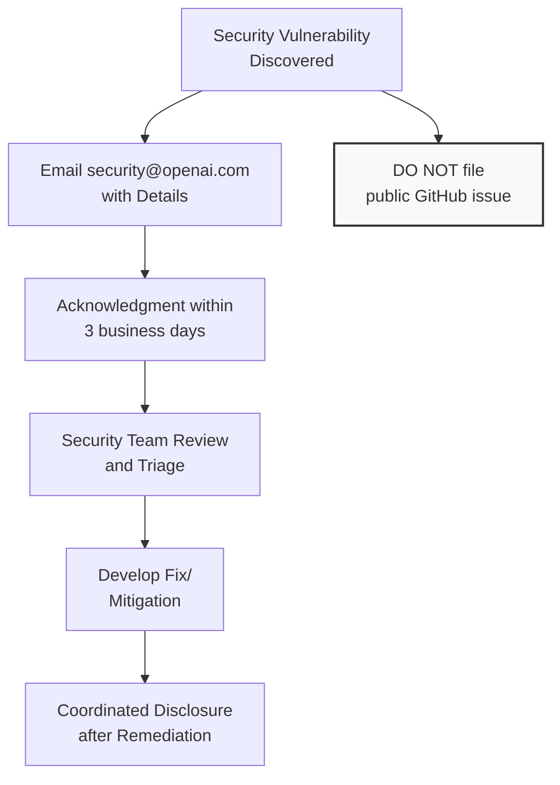
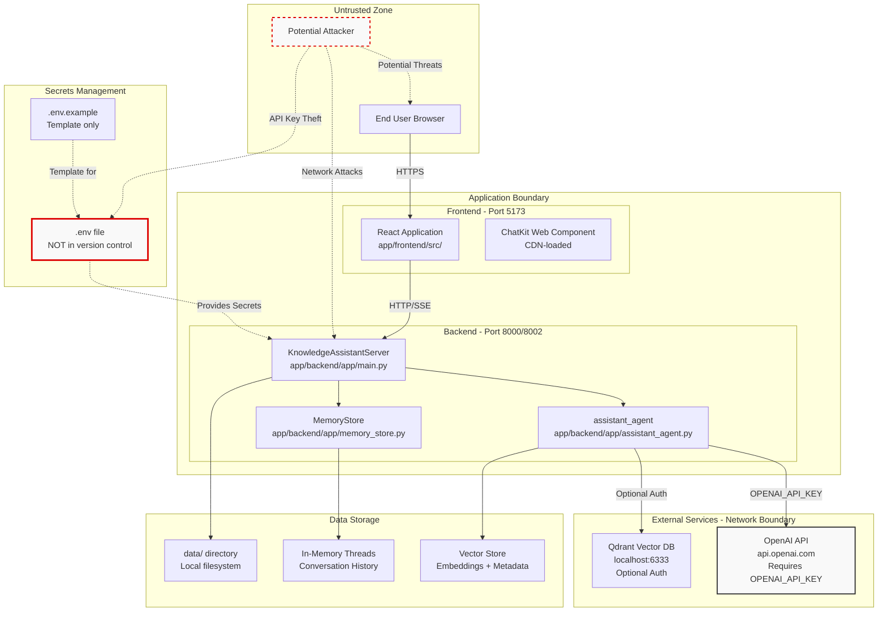
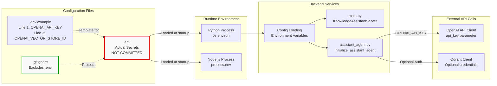
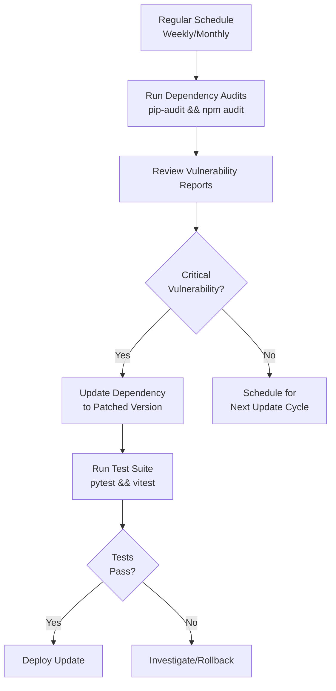
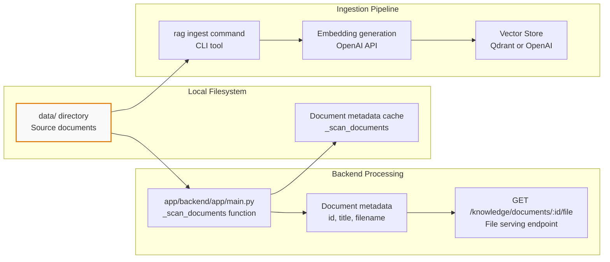

<!-- source: DeepWiki mcp.deepwiki.com · repo openai/openai-knowledge-retrieval · page 10 Security · fetched 2026-10-26 -->

# Security

<details>
<summary>Relevant source files</summary>

The following files were used as context for generating this wiki page:

- [SECURITY.md](SECURITY.md)

</details>


This document covers security policies, vulnerability reporting, and security best practices for the OpenAI Knowledge Retrieval starter kit. It includes information about secrets management, dependency auditing, and secure deployment practices. For production deployment considerations, see [Deployment](#9). For configuration details including environment variables, see [Configuration](#7).

---

## Security Policy

### Supported Versions

The OpenAI Knowledge Retrieval project is released as open source without a formal support policy. Security fixes are backported at the maintainers' discretion. Users are encouraged to follow the main branch for the latest security patches and updates.

**Sources:** [SECURITY.md:3-7]()

### Vulnerability Reporting Process

Security vulnerabilities should be reported privately to maintain responsible disclosure practices. The following workflow applies:



**Required Information for Vulnerability Reports:**

| Information | Description |
|-------------|-------------|
| **Description** | Detailed explanation of the issue and potential impact |
| **Reproduction Steps** | Step-by-step instructions or proof-of-concept exploit |
| **Mitigations** | Any mitigations or workarounds identified |
| **CVSS Score** | Suggested Common Vulnerability Scoring System score (if available) |
| **Patch/Mitigation** | Proposed fix or mitigation (if available) |

Public GitHub issues should **never** be used for security vulnerabilities to prevent exploitation before fixes are available.

**Sources:** [SECURITY.md:9-23]()

---

## Security Architecture and Trust Boundaries

The system has multiple trust boundaries between components, external services, and user data:



**Trust Boundaries:**

1. **User Browser → Frontend**: Untrusted user input enters through the React application
2. **Frontend → Backend**: HTTP/SSE communication should use HTTPS in production
3. **Backend → External Services**: API keys provide authentication to OpenAI and Qdrant
4. **Application → Filesystem**: Local document storage in `data/` directory
5. **In-Memory Data**: Thread and conversation history stored in `MemoryStore`

**Sources:** Derived from system architecture in Diagrams 1 and 3, [SECURITY.md:26-41]()

---

## Secrets Management

### Environment Variables and API Keys

The system uses environment variables to manage sensitive credentials. The credential flow from configuration files to runtime services is shown below:



**Critical Environment Variables:**

| Variable | Purpose | Used By | Required |
|----------|---------|---------|----------|
| `OPENAI_API_KEY` | Authentication for OpenAI API | [app/backend/app/assistant_agent.py]() | Yes |
| `OPENAI_VECTOR_STORE_ID` | Pre-configured vector store ID | [app/backend/app/assistant_agent.py]() | For File Search backend |
| `QDRANT_URL` | Qdrant vector database endpoint | Custom retrieval backend | For Qdrant backend |
| `QDRANT_API_KEY` | Qdrant authentication | Custom retrieval backend | Optional |

**Security Practices:**

1. **Never commit `.env` files**: The `.gitignore` excludes `.env` to prevent accidental commits
2. **Use `.env.example` as template**: Contains placeholder values only
3. **Rotate keys regularly**: API keys should be rotated periodically
4. **Scan commit history**: Use tools like `trufflehog` before publishing forks

```bash
# Scan for secrets in commit history
trufflehog git file://.
```

**Sources:** [SECURITY.md:26-30](), [.env.example]() (referenced in SECURITY.md), [app/backend/app/assistant_agent.py]() (uses environment variables)

### Configuration Files Security

The RAG configuration files in `configs/` directory contain system settings but should not contain secrets:

| File | Contents | Security Considerations |
|------|----------|------------------------|
| `configs/default.openai.yaml` | OpenAI-specific RAG settings | No secrets; safe to commit |
| `configs/default.qdrant.yaml` | Qdrant-specific RAG settings | No secrets; safe to commit |
| `configs/custom_*.yaml` | User-generated configs | Review before committing |

**Sources:** [SECURITY.md:28](), configuration references in Diagram 1

---

## Dependency Security

### Python Dependency Auditing

Python dependencies are specified in `pyproject.toml` and should be audited regularly for known vulnerabilities:

```bash
# Install pip-audit tool
pip install pip-audit

# Audit installed packages
pip-audit
```

**Key Backend Dependencies with Security Implications:**

| Dependency | Purpose | Security Notes |
|------------|---------|----------------|
| `fastapi` | Web framework | Keep updated for security patches |
| `uvicorn` | ASGI server | Production deployment security |
| `openai` | OpenAI API client | API key handling |
| `qdrant-client` | Vector database client | Network communication security |
| `pydantic` | Data validation | Input validation and sanitization |

**Sources:** [SECURITY.md:31-36](), [pyproject.toml]() (referenced in dependency discussion)

### Node.js Dependency Auditing

Frontend dependencies are specified in `package.json` and should be audited regularly:

```bash
# Audit frontend dependencies (excluding dev dependencies)
npm audit --omit=dev
```

**Key Frontend Dependencies with Security Implications:**

| Dependency | Purpose | Security Notes |
|------------|---------|----------------|
| `react` | UI framework | XSS prevention, DOM security |
| `vite` | Build tool | Development server security |
| TypeScript | Type safety | Runtime validation needed separately |
| ESLint | Code quality | Can catch security anti-patterns |

**Sources:** [SECURITY.md:31-38](), [package.json]() (referenced in frontend architecture)

### Dependency Update Strategy



**Sources:** [SECURITY.md:31-38]()

---

## Data Security

### Document Data Protection

Documents stored in the `data/` directory may contain sensitive information:

**Security Practices:**

1. **Limit access to sample datasets**: The repository may include sample documents
2. **Replace with own data before deployment**: Don't deploy with example data containing sensitive information
3. **Review file permissions**: Ensure `data/` directory has appropriate filesystem permissions
4. **Sanitize before ingestion**: Review documents before running `make ingest` or `rag ingest`

**Document Processing Flow:**



**File Serving Security:**

- Files are served through [app/backend/app/main.py]() endpoint `GET /knowledge/documents/:id/file`
- No authentication is implemented by default
- Production deployments should add authentication/authorization

**Sources:** [SECURITY.md:40-41](), [app/backend/app/main.py]() (document scanning and serving)

### Vector Store Data

Embeddings and document chunks stored in vector databases:

**Qdrant (Local):**
- Runs in Docker container on `localhost:6333`
- No authentication configured by default
- Data persists in Docker volume
- Should be secured with authentication in production

**OpenAI File Search:**
- Data stored in OpenAI's infrastructure
- Covered by OpenAI's security policies
- Vector store ID in `OPENAI_VECTOR_STORE_ID` environment variable

**Sources:** Qdrant configuration in Docker Compose (referenced in Diagram 1), [app/backend/app/assistant_agent.py]() (vector store initialization)

### Thread and Conversation Data

Conversation history is stored in memory via `MemoryStore`:

```python
# From app/backend/app/memory_store.py
# ThreadMetadata and ConversationItem stored in-memory
```

**Security Implications:**

| Aspect | Details |
|--------|---------|
| **Storage** | In-memory only, not persisted to disk |
| **Lifetime** | Lost on server restart |
| **Exposure** | Accessible only through backend API endpoints |
| **Privacy** | No built-in PII protection or redaction |

Production deployments should consider:
- Implementing persistent storage with encryption
- Adding conversation data retention policies
- Implementing PII detection and redaction
- Adding access controls for thread data

**Sources:** [app/backend/app/memory_store.py]() (in-memory storage implementation)

---

## Best Practices

### For Developers

The following practices should be followed when contributing to or forking the codebase:

**Secrets Management:**
```bash
# Before committing
git status                    # Verify no .env files staged
grep -r "sk-" .              # Search for potential API keys
trufflehog git file://.      # Scan commit history
```

**Code Security:**
- Use type hints and validation (Pydantic models in backend)
- Sanitize user inputs before processing
- Follow principle of least privilege for API keys
- Review third-party dependencies before adding

**Testing:**
```bash
# Run security-focused tests
pytest tests/                 # Backend tests
npm run test                  # Frontend tests
```

**Sources:** [SECURITY.md:26-41](), [CONTRIBUTING.md]() (referenced in development workflow)

### For Deployers

Production deployment requires additional security measures:

**Network Security:**
- Use HTTPS for all external communication
- Configure CORS appropriately in FastAPI
- Use reverse proxy (nginx, Apache) in front of FastAPI
- Isolate Qdrant database from public network

**Authentication and Authorization:**
- Add authentication layer (OAuth, API keys) to backend endpoints
- Implement rate limiting to prevent abuse
- Add authorization checks for document access
- Consider multi-tenancy isolation if supporting multiple users

**Environment Hardening:**
```bash
# Set restrictive file permissions
chmod 600 .env
chmod 700 data/

# Use non-root user for services
# Configure firewall rules
# Enable audit logging
```

**Monitoring:**
- Log authentication attempts and failures
- Monitor API usage and rate limits
- Alert on suspicious patterns
- Regular security audits

**Sources:** [SECURITY.md:26-41](), production considerations from architecture diagrams

### For End Users

Users deploying their own instances should:

**API Key Security:**
1. Generate dedicated API keys for the application (don't reuse keys)
2. Set appropriate usage limits in OpenAI dashboard
3. Rotate keys regularly
4. Monitor API usage for anomalies

**Data Handling:**
1. Review all documents before ingestion
2. Understand that embeddings can leak information
3. Be cautious with personally identifiable information (PII)
4. Implement data retention policies

**Access Control:**
1. Don't expose the application publicly without authentication
2. Use VPN or private networks for internal deployments
3. Regularly review who has access to the system
4. Implement audit logging for compliance

**Sources:** [SECURITY.md:26-41]()

---

## Security Checklist

Before deploying to production, verify the following:

| Category | Item | Status |
|----------|------|--------|
| **Secrets** | ✓ `.env` file not in version control | |
| **Secrets** | ✓ API keys rotated and stored securely | |
| **Secrets** | ✓ Commit history scanned for leaked secrets | |
| **Dependencies** | ✓ `pip-audit` run with no critical vulnerabilities | |
| **Dependencies** | ✓ `npm audit` run with no critical vulnerabilities | |
| **Dependencies** | ✓ Update schedule established | |
| **Network** | ✓ HTTPS enabled for production | |
| **Network** | ✓ CORS configured appropriately | |
| **Network** | ✓ Qdrant secured with authentication | |
| **Authentication** | ✓ Backend endpoints protected | |
| **Authentication** | ✓ Rate limiting implemented | |
| **Data** | ✓ Sample data removed or replaced | |
| **Data** | ✓ Document permissions reviewed | |
| **Data** | ✓ PII handling procedures in place | |
| **Monitoring** | ✓ Logging and alerting configured | |
| **Monitoring** | ✓ API usage monitoring enabled | |

**Sources:** Compiled from [SECURITY.md:26-41]() and production deployment best practices

---

## Additional Resources

- **OpenAI Security Best Practices**: [OpenAI Platform Documentation](https://platform.openai.com/docs/guides/safety-best-practices)
- **Qdrant Security**: Configure authentication for production deployments
- **OWASP Top 10**: Review common web application security risks
- **Python Security**: [bandit](https://bandit.readthedocs.io) for security-focused linting

For configuration details including environment variables and deployment, see [Configuration](#7) and [Deployment](#9).

**Sources:** [SECURITY.md:1-42]()

---

