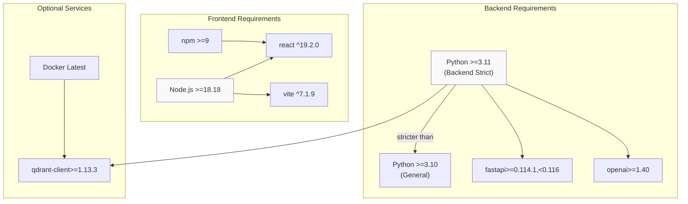
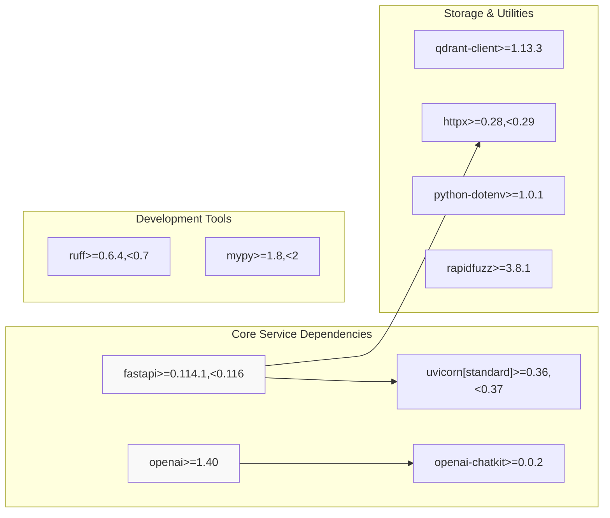
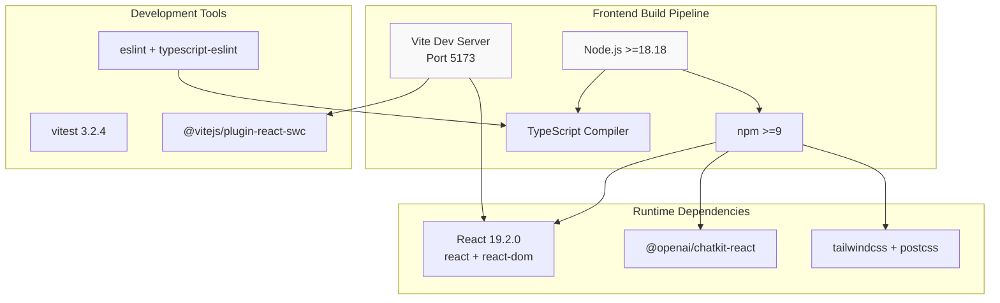
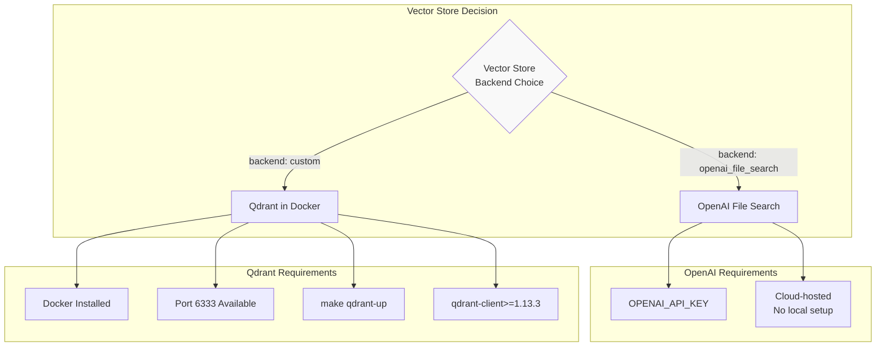
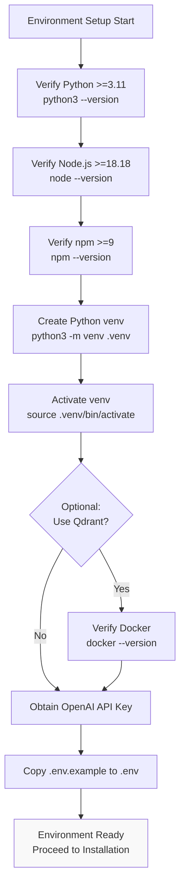

<!-- source: DeepWiki mcp.deepwiki.com · repo openai/openai-knowledge-retrieval · page 2.1 Prerequisites and Environment Setup · fetched 2026-10-26 -->

# Prerequisites and Environment Setup

<details>
<summary>Relevant source files</summary>

The following files were used as context for generating this wiki page:

- [CONTRIBUTING.md](CONTRIBUTING.md)
- [README.md](README.md)
- [app/backend/pyproject.toml](app/backend/pyproject.toml)
- [app/frontend/package.json](app/frontend/package.json)

</details>


## Purpose and Scope

This page documents the system requirements, dependency versions, and initial environment preparation needed before installing the OpenAI Knowledge Retrieval starter kit. It covers the prerequisites for both backend (Python/FastAPI) and frontend (Node.js/React) components, as well as external service requirements.

For the actual installation steps, see [Installation](#2.2). For configuring API keys and environment variables after setup, see [Configuration](#2.3).

---

## System Requirements Overview

The starter kit requires both Python and Node.js environments, with specific version constraints to ensure compatibility with dependencies.

### Minimum Version Requirements

| Component | Minimum Version | Source |
|-----------|----------------|---------|
| Python | 3.10 | General requirement |
| Python (Backend) | 3.11 | Backend-specific constraint |
| Node.js | 18.18 | Frontend requirement |
| npm | 9 | Frontend package manager |
| Docker | Latest stable | Optional, for Qdrant |

**Sources**: [README.md:72-74](), [CONTRIBUTING.md:36](), [app/backend/pyproject.toml:6](), [app/frontend/package.json:13-14]()

### Version Constraint Rationale



**Diagram**: Version dependency hierarchy showing how the backend enforces Python 3.11+ (stricter than the general 3.10+ requirement) due to the `pyproject.toml` constraint at [app/backend/pyproject.toml:6](). The frontend requires Node.js 18.18+ as specified in [app/frontend/package.json:13]().

**Sources**: [app/backend/pyproject.toml:6-17](), [app/frontend/package.json:13-14,16-21]()

---

## Python Environment Requirements

### Version Verification

The backend service requires Python 3.11 or later, despite the general project documentation mentioning 3.10+. This is enforced by the `requires-python` field in the backend's project manifest.

```bash
# Verify Python version
python3 --version
# Should output: Python 3.11.x or higher
```

### Virtual Environment Tooling

The project uses Python's built-in `venv` module for environment isolation. This approach is documented in both the quickstart and contribution guides.

| Tool | Command | Purpose |
|------|---------|---------|
| `venv` | `python3 -m venv .venv` | Create isolated environment |
| `activate` | `source .venv/bin/activate` | Enable environment (Unix) |
| `activate.bat` | `.venv\Scripts\activate.bat` | Enable environment (Windows) |

**Sources**: [README.md:18-20](), [CONTRIBUTING.md:15-17]()

### Backend Python Dependencies

The backend requires the following core dependencies, managed through the `pyproject.toml` build system:



**Diagram**: Backend dependency graph showing the core service layer (`fastapi`, `uvicorn`), OpenAI integration (`openai`, `openai-chatkit`), vector storage (`qdrant-client`), and development tooling (`ruff`, `mypy`).

**Sources**: [app/backend/pyproject.toml:7-23]()

---

## Node.js Environment Requirements

### Version Verification

The frontend application requires Node.js 18.18 or later and npm 9 or later. These constraints are enforced via the `engines` field in `package.json`.

```bash
# Verify Node.js version
node --version
# Should output: v18.18.x or higher

# Verify npm version
npm --version
# Should output: 9.x.x or higher
```

**Sources**: [app/frontend/package.json:12-15]()

### Frontend Dependency Stack

The frontend is built with React 19 and Vite 7, using modern JavaScript tooling:

| Category | Key Dependencies | Purpose |
|----------|-----------------|---------|
| **Core Framework** | `react@^19.2.0`, `react-dom@^19.2.0` | UI framework |
| **Build Tool** | `vite@^7.1.9`, `@vitejs/plugin-react-swc@^3.5.0` | Development server and bundler |
| **OpenAI Integration** | `@openai/chatkit-react@^0` | ChatKit component library |
| **Styling** | `tailwindcss@^3.4.13`, `postcss@^8.4.47` | CSS utilities |
| **Type Checking** | `typescript@^5.4.0` | Static type analysis |
| **Linting** | `eslint@^8.57.1`, `@typescript-eslint/parser@^7.18.0` | Code quality |

**Sources**: [app/frontend/package.json:16-42]()

### Node.js Environment Compatibility



**Diagram**: Frontend environment dependency tree starting from Node.js and npm, flowing through the build pipeline (Vite, TypeScript) to runtime dependencies (React 19, ChatKit) and development tooling (ESLint, Vitest).

**Sources**: [app/frontend/package.json:12-42]()

---

## External Service Requirements

### OpenAI API Access

An OpenAI API key with specific capabilities is required for the system to function. This is the only mandatory external service.

| Requirement | Details | Environment Variable |
|-------------|---------|---------------------|
| **API Key** | Valid OpenAI API key | `OPENAI_API_KEY` |
| **File Search Access** | Enabled for account | N/A |
| **Evals Access** | Optional, for evaluation harness | N/A |
| **Organization ID** | Optional, for multi-org accounts | `OPENAI_ORG_ID` |
| **Project ID** | Optional, for project isolation | `OPENAI_PROJECT_ID` |

**Sources**: [README.md:74](), [README.md:88-93]()

### Vector Store Options

The system supports two vector store backends, selectable via configuration:

#### Option 1: OpenAI File Search (Managed)

- **Requirements**: None beyond API key
- **Setup**: Automatic during ingestion
- **Configuration**: `vector_store.backend: openai_file_search`
- **Storage**: Cloud-hosted by OpenAI

#### Option 2: Qdrant (Self-Hosted)

- **Requirements**: Docker installed and running
- **Setup**: `make qdrant-up` starts container
- **Configuration**: `vector_store.backend: custom` with `custom.kind: qdrant`
- **Storage**: Local Docker volume, port 6333



**Diagram**: Vector store backend selection decision tree showing the two supported options and their respective requirements. OpenAI File Search requires only an API key, while Qdrant requires Docker and opens port 6333.

**Sources**: [README.md:48,109-114](), [README.md:186-208]()

---

## Environment Preparation Workflow

### Pre-Installation Checklist

Before proceeding to installation ([Installation](#2.2)), verify the following environment conditions:



**Diagram**: Sequential environment preparation workflow from version verification through virtual environment creation to final readiness state. This maps to the steps in [CONTRIBUTING.md:12-32]().

**Sources**: [CONTRIBUTING.md:12-32](), [README.md:16-31]()

### Step-by-Step Preparation Commands

| Step | Command | Verification |
|------|---------|--------------|
| **1. Check Python** | `python3 --version` | Output shows >=3.11 |
| **2. Check Node.js** | `node --version` | Output shows >=18.18 |
| **3. Check npm** | `npm --version` | Output shows >=9 |
| **4. Create venv** | `python3 -m venv .venv` | `.venv/` directory created |
| **5. Activate venv** | `source .venv/bin/activate` | Prompt shows `(.venv)` |
| **6. Check Docker** | `docker --version` | Output shows version (optional) |
| **7. Copy env file** | `cp .env.example .env` | `.env` file exists |

On Windows, step 5 changes to `.venv\Scripts\activate.bat` or `.venv\Scripts\Activate.ps1` for PowerShell.

**Sources**: [CONTRIBUTING.md:15-17,27-32](), [README.md:18-24]()

---

## Environment Verification

### Python Environment Verification

After activating the virtual environment, verify that Python is correctly isolated:

```bash
# Should point to .venv/bin/python3
which python3

# Should show the venv-specific path
echo $VIRTUAL_ENV
```

The `$VIRTUAL_ENV` variable should point to the `.venv` directory in your project root.

### Node.js Environment Verification

Verify Node.js and npm are accessible and meet version requirements:

```bash
# Check Node.js
node --version

# Check npm
npm --version

# Verify npm can access registry
npm ping
```

### Docker Verification (Optional)

If using Qdrant, verify Docker is operational:

```bash
# Check Docker daemon
docker info

# Verify Docker Compose
docker compose version

# Test Docker permissions (Unix)
docker ps
```

**Sources**: [README.md:109-114]()

---

## Common Environment Issues

### Python Version Mismatch

**Problem**: System Python is 3.10, but backend requires 3.11+

**Solution**: Install Python 3.11+ using your system package manager or [python.org](https://www.python.org/downloads), then explicitly use `python3.11 -m venv .venv`

### Node.js Version Mismatch

**Problem**: System Node.js is below 18.18

**Solution**: Use a Node version manager (nvm, fnm, or volta) to install Node.js 18.18 or later:

```bash
# Example with nvm
nvm install 18.18
nvm use 18.18
```

### Virtual Environment Activation Issues

**Problem**: `source .venv/bin/activate` fails or doesn't show `(.venv)` in prompt

**Solution**: Verify the virtual environment was created successfully. On Windows, use the correct activation script for your shell (cmd.exe, PowerShell, or Git Bash).

### Docker Permission Issues

**Problem**: `docker ps` requires sudo

**Solution**: Add your user to the `docker` group (Unix) or verify Docker Desktop is running (Windows/macOS).

**Sources**: [CONTRIBUTING.md:15-17]()

---

## Next Steps

Once the environment is prepared and verified:

1. **Proceed to installation** → See [Installation](#2.2) for dependency installation via `make dev` or `make install`
2. **Configure API keys** → See [Configuration](#2.3) for `.env` setup and YAML configuration
3. **Start services** → See [Running the Application](#2.4) for server startup commands

The environment setup documented here establishes the foundation for the installation process, which will populate the virtual environment with the dependencies listed in [app/backend/pyproject.toml]() and [app/frontend/package.json]().

**Sources**: [README.md:16-42](), [CONTRIBUTING.md:10-32]()

---

