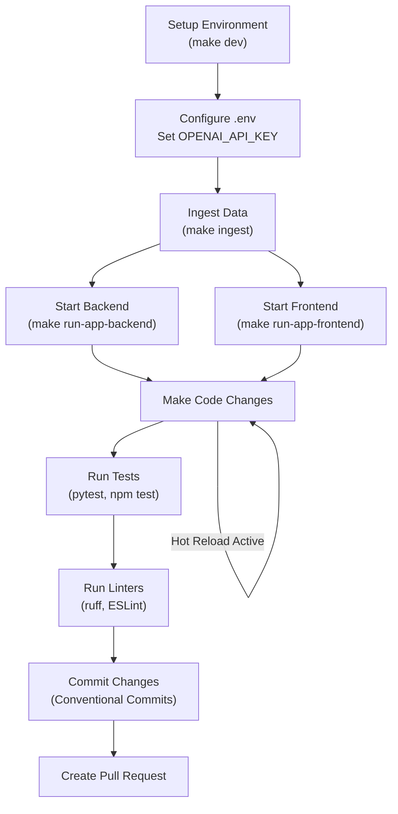
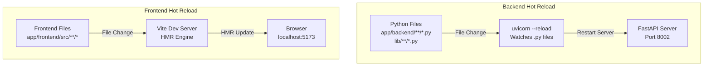
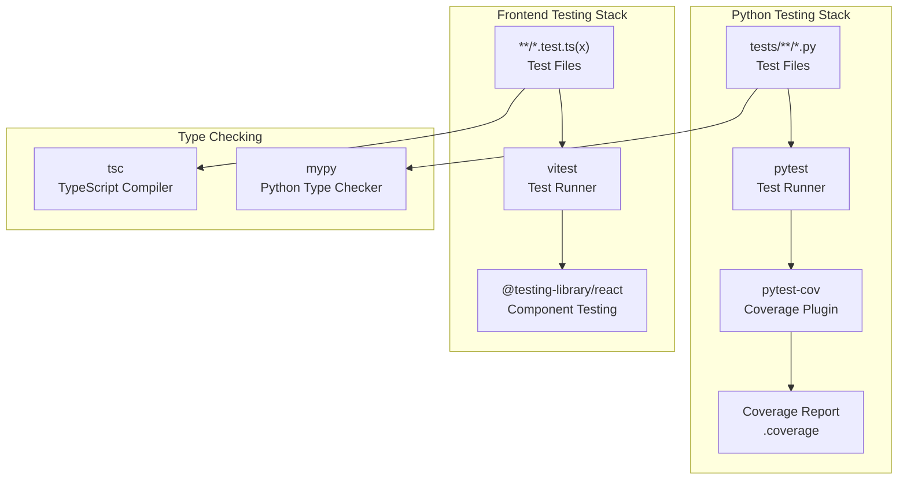
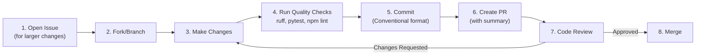

<!-- source: DeepWiki mcp.deepwiki.com · repo openai/openai-knowledge-retrieval · page 8 Development Guide · fetched 2026-10-26 -->

# Development Guide

<details>
<summary>Relevant source files</summary>

The following files were used as context for generating this wiki page:

- [CONTRIBUTING.md](CONTRIBUTING.md)
- [README.md](README.md)

</details>


## Purpose and Scope

This guide provides instructions for developers who want to contribute to or extend the OpenAI Knowledge Retrieval starter kit. It covers environment setup, development workflows, code quality standards, testing practices, and contribution processes.

For deployment instructions, see [Deployment](#9). For configuration details, see [Configuration](#7). For architecture understanding, see [Architecture](#3).

---

## Development Environment Setup

### Prerequisites

| Component | Version | Purpose |
|-----------|---------|---------|
| Python | 3.10+ | Backend runtime |
| Node.js | 18.18+ | Frontend development |
| Docker | Latest | Qdrant vector store (optional) |
| Git | Latest | Version control |

### Initial Setup

The repository uses a Python virtual environment for backend dependencies and npm for frontend dependencies. The [Makefile:1-200]() provides unified commands for all setup tasks.

**Backend Setup:**

```bash
# Create and activate virtual environment
python3 -m venv .venv
source .venv/bin/activate  # On Windows: .venv\Scripts\activate

# Install dependencies with development extras
make dev  # Installs package in editable mode with dev dependencies
```

The `make dev` command executes [Makefile:31-33]() which runs `pip install -e ".[dev]"`. This installs the package in editable mode, meaning code changes are immediately reflected without reinstallation.

**Frontend Setup:**

```bash
cd app/frontend
npm install
```

This installs all dependencies defined in [app/frontend/package.json:1-100]().

**Environment Configuration:**

```bash
cp .env.example .env
# Edit .env and set:
# - OPENAI_API_KEY (required)
# - OPENAI_ORG_ID (optional)
# - OPENAI_PROJECT_ID (optional)
# - VECTOR_STORE_ID (optional, for reusing existing vector stores)
```

**Vector Store Setup (Optional):**

```bash
make qdrant-up
```

This starts a Qdrant instance using [docker-compose.yaml:1-20](), accessible at `http://localhost:6333`.

**Sources:** CONTRIBUTING.md:10-33, README.md:16-24, Makefile:31-33, .env.example:1-20

---

## Development Workflow

### Development Cycle



**Sources:** CONTRIBUTING.md:10-57, README.md:12-42

### Running Services Locally

The development servers support hot reloading for rapid iteration.

**Backend Server:**

```bash
make run-app-backend
```

This command [Makefile:66-69]() starts the FastAPI backend on port 8002 using `uvicorn` with the `--reload` flag. The server automatically restarts when Python files change.

**Frontend Server:**

```bash
make run-app-frontend
```

This command [Makefile:71-74]() starts the Vite development server on port 5173 with hot module replacement (HMR). Changes to React components are reflected instantly in the browser.

**API Server (Optional):**

```bash
make run-api
```

This starts an alternative API server on port 8000 [Makefile:61-64]().

**Ingestion Pipeline:**

```bash
make ingest
# Or with custom config:
rag ingest --config configs/my.custom.yaml
```

The ingestion process [Makefile:45-48]() reads the configuration specified in `RAG_CONFIG` environment variable (defaulting to `configs/default.openai.yaml`).

**Sources:** Makefile:45-74, README.md:126-141

### Makefile Command Reference

The [Makefile:1-200]() provides a unified interface for all development tasks:

| Command | Purpose | Description |
|---------|---------|-------------|
| `make install` | Install package | Installs production dependencies |
| `make dev` | Install dev dependencies | Installs package in editable mode with dev extras |
| `make ingest` | Run ingestion | Processes documents and populates vector store |
| `make eval` | Run evaluation | Executes evaluation harness |
| `make run-api` | Start API server | Starts uvicorn on port 8000 |
| `make run-app-backend` | Start app backend | Starts uvicorn on port 8002 with reload |
| `make run-app-frontend` | Start frontend | Starts Vite dev server on port 5173 |
| `make qdrant-up` | Start Qdrant | Launches Qdrant Docker container |
| `make qdrant-down` | Stop Qdrant | Stops Qdrant Docker container |
| `make format` | Format code | Runs `ruff format` on Python files |
| `make lint` | Lint code | Runs `ruff check` on Python files |
| `make test` | Run tests | Executes `pytest` with coverage |
| `make clean` | Clean artifacts | Removes build files and caches |

**Sources:** Makefile:1-200

### File Watching and Hot Reloading



- **Backend:** `uvicorn` with `--reload` flag watches Python files and restarts the server on changes [Makefile:66-69]()
- **Frontend:** Vite's HMR updates the browser without full page reload when React components change [app/frontend/vite.config.ts:1-30]()

**Sources:** Makefile:66-74, app/frontend/vite.config.ts:1-30

---

## Code Quality and Testing

### Linting Standards

The project enforces code quality through automated linting tools.

**Python Linting:**

```bash
make lint
# Or directly:
ruff check .
```

The linting configuration is defined in [pyproject.toml:60-80](). Key rules:

- Line length: 120 characters
- Python version: 3.10+
- Selected rules: pyflakes, pycodestyle, isort
- Type hints required for new code [CONTRIBUTING.md:36]()

**Frontend Linting:**

```bash
cd app/frontend
npm run lint
```

This executes ESLint with TypeScript support [app/frontend/eslint.config.js:1-50](). Configuration enforces:

- React hooks rules
- TypeScript strict mode
- Import ordering
- Unused variable detection

**Sources:** pyproject.toml:60-80, app/frontend/eslint.config.js:1-50, CONTRIBUTING.md:34-41, Makefile:76-78

### Testing Framework



**Running Tests:**

```bash
# Python tests
make test
# Or directly:
pytest -q

# Frontend tests
cd app/frontend
npm test
```

The `make test` command [Makefile:80-82]() runs pytest with coverage reporting.

**Type Checking:**

```bash
# Python
mypy .

# Frontend
cd app/frontend
npm run type-check
```

Type hints are required for all new Python code [CONTRIBUTING.md:36](). The frontend uses TypeScript strict mode [app/frontend/tsconfig.json:1-30]().

**Sources:** pyproject.toml:40-58, app/frontend/package.json:20-30, CONTRIBUTING.md:48-56, Makefile:80-82

### Code Quality Gates

Before committing, ensure all quality checks pass:

| Check | Command | Configuration |
|-------|---------|---------------|
| Python Linting | `ruff check .` | [pyproject.toml:60-80]() |
| Python Formatting | `ruff format .` | [pyproject.toml:82-85]() |
| Python Tests | `pytest -q` | [pyproject.toml:40-58]() |
| Python Types | `mypy .` | [pyproject.toml:87-95]() |
| Frontend Linting | `npm run lint` | [app/frontend/eslint.config.js:1-50]() |
| Frontend Tests | `npm test` | [app/frontend/vitest.config.ts:1-30]() |
| Frontend Types | `npm run type-check` | [app/frontend/tsconfig.json:1-30]() |

All checks must pass before creating a pull request [CONTRIBUTING.md:48-56]().

**Sources:** CONTRIBUTING.md:48-56, pyproject.toml:40-95

### Coding Standards

**Python Standards:**

- Python 3.10+ with type hints for new code [CONTRIBUTING.md:36]()
- Small, focused functions; extract shared logic to `lib/` modules [CONTRIBUTING.md:37]()
- Snake_case filenames [CONTRIBUTING.md:40]()
- Concise docstrings for public functions where intent is not obvious [CONTRIBUTING.md:39]()

**Frontend Standards:**

- Functional components with hooks [CONTRIBUTING.md:38]()
- Composition over duplication [CONTRIBUTING.md:38]()
- Kebab-case filenames [CONTRIBUTING.md:40]()
- TypeScript interfaces for props [app/frontend/src/chatkit-react/types.ts:1-50]()

**Sources:** CONTRIBUTING.md:34-41

---

## Contributing Guidelines

### Commit Message Format

The project uses [Conventional Commits](https://www.conventionalcommits.org) format [CONTRIBUTING.md:46]():

```
<type>: <description>

[optional body]

[optional footer]
```

**Types:**
- `feat:` - New feature
- `fix:` - Bug fix
- `docs:` - Documentation changes
- `refactor:` - Code restructuring without behavior change
- `test:` - Adding or updating tests
- `chore:` - Maintenance tasks

**Examples:**
```
feat: add query expansion support to retrieval pipeline

fix: resolve citation extraction error for PDF documents

docs: update configuration guide with Qdrant examples

refactor: extract document scanning logic to separate module
```

Use imperative mood ("add" not "added", "fix" not "fixed") [CONTRIBUTING.md:46]().

**Sources:** CONTRIBUTING.md:44-46

### Pull Request Process



**Pull Request Checklist:**

1. **For significant changes:** Open an issue first to discuss the design [CONTRIBUTING.md:58-62]()
2. **Keep PRs focused:** Single feature or fix per PR [CONTRIBUTING.md:47]()
3. **Include summary:** Describe behavior change and testing evidence [CONTRIBUTING.md:47]()
4. **Run quality checks locally:**
   ```bash
   ruff check .
   pytest -q
   cd app/frontend && npm run lint
   ```
5. **Use conventional commits:** See commit message format above [CONTRIBUTING.md:46]()

**Sources:** CONTRIBUTING.md:44-62

### Proposing Larger Changes

For significant work (new features, API changes, architectural modifications), open an issue before submitting code [CONTRIBUTING.md:58-62](). Include:

- **Problem statement:** What issue are you solving?
- **Proposed solution:** How will you solve it?
- **Alternatives considered:** What other approaches did you evaluate?
- **Testing plan:** How will you verify the change works?

This discussion ensures alignment with project direction and prevents wasted effort.

**Sources:** CONTRIBUTING.md:58-62

### Reporting Issues

Use GitHub Issues for bugs or feature requests [CONTRIBUTING.md:64-67](). Include:

- **Reproduction steps:** Exact sequence to reproduce the issue
- **Expected behavior:** What should happen
- **Actual behavior:** What actually happens
- **Environment details:**
  - Operating system
  - Python version
  - Node.js version
  - Configuration file used (sanitized of sensitive data)
  - Relevant log output

**Sources:** CONTRIBUTING.md:64-67

---

## Code of Conduct

All contributors must abide by the [Code of Conduct](CODE_OF_CONDUCT.md) [CONTRIBUTING.md:5-8](). The project follows standard open source community guidelines:

- **Be respectful:** Treat all community members with respect
- **Be collaborative:** Work together to improve the project
- **Be inclusive:** Welcome contributors of all backgrounds and experience levels
- **Be professional:** Keep interactions focused on technical merit

**Reporting Issues:**

Report unacceptable behavior to [opensource@openai.com](mailto:opensource@openai.com) [CONTRIBUTING.md:8]().

**Sources:** CONTRIBUTING.md:5-8, CODE_OF_CONDUCT.md:1-100

---

## Development Tools Reference

### Python Development Dependencies

Installed via `make dev` [Makefile:31-33](), defined in [pyproject.toml:30-38]():

| Package | Purpose |
|---------|---------|
| `pytest` | Test runner |
| `pytest-cov` | Coverage reporting |
| `pytest-asyncio` | Async test support |
| `ruff` | Linting and formatting |
| `mypy` | Static type checking |
| `black` | Code formatting (deprecated, use ruff) |
| `isort` | Import sorting (deprecated, use ruff) |

### Frontend Development Dependencies

Installed via `npm install` in [app/frontend/](), defined in [app/frontend/package.json:30-50]():

| Package | Purpose |
|---------|---------|
| `vite` | Build tool and dev server |
| `vitest` | Test runner |
| `@testing-library/react` | Component testing utilities |
| `eslint` | JavaScript/TypeScript linting |
| `typescript` | Type checking |
| `@vitejs/plugin-react` | React integration for Vite |
| `tailwindcss` | Utility-first CSS framework |
| `postcss` | CSS processing |

**Sources:** pyproject.toml:30-38, app/frontend/package.json:30-50

---

## Quick Reference Commands

```bash
# Setup
make dev                      # Install dev dependencies
cp .env.example .env          # Configure environment
make qdrant-up                # Start vector store (optional)

# Development
make run-app-backend          # Start backend (port 8002)
make run-app-frontend         # Start frontend (port 5173)
make ingest                   # Ingest documents

# Quality Checks
make lint                     # Lint Python code
make test                     # Run Python tests
cd app/frontend && npm run lint   # Lint frontend
cd app/frontend && npm test       # Test frontend

# Evaluation
make eval                     # Run evaluation harness

# Cleanup
make qdrant-down              # Stop vector store
make clean                    # Remove build artifacts
```

**Sources:** Makefile:1-200, CONTRIBUTING.md:44-67

---

