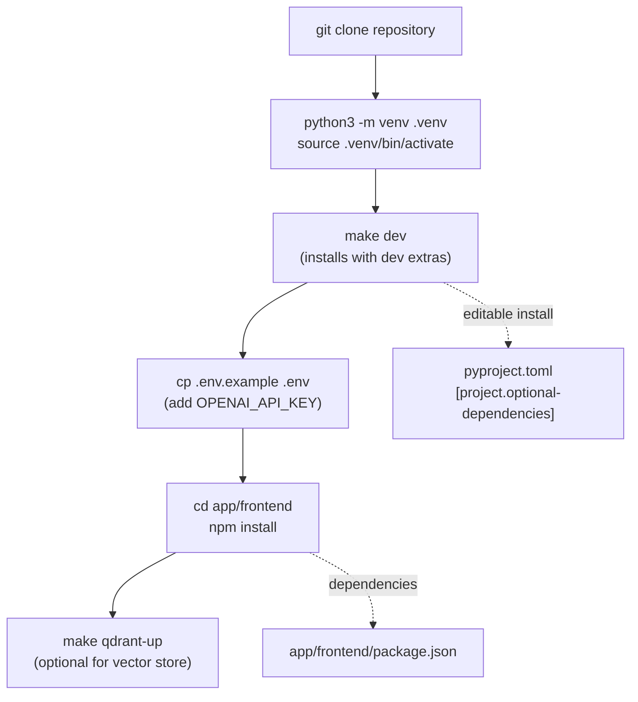
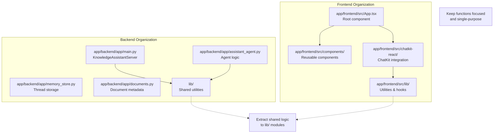
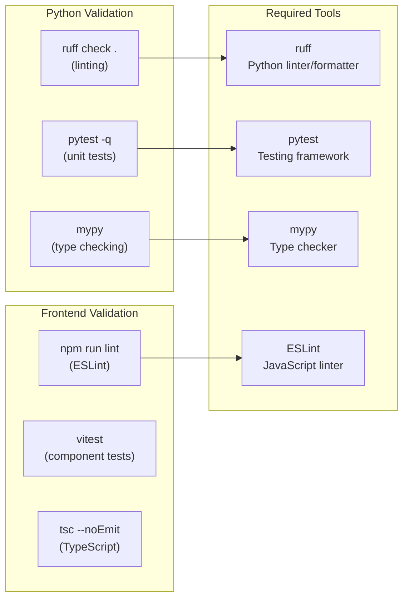
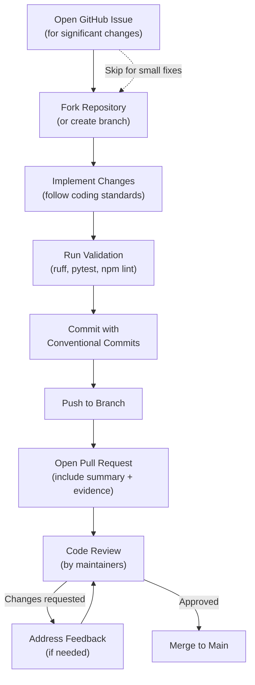
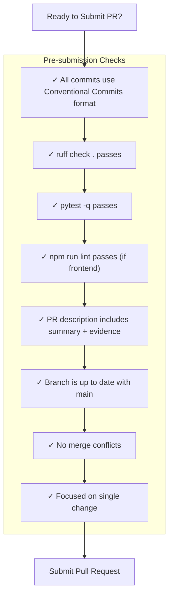

<!-- source: DeepWiki mcp.deepwiki.com · repo openai/openai-knowledge-retrieval · page 8.3 Contributing Guidelines · fetched 2026-10-26 -->

# Contributing Guidelines

<details>
<summary>Relevant source files</summary>

The following files were used as context for generating this wiki page:

- [CODE_OF_CONDUCT.md](CODE_OF_CONDUCT.md)
- [CONTRIBUTING.md](CONTRIBUTING.md)

</details>


## Purpose and Scope

This document provides practical guidance for contributing to the OpenAI Knowledge Retrieval starter kit. It covers development environment setup, coding standards, commit conventions, pull request workflows, and issue reporting procedures. For community behavior standards and enforcement policies, see [Code of Conduct](#8.4). For the broader development workflow including testing and quality checks, see [Development Workflow](#8.1) and [Code Quality and Testing](#8.2).

**Sources**: [CONTRIBUTING.md:1-72]()

---

## Development Environment Setup

### Prerequisites

Contributors must have the following installed:
- Python 3.10 or higher
- Node.js and npm (for frontend contributions)
- Git for version control
- Docker (for Qdrant vector store)

### Initial Setup Process



**Development Environment Setup Workflow**

The setup process follows these steps:

1. **Clone the repository** and activate a Python virtual environment [CONTRIBUTING.md:12-17]()
2. **Install backend dependencies** using `make dev`, which installs the project in editable mode with development extras
3. **Configure environment variables** by copying `.env.example` to `.env` and adding required API keys [CONTRIBUTING.md:27-32]()
4. **Install frontend dependencies** (optional) by running `npm install` in `app/frontend` [CONTRIBUTING.md:20-25]()
5. **Start Qdrant** (if using custom vector store) with `make qdrant-up`

**Sources**: [CONTRIBUTING.md:10-32]()

---

## Coding Standards

### Python Standards

| Standard | Requirement |
|----------|-------------|
| **Version** | Python 3.10+ required |
| **Type Hints** | Required for all new code |
| **Function Size** | Keep functions small and focused |
| **Code Organization** | Extract shared logic to helpers or modules under `lib/` |
| **Documentation** | Concise docstrings for public functions/classes where intent is not obvious |
| **File Naming** | snake_case for Python files |

**Sources**: [CONTRIBUTING.md:36-41]()

### TypeScript/React Standards

| Standard | Requirement |
|----------|-------------|
| **Component Style** | Functional components with hooks |
| **Code Reuse** | Use composition to avoid duplication |
| **File Naming** | kebab-case for new frontend modules |
| **Patterns** | Favor hooks and functional patterns over class components |

**Sources**: [CONTRIBUTING.md:38-40]()

### Code Organization Principles



**Code Organization Structure**

The codebase follows clear organizational principles:
- Backend services in `app/backend/app/` with focused modules per responsibility
- Shared Python utilities in `lib/` directory
- Frontend components in `app/frontend/src/components/`
- Frontend utilities and hooks in `app/frontend/src/lib/`

**Sources**: [CONTRIBUTING.md:36-41]()

---

## Code Quality and Validation

### Validation Requirements

Before submitting any pull request, contributors must ensure all quality checks pass:



**Code Validation Workflow**

### Python Validation Commands

| Command | Purpose | When to Run |
|---------|---------|-------------|
| `ruff check .` | Lint Python code for style violations | Always before committing |
| `pytest -q` | Run unit tests | Always before committing |
| `mypy` | Verify type annotations | For new code with type hints |

### Frontend Validation Commands

| Command | Purpose | When to Run |
|---------|---------|-------------|
| `npm run lint` | Run ESLint on TypeScript/React code | Only if UI code was modified |
| `vitest` | Run component tests | Only if UI code was modified |
| `tsc --noEmit` | TypeScript type checking | Only if UI code was modified |

**Sources**: [CONTRIBUTING.md:48-56]()

---

## Commit Message Conventions

### Conventional Commits Format

The project uses [Conventional Commits](https://www.conventionalcommits.org) specification for all commit messages:

```
<type>: <description>

[optional body]

[optional footer]
```

### Commit Types

| Type | Usage | Example |
|------|-------|---------|
| `feat:` | New features or capabilities | `feat: add query expansion to retrieval pipeline` |
| `fix:` | Bug fixes | `fix: correct citation extraction for OpenAI annotations` |
| `docs:` | Documentation changes | `docs: update RAG configuration examples` |
| `refactor:` | Code refactoring without behavior changes | `refactor: extract document scanning to separate function` |
| `test:` | Adding or modifying tests | `test: add unit tests for memory store` |
| `chore:` | Maintenance tasks, dependency updates | `chore: upgrade ruff to 0.2.0` |
| `style:` | Code formatting, whitespace changes | `style: format with ruff` |
| `perf:` | Performance improvements | `perf: cache document metadata lookups` |

### Commit Message Requirements

- **Imperative mood**: Use "add feature" not "added feature" or "adds feature"
- **Lowercase**: Start description with lowercase letter
- **No period**: Do not end description with period
- **Concise**: Keep first line under 72 characters
- **Body optional**: Add detailed explanation in body for complex changes

**Example Commit Messages**:
```bash
feat: implement HyDE query generation for vector search

Adds hypothetical document embedding (HyDE) to improve retrieval 
quality by generating synthetic documents before embedding the query.

fix: resolve thread memory leak in long conversations

The memory store was not properly clearing completed threads,
causing memory usage to grow unbounded.
```

**Sources**: [CONTRIBUTING.md:44-46]()

---

## Pull Request Process

### PR Submission Workflow



**Pull Request Submission Process**

### PR Requirements

| Requirement | Description |
|-------------|-------------|
| **Focused scope** | Keep PRs focused on a single change or feature |
| **Summary** | Include clear summary of behavior changes |
| **Testing evidence** | Show that changes work (screenshots, test output, etc.) |
| **Passing checks** | All validation commands must pass locally |
| **Conventional commits** | All commits follow conventional format |

### PR Content Guidelines

A good pull request includes:

1. **Title**: Clear, descriptive title using conventional commit type
2. **Description**: 
   - What problem does this solve?
   - What changes were made?
   - How was it tested?
3. **Testing Evidence**: Screenshots, logs, or test results demonstrating the fix/feature works
4. **Breaking Changes**: Clearly document any breaking API or behavior changes

**Sources**: [CONTRIBUTING.md:44-56]()

---

## Proposing Significant Changes

### When to Open an Issue First

For significant work including:
- New features
- API changes
- Architectural modifications
- Major refactoring

Contributors should open a GitHub issue before submitting a PR to discuss the design.

### Issue Content Requirements

| Element | Required Content |
|---------|------------------|
| **Problem Statement** | Clear description of the problem being solved |
| **Proposed Solution** | Detailed explanation of the proposed approach |
| **Alternatives Considered** | Other approaches that were evaluated and why they were not chosen |
| **Implementation Plan** | High-level steps for implementation (optional) |

**Sources**: [CONTRIBUTING.md:58-62]()

---

## Reporting Issues

### Bug Reports

Use GitHub issues for reporting bugs. Include:

| Field | Content |
|-------|---------|
| **Reproduction Steps** | Exact steps to reproduce the issue |
| **Expected Behavior** | What should happen |
| **Actual Behavior** | What actually happens |
| **Environment Details** | OS, Python version, Node version, configuration used |
| **Error Messages** | Full error messages and stack traces |
| **Configuration** | Relevant `.env` settings and YAML config (sanitize API keys) |

### Feature Requests

For feature requests, include:
- **Use case**: What problem would this solve?
- **Proposed interface**: How would users interact with this feature?
- **Alternatives**: What workarounds exist today?

**Sources**: [CONTRIBUTING.md:64-67]()

---

## Contribution Validation Checklist

Before submitting a pull request, verify:



**Pre-submission Validation Checklist**

**Sources**: [CONTRIBUTING.md:44-56]()

---

## License Agreement

By contributing to this project, contributors agree that their contributions will be licensed under the MIT License. This applies to all code, documentation, and other materials submitted via pull requests or other means.

**Sources**: [CONTRIBUTING.md:69-71]()

---

## Community Standards

Contributors are expected to follow the project's Code of Conduct. All interactions should demonstrate:
- Empathy and kindness toward other people
- Respect for differing opinions and experiences
- Graceful acceptance of constructive feedback
- Focus on what is best for the community

For full community standards and enforcement procedures, see [Code of Conduct](#8.4).

Report unacceptable behavior to [opensource@openai.com](mailto:opensource@openai.com).

**Sources**: [CONTRIBUTING.md:5-8](), [CODE_OF_CONDUCT.md:1-72]()

---

## Quick Reference

### Essential Commands

| Task | Command |
|------|---------|
| Setup development environment | `make dev` |
| Run Python linting | `ruff check .` |
| Run Python tests | `pytest -q` |
| Run frontend linting | `npm run lint` (in `app/frontend`) |
| Start backend dev server | `make run-app-backend` |
| Start frontend dev server | `make run-app-frontend` |
| Run ingestion | `make ingest` |
| Run evaluation | `make eval` |

### Key Files

| File | Purpose |
|------|---------|
| [CONTRIBUTING.md]() | Full contributing guide (this document's source) |
| [CODE_OF_CONDUCT.md]() | Community standards and behavior guidelines |
| [.env.example]() | Environment variable template |
| [pyproject.toml]() | Python dependencies and project metadata |
| [app/frontend/package.json]() | Frontend dependencies |

**Sources**: [CONTRIBUTING.md:1-72]()

---

