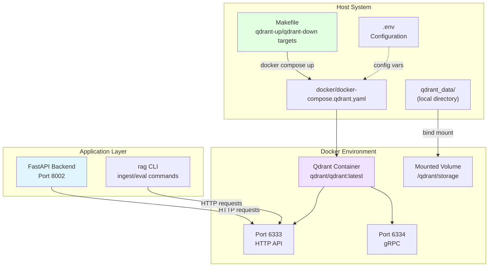
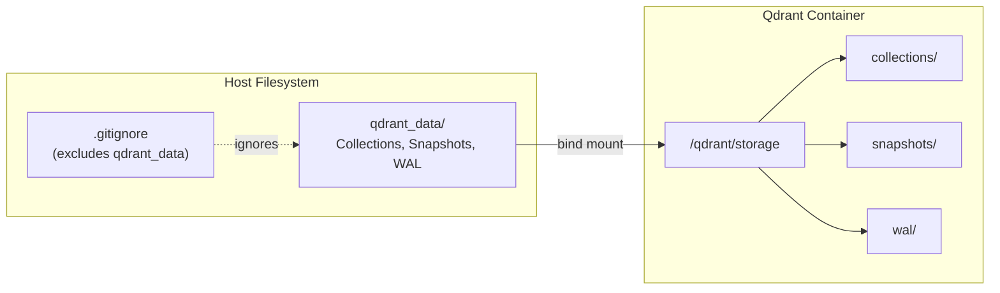
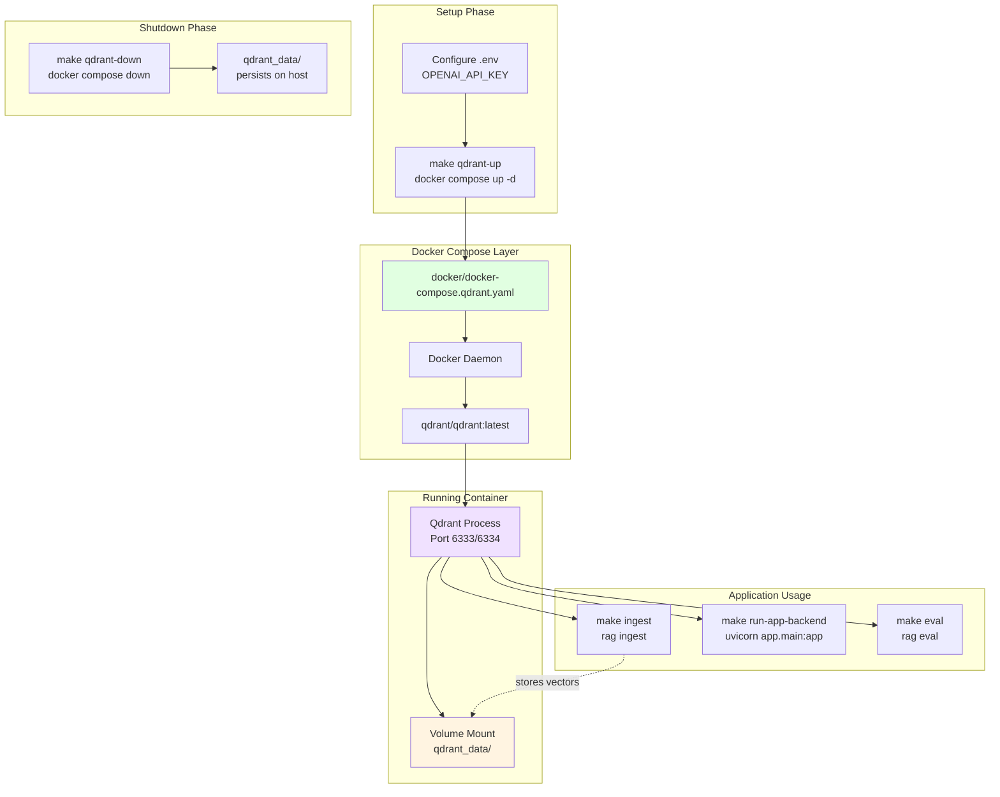

<!-- source: DeepWiki mcp.deepwiki.com · repo openai/openai-knowledge-retrieval · page 9.2 Docker Deployment · fetched 2026-10-26 -->

# Docker Deployment

<details>
<summary>Relevant source files</summary>

The following files were used as context for generating this wiki page:

- [.gitignore](.gitignore)
- [Makefile](Makefile)
- [README.md](README.md)

</details>


## Purpose and Scope

This document covers Docker-based deployment for the OpenAI Knowledge Retrieval system, specifically focusing on containerized deployment of the Qdrant vector database. The system uses Docker Compose to manage the Qdrant service for local development and production deployments.

For production builds of the application itself (frontend and backend), see [Production Build](#9.1). For initial local setup and development workflow, see [Getting Started](#2).

---

## Docker Usage Overview

The OpenAI Knowledge Retrieval system employs Docker primarily for running the **Qdrant vector database** as a containerized service. The backend FastAPI application and frontend React application are typically run natively during development, but Qdrant is containerized to simplify installation and ensure consistent behavior across environments.

**Key characteristics:**
- Docker Compose orchestrates the Qdrant container
- Volume mounts persist vector data between container restarts
- Port mapping exposes Qdrant's HTTP API (6333) and gRPC interface (6334)
- Makefile targets abstract Docker Compose commands

**Sources:** [Makefile:25-29](), [README.md:109-114](), [.gitignore:56-58]()

---

## Qdrant Docker Service Architecture

The system uses a Docker Compose configuration file located at `docker/docker-compose.qdrant.yaml` to define the Qdrant service. This approach isolates the vector database from the host environment while maintaining data persistence through volume mounts.

### Docker Compose Service Definition



**Typical docker-compose.qdrant.yaml structure:**

| Property | Value | Description |
|----------|-------|-------------|
| **Service name** | `qdrant` | Container identifier |
| **Image** | `qdrant/qdrant:latest` | Official Qdrant Docker image |
| **Ports** | `6333:6333`, `6334:6334` | HTTP API and gRPC endpoints |
| **Volumes** | `./qdrant_data:/qdrant/storage` | Data persistence mount point |
| **Restart policy** | `unless-stopped` | Auto-restart on failure |
| **Network mode** | `bridge` (default) | Container networking |

**Sources:** [Makefile:25-29](), [README.md:109-114](), [.gitignore:57]()

---

## Data Persistence and Volume Management

Qdrant stores its vector data, indexes, and metadata in the `/qdrant/storage` directory within the container. This directory is mounted to a local `qdrant_data/` directory on the host system, ensuring data survives container restarts and removals.

### Volume Mount Diagram



### Ignored Directories

The `.gitignore` file explicitly excludes Docker-related data directories from version control:

```
# Docker local volumes
qdrant_data/
docker-data/
```

This prevents large binary vector data and Docker state from being committed to the repository.

**Key behaviors:**
- **First run**: Qdrant initializes an empty storage directory
- **Subsequent runs**: Existing collections and indexes are loaded from `qdrant_data/`
- **Data cleanup**: Run `rm -rf qdrant_data/` to start fresh (after stopping the container)
- **Backup**: Copy or snapshot the `qdrant_data/` directory to preserve vector data

**Sources:** [.gitignore:56-58](), [Makefile:25-29]()

---

## Makefile Docker Commands

The [Makefile:1-38]() provides two primary targets for managing the Qdrant Docker container:

### `make qdrant-up`

```bash
make qdrant-up
```

**Implementation:** [Makefile:25-26]()
```makefile
qdrant-up:
	docker compose -f docker/docker-compose.qdrant.yaml up -d
```

**Behavior:**
- Starts the Qdrant container in detached mode (`-d`)
- Creates the `qdrant_data/` directory if it doesn't exist
- Pulls the `qdrant/qdrant:latest` image if not already cached
- Maps ports 6333 (HTTP) and 6334 (gRPC) to the host
- Qdrant becomes accessible at `http://localhost:6333`

**Typical usage scenario:**
```bash
# Terminal 1: Start Qdrant
make qdrant-up

# Verify it's running
curl http://localhost:6333/collections

# Terminal 2: Ingest data
make ingest

# Terminal 3: Run backend
make run-app-backend
```

### `make qdrant-down`

```bash
make qdrant-down
```

**Implementation:** [Makefile:28-29]()
```makefile
qdrant-down:
	docker compose -f docker/docker-compose.qdrant.yaml down --remove-orphans
```

**Behavior:**
- Stops the Qdrant container gracefully
- Removes the container and associated networks
- Preserves the `qdrant_data/` volume on the host
- Cleans up any orphaned containers

**Note:** Data in `qdrant_data/` persists after `make qdrant-down`. To completely reset:
```bash
make qdrant-down
rm -rf qdrant_data/
make qdrant-up
```

**Sources:** [Makefile:25-29]()

---

## Command Flow and Integration

The following diagram shows how Docker commands integrate with the broader development workflow:



**Sources:** [Makefile:4-38](), [README.md:16-42]()

---

## Network Configuration

The Qdrant container operates on Docker's default bridge network, making it accessible to:

### Local Host Applications
- Backend server at `http://localhost:8002` connects via `http://localhost:6333`
- CLI commands (`rag ingest`, `rag eval`) connect via `http://localhost:6333`

### Port Mapping

| Container Port | Host Port | Protocol | Purpose |
|---------------|-----------|----------|---------|
| 6333 | 6333 | HTTP | REST API for vector operations |
| 6334 | 6334 | gRPC | High-performance RPC interface |

The application primarily uses the HTTP interface on port 6333. The gRPC port is available for performance-critical applications but is not used by default.

**Configuration in vector store YAML:**
```yaml
vector_store:
  backend: custom
  custom:
    kind: qdrant
    qdrant:
      url: http://localhost:6333  # Docker-exposed port
      collection: my_collection
      distance: cosine
```

**Sources:** [README.md:193-205]()

---

## Environment Variables and Configuration

While the Docker Compose file itself doesn't require environment variables, the application components that connect to Qdrant reference configuration through:

### RAG Configuration Files

The vector store connection is specified in YAML configs (e.g., `configs/default.qdrant.yaml`):

```yaml
vector_store:
  backend: custom
  custom:
    kind: qdrant
    qdrant:
      url: http://localhost:6333
      collection: knowledge_base
      distance: cosine
      ef: 64
      m: 32
```

These parameters are read by:
- **Ingestion pipeline**: [stores/] modules for writing vectors
- **Backend server**: [app/backend/app/main.py] for retrieval
- **CLI commands**: [cli/] for direct vector operations

### No OpenAI API Key Required for Qdrant

Unlike the OpenAI File Search backend, Qdrant runs entirely locally and does not require `OPENAI_API_KEY` for vector storage operations. However, `OPENAI_API_KEY` is still needed for:
- Generating embeddings during ingestion
- LLM-based query expansion and reranking
- Response synthesis

**Sources:** [README.md:86-93](), [README.md:193-205]()

---

## Production Deployment Considerations

### Container Registry

For production deployments, consider:

1. **Pinning specific versions:**
   ```yaml
   image: qdrant/qdrant:v1.7.4  # Pin to stable release
   ```

2. **Using private registries** for security and availability

3. **Health checks** to ensure container readiness:
   ```yaml
   healthcheck:
     test: ["CMD", "curl", "-f", "http://localhost:6333/readyz"]
     interval: 10s
     timeout: 5s
     retries: 3
   ```

### Resource Limits

Production deployments should specify resource constraints:

```yaml
deploy:
  resources:
    limits:
      cpus: '2.0'
      memory: 4G
    reservations:
      cpus: '1.0'
      memory: 2G
```

### Volume Backups

For production persistence:
- Schedule regular snapshots of `qdrant_data/`
- Use Docker volumes instead of bind mounts for better isolation
- Consider cloud-native vector database solutions for high availability

### Alternative: Cloud-Hosted Qdrant

For production, Qdrant Cloud offers managed instances:
```yaml
vector_store:
  backend: custom
  custom:
    kind: qdrant
    qdrant:
      url: https://xyz.qdrant.io:6333
      api_key: ${QDRANT_API_KEY}
      collection: knowledge_base
```

**Sources:** [README.md:193-205](), [.gitignore:56-58]()

---

## Troubleshooting Docker Deployment

### Port Conflicts

If port 6333 is already in use:
```bash
# Check what's using the port
lsof -i :6333

# Modify docker-compose.qdrant.yaml to use different host port
ports:
  - "6335:6333"  # Map container 6333 to host 6335
```

Then update your RAG config:
```yaml
qdrant:
  url: http://localhost:6335
```

### Container Not Starting

```bash
# View container logs
docker compose -f docker/docker-compose.qdrant.yaml logs

# Check container status
docker compose -f docker/docker-compose.qdrant.yaml ps

# Restart with fresh state
make qdrant-down
rm -rf qdrant_data/
make qdrant-up
```

### Permission Issues

If the container cannot write to `qdrant_data/`:
```bash
# Ensure proper ownership (Linux/macOS)
sudo chown -R $(id -u):$(id -g) qdrant_data/

# Or run with appropriate user in docker-compose.yaml
user: "${UID}:${GID}"
```

### Connection Refused Errors

If the backend or CLI cannot connect to Qdrant:

1. **Verify container is running:**
   ```bash
   docker ps | grep qdrant
   ```

2. **Test HTTP endpoint:**
   ```bash
   curl http://localhost:6333/collections
   ```

3. **Check network mode** in docker-compose.yaml (should be bridge or default)

4. **Ensure firewall isn't blocking** port 6333

**Sources:** [Makefile:25-29](), [README.md:109-114]()

---

## Summary

The Docker deployment in this system focuses on containerizing Qdrant for vector storage. Key takeaways:

| Aspect | Implementation |
|--------|---------------|
| **Orchestration** | Docker Compose via `docker/docker-compose.qdrant.yaml` |
| **Management** | `make qdrant-up` and `make qdrant-down` |
| **Data persistence** | Bind mount to `qdrant_data/` directory |
| **Network exposure** | Ports 6333 (HTTP) and 6334 (gRPC) |
| **Configuration** | Via YAML files in `configs/` |
| **Integration** | Backend, CLI, and ingestion all connect via `http://localhost:6333` |

For deploying the full application stack (frontend + backend) in production, Docker is not required by default—the system supports native Python/Node.js deployments. However, Dockerizing the entire stack is straightforward by creating additional Dockerfile and docker-compose configurations.

**Sources:** [Makefile:4-38](), [README.md:1-308](), [.gitignore:56-58]()

---

