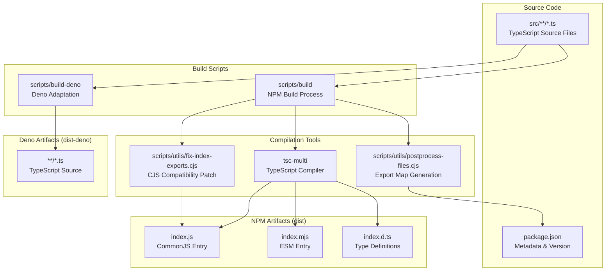
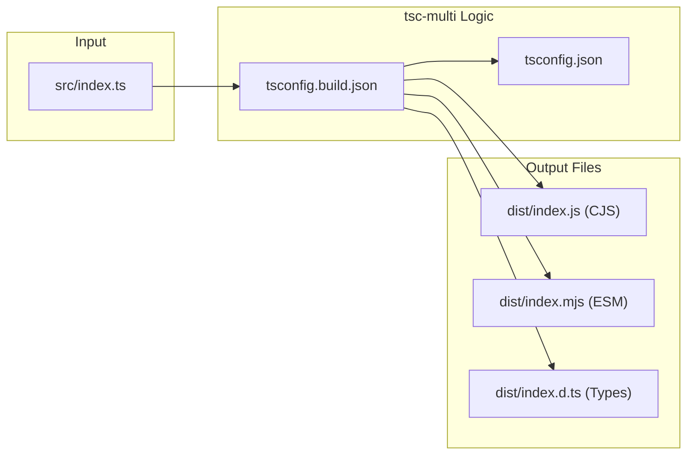

<!-- source: DeepWiki mcp.deepwiki.com · repo openai/openai-node · page 7.1 Build System · fetched 2026-10-26 -->

# Build System

Relevant source files

The following files were used as context for generating this wiki page:

- [.devcontainer/devcontainer.json](.devcontainer/devcontainer.json)
- [.gitignore](.gitignore)
- [ecosystem-tests/cli.ts](ecosystem-tests/cli.ts)
- [ecosystem-tests/proxy.ts](ecosystem-tests/proxy.ts)
- [eslint.config.mjs](eslint.config.mjs)
- [scripts/build](scripts/build)
- [src/internal/to-file.ts](src/internal/to-file.ts)
- [src/internal/uploads.ts](src/internal/uploads.ts)
- [src/internal/utils/path.ts](src/internal/utils/path.ts)
- [src/internal/utils/uuid.ts](src/internal/utils/uuid.ts)
- [tests/path.test.ts](tests/path.test.ts)
- [tsc-multi.json](tsc-multi.json)
- [tsconfig.build.json](tsconfig.build.json)
- [tsconfig.deno.json](tsconfig.deno.json)
- [tsconfig.json](tsconfig.json)
- [yarn.lock](yarn.lock)

This document describes the build pipeline for the OpenAI TypeScript/JavaScript SDK, including TypeScript compilation, dual-mode output generation (CommonJS and ESM), Deno/JSR adaptation, and package distribution. For information about the CI/CD automation around builds, see [CI/CD Pipeline](). For details on release automation and version management, see [Release Process]().

## Overview

The build system transforms TypeScript source code in `src/` into distributable artifacts optimized for multiple JavaScript runtimes. The SDK maintains **zero runtime dependencies** while supporting Node.js, Deno, Bun, browsers, and edge runtimes through careful build configuration and dual-mode output generation.

**Build Modes:**

| Build Type | Output Directory | Target Runtime | Entry Point |
|------------|-----------------|----------------|-------------|
| NPM (CommonJS) | `dist/` | Node.js, Bun, others | `dist/index.js` |
| NPM (ESM) | `dist/` | Modern bundlers, Node ESM | `dist/index.mjs` |
| JSR/Deno | `dist-deno/` | Deno runtime | TypeScript source |

Sources: [yarn.lock:1-167736](), [ecosystem-tests/cli.ts:14-20](), [scripts/build:14-16]()

## Build Pipeline Architecture

**Build Process Flow:**

The build system operates in two parallel tracks—NPM distribution and Deno/JSR distribution. The main entry point is `scripts/build`, which orchestrates the transformation from TypeScript source to runtime-optimized output.

Sources: [scripts/build:1-44]()

## TypeScript Compilation

### Compiler Configuration

The SDK uses a tiered configuration strategy. The base `tsconfig.json` provides strict type checking for development [tsconfig.json:1-37](), while `tsconfig.build.json` extends it to enable declaration and source map generation for the distribution build [tsconfig.build.json:1-18]().

The build process uses `tsc-multi`, a custom compiler wrapper that generates both CommonJS and ESM outputs in a single pass [scripts/build:26]().

Sources: [tsconfig.json:1-37](), [tsconfig.build.json:1-18](), [scripts/build:26]()

### Build Execution

The build script `scripts/build` performs the following critical steps:
1. **Version Check**: Ensures version consistency via `scripts/utils/check-version.cjs` [scripts/build:7]().
2. **Environment Setup**: Cleans the `dist` directory and copies source files to `dist/src` to ensure source maps point to relative paths [scripts/build:14-17]().
3. **Compilation**: Runs `tsc-multi` to generate dual-mode outputs [scripts/build:26]().
4. **CJS Patching**: Executes `scripts/utils/fix-index-exports.cjs` to ensure `module.exports` compatibility for legacy CommonJS consumers [scripts/build:30]().
5. **Post-processing**: Runs `scripts/utils/postprocess-files.cjs` to finalize file structures and the `package.json` export map [scripts/build:33]().

Sources: [scripts/build:1-44]()

## Dual-Mode Output Configuration

### Package Exports

The SDK provides conditional exports to support different module systems seamlessly. This is managed by `scripts/utils/make-dist-package-json.cjs`, which generates a specialized `package.json` for the `dist` folder [scripts/build:23]().

| Condition | Target File | Purpose |
|-----------|-------------|---------|
| `import`  | `index.mjs` | Native ESM support in Node.js and bundlers |
| `require` | `index.js`  | CommonJS support for legacy environments |
| `types`   | `index.d.ts`| TypeScript type resolution |

Sources: [scripts/build:21-23](), [scripts/build:37-38]()

## Deno and JSR Distribution

### Build Process

The Deno build is triggered automatically at the end of the standard build unless `OPENAI_DISABLE_DENO_BUILD` is set to `1` [scripts/build:40-43](). This process generates a `dist-deno` directory containing raw TypeScript files compatible with Deno's native TypeScript execution.

Sources: [scripts/build:40-44](), [.gitignore:8]()

## Dependency Management

### Zero Runtime Dependencies

The SDK is designed with a zero-dependency architecture. All required functionality, such as multipart form handling for file uploads [src/internal/uploads.ts:75-82]() and URI path encoding [src/internal/utils/path.ts:11-13](), is implemented internally.

### Optional Peer Dependencies

While the core is dependency-free, certain features utilize peer dependencies if available:
- **Zod**: Used for structured output parsing via `zodResponseFormat`.
- **WebSockets**: The Realtime API uses platform-native WebSockets or environment-specific shims.

Sources: [src/internal/uploads.ts:14-26](), [src/internal/to-file.ts:1-121]()

## Build Verification

The build system includes a self-test phase to ensure the generated artifacts are valid before distribution:
- **CJS Require Test**: `(cd dist && node -e 'require("openai")')` [scripts/build:37]().
- **ESM Import Test**: `(cd dist && node -e 'import("openai")' --input-type=module)` [scripts/build:38]().

Additionally, the `ecosystem-tests` suite validates the build artifacts across various runtimes including Bun, Vercel Edge, and Cloudflare Workers [ecosystem-tests/cli.ts:22-109]().

Sources: [scripts/build:35-38](), [ecosystem-tests/cli.ts:14-109]()

---

