# Page: Overview

# Overview

<details>
<summary>Relevant source files</summary>

The following files were used as context for generating this wiki page:

- [.release-please-manifest.json](.release-please-manifest.json)
- [CHANGELOG.md](CHANGELOG.md)
- [README.md](README.md)
- [api.md](api.md)
- [jsr.json](jsr.json)
- [package.json](package.json)
- [scripts/build-deno](scripts/build-deno)
- [scripts/utils/convert-jsr-readme.cjs](scripts/utils/convert-jsr-readme.cjs)
- [src/index.ts](src/index.ts)
- [src/resources/index.ts](src/resources/index.ts)
- [src/version.ts](src/version.ts)

</details>


## Purpose and Scope

This page provides a high-level introduction to the OpenAI Node.js SDK, covering its architecture, supported platforms, and core capabilities. For detailed information about installation and setup, see [Installation and Setup](). For specifics about the main client classes, see [Core Client]().

## What is the OpenAI Node.js SDK

The OpenAI Node.js SDK is the official TypeScript/JavaScript client library for interacting with OpenAI's APIs. It provides a comprehensive, type-safe interface to all OpenAI services including chat completions, embeddings, file management, image generation, audio processing, and advanced features like the Assistants API and Realtime API.

The SDK is built with modern TypeScript and supports multiple JavaScript runtimes, making it suitable for server-side applications, edge computing, and various deployment environments.

**Core Package Information:**
- **Package name**: `openai` on npm, `@openai/openai` on JSR [package.json:2-3](), [jsr.json:2]()
- **Current version**: `6.42.0` [src/version.ts:1](), [.release-please-manifest.json:2]()
- **Language**: TypeScript with full JavaScript support [package.json:4]()
- **License**: Apache-2.0 [package.json:10]()
- **Runtime dependencies**: Zero (peer dependencies: `ws`, `zod` - both optional) [package.json:29](), [package.json:88-99]()

The SDK is uniquely built with **zero runtime dependencies**, relying entirely on Web Standards APIs (`fetch`, `ReadableStream`, `WebSocket`) available in modern JavaScript runtimes. This design ensures minimal bundle size, broad compatibility, and reduced security surface area.

Sources: [package.json:1-100](), [README.md:1-10](), [src/version.ts:1](), [jsr.json:1-17]()

## High-Level Architecture

The SDK follows a layered architecture with clear separation between client interfaces, API resources, and core infrastructure.

### Client Layer Architecture

**Client Initialization and Core Infrastructure**

```mermaid
graph TB
    subgraph "Client Classes"
        OpenAI["OpenAI<br/>src/client.ts<br/>ClientOptions"]
        AzureOpenAI["AzureOpenAI<br/>src/azure.ts<br/>Azure-specific auth"]
        BedrockOpenAI["BedrockOpenAI<br/>src/bedrock.ts<br/>Amazon Bedrock support"]
    end
    
    subgraph "HTTP Layer - Zero Dependencies"
        APIClient["APIClient<br/>src/core.ts<br/>Web Fetch API"]
        RetryLogic["Retry Logic<br/>Exponential backoff<br/>maxRetries: 2"]
        AuthLayer["Authentication<br/>API Key / Token Provider"]
    end
    
    subgraph "Top API Resources"
        Responses["responses<br/>src/resources/responses/responses.ts<br/>Recommended API"]
        Chat["chat.completions<br/>src/resources/chat/completions/completions.ts<br/>Legacy API"]
        Assistants["beta.assistants<br/>src/resources/beta/assistants/assistants.ts"]
        Threads["beta.threads<br/>src/resources/beta/threads/threads.ts"]
        Realtime["beta.realtime<br/>src/resources/realtime/realtime.ts"]
    end
    
    subgraph "Supporting Resources"
        Files["files<br/>src/resources/files.ts"]
        Audio["audio<br/>src/resources/audio/audio.ts"]
        Images["images<br/>src/resources/images.ts"]
        Embeddings["embeddings<br/>src/resources/embeddings.ts"]
        Models["models<br/>src/resources/models.ts"]
        FineTuning["fineTuning<br/>src/resources/fine-tuning/fine-tuning.ts"]
        Batches["batches<br/>src/resources/batches.ts"]
        Evals["evals<br/>src/resources/evals/evals.ts"]
        Videos["videos<br/>src/resources/videos.ts"]
    end
    
    OpenAI --> APIClient
    AzureOpenAI --> APIClient
    BedrockOpenAI --> APIClient
    
    APIClient --> RetryLogic
    APIClient --> AuthLayer
    
    OpenAI --> Responses
    OpenAI --> Chat
    OpenAI --> Assistants
    OpenAI --> Threads
    OpenAI --> Realtime
    OpenAI --> Files
    OpenAI --> Audio
    OpenAI --> Images
    OpenAI --> Embeddings
    OpenAI --> Models
    OpenAI --> FineTuning
    OpenAI --> Batches
    OpenAI --> Evals
    OpenAI --> Videos
```

The SDK exposes three main client classes: `OpenAI` (standard API access), `AzureOpenAI` (Azure deployments), and `BedrockOpenAI` (Amazon Bedrock integration). The HTTP layer uses the native Web Fetch API with **zero external dependencies**, implementing authentication, retry logic with exponential backoff, and error handling entirely through standard web APIs.

Sources: [src/index.ts:3-29](), [src/resources/index.ts:1-152](), [README.md:37-70](), [package.json:29](), [CHANGELOG.md:17]()

### API Resource Organization by Priority

**Primary Text Generation APIs**

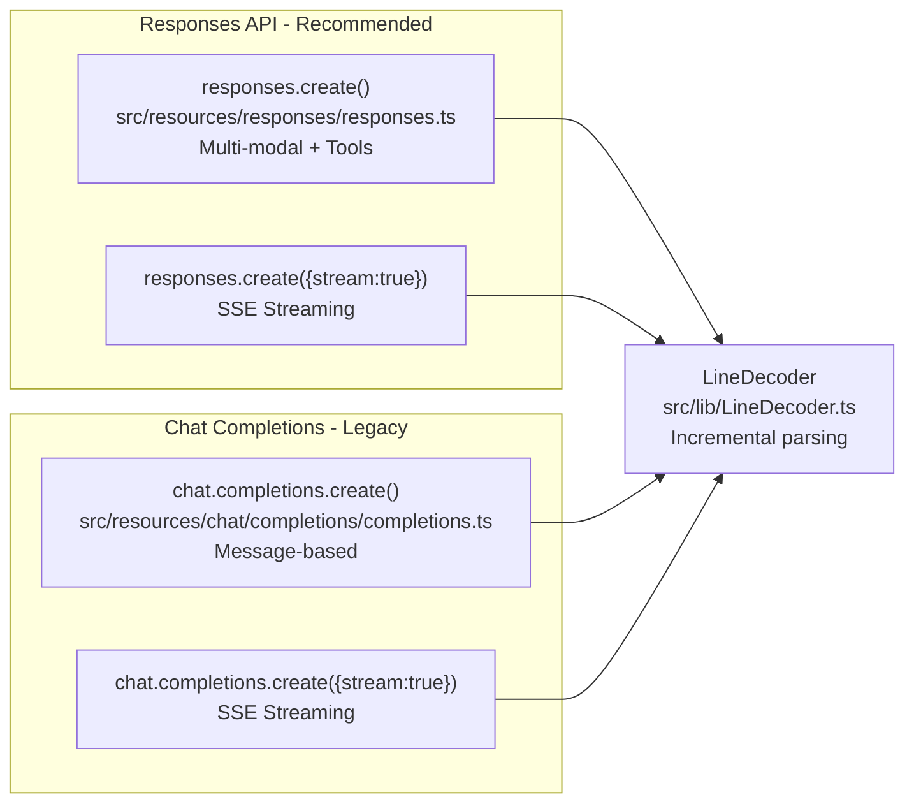

**Conversational AI System (Assistants API)**

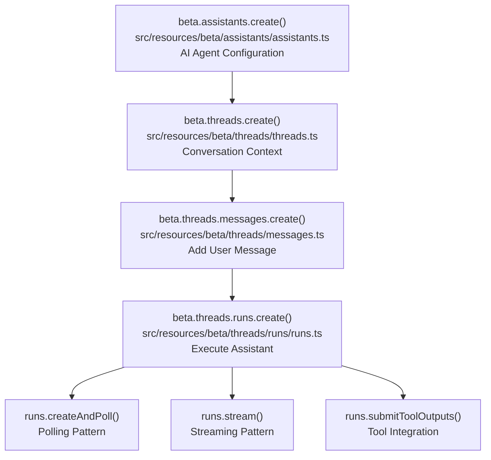

**Media Processing and Real-time**

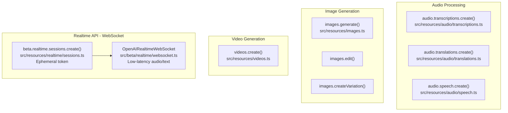

Each resource class extends `APIResource` and provides type-safe methods for API endpoints. The Responses API is the recommended interface for new applications, while Chat Completions remains supported indefinitely for backward compatibility.

Sources: [src/resources/index.ts:1-152](), [README.md:32-90](), [api.md:1-115](), [jsr.json:4-8]()

## Supported Platforms and Runtimes

The SDK achieves broad compatibility by relying exclusively on Web Standard APIs (`fetch`, `ReadableStream`, `WebSocket`) available across modern JavaScript runtimes:

| Runtime | Support Level | Notes |
|---------|---------------|-------|
| Node.js | Full support | Uses native `fetch` (Node 18+) |
| Deno | Full support | Native via JSR `@openai/openai` |
| Bun | Full support | Native Web APIs |
| Cloudflare Workers | Full support | Edge runtime compatible |
| Vercel Edge Runtime | Full support | Edge runtime compatible |
| Web Browsers | Limited | Requires `dangerouslyAllowBrowser: true` |

**Multi-target Distribution:**
- **npm (`openai`)**: Dual CommonJS/ESM builds in `dist/` directory [package.json:72-87]()
- **JSR (`@openai/openai`)**: Native TypeScript sources for Deno [jsr.json:4-8]()
- **Export maps**: Runtime-appropriate module resolution via `package.json` exports [package.json:72-87]()

Sources: [README.md:17-29](), [package.json:72-87](), [jsr.json:1-17](), [package.json:29]()

## Key Features and Capabilities

### Zero-Dependency HTTP Infrastructure

The SDK implements all HTTP functionality using native Web APIs:

- **Web Fetch API**: All HTTP requests use native `fetch()` (no `node-fetch` or `axios`).
- **Retry system**: Automatic retry with exponential backoff for 429/5xx errors.
- **Authentication**: Supports static API keys and dynamic token providers (Azure AD, Workload Identity).
- **Timeout handling**: Default 10-minute timeout with per-request override.

Sources: [README.md:72-167](), [package.json:29]()

### Comprehensive API Coverage

**Core Text and Embedding APIs:**
- **Responses API** (`responses.create()`): Recommended interface for multi-modal text generation, tool usage, and structured outputs [src/resources/responses/responses.ts]().
- **Chat Completions** (`chat.completions.create()`): Legacy interface supported indefinitely with function calling and streaming [src/resources/chat/completions/completions.ts]().
- **Embeddings** (`embeddings.create()`): Text vectorization with base64 encoding optimization [src/resources/embeddings.ts]().

**Media Processing:**
- **Audio** (`audio.*`): Transcription, translation, and speech synthesis with streaming [src/resources/audio/audio.ts]().
- **Images** (`images.*`): Generation, editing, and variations with streaming support [src/resources/images.ts]().
- **Videos** (`videos.*`): Video generation, character creation, and management [src/resources/videos.ts]().

**Conversational AI (Beta):**
- **Assistants** (`beta.assistants.*`): Stateful AI agents with tool execution (FunctionTool, CodeInterpreterTool, FileSearchTool).
- **Threads** (`beta.threads.*`): Persistent conversation context across multiple runs.
- **Real-time Communication**: WebSocket-based low-latency audio/text conversations [src/resources/realtime/realtime.ts]().

**Supporting Services:**
- **Files** (`files.*`): Upload and management with purpose-based workflows (`fine-tune`, `assistants`, `batch`) [src/resources/files.ts]().
- **Fine-tuning** (`fineTuning.*`): Custom model training with checkpoints and graders [src/resources/fine-tuning/fine-tuning.ts]().
- **Batches** (`batches.*`): Asynchronous batch request processing [src/resources/batches.ts]().
- **Evaluations** (`evals.*`): Model performance testing [src/resources/evals/evals.ts]().

Sources: [src/resources/index.ts:1-152](), [README.md:30-224](), [api.md:1-115]()

### Developer Experience Features

- **Full TypeScript support**: Generated type definitions for all API parameters and responses.
- **Workload Identity**: Support for Kubernetes, Azure, and GCP short-lived tokens [README.md:72-167]().
- **Streaming**: Native async generator support for SSE streams [README.md:168-183]().
- **File Handling**: Multiple upload formats via `toFile()` helper and native stream support [README.md:185-221]().

Sources: [README.md:72-221](), [src/index.ts:1-30]()

## Distribution and Build System

The SDK uses a sophisticated build system to support multiple JavaScript runtimes and distribution channels:

```mermaid
graph LR
    TypeScriptSource["`src/index.ts`<br/>`src/resources/`<br/>`src/core/`"]
    
    subgraph "Build Pipeline"
        NPMBuild["`dist/index.js`<br/>`dist/index.mjs`<br/>`dist/index.d.ts`"]
        JSRBuild["`dist-deno/index.ts`<br/>`dist-deno/jsr.json`"]
        BuildScript["`scripts/build`<br/>`scripts/build-deno`"]
    end
    
    subgraph "Distribution"
        NPMRegistry["`npm install openai`<br/>package.json exports"]
        JSRRegistry["`deno add jsr:@openai/openai`<br/>jsr.json exports"]
    end
    
    TypeScriptSource --> BuildScript
    BuildScript --> NPMBuild
    BuildScript --> JSRBuild
    
    NPMBuild --> NPMRegistry
    JSRBuild --> JSRRegistry
```

**Build Process:**
- **TypeScript compilation**: Generates both CommonJS and ESM outputs [package.json:72-87]().
- **Deno transformation**: Converts imports and Node.js-specific code for Deno compatibility [scripts/build-deno:1-15](), [scripts/utils/convert-jsr-readme.cjs:1-140]().
- **Export maps**: Provides runtime-appropriate module resolution [package.json:72-87]().

Sources: [package.json:72-87](), [scripts/build-deno:1-15](), [jsr.json:4-8](), [scripts/utils/convert-jsr-readme.cjs:1-140]()

---

# Page: Installation and Setup

# Installation and Setup

<details>
<summary>Relevant source files</summary>

The following files were used as context for generating this wiki page:

- [.devcontainer/devcontainer.json](.devcontainer/devcontainer.json)
- [.release-please-manifest.json](.release-please-manifest.json)
- [CHANGELOG.md](CHANGELOG.md)
- [README.md](README.md)
- [jsr.json](jsr.json)
- [package.json](package.json)
- [scripts/build-deno](scripts/build-deno)
- [scripts/utils/convert-jsr-readme.cjs](scripts/utils/convert-jsr-readme.cjs)
- [src/version.ts](src/version.ts)
- [tsconfig.build.json](tsconfig.build.json)
- [tsconfig.deno.json](tsconfig.deno.json)
- [tsconfig.json](tsconfig.json)

</details>


This page covers the installation of the OpenAI TypeScript/JavaScript SDK and basic client initialization. It explains package manager installation, runtime requirements, API key configuration, and client instantiation patterns. For detailed configuration options like retries, timeouts, and proxy settings, see [Core Client](). For Azure-specific deployment setup, see [Azure OpenAI Client]().

## Package Installation

The SDK is distributed through two primary registries: NPM and JSR (JavaScript Registry for Deno).

### NPM Installation

```bash
npm install openai
```

The package is published as `openai` on the NPM registry with zero runtime dependencies.

**Sources:** [package.json:1-30](), [README.md:11-15]()

### JSR Installation

For Deno, Bun with JSR, or npm with JSR:

```bash
# Deno
deno add jsr:@openai/openai

# npm/npx
npx jsr add @openai/openai
```

Direct import without installation (Deno only):

```typescript
import OpenAI from 'jsr:@openai/openai';
```

**Sources:** [README.md:17-28](), [jsr.json:1-17]()

### Package Distribution Architecture

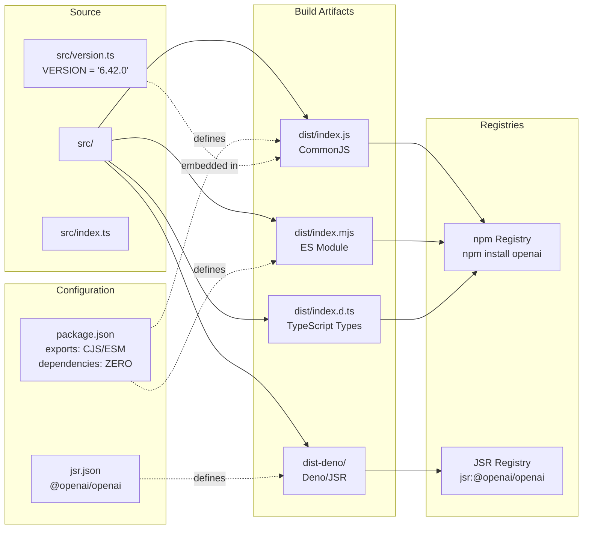

The build system generates dual-mode outputs (CommonJS and ESM) from TypeScript source files. The package uses `"type": "commonjs"` with conditional exports for ESM support. Version synchronization occurs across three files: `package.json`, `src/version.ts`, and `.release-please-manifest.json`.

**Sources:** [package.json:1-87](), [jsr.json:1-17](), [src/version.ts:1-1](), [.release-please-manifest.json:1-3](), [scripts/build-deno:1-15]()

## Supported Runtimes

| Runtime | Minimum Version | Notes |
|---------|----------------|-------|
| Node.js | 20 LTS or later | Non-EOL versions recommended |
| Deno | v1.28.0 or higher | Native support via JSR |
| Bun | 1.0 or later | Native support |
| Cloudflare Workers | N/A | Supported |
| Vercel Edge Runtime | N/A | Supported |
| Browsers | N/A | Requires `dangerouslyAllowBrowser: true` |

**TypeScript Requirement:** >= 5.8.3 (as specified in devDependencies)

**Sources:** [package.json:36-59](), [tsconfig.json:1-37]()

## API Key Configuration

The SDK requires authentication via an API key or Workload Identity, which can be provided through multiple methods:

### Environment Variable (Recommended)

```bash
export OPENAI_API_KEY='sk-...'
```

The `OpenAI` client constructor reads from `process.env['OPENAI_API_KEY']` by default.

**Sources:** [README.md:39-41]()

### Constructor Option

```typescript
import OpenAI from 'openai';

const client = new OpenAI({
  apiKey: 'sk-...'
});
```

**Sources:** [README.md:39-41]()

### Workload Identity Authentication

For secure, automated environments, you can use workload identity authentication with short-lived tokens from cloud identity providers instead of long-lived API keys. This is supported for Kubernetes, Azure, and GCP.

```typescript
import OpenAI from 'openai';
import { k8sServiceAccountTokenProvider } from 'openai/auth';

const client = new OpenAI({
  workloadIdentity: {
    identityProviderId: 'idp-123',
    serviceAccountId: 'sa-456',
    provider: k8sServiceAccountTokenProvider('/var/run/secrets/kubernetes.io/serviceaccount/token'),
  },
});
```

**Sources:** [README.md:72-163]()

### Authentication Configuration Flow

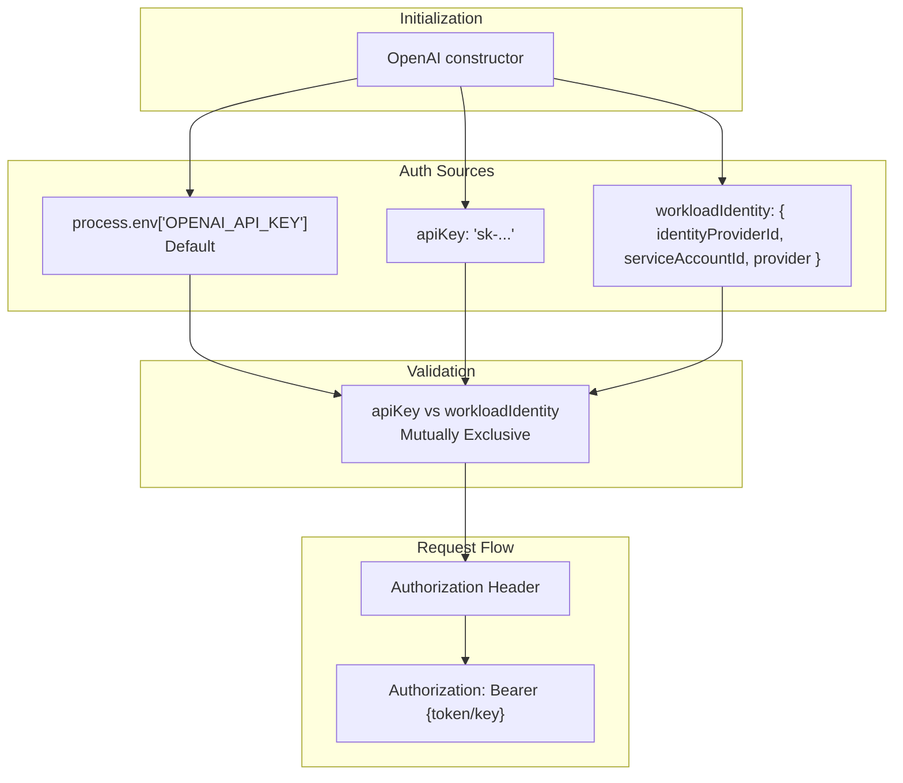

**Sources:** [README.md:39-41](), [README.md:72-78]()

## Client Initialization

### Basic Initialization

```typescript
import OpenAI from 'openai';

const client = new OpenAI({
  apiKey: process.env['OPENAI_API_KEY'], // Optional: defaults to env var
});
```

**Sources:** [README.md:36-50]()

### Client Initialization with Options

```typescript
import OpenAI from 'openai';

const client = new OpenAI({
  apiKey: 'sk-...',
  organization: 'org-...',       // Optional: defaults to OPENAI_ORG_ID env var
  project: 'proj_...',           // Optional: defaults to OPENAI_PROJECT_ID env var
  baseURL: 'https://api.openai.com/v1',  // Optional: custom base URL
  timeout: 20 * 1000,            // Optional: 20 seconds
  maxRetries: 2,                 // Optional: defaults to 2
});
```

**Sources:** [README.md:39-41](), [README.md:57-59]()

## Azure OpenAI Setup

Azure OpenAI requires additional configuration beyond the standard client, specifically an `endpoint` and `apiVersion`.

### Azure Client Initialization

```typescript
import { AzureOpenAI } from 'openai';
import { azureManagedIdentityTokenProvider } from 'openai/auth';

const client = new AzureOpenAI({
  apiKey: process.env['AZURE_OPENAI_API_KEY'],
  apiVersion: '2024-02-15-preview',
  endpoint: 'https://example-resource.azure.openai.com'
});
```

**Sources:** [README.md:100-113]()

### Azure vs Standard OpenAI Client Mapping

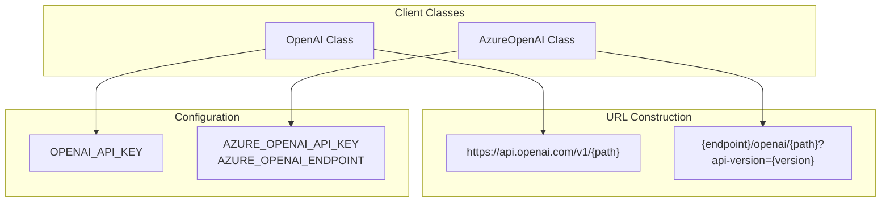

**Sources:** [README.md:100-113]()

## Verification

After installation and initialization, verify the setup with a simple request using the `Responses API`.

```typescript
import OpenAI from 'openai';

const client = new OpenAI();

const response = await client.responses.create({
  model: 'gpt-5.5',
  instructions: 'Verify setup',
  input: 'Is the SDK installed correctly?',
});

console.log(response.output_text);
```

**Sources:** [README.md:36-50]()

---

# Page: Core Client

# Core Client

<details>
<summary>Relevant source files</summary>

The following files were used as context for generating this wiki page:

- [api.md](api.md)
- [src/azure.ts](src/azure.ts)
- [src/client.ts](src/client.ts)
- [src/index.ts](src/index.ts)
- [src/resources/index.ts](src/resources/index.ts)
- [tests/index.test.ts](tests/index.test.ts)
- [tests/lib/azure.test.ts](tests/lib/azure.test.ts)
- [tests/log.test.ts](tests/log.test.ts)
- [tests/responses.test.ts](tests/responses.test.ts)
- [tests/utils/typing.ts](tests/utils/typing.ts)

</details>


The Core Client system provides the main client classes and configuration options for the OpenAI Node.js SDK. This page covers the `OpenAI` and `AzureOpenAI` client classes, their configuration options, and the underlying HTTP layer architecture.

For detailed information about specific client implementations and advanced features, see [OpenAI Client](#3.1) and [Azure OpenAI Client](#3.2).

## Main Client Classes

The SDK is built around a hierarchical client architecture where specialized clients inherit from a base implementation to provide consistent behavior across different environments.

### Core Client Hierarchy

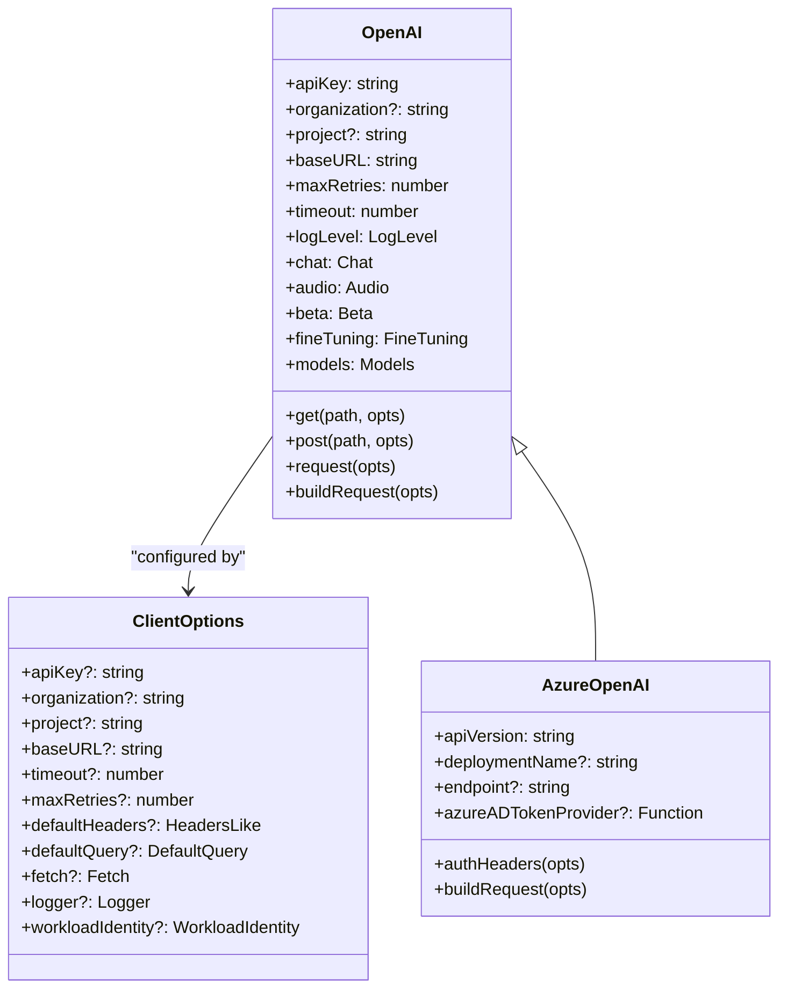

**Sources:** [src/client.ts:756-778](), [src/azure.ts:41-151](), [src/client.ts:200-260]()

The `OpenAI` class serves as the base for all interactions, managing the request lifecycle, retries, and resource organization [src/client.ts:756-1100](). `AzureOpenAI` extends this base to handle Azure-specific deployment routing and authentication schemes like `api-key` headers or Active Directory tokens [src/azure.ts:125-150]().

## Client Configuration Options

Clients are configured via a `ClientOptions` object [src/client.ts:200-260](), which supports both explicit passing and environment variable fallbacks via `readEnv` [src/client.ts:632-650]().

### Authentication and Identity

| Option | Type | Description | Default |
|--------|------|-------------|---------|
| `apiKey` | `string` | Primary API credential | `process.env['OPENAI_API_KEY']` |
| `organization` | `string` | Organization identifier | `process.env['OPENAI_ORG_ID']` |
| `project` | `string` | Project identifier | `process.env['OPENAI_PROJECT_ID']` |
| `workloadIdentity` | `WorkloadIdentity` | Token exchange config | N/A |

**Sources:** [src/client.ts:203-214](), [src/client.ts:632-645](), [src/auth/workload-identity-auth.ts:1-20]()

### Network and HTTP Layer

| Option | Type | Description | Default |
|--------|------|-------------|---------|
| `baseURL` | `string` | API root URL | `https://api.openai.com/v1` |
| `timeout` | `number` | Request timeout (ms) | `600000` (10 min) |
| `maxRetries` | `number` | Retry attempts | `2` |
| `fetch` | `Fetch` | Custom fetch engine | `globalThis.fetch` |

**Sources:** [src/client.ts:216-228](), [tests/index.test.ts:131-132](), [src/client.ts:632-633]()

### Logging and Debugging

The SDK includes a built-in logging system that can be configured via `logLevel` or the `OPENAI_LOG` environment variable [src/client.ts:246-258](). Supported levels include `off`, `error`, `warn`, `info`, and `debug` [src/client.ts:8]().

**Sources:** [tests/index.test.ts:130-132](), [tests/index.test.ts:164-171](), [src/internal/utils/log.ts:1-10]()

## HTTP Layer Architecture

The SDK abstracts the underlying HTTP communication through several internal utilities and a custom promise wrapper.

### Request Execution Flow

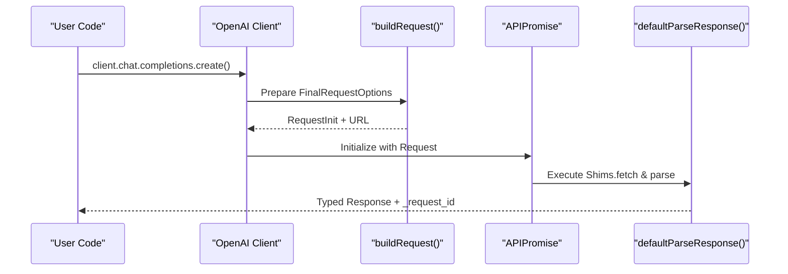

**Sources:** [src/client.ts:1011-1050](), [src/core/api-promise.ts:1-50](), [src/internal/parse.ts:18-84]()

### The APIPromise Wrapper
All client methods return an `APIPromise`, which extends the standard `Promise`. It provides additional methods like `.asResponse()` to access the raw `Response` object and `.withResponse()` to get both data and metadata (like `_request_id`) simultaneously [src/core/api-promise.ts:10-40]().

**Sources:** [tests/responses.test.ts:30-40](), [src/core/api-promise.ts:1-72]()

### Streaming Support
For streaming endpoints, the SDK uses a `Stream` class that implements `AsyncIterable`. It handles Server-Sent Events (SSE) parsing and provides utilities for managing the lifecycle of the stream [src/core/streaming.ts:21-217]().

**Sources:** [src/core/streaming.ts:163-185](), [src/internal/parse.ts:24-45]()

## Client Instantiation Patterns

### OpenAI Standard
```typescript
import OpenAI from 'openai';

// Uses process.env['OPENAI_API_KEY'] by default
const client = new OpenAI();
```

### Azure OpenAI
Azure requires an `apiVersion` and either an `endpoint` or `baseURL`. It supports deployment-based routing where the model name is injected into the URL path if the `deployment` option is provided [src/azure.ts:125-137]().

```typescript
import { AzureOpenAI } from 'openai';

const client = new AzureOpenAI({
  endpoint: 'https://my-resource.azure.openai.com',
  apiVersion: '2024-02-15-preview',
  deployment: 'my-gpt-4-deployment'
});
```

**Sources:** [src/azure.ts:62-123](), [tests/lib/azure.test.ts:26-31]()

## Summary

The Core Client provides:
1. **Unified Interface**: A consistent pattern for `get`, `post`, and `request` across all resources [src/client.ts:930-970]().
2. **Flexible Auth**: Support for API Keys, Azure AD tokens, and Workload Identity [src/auth/workload-identity-auth.ts:1-20](), [src/azure.ts:141-150]().
3. **Robust Lifecycle**: Integrated retry logic, timeout management, and automatic response parsing [src/client.ts:1011-1050]().
4. **Metadata Injection**: Automatic attachment of `_request_id` to response objects for easier debugging [tests/responses.test.ts:51-55]().

For details, see [OpenAI Client](#3.1) and [Azure OpenAI Client](#3.2).

---

# Page: OpenAI Client

# OpenAI Client

<details>
<summary>Relevant source files</summary>

The following files were used as context for generating this wiki page:

- [src/azure.ts](src/azure.ts)
- [src/client.ts](src/client.ts)
- [src/core/resource.ts](src/core/resource.ts)
- [src/core/streaming.ts](src/core/streaming.ts)
- [src/internal/errors.ts](src/internal/errors.ts)
- [src/internal/headers.ts](src/internal/headers.ts)
- [src/internal/parse.ts](src/internal/parse.ts)
- [src/internal/qs/formats.ts](src/internal/qs/formats.ts)
- [src/internal/qs/stringify.ts](src/internal/qs/stringify.ts)
- [src/internal/qs/utils.ts](src/internal/qs/utils.ts)
- [src/internal/request-options.ts](src/internal/request-options.ts)
- [tests/index.test.ts](tests/index.test.ts)
- [tests/lib/azure.test.ts](tests/lib/azure.test.ts)
- [tests/log.test.ts](tests/log.test.ts)
- [tests/responses.test.ts](tests/responses.test.ts)
- [tests/utils/typing.ts](tests/utils/typing.ts)

</details>


## Purpose and Scope

This page documents the main `OpenAI` client class, its configuration options, authentication mechanisms, and request handling behavior. It covers client instantiation, configuration precedence, environment variable usage, and core request/response patterns.

The `OpenAI` client is designed to be zero-dependency and supports multiple runtimes including Node.js, Bun, Deno, and browsers. It provides the foundation for all [API Resources](#4) such as Chat, Embeddings, and Assistants.

For Azure-specific client functionality, see [Azure OpenAI Client](#3.2). For detailed API resource usage, see [API Resources](#4). For advanced streaming capabilities, see [Streaming](#5.1).

## Client Class Overview

The `OpenAI` class serves as the primary interface for interacting with OpenAI's APIs. It handles authentication, request building, retry logic, and response processing.

### Code Entity Space: OpenAI Client Structure
The following diagram maps the high-level client configuration to the internal code entities and types used for request preparation.

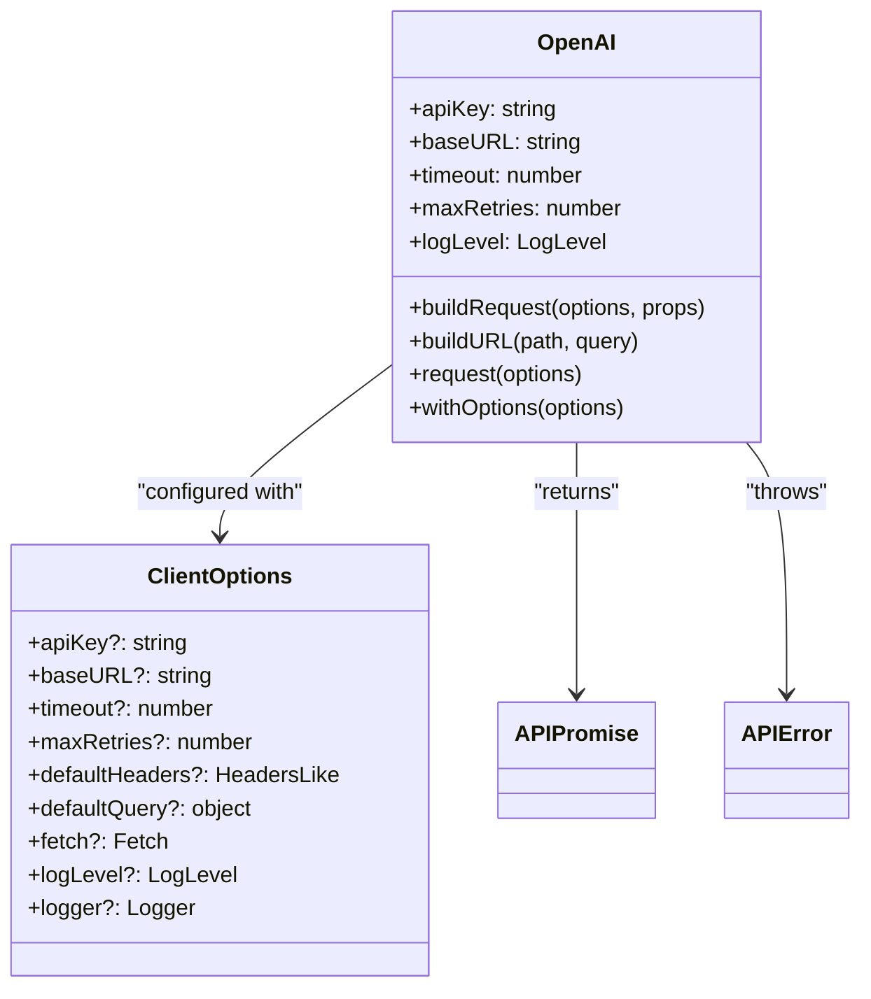

**Client Instantiation Flow**

The constructor initializes resource groups (e.g., `chat`, `images`) and resolves configuration by merging environment variables with explicit options.

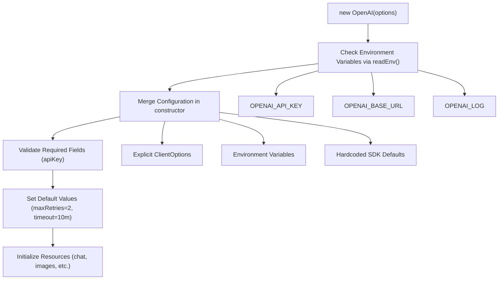

Sources: [src/client.ts:233-315](), [tests/index.test.ts:10-28](), [src/internal/request-options.ts:12-84]()

## Configuration Options

The `ClientOptions` interface defines all available configuration parameters for the OpenAI client.

| Option | Type | Default | Description |
|--------|------|---------|-------------|
| `apiKey` | `string` | `process.env.OPENAI_API_KEY` | API authentication key |
| `baseURL` | `string` | `"https://api.openai.com/v1"` | Base URL for API requests |
| `timeout` | `number` | `600,000` (10m) | Request timeout in milliseconds |
| `maxRetries` | `number` | `2` | Maximum number of retry attempts |
| `defaultHeaders` | `HeadersLike` | `{}` | Headers added to every request |
| `defaultQuery` | `object` | `{}` | Query parameters added to every request |
| `fetch` | `Fetch` | `globalThis.fetch` | Custom fetch implementation |
| `logLevel` | `LogLevel` | `"warn"` | Logging verbosity level (`'debug'`, `'info'`, `'warn'`, `'error'`, `'off'`) |
| `logger` | `Logger` | `console` | Custom logger implementation |

**Configuration Precedence**

The client resolves configuration using a specific hierarchy:
1. **Explicit options** passed to the constructor or `withOptions()`.
2. **Environment variables** (e.g., `OPENAI_API_KEY`).
3. **Internal defaults** defined in the SDK.

Sources: [src/client.ts:233-270](), [tests/index.test.ts:130-134](), [tests/index.test.ts:197-217]()

## Authentication

The client primarily supports API key authentication via the `Authorization: Bearer` header. It also supports **Workload Identity** for environments like Kubernetes, Azure Managed Identity, and GCP via `WorkloadIdentityAuth`.

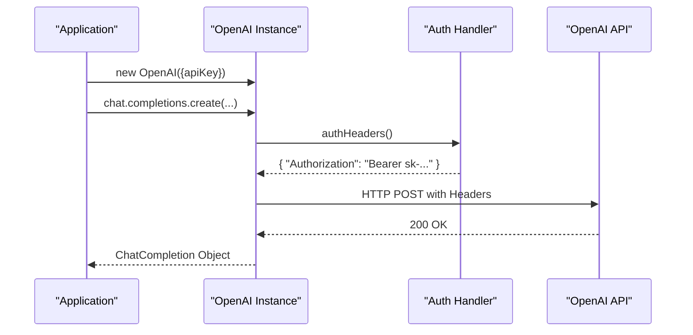

**Authentication Header Processing**
The client redacts the `Authorization` header in debug logs to prevent credential leakage. If `logLevel` is set to `debug`, the logger replaces sensitive values with `***` in `formatRequestDetails`.

Sources: [src/client.ts:850-863](), [tests/log.test.ts:30-43](), [src/auth/workload-identity-auth.ts:1-20](), [src/internal/parse.ts:6-16]()

## Request Lifecycle and Data Flow

The client manages the entire lifecycle of an HTTP request, from building the URL to parsing the response and attaching metadata like Request IDs.

### Natural Language to Code Entity Space: Request/Response Flow
This diagram maps the logical phases of a request to the specific functions and classes in the codebase that handle them.

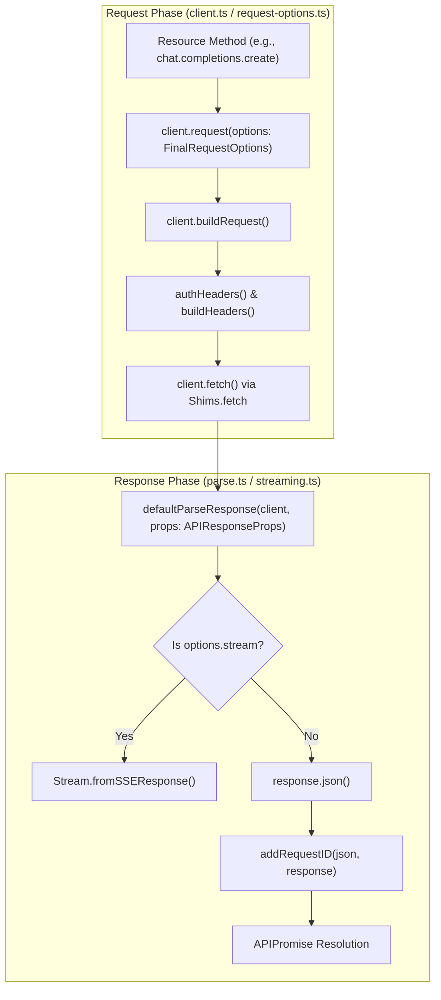

### Request Building
`buildRequest` merges global `defaultHeaders` with request-specific headers. It also handles the `x-stainless-retry-count` header for tracking retries and generates a `requestLogID` using `uuid4()`.

### Response Parsing
The `defaultParseResponse` function in `src/internal/parse.ts` handles:
- **JSON Parsing**: Automatically parses JSON bodies and calls `addRequestID` to inject the `_request_id` property.
- **Streaming**: Initializes a `Stream` object for Server-Sent Events (SSE) responses using `Stream.fromSSEResponse`.
- **Binary Data**: Returns the raw response if `options.__binaryResponse` is set.
- **Empty Responses**: Returns `null` for HTTP `204` No Content.

Sources: [src/client.ts:792-840](), [src/internal/parse.ts:18-84](), [src/internal/headers.ts:71-92](), [src/internal/utils/uuid.ts:5-5]()

## Retry Logic

The client implements automatic retries for transient failures using exponential backoff with jitter.

**Retryable Conditions:**
- HTTP `408` (Request Timeout)
- HTTP `409` (Conflict)
- HTTP `429` (Rate Limit)
- HTTP `>= 500` (Internal Server Errors)
- Network connectivity errors (e.g., `ECONNREFUSED`) or `AbortError` handled via `isAbortError`.

The client respects the `Retry-After` header if present in `429` or `5xx` responses to determine the wait duration before the next attempt.

Sources: [src/client.ts:881-915](), [tests/index.test.ts:663-691](), [src/internal/utils/sleep.ts:7-7](), [src/internal/errors.ts:3-12]()

## URL and Query Parameter Handling

The `buildURL` method combines the `baseURL`, request `path`, and `query` parameters.

- **Default Query**: Parameters in `defaultQuery` are included in every request.
- **Null/Undefined**: Passing `null` for a header or query param in a specific request will remove it from the final request via `buildHeaders` or query serialization logic.
- **Serialization**: Query parameters are serialized using `stringifyQuery` which leverages a custom implementation in `src/internal/qs/stringify.ts` to handle nested objects and arrays.

Sources: [src/client.ts:865-879](), [tests/index.test.ts:44-51](), [src/internal/utils/query.ts:1-14](), [src/internal/qs/stringify.ts:60-220]()

## Environment Variables

The client automatically reads several environment variables during initialization if the corresponding options are not provided in the constructor.

| Environment Variable | SDK Usage |
|----------------------|-----------|
| `OPENAI_API_KEY` | Used as the default `apiKey`. |
| `OPENAI_ORG_ID` | Used as the default `organization`. |
| `OPENAI_PROJECT_ID` | Used as the default `project`. |
| `OPENAI_BASE_URL` | Overrides the default base URL. |
| `OPENAI_LOG` | Sets the initial `logLevel` (parsed in constructor). |

Sources: [src/client.ts:245-265](), [tests/index.test.ts:155-174](), [tests/index.test.ts:53-65]()

## Client Instance Management

### withOptions()
The `withOptions()` method allows creating a new client instance that inherits configuration from the current one but overrides specific values. This is useful for per-request configuration changes like different timeouts or headers.

### Request IDs
Every successful non-streaming JSON response has a non-enumerable `_request_id` property attached. This ID corresponds to the `x-request-id` header sent by the OpenAI API and is crucial for debugging and support.

Sources: [src/client.ts:317-323](), [src/internal/parse.ts:91-100](), [tests/responses.test.ts:42-55]()

---

# Page: Azure OpenAI Client

# Azure OpenAI Client

<details>
<summary>Relevant source files</summary>

The following files were used as context for generating this wiki page:

- [azure.md](azure.md)
- [helpers.md](helpers.md)
- [realtime.md](realtime.md)
- [src/azure.ts](src/azure.ts)
- [src/client.ts](src/client.ts)
- [tests/api-resources/embeddings-base64-response.json](tests/api-resources/embeddings-base64-response.json)
- [tests/api-resources/embeddings-float-response.json](tests/api-resources/embeddings-float-response.json)
- [tests/index.test.ts](tests/index.test.ts)
- [tests/lib/azure.test.ts](tests/lib/azure.test.ts)
- [tests/log.test.ts](tests/log.test.ts)
- [tests/responses.test.ts](tests/responses.test.ts)
- [tests/utils/typing.ts](tests/utils/typing.ts)

</details>


## Purpose and Scope

The Azure OpenAI Client provides specialized functionality for interfacing with Microsoft Azure's OpenAI service. It extends the base `OpenAI` client class with Azure-specific authentication, URL routing, and deployment management capabilities. This document covers the Azure-specific configuration, authentication methods, and deployment routing mechanisms, including support for Realtime APIs.

For information about the base client functionality, see [OpenAI Client](3.1). For general installation and setup instructions, see [Installation and Setup](2).

---

## Class Architecture

The `AzureOpenAI` class extends the base `OpenAI` client and overrides key methods to accommodate Azure's service architecture.

### Code Entity Space: Azure Client Inheritance
Title: Azure OpenAI Client Inheritance Structure
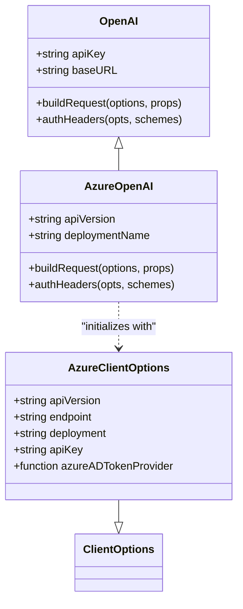
Sources: [src/azure.ts:11-38](), [src/azure.ts:41-151]()

---

## Configuration Options

The `AzureOpenAI` client requires Azure-specific configuration parameters in addition to the base client options.

### Required Parameters

| Parameter | Type | Default | Description |
|-----------|------|---------|-------------|
| `apiVersion` | `string` | `process.env['OPENAI_API_VERSION']` | Azure API version (e.g., `'2024-02-15-preview'`) [src/azure.ts:15](). |
| `endpoint` or `baseURL` | `string` | `process.env['AZURE_OPENAI_ENDPOINT']` | Azure resource endpoint [src/azure.ts:20](). |

### Optional Parameters

| Parameter | Type | Default | Description |
|-----------|------|---------|-------------|
| `deployment` | `string` | `undefined` | Default model deployment name. Sets the base client URL to include `/deployments/{deployment}` [src/azure.ts:26](). |
| `apiKey` | `string` | `process.env['AZURE_OPENAI_API_KEY']` | Azure API key [src/azure.ts:31](). |
| `azureADTokenProvider` | `() => Promise<string>` | `undefined` | Azure AD token provider function for Microsoft Entra authentication [src/azure.ts:37](). |

**Example Initialization:**

```typescript
import { AzureOpenAI } from 'openai';

const client = new AzureOpenAI({
  endpoint: 'https://my-resource.azure.openai.com',
  apiKey: process.env.AZURE_OPENAI_API_KEY,
  apiVersion: '2024-02-15-preview',
});
```
Sources: [src/azure.ts:11-38](), [src/azure.ts:62-71](), [tests/lib/azure.test.ts:26-31]()

---

## Base URL Construction

The Azure client constructs base URLs differently than the standard OpenAI client, converting resource endpoints to OpenAI-compatible paths.

Title: Azure URL Construction Logic
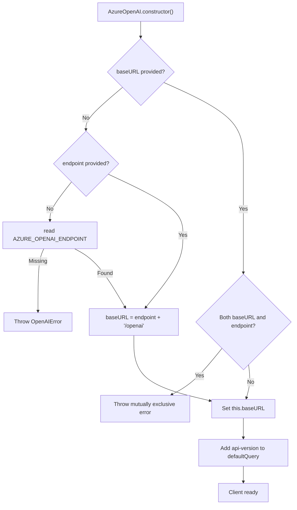
Sources: [src/azure.ts:93-112](), [tests/lib/azure.test.ts:86-89](), [tests/lib/azure.test.ts:162-182]()

---

## Authentication Methods

The Azure client supports two mutually exclusive authentication methods.

### API Key Authentication

When using API key authentication, the client sends credentials via the `api-key` header (not the `Authorization` header used by the standard OpenAI client). This is implemented by overriding `authHeaders` [src/azure.ts:141-150]().

### Azure AD Token Provider

For Azure Active Directory (Azure Entra) authentication, provide an async function `azureADTokenProvider` [src/azure.ts:37](). The function is invoked on every request, allowing for dynamic token management.

**Key Differences:**

| Feature | API Key | Azure AD Token Provider |
|---------|---------|-------------------------|
| Header Used | `api-key` | `Authorization: Bearer` |
| Implementation | Static header in `authHeaders` | `apiKey` is set to the provider function [src/azure.ts:115]() |
| Browser Safety | Requires `dangerouslyAllowBrowser: true` | Automatically sets `dangerouslyAllowBrowser: true` [src/azure.ts:79]() |

Sources: [src/azure.ts:78-92](), [src/azure.ts:114-119](), [src/azure.ts:141-150]()

---

## Deployment Routing

Azure OpenAI uses deployment names in API paths. The `AzureOpenAI` client automatically converts model parameters to deployment paths for specific endpoints defined in `_deployments_endpoints` [src/azure.ts:153-163]().

### Code Entity Space: Deployment Path Injection
Title: Request Lifecycle with Deployment Injection
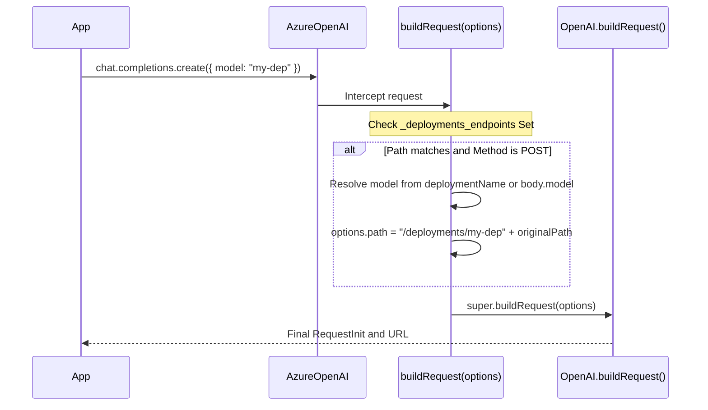
Sources: [src/azure.ts:125-139](), [src/azure.ts:153-163]()

---

## Realtime API Support

The SDK provides specialized support for Azure OpenAI Realtime via WebSockets. To utilize real-time features, you should create a fully configured `AzureOpenAI` client and pass it into the `.azure()` helper on the Realtime classes.

### Initialization Example

```typescript
import { AzureOpenAI } from 'openai';
import { OpenAIRealtimeWS } from 'openai/realtime/ws';

const client = new AzureOpenAI({
  apiKey: process.env.AZURE_OPENAI_API_KEY,
  apiVersion: '2024-10-01-preview',
  deployment: 'my-realtime-deployment',
});

const rt = await OpenAIRealtimeWS.azure(client);
```

**Implementation Details:**
- **Endpoint Structure**: Azure Realtime uses a different URL structure compared to standard OpenAI, which the `.azure()` helper handles automatically.
- **Authentication**: Supports both API key (via `api-key` query param or header) and Azure AD token providers.

Sources: [azure.md:33-53](), [src/azure.ts:122]()

---

## Error Handling and Validation

The `AzureOpenAI` constructor performs several strict validations:

1.  **API Version**: Throws if `apiVersion` is missing or empty [src/azure.ts:72-76]().
2.  **Credentials**: Throws if neither `apiKey` nor `azureADTokenProvider` is provided [src/azure.ts:82-86]().
3.  **Mutual Exclusivity**: Throws if both `apiKey` and `azureADTokenProvider` are provided [src/azure.ts:88-92]().
4.  **Base URL vs Endpoint**: Throws if both `baseURL` and `endpoint` are provided [src/azure.ts:109-112]().

Sources: [src/azure.ts:72-112](), [tests/lib/azure.test.ts:199-211]()

---

# Page: API Resources

# API Resources

<details>
<summary>Relevant source files</summary>

The following files were used as context for generating this wiki page:

- [api.md](api.md)
- [src/index.ts](src/index.ts)
- [src/resources/chat/chat.ts](src/resources/chat/chat.ts)
- [src/resources/chat/completions.ts](src/resources/chat/completions.ts)
- [src/resources/chat/index.ts](src/resources/chat/index.ts)
- [src/resources/completions.ts](src/resources/completions.ts)
- [src/resources/embeddings.ts](src/resources/embeddings.ts)
- [src/resources/files.ts](src/resources/files.ts)
- [src/resources/index.ts](src/resources/index.ts)

</details>


This document provides an overview of the API resource organization and structure in the OpenAI Node.js client library. It covers how API endpoints are organized into resource classes, the hierarchical structure of resources, and common access patterns used across the library.

For detailed information about specific API resources and their methods, see the individual resource pages ([Responses API](#4.1) through [Skills](#4.20)). For information about the core client configuration and setup, see [Core Client](#3).

## Resource Organization Overview

The OpenAI client library organizes API endpoints into logical resource groupings, each implemented as a class that extends the base `APIResource` class [src/resources/files.ts:17](). Resources are structured hierarchically and accessed through the main `OpenAI` client instance using a dot-notation pattern.

```mermaid
graph TB
    subgraph "Main Client [src/client.ts]"
        OpenAI["OpenAI Client Class"]
    end
    
    subgraph "Core API Resources [src/resources/index.ts]"
        Chat["chat"]
        Completions["completions"]
        Embeddings["embeddings"]
        Files["files"]
        Images["images"]
        Audio["audio"]
        Models["models"]
        Moderations["moderations"]
        Responses["responses"]
    end
    
    subgraph "Beta Resources [src/resources/beta/beta.ts]"
        Beta["beta"]
        Assistants["beta.assistants"]
        Threads["beta.threads"]
        Realtime["beta.realtime"]
    end
    
    subgraph "Advanced & Admin Resources [src/resources/index.ts]"
        FineTuning["fineTuning"]
        Evals["evals"]
        VectorStores["vectorStores"]
        Batches["batches"]
        Videos["videos"]
        Containers["containers"]
        Admin["admin"]
        Skills["skills"]
        Webhooks["webhooks"]
    end
    
    OpenAI --> Chat
    OpenAI --> Completions
    OpenAI --> Embeddings
    OpenAI --> Files
    OpenAI --> Images
    OpenAI --> Audio
    OpenAI --> Models
    OpenAI --> Moderations
    OpenAI --> Responses
    OpenAI --> Beta
    OpenAI --> FineTuning
    OpenAI --> Evals
    OpenAI --> VectorStores
    OpenAI --> Batches
    OpenAI --> Videos
    OpenAI --> Containers
    OpenAI --> Admin
    OpenAI --> Skills
    OpenAI --> Webhooks
    
    Beta --> Assistants
    Beta --> Threads
    Beta --> Realtime
```

Sources: [src/resources/index.ts:3-152](), [api.md:1-120]()

## Main Client Structure

The `OpenAI` class serves as the primary entry point and contains instances of all resource classes [src/index.ts:7](). Each resource is instantiated as a property on the client, providing a clean namespace for API operations.

### Resource Instantiation Pattern

The following diagram maps the high-level client properties to their corresponding internal class implementations.

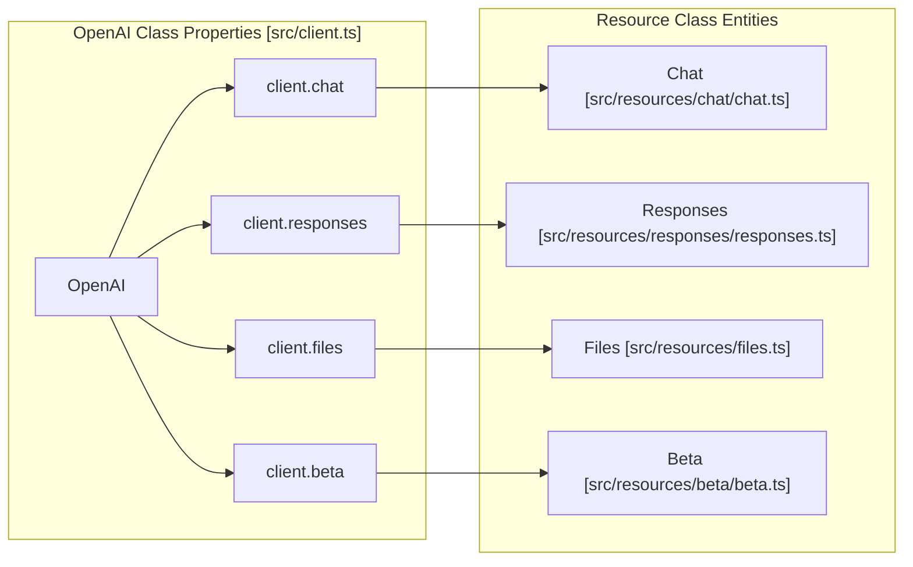

Sources: [src/resources/chat/chat.ts:53-55](), [src/resources/files.ts:17](), [src/resources/index.ts:3-152]()

## Resource Categories

The API resources are organized into several logical categories based on their functionality and stability:

| Category | Resources | Description |
|----------|-----------|-------------|
| **Core APIs** | `chat`, `completions`, `embeddings`, `files`, `images`, `audio`, `models`, `moderations` | Stable endpoints for primary AI capabilities. |
| **New APIs** | `responses`, `videos` | Next-generation APIs for complex interactions and media generation. |
| **Beta APIs** | `beta.assistants`, `beta.threads`, `beta.realtime` | Preview features under active development. |
| **Advanced Features** | `fineTuning`, `evals`, `vectorStores`, `batches`, `skills` | Specialized functionality for RAG, evaluation, and customization. |
| **Infrastructure** | `containers`, `webhooks`, `admin` | Supporting services for code execution, event handling, and organization management. |

Sources: [src/resources/index.ts:3-152](), [api.md:1-120]()

## Hierarchical Resource Structure

Some resources contain nested sub-resources, creating a hierarchical API structure that mirrors the OpenAI REST API organization. For example, `Chat` contains `Completions` [src/resources/chat/chat.ts:54](), and `Completions` (within Chat) contains `Messages` [api.md:92-96]().

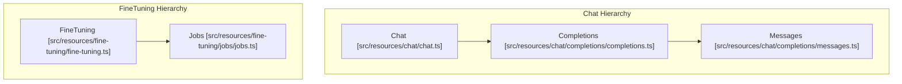

Sources: [src/resources/chat/chat.ts:54-59](), [api.md:92-96](), [src/resources/index.ts:17-100]()

## Common Resource Patterns

All API resources follow consistent patterns for common operations, providing a uniform developer experience across different endpoints.

### Standard CRUD Operations

Most resources implement a standard set of methods for Create, Read, Update, and Delete operations:

| Method | Purpose | Return Type | Example Usage |
|--------|---------|-------------|---------------|
| `create()` | Create a new resource | `APIPromise<Resource>` | `client.files.create({...})` [src/resources/files.ts:47]() |
| `retrieve()` | Get a specific resource by ID | `APIPromise<Resource>` | `client.files.retrieve('file-123')` [src/resources/files.ts:57]() |
| `update()` | Modify an existing resource | `APIPromise<Resource>` | `client.chat.completions.update(id, {...})` [api.md:88]() |
| `list()` | Get multiple resources with pagination | `PagePromise<Page, Resource>` | `client.files.list()` [src/resources/files.ts:64]() |
| `delete()` | Remove a resource | `APIPromise<DeletedObject>` | `client.files.delete('file-123')` [src/resources/files.ts:78]() |

### Streaming Support

Many resources support streaming responses for real-time data processing using the `Stream` class [src/resources/completions.ts:7]():

```typescript
// Example of streaming chat completions
const stream = await client.chat.completions.create({
  model: 'gpt-4o',
  messages: [{ role: 'user', content: 'Hello!' }],
  stream: true,
});
```
Sources: [src/resources/completions.ts:29](), [api.md:74]()

### Helper Methods and Utilities

Resources often include convenience methods beyond the basic CRUD operations:

| Resource | Helper Methods | Purpose |
|----------|----------------|---------|
| `files` | `waitForProcessing()` | Polls the file status until it reaches a terminal state (`processed`, `error`, or `deleted`) [src/resources/files.ts:97-118](). |
| `embeddings` | `create()` | Automatically handles `base64` encoding/decoding for performance optimization [src/resources/embeddings.ts:24-65](). |
| `webhooks` | Signature Verification | Helpers for verifying incoming webhook requests [src/resources/index.ts:152](). |

## Detailed Resource Pages

- [Responses API](#4.1) — Document the Responses API (recommended interface).
- [Chat Completions](#4.2) — Document the Chat Completions API (legacy interface).
- [Embeddings](#4.3) — Document the embeddings API for vector representations [src/resources/embeddings.ts:11]().
- [Audio Processing](#4.4) — Document audio transcription, translation, and speech.
- [Images](#4.5) — Document image generation, editing, and variation.
- [Moderations](#4.6) — Document content moderation API.
- [Files](#4.7) — Document file upload and management [src/resources/files.ts:15]().
- [Models](#4.8) — Document the models API for listing and retrieval.
- [Fine-tuning](#4.9) — Document fine-tuning jobs and methods.
- [Assistants API](#4.10) — Overview of the Assistants API system.
- [Realtime API](#4.11) — Document low-latency audio/text conversations.
- [Conversations](#4.12) — Document managing conversation history.
- [Vector Stores](#4.13) — Document vector store management for RAG.
- [Evaluations](#4.14) — Document the evaluations API.
- [Batches](#4.15) — Document the batches API for bulk processing.
- [Videos](#4.16) — Document AI-generated video management.
- [Containers](#4.17) — Document execution containers for tools.
- [Webhooks](#4.18) — Document webhook signature verification.
- [Administration](#4.19) — Document organization and project management.
- [Skills](#4.20) — Document reusable AI skill definitions.

---

# Page: Responses API

# Responses API

<details>
<summary>Relevant source files</summary>

The following files were used as context for generating this wiki page:

- [.stats.yml](.stats.yml)
- [examples/responses/stream_background.ts](examples/responses/stream_background.ts)
- [examples/responses/websocket.ts](examples/responses/websocket.ts)
- [src/core/EventEmitter.ts](src/core/EventEmitter.ts)
- [src/internal/ws-adapter-browser.ts](src/internal/ws-adapter-browser.ts)
- [src/internal/ws-adapter-node.ts](src/internal/ws-adapter-node.ts)
- [src/internal/ws-adapter.ts](src/internal/ws-adapter.ts)
- [src/internal/ws.ts](src/internal/ws.ts)
- [src/lib/ResponsesParser.ts](src/lib/ResponsesParser.ts)
- [src/lib/responses/ResponseStream.ts](src/lib/responses/ResponseStream.ts)
- [src/resources/chat/completions/completions.ts](src/resources/chat/completions/completions.ts)
- [src/resources/responses/index.ts](src/resources/responses/index.ts)
- [src/resources/responses/internal-base.ts](src/resources/responses/internal-base.ts)
- [src/resources/responses/responses.ts](src/resources/responses/responses.ts)
- [src/resources/responses/ws-base.ts](src/resources/responses/ws-base.ts)
- [src/resources/responses/ws.ts](src/resources/responses/ws.ts)
- [src/resources/shared.ts](src/resources/shared.ts)
- [tests/api-resources/chat/completions/completions.test.ts](tests/api-resources/chat/completions/completions.test.ts)
- [tests/api-resources/responses/responses.test.ts](tests/api-resources/responses/responses.test.ts)
- [tests/lib/ResponseStream.test.ts](tests/lib/ResponseStream.test.ts)
- [tests/lib/__snapshots__/ResponseStream.test.ts.snap](tests/lib/__snapshots__/ResponseStream.test.ts.snap)
- [tests/ws.test.ts](tests/ws.test.ts)

</details>


The Responses API is the recommended interface for interacting with OpenAI models. It provides a modern, unified API surface for text generation, tool calling, structured outputs, and multi-turn conversations. This API supersedes the Chat Completions API for new projects, offering enhanced features like conversation state management, background processing, and improved streaming capabilities.

For information about the legacy Chat Completions API, see [Chat Completions](#4.2). For details on streaming implementation, see [Streaming](#5.1). For tool usage patterns, see [Function Calling and Tools](#5.3).

## Overview

The Responses API resource is implemented in [src/resources/responses/responses.ts:74]() as the `Responses` class, which extends `APIResource`. It provides methods for creating, retrieving, deleting, and managing model responses with support for both non-streaming and streaming modes.

**Core Resource Structure:**

```mermaid
graph TB
    Client["OpenAI Client"]
    Responses["Responses<br/>src/resources/responses/responses.ts:74"]
    InputItems["InputItems<br/>src/resources/responses/input-items.ts:10"]
    InputTokens["InputTokens<br/>src/resources/responses/input-tokens.ts"]
    
    Client --> Responses
    Responses --> InputItems
    Responses --> InputTokens
    
    Responses --> Create["create()<br/>POST /responses"]
    Responses --> Retrieve["retrieve()<br/>GET /responses/:id"]
    Responses --> Delete["delete()<br/>DELETE /responses/:id"]
    Responses --> Parse["parse()<br/>with structured outputs"]
    Responses --> Stream["stream()<br/>ResponseStream helper"]
```

**Sources:** [src/resources/responses/responses.ts:74-200](), [src/resources/responses/responses.ts:75-76]()

## Response Objects

The `Response` type represents a completed or in-progress model response. Key properties include the unique identifier, the model used, and an array of output items.

| Property | Description |
|----------|-------------|
| `id` | Unique identifier (e.g., `resp_677efb...`) |
| `model` | Model used (e.g., `gpt-5.4`, `o3`) |
| `output` | Array of `ParsedResponseOutputItem` generated |
| `output_text` | Convenience property for text output added by `addOutputText` |
| `status` | One of `completed`, `failed`, `in_progress`, `cancelled`, `queued`, `incomplete` |

The SDK automatically enhances response objects using `addOutputText` in the `_thenUnwrap` hook of `create` and `retrieve` methods [src/resources/responses/responses.ts:116-122](), [src/resources/responses/responses.ts:162-168]().

**Sources:** [src/resources/responses/responses.ts:24-70](), [src/resources/responses/responses.ts:116-122](), [src/resources/responses/responses.ts:162-168]()

### Response Output Items

The `output` array contains heterogeneous items representing different types of model outputs. The `ParsedResponseOutputItem` union covers messages, tool calls, and reasoning items [src/resources/responses/responses.ts:38-64]().

```mermaid
graph TB
    Output["ParsedResponseOutputItem<br/>src/resources/responses/responses.ts:38"]
    
    Message["ParsedResponseOutputMessage<br/>Assistant messages"]
    FuncCall["ParsedResponseFunctionToolCall<br/>Function calls"]
    FileSearch["ResponseFileSearchToolCall<br/>File search results"]
    Reasoning["ResponseReasoningItem<br/>Reasoning traces"]
    CodeInterp["ResponseCodeInterpreterToolCall<br/>Code execution"]
    
    Output --> Message
    Output --> FuncCall
    Output --> FileSearch
    Output --> Reasoning
    Output --> CodeInterp
    
    Message --> Content["ParsedContent<br/>Text or Refusal"]
```

**Sources:** [src/resources/responses/responses.ts:24-64]()

## Creating Responses

The `create()` method [src/resources/responses/responses.ts:96-123]() is overloaded to handle both standard and streaming requests.

**Method Signatures:**
```typescript
create(body: ResponseCreateParamsNonStreaming, options?: RequestOptions): APIPromise<Response>
create(body: ResponseCreateParamsStreaming, options?: RequestOptions): APIPromise<Stream<ResponseStreamEvent>>
```

**Request Flow:**

```mermaid
sequenceDiagram
    participant App
    participant Responses["Responses.create()"]
    participant HTTP["OpenAI Client HTTP"]
    participant API["OpenAI API /responses"]
    participant Parser["ResponsesParser.ts"]
    
    App->>Responses: create(body, options)
    Responses->>HTTP: post('/responses', ...)
    HTTP->>API: POST Request
    
    alt Non-Streaming
        API-->>HTTP: JSON Response
        HTTP-->>Responses: Raw Response Object
        Responses->>Parser: addOutputText(rsp)
        Parser-->>Responses: Enhanced Response
        Responses-->>App: Promise<Response>
    else Streaming
        API-->>HTTP: SSE Stream
        HTTP-->>Responses: Stream<ResponseStreamEvent>
        Responses-->>App: Promise<Stream>
    end
```

**Sources:** [src/resources/responses/responses.ts:96-123](), [src/lib/ResponsesParser.ts:7]()

## Streaming Responses

The SDK provides a high-level `ResponseStream` class [src/lib/responses/ResponseStream.ts:64]() that manages the lifecycle of a streamed response, including event accumulation and snapshotting.

### ResponseStream Lifecycle
1. **Initialization**: Created via `ResponseStream.createResponse` [src/lib/responses/ResponseStream.ts:77]().
2. **Connection**: Establishes an SSE connection to `/responses` [src/lib/responses/ResponseStream.ts:187-191]().
3. **Accumulation**: As events like `response.output_text.delta` arrive, the internal snapshot is updated via `#accumulateResponse` [src/lib/responses/ResponseStream.ts:110-143](), [src/lib/responses/ResponseStream.ts:203]().
4. **Finalization**: When the stream ends, `finalizeResponse` is called in `#endRequest` to produce a complete `ParsedResponse` [src/lib/responses/ResponseStream.ts:150-163]().

**Sources:** [src/lib/responses/ResponseStream.ts:64-203]()

## Structured Outputs

The `parse()` method [src/resources/responses/responses.ts:189-196]() is the recommended way to generate type-safe JSON outputs. It uses `parseResponse` from the `ResponsesParser` library to extract and validate content [src/resources/responses/responses.ts:195]().

```typescript
// Example usage pattern
const response = await client.responses.parse({
  model: 'gpt-4o',
  tools: [ ... ],
  // ...
});
console.log(response.output_parsed); 
```

**Sources:** [src/resources/responses/responses.ts:189-196](), [src/lib/ResponsesParser.ts:5]()

## WebSocket Support (Realtime/Streaming)

For low-latency interactions, the SDK includes `ResponsesWS` [src/resources/responses/ws.ts:12](), which implements a WebSocket-based interface for the Responses API.

- **Base Class**: `ResponsesWSBase` [src/resources/responses/ws-base.ts:63]().
- **Node Implementation**: Uses the `ws` package and `NodeWebSocket` adapter [src/resources/responses/ws.ts:12-38]().
- **Events**: Emits server events such as `message`, `error`, and `close` via `ResponsesEmitter` [src/resources/responses/internal-base.ts:54-97]().
- **Queue Management**: Outgoing messages are buffered in a `SendQueue` during connection or reconnection phases [src/resources/responses/ws-base.ts:70](), [src/internal/ws.ts:85]().

**Sources:** [src/resources/responses/ws.ts:12-38](), [src/resources/responses/ws-base.ts:63-160](), [src/resources/responses/internal-base.ts:10-52](), [src/internal/ws.ts:85-157]()

## Sub-resources

### Input Items
The `inputItems` resource [src/resources/responses/responses.ts:75]() allows retrieving the items that contributed to a specific response.
- **Implementation**: `InputItems` class [src/resources/responses/input-items.ts:10]().
- **Endpoint**: `GET /responses/${responseID}/input_items` [src/resources/responses/responses.ts:156]().

### Input Tokens
The `inputTokens` resource [src/resources/responses/responses.ts:76]() provides utilities for token counting and management related to response inputs.

**Sources:** [src/resources/responses/responses.ts:75-76](), [src/resources/responses/input-items.ts:10]()

---

# Page: Chat Completions

# Chat Completions

<details>
<summary>Relevant source files</summary>

The following files were used as context for generating this wiki page:

- [.stats.yml](.stats.yml)
- [examples/tool-call-helpers-zod.ts](examples/tool-call-helpers-zod.ts)
- [examples/tool-call-helpers.ts](examples/tool-call-helpers.ts)
- [src/lib/AbstractChatCompletionRunner.ts](src/lib/AbstractChatCompletionRunner.ts)
- [src/lib/AssistantStream.ts](src/lib/AssistantStream.ts)
- [src/lib/ChatCompletionRunner.ts](src/lib/ChatCompletionRunner.ts)
- [src/lib/ChatCompletionStream.ts](src/lib/ChatCompletionStream.ts)
- [src/lib/ChatCompletionStreamingRunner.ts](src/lib/ChatCompletionStreamingRunner.ts)
- [src/lib/EventStream.ts](src/lib/EventStream.ts)
- [src/lib/RunnableFunction.ts](src/lib/RunnableFunction.ts)
- [src/lib/chatCompletionUtils.ts](src/lib/chatCompletionUtils.ts)
- [src/resources/beta/threads/runs/index.ts](src/resources/beta/threads/runs/index.ts)
- [src/resources/chat/chat.ts](src/resources/chat/chat.ts)
- [src/resources/chat/completions.ts](src/resources/chat/completions.ts)
- [src/resources/chat/completions/completions.ts](src/resources/chat/completions/completions.ts)
- [src/resources/chat/index.ts](src/resources/chat/index.ts)
- [src/resources/completions.ts](src/resources/completions.ts)
- [src/resources/embeddings.ts](src/resources/embeddings.ts)
- [src/resources/files.ts](src/resources/files.ts)
- [src/resources/responses/responses.ts](src/resources/responses/responses.ts)
- [src/resources/shared.ts](src/resources/shared.ts)
- [tests/api-resources/chat/completions/completions.test.ts](tests/api-resources/chat/completions/completions.test.ts)
- [tests/api-resources/responses/responses.test.ts](tests/api-resources/responses/responses.test.ts)

</details>


## Purpose and Scope

This document covers the Chat Completions API, the legacy interface for creating conversational responses from OpenAI models. The Chat Completions API is implemented in the `Completions` class at [src/resources/chat/completions/completions.ts]() and is accessible via `client.chat.completions`.

**Note:** For new projects, OpenAI recommends using the [Responses API](#4.1) instead, which provides the latest platform features and an improved developer experience. This page documents Chat Completions for backward compatibility and existing integrations.

For information about:
- Modern response creation with the latest features, see [Responses API](#4.1)
- Audio processing capabilities, see [Audio Processing](#4.4)
- Function calling patterns across all APIs, see [Function Calling and Tools](#5.3)
- Streaming implementation details, see [Streaming](#5.1)
- Structured output parsing, see [Structured Outputs and Parsing](#5.4)

Sources: [src/resources/chat/completions/completions.ts:26-38](), [src/resources/chat/chat.ts:53-54]()

## Core Architecture

### Completions Class Structure

```mermaid
graph TB
    subgraph "Client Layer"
        CLIENT["OpenAI Client"]
        CHAT["Chat Resource"]
    end
    
    subgraph "Completions Resource"
        COMP["Completions Class<br/>src/resources/chat/completions/completions.ts"]
        MESSAGES["Messages Subresource<br/>messages: Messages"]
    end
    
    subgraph "Core Methods"
        CREATE["create()<br/>POST /chat/completions"]
        RETRIEVE["retrieve(completionID)<br/>GET /chat/completions/{id}"]
        UPDATE["update(completionID, body)<br/>POST /chat/completions/{id}"]
        LIST["list(query)<br/>GET /chat/completions"]
        DELETE["delete(completionID)<br/>DELETE /chat/completions/{id}"]
    end
    
    subgraph "Helper Methods"
        PARSE["parse(body, options)<br/>Structured parsing"]
        RUNTOOLS["runTools(body, options)<br/>Automated tool execution"]
        STREAM["stream(body, options)<br/>ChatCompletionStream"]
    end
    
    subgraph "Support Classes"
        CCSTREAM["ChatCompletionStream<br/>lib/ChatCompletionStream"]
        RUNNER["ChatCompletionRunner<br/>lib/ChatCompletionRunner"]
        STREAMRUNNER["ChatCompletionStreamingRunner<br/>lib/ChatCompletionStreamingRunner"]
    end
    
    CLIENT --> CHAT
    CHAT --> COMP
    COMP --> MESSAGES
    
    COMP --> CREATE
    COMP --> RETRIEVE
    COMP --> UPDATE
    COMP --> LIST
    COMP --> DELETE
    
    COMP --> PARSE
    COMP --> RUNTOOLS
    COMP --> STREAM
    
    PARSE --> CREATE
    RUNTOOLS --> RUNNER
    RUNTOOLS --> STREAMRUNNER
    STREAM --> CCSTREAM
```

**Completions Class Overview**

The `Completions` class extends `APIResource` and provides methods for creating and managing chat completions. It includes a subresource `Messages` for accessing stored completion messages at [src/resources/chat/completions/messages.ts]().

Sources: [src/resources/chat/completions/completions.ts:23-28](), [src/resources/chat/chat.ts:53-54]()

### Request and Response Flow

```mermaid
sequenceDiagram
    participant App as Application
    participant Comp as Completions (src/resources/chat/completions/completions.ts)
    participant HTTP as HTTP Layer (src/core/resource.ts)
    participant API as OpenAI API (/chat/completions)
    
    Note over App,API: Standard Non-Streaming Request
    App->>Comp: create({messages, model})
    Comp->>HTTP: POST /chat/completions
    HTTP->>API: Request with stream: false
    API-->>HTTP: ChatCompletion object
    HTTP-->>Comp: Parse response
    Comp-->>App: ChatCompletion
    
    Note over App,API: Streaming Request
    App->>Comp: create({messages, model, stream: true})
    Comp->>HTTP: POST /chat/completions
    HTTP->>API: Request with stream: true
    loop For each chunk
        API-->>HTTP: ChatCompletionChunk
        HTTP-->>App: Stream event (ChatCompletionChunk)
    end
```

Sources: [src/resources/chat/completions/completions.ts:71-80](), [src/resources/chat/completions/completions.ts:182-204]()

## Message Format and Types

### Message Type Hierarchy

```mermaid
graph TB
    subgraph "ChatCompletionMessageParam Types"
        MSGPARAM["ChatCompletionMessageParam<br/>Union of all message types"]
        
        SYSTEM["ChatCompletionSystemMessageParam<br/>role: 'system'"]
        DEVELOPER["ChatCompletionDeveloperMessageParam<br/>role: 'developer'"]
        USER["ChatCompletionUserMessageParam<br/>role: 'user'"]
        ASSISTANT["ChatCompletionAssistantMessageParam<br/>role: 'assistant'"]
        TOOL["ChatCompletionToolMessageParam<br/>role: 'tool'"]
        FUNCTION["ChatCompletionFunctionMessageParam<br/>role: 'function' (deprecated)"]
    end
    
    subgraph "User Message Content"
        USERCONTENT["string | Array<ContentPart>"]
        TEXT["ChatCompletionContentPartText<br/>type: 'text'"]
        IMAGE["ChatCompletionContentPartImage<br/>type: 'image_url'"]
        AUDIO["ChatCompletionContentPartInputAudio<br/>type: 'input_audio'"]
    end
    
    MSGPARAM --> SYSTEM
    MSGPARAM --> DEVELOPER
    MSGPARAM --> USER
    MSGPARAM --> ASSISTANT
    MSGPARAM --> TOOL
    MSGPARAM --> FUNCTION
    
    USER --> USERCONTENT
    USERCONTENT --> TEXT
    USERCONTENT --> IMAGE
    USERCONTENT --> AUDIO
```

**Message Roles:**

| Role | Type | Purpose | Notes |
|------|------|---------|-------|
| `system` | `ChatCompletionSystemMessageParam` | High-level instructions | Traditional context setting |
| `developer` | `ChatCompletionDeveloperMessageParam` | Developer-level instructions | Supported by reasoning models |
| `user` | `ChatCompletionUserMessageParam` | User input (text/image/audio) | Supports multimodal content |
| `assistant` | `ChatCompletionAssistantMessageParam` | Previous model responses | May include tool calls |
| `tool` | `ChatCompletionToolMessageParam` | Tool execution results | References tool call ID |
| `function` | `ChatCompletionFunctionMessageParam` | Deprecated function results | Use `tool` instead |

Sources: [src/resources/chat/chat.ts:68-100](), [src/resources/chat/completions/completions.ts:55-58]()

## Creating Chat Completions

### Basic Creation

The `create()` method supports both streaming and non-streaming modes through method overloads:

```mermaid
graph LR
    subgraph "create() Method Overloads"
        CREATE["create(body, options)"]
        
        NONSTREAM["Non-Streaming<br/>body: ChatCompletionCreateParamsNonStreaming<br/>returns: APIPromise<ChatCompletion>"]
        STREAMING["Streaming<br/>body: ChatCompletionCreateParamsStreaming<br/>returns: APIPromise<Stream<ChatCompletionChunk>>"]
    end
    
    CREATE --> NONSTREAM
    CREATE --> STREAMING
    
    NONSTREAM --> RESULT1["ChatCompletion"]
    STREAMING --> RESULT2["Stream<ChatCompletionChunk>"]
```

**Method Signatures:**
- [src/resources/chat/completions/completions.ts:61-61]() - Non-streaming signature
- [src/resources/chat/completions/completions.ts:62-65]() - Streaming signature
- [src/resources/chat/completions/completions.ts:73-80]() - Implementation

### Request Parameters

**Required Parameters:**

| Parameter | Type | Description |
|-----------|------|-------------|
| `messages` | `Array<ChatCompletionMessageParam>` | Conversation history |
| `model` | `string \| ChatModel` | Model identifier (e.g., `'gpt-5.4'`) |

**Common Optional Parameters:**

| Parameter | Type | Description |
|-----------|------|-------------|
| `stream` | `boolean` | Enable streaming responses |
| `temperature` | `number` | Sampling temperature (0-2) |
| `max_tokens` | `number` | Maximum tokens to generate |
| `tools` | `Array<ChatCompletionTool>` | Available tools for the model |
| `tool_choice` | `ChatCompletionToolChoiceOption` | Control tool selection |
| `response_format` | `object` | Specify output format (text or JSON) |
| `store` | `boolean` | Whether to store the completion for later retrieval |

Sources: [src/resources/chat/completions/completions.test.ts:27-96](), [src/resources/chat/chat.ts:104-109]()

## Streaming Responses

### Raw Streaming

When `stream: true` is passed to `create()`, the SDK returns an `APIPromise<Stream<ChatCompletionChunk>>`. This allows for processing partial results as they are generated.

```typescript
const stream = await client.chat.completions.create({
  model: 'gpt-4o',
  messages: [{ role: 'user', content: 'Hello' }],
  stream: true,
});

for await (const chunk of stream) {
  process.stdout.write(chunk.choices[0]?.delta?.content || '');
}
```

Sources: [src/resources/chat/completions/completions.ts:62-65](), [src/core/streaming.ts]()

### ChatCompletionStream Helper

The `stream()` method is a convenience helper that returns a `ChatCompletionStream`. It provides an event-based interface and accumulates the final response snapshot.

| Event | Payload Type | Description |
|-------|--------------|-------------|
| `chunk` | `ChatCompletionChunk` | Emitted for every SSE event |
| `content` | `string, string` | Emitted when text content is received (delta, snapshot) |
| `content.delta` | `ContentDeltaEvent` | Emitted for parsed content deltas |
| `refusal.delta`| `RefusalDeltaEvent` | Emitted for model refusal deltas |

Sources: [src/resources/chat/completions/completions.ts:198-203](), [src/lib/ChatCompletionStream.ts:96-114]()

## Tool Calling

### Tool Definition

Tools enable the model to request execution of functions. The SDK uses `ChatCompletionTool` to define these capabilities.

```typescript
const tools: OpenAI.ChatCompletionTool[] = [
  {
    type: 'function',
    function: {
      name: 'get_weather',
      parameters: {
        type: 'object',
        properties: {
          location: { type: 'string' },
        },
      },
      strict: true,
    },
  },
];
```

Sources: [src/resources/chat/completions/completions.test.ts:69-79](), [src/resources/shared.ts:196-228]()

### Automated Tool Execution

The `runTools()` helper automatically executes tool calls in a loop until the model finishes. It uses `ChatCompletionRunner` or `ChatCompletionStreamingRunner` to manage the lifecycle.

```mermaid
stateDiagram-v2
    [*] --> CreateCompletion: runTools(params)
    CreateCompletion --> CheckResponse: API returns completion
    CheckResponse --> ExecuteTools: finish_reason = 'tool_calls'
    CheckResponse --> Complete: finish_reason = 'stop'
    ExecuteTools --> CallFunction: Execute local code (RunnableFunction)
    CallFunction --> CreateCompletion: Submit results via message history
    Complete --> [*]
```

Sources: [src/resources/chat/completions/completions.ts:182-193](), [src/lib/ChatCompletionRunner.ts](), [src/lib/ChatCompletionStreamingRunner.ts]()

## Parsing and Structured Outputs

### Parse Helper Method

The `parse()` helper extracts structured data from completions using `response_format` with JSON schema. It uses `parseChatCompletion` to validate and transform the raw API response into typed objects.

```typescript
const completion = await client.chat.completions.parse({
  model: 'gpt-4o',
  messages: [{ role: 'user', content: 'Extract data' }],
  response_format: zodResponseFormat(MySchema, 'result'),
});

const parsed = completion.choices[0].message.parsed;
```

Sources: [src/resources/chat/completions/completions.ts:164-179](), [src/lib/parser.ts]()

## Stored Completions

Completions created with `store: true` can be managed through retrieval and listing methods.

| Method | Endpoint | Description |
|--------|----------|-------------|
| `retrieve(id)` | `GET /chat/completions/{id}` | Get a stored completion |
| `update(id, body)` | `POST /chat/completions/{id}` | Update metadata of a stored completion |
| `list(query)` | `GET /chat/completions` | List stored completions (returns `ChatCompletionsPage`) |
| `delete(id)` | `DELETE /chat/completions/{id}` | Delete a stored completion |

Sources: [src/resources/chat/completions/completions.ts:82-162]()

## Reasoning Models

For reasoning models (o-series), the SDK supports the `reasoning_effort` parameter to constrain the effort spent on internal reasoning steps.

```typescript
const response = await client.chat.completions.create({
  model: 'o1',
  messages: [{ role: 'user', content: 'Complex logic puzzle' }],
  reasoning_effort: 'high',
});
```

Sources: [src/resources/chat/completions/completions.test.ts:58](), [src/resources/shared.ts:259-265]()

## Audio Modalities

Models like `gpt-4o-audio-preview` support generating audio directly. The request includes `modalities: ['text', 'audio']` and an `audio` configuration object specifying the `voice` and `format`.

Sources: [src/resources/chat/completions/completions.test.ts:36](), [src/resources/chat/chat.ts:69-70]()

---

# Page: Embeddings

# Embeddings

<details>
<summary>Relevant source files</summary>

The following files were used as context for generating this wiki page:

- [src/resources/chat/chat.ts](src/resources/chat/chat.ts)
- [src/resources/chat/completions.ts](src/resources/chat/completions.ts)
- [src/resources/chat/index.ts](src/resources/chat/index.ts)
- [src/resources/completions.ts](src/resources/completions.ts)
- [src/resources/embeddings.ts](src/resources/embeddings.ts)
- [src/resources/files.ts](src/resources/files.ts)
- [tests/api-resources/audio/transcriptions.test.ts](tests/api-resources/audio/transcriptions.test.ts)
- [tests/api-resources/audio/translations.test.ts](tests/api-resources/audio/translations.test.ts)
- [tests/api-resources/embeddings.test.ts](tests/api-resources/embeddings.test.ts)
- [tests/api-resources/files.test.ts](tests/api-resources/files.test.ts)
- [tests/api-resources/models.test.ts](tests/api-resources/models.test.ts)

</details>


This document covers the Embeddings API resource, which converts text into high-dimensional numerical vectors for semantic analysis, search, and machine learning applications. The embeddings functionality is implemented in the `Embeddings` class and provides text vectorization capabilities with multiple encoding formats and model options.

For chat-based text generation, see [Chat Completions](4.2). For core client configuration, see [OpenAI Client](3.1).

## Overview

The Embeddings API transforms textual input into dense vector representations that capture semantic meaning. These vectors can be used for similarity search, clustering, classification, and other machine learning tasks.

### Architecture and Data Flow

The following diagram illustrates the relationship between the SDK's internal classes and the logical flow of an embedding request.

Title: Embeddings Architecture and Data Flow
```mermaid
graph TB
    subgraph "Client Layer (Code Entity Space)"
        EmbeddingsClass["Embeddings (src/resources/embeddings.ts)"]
        APIResource["APIResource (src/core/resource.ts)"]
    end
    
    subgraph "Request Processing"
        CreateMethod["create()"]
        EncodingLogic["encoding_format optimization"]
        RequestBuilder["_client.post()"]
    end
    
    subgraph "Response Processing"
        ResponseParser["_thenUnwrap()"]
        Base64Decoder["toFloat32Array() (src/internal/utils.ts)"]
    end
    
    subgraph "Data Types (Natural Language Space)"
        EmbeddingCreateParams["EmbeddingCreateParams"]
        CreateEmbeddingResponse["CreateEmbeddingResponse"]
        EmbeddingVector["Vector representation"]
    end
    
    EmbeddingsClass -- "extends" --> APIResource
    EmbeddingsClass -- "implements" --> CreateMethod
    CreateMethod --> EncodingLogic
    EncodingLogic -- "sends to /embeddings" --> RequestBuilder
    RequestBuilder -- "intercepts response" --> ResponseParser
    ResponseParser -- "decodes if default" --> Base64Decoder
    Base64Decoder --> EmbeddingVector
    
    EmbeddingCreateParams -- "input to" --> CreateMethod
    CreateEmbeddingResponse -- "output from" --> ResponseParser
```

**Sources:** [src/resources/embeddings.ts:11-66](), [src/core/resource.ts:3-3]()

## Request Flow and Encoding Optimization

The embeddings creation process includes automatic encoding format optimization for performance. When no explicit encoding format is specified, the client defaults to `base64` encoding for network efficiency, then converts the response to float32 arrays before returning them to the user.

Title: Embeddings Sequence and Encoding Logic
```mermaid
sequenceDiagram
    participant App as "Application Code"
    participant Embeddings as "Embeddings.create()"
    participant APIClient as "OpenAI._client"
    participant ResponseProcessor as "_thenUnwrap() Callback"
    participant Utils as "toFloat32Array() (src/internal/utils.ts)"

    App->>Embeddings: create({ input, model })
    Note over Embeddings: encoding_format defaults to 'base64'
    
    Embeddings->>APIClient: post('/embeddings', body)
    
    alt User provided encoding_format
        APIClient-->>App: Return CreateEmbeddingResponse as-is
    else Default (base64 optimization)
        APIClient->>ResponseProcessor: Process raw response
        loop Each embedding in data
            ResponseProcessor->>Utils: toFloat32Array(base64String)
            Utils-->>ResponseProcessor: Float32Array
        end
        ResponseProcessor-->>App: Return decoded CreateEmbeddingResponse
    end
```

**Sources:** [src/resources/embeddings.ts:24-65](), [src/internal/utils.ts:6-6]()

## Input Formats and Parameters

The `EmbeddingCreateParams` interface supports multiple input formats and configuration options:

| Parameter | Type | Description |
|-----------|------|-------------|
| `input` | `string \| Array<string> \| Array<number> \| Array<Array<number>>` | Text or token arrays to embed. Max 8,192 tokens per input. |
| `model` | `(string & {}) \| EmbeddingModel` | ID of the model to use. |
| `dimensions` | `number` (optional) | Output vector dimensions. Only supported in `text-embedding-3` and later. |
| `encoding_format` | `'float' \| 'base64'` (optional) | Response encoding format. SDK defaults to `base64` for speed. |
| `user` | `string` (optional) | Unique identifier for end-user monitoring. |

The API enforces several limits:
- Maximum 8,192 tokens per input for all embedding models [src/resources/embeddings.ts:132-142]().
- Maximum 2,048 dimensions for input arrays [src/resources/embeddings.ts:143-143]().
- Maximum 300,000 tokens total across all inputs in a single request [src/resources/embeddings.ts:139-141]().

**Sources:** [src/resources/embeddings.ts:131-172]()

## Available Models

The library defines standard embedding models in the `EmbeddingModel` type:

```typescript
export type EmbeddingModel = 'text-embedding-ada-002' | 'text-embedding-3-small' | 'text-embedding-3-large';
```

The newer `text-embedding-3-small` and `text-embedding-3-large` models support the `dimensions` parameter for controlling output vector size, enabling performance and cost optimization.

**Sources:** [src/resources/embeddings.ts:129-129]()

## Response Structure

The `CreateEmbeddingResponse` represents the object returned by the `/embeddings` endpoint.

Title: Embedding Response Data Structure
```mermaid
graph TD
    subgraph "CreateEmbeddingResponse (src/resources/embeddings.ts)"
        Data["data: Array<Embedding>"]
        Model["model: string"]
        Object["object: 'list'"]
        Usage["usage: CreateEmbeddingResponse.Usage"]
    end
    
    subgraph "Embedding"
        EmbeddingVector["embedding: Array<number>"]
        Index["index: number"]
        EmbeddingObject["object: 'embedding'"]
    end
    
    subgraph "Usage"
        PromptTokens["prompt_tokens: number"]
        TotalTokens["total_tokens: number"]
    end
    
    Data --> EmbeddingVector
    Data --> Index
    Data --> EmbeddingObject
    Usage --> PromptTokens
    Usage --> TotalTokens
```

Each `Embedding` object contains:
- `embedding`: The vector representation (list of floats) [src/resources/embeddings.ts:110-116]().
- `index`: The index of the embedding in the input list [src/resources/embeddings.ts:118-121]().
- `object`: Always set to `"embedding"` [src/resources/embeddings.ts:123-126]().

**Sources:** [src/resources/embeddings.ts:68-127]()

## Encoding Format Handling

The client implements intelligent encoding format management in the `create` method of the `Embeddings` class:

1.  **Default Behavior**: When `encoding_format` is not specified by the user, the SDK sets it to `'base64'` [src/resources/embeddings.ts:28-29]().
2.  **Performance Optimization**: Base64 is used to reduce payload size over the wire [src/resources/embeddings.ts:26-27]().
3.  **Automatic Decoding**: If the SDK forced base64, it uses `_thenUnwrap` to intercept the response and call `toFloat32Array` to convert the strings back into numerical arrays before the user receives the promise result [src/resources/embeddings.ts:55-64]().
4.  **User Override**: If a user explicitly provides an `encoding_format` (e.g., `'float'`), the SDK returns the response as-is without transformation [src/resources/embeddings.ts:45-47]().

**Sources:** [src/resources/embeddings.ts:24-65](), [src/internal/utils.ts:6-6]()

## Integration with Core Client

The `Embeddings` class extends `APIResource`, inheriting standard client functionality:

-   **HTTP Methods**: Uses `this._client.post()` to send requests to the `/embeddings` path [src/resources/embeddings.ts:35-42]().
-   **Security**: Automatically includes `bearerAuth` security configuration [src/resources/embeddings.ts:41-41]().
-   **Logging**: Uses `loggerFor(this._client)` to log debugging information regarding encoding format decisions [src/resources/embeddings.ts:32-32]().

**Sources:** [src/resources/embeddings.ts:11-66](), [src/core/resource.ts:3-3]()

---

# Page: Audio Processing

# Audio Processing

<details>
<summary>Relevant source files</summary>

The following files were used as context for generating this wiki page:

- [examples/audio.ts](examples/audio.ts)
- [src/resources/audio/audio.ts](src/resources/audio/audio.ts)
- [src/resources/audio/index.ts](src/resources/audio/index.ts)
- [src/resources/audio/speech.ts](src/resources/audio/speech.ts)
- [src/resources/audio/transcriptions.ts](src/resources/audio/transcriptions.ts)
- [src/resources/audio/translations.ts](src/resources/audio/translations.ts)
- [src/resources/beta/realtime/realtime.ts](src/resources/beta/realtime/realtime.ts)
- [src/resources/beta/realtime/sessions.ts](src/resources/beta/realtime/sessions.ts)
- [src/resources/beta/realtime/transcription-sessions.ts](src/resources/beta/realtime/transcription-sessions.ts)
- [src/resources/images.ts](src/resources/images.ts)
- [src/resources/models.ts](src/resources/models.ts)
- [src/resources/moderations.ts](src/resources/moderations.ts)
- [tests/api-resources/audio/speech.test.ts](tests/api-resources/audio/speech.test.ts)

</details>


This document covers the audio processing capabilities of the OpenAI Node.js client library, including audio transcription, translation, and speech synthesis. The audio processing system provides comprehensive support for converting audio to text, translating audio to English, and generating speech from text. For file upload utilities used by audio processing, see [File Uploads and Utilities](#5.5). For streaming infrastructure used in real-time transcription, see [Streaming](#5.1).

## System Architecture

The audio processing system is organized into three main sub-resources under the `Audio` class, each handling specific audio-related operations.

### Audio Resource Hierarchy

```mermaid
graph TB
    subgraph "Audio Resource [src/resources/audio/audio.ts]"
        Audio["Audio"]
        Audio --> Transcriptions["transcriptions: Transcriptions"]
        Audio --> Translations["translations: Translations"] 
        Audio --> Speech["speech: Speech"]
    end
    
    subgraph "Transcription Features [src/resources/audio/transcriptions.ts]"
        Transcriptions --> TranscriptionsCreate["create()"]
        TranscriptionsCreate --> ResponseFormats["Response Formats<br/>json, diarized_json, verbose_json, text, srt, vtt"]
        TranscriptionsCreate --> StreamingSupport["Streaming Support<br/>TranscriptionStreamEvent"]
        TranscriptionsCreate --> Models1["Models<br/>whisper-1, gpt-4o-transcribe, gpt-4o-transcribe-diarize"]
    end
    
    subgraph "Translation Features [src/resources/audio/translations.ts]"
        Translations --> TranslationsCreate["create()"]
        TranslationsCreate --> TranslationFormats["Response Formats<br/>json, verbose_json, text, srt, vtt"]
        TranslationsCreate --> WhisperOnly["Model<br/>whisper-1 only"]
    end
    
    subgraph "Speech Features [src/resources/audio/speech.ts]"
        Speech --> SpeechCreate["create()"]
        SpeechCreate --> TTSModels["TTS Models<br/>tts-1, tts-1-hd, gpt-4o-mini-tts"]
        SpeechCreate --> VoiceOptions["Voice Options<br/>alloy, ash, ballad, coral, echo, fable, onyx, nova, sage, shimmer, verse, marin, cedar"]
    end
    
    subgraph "Core Infrastructure"
        MultipartUpload["multipartFormRequestOptions() [src/internal/uploads.ts]"]
        StreamingEvents["Stream&lt;TranscriptionStreamEvent&gt; [src/core/streaming.ts]"]
        FileUpload["Uploadable [src/core/uploads.ts]"]
    end
    
    TranscriptionsCreate --> MultipartUpload
    TranslationsCreate --> MultipartUpload
    TranscriptionsCreate --> StreamingEvents
    TranscriptionsCreate --> FileUpload
    TranslationsCreate --> FileUpload
```

**Sources:** [src/resources/audio/audio.ts:34-38](), [src/resources/audio/transcriptions.ts:15-24](), [src/resources/audio/translations.ts:14-25](), [src/resources/audio/speech.ts:11-28]()

## Audio Transcription

The `Transcriptions` class provides audio-to-text conversion with advanced features including streaming, multiple output formats, and diarization.

### Core Transcription Interface

The `create` method is overloaded to return different response types based on the `response_format` parameter.

```mermaid
graph TB
    subgraph "Transcription API [src/resources/audio/transcriptions.ts]"
        TranscriptionsClass["Transcriptions"]
        TranscriptionsClass --> CreateMethod["create()"]
    end
    
    subgraph "Input Parameters [TranscriptionCreateParams]"
        CreateMethod --> File["file: Uploadable"]
        CreateMethod --> Model["model: AudioModel"]
        CreateMethod --> ResponseFormat["response_format: AudioResponseFormat"]
        CreateMethod --> StreamParam["stream: boolean"]
        CreateMethod --> Language["language: string"]
        CreateMethod --> Prompt["prompt: string"]
        CreateMethod --> Temperature["temperature: number"]
    end
    
    subgraph "Response Types"
        CreateMethod --> TranscriptionResponse["Transcription"]
        CreateMethod --> DiarizedResponse["TranscriptionDiarized"]
        CreateMethod --> VerboseResponse["TranscriptionVerbose"]
        CreateMethod --> StringResponse["string"]
        CreateMethod --> StreamResponse["Stream&lt;TranscriptionStreamEvent&gt;"]
    end
    
    subgraph "Advanced Features"
        CreateMethod --> TimestampGranularities["timestamp_granularities: word | segment"]
        CreateMethod --> Include["include: logprobs"]
        CreateMethod --> UsageStats["usage: Tokens | Duration"]
    end
```

**Sources:** [src/resources/audio/transcriptions.ts:31-69](), [src/resources/audio/transcriptions.ts:76-93](), [src/resources/audio/transcriptions.ts:180-205](), [src/resources/audio/audio.ts:47-54]()

### Supported Models and Capabilities

| Model | Streaming | Response Formats | Special Features |
|-------|-----------|------------------|------------------|
| `whisper-1` | No | All formats | Powered by Whisper V2 |
| `gpt-4o-transcribe` | Yes | `json` only | Logprobs, token usage |
| `gpt-4o-mini-transcribe` | Yes | `json` only | Cost-efficient transcription |
| `gpt-4o-transcribe-diarize` | No | `diarized_json` | Speaker labels and annotations |

**Sources:** [src/resources/audio/audio.ts:40-45](), [src/resources/audio/audio.ts:47-54](), [src/resources/audio/transcriptions.ts:18-21]()

### Diarization and Speaker Annotation

Diarization identifies and labels different speakers in the audio input. This is primarily supported by the `gpt-4o-transcribe-diarize` model. To receive speaker annotations, the `response_format` must be set to `diarized_json`.

```mermaid
graph LR
    subgraph "Diarized Output [src/resources/audio/transcriptions.ts]"
        Diarized["TranscriptionDiarized"]
        Diarized --> Segments["segments: TranscriptionDiarizedSegment[]"]
        Segments --> Speaker["speaker: string"]
        Segments --> Start["start: number"]
        Segments --> End["end: number"]
        Segments --> Text["text: string"]
    end
```

**Sources:** [src/resources/audio/transcriptions.ts:180-205](), [src/resources/audio/audio.ts:49-53]()

### Streaming Transcription Events

When `stream: true` is provided (supported by `gpt-4o-transcribe` models), the API returns a stream of events.

```mermaid
graph TB
    subgraph "Streaming Events [src/resources/audio/transcriptions.ts]"
        StreamEvent["TranscriptionStreamEvent"]
        StreamEvent --> DeltaEvent["TranscriptionTextDeltaEvent"]
        StreamEvent --> DoneEvent["TranscriptionTextDoneEvent"]
        StreamEvent --> SegmentEvent["TranscriptionTextSegmentEvent"]
    end
    
    subgraph "Event Details"
        DeltaEvent --> DeltaText["delta: string"]
        DoneEvent --> FullText["text: string"]
        SegmentEvent --> Seg["segment: TranscriptionSegment"]
    end
```

**Sources:** [src/resources/audio/transcriptions.ts:44-51](), [src/resources/audio/audio.ts:70-75]()

## Audio Translation

The `Translations` class translates audio from various source languages into English. Currently, only the `whisper-1` model is available for this resource.

```mermaid
graph TB
    subgraph "Translation API [src/resources/audio/translations.ts]"
        TranslationsClass["Translations"]
        TranslationsClass --> TranslationCreate["create()"]
    end
    
    subgraph "Input Parameters [TranslationCreateParams]"
        TranslationCreate --> TransFile["file: Uploadable"]
        TranslationCreate --> TransModel["model: AudioModel"]
        TranslationCreate --> TransFormat["response_format: json | verbose_json | text | srt | vtt"]
        TranslationCreate --> TransPrompt["prompt?: string"]
        TranslationCreate --> TransTemp["temperature?: number"]
    end
    
    subgraph "Response Types"
        TranslationCreate --> Translation["Translation"]
        TranslationCreate --> TranslationVerbose["TranslationVerbose"]
        TranslationCreate --> TranslationString["string"]
    end
```

**Sources:** [src/resources/audio/translations.ts:14-47](), [src/resources/audio/translations.ts:78-115]()

## Text to Speech (Speech Generation)

The `Speech` class generates audio from text input. Unlike transcription and translation which use multipart forms, speech generation returns binary audio content.

### Speech Creation Flow

```mermaid
graph LR
    subgraph "Speech API [src/resources/audio/speech.ts]"
        SpeechClass["Speech"]
        SpeechClass --> SpeechCreate["create()"]
    end
    
    subgraph "Parameters [SpeechCreateParams]"
        SpeechCreate --> InputText["input: string (max 4096)"]
        SpeechCreate --> Model["model: SpeechModel"]
        SpeechCreate --> Voice["voice: string | ID"]
        SpeechCreate --> Format["response_format: mp3 | opus | aac | flac | wav | pcm"]
        SpeechCreate --> Speed["speed: 0.25 to 4.0"]
        SpeechCreate --> Instructions["instructions?: string"]
    end
    
    subgraph "Response"
        SpeechCreate --> Response["APIPromise&lt;Response&gt;"]
        Response --> Binary["Binary Response Content"]
    end
```

**Sources:** [src/resources/audio/speech.ts:11-38](), [src/resources/audio/speech.ts:42-99]()

## Usage Statistics and Billing

The SDK provides detailed usage information for monitoring and billing. Statistics vary depending on whether the model is billed by token usage (like `gpt-4o-transcribe`) or by audio duration (like `whisper-1`).

```mermaid
graph TB
    subgraph "Usage Entities [src/resources/audio/transcriptions.ts]"
        TokenUsage["Transcription.Tokens"]
        DurationUsage["Transcription.Duration"]
    end
    
    subgraph "Token Statistics"
        TokenUsage --> InputTokens["input_tokens: number"]
        TokenUsage --> OutputTokens["output_tokens: number"]
        TokenUsage --> TotalTokens["total_tokens: number"]
        TokenUsage --> InputDetails["input_token_details"]
        InputDetails --> AudioTokens["audio_tokens: number"]
        InputDetails --> TextTokens["text_tokens: number"]
    end
    
    subgraph "Duration Statistics"
        DurationUsage --> DurationSeconds["seconds: number"]
        DurationUsage --> DurationType["type: 'duration'"]
    end
```

**Sources:** [src/resources/audio/transcriptions.ts:116-158](), [src/resources/audio/transcriptions.ts:163-173]()

## Realtime API (Beta)

For low-latency, multi-modal interactions, the SDK includes a `Realtime` resource. This is used for creating sessions and transcription sessions that support WebSocket-based communication.

- **Sessions:** Used to create ephemeral tokens for browser-based Realtime API clients. [src/resources/beta/realtime/sessions.ts:8-32]()
- **Transcription Sessions:** Specifically for real-time audio transcription with ISO-639-1 language support and turn detection. [src/resources/beta/realtime/transcription-sessions.ts:8-32]()

**Sources:** [src/resources/beta/realtime/realtime.ts:23-27](), [src/resources/beta/realtime/sessions.ts:37-169](), [src/resources/beta/realtime/transcription-sessions.ts:41-70]()

---

# Page: Images

# Images

<details>
<summary>Relevant source files</summary>

The following files were used as context for generating this wiki page:

- [src/resources/audio/audio.ts](src/resources/audio/audio.ts)
- [src/resources/audio/index.ts](src/resources/audio/index.ts)
- [src/resources/audio/transcriptions.ts](src/resources/audio/transcriptions.ts)
- [src/resources/audio/translations.ts](src/resources/audio/translations.ts)
- [src/resources/images.ts](src/resources/images.ts)
- [src/resources/models.ts](src/resources/models.ts)
- [src/resources/moderations.ts](src/resources/moderations.ts)
- [tests/api-resources/beta/assistants.test.ts](tests/api-resources/beta/assistants.test.ts)
- [tests/api-resources/beta/threads/messages.test.ts](tests/api-resources/beta/threads/messages.test.ts)
- [tests/api-resources/beta/threads/runs/runs.test.ts](tests/api-resources/beta/threads/runs/runs.test.ts)
- [tests/api-resources/beta/threads/threads.test.ts](tests/api-resources/beta/threads/threads.test.ts)
- [tests/api-resources/completions.test.ts](tests/api-resources/completions.test.ts)
- [tests/api-resources/fine-tuning/jobs/jobs.test.ts](tests/api-resources/fine-tuning/jobs/jobs.test.ts)
- [tests/api-resources/images.test.ts](tests/api-resources/images.test.ts)
- [tests/api-resources/moderations.test.ts](tests/api-resources/moderations.test.ts)

</details>


## Purpose and Scope

This document covers the Images API, which provides endpoints for generating, editing, and creating variations of images. The API is accessed through the `images` resource on the OpenAI client and supports multiple models including `dall-e-2`, `dall-e-3`, `gpt-image-1`, and `gpt-image-1-mini`.

For audio processing capabilities, see [Audio Processing](#4.4). For moderation of generated images, see [Moderations](#4.6).

**Sources:** [src/resources/images.ts:1-13](), [src/resources/images.ts:33-35]()

## API Resource Structure

The `Images` class extends `APIResource` [src/resources/images.ts:14]() and provides three main methods for image operations. The class is instantiated as `client.images` and handles all image-related API interactions.

### Code Entity Space to API Mapping

The following diagram maps the SDK class methods to their respective REST API endpoints and return types.

Title: Images API Resource Mapping
```mermaid
graph TB
    Client["OpenAI Client"]
    Images["Images<br/>(src/resources/images.ts)"]
    
    Generate["generate()<br/>POST /images/generations"]
    Edit["edit()<br/>POST /images/edits"]
    CreateVariation["createVariation()<br/>POST /images/variations"]
    
    Client --> Images
    Images --> Generate
    Images --> Edit
    Images --> CreateVariation
    
    Generate --> GenNonStream["Non-Streaming<br/>APIPromise&lt;ImagesResponse&gt;"]
    Generate --> GenStream["Streaming<br/>APIPromise&lt;Stream&lt;ImageGenStreamEvent&gt;&gt;"]
    
    Edit --> EditNonStream["Non-Streaming<br/>APIPromise&lt;ImagesResponse&gt;"]
    Edit --> EditStream["Streaming<br/>APIPromise&lt;Stream&lt;ImageEditStreamEvent&gt;&gt;"]
    
    CreateVariation --> VarResponse["APIPromise&lt;ImagesResponse&gt;<br/>(dall-e-2 only)"]
```

**Sources:** [src/resources/images.ts:14-95]()

## Image Generation

The `generate()` method creates images from text prompts [src/resources/images.ts:70](). It supports both streaming and non-streaming modes, with method overloads that provide type-safe return types based on the `stream` parameter [src/resources/images.ts:75-94]().

### Method Signatures

The method has distinct overloads based on the streaming parameter:

| Stream Mode | Return Type | Use Case |
|------------|-------------|----------|
| `stream: false` or undefined | `APIPromise<ImagesResponse>` | Complete images returned at once [src/resources/images.ts:75]() |
| `stream: true` | `APIPromise<Stream<ImageGenStreamEvent>>` | Progressive image updates [src/resources/images.ts:77-79]() |

**Sources:** [src/resources/images.ts:75-94]()

### Generation Parameters

Title: Image Generation Parameters
```mermaid
graph LR
    subgraph "Required Parameters"
        Prompt["prompt<br/>(string)"]
    end
    
    subgraph "Model-Specific Parameters"
        Model["model<br/>dall-e-2/dall-e-3/gpt-image-1"]
        Size["size<br/>Model-dependent dimensions"]
        Quality["quality<br/>standard/hd/low/medium/high/auto"]
        Style["style<br/>(dall-e-3 only)<br/>vivid/natural"]
        Background["background<br/>(gpt-image-1 only)<br/>transparent/opaque/auto"]
        OutputFormat["output_format<br/>(gpt-image-1 only)<br/>png/jpeg/webp"]
        Moderation["moderation<br/>(gpt-image-1 only)<br/>low/auto"]
    end
    
    subgraph "Response Parameters"
        ResponseFormat["response_format<br/>(dall-e only)<br/>url/b64_json"]
        N["n<br/>Number of images"]
    end
    
    subgraph "Streaming Parameters"
        Stream["stream<br/>(gpt-image-1 only)<br/>boolean"]
        PartialImages["partial_images<br/>0-3 intermediate images"]
        OutputCompression["output_compression<br/>0-100%"]
    end
```

**Sources:** [src/resources/images.ts:661-779](), [tests/api-resources/images.test.ts:81-97]()

### Size Options by Model

| Model | Supported Sizes |
|-------|----------------|
| `dall-e-2` | `256x256`, `512x512`, `1024x1024` |
| `dall-e-3` | `1024x1024`, `1792x1024`, `1024x1792` |
| `gpt-image-1` | `1024x1024`, `1536x1024`, `1024x1536`, `auto` |

**Sources:** [src/resources/images.ts:742-756]()

## Image Editing

The `edit()` method modifies existing images based on a prompt [src/resources/images.ts:39](). It supports both `dall-e-2` and `gpt-image-1` family models, with the latter offering advanced features including multiple input images and streaming [src/resources/images.ts:34-35]().

### Editing Workflow

The implementation uses `multipartFormRequestOptions` to handle file uploads for the `image` and `mask` fields [src/resources/images.ts:57-60]().

Title: Image Edit Request Lifecycle
```mermaid
sequenceDiagram
    participant App as "Application"
    participant Images as "Images.edit()"
    participant API as "POST /images/edits"
    
    App->>Images: "ImageEditParams"
    Note over App,Images: "Required: image(s), prompt"
    Images->>Images: "multipartFormRequestOptions()"
    Images->>API: "Multipart form data"
    
    alt "Non-streaming"
        API-->>Images: "ImagesResponse"
        Images-->>App: "Complete edited image(s)"
    else "Streaming (gpt-image-1)"
        loop "For each event"
            API-->>Images: "ImageEditStreamEvent"
            alt "Partial Image"
                Images-->>App: "ImageEditPartialImageEvent"
            else "Completed"
                Images-->>App: "ImageEditCompletedEvent"
            end
        end
    end
```

**Sources:** [src/resources/images.ts:45-62](), [src/internal/uploads.ts:9-10]()

### Editing-Specific Parameters

| Parameter | Type | Models | Description |
|-----------|------|--------|-------------|
| `image` | `Uploadable \| Array<Uploadable>` | All | Image(s) to edit. Single for dall-e-2, up to 16 for gpt-image-1 [src/resources/images.ts:518-527]() |
| `prompt` | `string` | All | Description of desired changes [src/resources/images.ts:547-553]() |
| `mask` | `Uploadable` | All | PNG with transparent areas indicating edit regions [src/resources/images.ts:532-535]() |
| `input_fidelity` | `'high' \| 'low'` | gpt-image-1 | Controls how closely output matches input features [src/resources/images.ts:529-530]() |

**Sources:** [src/resources/images.ts:518-634]()

## Image Variations

The `createVariation()` method generates variations of an existing image [src/resources/images.ts:16](). This endpoint only supports the `dall-e-2` model and returns a non-streaming response [src/resources/images.ts:16-25]().

### Variation Constraints

| Parameter | Requirement |
|-----------|------------|
| `image` | Valid PNG file [src/resources/images.ts:477-483]() |
| File size | Less than 4MB [src/resources/images.ts:477]() |
| Dimensions | Must be square [src/resources/images.ts:477]() |
| Model | Only `dall-e-2` supported [src/resources/images.ts:16]() |

**Sources:** [src/resources/images.ts:16-30](), [src/resources/images.ts:477-514]()

## Streaming Support

Streaming is only supported for `gpt-image-1` and `gpt-image-1-mini` models [src/resources/images.ts:34-35](). It enables progressive rendering by delivering partial images before the final result.

### Stream Event Types

Streaming responses iterate through events defined in the `ImageGenStreamEvent` [src/resources/images.ts:384]() and `ImageEditStreamEvent` [src/resources/images.ts:245]() unions.

Title: Image Streaming Event States
```mermaid
stateDiagram-v2
    [*] --> PartialImage: "stream starts"
    
    PartialImage: "ImageGenPartialImageEvent<br/>or<br/>ImageEditPartialImageEvent"
    Completed: "ImageGenCompletedEvent<br/>or<br/>ImageEditCompletedEvent"
    
    PartialImage --> PartialImage: "partial_images > 0"
    PartialImage --> Completed: "final image ready"
    Completed --> [*]
    
    note right of PartialImage
        type: image_generation.partial_image
        partial_image_index: 0-based
        b64_json: partial image data
    end note
    
    note right of Completed
        type: image_generation.completed
        b64_json: final image data
        usage: token usage info
    end note
```

**Sources:** [src/resources/images.ts:342-382](), [src/resources/images.ts:203-243]()

## Response Formats

The API supports different response formats depending on the model used.

### Response Data Mapping

The following diagram associates the `Image` interface fields with model-specific behavior.

Title: Image Interface Model Mapping
```mermaid
graph LR
    subgraph "Interface Image (src/resources/images.ts:100)"
        B64["b64_json (string)"]
        URL["url (string)"]
        RP["revised_prompt (string)"]
    end
    
    subgraph "Model Behavior"
        D23["dall-e-2/3"]
        GPTI["gpt-image-1 family"]
    end
    
    D23 -- "default" --> URL
    D23 -- "response_format: b64_json" --> B64
    D23 -- "dall-e-3 only" --> RP
    
    GPTI -- "always" --> B64
    GPTI -- "unsupported" --> URL
```

**Sources:** [src/resources/images.ts:100-119]()

### Token Usage

For `gpt-image-1` models, the API returns token usage information in the `usage` field of the `ImagesResponse` [src/resources/images.ts:431]() and completed stream events [src/resources/images.ts:164]().

| Field | Description |
|-------|-------------|
| `input_tokens` | Total tokens in prompt + input images [src/resources/images.ts:303]() |
| `output_tokens` | Tokens used for generated image [src/resources/images.ts:313]() |
| `input_tokens_details` | Breakdown of `image_tokens` vs `text_tokens` [src/resources/images.ts:325-335]() |

**Sources:** [src/resources/images.ts:299-337](), [src/resources/images.ts:437-474]()

## Implementation Details

The `Images` class utilizes `multipartFormRequestOptions` for any endpoint requiring file uploads (`/images/variations` and `/images/edits`) [src/resources/images.ts:28, 57](). For standard generations, it uses a simple POST request with a JSON body [src/resources/images.ts:88]().

All methods return an `APIPromise`, which allows users to access the raw response via `.asResponse()` or the data and response via `.withResponse()` [tests/api-resources/images.test.ts:16-22]().

**Sources:** [src/resources/images.ts:25-94](), [tests/api-resources/images.test.ts:11-99]()

---

# Page: Moderations

# Moderations

<details>
<summary>Relevant source files</summary>

The following files were used as context for generating this wiki page:

- [src/resources/audio/audio.ts](src/resources/audio/audio.ts)
- [src/resources/audio/index.ts](src/resources/audio/index.ts)
- [src/resources/audio/transcriptions.ts](src/resources/audio/transcriptions.ts)
- [src/resources/audio/translations.ts](src/resources/audio/translations.ts)
- [src/resources/images.ts](src/resources/images.ts)
- [src/resources/models.ts](src/resources/models.ts)
- [src/resources/moderations.ts](src/resources/moderations.ts)

</details>


The Moderations API provides content safety classification for text and image inputs, identifying potentially harmful content across multiple categories. This system enables applications to filter unsafe content before processing or displaying it to users.

For other content-related APIs, see [Images](#4.5) for image generation and [Audio Processing](#4.4) for audio content processing.

## Overview

The moderations system is implemented through the `Moderations` class, which provides a single interface for classifying content safety across multiple categories including harassment, hate speech, violence, sexual content, and self-harm. The system supports both text-only and multi-modal (text and image) inputs using various specialized models.

### Natural Language to Code Entity Mapping

```mermaid
graph TB
    subgraph "Natural Language Space"
        UserRequest["Moderation Request"]
        SafetyCategories["Safety Categories"]
        InputData["Text/Image Data"]
    end
    
    subgraph "Code Entity Space (src/resources/moderations.ts)"
        ModerationsClass["class Moderations"]
        CreateMethod["create()"]
        ParamsInterface["interface ModerationCreateParams"]
        ResponseInterface["interface ModerationCreateResponse"]
        ResultInterface["interface Moderation"]
    end
    
    UserRequest -- "Invokes" --> ModerationsClass
    SafetyCategories -- "Defined in" --> ResultInterface
    InputData -- "Typed by" --> ParamsInterface
    CreateMethod -- "Returns" --> ResponseInterface
```
Sources: [src/resources/moderations.ts:7-18]()

## Core API Interface

The moderations system centers around the `Moderations` class with a single `create` method that processes content and returns safety classifications.

### Moderations Class

The `Moderations` class extends `APIResource` and provides the primary interface for content moderation:

```mermaid
classDiagram
    class Moderations {
        +create(body: ModerationCreateParams, options?: RequestOptions) APIPromise~ModerationCreateResponse~
    }
    
    class APIResource {
        <<abstract>>
        #_client
    }
    
    class ModerationCreateParams {
        +input: string | Array~string~ | Array~ModerationMultiModalInput~
        +model?: ModerationModel
    }
    
    class ModerationCreateResponse {
        +id: string
        +model: string
        +results: Array~Moderation~
    }
    
    Moderations --|> APIResource
    Moderations --> ModerationCreateParams
    Moderations --> ModerationCreateResponse
```
Sources: [src/resources/moderations.ts:10-18](), [src/resources/moderations.ts:302-308](), [src/resources/moderations.ts:324-339]()

### Input Types and Formats

The API supports three input formats for flexible content submission via the `input` property in `ModerationCreateParams` [src/resources/moderations.ts:304-306]():

| Input Type | Description | Example Use Case |
|------------|-------------|------------------|
| `string` | Single text string | User message filtering |
| `Array<string>` | Batch text processing | Multiple comments or document sections |
| `Array<ModerationMultiModalInput>` | Text and image content | Social media posts with attachments |

```mermaid
graph LR
    subgraph "Input Formats"
        SingleText["string"]
        MultiText["Array<string>"]
        MultiModal["Array<ModerationMultiModalInput>"]
    end
    
    subgraph "Multi-Modal Components"
        TextType["ModerationTextInput"]
        ImageType["ModerationImageURLInput"]
    end
    
    MultiModal --> TextType
    MultiModal --> ImageType
    
    TextType --> TextContent["text: string, type: 'text'"]
    ImageType --> ImageContent["image_url: {url: string}, type: 'image_url'"]
```
Sources: [src/resources/moderations.ts:304-306](), [src/resources/moderations.ts:341-355](), [src/resources/moderations.ts:271-293]()

## Content Categories and Classification

The moderation system classifies content across multiple safety categories, each with boolean flags, confidence scores, and applicable input types.

### Category Hierarchy

The `Moderation.Categories` interface defines the safety checks performed by the model.

| Category | Description |
|----------|-------------|
| `harassment` | Content expressing harassing language towards any target. |
| `hate` | Hate based on race, gender, religion, etc. |
| `illicit` | Instructions facilitating wrongdoing (e.g., shoplifting). |
| `self-harm` | Promoting or depicting acts of self-harm. |
| `sexual` | Content meant to arouse sexual excitement. |
| `violence` | Depicting death, violence, or physical injury. |

Sources: [src/resources/moderations.ts:46-128]()

### Input Type Application

Different categories apply to different input types, defined in the `CategoryAppliedInputTypes` interface:

| Category | Applicable Input Types |
|----------|------------------------|
| `harassment` | `['text']` |
| `self-harm` | `['text', 'image']` |
| `sexual` | `['text', 'image']` |
| `violence` | `['text', 'image']` |
| `sexual/minors` | `['text']` |

Sources: [src/resources/moderations.ts:133-198]()

## Response Structure and Scoring

The moderation response provides comprehensive classification data for each input via the `Moderation` interface.

```mermaid
graph TB
    subgraph "Moderation Object Entity"
        Flagged["flagged: boolean"]
        Categories["categories: Moderation.Categories"]
        Scores["category_scores: Moderation.CategoryScores"]
        InputTypes["category_applied_input_types: Moderation.CategoryAppliedInputTypes"]
    end
    
    subgraph "Data Mapping"
        Flagged -- "Indicates" --> AnyViolation["Any Category Flagged"]
        Categories -- "Contains" --> BooleanFlags["True/False Flags"]
        Scores -- "Contains" --> ConfidenceScores["Model Confidence (0-1)"]
    end
```
Sources: [src/resources/moderations.ts:20-40](), [src/resources/moderations.ts:203-269]()

## Available Models

The system supports multiple moderation models optimized for different content types. The `ModerationModel` type includes:

*   `omni-moderation-latest`: The latest multi-modal model.
*   `omni-moderation-2024-09-26`: A specific version of the omni model.
*   `text-moderation-latest`: The latest text-only model.
*   `text-moderation-stable`: The stable version of the text-only model.

Sources: [src/resources/moderations.ts:295-299]()

## Implementation and Data Flow

The `create` method in `src/resources/moderations.ts` handles the POST request to the `/moderations` endpoint. It uses the internal `_client.post` method and requires bearer authentication.

```mermaid
sequenceDiagram
    participant User as "Developer Code"
    participant Mod as "Moderations Resource"
    participant Client as "OpenAI Client"
    participant API as "OpenAI API Endpoint"
    
    User->>Mod: create({ input: "...", model: "..." })
    Mod->>Client: post('/moderations', { body, __security })
    Client->>API: POST https://api.openai.com/v1/moderations
    API-->>Client: HTTP 200 (ModerationCreateResponse)
    Client-->>Mod: JSON Response
    Mod-->>User: APIPromise<ModerationCreateResponse>
```
Sources: [src/resources/moderations.ts:15-17]()

---

# Page: Files

# Files

<details>
<summary>Relevant source files</summary>

The following files were used as context for generating this wiki page:

- [src/resources/chat/chat.ts](src/resources/chat/chat.ts)
- [src/resources/chat/completions.ts](src/resources/chat/completions.ts)
- [src/resources/chat/index.ts](src/resources/chat/index.ts)
- [src/resources/completions.ts](src/resources/completions.ts)
- [src/resources/embeddings.ts](src/resources/embeddings.ts)
- [src/resources/files.ts](src/resources/files.ts)
- [tests/api-resources/audio/transcriptions.test.ts](tests/api-resources/audio/transcriptions.test.ts)
- [tests/api-resources/audio/translations.test.ts](tests/api-resources/audio/translations.test.ts)
- [tests/api-resources/embeddings.test.ts](tests/api-resources/embeddings.test.ts)
- [tests/api-resources/files.test.ts](tests/api-resources/files.test.ts)
- [tests/api-resources/models.test.ts](tests/api-resources/models.test.ts)

</details>


The Files API provides file upload, management, and processing capabilities for the OpenAI Node.js client library. This system handles file operations across various OpenAI services including Assistants, Fine-tuning, Batch processing, and Vision applications.

For information about file upload utilities and multipart form handling, see [File Uploads and Utilities](#5.5). For Assistant-specific file operations, see [Assistants API](#4.10).

## Core Files API Operations

The `Files` class in [src/resources/files.ts:17-119]() provides the primary interface for file operations:

```mermaid
graph TB
    subgraph "Code Entity Space: Files Class"
        FilesClass["Files [src/resources/files.ts]"]
        CreateMethod["create() [line 47]"]
        RetrieveMethod["retrieve() [line 57]"]
        ListMethod["list() [line 64]"]
        DeleteMethod["delete() [line 78]"]
        ContentMethod["content() [line 85]"]
        WaitMethod["waitForProcessing() [line 97]"]
    end
    
    subgraph "Natural Language Space: HTTP Endpoints"
        PostFiles["POST /files"]
        GetFile["GET /files/{fileID}"]
        GetFiles["GET /files"]
        DeleteFile["DELETE /files/{fileID}"]
        GetContent["GET /files/{fileID}/content"]
    end
    
    subgraph "Data Entities"
        FileCreateParams["FileCreateParams [line 207]"]
        FileObject["FileObject [line 136]"]
        FileListParams["FileListParams [line 232]"]
        FileDeleted["FileDeleted [line 125]"]
        ResponseContent["Response [line 85]"]
    end
    
    FilesClass --> CreateMethod
    FilesClass --> RetrieveMethod
    FilesClass --> ListMethod
    FilesClass --> DeleteMethod
    FilesClass --> ContentMethod
    FilesClass --> WaitMethod
    
    CreateMethod --> PostFiles
    RetrieveMethod --> GetFile
    ListMethod --> GetFiles
    DeleteMethod --> DeleteFile
    ContentMethod --> GetContent
    
    CreateMethod -.-> FileCreateParams
    RetrieveMethod -.-> FileObject
    ListMethod -.-> FileObject
    DeleteMethod -.-> FileDeleted
    ContentMethod -.-> ResponseContent
```

Sources: [src/resources/files.ts:17-119](), [src/resources/files.ts:125-131](), [src/resources/files.ts:136-193](), [src/resources/files.ts:207-229]()

## File Upload and Processing Workflow

The file processing system follows a specific lifecycle from upload to ready state. The SDK uses `multipartFormRequestOptions` to handle the transition from local `Uploadable` types to the multipart/form-data required by the API.

```mermaid
sequenceDiagram
    participant Client as "Application"
    participant FilesAPI as "Files.create() [src/resources/files.ts]"
    participant MultipartForm as "multipartFormRequestOptions [src/internal/uploads.ts]"
    participant Server as "OpenAI API"
    participant WaitUtil as "waitForProcessing() [src/resources/files.ts]"
    
    Client->>FilesAPI: "create({ file, purpose })"
    FilesAPI->>MultipartForm: "Build multipart request options"
    MultipartForm->>Server: "POST /files"
    Server->>FilesAPI: "FileObject { status: 'uploaded' }"
    FilesAPI->>Client: "Return FileObject"
    
    opt "Wait for processing"
        Client->>WaitUtil: "waitForProcessing(id)"
        loop "Polling"
            WaitUtil->>FilesAPI: "retrieve(id)"
            FilesAPI->>Server: "GET /files/{id}"
            Server->>WaitUtil: "FileObject { status }"
            alt "Terminal State: processed | error | deleted"
                WaitUtil->>Client: "FileObject"
            else "Transient State"
                WaitUtil->>WaitUtil: "sleep(pollInterval)"
            end
        end
    end
```

Sources: [src/resources/files.ts:47-52](), [src/resources/files.ts:97-118](), [src/internal/uploads.ts:11-11]()

## File Purposes and Integration Points

Files serve different purposes across OpenAI APIs, each with specific requirements and constraints defined in the `FilePurpose` type.

| Purpose | Description | File Size Limit | Supported Formats | Used By |
|---------|-------------|-----------------|-------------------|---------|
| `assistants` | Files for Assistant tools | 2M tokens | Various | Assistants API |
| `assistants_output` | Generated Assistant outputs | - | - | Assistants API |
| `batch` | Batch processing input | 200 MB | `.jsonl` | Batch API |
| `batch_output` | Batch processing results | - | `.jsonl` | Batch API |
| `fine-tune` | Fine-tuning training data | - | `.jsonl` | Fine-tuning API |
| `fine-tune-results` | Fine-tuning outputs | - | - | Fine-tuning API |
| `vision` | Images for vision models | - | Image formats | Vision/Chat API |
| `user_data` | Flexible general purpose | - | Various | General use |
| `evals` | Evaluation datasets | - | Various | Evaluations API |

Sources: [src/resources/files.ts:18-45](), [src/resources/files.ts:167-175](), [src/resources/files.ts:205-205]()

## Processing States and Wait Utilities

The `waitForProcessing()` method provides a robust polling mechanism to handle the asynchronous nature of file ingestion (e.g., for `file_search` or `fine-tuning` validation).

```mermaid
stateDiagram-v2
    [*] --> uploaded: "Files.create()"
    uploaded --> processed: "Ingestion Success"
    uploaded --> error: "Validation/Processing Failure"
    uploaded --> deleted: "Files.delete()"
    
    state "Terminal States [src/resources/files.ts:101]" as terminal {
        processed
        error
        deleted
    }
    
    note right of uploaded: "waitForProcessing() polls retrieve()"
    note right of terminal: "waitForProcessing() returns"
```

The wait utility implements the following logic:
- **Default poll interval**: 5000ms (5 seconds) [src/resources/files.ts:99-99]().
- **Default max wait**: 1,800,000ms (30 minutes) [src/resources/files.ts:99-99]().
- **Terminal states**: `processed`, `error`, `deleted` [src/resources/files.ts:101-101]().
- **Timeout behavior**: Throws `APIConnectionTimeoutError` if `maxWait` is exceeded [src/resources/files.ts:111-113]().

Sources: [src/resources/files.ts:97-118](), [src/internal/utils/sleep.ts:1-1]()

## API Reference Details

### Core Methods

**`create(body: FileCreateParams, options?: RequestOptions): APIPromise<FileObject>`**
- Uploads a file using multipart form encoding [src/resources/files.ts:47-52]().
- Uses `multipartFormRequestOptions` to transform `Uploadable` inputs into request-compatible structures [src/resources/files.ts:50-50]().
- Individual files can be up to 512 MB, and projects can store up to 2.5 TB total [src/resources/files.ts:19-20]().

**`retrieve(fileID: string, options?: RequestOptions): APIPromise<FileObject>`**
- Fetches metadata for a specific file by ID [src/resources/files.ts:57-59]().
- Performs a `GET` request to `/files/${fileID}` [src/resources/files.ts:58-58]().

**`list(query?: FileListParams, options?: RequestOptions): PagePromise<FileObjectsPage, FileObject>`**
- Returns a paginated list of files using the `CursorPage` strategy [src/resources/files.ts:64-73]().
- Allows filtering by `purpose` [src/resources/files.ts:237-237]().

**`delete(fileID: string, options?: RequestOptions): APIPromise<FileDeleted>`**
- Permanently removes a file and its association with vector stores [src/resources/files.ts:76-80]().

**`content(fileID: string, options?: RequestOptions): APIPromise<Response>`**
- Downloads file content.
- Explicitly sets `Accept: application/binary` and `__binaryResponse: true` to bypass default JSON parsing [src/resources/files.ts:85-92]().

### Type Definitions

**`FileObject`** represents uploaded files with these key properties [src/resources/files.ts:136-193]():
- `id`: Unique identifier [src/resources/files.ts:140-140]().
- `status`: Current state (`uploaded`, `processed`, `error`) [src/resources/files.ts:181-181]().
- `purpose`: Intended usage (e.g., `fine-tune`, `assistants`) [src/resources/files.ts:167-175]().
- `bytes`: Size in bytes [src/resources/files.ts:145-145]().
- `expires_at`: Optional Unix timestamp for file expiration [src/resources/files.ts:186-186]().

**`FileCreateParams`** [src/resources/files.ts:207-229]():
- `file`: Must be an `Uploadable` (File, Buffer, ReadStream, etc.) [src/resources/files.ts:211-211]().
- `purpose`: The mandatory `FilePurpose` [src/resources/files.ts:216-216]().

Sources: [src/resources/files.ts:47-92](), [src/resources/files.ts:136-229]()

---

# Page: Models

# Models

<details>
<summary>Relevant source files</summary>

The following files were used as context for generating this wiki page:

- [src/resources/audio/audio.ts](src/resources/audio/audio.ts)
- [src/resources/audio/index.ts](src/resources/audio/index.ts)
- [src/resources/audio/transcriptions.ts](src/resources/audio/transcriptions.ts)
- [src/resources/audio/translations.ts](src/resources/audio/translations.ts)
- [src/resources/images.ts](src/resources/images.ts)
- [src/resources/models.ts](src/resources/models.ts)
- [src/resources/moderations.ts](src/resources/moderations.ts)

</details>


The Models API resource provides management operations for OpenAI models including listing available models, retrieving model details, and deleting fine-tuned models. The `Models` class is part of the core API resources exposed through the main OpenAI client and handles metadata operations on model objects rather than model inference.

This resource is distinct from model usage—for chat completions, see Chat Completions; for embeddings, see Embeddings; for creating custom models through fine-tuning, see Fine-tuning.

## Models API Architecture

```mermaid
graph TD
    subgraph "OpenAI Client"
        OpenAIClient["OpenAI.models"]
    end
    
    subgraph "Models Resource (src/resources/models.ts)"
        ModelsClass["class Models extends APIResource"]
        RetrieveMethod["retrieve(model: string): APIPromise<Model>"]
        ListMethod["list(): PagePromise<ModelsPage, Model>"]
        DeleteMethod["delete(model: string): APIPromise<ModelDeleted>"]
    end
    
    subgraph "Core Infrastructure"
        APIResource["class APIResource"]
        APIPromise["class APIPromise<T>"]
        Page["class Page<Model>"]
        RequestOptions["interface RequestOptions"]
    end
    
    subgraph "Type Definitions"
        ModelInterface["interface Model"]
        ModelDeleted["interface ModelDeleted"]
        ModelsPage["type ModelsPage = Page<Model>"]
    end
    
    subgraph "HTTP Endpoints"
        GetModelEndpoint["GET /models/{model}"]
        ListModelsEndpoint["GET /models"]  
        DeleteModelEndpoint["DELETE /models/{model}"]
    end
    
    OpenAIClient --> ModelsClass
    ModelsClass --> APIResource
    ModelsClass --> RetrieveMethod
    ModelsClass --> ListMethod
    ModelsClass --> DeleteMethod
    
    RetrieveMethod --> APIPromise
    RetrieveMethod --> GetModelEndpoint
    RetrieveMethod --> ModelInterface
    
    ListMethod --> Page
    ListMethod --> ListModelsEndpoint
    ListMethod --> ModelsPage
    
    DeleteMethod --> APIPromise
    DeleteMethod --> DeleteModelEndpoint
    DeleteMethod --> ModelDeleted
```

**Models Resource Class Structure**
This diagram maps the `Models` class implementation to actual code entities, showing how the core methods interact with the HTTP API and return appropriate types from the SDK's type system.

Sources: [src/resources/models.ts:12-36](), [src/resources/models.ts:3-7]()

## Core Functionality

### Listing Available Models

The `list()` method retrieves all currently available models with basic information about each one. This includes both OpenAI's base models and any fine-tuned models accessible to your organization.

| Method | HTTP Operation | Return Type | Description |
|--------|---------------|-------------|-------------|
| `list()` | `GET /models` | `PagePromise<ModelsPage, Model>` | Lists all available models |

The method uses the SDK's pagination system via `getAPIList` and the `Page` class, even though no actual pagination occurs currently as noted in the source comments.

Sources: [src/resources/models.ts:25-27](), [src/resources/models.ts:38-39]()

### Retrieving Model Details

The `retrieve()` method fetches detailed information about a specific model by its identifier. This provides basic information including the model's owner and permissioning details.

| Method | Parameters | Return Type | Description |
|--------|------------|-------------|-------------|
| `retrieve()` | `model: string` | `APIPromise<Model>` | Retrieves specific model information |

The method constructs the API path using the SDK's internal `path` utility to safely interpolate the model identifier into the URL.

Sources: [src/resources/models.ts:17-19](), [src/resources/models.ts:7-7]()

### Deleting Fine-tuned Models

The `delete()` method removes fine-tuned models from your organization. This operation requires Owner role permissions and only applies to custom fine-tuned models, not base OpenAI models.

| Method | Parameters | Return Type | Description |
|--------|------------|-------------|-------------|
| `delete()` | `model: string` | `APIPromise<ModelDeleted>` | Deletes a fine-tuned model |

Sources: [src/resources/models.ts:33-35]()

## Data Structures

```mermaid
graph LR
    subgraph "Model Interface"
        ModelId["id: string"]
        ModelCreated["created: number"]
        ModelObject["object: 'model'"]
        ModelOwnedBy["owned_by: string"]
    end
    
    subgraph "ModelDeleted Interface"  
        DeletedId["id: string"]
        DeletedFlag["deleted: boolean"]
        DeletedObject["object: string"]
    end
    
    subgraph "ModelsPage Type"
        PageType["Page<Model>"]
    end
    
    ModelInterface --> ModelId
    ModelInterface --> ModelCreated
    ModelInterface --> ModelObject
    ModelInterface --> ModelOwnedBy
    
    ModelDeleted --> DeletedId
    ModelDeleted --> DeletedFlag
    ModelDeleted --> DeletedObject
    
    ModelsPage --> PageType
```

**Models API Data Structure**
This diagram illustrates the main data types returned by the Models API operations defined in `src/resources/models.ts`.

### Model Interface

The `Model` interface represents an OpenAI model offering that can be used with the API:

| Field | Type | Description |
|-------|------|-------------|
| `id` | `string` | The model identifier, which can be referenced in the API endpoints. |
| `created` | `number` | The Unix timestamp (in seconds) when the model was created. |
| `object` | `'model'` | The object type, which is always "model". |
| `owned_by` | `string` | The organization that owns the model. |

Sources: [src/resources/models.ts:44-64]()

### ModelDeleted Interface

The `ModelDeleted` interface represents the response when a model is successfully deleted:

| Field | Type | Description |
|-------|------|-------------|
| `id` | `string` | Identifier of deleted model |
| `deleted` | `boolean` | Deletion confirmation flag |
| `object` | `string` | Object type identifier |

Sources: [src/resources/models.ts:66-72]()

## Relationship to Other Resources

While the `Models` resource manages metadata, other resources define specific model identifier types for their respective operations. For instance, the Audio resource defines a union of supported models for transcription and translation tasks.

```mermaid
graph LR
    subgraph "Model Management"
        ModelsAPI["src/resources/models.ts"]
    end
    
    subgraph "Audio Resource"
        AudioAPI["src/resources/audio/audio.ts"]
        AudioModel["type AudioModel"]
    end
    
    subgraph "Images Resource"
        ImagesAPI["src/resources/images.ts"]
    end
    
    ModelsAPI -- "Provides IDs for" --> AudioModel
    AudioModel -- "whisper-1" --> AudioAPI
    AudioModel -- "gpt-4o-transcribe" --> AudioAPI
    AudioModel -- "gpt-4o-mini-transcribe" --> AudioAPI
```

**Model Identifier Usage**
The SDK defines specific union types for models compatible with certain endpoints, such as `AudioModel` which includes `whisper-1`, `gpt-4o-transcribe`, and others.

Sources: [src/resources/audio/audio.ts:40-45](), [src/resources/audio/translations.ts:88-91](), [src/resources/images.ts:16-17](), [src/resources/images.ts:34-35]()

## Implementation Details

The `Models` class extends `APIResource` and uses the SDK's standard patterns for API interactions:

- **Path Construction**: Uses the `path` helper from `../internal/utils/path` for safe URL construction. [src/resources/models.ts:7-7]()
- **Security**: Explicitly passes `__security: { bearerAuth: true }` in request options for all methods. [src/resources/models.ts:18-18](), [src/resources/models.ts:26-26](), [src/resources/models.ts:34-34]()
- **Pagination**: Exports `ModelsPage` as a type alias for `Page<Model>` to maintain future compatibility with paginated results. [src/resources/models.ts:39-39]()
- **Namespacing**: Uses `export declare namespace Models` to export types alongside the class implementation. [src/resources/models.ts:74-76]()

Sources: [src/resources/models.ts:1-77]()

---

# Page: Fine-tuning

# Fine-tuning

<details>
<summary>Relevant source files</summary>

The following files were used as context for generating this wiki page:

- [src/resources/beta/assistants.ts](src/resources/beta/assistants.ts)
- [src/resources/beta/threads/messages.ts](src/resources/beta/threads/messages.ts)
- [src/resources/beta/threads/runs/runs.ts](src/resources/beta/threads/runs/runs.ts)
- [src/resources/beta/threads/runs/steps.ts](src/resources/beta/threads/runs/steps.ts)
- [src/resources/beta/threads/threads.ts](src/resources/beta/threads/threads.ts)
- [src/resources/evals/runs/output-items.ts](src/resources/evals/runs/output-items.ts)
- [src/resources/fine-tuning/alpha/graders.ts](src/resources/fine-tuning/alpha/graders.ts)
- [src/resources/fine-tuning/checkpoints/checkpoints.ts](src/resources/fine-tuning/checkpoints/checkpoints.ts)
- [src/resources/fine-tuning/checkpoints/index.ts](src/resources/fine-tuning/checkpoints/index.ts)
- [src/resources/fine-tuning/checkpoints/permissions.ts](src/resources/fine-tuning/checkpoints/permissions.ts)
- [src/resources/fine-tuning/fine-tuning.ts](src/resources/fine-tuning/fine-tuning.ts)
- [src/resources/fine-tuning/index.ts](src/resources/fine-tuning/index.ts)
- [src/resources/fine-tuning/jobs/index.ts](src/resources/fine-tuning/jobs/index.ts)
- [src/resources/fine-tuning/jobs/jobs.ts](src/resources/fine-tuning/jobs/jobs.ts)
- [tests/api-resources/evals/evals.test.ts](tests/api-resources/evals/evals.test.ts)
- [tests/api-resources/fine-tuning/alpha/graders.test.ts](tests/api-resources/fine-tuning/alpha/graders.test.ts)
- [tests/api-resources/fine-tuning/checkpoints/permissions.test.ts](tests/api-resources/fine-tuning/checkpoints/permissions.test.ts)

</details>


Fine-tuning allows you to train models on your own data to customize behavior for specific tasks. This documentation covers the fine-tuning job management system, lifecycle operations, monitoring capabilities, checkpoint management, and supported training methods (Supervised, DPO, and Reinforcement) within the OpenAI Node.js SDK.

## System Architecture

The fine-tuning system is organized around job management, with support for specialized training methods, checkpoint handling, and permission management for organization-wide model sharing.

### Fine-tuning System Overview

```mermaid
graph TB
    subgraph "Client Layer"
        OpenAI["class OpenAI"]
        FineTuning["class FineTuning (Resource)"]
    end
    
    subgraph "Resource Management"
        Jobs["class Jobs"]
        Methods["class Methods"]
        Checkpoints["class Checkpoints"]
        Alpha["class Alpha"]
    end
    
    subgraph "Job Operations"
        Create["Jobs.create()"]
        Retrieve["Jobs.retrieve()"]
        List["Jobs.list()"]
        Cancel["Jobs.cancel()"]
        Pause["Jobs.pause()"]
        Resume["Jobs.resume()"]
        ListEvents["Jobs.listEvents()"]
    end
    
    subgraph "Advanced Training & Monitoring"
        DPO["Methods.DpoMethod"]
        Supervised["Methods.SupervisedMethod"]
        Reinforcement["Methods.ReinforcementMethod"]
        Graders["Alpha.Graders (Alpha)"]
    end
    
    OpenAI --> FineTuning
    FineTuning --> Jobs
    FineTuning --> Methods
    FineTuning --> Checkpoints
    FineTuning --> Alpha
    
    Jobs --> Create
    Jobs --> Retrieve
    Jobs --> List
    Jobs --> Cancel
    Jobs --> Pause
    Jobs --> Resume
    Jobs --> ListEvents
    
    Alpha --> Graders
```

Sources: [src/resources/fine-tuning/fine-tuning.ts:33-38](), [src/resources/fine-tuning/jobs/jobs.ts:21-22](), [src/resources/fine-tuning/jobs/jobs.ts:41-161]()

### API Endpoint to Code Entity Mapping

```mermaid
graph LR
    subgraph "HTTP Endpoints"
        POST_jobs["POST /fine_tuning/jobs"]
        GET_job["GET /fine_tuning/jobs/{id}"]
        POST_cancel["POST /fine_tuning/jobs/{id}/cancel"]
        POST_pause["POST /fine_tuning/jobs/{id}/pause"]
        POST_resume["POST /fine_tuning/jobs/{id}/resume"]
        GET_events["GET /fine_tuning/jobs/{id}/events"]
        GET_checkpoints["GET /fine_tuning/jobs/{id}/checkpoints"]
        POST_perm["POST /fine_tuning/checkpoints/{cp}/permissions"]
        GET_graders["GET /fine_tuning/alpha/graders"]
    end
    
    subgraph "SDK Methods"
        create["Jobs.create()"]
        retrieve["Jobs.retrieve()"]
        cancel["Jobs.cancel()"]
        pause["Jobs.pause()"]
        resume["Jobs.resume()"]
        listEvents["Jobs.listEvents()"]
        cp_list["Checkpoints.list()"]
        perm_create["Permissions.create()"]
        graders_list["Graders.list()"]
    end
    
    POST_jobs --> create
    GET_job --> retrieve
    POST_cancel --> cancel
    POST_pause --> pause
    POST_resume --> resume
    GET_events --> listEvents
    GET_checkpoints --> cp_list
    POST_perm --> perm_create
    GET_graders --> graders_list
```

Sources: [src/resources/fine-tuning/jobs/jobs.ts:42-159](), [src/resources/fine-tuning/checkpoints/permissions.ts:35-45](), [src/resources/fine-tuning/alpha/alpha.ts:10-10]()

## Job Management

The `Jobs` class provides comprehensive management of fine-tuning operations. It is accessed via `client.fineTuning.jobs`.

### Core Job Operations

| Method | Purpose | Implementation |
|--------|---------|----------------|
| `create()` | Enqueue a new fine-tuning job | `this._client.post('/fine_tuning/jobs', ...)` |
| `retrieve()` | Get info about a specific job | `this._client.get(path'/fine_tuning/jobs/${id}', ...)` |
| `list()` | List organization's jobs (paginated) | `this._client.getAPIList('/fine_tuning/jobs', ...)` |
| `cancel()` | Immediately stop a running job | `this._client.post(path'/fine_tuning/jobs/${id}/cancel', ...)` |
| `pause()` | Pause an active job | `this._client.post(path'/fine_tuning/jobs/${id}/pause', ...)` |
| `resume()` | Resume a paused job | `this._client.post(path'/fine_tuning/jobs/${id}/resume', ...)` |
| `listEvents()` | Get status updates/logs for a job | `this._client.getAPIList(path'/fine_tuning/jobs/${id}/events', ...)` |

Sources: [src/resources/fine-tuning/jobs/jobs.ts:41-161]()

## Fine-tuning Methods

OpenAI supports different training methodologies depending on the model and optimization goals. These are represented in the `Methods` resource.

### Supervised Fine-tuning (SFT)
The standard approach where the model is trained on prompt-completion pairs. It uses `SupervisedHyperparameters` such as `n_epochs`, `batch_size`, and `learning_rate_multiplier`.
Sources: [src/resources/fine-tuning/fine-tuning.ts:11-12](), [src/resources/fine-tuning/jobs/jobs.ts:204]()

### Direct Preference Optimization (DPO)
A method for aligning models with human preferences without requiring a separate reward model.
Sources: [src/resources/fine-tuning/fine-tuning.ts:6-7]()

### Reinforcement Learning
Support for reinforcement learning methods, utilizing `ReinforcementHyperparameters`.
Sources: [src/resources/fine-tuning/fine-tuning.ts:9-10]()

## Job Lifecycle

Fine-tuning jobs progress through several states. The `status` field in the `FineTuningJob` interface tracks this progression.

### Job Status States

The job `status` can be one of the following:
* `validating_files`: The system is checking the uploaded training/validation files.
* `queued`: The job is waiting for compute resources.
* `running`: The model is currently being trained.
* `succeeded`: Training completed successfully.
* `failed`: Training stopped due to an error.
* `cancelled`: The job was stopped by the user.

Sources: [src/resources/fine-tuning/jobs/jobs.ts:234-237]()

## Checkpoints and Permissions

Checkpoints represent intermediate states of the model during the fine-tuning process. The SDK allows managing these checkpoints and sharing them across projects.

### Checkpoint Permissions

Organization owners can share fine-tuned models with other projects using the `Permissions` resource. Note that these operations require an **Admin API Key**.

| Method | Purpose | Endpoint |
|--------|---------|----------|
| `create()` | Share checkpoint with specific project IDs | `POST /fine_tuning/checkpoints/{id}/permissions` |
| `list()` | View all permissions for a checkpoint | `GET /fine_tuning/checkpoints/{id}/permissions` |
| `delete()` | Revoke a specific permission | `DELETE /fine_tuning/checkpoints/{id}/permissions/{p_id}` |

Sources: [src/resources/fine-tuning/checkpoints/permissions.ts:17-124](), [tests/api-resources/fine-tuning/checkpoints/permissions.test.ts:7-7]()

## Graders (Alpha)

The `Alpha` namespace includes experimental features like `Graders`, which are used to evaluate fine-tuned model performance.

| Method | Purpose | Implementation |
|--------|---------|----------------|
| `list()` | List available graders | `this._client.getAPIList('/fine_tuning/alpha/graders', ...)` |

Sources: [src/resources/fine-tuning/alpha/alpha.ts:10-10](), [src/resources/fine-tuning/alpha/graders.ts:17-17]()

## Data Structures

### FineTuningJob
The primary object returned by job operations.
* `id`: Unique identifier for the job. [src/resources/fine-tuning/jobs/jobs.ts:175]()
* `fine_tuned_model`: The name of the resulting model (null until `succeeded`). [src/resources/fine-tuning/jobs/jobs.ts:192]()
* `hyperparameters`: Configuration used for training. Returned for `supervised` jobs. [src/resources/fine-tuning/jobs/jobs.ts:204]()
* `result_files`: Array of file IDs containing training results. [src/resources/fine-tuning/jobs/jobs.ts:226]()
* `error`: Details on why a job failed, if applicable. [src/resources/fine-tuning/jobs/jobs.ts:186]()

### FineTuningJobEvent
Status updates generated during training.
* `level`: Importance of the event (`info`, `warn`, `error`).
* `message`: Human-readable description of the progress or issue.
* `type`: Categorization of the event (e.g., `metrics` or `message`).

Sources: [src/resources/fine-tuning/jobs/jobs.ts:171-240]()

---

# Page: Assistants API

# Assistants API

<details>
<summary>Relevant source files</summary>

The following files were used as context for generating this wiki page:

- [src/resources/beta/assistants.ts](src/resources/beta/assistants.ts)
- [src/resources/beta/beta.ts](src/resources/beta/beta.ts)
- [src/resources/beta/index.ts](src/resources/beta/index.ts)
- [src/resources/beta/threads/index.ts](src/resources/beta/threads/index.ts)
- [src/resources/beta/threads/messages.ts](src/resources/beta/threads/messages.ts)
- [src/resources/beta/threads/runs/runs.ts](src/resources/beta/threads/runs/runs.ts)
- [src/resources/beta/threads/runs/steps.ts](src/resources/beta/threads/runs/steps.ts)
- [src/resources/beta/threads/threads.ts](src/resources/beta/threads/threads.ts)
- [src/resources/fine-tuning/jobs/jobs.ts](src/resources/fine-tuning/jobs/jobs.ts)
- [src/resources/vector-stores/index.ts](src/resources/vector-stores/index.ts)
- [src/resources/vector-stores/vector-stores.ts](src/resources/vector-stores/vector-stores.ts)

</details>


The Assistants API provides a stateful framework for building AI agents with persistent conversation threads, tool execution, and multi-turn interactions. This system enables creating assistants with specific instructions and capabilities, managing conversation contexts through threads, and executing runs that process messages using configured tools.

**Deprecation Notice:** The Assistants API is deprecated in favor of the Responses API. All resources under `client.beta.assistants`, `client.beta.threads`, `client.beta.threads.runs`, and `client.beta.threads.messages` include deprecation markers. [src/resources/beta/threads/runs/runs.ts:47-48](), [src/resources/beta/threads/threads.ts:78-79](), [src/resources/beta/assistants.ts:23-24]().

For detailed information on specific components, see:
- [Assistants](#4.10.1) — Assistant creation, configuration, and tool setup.
- [Threads](#4.10.2) — Thread management and conversation contexts.
- [Messages](#4.10.3) — Message operations within threads.
- [Runs](#4.10.4) — Run lifecycle, polling, streaming, and tool output submission.

## Architecture Overview

The Assistants API consists of four primary resources organized in a hierarchical structure. The `Beta` class acts as the entry point, exposing `assistants` and `threads` namespaces.

```mermaid
graph TB
    Client["Beta<br/>src/resources/beta/beta.ts"]
    
    Assistants["Assistants<br/>src/resources/beta/assistants.ts"]
    Threads["Threads<br/>src/resources/beta/threads/threads.ts"]
    
    Messages["Messages<br/>src/resources/beta/threads/messages.ts"]
    Runs["Runs<br/>src/resources/beta/threads/runs/runs.ts"]
    Steps["Steps<br/>src/resources/beta/threads/runs/steps.ts"]
    
    Client -- "this.assistants" --> Assistants
    Client -- "this.threads" --> Threads
    Threads -- "this.messages" --> Messages
    Threads -- "this.runs" --> Runs
    Runs -- "this.steps" --> Steps
    
    AssistantObj["Assistant Interface"]
    ThreadObj["Thread Interface"]
    MessageObj["Message Interface"]
    RunObj["Run Interface"]
    StepObj["RunStep Interface"]
    
    Assistants -. "APIPromise&lt;Assistant&gt;" .-> AssistantObj
    Threads -. "APIPromise&lt;Thread&gt;" .-> ThreadObj
    Messages -. "APIPromise&lt;Message&gt;" .-> MessageObj
    Runs -. "APIPromise&lt;Run&gt;" .-> RunObj
    Steps -. "APIPromise&lt;RunStep&gt;" .-> StepObj
```

**Sources:** [src/resources/beta/beta.ts:96-101](), [src/resources/beta/assistants.ts:19-90](), [src/resources/beta/threads/threads.ts:80-82](), [src/resources/beta/threads/runs/runs.ts:49-50](), [src/resources/beta/threads/runs/steps.ts:17]()

## Core Resource Classes

| Resource | Class | Path | Primary Operations |
|----------|-------|------|-------------------|
| Assistants | `Assistants` | `src/resources/beta/assistants.ts` | `create()`, `retrieve()`, `update()`, `list()`, `delete()` |
| Threads | `Threads` | `src/resources/beta/threads/threads.ts` | `create()`, `retrieve()`, `update()`, `delete()`, `createAndRun()` |
| Messages | `Messages` | `src/resources/beta/threads/messages.ts` | `create()`, `retrieve()`, `update()`, `list()`, `delete()` |
| Runs | `Runs` | `src/resources/beta/threads/runs/runs.ts` | `create()`, `retrieve()`, `update()`, `list()`, `cancel()`, `createAndPoll()` |
| Steps | `Steps` | `src/resources/beta/threads/runs/steps.ts` | `retrieve()`, `list()` |

All API calls include the header `OpenAI-Beta: assistants=v2` to specify the API version. [src/resources/beta/threads/runs/runs.ts:78](), [src/resources/beta/assistants.ts:29]().

**Sources:** [src/resources/beta/assistants.ts:19](), [src/resources/beta/threads/threads.ts:80](), [src/resources/beta/threads/messages.ts:17](), [src/resources/beta/threads/runs/runs.ts:49](), [src/resources/beta/threads/runs/steps.ts:17]()

## Workflow Pattern

The typical usage pattern involves creating an assistant, initializing a thread, adding messages, and executing a run to process those messages.

```mermaid
sequenceDiagram
    participant App as Application
    participant A as Assistants
    participant T as Threads
    participant M as Messages
    participant R as Runs
    
    Note over App,R: Step 1: Create Assistant
    App->>A: create({model, instructions, tools})
    A-->>App: Assistant Object
    
    Note over App,R: Step 2: Create Thread
    App->>T: create({messages})
    T-->>App: Thread Object
    
    Note over App,R: Step 3: Add User Message
    App->>M: create(threadId, {role: "user", content})
    M-->>App: Message Object
    
    Note over App,R: Step 4: Execute Run
    App->>R: create(threadId, {assistant_id})
    R-->>App: Run {status: "queued"}
    
    App->>R: poll(runId, {thread_id})
    loop while status in [queued, in_progress, cancelling]
        R-->>App: Run status updates
    end
    R-->>App: Run {status: "completed"}
    
    App->>M: list(threadId)
    M-->>App: MessagesPage with response
```

**Sources:** [src/resources/beta/threads/threads.ts:89-96](), [src/resources/beta/threads/messages.ts:23-30](), [src/resources/beta/threads/runs/runs.ts:57-83](), [src/resources/beta/threads/runs/runs.ts:178-219]()

## Run Lifecycle and Status

The `Run` object represents an execution of an assistant on a thread. Runs transition through multiple states, from initial queuing to terminal completion or failure.

```mermaid
stateDiagram-v2
    [*] --> queued: "Runs.create()"
    
    queued --> in_progress: "Processing starts"
    queued --> expired: "Timeout"
    
    in_progress --> requires_action: "Tool calls needed"
    in_progress --> completed: "Success"
    in_progress --> failed: "Error"
    in_progress --> incomplete: "Token limit reached"
    in_progress --> cancelling: "Runs.cancel()"
    
    requires_action --> in_progress: "submitToolOutputs()"
    requires_action --> expired: "Timeout"
    
    cancelling --> cancelled: "Cancellation complete"
    
    completed --> [*]
    failed --> [*]
    cancelled --> [*]
    expired --> [*]
    incomplete --> [*]
```

**Sources:** [src/resources/beta/threads/runs/runs.ts:197-217](), [src/resources/beta/threads/runs/runs.ts:137-144]()

## Tool System

Assistants support three tool types defined in the `AssistantTool` union type:

| Tool Type | Interface | Purpose |
|-----------|-----------|---------|
| `code_interpreter` | `CodeInterpreterTool` | Execute Python code, generate files and images. |
| `file_search` | `FileSearchTool` | Search through uploaded files using RAG via Vector Stores. |
| `function` | `FunctionTool` | Call external functions with JSON parameters. |

Tools are configured on assistants via the `tools` array. [src/resources/beta/assistants.ts:149-153]().

**Sources:** [src/resources/beta/assistants.ts:164-172](), [src/resources/beta/threads/runs/steps.ts:98-114](), [src/resources/beta/threads/runs/steps.ts:216-232]()

## Polling and Helper Methods

### createAndPoll Pattern

The `Runs` class provides helper methods that simplify the common workflow of waiting for a run to finish.

```typescript
// Runs.createAndPoll - Create run and poll until terminal state
async createAndPoll(
  threadId: string,
  body: RunCreateParamsNonStreaming,
  options?: RequestOptions & { pollIntervalMs?: number }
): Promise<Run>

// Runs.poll - Poll existing run until terminal state
async poll(
  runId: string,
  params: RunRetrieveParams,
  options?: RequestOptions & { pollIntervalMs?: number }
): Promise<Run>
```

The `poll` logic continues while the status is `queued`, `in_progress`, or `cancelling`. [src/resources/beta/threads/runs/runs.ts:199-201]().

**Sources:** [src/resources/beta/threads/runs/runs.ts:151-158](), [src/resources/beta/threads/runs/runs.ts:178-219]()

### createAndRunPoll Pattern

The `Threads` class provides a combined helper that creates both a thread and a run in one operation, then polls for completion.

```typescript
// Threads.createAndRunPoll - Create thread, run, and poll
async createAndRunPoll(
  body: ThreadCreateAndRunParamsNonStreaming,
  options?: RequestOptions & { pollIntervalMs?: number }
): Promise<Threads.Run>
```

**Sources:** [src/resources/beta/threads/threads.ts:171-177]()

## Streaming Support

Runs support streaming via Server-Sent Events (SSE). The SDK provides `AssistantStream` to manage these events.

```mermaid
graph LR
    Create["Runs.create({stream: true})"]
    Stream["AssistantStream<br/>src/lib/AssistantStream.ts"]
    Events["AssistantStreamEvent Union"]
    
    ThreadEvents["thread.run.created"]
    RunEvents["thread.run.queued<br/>thread.run.in_progress"]
    StepEvents["thread.run.step.delta"]
    MessageEvents["thread.message.delta"]
    
    Create --> Stream
    Stream --> Events
    Events --> ThreadEvents
    Events --> RunEvents
    Events --> StepEvents
    Events --> MessageEvents
```

**Sources:** [src/resources/beta/threads/runs/runs.ts:58-62](), [src/resources/beta/threads/threads.ts:182-184](), [src/resources/beta/assistants.ts:168]()

## Vector Stores and Tool Resources

The `file_search` tool relies on `VectorStores` to manage indexed content. Assistants and threads can be associated with these resources via `tool_resources`.

```typescript
// Assistant.ToolResources structure
interface ToolResources {
  code_interpreter?: {
    file_ids?: Array<string>
  }
  file_search?: {
    vector_store_ids?: Array<string>
  }
}
```

**Sources:** [src/resources/beta/assistants.ts:192](), [src/resources/vector-stores/vector-stores.ts:35-49](), [src/resources/beta/threads/threads.ts:277-309]()

## API Headers and Versioning

The SDK automatically injects the required beta header for all resources in the `beta` namespace.

```typescript
headers: buildHeaders([{ 'OpenAI-Beta': 'assistants=v2' }, options?.headers])
```

**Sources:** [src/resources/beta/assistants.ts:29](), [src/resources/beta/threads/threads.ts:93](), [src/resources/beta/threads/messages.ts:27](), [src/resources/beta/threads/runs/runs.ts:78]()

---

# Page: Assistants

# Assistants

<details>
<summary>Relevant source files</summary>

The following files were used as context for generating this wiki page:

- [src/resources/beta/assistants.ts](src/resources/beta/assistants.ts)
- [src/resources/beta/threads/messages.ts](src/resources/beta/threads/messages.ts)
- [src/resources/beta/threads/runs/runs.ts](src/resources/beta/threads/runs/runs.ts)
- [src/resources/beta/threads/runs/steps.ts](src/resources/beta/threads/runs/steps.ts)
- [src/resources/beta/threads/threads.ts](src/resources/beta/threads/threads.ts)
- [src/resources/fine-tuning/jobs/jobs.ts](src/resources/fine-tuning/jobs/jobs.ts)

</details>


This document covers the `Assistants` resource, which manages the creation, configuration, and lifecycle of AI assistant entities. Assistants are stateful configurations that define how a model behaves, what tools it can use, and what resources are available to it. For information about executing assistants within conversations, see [Runs](#4.10.4). For managing conversation state, see [Threads](#4.10.2) and [Messages](#4.10.3).

**Deprecation Notice**: The Assistants API is deprecated in favor of the Responses API. All methods in [src/resources/beta/assistants.ts]() are marked with `@deprecated` annotations.

## Core Concepts

An `Assistant` is a configured AI agent that persists across multiple conversation threads. Unlike stateless API calls, assistants maintain their configuration including:

- **Model selection**: Which OpenAI model to use (e.g., `gpt-4o`) [src/resources/beta/assistants.ts:136-136]().
- **Instructions**: System-level instructions that define the assistant's behavior (max 256,000 characters) [src/resources/beta/assistants.ts:114-117]().
- **Tools**: Enabled capabilities like code execution, file search, or custom functions [src/resources/beta/assistants.ts:149-153]().
- **Tool Resources**: Associated files and vector stores that tools can access [src/resources/beta/assistants.ts:187-192]().
- **Sampling parameters**: Temperature, top_p, and response formatting options [src/resources/beta/assistants.ts:180-201]().
- **Metadata**: Key-value pairs for custom organization (16 pairs max, 64-char keys, 512-char values) [src/resources/beta/assistants.ts:120-127]().

### Assistant Object Structure

```mermaid
graph TB
    Assistant["Assistant Object"]
    Assistant --> Model["model: string<br/>ID of model to use"]
    Assistant --> Instructions["instructions: string | null<br/>System instructions<br/>(max 256,000 chars)"]
    Assistant --> Tools["tools: Array&lt;AssistantTool&gt;<br/>Max 128 tools"]
    Assistant --> ToolResources["tool_resources:<br/>ToolResources | null"]
    Assistant --> Config["Configuration"]
    
    Tools --> CodeInterpreter["CodeInterpreterTool<br/>type: 'code_interpreter'"]
    Tools --> FileSearch["FileSearchTool<br/>type: 'file_search'"]
    Tools --> Function["FunctionTool<br/>type: 'function'"]
    
    ToolResources --> CodeInterpreterRes["code_interpreter:<br/>file_ids (max 20)"]
    ToolResources --> FileSearchRes["file_search:<br/>vector_store_ids (max 1)"]
    
    Config --> Temperature["temperature: number<br/>(0-2)"]
    Config --> TopP["top_p: number"]
    Config --> ResponseFormat["response_format:<br/>AssistantResponseFormatOption"]
    Config --> Metadata["metadata:<br/>Metadata | null"]
```

**Diagram: Assistant Object Structure and Components**

Sources: [src/resources/beta/assistants.ts:97-202](), [src/resources/beta/assistants.ts:206-253]()

## Assistants Class API

The `Assistants` class in [src/resources/beta/assistants.ts:19-90]() provides CRUD operations for assistant management. All methods require the `OpenAI-Beta: assistants=v2` header.

### Class Hierarchy

```mermaid
graph LR
    APIResource["APIResource<br/>(core/resource)"]
    Assistants["Assistants<br/>(beta.assistants)"]
    Client["OpenAI Client<br/>client.beta.assistants"]
    
    APIResource --> Assistants
    Assistants --> Client
    
    Assistants --> create["create(body, options)<br/>POST /assistants"]
    Assistants --> retrieve["retrieve(id, options)<br/>GET /assistants/:id"]
    Assistants --> update["update(id, body, options)<br/>POST /assistants/:id"]
    Assistants --> list["list(query, options)<br/>GET /assistants"]
    Assistants --> delete["delete(id, options)<br/>DELETE /assistants/:id"]
```

**Diagram: Assistants Class Structure and Methods**

Sources: [src/resources/beta/assistants.ts:19-90]()

## Creating Assistants

The `create` method accepts an `AssistantCreateParams` object with parameters including the required `model`.

| Parameter | Type | Required | Description |
|-----------|------|----------|-------------|
| `model` | `string` | Yes | Model ID (e.g., `gpt-4o`, `gpt-4o-mini`) [src/resources/beta/assistants.ts:136-136]() |
| `description` | `string \| null` | No | Description (max 512 chars) [src/resources/beta/assistants.ts:109-111]() |
| `instructions` | `string \| null` | No | System instructions (max 256,000 chars) [src/resources/beta/assistants.ts:114-117]() |
| `name` | `string \| null` | No | Name (max 256 chars) [src/resources/beta/assistants.ts:139-141]() |
| `tools` | `Array<AssistantTool>` | No | Enabled tools (max 128) [src/resources/beta/assistants.ts:149-153]() |
| `tool_resources` | `ToolResources \| null` | No | File and vector store associations [src/resources/beta/assistants.ts:187-192]() |
| `metadata` | `Metadata \| null` | No | Custom key-value pairs [src/resources/beta/assistants.ts:120-127]() |
| `temperature` | `number \| null` | No | Sampling temperature (0-2) [src/resources/beta/assistants.ts:180-184]() |
| `top_p` | `number \| null` | No | Nucleus sampling parameter [src/resources/beta/assistants.ts:195-201]() |
| `response_format` | `AssistantResponseFormatOption \| null` | No | Output format constraint [src/resources/beta/assistants.ts:156-177]() |

Sources: [src/resources/beta/assistants.ts:25-32](), [src/resources/beta/assistants.ts:97-202]()

## Tool Configuration

Assistants support three types of tools, defined as a union type `AssistantTool` in [src/resources/beta/assistants.ts:153-153]():

### Code Interpreter Tool

Enables Python code execution in a sandboxed environment. It can read and write files.

```mermaid
graph TD
    CodeInterpreterTool["CodeInterpreterTool"]
    CodeInterpreterTool --> Type["type: 'code_interpreter'"]
    CodeInterpreterTool --> Resources["Associated Resources"]
    
    Resources --> FileIds["tool_resources.code_interpreter.file_ids<br/>Array&lt;string&gt; (max 20 files)"]
    
    FileIds --> FilePurpose["Files must have<br/>purpose: 'assistants'"]
```

**Diagram: Code Interpreter Tool Configuration**

Sources: [src/resources/beta/assistants.ts:151-151](), [src/resources/beta/assistants.ts:187-192]()

### File Search Tool

Enables semantic search over attached files using vector embeddings.

```mermaid
graph TD
    FileSearchTool["FileSearchTool"]
    FileSearchTool --> Type["type: 'file_search'"]
    FileSearchTool --> Config["file_search config (optional)"]
    FileSearchTool --> Resources["Associated Resources"]
    
    Config --> MaxResults["max_num_results: number<br/>(1-50)"]
    Config --> Ranking["ranking_options:<br/>RankingOptions"]
    
    Ranking --> Ranker["ranker: 'auto' | 'default_2024_08_21'"]
    Ranking --> Threshold["score_threshold: number<br/>(0-1)"]
    
    Resources --> VectorStores["tool_resources.file_search.vector_store_ids<br/>Array&lt;string&gt; (max 1 vector store)"]
```

**Diagram: File Search Tool Configuration**

Sources: [src/resources/beta/assistants.ts:151-151](), [src/resources/beta/assistants.ts:187-192](), [src/resources/beta/threads/runs/steps.ts:216-232]()

### Function Tool

Enables custom function calling with JSON schema definitions.

```mermaid
graph TD
    FunctionTool["FunctionTool"]
    FunctionTool --> Type["type: 'function'"]
    FunctionTool --> Definition["function: FunctionDefinition"]
    
    Definition --> Name["name: string<br/>(a-z, A-Z, 0-9, underscores, hyphens,<br/>max 64 chars)"]
    Definition --> Description["description: string (optional)"]
    Definition --> Parameters["parameters: FunctionParameters<br/>(JSON Schema object)"]
    Definition --> Strict["strict: boolean | null<br/>(enable strict schema adherence)"]
```

**Diagram: Function Tool Configuration**

Sources: [src/resources/beta/assistants.ts:151-151](), [src/resources/shared.ts]()

## Response Format Options

The `response_format` parameter controls output structure, defined as `AssistantResponseFormatOption` in [src/resources/beta/threads/threads.ts:187-205]():

| Format | Type | Description |
|--------|------|-------------|
| `'auto'` | String literal | Default - model chooses format |
| `ResponseFormatText` | Object | Plain text output: `{ type: 'text' }` |
| `ResponseFormatJSONObject` | Object | Valid JSON object: `{ type: 'json_object' }` |
| `ResponseFormatJSONSchema` | Object | Structured outputs with schema validation: `{ type: 'json_schema', json_schema: {...} }` |

**Important**: When using `json_object` mode, you must instruct the model to produce JSON in your system message. Without this, the model may generate whitespace until token limits are reached. [src/resources/beta/threads/threads.ts:198-203]()

Sources: [src/resources/beta/threads/threads.ts:187-205](), [src/resources/beta/assistants.ts:156-177]()

## Management Operations

### Retrieving an Assistant

```typescript
retrieve(assistantID: string, options?: RequestOptions): APIPromise<Assistant>
```

Fetches a single assistant by ID. Returns the full `Assistant` object. [src/resources/beta/assistants.ts:39-45]()

### Updating an Assistant

```typescript
update(assistantID: string, body: AssistantUpdateParams, options?: RequestOptions): APIPromise<Assistant>
```

Modifies an existing assistant. Fields not provided remain unchanged. [src/resources/beta/assistants.ts:52-59]()

### Listing Assistants

```typescript
list(query?: AssistantListParams, options?: RequestOptions): PagePromise<AssistantsPage, Assistant>
```

Returns a paginated list of assistants. Parameters include `after`, `before`, `limit`, and `order`. [src/resources/beta/assistants.ts:66-76](). Returns a `CursorPage<Assistant>` for iteration [src/resources/beta/assistants.ts:92-92]().

### Deleting an Assistant

```typescript
delete(assistantID: string, options?: RequestOptions): APIPromise<AssistantDeleted>
```

Permanently removes an assistant. Returns an `AssistantDeleted` object containing the `id` and `deleted` status. [src/resources/beta/assistants.ts:83-89]()

## Assistant Lifecycle Flow

```mermaid
sequenceDiagram
    participant Client as Client Code
    participant AssistantsAPI as Assistants Resource<br/>(beta.assistants)
    participant HTTP as HTTP Layer
    participant OpenAI as OpenAI API
    
    Note over Client,OpenAI: Create Assistant
    Client->>AssistantsAPI: create({model, instructions, tools})
    AssistantsAPI->>HTTP: POST /assistants<br/>Header: OpenAI-Beta=assistants=v2
    HTTP->>OpenAI: Request
    OpenAI-->>HTTP: Assistant object
    HTTP-->>AssistantsAPI: Assistant
    AssistantsAPI-->>Client: Assistant {id, model, ...}
    
    Note over Client,OpenAI: Update Configuration
    Client->>AssistantsAPI: update(assistant_id, {instructions})
    AssistantsAPI->>HTTP: POST /assistants/:id
    HTTP->>OpenAI: Request
    OpenAI-->>HTTP: Updated Assistant
    HTTP-->>AssistantsAPI: Assistant
    AssistantsAPI-->>Client: Assistant
    
    Note over Client,OpenAI: List Assistants
    Client->>AssistantsAPI: list({limit: 20, order: 'desc'})
    AssistantsAPI->>HTTP: GET /assistants?limit=20&order=desc
    HTTP->>OpenAI: Request
    OpenAI-->>HTTP: CursorPage response
    HTTP-->>AssistantsAPI: AssistantsPage
    AssistantsAPI-->>Client: CursorPage&lt;Assistant&gt;
```

**Diagram: Complete Assistant Management Flow**

Sources: [src/resources/beta/assistants.ts:19-90]()

## Pagination

The `list` method returns a `CursorPage<Assistant>` which supports automatic iteration using the `PagePromise` wrapper [src/resources/beta/assistants.ts:66-76]().

Sources: [src/resources/beta/assistants.ts:66-76](), [src/core/pagination.ts]()

## Headers and Versioning

All assistant operations require the `OpenAI-Beta: assistants=v2` header, added via the `buildHeaders` utility [src/resources/beta/assistants.ts:29-29](). This header is automatically included by all methods in the `Assistants` class.

Sources: [src/resources/beta/assistants.ts:25-89](), [src/internal/headers.ts]()

---

# Page: Threads

# Threads

<details>
<summary>Relevant source files</summary>

The following files were used as context for generating this wiki page:

- [src/resources/beta/assistants.ts](src/resources/beta/assistants.ts)
- [src/resources/beta/threads/messages.ts](src/resources/beta/threads/messages.ts)
- [src/resources/beta/threads/runs/runs.ts](src/resources/beta/threads/runs/runs.ts)
- [src/resources/beta/threads/runs/steps.ts](src/resources/beta/threads/runs/steps.ts)
- [src/resources/beta/threads/threads.ts](src/resources/beta/threads/threads.ts)
- [src/resources/fine-tuning/jobs/jobs.ts](src/resources/fine-tuning/jobs/jobs.ts)
- [tests/api-resources/beta/assistants.test.ts](tests/api-resources/beta/assistants.test.ts)
- [tests/api-resources/beta/threads/messages.test.ts](tests/api-resources/beta/threads/messages.test.ts)
- [tests/api-resources/beta/threads/runs/runs.test.ts](tests/api-resources/beta/threads/runs/runs.test.ts)
- [tests/api-resources/beta/threads/threads.test.ts](tests/api-resources/beta/threads/threads.test.ts)
- [tests/api-resources/completions.test.ts](tests/api-resources/completions.test.ts)
- [tests/api-resources/fine-tuning/jobs/jobs.test.ts](tests/api-resources/fine-tuning/jobs/jobs.test.ts)
- [tests/api-resources/images.test.ts](tests/api-resources/images.test.ts)
- [tests/api-resources/moderations.test.ts](tests/api-resources/moderations.test.ts)

</details>


This document covers thread management within the Assistants API, including thread creation, modification, and lifecycle operations. Threads serve as conversation containers that hold messages and can be executed by assistants through runs. For information about executing threads, see [Runs](#4.10.4). For information about managing messages within threads, see [Messages](#4.10.3).

**Note**: The Assistants API is currently marked as deprecated in favor of the Responses API [src/resources/beta/threads/threads.ts:78-78]().

## Thread Architecture Overview

The `Threads` class acts as the primary entry point for managing conversational state. It orchestrates the creation of thread entities and provides access to nested resources for `Runs` and `Messages`.

```mermaid
graph TB
    subgraph "Thread Management [src/resources/beta/threads/threads.ts]"
        ThreadsClass["Threads"]
        ThreadEntity["Thread"]
        ThreadCreateParams["ThreadCreateParams"]
        ThreadUpdateParams["ThreadUpdateParams"]
    end
    
    subgraph "Nested Resources"
        RunsResource["threads.runs (RunsAPI.Runs)"]
        MessagesResource["threads.messages (MessagesAPI.Messages)"]
    end
    
    subgraph "Tool Resources"
        CodeInterpreter["code_interpreter"]
        FileSearch["file_search"]
        VectorStores["vector_stores"]
    end
    
    subgraph "Operations"
        Create["create()"]
        Retrieve["retrieve()"]
        Update["update()"]
        Delete["delete()"]
        CreateAndRun["createAndRun()"]
        CreateAndRunPoll["createAndRunPoll()"]
        CreateAndRunStream["createAndRunStream()"]
    end
    
    ThreadsClass --> RunsResource
    ThreadsClass --> MessagesResource
    ThreadsClass --> Create
    ThreadsClass --> Retrieve
    ThreadsClass --> Update
    ThreadsClass --> Delete
    ThreadsClass --> CreateAndRun
    ThreadsClass --> CreateAndRunPoll
    ThreadsClass --> CreateAndRunStream
    
    ThreadEntity --> CodeInterpreter
    ThreadEntity --> FileSearch
    ThreadEntity --> VectorStores
    
    Create --> ThreadCreateParams
    Update --> ThreadUpdateParams
```

Sources: [src/resources/beta/threads/threads.ts:80-185]()

## Core Thread Operations

The `Threads` class provides fundamental CRUD operations. All requests to the threads endpoints include the `OpenAI-Beta: assistants=v2` header [src/resources/beta/threads/threads.ts:93-93]().

| Operation | Method | Purpose |
|-----------|--------|---------|
| **Create** | `create()` | Creates a new thread with optional initial messages and tool resources [src/resources/beta/threads/threads.ts:89-96](). |
| **Retrieve** | `retrieve()` | Fetches an existing thread by its ID [src/resources/beta/threads/threads.ts:103-108](). |
| **Update** | `update()` | Modifies thread metadata and tool resources [src/resources/beta/threads/threads.ts:116-122](). |
| **Delete** | `delete()` | Permanently removes a thread and its associated messages [src/resources/beta/threads/threads.ts:130-135](). |

### Basic Thread Lifecycle

```mermaid
sequenceDiagram
    participant Client
    participant Threads as "Threads (src/resources/beta/threads/threads.ts)"
    participant API as "OpenAI API"
    
    Client->>Threads: "create(ThreadCreateParams)"
    Threads->>API: "POST /threads"
    API-->>Threads: "Thread Object"
    Threads-->>Client: "Thread"
    
    Client->>Threads: "retrieve(threadID)"
    Threads->>API: "GET /threads/{threadID}"
    API-->>Threads: "Thread Object"
    Threads-->>Client: "Thread"
    
    Client->>Threads: "update(threadID, ThreadUpdateParams)"
    Threads->>API: "POST /threads/{threadID}"
    API-->>Threads: "Thread Object"
    Threads-->>Client: "Thread"
    
    Client->>Threads: "delete(threadID)"
    Threads->>API: "DELETE /threads/{threadID}"
    API-->>Threads: "ThreadDeleted Object"
    Threads-->>Client: "ThreadDeleted"
```

Sources: [src/resources/beta/threads/threads.ts:87-136]()

## Thread Structure and Properties

The `Thread` interface defines the schema for the conversational container. It includes identifiers, timestamps, and resource configurations.

### Thread Properties

- **`id`**: Unique thread identifier [src/resources/beta/threads/threads.ts:246-246]().
- **`created_at`**: Unix timestamp (seconds) of creation [src/resources/beta/threads/threads.ts:251-251]().
- **`metadata`**: Up to 16 key-value pairs for custom data [src/resources/beta/threads/threads.ts:260-260]().
- **`object`**: Always `"thread"` [src/resources/beta/threads/threads.ts:265-265]().
- **`tool_resources`**: Configuration for tools like `code_interpreter` and `file_search` [src/resources/beta/threads/threads.ts:270-270]().

### Tool Resources Configuration

Threads can be configured with resources that tools use during a run:

1.  **Code Interpreter**: Holds an array of `file_ids` (max 20) used for data analysis or code execution [src/resources/beta/threads/threads.ts:285-285]().
2.  **File Search**: Supports `vector_store_ids` for retrieval-augmented generation [src/resources/beta/threads/threads.ts:300-300](). During thread creation, vector stores can be created inline via `vector_stores` parameters [src/resources/beta/threads/threads.ts:461-488]().

Sources: [src/resources/beta/threads/threads.ts:242-507]()

## Advanced Thread Operations

The SDK provides high-level helpers to combine thread creation with run execution and polling.

### Create and Run Helpers

| Method | Return Type | Description |
|--------|-------------|-------------|
| `createAndRun()` | `APIPromise<Run \| Stream>` | Atomic request to create a thread and start a run [src/resources/beta/threads/threads.ts:143-164](). |
| `createAndRunPoll()` | `Promise<Run>` | Creates a thread, starts a run, and uses the `runs.poll()` helper to wait for a terminal state [src/resources/beta/threads/threads.ts:171-177](). |
| `createAndRunStream()` | `AssistantStream` | Creates a thread and returns an `AssistantStream` for handling real-time events [src/resources/beta/threads/threads.ts:182-184](). |

### Thread and Run Integration Flow

The following diagram illustrates how the "Create and Run" helpers bridge the gap between static thread creation and active model execution.

```mermaid
graph TD
    subgraph "Thread & Run Execution Flow"
        CreateThread["createAndRun() [src/resources/beta/threads/threads.ts:155]"]
        StartRun["API: POST /threads/runs"]
        PollLogic["poll() [src/resources/beta/threads/runs/runs.ts:178]"]
        StreamLogic["AssistantStream.createThreadAssistantStream()"]
    end
    
    CreateThread --> StartRun
    
    subgraph "Polling Path"
        StartRun -->|"createAndRunPoll()"| PollLogic
        PollLogic -->|"Loop until 'completed'/'failed'"| TerminalState["Run (Terminal)"]
    end
    
    subgraph "Streaming Path"
        StartRun -->|"createAndRunStream()"| StreamLogic
        StreamLogic -->|"Emit Events"| UI["Client Events"]
    end
```

Sources: [src/resources/beta/threads/threads.ts:139-185](), [src/resources/beta/threads/runs/runs.ts:151-182]()

## Relationship to Nested Resources

The `Threads` class maintains instances of `Runs` and `Messages` to allow for chained access (e.g., `client.beta.threads.runs.create(...)`).

- **`this.runs`**: An instance of `RunsAPI.Runs` [src/resources/beta/threads/threads.ts:81-81]().
- **`this.messages`**: An instance of `MessagesAPI.Messages` [src/resources/beta/threads/threads.ts:82-82]().

```mermaid
graph LR
    ThreadsClass["Threads (src/resources/beta/threads/threads.ts)"]
    RunsResource["threads.runs (RunsAPI.Runs)"]
    MessagesResource["threads.messages (MessagesAPI.Messages)"]
    
    ThreadsClass --> RunsResource
    ThreadsClass --> MessagesResource
    
    RunsResource --> RunOps["• create()<br/>• poll()<br/>• cancel()"]
    MessagesResource --> MsgOps["• create()<br/>• list()<br/>• delete()"]
```

Sources: [src/resources/beta/threads/threads.ts:81-82](), [src/resources/beta/threads/runs/runs.ts:49-50](), [src/resources/beta/threads/messages.ts:17-17]()

---

# Page: Messages

# Messages

<details>
<summary>Relevant source files</summary>

The following files were used as context for generating this wiki page:

- [src/resources/beta/assistants.ts](src/resources/beta/assistants.ts)
- [src/resources/beta/threads/messages.ts](src/resources/beta/threads/messages.ts)
- [src/resources/beta/threads/runs/runs.ts](src/resources/beta/threads/runs/runs.ts)
- [src/resources/beta/threads/runs/steps.ts](src/resources/beta/threads/runs/steps.ts)
- [src/resources/beta/threads/threads.ts](src/resources/beta/threads/threads.ts)
- [src/resources/fine-tuning/jobs/jobs.ts](src/resources/fine-tuning/jobs/jobs.ts)

</details>


The Messages system provides creation and management of conversational messages within threads in the Assistants API. Messages represent individual communications from users or assistants, supporting text, images, and file attachments.

**Note**: The Assistants API, including Messages, is deprecated in favor of the Responses API [src/resources/beta/threads/messages.ts:15-16]().

## System Architecture

Messages operate within the context of threads and are processed by runs in the Assistants API ecosystem. The `Messages` class provides CRUD operations while supporting rich content types and streaming capabilities.

Title: Assistants API Resource Relationship
```mermaid
graph TD
    subgraph "Assistants API Ecosystem"
        Assistant["Assistants (src/resources/beta/assistants.ts)"]
        Thread["Threads (src/resources/beta/threads/threads.ts)"]
        Messages["Messages (src/resources/beta/threads/messages.ts)"]
        Runs["Runs (src/resources/beta/threads/runs/runs.ts)"]
        Steps["Steps (src/resources/beta/threads/runs/steps.ts)"]
    end
    
    subgraph "Message Operations"
        Create["Messages.create()"]
        Retrieve["Messages.retrieve()"]
        Update["Messages.update()"]
        List["Messages.list()"]
        Delete["Messages.delete()"]
    end
    
    subgraph "Content Types"
        TextContent["TextContentBlock"]
        ImageFile["ImageFileContentBlock"]
        ImageURL["ImageURLContentBlock"]
        Refusal["RefusalContentBlock"]
    end
    
    subgraph "Streaming"
        MessageDelta["MessageDelta"]
        MessageDeltaEvent["MessageDeltaEvent"]
    end
    
    Assistant --> Thread
    Thread --> Messages
    Thread --> Runs
    Runs --> Steps
    Steps -.-> Messages
    
    Messages --> Create
    Messages --> Retrieve
    Messages --> Update
    Messages --> List
    Messages --> Delete
    
    Messages --> TextContent
    Messages --> ImageFile
    Messages --> ImageURL
    Messages --> Refusal
    
    Runs --> MessageDelta
    MessageDelta --> MessageDeltaEvent
```

Sources: [src/resources/beta/threads/messages.ts:17-96](), [src/resources/beta/threads/threads.ts:80-82](), [src/resources/beta/threads/runs/runs.ts:49-50](), [src/resources/beta/assistants.ts:19-20]()

## Message Structure

The `Message` interface defines the core structure of conversational messages, supporting rich metadata and content types.

| Property | Type | Description |
|----------|------|-------------|
| `id` | string | Unique identifier for the message [src/resources/beta/threads/messages.ts:374](). |
| `role` | 'user' \| 'assistant' | Entity that created the message [src/resources/beta/threads/messages.ts:411](). |
| `content` | Array<MessageContent> | Message content blocks [src/resources/beta/threads/messages.ts:382](). |
| `thread_id` | string | Parent thread identifier [src/resources/beta/threads/messages.ts:416](). |
| `assistant_id` | string \| null | Assistant that authored the message [src/resources/beta/threads/messages.ts:380](). |
| `run_id` | string \| null | Associated run identifier [src/resources/beta/threads/messages.ts:406](). |
| `status` | 'in_progress' \| 'incomplete' \| 'completed' | Message processing status [src/resources/beta/threads/messages.ts:413](). |
| `attachments` | Array<Attachment> \| null | File attachments with tools [src/resources/beta/threads/messages.ts:377](). |
| `metadata` | Metadata \| null | Custom key-value pairs [src/resources/beta/threads/messages.ts:394](). |

Title: Message Entity Composition
```mermaid
graph TD
    Message["Message (src/resources/beta/threads/messages.ts)"]
    
    subgraph "Core Properties"
        ID["id: string"]
        Role["role: 'user' | 'assistant'"]
        Status["status: 'in_progress' | 'incomplete' | 'completed'"]
        ThreadID["thread_id: string"]
        AssistantID["assistant_id: string | null"]
        RunID["run_id: string | null"]
    end
    
    subgraph "Content System"
        Content["content: Array<MessageContent>"]
        TextBlock["TextContentBlock"]
        ImageFileBlock["ImageFileContentBlock"]
        ImageURLBlock["ImageURLContentBlock"]
        RefusalBlock["RefusalContentBlock"]
    end
    
    subgraph "Attachments"
        Attachments["attachments: Array<Attachment>"]
        FileID["file_id: string"]
        Tools["tools: Array<Tool>"]
        CodeInterpreter["CodeInterpreterTool"]
        FileSearch["FileSearchTool"]
    end
    
    Message --> ID
    Message --> Role
    Message --> Status
    Message --> ThreadID
    Message --> AssistantID
    Message --> RunID
    
    Message --> Content
    Content --> TextBlock
    Content --> ImageFileBlock
    Content --> ImageURLBlock
    Content --> RefusalBlock
    
    Message --> Attachments
    Attachments --> FileID
    Attachments --> Tools
    Tools --> CodeInterpreter
    Tools --> FileSearch
```

Sources: [src/resources/beta/threads/messages.ts:370-451](), [src/resources/beta/threads/messages.ts:453-484]()

## Content Types and Structure

Messages support multiple content types through the `MessageContent` union type, enabling rich multimedia conversations.

### Text Content

Text content includes annotations for file citations and generated file paths:

Title: Text Content and Annotation Hierarchy
```mermaid
graph TD
    TextContentBlock["TextContentBlock"]
    Text["Text"]
    
    subgraph "Text Structure"
        Value["value: string"]
        Annotations["annotations: Array<Annotation>"]
    end
    
    subgraph "Annotation Types"
        FileCitation["FileCitationAnnotation"]
        FilePath["FilePathAnnotation"]
    end
    
    subgraph "Citation Details"
        FileID["file_id: string"]
        StartIndex["start_index: number"]
        EndIndex["end_index: number"]
        AnnotationText["text: string"]
    end
    
    TextContentBlock --> Text
    Text --> Value
    Text --> Annotations
    
    Annotations --> FileCitation
    Annotations --> FilePath
    
    FileCitation --> FileID
    FileCitation --> StartIndex
    FileCitation --> EndIndex
    FileCitation --> AnnotationText
    
    FilePath --> FileID
    FilePath --> StartIndex
    FilePath --> EndIndex
    FilePath --> AnnotationText
```

Sources: [src/resources/beta/threads/messages.ts:594-604](), [src/resources/beta/threads/messages.ts:585-592](), [src/resources/beta/threads/messages.ts:105-217]()

### Image Content

Images can be referenced via file IDs or external URLs:

| Content Type | Properties | Use Case |
|--------------|------------|----------|
| `ImageFileContentBlock` | `image_file.file_id`, `image_file.detail` | Uploaded files with vision analysis [src/resources/beta/threads/messages.ts:267-274](). |
| `ImageURLContentBlock` | `image_url.url`, `image_url.detail` | External image references [src/resources/beta/threads/messages.ts:326-333](). |

Sources: [src/resources/beta/threads/messages.ts:267-274](), [src/resources/beta/threads/messages.ts:326-333]()

## CRUD Operations

The `Messages` class in `src/resources/beta/threads/messages.ts` provides comprehensive message management through standard CRUD operations.

### Message Creation

The `create` method accepts `MessageCreateParams` with content, role, optional attachments, and metadata. It enforces the `OpenAI-Beta: assistants=v2` header [src/resources/beta/threads/messages.ts:27-28]().

Title: Message Creation Data Flow
```mermaid
sequenceDiagram
    participant Client as "Client Application"
    participant Messages as "Messages.create()"
    participant API as "OpenAI API (POST /threads/{id}/messages)"
    
    Client->>Messages: create(threadID, body, options)
    Messages->>API: buildHeaders(['OpenAI-Beta: assistants=v2'])
    API-->>Messages: Message Object
    Messages-->>Client: APIPromise<Message>
```

Sources: [src/resources/beta/threads/messages.ts:23-30](), [src/resources/beta/threads/messages.ts:647-700]()

### Message Retrieval and Listing

| Operation | Method | Parameters | Return Type |
|-----------|--------|------------|-------------|
| Get single | `retrieve(messageID, params)` | `MessageRetrieveParams` | `APIPromise<Message>` [src/resources/beta/threads/messages.ts:37-44](). |
| List messages | `list(threadID, query)` | `MessageListParams` | `PagePromise<MessagesPage, Message>` [src/resources/beta/threads/messages.ts:66-77](). |

The `list` method returns a `PagePromise` for cursor-based pagination, utilizing the `CursorPage<Message>` class [src/resources/beta/threads/messages.ts:71]().

Sources: [src/resources/beta/threads/messages.ts:37-44](), [src/resources/beta/threads/messages.ts:66-77]()

### Message Updates and Deletion

- **Update**: Modifies message metadata via `update(messageID, params)` [src/resources/beta/threads/messages.ts:51-59]().
- **Delete**: Removes message from thread via `delete(messageID, params)` [src/resources/beta/threads/messages.ts:84-95](). Returns a `MessageDeleted` object [src/resources/beta/threads/messages.ts:88]().

## File Attachments and Annotations

Messages support file attachments that integrate with assistant tools for enhanced functionality.

### Attachment Structure

Attachments link specific files to tools like `code_interpreter` or `file_search` for the duration of the message's processing [src/resources/beta/threads/messages.ts:454-473]().

Sources: [src/resources/beta/threads/messages.ts:454-473](), [src/resources/beta/threads/messages.ts:680-699]()

### Annotation System

Text content includes automatic annotations for file citations and paths:

- **File Citations**: References to specific quotes from files used in `file_search` [src/resources/beta/threads/messages.ts:119-144]().
- **File Paths**: References to files generated by `code_interpreter` [src/resources/beta/threads/messages.ts:192-217]().

## Streaming Support

Messages participate in the Assistants API streaming system through delta objects that represent incremental changes during message generation.

Title: Message Streaming Event Model
```mermaid
graph TD
    subgraph "Streaming Events"
        ThreadMessageCreated["thread.message.created"]
        ThreadMessageInProgress["thread.message.in_progress"]
        ThreadMessageDelta["thread.message.delta"]
        ThreadMessageCompleted["thread.message.completed"]
        ThreadMessageIncomplete["thread.message.incomplete"]
    end
    
    subgraph "Delta Objects"
        MessageDelta["MessageDelta (src/resources/beta/threads/messages.ts)"]
        MessageDeltaEvent["MessageDeltaEvent"]
        MessageContentDelta["MessageContentDelta"]
    end
    
    subgraph "Content Deltas"
        TextDeltaBlock["TextDeltaBlock"]
        ImageFileDeltaBlock["ImageFileDeltaBlock"]
        ImageURLDeltaBlock["ImageURLDeltaBlock"]
        RefusalDeltaBlock["RefusalDeltaBlock"]
    end
    
    ThreadMessageCreated --> MessageDeltaEvent
    ThreadMessageInProgress --> MessageDeltaEvent
    ThreadMessageDelta --> MessageDeltaEvent
    ThreadMessageCompleted --> MessageDeltaEvent
    ThreadMessageIncomplete --> MessageDeltaEvent
    
    MessageDeltaEvent --> MessageDelta
    MessageDelta --> MessageContentDelta
    
    MessageContentDelta --> TextDeltaBlock
    MessageContentDelta --> ImageFileDeltaBlock
    MessageContentDelta --> ImageURLDeltaBlock
    MessageContentDelta --> RefusalDeltaBlock
```

Sources: [src/resources/beta/threads/messages.ts:539-554](), [src/resources/beta/threads/messages.ts:500-504](), [src/resources/beta/threads/messages.ts:510-537]()

## Integration with Threads and Runs

Messages are managed as a sub-resource of Threads [src/resources/beta/threads/threads.ts:82]().

- **Thread Context**: Messages maintain references to their parent thread via `thread_id` [src/resources/beta/threads/messages.ts:416]().
- **Run Association**: Messages created by assistants during a run include a `run_id` [src/resources/beta/threads/messages.ts:406]().
- **Assistant Relationship**: Assistant-authored messages include an `assistant_id` [src/resources/beta/threads/messages.ts:380]().

Sources: [src/resources/beta/threads/threads.ts:80-82](), [src/resources/beta/threads/messages.ts:370-420]()

---

# Page: Runs

# Runs

<details>
<summary>Relevant source files</summary>

The following files were used as context for generating this wiki page:

- [examples/tool-call-helpers-zod.ts](examples/tool-call-helpers-zod.ts)
- [examples/tool-call-helpers.ts](examples/tool-call-helpers.ts)
- [src/lib/AbstractChatCompletionRunner.ts](src/lib/AbstractChatCompletionRunner.ts)
- [src/lib/AssistantStream.ts](src/lib/AssistantStream.ts)
- [src/lib/ChatCompletionRunner.ts](src/lib/ChatCompletionRunner.ts)
- [src/lib/ChatCompletionStream.ts](src/lib/ChatCompletionStream.ts)
- [src/lib/ChatCompletionStreamingRunner.ts](src/lib/ChatCompletionStreamingRunner.ts)
- [src/lib/EventStream.ts](src/lib/EventStream.ts)
- [src/lib/RunnableFunction.ts](src/lib/RunnableFunction.ts)
- [src/lib/chatCompletionUtils.ts](src/lib/chatCompletionUtils.ts)
- [src/resources/beta/assistants.ts](src/resources/beta/assistants.ts)
- [src/resources/beta/threads/messages.ts](src/resources/beta/threads/messages.ts)
- [src/resources/beta/threads/runs/index.ts](src/resources/beta/threads/runs/index.ts)
- [src/resources/beta/threads/runs/runs.ts](src/resources/beta/threads/runs/runs.ts)
- [src/resources/beta/threads/runs/steps.ts](src/resources/beta/threads/runs/steps.ts)
- [src/resources/beta/threads/threads.ts](src/resources/beta/threads/threads.ts)
- [src/resources/fine-tuning/jobs/jobs.ts](src/resources/fine-tuning/jobs/jobs.ts)

</details>


> **⚠️ Deprecation Notice**: The Assistants API is deprecated in favor of the Responses API. While this functionality remains available, new implementations should consider using the newer Responses API. [src/resources/beta/threads/runs/runs.ts:47-48](), [src/resources/beta/threads/threads.ts:77-79]()

This document provides a technical overview of the Runs API in the OpenAI Node.js SDK. Runs represent the execution of an Assistant on a Thread, involving a complex lifecycle of state transitions, tool executions, and message generation.

## Run Lifecycle

A run progresses through several states. The SDK provides helper methods like `createAndPoll` and `stream` to manage these transitions automatically.

### Run Status Transitions
```mermaid
stateDiagram-v2
    [*] --> "queued": Run created
    "queued" --> "in_progress": Processing started
    "in_progress" --> "requires_action": Tool outputs needed
    "requires_action" --> "in_progress": submitToolOutputs() called
    "in_progress" --> "completed": Run finished successfully
    "in_progress" --> "failed": Error encountered
    "in_progress" --> "cancelling": cancel() called
    "cancelling" --> "cancelled": Termination confirmed
    "in_progress" --> "expired": Time limit reached
    "in_progress" --> "incomplete": Context window limit
```

Sources: [src/resources/beta/threads/runs/runs.ts:197-219](), [src/resources/beta/threads/runs/runs.ts:629-638]()

## Code Architecture

The `Runs` resource is nested under `Threads` and manages the lifecycle of assistant executions. It interfaces with the `Steps` resource to provide detailed execution logs.

### Code Entity Space: Runs and Steps
```mermaid
classDiagram
    class Runs {
        +Steps steps
        +create(threadID, params) APIPromise
        +retrieve(runID, params) APIPromise
        +cancel(runID, params) APIPromise
        +createAndPoll(threadId, body) Promise
        +poll(runId, params) Promise
        +stream(threadId, body) AssistantStream
        +submitToolOutputs(runID, params) APIPromise
    }
    
    class Run {
        +string id
        +string status
        +RequiredAction required_action
        +Usage usage
    }
    
    class Steps {
        +retrieve(stepID, params) APIPromise
        +list(runID, params) PagePromise
    }

    class AssistantStream {
        +createAssistantStream(threadId, runs, body) AssistantStream
        +on(event, callback)
    }
    
    Runs "1" -- "1" Steps : manages
    Runs ..> Run : returns
    Runs ..> AssistantStream : creates
```

Sources: 
- [src/resources/beta/threads/runs/runs.ts:49-50]()
- [src/resources/beta/threads/runs/runs.ts:340-524]()
- [src/lib/AssistantStream.ts:73-76]()
- [src/resources/beta/threads/runs/steps.ts:17-18]()

## Execution Patterns

### Polling Pattern
The SDK implements a robust polling mechanism in `poll()`. It handles intermediate states and respects the `openai-poll-after-ms` header provided by the API to optimize request frequency.

```typescript
// Internal polling logic
while (true) {
  const { data: run, response } = await this.retrieve(runId, params, options).withResponse();
  if (['queued', 'in_progress', 'cancelling'].includes(run.status)) {
    const sleepInterval = options?.pollIntervalMs ?? 
                         parseInt(response.headers.get('openai-poll-after-ms')) ?? 5000;
    await sleep(sleepInterval);
  } else {
    return run;
  }
}
```

Sources: [src/resources/beta/threads/runs/runs.ts:178-219](), [src/resources/beta/threads/runs/runs.ts:151-158]()

### Streaming Pattern
The `AssistantStream` class (extending `EventStream`) handles Server-Sent Events (SSE). It accumulates `RunStepDelta` and `MessageDelta` events into local snapshots.

```mermaid
sequenceDiagram
    participant API as "OpenAI API"
    participant AS as "AssistantStream"
    participant User as "Developer Code"

    API->>AS: "thread.run.step.created"
    AS->>User: "emit('runStepCreated', step)"
    API->>AS: "thread.run.step.delta"
    AS->>AS: "Update #runStepSnapshots"
    AS->>User: "emit('runStepDelta', delta, snapshot)"
    API->>AS: "thread.message.delta"
    AS->>AS: "Update #messageSnapshots"
    AS->>User: "emit('messageDelta', delta, snapshot)"
```

Sources: [src/lib/AssistantStream.ts:35-59](), [src/lib/AssistantStream.ts:73-95](), [src/lib/AssistantStream.ts:174-177]()

## Tool Output Submission

When a Run status is `requires_action`, the assistant is waiting for tool execution results. The `submitToolOutputs` method is used to provide these results. This can also be streamed using `submitToolOutputsStream`.

```typescript
await client.beta.threads.runs.submitToolOutputs(threadId, runId, {
  tool_outputs: [
    {
      tool_call_id: "call_123",
      output: "The weather is 72 degrees."
    }
  ]
});
```

Sources: [src/resources/beta/threads/runs/runs.ts:236-262](), [src/lib/AssistantStream.ts:189-203]()

## Run Steps

Run steps provide a granular view of the Assistant's internal operations.

| Step Type | Data Object | Description |
| :--- | :--- | :--- |
| `message_creation` | `MessageCreationStepDetails` | The assistant created a new message. [src/resources/beta/threads/runs/steps.ts:443-455]() |
| `tool_calls` | `ToolCallsStepDetails` | The assistant called one or more tools. [src/resources/beta/threads/runs/steps.ts:517-536]() |

### Tool Call Types in Steps
1.  **Code Interpreter**: Includes `input` (code) and `outputs` (logs or images). [src/resources/beta/threads/runs/steps.ts:98-114]()
2.  **File Search**: Contains ranking options and search results. [src/resources/beta/threads/runs/steps.ts:216-232]()
3.  **Function**: Standard tool calls with `name` and `arguments`. [src/resources/beta/threads/runs/steps.ts:323-339]()

Sources: [src/resources/beta/threads/runs/steps.ts:17-47]()

## Advanced Configuration

The `RunCreateParams` allow overriding Assistant behavior per-run:
- **Truncation Strategy**: `truncation_strategy` defines how to handle thread history when context limits are reached. [src/resources/beta/threads/runs/runs.ts:792-806]()
- **Tool Choice**: Use `tool_choice` to force the use of a specific tool or disable them. [src/resources/beta/threads/runs/runs.ts:782-790]()
- **Response Format**: Constrain the output to `json_object` or a specific `json_schema`. [src/resources/beta/threads/runs/runs.ts:742-770]()

Sources: [src/resources/beta/threads/runs/runs.ts:642-806]()

---

# Page: Realtime API

# Realtime API

<details>
<summary>Relevant source files</summary>

The following files were used as context for generating this wiki page:

- [examples/azure/chat.ts](examples/azure/chat.ts)
- [examples/azure/realtime/websocket.ts](examples/azure/realtime/websocket.ts)
- [examples/azure/realtime/ws.ts](examples/azure/realtime/ws.ts)
- [examples/realtime/websocket.ts](examples/realtime/websocket.ts)
- [examples/realtime/ws.ts](examples/realtime/ws.ts)
- [src/beta/realtime/internal-base.ts](src/beta/realtime/internal-base.ts)
- [src/beta/realtime/websocket.ts](src/beta/realtime/websocket.ts)
- [src/beta/realtime/ws.ts](src/beta/realtime/ws.ts)
- [src/realtime/websocket.ts](src/realtime/websocket.ts)
- [src/realtime/ws.ts](src/realtime/ws.ts)
- [src/resources/audio/speech.ts](src/resources/audio/speech.ts)
- [src/resources/beta/realtime/realtime.ts](src/resources/beta/realtime/realtime.ts)
- [src/resources/beta/realtime/sessions.ts](src/resources/beta/realtime/sessions.ts)
- [src/resources/beta/realtime/transcription-sessions.ts](src/resources/beta/realtime/transcription-sessions.ts)
- [src/resources/realtime/api.md](src/resources/realtime/api.md)
- [src/resources/realtime/calls.ts](src/resources/realtime/calls.ts)
- [src/resources/realtime/client-secrets.ts](src/resources/realtime/client-secrets.ts)
- [src/resources/realtime/index.ts](src/resources/realtime/index.ts)
- [src/resources/realtime/realtime.ts](src/resources/realtime/realtime.ts)
- [src/resources/videos.ts](src/resources/videos.ts)
- [tests/api-resources/audio/speech.test.ts](tests/api-resources/audio/speech.test.ts)
- [tests/api-resources/realtime/calls.test.ts](tests/api-resources/realtime/calls.test.ts)

</details>


The Realtime API enables low-latency, bidirectional audio and text conversations with OpenAI models over WebSocket connections. This page documents the SDK's client-side implementation for creating ephemeral sessions, managing WebSocket events, and configuring real-time audio processing including Voice Activity Detection (VAD), transcription, and SIP call management.

For server-sent event streaming with Chat Completions or Responses APIs, see [Streaming](#5.1). For the Assistants API's stateful conversation system, see [Assistants API](#4.10).

**Deprecation Notice**: The beta Realtime API implementation at [src/resources/beta/realtime/realtime.ts:21-27]() is deprecated. The API has now launched and is generally available. New implementations should use the resources in `src/resources/realtime/`.

## Overview

The Realtime API provides two primary resources accessible via `client.realtime`:

| Resource | Purpose | Endpoint |
|----------|---------|----------|
| `clientSecrets` | Create ephemeral API tokens for secure client-side (WebRTC/WS) access | `/realtime/client_secrets` |
| `calls` | Manage incoming SIP calls, including accepting, rejecting, and transferring | `/realtime/calls` |

**Sources**: [src/resources/realtime/realtime.ts:19-22](), [src/resources/realtime/client-secrets.ts:10-41](), [src/resources/realtime/calls.ts:11-87]()

## Realtime Client Implementation

The SDK provides specialized classes for WebSocket management: `OpenAIRealtimeWS` (for `ws` in Node.js) and `OpenAIRealtimeWebSocket` (for browser-native `WebSocket`).

### Natural Language to Code Entity Mapping

```mermaid
graph TD
    subgraph "Natural Language Concepts"
        A["Realtime Session"]
        B["Audio Input"]
        C["Model Response"]
        D["SIP Call"]
    end

    subgraph "Code Entity Space"
        A1["OpenAIRealtimeWS (src/beta/realtime/ws.ts)"]
        A2["OpenAIRealtimeWebSocket (src/beta/realtime/websocket.ts)"]
        B1["InputAudioBufferAppendEvent (src/resources/realtime/realtime.ts)"]
        C1["RealtimeResponse (src/resources/realtime/realtime.ts)"]
        D1["Calls.accept (src/resources/realtime/calls.ts)"]
        D2["Calls.hangup (src/resources/realtime/calls.ts)"]
    end

    A --> A1
    A --> A2
    B --> B1
    C --> C1
    D --> D1
    D --> D2
```

**Sources**: [src/beta/realtime/ws.ts:20-165](), [src/beta/realtime/websocket.ts:21-163](), [src/resources/realtime/calls.ts:11-87](), [src/resources/realtime/realtime.ts:19-22]()

### Basic Usage (Node.js)

```typescript
import { OpenAIRealtimeWS } from 'openai/realtime/ws';

const rt = new OpenAIRealtimeWS({ model: 'gpt-4o-realtime-preview' });

rt.socket.on('open', () => {
  rt.send({
    type: 'session.update',
    session: { modalities: ['text', 'audio'] }
  });

  rt.send({
    type: 'conversation.item.create',
    item: {
      type: 'message',
      role: 'user',
      content: [{ type: 'input_text', text: 'Hello!' }]
    }
  });

  rt.send({ type: 'response.create' });
});

rt.on('response.text.delta', (event) => process.stdout.write(event.delta));
```

**Sources**: [src/beta/realtime/ws.ts:149-155](), [src/resources/realtime/realtime.ts:164-192]()

## Session & Client Secrets

To connect from a browser or mobile device without exposing your primary API key, you must create a `client_secret` (ephemeral token).

```mermaid
sequenceDiagram
    participant App as "Backend Server"
    participant API as "OpenAI API"
    participant Client as "Frontend/SIP Client"
    
    App->>API: "POST /realtime/client_secrets"
    API-->>App: "ClientSecretCreateResponse (ek_...)"
    App->>Client: "Send ek_ token"
    Client->>API: "Connect via WebSocket with Authorization: Bearer ek_..."
```

**Sources**: [src/resources/realtime/client-secrets.ts:10-41](), [src/resources/beta/realtime/sessions.ts:8-32]()

### Ephemeral Key Creation

```typescript
const clientSecret = await client.realtime.clientSecrets.create({
  model: 'gpt-4o-realtime-preview',
  instructions: 'You are a helpful assistant.',
  voice: 'alloy'
});

// clientSecret.client_secret contains the "ek_..." token value
```

**Sources**: [src/resources/realtime/client-secrets.ts:34-40](), [src/resources/realtime/client-secrets.ts:46-187]()

## SIP Call Management

The `Calls` resource allows the Realtime API to interface with telephony systems via SIP.

| Method | Description |
|--------|-------------|
| `accept` | Connects an incoming SIP call to a Realtime session |
| `reject` | Declines an incoming call with a SIP status code |
| `hangup` | Terminates an active call (SIP or WebRTC) |
| `refer` | Transfers a call to another URI (SIP REFER) |

### Accepting a Call

```typescript
await client.realtime.calls.accept('call_id', {
  type: 'realtime',
  model: 'gpt-4o-realtime-preview',
  instructions: 'Handle this phone call professionally.'
});
```

**Sources**: [src/resources/realtime/calls.ts:12-30](), [src/resources/realtime/calls.ts:89-151]()

## Audio & Transcription

### Audio Formats

Supported formats for low-latency streaming:
- `pcm16`: 16-bit PCM at 24kHz, mono, little-endian.
- `g711_ulaw`: Standard telephony μ-law.
- `g711_alaw`: Standard telephony A-law.

**Sources**: [src/resources/beta/realtime/sessions.ts:44-48](), [src/resources/beta/realtime/transcription-sessions.ts:165-169]()

### Voice Activity Detection (VAD)

The API supports multiple turn detection modes:
1. **Server VAD**: Detects speech start/end based on audio volume.
2. **Semantic VAD**: Uses a model to semantically estimate if the user is finished speaking (e.g., ignoring "uhm").

```typescript
const sessionConfig = {
  turn_detection: {
    type: 'server_vad',
    threshold: 0.5,
    silence_duration_ms: 500
  }
};
```

**Sources**: [src/resources/beta/realtime/sessions.ts:149-161](), [src/resources/beta/realtime/transcription-sessions.ts:119-148]()

## Azure OpenAI Realtime

Azure-specific connections are supported via the `.azure()` static factory method on the Realtime classes. This method handles deployment-based routing and Azure AD or API key authentication.

```typescript
import { AzureOpenAI } from 'openai';
import { OpenAIRealtimeWebSocket } from 'openai/realtime/websocket';

const client = new AzureOpenAI({ deploymentName: 'my-realtime-deployment' });
const rt = await OpenAIRealtimeWebSocket.azure(client);
```

**Sources**: [src/beta/realtime/websocket.ts:115-146](), [src/beta/realtime/ws.ts:74-101]()

## WebSocket Events Reference

### Client-to-Server Events
- `session.update`: Modify session settings mid-stream.
- `input_audio_buffer.append`: Stream raw audio bytes (base64).
- `response.create`: Manually trigger a model response.
- `conversation.item.create`: Add text, function results, or system messages to history.

**Sources**: [src/resources/realtime/realtime.ts:164-192](), [src/resources/beta/realtime/realtime.ts:1017-1050]()

### Server-to-Client Events
- `response.audio.delta`: Streaming audio output chunks.
- `response.audio_transcript.delta`: Streaming text transcript of the audio.
- `input_audio_buffer.speech_started`: VAD trigger indicating user began speaking.
- `error`: Detailed error payloads for failed events.

**Sources**: [src/resources/realtime/realtime.ts:132-153](), [src/resources/beta/realtime/realtime.ts:1261-1321]()

## Error Handling

It is critical to listen for the `error` event. If no listener is registered, the SDK will log errors, but the connection might remain in an unstable state.

```typescript
rt.on('error', (err) => {
  console.error('Realtime Error:', err);
});
```

**Sources**: [src/beta/realtime/websocket.ts:95-97](), [src/beta/realtime/ws.ts:62-64]()

---

# Page: Conversations

# Conversations

<details>
<summary>Relevant source files</summary>

The following files were used as context for generating this wiki page:

- [src/resources/admin/organization/audit-logs.ts](src/resources/admin/organization/audit-logs.ts)
- [src/resources/conversations/conversations.ts](src/resources/conversations/conversations.ts)
- [src/resources/conversations/items.ts](src/resources/conversations/items.ts)
- [src/resources/responses/api.md](src/resources/responses/api.md)
- [src/resources/responses/input-items.ts](src/resources/responses/input-items.ts)
- [src/resources/responses/input-tokens.ts](src/resources/responses/input-tokens.ts)
- [tests/api-resources/conversations/conversations.test.ts](tests/api-resources/conversations/conversations.test.ts)
- [tests/api-resources/conversations/items.test.ts](tests/api-resources/conversations/items.test.ts)
- [tests/api-resources/responses/input-items.test.ts](tests/api-resources/responses/input-items.test.ts)
- [tests/api-resources/responses/input-tokens.test.ts](tests/api-resources/responses/input-tokens.test.ts)
- [tests/responsesItems.test.ts](tests/responsesItems.test.ts)

</details>


This document describes the Conversations API for managing conversation history and items. The Conversations API provides persistent storage for multi-turn dialogues, including messages, tool calls, and their outputs. It is designed to work with the Responses API for stateful conversation management.

For information about the Responses API and how it creates responses, see [Responses API](#4.1). For real-time conversation capabilities, see [Realtime API](#4.11).

**Scope**: This page covers the `client.conversations` resource and its `items` sub-resource, including conversation lifecycle management, item operations, content types, and integration with tool execution systems.

## Resource Architecture

The Conversations API is organized into two primary resource classes that handle different aspects of conversation management.

### Class Relationship Diagram
```mermaid
graph TB
    Client["OpenAI Client"]
    Conversations["Conversations<br/>(APIResource)"]
    Items["Items<br/>(APIResource)"]
    
    Client --> Conversations
    Conversations --> Items
    
    subgraph "Conversations Methods"
        Create["create()<br/>POST /conversations"]
        Retrieve["retrieve(conversationID)<br/>GET /conversations/{id}"]
        Update["update(conversationID, body)<br/>POST /conversations/{id}"]
        Delete["delete(conversationID)<br/>DELETE /conversations/{id}"]
    end
    
    subgraph "Items Methods"
        ItemCreate["create(conversationID, params)<br/>POST /conversations/{id}/items"]
        ItemRetrieve["retrieve(itemID, params)<br/>GET /conversations/{id}/items/{itemID}"]
        ItemList["list(conversationID, query)<br/>GET /conversations/{id}/items"]
        ItemDelete["delete(itemID, params)<br/>DELETE /conversations/{id}/items/{itemID}"]
    end
    
    Conversations --> Create
    Conversations --> Retrieve
    Conversations --> Update
    Conversations --> Delete
    
    Items --> ItemCreate
    Items --> ItemRetrieve
    Items --> ItemList
    Items --> ItemDelete
```

Sources: [src/resources/conversations/conversations.ts:24-71](), [src/resources/conversations/items.ts:18-81]()

## Conversation Object Structure

The `Conversation` object represents a container for conversation items with associated metadata.

| Field | Type | Description |
|-------|------|-------------|
| `id` | `string` | Unique conversation identifier |
| `created_at` | `number` | Unix timestamp in seconds since epoch |
| `metadata` | `unknown` | 16 key-value pairs (max 64 char keys, 512 char values) |
| `object` | `'conversation'` | Always set to `"conversation"` |

Sources: [src/resources/conversations/conversations.ts:100-125]()

## Creating and Managing Conversations

### Creating a Conversation

The `create()` method initializes a new conversation with optional initial items and metadata.

```typescript
// Method signature
create(
  body?: ConversationCreateParams | null | undefined,
  options?: RequestOptions
): APIPromise<Conversation>
```

**Parameters**:
- `items`: Optional array of `ResponseInputItem` objects (up to 20 at a time) [src/resources/conversations/conversations.ts:244-250]()
- `metadata`: Optional key-value pairs for storing additional information [src/resources/conversations/conversations.ts:252-260]()

Sources: [src/resources/conversations/conversations.ts:30-35](), [tests/api-resources/conversations/conversations.test.ts:12-21]()

### Retrieving a Conversation

The `retrieve()` method fetches a conversation by its ID.

```typescript
retrieve(conversationID: string, options?: RequestOptions): APIPromise<Conversation>
```

Sources: [src/resources/conversations/conversations.ts:40-45](), [tests/api-resources/conversations/conversations.test.ts:43-52]()

### Updating Conversation Metadata

The `update()` method modifies the metadata of an existing conversation.

```typescript
update(
  conversationID: string,
  body: ConversationUpdateParams,
  options?: RequestOptions
): APIPromise<Conversation>
```

Sources: [src/resources/conversations/conversations.ts:50-60](), [tests/api-resources/conversations/conversations.test.ts:54-67]()

### Deleting a Conversation

The `delete()` method removes a conversation. **Important**: Items within the conversation are not automatically deleted [src/resources/conversations/conversations.ts:63-63]().

```typescript
delete(conversationID: string, options?: RequestOptions): APIPromise<ConversationDeletedResource>
```

Sources: [src/resources/conversations/conversations.ts:65-70](), [src/resources/conversations/conversations.ts:135-141]()

## Conversation Items Management

The `Items` sub-resource manages individual items within a conversation. Items represent messages, tool calls, and their outputs.

### Named Path Parameters

The items methods use named path parameters for IDs. The `conversation_id` is required in the params object for retrieval and deletion.

```typescript
// Retrieve item
client.conversations.items.retrieve('msg_abc', { conversation_id: 'conv_123' });

// Delete item
client.conversations.items.delete('msg_abc', { conversation_id: 'conv_123' });
```

Sources: [src/resources/conversations/items.ts:39-50](), [src/resources/conversations/items.ts:70-80]()

### Creating Items

The `create()` method adds items to a conversation.

```typescript
create(
  conversationID: string,
  params: ItemCreateParams,
  options?: RequestOptions
): APIPromise<ConversationItemList>
```

Sources: [src/resources/conversations/items.ts:22-34](), [tests/api-resources/conversations/items.test.ts:12-29]()

### Listing Items

The `list()` method retrieves items for a conversation with cursor-based pagination.

```typescript
list(
  conversationID: string,
  query?: ItemListParams | null,
  options?: RequestOptions
): PagePromise<ConversationItemsPage, ConversationItem>
```

Sources: [src/resources/conversations/items.ts:55-65](), [tests/api-resources/conversations/items.test.ts:63-72]()

## Conversation Item Types

Items in a conversation form a union type encompassing messages and various tool-related artifacts.

### Item Type Hierarchy
```mermaid
graph TB
    ConversationItem["ConversationItem<br/>(Union Type)"]
    
    subgraph "Message Types"
        Message["Message<br/>role: user|assistant|system|tool|critic...<br/>content: Array<ContentType>"]
    end
    
    subgraph "Tool Call Types"
        FunctionCall["ResponseFunctionToolCallItem"]
        FunctionOutput["ResponseFunctionToolCallOutputItem"]
        FileSearch["ResponseFileSearchToolCall"]
        WebSearch["ResponseFunctionWebSearch"]
        ImageGen["ImageGenerationCall"]
        Computer["ResponseComputerToolCall"]
        CodeInterpreter["ResponseCodeInterpreterToolCall"]
        LocalShell["LocalShellCall"]
        ApplyPatch["ResponseApplyPatchToolCall"]
        Custom["ResponseCustomToolCall"]
    end
    
    subgraph "MCP Types"
        McpListTools["McpListTools"]
        McpApproval["McpApprovalRequest"]
        McpCall["McpCall"]
    end
    
    ConversationItem --> Message
    ConversationItem --> FunctionCall
    ConversationItem --> ImageGen
    ConversationItem --> Computer
    ConversationItem --> CodeInterpreter
    ConversationItem --> LocalShell
    ConversationItem --> McpCall
```

Sources: [src/resources/conversations/items.ts:90-116]()

## Message Content Types

The `Message` item type contains an array of content objects.

### Content Structure Diagram
```mermaid
graph LR
    Message["Message"]
    Content["content: Array<ContentType>"]
    
    Message --> Content
    
    subgraph "Input Content"
        InputText["ResponseInputText"]
        InputImage["ResponseInputImage"]
        InputFile["ResponseInputFile"]
    end
    
    subgraph "Output Content"
        OutputText["ResponseOutputText"]
        TextContent["TextContent"]
        ReasoningText["ReasoningText"]
        SummaryText["SummaryTextContent"]
        Refusal["ResponseOutputRefusal"]
    end
    
    subgraph "Special"
        Screenshot["ComputerScreenshotContent"]
    end
    
    Content --> InputText
    Content --> InputImage
    Content --> OutputText
    Content --> ReasoningText
    Content --> Screenshot
```

### Message Fields
- `role`: One of `user`, `assistant`, `system`, `critic`, `discriminator`, `developer`, or `tool`. [src/resources/conversations/conversations.ts:168-171]()
- `status`: `in_progress`, `completed`, or `incomplete`. [src/resources/conversations/conversations.ts:177-177]()
- `phase`: Labels assistant messages as `commentary` or `final_answer`. [src/resources/conversations/conversations.ts:190-190]()

Sources: [src/resources/conversations/conversations.ts:146-191]()

## Tool Integration

### Image Generation Calls
```typescript
export interface ImageGenerationCall {
  id: string;
  result: string | null; // Base64 encoded image
  status: 'in_progress' | 'completed' | 'generating' | 'failed';
  type: 'image_generation_call';
}
```
Sources: [src/resources/conversations/items.ts:122-142]()

### Local Shell Execution
The SDK supports local shell command execution via `LocalShellCall` and `LocalShellCallOutput`.
- `action.command`: Array of command parts. [src/resources/conversations/items.ts:204-204]()
- `action.env`: Key-value environment variables. [src/resources/conversations/items.ts:209-209]()

Sources: [src/resources/conversations/items.ts:169-231](), [src/resources/conversations/items.ts:236-250]()

### MCP (Model Context Protocol)
Supports listing tools from servers, approval flows, and tool execution.
- `McpListTools`: Returns available tools from a specific `server_label`. [src/resources/conversations/items.ts:239-262]()
- `McpApprovalRequest`: Requests user approval for a tool call. [src/resources/conversations/items.ts:295-316]()
- `McpCall`: Executes the tool after approval. [src/resources/conversations/items.ts:355-381]()

Sources: [src/resources/conversations/items.ts:239-407]()

## Input Token Counting

The SDK provides a utility to count input tokens for a potential response, which can be linked to a conversation.

```typescript
const response = await client.responses.inputTokens.count({
  conversation: 'conv_123',
  input: 'What is the status of my order?'
});
```

Sources: [src/resources/responses/input-tokens.ts:9-30](), [src/resources/responses/input-tokens.ts:39-46]()

## Pagination

Listing items returns a `ConversationCursorPage` which supports asynchronous iteration.

```typescript
const items = await client.conversations.items.list('conv_123', { limit: 10 });

for await (const item of items) {
  console.log(item.id);
}
```

Sources: [src/resources/conversations/items.ts:55-65](), [src/resources/admin/organization/audit-logs.ts:5-8]()

## Summary of Key Classes

| Class | File Path | Role |
|-------|-----------|------|
| `Conversations` | [src/resources/conversations/conversations.ts:24-24]() | Entry point for conversation lifecycle (CRUD) |
| `Items` | [src/resources/conversations/items.ts:18-18]() | Manages items (messages, tool calls) within a conversation |
| `InputItems` | [src/resources/responses/input-items.ts:10-10]() | Lists input items specific to a generated Response |
| `InputTokens` | [src/resources/responses/input-tokens.ts:9-9]() | Utility for counting tokens in a conversation context |

Sources: [src/resources/conversations/conversations.ts](), [src/resources/conversations/items.ts](), [src/resources/responses/input-items.ts](), [src/resources/responses/input-tokens.ts]()

---

# Page: Vector Stores

# Vector Stores

<details>
<summary>Relevant source files</summary>

The following files were used as context for generating this wiki page:

- [src/resources/beta/beta.ts](src/resources/beta/beta.ts)
- [src/resources/beta/index.ts](src/resources/beta/index.ts)
- [src/resources/beta/threads/index.ts](src/resources/beta/threads/index.ts)
- [src/resources/vector-stores/file-batches.ts](src/resources/vector-stores/file-batches.ts)
- [src/resources/vector-stores/files.ts](src/resources/vector-stores/files.ts)
- [src/resources/vector-stores/index.ts](src/resources/vector-stores/index.ts)
- [src/resources/vector-stores/vector-stores.ts](src/resources/vector-stores/vector-stores.ts)
- [tests/api-resources/vector-stores/file-batches.test.ts](tests/api-resources/vector-stores/file-batches.test.ts)

</details>


## Purpose and Scope

The Vector Stores API enables efficient storage and retrieval of file content for use in Retrieval Augmented Generation (RAG) applications. Vector stores process uploaded files by chunking their content, generating embeddings, and storing them for semantic search. This API is primarily used in conjunction with the Assistants API's `file_search` tool. [src/resources/vector-stores/vector-stores.ts:203-206]().

The SDK provides high-level helpers for common workflows, such as uploading files and polling until processing is complete. [src/resources/vector-stores/file-batches.ts:158-162]().

**Sources:** [src/resources/vector-stores/vector-stores.ts:203-206](), [src/resources/vector-stores/file-batches.ts:158-162]()

---

## Vector Store Resource

### Resource Class Overview

The `VectorStores` resource class provides operations for creating, managing, and searching vector stores. It acts as a parent resource for file-specific operations. [src/resources/vector-stores/vector-stores.ts:35-37]().

```mermaid
graph TB
    Client["OpenAI Client"]
    VectorStores["VectorStores Resource<br/>(client.vectorStores)"]
    Files["Files Sub-resource<br/>(vectorStores.files)"]
    FileBatches["FileBatches Sub-resource<br/>(vectorStores.fileBatches)"]
    
    Client --> VectorStores
    VectorStores --> Files
    VectorStores --> FileBatches
    
    VectorStores --> |"create()"| CreateOp["VectorStoreCreateParams"]
    VectorStores --> |"retrieve()"| RetrieveOp["Get by ID"]
    VectorStores --> |"update()"| UpdateOp["VectorStoreUpdateParams"]
    VectorStores --> |"list()"| ListOp["VectorStoresPage"]
    VectorStores --> |"delete()"| DeleteOp["VectorStoreDeleted"]
    VectorStores --> |"search()"| SearchOp["VectorStoreSearchParams"]
```

**Sources:** [src/resources/vector-stores/vector-stores.ts:35-37](), [src/resources/vector-stores/vector-stores.ts:42-125]()

### Core Types

| Type | Description |
|------|-------------|
| `VectorStore` | The vector store object containing metadata, file counts, and status. [src/resources/vector-stores/vector-stores.ts:206-250]() |
| `VectorStoreDeleted` | Response object when a vector store is deleted. [src/resources/vector-stores/vector-stores.ts:96]() |
| `VectorStoreCreateParams` | Parameters for creating a new vector store. [src/resources/vector-stores/vector-stores.ts:42]() |
| `VectorStoreUpdateParams` | Parameters for updating vector store configuration. [src/resources/vector-stores/vector-stores.ts:65]() |
| `VectorStoresPage` | Paginated response for list operations. [src/resources/vector-stores/vector-stores.ts:127]() |

**Sources:** [src/resources/vector-stores/vector-stores.ts:42-127](), [src/resources/vector-stores/vector-stores.ts:206-250]()

---

## File Chunking Strategies

Vector stores process files by splitting them into chunks before generating embeddings. The SDK supports multiple chunking strategies. [src/resources/vector-stores/vector-stores.ts:146-152]().

### Chunking Strategy Types

```mermaid
graph TB
    FileChunkingStrategy["FileChunkingStrategy<br/>(Union Type)"]
    
    Auto["AutoFileChunkingStrategyParam<br/>type: 'auto'"]
    Static["StaticFileChunkingStrategyObject<br/>type: 'static'"]
    Other["OtherFileChunkingStrategyObject<br/>type: 'other'"]
    
    FileChunkingStrategy --> Auto
    FileChunkingStrategy --> Static
    FileChunkingStrategy --> Other
    
    Auto --> AutoDesc["Automatic chunking<br/>(800 token size / 400 overlap)"]
    Static --> StaticDesc["Custom fixed chunk size<br/>max_chunk_size_tokens<br/>chunk_overlap_tokens"]
    Other --> OtherDesc["Reserved for legacy<br/>indexed files"]
```

**Sources:** [src/resources/vector-stores/vector-stores.ts:133-200]()

### Strategy Configuration

| Strategy Type | Description | Configuration |
|--------------|-------------|---------------|
| `auto` | Default strategy using 800 token chunks and 400 token overlap. [src/resources/vector-stores/vector-stores.ts:133-141]() | `type: 'auto'` |
| `static` | User-defined chunking parameters. [src/resources/vector-stores/vector-stores.ts:166-188]() | `max_chunk_size_tokens` (100-4096), `chunk_overlap_tokens` |
| `other` | Used for files indexed before the strategy concept was introduced. [src/resources/vector-stores/vector-stores.ts:155-164]() | `type: 'other'` |

**Sources:** [src/resources/vector-stores/vector-stores.ts:133-200]()

---

## Vector Store Files

The `Files` sub-resource manages individual file attachments within a vector store. [src/resources/vector-stores/files.ts:13]().

### Key Functions and Polling Helpers

The SDK includes convenient polling methods to handle the asynchronous nature of file processing.

| Function | Description |
|----------|-------------|
| `createAndPoll()` | Attaches an existing file ID and waits for processing. [src/resources/vector-stores/files.ts:99-106]() |
| `uploadAndPoll()` | Uploads a new file to the API and waits for processing. [src/resources/vector-stores/files.ts:173-180]() |
| `poll()` | Internal loop that checks `file.status` until it reaches `completed` or `failed`. [src/resources/vector-stores/files.ts:113-159]() |
| `content()` | Retrieves the parsed text content of a processed file. [src/resources/vector-stores/files.ts:185-200]() |

**Sources:** [src/resources/vector-stores/files.ts:13-201]()

---

## File Batches

For bulk operations, `FileBatches` allow adding multiple files simultaneously. [src/resources/vector-stores/file-batches.ts:16]().

### Batch Implementation and Data Flow

```mermaid
sequenceDiagram
    participant App as "Application"
    participant SDK as "FileBatches Resource"
    participant API as "OpenAI API"
    
    App->>SDK: uploadAndPoll(vectorStoreId, { files: [File, File] })
    loop For each file
        SDK->>API: files.create(file, purpose='assistants')
        API-->>SDK: file_id
    end
    SDK->>API: vector_stores/{id}/file_batches.create({ file_ids })
    API-->>SDK: batch_id (status: in_progress)
    loop Every 5s (or openai-poll-after-ms)
        SDK->>API: vector_stores/{id}/file_batches.retrieve(batch_id)
        API-->>SDK: status: in_progress | completed | failed
    end
    SDK-->>App: VectorStoreFileBatch
```

**Sources:** [src/resources/vector-stores/file-batches.ts:118-151](), [src/resources/vector-stores/file-batches.ts:158-196]()

---

## Integration with Assistants API

Vector stores are primarily consumed by the `file_search` tool in the Assistants API. [src/resources/beta/assistants.ts:16]().

### Code Entity Association

```mermaid
graph LR
    subgraph "Natural Language Space"
        UserQuery["'Search my docs for X'"]
    end

    subgraph "Code Entity Space"
        Assistant["Assistants Resource<br/>(src/resources/beta/assistants.ts)"]
        Tool["FileSearchTool<br/>(type: 'file_search')"]
        Resource["VectorStores Resource<br/>(src/resources/vector-stores/vector-stores.ts)"]
        Batch["FileBatches Resource<br/>(src/resources/vector-stores/file-batches.ts)"]
    end

    UserQuery -.-> Assistant
    Assistant --> Tool
    Tool --> Resource
    Resource --> Batch
```

**Sources:** [src/resources/beta/beta.ts:99-100](), [src/resources/beta/index.ts:10](), [src/resources/vector-stores/vector-stores.ts:35-37]()

---

## Pagination and Search

The `VectorStores` resource supports cursor-based pagination for listing stores and searching content. [src/resources/vector-stores/vector-stores.ts:81-125]().

| Operation | Response Class | Data Type |
|-----------|----------------|-----------|
| `list()` | `VectorStoresPage` | `VectorStore` [src/resources/vector-stores/vector-stores.ts:84]() |
| `search()` | `VectorStoreSearchResponsesPage` | `VectorStoreSearchResponse` [src/resources/vector-stores/vector-stores.ts:112]() |
| `fileBatches.listFiles()` | `VectorStoreFilesPage` | `VectorStoreFile` [src/resources/vector-stores/file-batches.ts:85]() |

**Sources:** [src/resources/vector-stores/vector-stores.ts:127-130](), [src/resources/vector-stores/file-batches.ts:81-97]()

---

## Usage Patterns

### Bulk Upload and Poll
The `uploadAndPoll` method manages file uploads with a default concurrency of 5 and polls the batch status until terminal. [src/resources/vector-stores/file-batches.ts:158-196]().

```typescript
const batch = await client.vectorStores.fileBatches.uploadAndPoll(
  "vs_123",
  {
    files: [
      fs.createReadStream("manual.pdf"),
      fs.createReadStream("specs.pdf")
    ]
  }
);

if (batch.status === 'completed') {
  console.log("Files processed:", batch.file_counts.completed);
}
```

### Searching Directly
Direct search allows querying the vector store without an Assistant run. [src/resources/vector-stores/vector-stores.ts:108-112]().

```typescript
const results = await client.vectorStores.search("vs_123", {
  query: "What is the warranty period?",
  limit: 5
});

for await (const chunk of results) {
  console.log(chunk.text);
}
```

**Sources:** [src/resources/vector-stores/file-batches.ts:158-196](), [src/resources/vector-stores/vector-stores.ts:108-112]()

---

# Page: Evaluations

# Evaluations

<details>
<summary>Relevant source files</summary>

The following files were used as context for generating this wiki page:

- [src/resources/evals/evals.ts](src/resources/evals/evals.ts)
- [src/resources/evals/index.ts](src/resources/evals/index.ts)
- [src/resources/evals/runs/index.ts](src/resources/evals/runs/index.ts)
- [src/resources/evals/runs/runs.ts](src/resources/evals/runs/runs.ts)
- [src/resources/fine-tuning/checkpoints/checkpoints.ts](src/resources/fine-tuning/checkpoints/checkpoints.ts)
- [src/resources/fine-tuning/checkpoints/index.ts](src/resources/fine-tuning/checkpoints/index.ts)
- [src/resources/fine-tuning/checkpoints/permissions.ts](src/resources/fine-tuning/checkpoints/permissions.ts)
- [src/resources/graders/grader-models.ts](src/resources/graders/grader-models.ts)
- [tests/api-resources/evals/evals.test.ts](tests/api-resources/evals/evals.test.ts)
- [tests/api-resources/fine-tuning/checkpoints/permissions.test.ts](tests/api-resources/fine-tuning/checkpoints/permissions.test.ts)

</details>


The Evaluations system provides a comprehensive framework for testing and measuring model performance through structured grading criteria and configurable data sources. This system enables systematic evaluation of model outputs against predefined testing criteria using various grading methodologies including model-based scoring, string comparisons, text similarity metrics, and custom Python scripts.

For information about fine-tuning model training, see [Fine-tuning](#4.9). For information about model-based responses, see [Responses API](#4.1).

## Overview

The evaluation system consists of three primary components: **Evaluations** that define testing frameworks, **Runs** that execute evaluations against specific data and model configurations, and **Output Items** that contain individual test results. The system supports multiple data source types and grading methodologies to accommodate diverse evaluation scenarios.

### Architecture Overview

```mermaid
graph TB
    subgraph "Evaluation System Architecture"
        Evals["Evals (src/resources/evals/evals.ts)"]
        Runs["Runs (src/resources/evals/runs/runs.ts)"]
        OutputItems["OutputItems (src/resources/evals/runs/output-items.ts)"]
        GraderModels["GraderModels (src/resources/graders/grader-models.ts)"]
    end
    
    subgraph "Data Sources"
        CustomDS["EvalCustomDataSourceConfig"]
        LogsDS["EvalCreateResponse.Logs"]
        StoredCompletionsDS["EvalStoredCompletionsDataSourceConfig"]
        JSONLSource["CreateEvalJSONLRunDataSource"]
        CompletionsSource["CreateEvalCompletionsRunDataSource"]
    end
    
    subgraph "Grader Types"
        LabelModel["LabelModelGrader"]
        StringCheck["StringCheckGrader"]
        TextSimilarity["TextSimilarityGrader"]
        Python["PythonGrader"]
        ScoreModel["ScoreModelGrader"]
    end
    
    Evals --> Runs
    Runs --> OutputItems
    Evals --> GraderModels
    
    Evals --> CustomDS
    Evals --> LogsDS
    Evals --> StoredCompletionsDS
    
    Runs --> JSONLSource
    Runs --> CompletionsSource
    
    GraderModels --> LabelModel
    GraderModels --> StringCheck
    GraderModels --> TextSimilarity
    GraderModels --> Python
    GraderModels --> ScoreModel
```

Sources: [src/resources/evals/evals.ts:33-82](), [src/resources/evals/runs/runs.ts:25-92](), [src/resources/graders/grader-models.ts:8-251]()

## Core Classes and Structure

### Evals Class

The `Evals` class serves as the primary interface for evaluation management, providing methods to create, retrieve, update, list, and delete evaluation configurations. Each evaluation defines a testing framework with data source configuration and testing criteria.

| Method | Purpose | Return Type |
|--------|---------|-------------|
| `create()` | Create evaluation structure | `APIPromise<EvalCreateResponse>` |
| `retrieve()` | Get evaluation by ID | `APIPromise<EvalRetrieveResponse>` |
| `update()` | Update evaluation properties | `APIPromise<EvalUpdateResponse>` |
| `list()` | List evaluations for project | `PagePromise<EvalListResponsesPage, EvalListResponse>` |
| `delete()` | Delete evaluation | `APIPromise<EvalDeleteResponse>` |

The class includes a nested `runs` property providing access to evaluation run management through the `Runs` class.

Sources: [src/resources/evals/evals.ts:33-82]()

### Runs Class

The `Runs` class manages evaluation execution, handling the creation and monitoring of evaluation runs against specific data sources and model configurations.

| Method | Purpose | Return Type |
|--------|---------|-------------|
| `create()` | Start new evaluation run | `APIPromise<RunCreateResponse>` |
| `retrieve()` | Get run by ID | `APIPromise<RunRetrieveResponse>` |
| `list()` | List runs for evaluation | `PagePromise<RunListResponsesPage, RunListResponse>` |
| `delete()` | Delete evaluation run | `APIPromise<RunDeleteResponse>` |
| `cancel()` | Cancel ongoing run | `APIPromise<RunCancelResponse>` |

The class includes an `outputItems` property providing access to individual evaluation results through the `OutputItems` class.

Sources: [src/resources/evals/runs/runs.ts:25-92]()

## Data Source Configuration

Evaluations support multiple data source types to accommodate different evaluation scenarios and data formats.

```mermaid
graph LR
    subgraph "Data Source Configs (src/resources/evals/evals.ts)"
        Custom["EvalCustomDataSourceConfig"]
        Logs["EvalCreateResponse.Logs"]
        StoredCompletions["EvalStoredCompletionsDataSourceConfig"]
    end
    
    subgraph "Run Data Sources (src/resources/evals/runs/runs.ts)"
        JSONL["CreateEvalJSONLRunDataSource"]
        Completions["CreateEvalCompletionsRunDataSource"]
    end
    
    subgraph "Source Content Types"
        FileContent["FileContent"]
        FileID["FileID"]
        StoredData["StoredCompletions"]
    end
    
    Custom --> JSONL
    StoredCompletions --> Completions
    
    JSONL --> FileContent
    JSONL --> FileID
    Completions --> FileContent
    Completions --> FileID
    Completions --> StoredData
```

Sources: [src/resources/evals/evals.ts:94-131](), [src/resources/evals/runs/runs.ts:99-181]()

### Custom Data Source Configuration

Custom data sources allow users to define arbitrary JSON schemas for evaluation data. The `EvalCustomDataSourceConfig` specifies the structure of item data used in testing criteria and run creation.

```typescript
export interface EvalCustomDataSourceConfig {
  schema: { [key: string]: unknown };
  type: 'custom';
}
```

Sources: [src/resources/evals/evals.ts:94-105]()

### Logs Data Source Configuration

Logs data sources enable evaluation against production API logs filtered by metadata properties. This is defined in `EvalCreateResponse.Logs`. The schema returned by this config defines what variables are available in the evaluation.

Sources: [src/resources/evals/evals.ts:200-213]()

### Stored Completions Data Source Configuration

Deprecated in favor of logs data source configuration, `EvalStoredCompletionsDataSourceConfig` previously supported evaluation against stored completion data with metadata filtering capabilities.

Sources: [src/resources/evals/evals.ts:110-131]()

## Grading System

The evaluation system supports distinct grader types for assessing model performance across different criteria and methodologies.

```mermaid
graph TB
    subgraph "Grader Models (src/resources/graders/grader-models.ts)"
        LabelModel["LabelModelGrader"]
        StringCheck["StringCheckGrader"]
        TextSim["TextSimilarityGrader"]
        Python["PythonGrader"]
        ScoreModel["ScoreModelGrader"]
    end
    
    subgraph "LabelModel Attributes"
        LMInput["input: Array<LabelModelGrader.Input>"]
        LMLabels["labels: Array<string>"]
        LMModel["model: string"]
        LMPassing["passing_labels: Array<string>"]
    end
    
    subgraph "StringCheck Attributes"
        SCInput["input: string"]
        SCOp["operation: 'eq'|'ne'|'like'|'ilike'"]
        SCRef["reference: string"]
    end
    
    LabelModel --> LMInput
    LabelModel --> LMLabels
    LabelModel --> LMModel
    LabelModel --> LMPassing
    
    StringCheck --> SCInput
    StringCheck --> SCOp
    StringCheck --> SCRef
```

Sources: [src/resources/graders/grader-models.ts:64-286]()

### Label Model Grader

The `LabelModelGrader` uses language models with structured outputs to classify evaluation items into predefined labels. This grader type requires model support for structured outputs and defines passing criteria through specific label subsets.

Sources: [src/resources/graders/grader-models.ts:64-91]()

### String Check Grader

The `StringCheckGrader` performs direct string comparisons between input and reference text using specified operations including equality (`eq`), inequality (`ne`), pattern matching (`like`), and case-insensitive pattern matching (`ilike`).

Sources: [src/resources/graders/grader-models.ts:216-245]()

### Text Similarity Grader

The `TextSimilarityGrader` evaluates text similarity using metrics including `fuzzy_match`, `bleu`, `gleu`, `meteor`, and various `rouge` variants. This grader type requires a `pass_threshold` parameter defining minimum similarity scores.

Sources: [src/resources/graders/grader-models.ts:247-286]()

### Python Grader

The `PythonGrader` executes custom Python scripts for evaluation logic, supporting arbitrary assessment criteria through user-defined code in the `source` field.

Sources: [src/resources/graders/grader-models.ts:195-215]()

### Score Model Grader

The `ScoreModelGrader` uses language models to assign numerical scores to evaluation inputs within specified ranges (defaults to `[0, 1]`).

Sources: [src/resources/graders/grader-models.ts:220-251]()

## Evaluation Workflow

The evaluation process follows a structured workflow from evaluation creation through run execution to results analysis.

```mermaid
sequenceDiagram
    participant Client as "OpenAI Client"
    participant Evals as "Evals Resource (src/resources/evals/evals.ts)"
    participant Runs as "Runs Resource (src/resources/evals/runs/runs.ts)"
    participant OutputItems as "OutputItems Resource (src/resources/evals/runs/output-items.ts)"
    
    Client->>Evals: "create(EvalCreateParams)"
    Evals-->>Client: "EvalCreateResponse"
    
    Client->>Runs: "create(evalID, RunCreateParams)"
    Note over Runs: "DataSource validation against Eval schema"
    Runs-->>Client: "RunCreateResponse"
    
    Client->>Runs: "retrieve(runID, {eval_id})"
    Runs-->>Client: "RunRetrieveResponse"
    
    Client->>OutputItems: "list(runID, {eval_id})"
    OutputItems-->>Client: "OutputItemListResponsesPage"
```

Sources: [src/resources/evals/evals.ts:44-46](), [src/resources/evals/runs/runs.ts:33-38](), [src/resources/evals/runs/output-items.ts:32-43]()

## Run Data Sources

Evaluation runs support specific data source types for execution.

### JSONL Run Data Source

The `CreateEvalJSONLRunDataSource` accepts either `file_content` (arrays of items) or `file_id` references to uploaded files containing JSONL data.

Sources: [src/resources/evals/runs/runs.ts:302-350]()

### Completions Run Data Source

The `CreateEvalCompletionsRunDataSource` enables evaluation through model sampling. It supports `input_messages` which can be a `template` (with variable references to the `item` namespace) or an `item_reference`.

Sources: [src/resources/evals/runs/runs.ts:99-130]()

## Results and Output Items

Evaluation runs generate structured results and detailed output items for individual evaluation instances.

### Output Items Management

The `OutputItems` class (accessed via `client.evals.runs.outputItems`) provides access to individual evaluation results with detailed grading information for each evaluated item.

Each `OutputItemRetrieveResponse` contains:
- `datasource_item`: The original input data.
- `results`: An array of `Result` objects containing the grader name, whether it `passed`, and the numeric `score`.
- `sample`: The model `input` and `output` generated during the run.

Sources: [src/resources/evals/runs/output-items.ts:51-101](), [src/resources/evals/runs/output-items.ts:107-134]()

## Checkpoint Permissions

While not part of the core Evaluations API, the `Permissions` resource under `fine-tuning` allows organization owners to manage access to model checkpoints, which may be relevant when selecting models for evaluation.

| Method | Purpose | Auth Requirement |
|--------|---------|------------------|
| `create()` | Share checkpoint with projects | Admin API Key |
| `list()` | View checkpoint permissions | Admin API Key |
| `delete()` | Revoke checkpoint access | Admin API Key |

Sources: [src/resources/fine-tuning/checkpoints/permissions.ts:17-124]()

---

# Page: Batches

# Batches

<details>
<summary>Relevant source files</summary>

The following files were used as context for generating this wiki page:

- [src/resources/batches.ts](src/resources/batches.ts)
- [tests/api-resources/batches.test.ts](tests/api-resources/batches.test.ts)
- [tests/api-resources/uploads/uploads.test.ts](tests/api-resources/uploads/uploads.test.ts)

</details>


The Batches API enables asynchronous batch processing of large volumes of API requests. This resource allows applications to submit multiple requests for offline processing, providing cost savings (typically 50% discount) and simplified handling of high-volume workloads. Batches support various endpoints including Chat Completions, Embeddings, and other API operations.

For real-time request processing, see the Responses API ([4.1]()) or Chat Completions ([4.2]()). For file management required by batch processing, see Files ([4.7]()).

## Overview

The `Batches` resource provides methods to create, retrieve, list, and cancel batch processing jobs. Batches process requests from JSONL input files and write results to JSONL output files. The API tracks batch status, request counts, and error information throughout the processing lifecycle.

The Batches resource is accessed via `client.batches` on the OpenAI client instance.

**Sources:** [src/resources/batches.ts:14-14](), [src/resources/batches.ts:18-54]()

## Core Types and Interfaces

The Batches API exposes the following primary types:

| Type | Purpose |
|------|---------|
| `Batch` | Main batch object containing status, file IDs, and metadata |
| `BatchCreateParams` | Parameters for creating a new batch |
| `BatchListParams` | Query parameters for listing batches |
| `BatchError` | Error information for failed batch requests |
| `BatchRequestCounts` | Count of requests by status (completed, failed, total) |
| `BatchUsage` | Token usage statistics for the batch |
| `BatchesPage` | Paginated list of batch objects |

```mermaid
graph TB
    Batches["Batches<br/>(Resource Class)"]
    
    subgraph "Core Types"
        Batch["Batch<br/>id, status, input_file_id, output_file_id"]
        BatchError["BatchError<br/>line, message, code"]
        BatchRequestCounts["BatchRequestCounts<br/>completed, failed, total"]
        BatchUsage["BatchUsage<br/>total_tokens, input_tokens, output_tokens"]
    end
    
    subgraph "Parameter Types"
        BatchCreateParams["BatchCreateParams<br/>input_file_id, endpoint, completion_window"]
        BatchListParams["BatchListParams<br/>after, limit"]
    end
    
    subgraph "Response Types"
        BatchesPage["BatchesPage<br/>Paginated batch list"]
    end
    
    Batches -->|"create()"| BatchCreateParams
    Batches -->|"list()"| BatchListParams
    Batches -->|"retrieve()"| Batch
    Batches -->|"cancel()"| Batch
    
    Batch -->|"contains"| BatchRequestCounts
    Batch -->|"contains"| BatchUsage
    Batch -->|"contains"| BatchError
    
    BatchesPage -->|"contains multiple"| Batch
```

**Diagram: Batches Resource Type Hierarchy**

**Sources:** [src/resources/batches.ts:14-14](), [src/resources/batches.ts:58-181](), [src/resources/batches.ts:194-214](), [src/resources/batches.ts:219-234](), [src/resources/batches.ts:241-266]()

## Batch Lifecycle

A batch progresses through several states from creation to completion. The `status` field on the `Batch` object indicates the current state.

```mermaid
stateDiagram-v2
    [*] --> validating: "create(BatchCreateParams)"
    
    validating --> failed: "Validation Error"
    validating --> finalizing: "Input Processing Complete"
    validating --> in_progress: "Processing Requests"
    validating --> cancelling: "cancel() called"
    
    in_progress --> finalizing: "All Requests Complete"
    in_progress --> cancelling: "cancel() called"
    in_progress --> failed: "System Error"
    
    finalizing --> completed: "Output File Ready"
    finalizing --> failed: "Finalization Error"
    
    cancelling --> cancelled: "Cancellation Complete"
    
    completed --> [*]: "output_file_id available"
    failed --> [*]: "errors populated"
    cancelled --> [*]: "partial results may exist"
    expired --> [*]: "24h completion window exceeded"
    
    note right of validating
        Status: "validating"
        Input file validated
    end note
    
    note right of in_progress
        Status: "in_progress"
        request_counts updated
        incrementally
    end note
    
    note right of completed
        Status: "completed"
        Download via Files API
        using output_file_id
    end note
```

**Diagram: Batch Status State Machine**

**Sources:** [src/resources/batches.ts:89-97]()

## Creating Batches

### Input File Format

Batch requests are submitted via JSONL files uploaded through the Files API. Each line in the input file represents a single request.

Each request requires:
- `custom_id`: Unique identifier for correlating responses.
- `method`: HTTP method (typically `"POST"`).
- `url`: API endpoint path.
- `body`: Request parameters specific to the endpoint.

### Create Operation

The `create()` method on the `Batches` resource initiates batch processing:

```typescript
const batch = await client.batches.create({
  input_file_id: "file-abc123",
  endpoint: "/v1/chat/completions",
  completion_window: "24h"
});
```

**Parameters:**
- `input_file_id` (required): File ID from Files API with `purpose: "batch"`.
- `endpoint` (required): Target API endpoint (e.g., `"/v1/chat/completions"`, `"/v1/embeddings"`).
- `completion_window` (required): Processing deadline, typically `"24h"`.
- `metadata` (optional): Custom key-value pairs for tracking [src/resources/batches.ts:154-154]().

**Sources:** [src/resources/batches.ts:18-20](), [tests/api-resources/batches.test.ts:12-25]()

## Retrieving and Monitoring Batches

### Retrieve Operation

The `retrieve()` method fetches the current state of a batch:

```typescript
const batch = await client.batches.retrieve("batch_abc123");

console.log(batch.status); // "in_progress", "completed", etc.
console.log(batch.request_counts); // { completed: 50, failed: 2, total: 100 }
```

The `Batch` object contains:
- `id`: Batch identifier [src/resources/batches.ts:59-59]().
- `status`: Current state [src/resources/batches.ts:89-97]().
- `request_counts`: `BatchRequestCounts` with completion statistics [src/resources/batches.ts:173-173]().
- `input_file_id`: Reference to input JSONL file [src/resources/batches.ts:79-79]().
- `output_file_id`: Reference to output file (available when `status === "completed"`) [src/resources/batches.ts:168-168]().
- `error_file_id`: Reference to error details file (when errors occurred) [src/resources/batches.ts:117-117]().
- `created_at`: Unix timestamp [src/resources/batches.ts:69-69]().
- `completed_at`: Unix timestamp (when finished) [src/resources/batches.ts:112-112]().
- `metadata`: Custom tracking data [src/resources/batches.ts:154-154]().

**Sources:** [src/resources/batches.ts:25-27](), [src/resources/batches.ts:58-181]()

### List Operation

The `list()` method returns a paginated collection of batches:

```typescript
const batches = await client.batches.list({
  limit: 20,
  after: "batch_abc123"
});

for await (const batch of batches) {
  console.log(`${batch.id}: ${batch.status}`);
}
```

The method returns a `PagePromise` that resolves to a `BatchesPage` (a `CursorPage<Batch>`).

**Sources:** [src/resources/batches.ts:32-41](), [src/resources/batches.ts:56-56]()

## Request Counts and Progress Tracking

The `BatchRequestCounts` interface tracks processing progress:

| Field | Type | Description |
|-------|------|-------------|
| `total` | number | Total number of requests in batch |
| `completed` | number | Successfully processed requests |
| `failed` | number | Requests that encountered errors |

**Sources:** [src/resources/batches.ts:219-234]()

## Batch Usage Statistics

The `BatchUsage` interface provides token consumption metrics for batches created after September 7, 2025. This includes breakdowns for input and output tokens, such as cached tokens or reasoning tokens.

| Field | Type | Description |
|-------|------|-------------|
| `input_tokens` | number | The number of input tokens [src/resources/batches.ts:245-245](). |
| `input_tokens_details` | `InputTokensDetails` | Breakdown including `audio_tokens` and `cached_tokens` [src/resources/batches.ts:250-250](). |
| `output_tokens` | number | The number of output tokens [src/resources/batches.ts:255-255](). |
| `output_tokens_details` | `OutputTokensDetails` | Breakdown including `audio_tokens` and `reasoning_tokens` [src/resources/batches.ts:260-260](). |
| `total_tokens` | number | The total number of tokens used [src/resources/batches.ts:265-265](). |

**Sources:** [src/resources/batches.ts:241-266]()

## Error Handling

### Batch-Level Errors

Batches may fail during validation or processing, indicated by `status === "failed"`. The `BatchError` type captures error details:

| Field | Type | Description |
|-------|------|-------------|
| `line` | number \| null | Line number in input file where error occurred [src/resources/batches.ts:203-203](). |
| `message` | string | Human-readable error description [src/resources/batches.ts:208-208](). |
| `code` | string | Machine-readable error code [src/resources/batches.ts:198-198](). |

**Sources:** [src/resources/batches.ts:194-214]()

### Request-Level Errors

Individual request failures are recorded in the error file (`error_file_id`). Failed requests are counted in `request_counts.failed` but do not fail the entire batch.

**Sources:** [src/resources/batches.ts:117-117](), [src/resources/batches.ts:228-228]()

## Cancel Operation

The `cancel()` method attempts to stop in-progress batches:

```typescript
const batch = await client.batches.cancel("batch_abc123");
console.log(batch.status); // "cancelling"
```

Cancellation behavior:
- Batches in `validating` or `in_progress` states can be cancelled.
- Status transitions to `"cancelling"` (for up to 10 minutes) then `"cancelled"` [src/resources/batches.ts:44-47]().
- Partial results may be available in the output file [src/resources/batches.ts:44-47]().

**Sources:** [src/resources/batches.ts:48-53]()

## Data Flow and Interaction

```mermaid
sequenceDiagram
    participant App as "Application"
    participant Batches as "client.batches (Batches class)"
    participant Files as "client.files (Files class)"
    participant API as "OpenAI API (/batches)"
    
    App->>Files: "upload(input.jsonl, purpose: 'batch')"
    Files->>API: "POST /v1/files"
    API-->>Files: "FileObject {id: 'file-abc123'}"
    Files-->>App: "file_id"
    
    App->>Batches: "create({input_file_id, endpoint, completion_window})"
    Note over Batches: Calls this._client.post('/batches')
    Batches->>API: "POST /v1/batches"
    API-->>Batches: "Batch {id: 'batch_xyz', status: 'validating'}"
    Batches-->>App: "Batch object"
    
    loop "Poll until terminal state"
        App->>Batches: "retrieve('batch_xyz')"
        Note over Batches: Calls this._client.get('/batches/batch_xyz')
        Batches->>API: "GET /v1/batches/batch_xyz"
        API-->>Batches: "Batch {status: 'in_progress', request_counts: {...}}"
        Batches-->>App: "Batch object"
        App->>App: "Wait (polling interval)"
    end
    
    App->>Batches: "retrieve('batch_xyz')"
    Batches->>API: "GET /v1/batches/batch_xyz"
    API-->>Batches: "Batch {status: 'completed', output_file_id: 'file-out123'}"
    Batches-->>App: "Batch object"
    
    App->>Files: "content('file-out123')"
    Files->>API: "GET /v1/files/file-out123/content"
    API-->>Files: "JSONL content"
    Files-->>App: "Results stream"
```

**Diagram: Batch Processing Data Flow**

**Sources:** [src/resources/batches.ts:14-54](), [tests/api-resources/batches.test.ts:11-76]()

## Pagination

The `list()` method returns a `PagePromise` which facilitates easy navigation through batches using the `CursorPage` pattern.

```typescript
// Manual pagination
let page = await client.batches.list({ limit: 10 });
while (page.hasNextPage()) {
  page = await page.getNextPage();
}
```

**Sources:** [src/resources/batches.ts:32-41](), [src/resources/batches.ts:56-56]()

---

# Page: Videos

# Videos

<details>
<summary>Relevant source files</summary>

The following files were used as context for generating this wiki page:

- [src/resources/realtime/api.md](src/resources/realtime/api.md)
- [src/resources/realtime/calls.ts](src/resources/realtime/calls.ts)
- [src/resources/realtime/client-secrets.ts](src/resources/realtime/client-secrets.ts)
- [src/resources/realtime/index.ts](src/resources/realtime/index.ts)
- [src/resources/realtime/realtime.ts](src/resources/realtime/realtime.ts)
- [src/resources/videos.ts](src/resources/videos.ts)
- [tests/api-resources/containers/files/content.test.ts](tests/api-resources/containers/files/content.test.ts)
- [tests/api-resources/realtime/calls.test.ts](tests/api-resources/realtime/calls.test.ts)
- [tests/api-resources/skills/versions/content.test.ts](tests/api-resources/skills/versions/content.test.ts)
- [tests/api-resources/videos.test.ts](tests/api-resources/videos.test.ts)

</details>


The Videos API provides a comprehensive suite for AI-driven video production, including generation from text prompts, editing existing content, extending video duration, and managing persistent "characters" for consistency across generations.

## Overview

The `Videos` resource is accessed via `client.videos` and facilitates interactions with video models such as the `sora` family [src/resources/videos.ts:12](), [src/resources/videos.ts:222-228](). Most operations involving file uploads (like editing or character creation) utilize multipart form data, which the SDK handles automatically via the `multipartFormRequestOptions` or `maybeMultipartFormRequestOptions` utilities [src/resources/videos.ts:19-20](), [src/resources/videos.ts:60-61](), [src/resources/videos.ts:120-121]().

### Data Flow: Video Generation Lifecycle

Video generation is typically an asynchronous process. A job is created, returns a status of `queued` or `in_progress`, and eventually reaches `completed` or `failed` [src/resources/videos.ts:204-204]().

Title: Video Resource Lifecycle
```mermaid
graph TD
    subgraph "Request Phase"
        A["client.videos.create()"] -- "multipart/form-data" --> B["API Endpoint: /videos"]
    end

    subgraph "Processing Phase"
        B --> C["Status: 'queued'"]
        C --> D["Status: 'in_progress'"]
        D --> E["Status: 'completed'"]
        D --> F["Status: 'failed'"]
    end

    subgraph "Retrieval Phase"
        E --> G["client.videos.retrieve()"]
        G --> H["client.videos.downloadContent()"]
    end

    F --> I["VideoCreateError"]
```
Sources: [src/resources/videos.ts:16-21](), [src/resources/videos.ts:26-28](), [src/resources/videos.ts:204-204](), [src/resources/videos.ts:210-220]()

---

## Key Functions and Classes

### The Videos Resource Class
The `Videos` class extends `APIResource` and encapsulates all video-related endpoints [src/resources/videos.ts:12]().

| Method | Endpoint | Description |
| --- | --- | --- |
| `create` | `POST /videos` | Generates a new video from a prompt and optional reference assets [src/resources/videos.ts:16-21](). |
| `retrieve` | `GET /videos/{id}` | Fetches the latest metadata and current status for a generated video [src/resources/videos.ts:26-28](). |
| `list` | `GET /videos` | Returns a paginated list of recently generated videos for the current project [src/resources/videos.ts:33-42](). |
| `delete` | `DELETE /videos/{id}` | Permanently removes a video and its stored assets [src/resources/videos.ts:47-49](). |
| `downloadContent`| `GET /videos/{id}/content` | Streams the rendered video bytes or a derived preview asset [src/resources/videos.ts:69-81](). |
| `createCharacter`| `POST /videos/characters` | Extracts a character from an uploaded video [src/resources/videos.ts:54-62](). |
| `edit` | `POST /videos/edits` | Edits a source video or existing generated video [src/resources/videos.ts:87-92](). |
| `extend` | `POST /videos/extensions` | Creates an extension of a completed video [src/resources/videos.ts:97-102](). |
| `remix` | `POST /videos/{id}/remix` | Creates a remix of a completed video using a refreshed prompt [src/resources/videos.ts:117-122](). |
| `getCharacter` | `GET /videos/characters/{id}` | Fetches a specific character profile [src/resources/videos.ts:107-112](). |

Sources: [src/resources/videos.ts:12-123]()

---

## Implementation Details

### Video Generation (`create`)
The `create` method accepts a `VideoCreateParams` object. It requires a `prompt` and supports optional parameters like `model` (e.g., `sora-2`), `seconds` ('4', '8', '12'), and `size` (e.g., '1280x720') [src/resources/videos.ts:16-21](), [src/resources/videos.ts:222-232](). Input references can be provided as file IDs or URLs [src/resources/videos.ts:127-134]().

### Character Management
The API allows creating a persistent character from a video source. This character can then be referenced in subsequent generation tasks to maintain visual consistency.
*   **Create**: `client.videos.createCharacter` takes a `name` and a `video` file (Uploadable) [src/resources/videos.ts:54-62]().
*   **Retrieve**: `client.videos.getCharacter` fetches the character profile by ID using the `path` utility for URL construction [src/resources/videos.ts:107-112]().

### Content Download
Unlike metadata retrieval, `downloadContent` returns a binary stream. The SDK sets the `Accept: application/binary` header via `buildHeaders` and uses the `__binaryResponse: true` internal flag to ensure the raw `Response` object is returned to the caller [src/resources/videos.ts:69-81]().

Title: Code Entity Mapping for Video Operations
```mermaid
graph LR
    subgraph "SDK Surface (Code Entities)"
        V["Videos Class"]
        VC["create()"]
        VD["downloadContent()"]
        VCH["createCharacter()"]
        VR["remix()"]
    end

    subgraph "Internal SDK Logic"
        MF["multipartFormRequestOptions()"]
        MMF["maybeMultipartFormRequestOptions()"]
        BH["buildHeaders()"]
        PU["path utility"]
    end

    subgraph "API Resource Space"
        R1["/videos"]
        R2["/videos/{id}/content"]
        R3["/videos/characters"]
        R4["/videos/{id}/remix"]
    end

    V --> VC
    V --> VD
    V --> VCH
    V --> VR

    VC -- "uses" --> MF
    VCH -- "uses" --> MF
    VR -- "uses" --> MMF
    VD -- "uses" --> BH
    VD -- "uses" --> PU

    MF -- "targets" --> R1
    BH -- "targets" --> R2
    MF -- "targets" --> R3
    MMF -- "targets" --> R4
```
Sources: [src/resources/videos.ts:12-21](), [src/resources/videos.ts:54-81](), [src/resources/videos.ts:117-122](), [src/internal/uploads.ts:9-9](), [src/internal/headers.ts:7-7](), [src/internal/utils/path.ts:10-10]()

---

## Pagination and Lists

The `list` method returns a `PagePromise` that resolves to a `VideosPage` [src/resources/videos.ts:36-37](). This uses the `ConversationCursorPage` structure for cursor-based navigation through the project's video history [src/resources/videos.ts:5-5](), [src/resources/videos.ts:125-125]().

Title: Video Listing and Pagination Flow
```mermaid
sequenceDiagram
    participant App as "Application Code"
    participant SDK as "Videos.list()"
    participant API as "OpenAI API (/videos)"

    App->>SDK: list({ limit: 20, order: 'asc' })
    SDK->>API: GET /videos?limit=20&order=asc
    API-->>SDK: { data: [Video], next_cursor: "..." }
    SDK-->>App: PagePromise (AsyncIterable)
    
    Note over App, API: User iterates through pages using ConversationCursorPage logic
```
Sources: [src/resources/videos.ts:33-42](), [src/resources/videos.ts:125-125]()

---

## Error Handling

Video jobs may fail during the generation process. The `Video` object includes an `error` field of type `VideoCreateError`, which contains a machine-readable `code` and a human-readable `message` [src/resources/videos.ts:158-158](), [src/resources/videos.ts:210-220](). This is distinct from HTTP-level errors (like `OpenAI.NotFoundError`), which are thrown during the initial request if the resource or path is invalid [tests/api-resources/videos.test.ts:66-66](), [tests/api-resources/videos.test.ts:105-105]().

Sources: [src/resources/videos.ts:158-158](), [src/resources/videos.ts:210-220](), [tests/api-resources/videos.test.ts:66-66](), [tests/api-resources/videos.test.ts:105-105]()

---

# Page: Containers

# Containers

<details>
<summary>Relevant source files</summary>

The following files were used as context for generating this wiki page:

- [src/resources/containers.ts](src/resources/containers.ts)
- [src/resources/containers/containers.ts](src/resources/containers/containers.ts)
- [src/resources/containers/files.ts](src/resources/containers/files.ts)
- [src/resources/containers/files/content.ts](src/resources/containers/files/content.ts)
- [src/resources/containers/files/files.ts](src/resources/containers/files/files.ts)
- [src/resources/containers/files/index.ts](src/resources/containers/files/index.ts)
- [src/resources/containers/index.ts](src/resources/containers/index.ts)
- [tests/api-resources/containers/containers.test.ts](tests/api-resources/containers/containers.test.ts)
- [tests/api-resources/containers/files/content.test.ts](tests/api-resources/containers/files/content.test.ts)
- [tests/api-resources/containers/files/files.test.ts](tests/api-resources/containers/files/files.test.ts)
- [tests/api-resources/skills/versions/content.test.ts](tests/api-resources/skills/versions/content.test.ts)
- [tests/api-resources/videos.test.ts](tests/api-resources/videos.test.ts)

</details>


The Containers API provides a managed execution environment for tools such as code interpreters and shells. This API allows for the creation of isolated environments, management of their lifecycle (including expiration and memory limits), and fine-grained control over files stored within those environments.

## Architecture and Data Flow

The Containers resource is structured as a hierarchical API where the base `Containers` class manages the lifecycle of the execution environments, while the nested `Files` resource handles data persistence and retrieval within those environments.

### Container Lifecycle Management
Containers are created with specific configurations including network policies and resource limits. They can be configured to automatically expire based on inactivity using the `expires_after` parameter [src/resources/containers/containers.ts:98-102]().

### File Management Flow
Files within a container can be managed through multipart form uploads or by referencing existing file IDs [src/resources/containers/files/files.ts:18-22](). The SDK provides a specialized `Content` resource for retrieving the raw binary data of files stored inside a container [src/resources/containers/files/content.ts:9-22]().

### Execution Entity Relationship
The following diagram illustrates the relationship between the SDK client and the Container resource entities.

**Container Resource Mapping**
```mermaid
graph TD
    subgraph "Natural Language Space"
        "Execution Environment"
        "File Storage"
        "Raw Data"
    end

    subgraph "Code Entity Space"
        "OpenAI_Client"["OpenAI Client"]
        "Containers_Class"["class Containers"]
        "Files_Class"["class Files"]
        "Content_Class"["class Content"]

        "OpenAI_Client" --> "Containers_Class"
        "Containers_Class" -- "has property .files" --> "Files_Class"
        "Files_Class" -- "has property .content" --> "Content_Class"
    end

    "Execution Environment" -.-> "Containers_Class"
    "File Storage" -.-> "Files_Class"
    "Raw Data" -.-> "Content_Class"
```
Sources: [src/resources/containers/containers.ts:23-24](), [src/resources/containers/files/files.ts:14-15](), [src/resources/containers/files/content.ts:9-9]()

## The Containers Resource

The `Containers` class handles the primary CRUD operations for execution environments.

### Key Methods
- `create(body, options)`: Initializes a new container. Supports configuring `expires_after`, `memory_limit`, and `network_policy` [src/resources/containers/containers.ts:29-31]().
- `retrieve(containerID, options)`: Fetches the current status and configuration of a container [src/resources/containers/containers.ts:36-41]().
- `list(query, options)`: Returns a paginated list of containers [src/resources/containers/containers.ts:46-55]().
- `delete(containerID, options)`: Permanently removes a container and its associated data [src/resources/containers/containers.ts:60-66]().

### Configuration Parameters
| Parameter | Type | Description |
| :--- | :--- | :--- |
| `name` | `string` | Human-readable name for the container. |
| `expires_after` | `object` | Defines when the container should be reaped (e.g., `last_active_at`) [src/resources/containers/containers.ts:126-136](). |
| `memory_limit` | `string` | Resource constraints: `1g`, `4g`, `16g`, or `64g` [src/resources/containers/containers.ts:112-112](). |
| `network_policy` | `object` | Configures `allowlist` or `disabled` network access [src/resources/containers/containers.ts:141-151](). |

Sources: [src/resources/containers/containers.ts:71-152](), [src/resources/containers/containers.ts:23-67]()

## File Operations

The `Files` class, accessed via `client.containers.files`, manages the filesystem within a specific container [src/resources/containers/files/files.ts:14-15]().

### File Creation and Upload
Files can be created in two ways [src/resources/containers/files/files.ts:18-22]():
1. **Multipart Upload**: Sending raw file content using the `Uploadable` type [src/resources/containers/files/files.ts:194-194]().
2. **Reference**: Providing an existing `file_id` [src/resources/containers/files/files.ts:199-199]().

The `create` method utilizes `maybeMultipartFormRequestOptions` to automatically detect and format the request if a raw file is provided [src/resources/containers/files/files.ts:28-31]().

### File Management Diagram
This diagram shows the internal data flow for file-related requests within the container sub-resource.

**Container File Data Flow**
```mermaid
sequenceDiagram
    participant User
    participant Files as "class Files"
    participant Client as "OpenAI Client (core)"
    participant API as "OpenAI API (/containers/.../files)"

    User->>Files: create(containerID, { file: ... })
    Files->>Client: post(path, maybeMultipartFormRequestOptions)
    Client->>API: HTTP POST (multipart/form-data)
    API-->>User: FileCreateResponse (id, path, source)

    User->>Files: content.retrieve(fileID, { container_id })
    Files->>Client: get(path, { __binaryResponse: true })
    Client->>API: HTTP GET (Accept: application/binary)
    API-->>User: Response (Binary stream)
```
Sources: [src/resources/containers/files/files.ts:23-32](), [src/resources/containers/files/content.ts:13-21](), [src/resources/containers/files/files.ts:79-114]()

## Binary Content Retrieval

The `Content` resource is a specialized sub-resource for accessing the raw bytes of a file. Unlike standard metadata retrieval, the `retrieve` method in this class is configured to handle binary responses.

- **Endpoint**: `GET /containers/${container_id}/files/${fileID}/content` [src/resources/containers/files/content.ts:15-15]().
- **Headers**: It explicitly sets `Accept: application/binary` using the `buildHeaders` utility [src/resources/containers/files/content.ts:17-17]().
- **Response Type**: Returns an `APIPromise<Response>`, with `__binaryResponse: true` set to allow the user to handle the raw stream directly via the standard Fetch API `Response` object [src/resources/containers/files/content.ts:13-21]().

Sources: [src/resources/containers/files/content.ts:9-22]()

## Implementation Details

### Pagination
The `list` methods for both Containers and Files use `CursorPage` and `PagePromise` for handling large sets of resources [src/resources/containers/containers.ts:49-50](), [src/resources/containers/files/files.ts:56-57]().

### Security
Every request in the Containers API includes the `__security: { bearerAuth: true }` flag, ensuring that the authentication token is correctly attached to the outgoing request [src/resources/containers/containers.ts:30-30](), [src/resources/containers/files/files.ts:30-30](), [src/resources/containers/files/content.ts:18-18]().

### Path Construction
The SDK uses the `path` template literal tag from `internal/utils/path` to safely construct URLs with container and file IDs [src/resources/containers/containers.ts:37-37](), [src/resources/containers/files/files.ts:29-29](), [src/resources/containers/files/content.ts:15-15]().

Sources: [src/resources/containers/containers.ts:23-67](), [src/resources/containers/files/files.ts:14-75](), [src/resources/containers/files/content.ts:1-31]()

---

# Page: Webhooks

# Webhooks

<details>
<summary>Relevant source files</summary>

The following files were used as context for generating this wiki page:

- [src/resources/conversations/api.md](src/resources/conversations/api.md)
- [src/resources/webhooks.ts](src/resources/webhooks.ts)
- [src/resources/webhooks/api.md](src/resources/webhooks/api.md)
- [src/resources/webhooks/index.ts](src/resources/webhooks/index.ts)
- [src/resources/webhooks/webhooks.ts](src/resources/webhooks/webhooks.ts)

</details>


This page documents the webhook functionality provided by the OpenAI TypeScript/JavaScript SDK, focusing on signature verification, the `unwrap` helper, and supported event types.

Webhooks allow OpenAI to notify your application asynchronously when events occur, such as a batch job completing or a fine-tuning job succeeding.

---

## 1. Overview of Webhook Verification

When OpenAI sends webhook notifications, it includes cryptographic signatures and metadata in HTTP headers to prove the payload’s authenticity and protect against replay attacks. The SDK facilitates verifying these webhooks with built-in cryptographic validation leveraging the Web Crypto API [src/resources/webhooks/webhooks.ts:32-117]().

The verification process ensures:
- The webhook signature matches the expected HMAC-SHA256 signature computed using the shared webhook secret [src/resources/webhooks/webhooks.ts:85-112]().
- The webhook timestamp is within an acceptable timeframe (default 5 minutes) to prevent replay attacks [src/resources/webhooks/webhooks.ts:59-67]().
- Required headers (`webhook-signature`, `webhook-timestamp`, and `webhook-id`) are present and correctly formatted [src/resources/webhooks/webhooks.ts:49-57]().

If any of these checks fail, an `InvalidWebhookSignatureError` is thrown [src/resources/webhooks/webhooks.ts:3-3]().

---

## 2. Key Classes and Functions

### 2.1 `Webhooks` Class
The `Webhooks` class is the primary interface for handling webhook security and parsing.

- **Location**: [src/resources/webhooks/webhooks.ts:7-140]()
- **Inheritance**: Extends `APIResource` [src/resources/webhooks/webhooks.ts:7-7]().

| Method | Description |
| :--- | :--- |
| `unwrap()` | Validates the signature and returns the parsed `UnwrapWebhookEvent` object [src/resources/webhooks/webhooks.ts:11-20](). |
| `verifySignature()` | Performs the cryptographic verification logic. Throws on failure [src/resources/webhooks/webhooks.ts:32-117](). |

### 2.2 Signature Verification Logic
The `verifySignature` method implements the following security protocol:
1. **Environment Check**: Ensures the `crypto` global is available with `subtle` support [src/resources/webhooks/webhooks.ts:38-44]().
2. **Header Extraction**: Retrieves `webhook-signature`, `webhook-timestamp`, and `webhook-id` [src/resources/webhooks/webhooks.ts:48-51]().
3. **Secret Decoding**: If the secret starts with `whsec_`, it is treated as base64; otherwise, it is UTF-8 encoded [src/resources/webhooks/webhooks.ts:77-80]().
4. **Payload Construction**: Concatenates `${webhookId}.${timestamp}.${payload}` to form the signed string [src/resources/webhooks/webhooks.ts:83-83]().
5. **HMAC Verification**: Uses `crypto.subtle.verify` with SHA-256 to check the signature [src/resources/webhooks/webhooks.ts:98-103]().

Sources: [src/resources/webhooks/webhooks.ts:7-140](), [src/resources/webhooks/index.ts:1-4]()

---

## 3. Webhook Data Flow

The following diagram bridges the "Natural Language Space" of an incoming HTTP request to the "Code Entity Space" of the SDK methods.

### Diagram: Request to Verified Event
```mermaid
flowchart TD
    subgraph "Natural Language Space"
        A["Incoming Webhook Request"]
        B["Raw JSON Body String"]
        C["HTTP Headers"]
    end

    subgraph "Code Entity Space (src/resources/webhooks/webhooks.ts)"
        D["Webhooks.unwrap()"]
        E["Webhooks.verifySignature()"]
        F["#getRequiredHeader()"]
        G["crypto.subtle.verify()"]
        H["JSON.parse()"]
        I["UnwrapWebhookEvent (Interface)"]
    end

    A --> B
    A --> C
    B --> D
    C --> D
    D -- calls --> E
    E -- uses --> F
    E -- executes --> G
    D -- if valid --> H
    H -- returns --> I
```
Sources: [src/resources/webhooks/webhooks.ts:11-140]()

---

## 4. Supported Webhook Event Types

The SDK provides TypeScript interfaces for all supported webhook events. Each event follows a standard structure containing an `id`, `created_at` timestamp, `type`, and a `data` payload.

### Event Mapping Table

| Event Type (`type`) | Interface Name | Purpose |
| :--- | :--- | :--- |
| `batch.cancelled` | `BatchCancelledWebhookEvent` | Sent when a batch API request is cancelled [src/resources/webhooks/webhooks.ts:145-170](). |
| `batch.completed` | `BatchCompletedWebhookEvent` | Sent when a batch API request completes successfully [src/resources/webhooks/webhooks.ts:187-212](). |
| `batch.expired` | `BatchExpiredWebhookEvent` | Sent when a batch API request expires [src/resources/webhooks/webhooks.ts:229-250](). |
| `fine_tuning.job.succeeded` | `FineTuningJobSucceededWebhookEvent` | Sent when a fine-tuning job finishes [src/resources/webhooks/api.md:14-14](). |
| `response.completed` | `ResponseCompletedWebhookEvent` | Sent when a Responses API task completes [src/resources/webhooks/api.md:17-17](). |

### Diagram: Event Interface Hierarchy
This diagram maps the natural event concepts to the specific TypeScript interfaces defined in the SDK.

```mermaid
graph TD
    Event["UnwrapWebhookEvent (Union Type)"]
    
    subgraph "Batch Events"
        BC["BatchCancelledWebhookEvent"]
        BCOM["BatchCompletedWebhookEvent"]
        BE["BatchExpiredWebhookEvent"]
    end
    
    subgraph "Fine Tuning Events"
        FTS["FineTuningJobSucceededWebhookEvent"]
        FTF["FineTuningJobFailedWebhookEvent"]
    end

    subgraph "Response API Events"
        RC["ResponseCompletedWebhookEvent"]
        RF["ResponseFailedWebhookEvent"]
    end

    Event --- BC
    Event --- BCOM
    Event --- BE
    Event --- FTS
    Event --- FTF
    Event --- RC
    Event --- RF
```
Sources: [src/resources/webhooks/webhooks.ts:145-250](), [src/resources/webhooks/api.md:5-20]()

---

## 5. Security and Error Handling

### 5.1 Replay Protection
The `tolerance` parameter (default 300s) prevents replay attacks by ensuring the `webhook-timestamp` is close to the current system time [src/resources/webhooks/webhooks.ts:59-67]().

### 5.2 Error Types
- **`InvalidWebhookSignatureError`**: Thrown when the signature does not match or the timestamp is outside the tolerance window [src/resources/webhooks/webhooks.ts:114-116]().
- **Generic `Error`**: Thrown if the `crypto` global is missing, required headers are absent, or the webhook secret is not configured [src/resources/webhooks/webhooks.ts:43-43](), [src/resources/webhooks/webhooks.ts:121-123](), [src/resources/webhooks/webhooks.ts:135-135]().

### 5.3 Timing Attacks
The SDK uses `crypto.subtle.verify()` for signature comparison [src/resources/webhooks/webhooks.ts:98-103](). This is a cryptographic primitive designed to be timing-safe, preventing attackers from brute-forcing signatures based on response time differences.

Sources: [src/resources/webhooks/webhooks.ts:32-117]()

---

## 6. Implementation Example

The `unwrap` method is the recommended entry point for developers.

```typescript
// Internal flow of unwrap
async unwrap(payload, headers, secret, tolerance) {
  // 1. Validate signature using verifySignature()
  await this.verifySignature(payload, headers, secret, tolerance);
  
  // 2. Parse and return typed object
  return JSON.parse(payload) as UnwrapWebhookEvent;
}
```
Sources: [src/resources/webhooks/webhooks.ts:11-20]()

---

# Page: Administration

# Administration

<details>
<summary>Relevant source files</summary>

The following files were used as context for generating this wiki page:

- [MIGRATION.md](MIGRATION.md)
- [scripts/detect-breaking-changes](scripts/detect-breaking-changes)
- [src/resources/admin/admin.ts](src/resources/admin/admin.ts)
- [src/resources/admin/index.ts](src/resources/admin/index.ts)
- [src/resources/admin/organization.ts](src/resources/admin/organization.ts)
- [src/resources/admin/organization/admin-api-keys.ts](src/resources/admin/organization/admin-api-keys.ts)
- [src/resources/admin/organization/groups/groups.ts](src/resources/admin/organization/groups/groups.ts)
- [src/resources/admin/organization/groups/index.ts](src/resources/admin/organization/groups/index.ts)
- [src/resources/admin/organization/groups/roles.ts](src/resources/admin/organization/groups/roles.ts)
- [src/resources/admin/organization/groups/users.ts](src/resources/admin/organization/groups/users.ts)
- [src/resources/admin/organization/index.ts](src/resources/admin/organization/index.ts)
- [src/resources/admin/organization/invites.ts](src/resources/admin/organization/invites.ts)
- [src/resources/admin/organization/organization.ts](src/resources/admin/organization/organization.ts)
- [src/resources/admin/organization/projects/groups/groups.ts](src/resources/admin/organization/projects/groups/groups.ts)
- [src/resources/admin/organization/projects/groups/roles.ts](src/resources/admin/organization/projects/groups/roles.ts)
- [src/resources/admin/organization/projects/hosted-tool-permissions.ts](src/resources/admin/organization/projects/hosted-tool-permissions.ts)
- [src/resources/admin/organization/projects/index.ts](src/resources/admin/organization/projects/index.ts)
- [src/resources/admin/organization/projects/model-permissions.ts](src/resources/admin/organization/projects/model-permissions.ts)
- [src/resources/admin/organization/projects/projects.ts](src/resources/admin/organization/projects/projects.ts)
- [src/resources/admin/organization/projects/users/users.ts](src/resources/admin/organization/projects/users/users.ts)
- [src/resources/admin/organization/usage.ts](src/resources/admin/organization/usage.ts)
- [src/resources/admin/organization/users/users.ts](src/resources/admin/organization/users/users.ts)
- [tests/api-resources/admin/organization/audit-logs.test.ts](tests/api-resources/admin/organization/audit-logs.test.ts)
- [tests/api-resources/admin/organization/projects/hosted-tool-permissions.test.ts](tests/api-resources/admin/organization/projects/hosted-tool-permissions.test.ts)
- [tests/api-resources/admin/organization/projects/projects.test.ts](tests/api-resources/admin/organization/projects/projects.test.ts)
- [tests/api-resources/admin/organization/projects/users/users.test.ts](tests/api-resources/admin/organization/projects/users/users.test.ts)
- [tests/api-resources/admin/organization/usage.test.ts](tests/api-resources/admin/organization/usage.test.ts)

</details>


The Administration API provides programmatic tools for managing OpenAI organizations and projects. This includes user lifecycle management, project-level resource allocation, API key auditing, usage tracking, security configuration, and data retention policies.

## Overview

The administration functionality is organized under the `client.admin` namespace. It primarily interacts with the `/organization` base path and requires specific administrative permissions (often via an Admin API Key) to execute.

### Data Flow and Security
Requests to administrative endpoints are routed through the `Organization` resource class. Most methods within this namespace explicitly include the `__security: { adminAPIKeyAuth: true }` flag, ensuring that the SDK applies the correct authentication headers for administrative operations [src/resources/admin/organization/invites.ts:31-31]().

**Sources:** [src/resources/admin/organization/organization.ts:121-133](), [src/resources/admin/organization/invites.ts:27-32]()

---

## Organization Management

The `Organization` class acts as the central hub for managing global entities that span across all projects within the organization [src/resources/admin/organization/organization.ts:121-133]().

### Key Entities
| Entity | Code Class | Purpose |
| :--- | :--- | :--- |
| **Users** | `Users` | Manage organization-level membership and global roles [src/resources/admin/organization/users/users.ts:26-26](). |
| **Invites** | `Invites` | Handle the invitation lifecycle for new members [src/resources/admin/organization/invites.ts:13-13](). |
| **Groups** | `Groups` | Logical collections of users for bulk permissioning [src/resources/admin/organization/groups/groups.ts:35-35](). |
| **Roles** | `Roles` | Define and assign sets of permissions at the org level [src/resources/admin/organization/organization.ts:128-128](). |
| **Audit Logs** | `AuditLogs` | Retrieve a record of all actions and config changes [src/resources/admin/organization/organization.ts:122-122](). |
| **Admin API Keys** | `AdminAPIKeys` | Manage keys used specifically for administrative tasks [src/resources/admin/organization/organization.ts:123-123](). |
| **Data Retention** | `DataRetention` | Configure how long data is stored at the org level [src/resources/admin/organization/organization.ts:129-129](). |

### Entity Relationships
The following diagram illustrates how administrative entities are structured within the SDK's resource tree.

**Administration Resource Map**
```mermaid
graph TD
    subgraph "Natural Language Space"
        Org["Organization"]
        Proj["Project"]
        Log["Audit Log"]
        Usage["Usage Tracking"]
    end

    subgraph "Code Entity Space (src/resources/admin)"
        AdminClass["Admin (admin.ts)"]
        OrgClass["Organization (organization/organization.ts)"]
        ProjClass["Projects (organization/projects/projects.ts)"]
        AuditClass["AuditLogs (organization/audit-logs.ts)"]
        UsageClass["Usage (organization/usage.ts)"]
        InvitesClass["Invites (organization/invites.ts)"]
    end

    AdminClass --> OrgClass
    OrgClass --> AuditClass
    OrgClass --> UsageClass
    OrgClass --> ProjClass
    OrgClass --> InvitesClass
    OrgClass --> Users["Users (organization/users/users.ts)"]
    OrgClass --> Groups["Groups (organization/groups/groups.ts)"]
```
**Sources:** [src/resources/admin/organization/organization.ts:121-133](), [src/resources/admin/organization/projects/projects.ts:117-130]()

---

## Project Management

Projects are isolated environments within an organization. The `Projects` class allows for creating, updating, and archiving these environments [src/resources/admin/organization/projects/projects.ts:116-116]().

### Project Lifecycle Functions
- **`create()`**: Initializes a new project. Projects can be created but not deleted [src/resources/admin/organization/projects/projects.ts:144-150]().
- **`archive()`**: Projects must be archived to be disabled, which prevents further usage [src/resources/admin/organization/projects/projects.ts:223-228]().
- **`list()`**: Returns a `PagePromise` of projects, supporting automatic pagination through `ConversationCursorPage` [src/resources/admin/organization/projects/projects.ts:200-209]().

### Project-Scoped Resources
Within a project, the SDK provides access to sub-resources:
- **`apiKeys`**: Manage API keys restricted to a single project [src/resources/admin/organization/projects/projects.ts:119-119]().
- **`rateLimits`**: Update model rate limits (TPM/RPM) for specific projects [src/resources/admin/organization/projects/projects.ts:120-120]().
- **`serviceAccounts`**: Manage non-user identities for automation [src/resources/admin/organization/projects/projects.ts:118-118]().
- **`modelPermissions`**: Control which models are available in a project [src/resources/admin/organization/projects/projects.ts:121-123]().
- **`spendAlerts`**: Configure thresholds for project-level spending [src/resources/admin/organization/projects/projects.ts:129-129]().

**Sources:** [src/resources/admin/organization/projects/projects.ts:116-130](), [src/resources/admin/organization/projects/projects.ts:144-228]()

---

## Usage Tracking

The `Usage` resource provides specialized methods to track consumption and costs across different model categories and features for the entire organization [src/resources/admin/organization/usage.ts:7-7]().

### Usage Categories
| Method | Data Tracked |
| :--- | :--- |
| `audioSpeeches()` | Text-to-Speech (TTS) usage [src/resources/admin/organization/usage.ts:19-28]() |
| `audioTranscriptions()` | Speech-to-Text usage [src/resources/admin/organization/usage.ts:41-50]() |
| `completions()` | Chat and legacy completion token usage [src/resources/admin/organization/usage.ts:85-91]() |
| `embeddings()` | Vector embedding generation usage [src/resources/admin/organization/usage.ts:123-129]() |
| `images()` | DALL-E image generation usage [src/resources/admin/organization/usage.ts:164-170]() |
| `costs()` | Aggregated monetary costs for the organization [src/resources/admin/organization/usage.ts:104-110]() |
| `vectorStores()` | Storage and usage for vector stores [src/resources/admin/organization/usage.ts:202-211]() |

**Sources:** [src/resources/admin/organization/usage.ts:7-234]()

---

## Implementation Details

### Pagination Patterns
Administration resources utilize different cursor-based pagination strategies depending on the underlying API requirements:
- **`ConversationCursorPage`**: Used for `Invites`, `Users`, and `Projects` [src/resources/admin/organization/invites.ts:68-68](), [src/resources/admin/organization/projects/projects.ts:204-204](), [src/resources/admin/organization/users/users.ts:77-77]().
- **`NextCursorPage`**: Used for `Groups` [src/resources/admin/organization/groups/groups.ts:113-113]().

### Request Flow Diagram
This diagram shows the path of an administrative request from the user code to the OpenAI API, highlighting the security context.

```mermaid
sequenceDiagram
    participant User as "User Code"
    participant SDK as "client.admin.organization.invites"
    participant Internal as "OpenAI._client (Internal)"
    participant API as "OpenAI Admin API"

    User->>SDK: create({ email: '...', role: 'reader' })
    SDK->>Internal: post('/organization/invites', { body, __security: { adminAPIKeyAuth: true } })
    Note over Internal: Internal applies Admin API Key<br/>to Authorization header
    Internal->>API: POST https://api.openai.com/v1/organization/invites
    API-->>Internal: 201 Created (Invite Object)
    Internal-->>SDK: APIPromise<Invite>
    SDK-->>User: Invite Object
```

### Breaking Changes Note
Recent versions of the SDK changed how path parameters are handled. For administrative methods involving multiple path parameters (e.g., project-scoped user roles), only the last parameter is positional; others must be passed as named arguments [MIGRATION.md:35-47](), [MIGRATION.md:70-99]().

**Sources:** [src/resources/admin/organization/invites.ts:27-33](), [MIGRATION.md:35-99](), [src/resources/admin/organization/usage.ts:23-27]()

---

# Page: Skills

# Skills

<details>
<summary>Relevant source files</summary>

The following files were used as context for generating this wiki page:

- [src/resources/skills/content.ts](src/resources/skills/content.ts)
- [src/resources/skills/skills.ts](src/resources/skills/skills.ts)
- [src/resources/skills/versions/content.ts](src/resources/skills/versions/content.ts)
- [src/resources/skills/versions/versions.ts](src/resources/skills/versions/versions.ts)
- [tests/api-resources/skills/skills.test.ts](tests/api-resources/skills/skills.test.ts)
- [tests/api-resources/skills/versions/versions.test.ts](tests/api-resources/skills/versions/versions.test.ts)
- [tests/api-resources/uploads/parts.test.ts](tests/api-resources/uploads/parts.test.ts)

</details>


The Skills API provides a mechanism for creating, versioning, and managing reusable AI skill definitions. It allows developers to upload code or configuration bundles (as files or zip archives), manage immutable versions of those skills, and control which version is active via a default version pointer.

## Architecture and Data Flow

The Skills resource is organized into a hierarchical structure. The top-level `Skills` class manages the lifecycle of the skill entity itself, while the `Versions` sub-resource handles the immutable snapshots of skill content.

### Skill Management Lifecycle

1.  **Creation**: A skill is initialized by uploading files (directory upload or zip) via `client.skills.create()`. [src/resources/skills/skills.ts:32-37]()
2.  **Versioning**: New logic or content is added by creating a new version under an existing skill using `client.skills.versions.create()`. [src/resources/skills/versions/versions.ts:19-28]()
3.  **Content Retrieval**: Binary bundles (zip files) can be downloaded for either the skill's current default or a specific version. [src/resources/skills/content.ts:13-20]()
4.  **Promotion**: The `default_version` of a skill can be updated via `client.skills.update()` to point to a specific version number. [src/resources/skills/skills.ts:49-55]()

### Logical Entity Mapping

The following diagram maps the Natural Language concepts of "Skills" to the specific code entities and API routes used in the SDK.

**Skill Entity Relationship**
```mermaid
graph TD
    subgraph "Natural Language Space"
        "SkillDefinition"["Skill Definition"]
        "ImmutableVersion"["Immutable Version"]
        "SkillContent"["Skill Content (Binary)"]
    end

    subgraph "Code Entity Space"
        "SkillsClass"["class Skills [src/resources/skills/skills.ts]"]
        "VersionsClass"["class Versions [src/resources/skills/versions/versions.ts]"]
        "ContentClass"["class Content [src/resources/skills/content.ts]"]
        "VContentClass"["class Content [src/resources/skills/versions/content.ts]"]
        
        "SkillsClass" -->|"/skills"| "POST_create"["create()"]
        "SkillsClass" -->|"/skills/{id}"| "GET_retrieve"["retrieve()"]
        "VersionsClass" -->|"/skills/{id}/versions"| "POST_vcreate"["create()"]
        "ContentClass" -->|"/skills/{id}/content"| "GET_content"["retrieve()"]
        "VContentClass" -->|"/skills/{id}/versions/{v}/content"| "GET_vcontent"["retrieve()"]
    end

    "SkillDefinition" --- "SkillsClass"
    "ImmutableVersion" --- "VersionsClass"
    "SkillContent" --- "ContentClass"
    "SkillContent" --- "VContentClass"
```

**Sources:**
- [src/resources/skills/skills.ts:25-27]()
- [src/resources/skills/versions/versions.ts:13-15]()
- [src/resources/skills/content.ts:9-13]()
- [src/resources/skills/versions/content.ts:9-13]()

---

## The Skills Resource

The `Skills` class handles the primary operations for skill management. It supports multipart form data for file uploads during creation via `maybeMultipartFormRequestOptions`. [src/resources/skills/skills.ts:35-35]()

### Key Methods

| Method | Description | Endpoint |
| :--- | :--- | :--- |
| `create()` | Initializes a new skill, optionally with files. | `POST /skills` |
| `retrieve(id)` | Fetches skill metadata including `default_version` and `latest_version`. | `GET /skills/{id}` |
| `update(id, params)` | Updates the `default_version` pointer for the skill. | `POST /skills/{id}` |
| `list(query)` | Lists all skills in the project with cursor-based pagination. | `GET /skills` |
| `delete(id)` | Removes the skill and its associated versions. | `DELETE /skills/{id}` |

**Sources:**
- [src/resources/skills/skills.ts:32-76]()
- [src/resources/skills/skills.ts:153-173]()

---

## Skill Versions

Versions represent immutable snapshots of a skill. When a version is created, it is assigned a version number and can optionally be set as the default immediately. [src/resources/skills/versions/versions.ts:155-165]()

### Version Data Flow
The `Versions` class uses `maybeMultipartFormRequestOptions` to handle file uploads, allowing for `Uploadable` types (like `fs.ReadStream` or `Buffer`) to be sent as part of the version creation.

```mermaid
sequenceDiagram
    participant User
    participant SDK as Versions Class [src/resources/skills/versions/versions.ts]
    participant Internal as Upload Utils [src/internal/uploads.ts]
    participant API as OpenAI API

    User->>SDK: create(skillID, { files, default: true })
    SDK->>Internal: maybeMultipartFormRequestOptions(body)
    Internal-->>SDK: RequestOptions with Multipart Body
    SDK->>API: POST /skills/{skillID}/versions
    API-->>SDK: SkillVersion Object
    SDK-->>User: SkillVersion { id, version, ... }
```

**Sources:**
- [src/resources/skills/versions/versions.ts:19-28]()
- [src/resources/skills/versions/versions.ts:91-126]()
- [src/internal/uploads.ts:22-22]() (referenced by Versions)

---

## Content Management

The SDK provides specialized `Content` classes for downloading the binary zip bundles of skills. These methods set the `Accept: application/binary` header and enable `__binaryResponse: true` to ensure the raw response is returned rather than parsed JSON. [src/resources/skills/content.ts:16-18]()

### Content Hierarchy

*   **Top-level Content**: `client.skills.content.retrieve(skillID)` downloads the content associated with the skill's current default version. [src/resources/skills/content.ts:13-20]()
*   **Version-specific Content**: `client.skills.versions.content.retrieve(version, { skill_id })` downloads the content for a specific version string. [src/resources/skills/versions/content.ts:13-21]()

---

## Implementation Details

### File Uploads
The Skills API utilizes the `Uploadable` type for both skill and version creation. This allows users to pass arrays of files or a single zip file. [src/resources/skills/skills.ts:157-157]() [src/resources/skills/versions/versions.ts:164-164]()

```typescript
// Example from tests/api-resources/skills/skills.test.ts:26-31
await client.skills.create({
  files: [await toFile(Buffer.from('Example data'), 'README.md')]
});
```

### Pagination
Listing skills and versions returns a `PagePromise`, which resolves to a `CursorPage`. This supports the `after`, `limit`, and `order` parameters. [src/resources/skills/skills.ts:64-68]() [src/resources/skills/versions/versions.ts:53-57]()

**Sources:**
- [src/resources/skills/skills.ts:60-69]()
- [src/resources/skills/versions/versions.ts:48-58]()
- [tests/api-resources/skills/skills.test.ts:72-82]()

### Security
All Skill API requests are authenticated using Bearer tokens, explicitly configured in the request options with `__security: { bearerAuth: true }`.

**Sources:**
- [src/resources/skills/skills.ts:35-35]()
- [src/resources/skills/skills.ts:43-43]()
- [src/resources/skills/versions/versions.ts:26-26]()
- [src/resources/skills/versions/content.ts:18-18]()

---

# Page: Advanced Features

# Advanced Features

<details>
<summary>Relevant source files</summary>

The following files were used as context for generating this wiki page:

- [src/_vendor/zod-to-json-schema/parsers/nullable.ts](src/_vendor/zod-to-json-schema/parsers/nullable.ts)
- [src/_vendor/zod-to-json-schema/parsers/object.ts](src/_vendor/zod-to-json-schema/parsers/object.ts)
- [src/_vendor/zod-to-json-schema/parsers/optional.ts](src/_vendor/zod-to-json-schema/parsers/optional.ts)
- [src/error.ts](src/error.ts)
- [src/helpers/zod.ts](src/helpers/zod.ts)
- [src/internal/decoders/line.ts](src/internal/decoders/line.ts)
- [src/internal/stream-utils.ts](src/internal/stream-utils.ts)
- [src/streaming.ts](src/streaming.ts)
- [tests/helpers/zod.test.ts](tests/helpers/zod.test.ts)
- [tests/internal/decoders/line.test.ts](tests/internal/decoders/line.test.ts)
- [tests/streaming.test.ts](tests/streaming.test.ts)

</details>


This document provides an overview of the OpenAI Node.js SDK's advanced capabilities that extend beyond basic API calls. These features enable sophisticated integration patterns including real-time streaming, automated function execution, type-safe response parsing, proxy configuration, and workload identity authentication.

For detailed implementation guides on specific advanced features, see [Streaming](#5.1), [Error Handling](#5.2), [Function Calling and Tools](#5.3), [Structured Outputs and Parsing](#5.4), [File Uploads and Utilities](#5.5), [Proxy Configuration](#5.6), [Workload Identity Authentication](#5.7), and [ChatKit (Beta)](#5.8).

## Overview

The OpenAI Node.js SDK provides comprehensive advanced features organized around helper functions, streaming infrastructure, and environment-specific authentication providers:

| Feature Category | Primary Use Cases | Key Classes/Methods |
|------------------|-------------------|-------------------|
| **Streaming & Decoders** | Real-time SSE responses, incremental processing | `LineDecoder`, `_iterSSEMessages`, `ChatCompletionStreamingRunner` |
| **Error & Retry Logic** | Robust API interactions, timeout handling | `OpenAIError`, `APIError`, `RequestOptions.maxRetries` |
| **Tool Integration** | Automated function calling, multi-turn loops | `chat.completions.runTools()`, `zodFunction()` |
| **Structured Outputs** | Type-safe JSON responses, Zod validation | `zodResponseFormat()`, `chat.completions.parse()` |
| **File & Upload Utils** | Multipart form handling, file conversions | `toFile()`, `Uploadable` |
| **Identity & Auth** | Enterprise security, Kubernetes/Cloud auth | `WorkloadIdentityAuthenticator` |

## Streaming and SSE Infrastructure

The SDK includes a low-level streaming infrastructure designed to handle Server-Sent Events (SSE) across different runtimes. At its core is the `LineDecoder`, which handles incremental text buffering and newline normalization for both `\n` and `\r\n` patterns.

### SSE Message Decoding Flow

```mermaid
graph TD
    subgraph "Natural Language Space (Streaming Concepts)"
        Chunk["Incoming Data Chunk"]
        Line["Complete Text Line"]
        Event["SSE Event (data/event)"]
    end

    subgraph "Code Entity Space"
        RawChunk["Uint8Array / string"]
        LD["LineDecoder"]
        LD_Buffer["LineDecoder.#buffer"]
        LD_Decode["LineDecoder.decode()"]
        SSE_Iter["_iterSSEMessages()"]
        AsyncIter["Symbol.asyncIterator"]
    end

    Chunk -.-> RawChunk
    RawChunk --> LD_Decode
    LD_Decode --> LD_Buffer
    LD_Buffer --> LD_Decode
    LD_Decode --> Line
    Line -.-> Event
    Event --> SSE_Iter
    SSE_Iter --> AsyncIter
```

The `LineDecoder` ensures that multi-byte UTF-8 characters are correctly handled even if they are split across network chunks [src/internal/decoders/line.ts:11-75](). The internal `_iterSSEMessages` utility consumes a `Response` body and yields parsed events [tests/streaming.test.ts:13-15](). For details, see [Streaming](#5.1).

Sources: [src/internal/decoders/line.ts:11-135](), [tests/streaming.test.ts:6-213](), [src/internal/stream-utils.ts:7-32]()

## Structured Outputs and Zod Integration

The SDK provides specialized helpers for defining and parsing structured outputs using Zod. This allows for strict JSON schema generation that the OpenAI API can use to guarantee response formats.

### Zod to JSON Schema Mapping

```mermaid
graph LR
    subgraph "Natural Language Space (Schema Definition)"
        ZodDef["Zod Schema Definition"]
        ParsedObj["Typed JavaScript Object"]
    end

    subgraph "Code Entity Space"
        ZRF["zodResponseFormat()"]
        ZF["zodFunction()"]
        ZTS["zodV4ToJsonSchema()"]
        PO["parseObjectDef()"]
        OSM["openaiStrictMode: true"]
    end

    ZodDef --> ZRF
    ZodDef --> ZF
    ZRF --> ZTS
    ZF --> ZTS
    ZTS --> PO
    PO --> OSM
    OSM --> ParsedObj
```

The `zodResponseFormat` helper automatically converts Zod objects into the `json_schema` format required by the API, enforcing `strict: true` by default [src/helpers/zod.ts:82-99](). It handles complex logic such as ensuring all fields are marked as required for strict mode [src/_vendor/zod-to-json-schema/parsers/object.ts:49-60](). For details, see [Structured Outputs and Parsing](#5.4).

Sources: [src/helpers/zod.ts:82-152](), [src/_vendor/zod-to-json-schema/parsers/object.ts:30-76](), [tests/helpers/zod.test.ts:11-50]()

## Error Handling

Advanced error handling is facilitated by a structured error hierarchy. The SDK exports core error classes from `openai/error` (internally `openai/core/error`) to allow developers to catch specific failure modes like rate limits or authentication failures.

For details on retry logic and timeout configuration, see [Error Handling](#5.2).

Sources: [src/error.ts:1-2]()

## Advanced Configuration

### Proxy and Network
The SDK supports advanced network configurations through `fetchOptions`, allowing users to pass environment-specific options for proxying in Node.js, Bun, or Deno. For details, see [Proxy Configuration](#5.6).

### Workload Identity
For enterprise environments, the SDK includes a Workload Identity system that automates token exchange for Kubernetes, Azure, and GCP. For details, see [Workload Identity Authentication](#5.7).

### ChatKit (Beta)
ChatKit is a high-level beta feature designed for workflow-driven chat sessions, providing specialized thread management and session lifecycle controls. For details, see [ChatKit (Beta)](#5.8).

---

# Page: Streaming

# Streaming

<details>
<summary>Relevant source files</summary>

The following files were used as context for generating this wiki page:

- [examples/responses/stream_background.ts](examples/responses/stream_background.ts)
- [examples/tool-call-helpers-zod.ts](examples/tool-call-helpers-zod.ts)
- [examples/tool-call-helpers.ts](examples/tool-call-helpers.ts)
- [src/error.ts](src/error.ts)
- [src/internal/decoders/line.ts](src/internal/decoders/line.ts)
- [src/internal/stream-utils.ts](src/internal/stream-utils.ts)
- [src/lib/AbstractChatCompletionRunner.ts](src/lib/AbstractChatCompletionRunner.ts)
- [src/lib/AssistantStream.ts](src/lib/AssistantStream.ts)
- [src/lib/ChatCompletionRunner.ts](src/lib/ChatCompletionRunner.ts)
- [src/lib/ChatCompletionStream.ts](src/lib/ChatCompletionStream.ts)
- [src/lib/ChatCompletionStreamingRunner.ts](src/lib/ChatCompletionStreamingRunner.ts)
- [src/lib/EventStream.ts](src/lib/EventStream.ts)
- [src/lib/ResponsesParser.ts](src/lib/ResponsesParser.ts)
- [src/lib/RunnableFunction.ts](src/lib/RunnableFunction.ts)
- [src/lib/chatCompletionUtils.ts](src/lib/chatCompletionUtils.ts)
- [src/lib/responses/ResponseStream.ts](src/lib/responses/ResponseStream.ts)
- [src/resources/beta/threads/runs/index.ts](src/resources/beta/threads/runs/index.ts)
- [src/streaming.ts](src/streaming.ts)
- [tests/internal/decoders/line.test.ts](tests/internal/decoders/line.test.ts)
- [tests/lib/ResponseStream.test.ts](tests/lib/ResponseStream.test.ts)
- [tests/lib/__snapshots__/ResponseStream.test.ts.snap](tests/lib/__snapshots__/ResponseStream.test.ts.snap)
- [tests/streaming.test.ts](tests/streaming.test.ts)

</details>


This document covers the comprehensive streaming infrastructure in the OpenAI Node.js client library. The streaming system enables real-time processing of server-sent events (SSE) from various OpenAI APIs, including the newer Responses API, chat completions, and assistant runs.

For information about specific API endpoints that support streaming, see [Responses API](#4.1), [Chat Completions](#4.2), and [Assistants API](#4.10). For error handling in streaming contexts, see [Error Handling](#5.2).

## Core Streaming Architecture

The streaming infrastructure is built on a hierarchical event-driven architecture. The library uses a specialized `Stream` class for simple SSE iteration and more complex `EventStream` subclasses for stateful accumulation and helper methods.

### Streaming Class Hierarchy

```mermaid
classDiagram
    class Stream~Item~ {
        +controller: AbortController
        +fromSSEResponse(response, controller)
        +fromReadableStream(readableStream, controller)
        +tee()
        +toReadableStream()
    }

    class EventStream {
        +controller: AbortController
        +ended: boolean
        +on(event, listener)
        +abort()
        #_emit(event, args)
        #_connected()
    }
    
    class ChatCompletionStream {
        +createChatCompletion(client, params)
        +currentChatCompletionSnapshot
        #_accumulateChatCompletion(chunk)
    }

    class ResponseStream {
        +createResponse(client, params)
        #_accumulateResponse(event)
        #_createOrRetrieveResponse(client, params)
    }
    
    class AssistantStream {
        +fromReadableStream(stream)
        +toReadableStream()
        #_addEvent(event)
    }

    Stream <|-- ResponseStream : uses
    EventStream <|-- ChatCompletionStream
    ChatCompletionStream <|-- ChatCompletionStreamingRunner
    EventStream <|-- ResponseStream
    EventStream <|-- AssistantStream
```

Sources: [src/core/streaming.ts:21-32](), [src/lib/responses/ResponseStream.ts:64-76](), [src/lib/EventStream.ts:1-240](), [src/lib/ChatCompletionStream.ts:129-132](), [src/lib/AssistantStream.ts:73-76]()

### SSE Processing Pipeline

The data flow from raw network bytes to structured objects involves several decoding stages.

```mermaid
flowchart TD
    subgraph "Network Layer"
        A["fetch() Response"] --> B["response.body (ReadableStream)"]
    end

    subgraph "Code Entity Space: Decoding"
        B --> C["LineDecoder.decode()"]
        C --> D["_iterSSEMessages()"]
    end

    subgraph "Code Entity Space: Parsing"
        D --> E["Stream.fromSSEResponse()"]
        E --> F["JSON.parse(sse.data)"]
        F --> G["AsyncIterable&lt;Item&gt;"]
    end

    subgraph "Natural Language Space"
        G --> H["User Application Logic"]
    end
```

Sources: [src/internal/decoders/line.ts:11-22](), [src/core/streaming.ts:219-222](), [src/core/streaming.ts:34-43]()

## Line Decoding and SSE Parsing

The library uses a specialized `LineDecoder` to handle incremental SSE parsing across chunk boundaries, ensuring that multi-byte characters (like UTF-8 emojis or non-English scripts) are not corrupted when split between network packets.

### LineDecoder Implementation

The `LineDecoder` class handles various newline formats and maintains an internal buffer for incomplete lines.

| Feature | Implementation Detail |
|---------|-----------------------|
| **Multi-byte safety** | Buffers `Uint8Array` and only decodes to UTF-8 once full lines are found [src/internal/decoders/line.ts:34-59](). |
| **Newline formats** | Supports `\n`, `\r`, and `\r\n` [src/internal/decoders/line.ts:13-14](). |
| **Incremental parsing** | `decode(chunk)` returns an array of complete strings found in the current buffer [src/internal/decoders/line.ts:24-67](). |
| **Flushing** | `flush()` forces the remaining buffer to be treated as a line [src/internal/decoders/line.ts:69-74](). |

### SSE Message Iteration

The `_iterSSEMessages` function is the primary engine for parsing the SSE protocol. It looks for `event:` and `data:` prefixes and yields `ServerSentEvent` objects.

```typescript
export async function* _iterSSEMessages(
  response: Response,
  controller: AbortController,
): AsyncGenerator<ServerSentEvent, void, unknown> {
  // ... line decoding logic ...
  // Yields { event, data, raw }
}
```

Sources: [src/core/streaming.ts:219-222](), [tests/streaming.test.ts:5-23]()

## The Stream Class

The `Stream<Item>` class is a wrapper around an async iterator that provides utility methods for managing SSE responses.

### Key Methods

- **`fromSSEResponse`**: The standard entry point for API responses. It handles the `[DONE]` message and automatically parses JSON data [src/core/streaming.ts:34-62]().
- **`tee()`**: Splits the stream into two independent streams. This is useful if you need to process the same stream in two different places (e.g., logging and UI) [src/core/streaming.ts:163-185]().
- **`toReadableStream()`**: Converts the async iterator back into a standard web `ReadableStream`, stringifying objects back into a newline-separated format [src/core/streaming.ts:192-216]().
- **`controller.abort()`**: Every stream has an associated `AbortController` to cancel the underlying network request [src/core/streaming.ts:22-30]().

### Automatic JSON Parsing

The `Stream` class automatically attempts to parse `sse.data` as JSON. If the data contains an `error` field, it throws an `APIError` [src/core/streaming.ts:69-71]().

Sources: [src/core/streaming.ts:21-102](), [src/internal/parse.ts:39-44]()

## Specialized Streaming Runners

The SDK provides several specialized runners that extend `EventStream` to provide higher-level abstractions like snapshots and automatic tool execution.

### ChatCompletionStream

Used by the Chat Completions API, this runner accumulates chunks into a `ChatCompletionSnapshot`.

- **Events**: Emits `content`, `chunk`, `content.delta`, and `refusal.delta` [src/lib/ChatCompletionStream.ts:96-114]().
- **Snapshots**: Accessible via `currentChatCompletionSnapshot` [src/lib/ChatCompletionStream.ts:143-145]().
- **Tool Helpers**: `ChatCompletionStreamingRunner.runTools` allows for automatic execution of tools while streaming [src/lib/ChatCompletionStreamingRunner.ts:34-50]().

### ResponseStream

The `ResponseStream` (used by `openai.responses.stream`) provides a higher-level interface for the newer Responses API. It accumulates state over time and supports "backgrounding" and resuming streams using `response_id` and `starting_after`.

| Event | Purpose |
|-------|---------|
| `response.created` | Emitted when the response object is first initialized [src/lib/responses/ResponseStream.ts:206-208](). |
| `response.output_text.delta` | Emitted for text chunks, including a snapshot of the full text so far [src/lib/responses/ResponseStream.ts:110-129](). |
| `response.function_call_arguments.delta` | Emitted for tool argument chunks [src/lib/responses/ResponseStream.ts:131-143](). |

Sources: [src/lib/responses/ResponseStream.ts:17-46](), [src/lib/responses/ResponseStream.ts:179-191](), [src/lib/ChatCompletionStream.ts:199-230]()

### AssistantStream

Handles the complex event lifecycle of the Assistants API, including runs, steps, and message deltas.

- **Event Mapping**: Maps raw `AssistantStreamEvent` to high-level events like `textDelta`, `toolCallDone`, and `messageDone` [src/lib/AssistantStream.ts:35-59]().
- **Iterator**: Implements `[Symbol.asyncIterator]` to allow `for await` loops over `AssistantStreamEvent` [src/lib/AssistantStream.ts:96-156]().

Sources: [src/lib/AssistantStream.ts:73-156]()

## Integration with Request Lifecycle

Streaming is triggered in the SDK when the `stream: true` option is passed in `RequestOptions`.

```mermaid
flowchart LR
    A["API Call"] --> B["defaultParseResponse"]
    B -- "options.stream: true" --> C["Stream.fromSSEResponse"]
    B -- "options.stream: false" --> D["response.json()"]
```

The `defaultParseResponse` function checks for the `stream` flag and returns a `Stream` instance instead of a static object if enabled [src/internal/parse.ts:24-45]().

Sources: [src/internal/parse.ts:18-45](), [src/internal/request-options.ts:48-83]()

---

# Page: Error Handling

# Error Handling

<details>
<summary>Relevant source files</summary>

The following files were used as context for generating this wiki page:

- [src/azure.ts](src/azure.ts)
- [src/client.ts](src/client.ts)
- [src/error.ts](src/error.ts)
- [src/internal/decoders/line.ts](src/internal/decoders/line.ts)
- [src/internal/stream-utils.ts](src/internal/stream-utils.ts)
- [src/streaming.ts](src/streaming.ts)
- [tests/index.test.ts](tests/index.test.ts)
- [tests/internal/decoders/line.test.ts](tests/internal/decoders/line.test.ts)
- [tests/lib/azure.test.ts](tests/lib/azure.test.ts)
- [tests/log.test.ts](tests/log.test.ts)
- [tests/responses.test.ts](tests/responses.test.ts)
- [tests/streaming.test.ts](tests/streaming.test.ts)
- [tests/utils/typing.ts](tests/utils/typing.ts)

</details>


This page documents the error handling system in the OpenAI Node.js SDK. It covers the error class hierarchy, error types, how to handle errors in your applications, retry mechanism, and best practices for debugging. For information about streaming-related errors, see [Streaming](#5.1).

## Error Class Hierarchy

The OpenAI SDK implements a comprehensive error handling system with a hierarchy of specialized error classes. All errors extend from the base `OpenAIError` class.

### Core Error Classes

```mermaid
classDiagram
    class Error {
        <<JavaScript>>
    }
    
    class OpenAIError {
        +message: string
    }
    
    class APIError {
        +status: number
        +headers: Headers
        +error: Object
        +code: string
        +param: string
        +type: string
        +request_id: string
    }
    
    class APIConnectionError {
        +detail: string
    }
    
    class APIConnectionTimeoutError {
        +detail: string
    }
    
    class APIUserAbortError {
        +detail: string
    }
    
    class BadRequestError {
        +status: 400
    }
    
    class AuthenticationError {
        +status: 401
    }
    
    class PermissionDeniedError {
        +status: 403
    }
    
    class NotFoundError {
        +status: 404
    }
    
    class ConflictError {
        +status: 409
    }
    
    class UnprocessableEntityError {
        +status: 422
    }
    
    class RateLimitError {
        +status: 429
    }
    
    class InternalServerError {
        +status: >=500
    }
    
    class InvalidWebhookSignatureError {
        +message: string
    }

    class OAuthError {
        +message: string
    }

    class SubjectTokenProviderError {
        +message: string
    }
    
    Error <|-- OpenAIError
    OpenAIError <|-- APIError
    OpenAIError <|-- APIConnectionError
    OpenAIError <|-- InvalidWebhookSignatureError
    OpenAIError <|-- OAuthError
    OpenAIError <|-- SubjectTokenProviderError
    APIConnectionError <|-- APIConnectionTimeoutError
    APIConnectionError <|-- APIUserAbortError
    
    APIError <|-- BadRequestError
    APIError <|-- AuthenticationError
    APIError <|-- PermissionDeniedError
    APIError <|-- NotFoundError
    APIError <|-- ConflictError
    APIError <|-- UnprocessableEntityError
    APIError <|-- RateLimitError
    APIError <|-- InternalServerError
```

Sources: [src/client.ts:16-20](), [src/error.ts:1-2]()

## API Error Types

The SDK maps HTTP status codes to specific error classes, making it easier to handle different types of errors programmatically.

| Status Code | Error Class | Description |
|-------------|-------------|-------------|
| 400 | `BadRequestError` | The request was malformed or invalid |
| 401 | `AuthenticationError` | Authentication credentials were missing or incorrect |
| 403 | `PermissionDeniedError` | The authenticated user doesn't have permission |
| 404 | `NotFoundError` | The requested resource was not found |
| 409 | `ConflictError` | The request conflicts with the current state |
| 422 | `UnprocessableEntityError` | The request was well-formed but couldn't be processed |
| 429 | `RateLimitError` | Too many requests have been made in a given time period |
| ≥500 | `InternalServerError` | An error occurred on the OpenAI server |
| N/A | `APIConnectionError` | Failed to connect to the API (network issues) |
| N/A | `InvalidWebhookSignatureError` | Webhook signature verification failed |
| N/A | `OAuthError` | OAuth-related error during authentication |
| N/A | `SubjectTokenProviderError` | Error from the subject token provider during workload identity authentication |

Sources: [src/client.ts:16-20](), [src/error.ts:1-2]()

## Error Properties

All API errors include the following properties that can be useful for debugging:

```javascript
{
  status: 400,                  // HTTP status code
  headers: { ... },             // Response headers
  error: { ... },               // Full error object from the API
  code: "invalid_request_error", // Error code
  param: "model",               // Parameter that caused the error (if applicable)
  type: "invalid_request_error", // Error type
  request_id: "req_abc123",     // Request ID for tracking and debugging
  message: "400 Invalid model..." // Error message
}
```

Sources: [src/client.ts:16]()

## Connection Errors

In addition to API errors, the SDK defines error types for network and connection issues:

1. `APIConnectionError`: Base class for connection-related errors.
2. `APIConnectionTimeoutError`: Request timed out.
3. `APIUserAbortError`: Request was aborted by the user (e.g., via `AbortController`).

These errors are thrown when the SDK is unable to connect to the API, rather than receiving an error response from the API itself. The `isAbortError` utility is used internally to detect these states.

Sources: [src/client.ts:9](), [tests/index.test.ts:7](), [tests/lib/azure.test.ts:2](), [tests/lib/azure.test.ts:157]()

## Handling Errors

### Basic Error Handling

You can catch and handle errors using standard try/catch blocks:

```javascript
try {
  const completion = await client.chat.completions.create({
    model: 'gpt-4o',
    messages: [{ role: 'user', content: 'Hello!' }],
  });
} catch (error) {
  console.error('API call failed:', error);
}
```

### Type-Specific Error Handling

For more granular error handling, check the type of error:

```javascript
import { APIUserAbortError } from 'openai';

async function main() {
  try {
    await client.chat.completions.create({ model: 'gpt-4o', messages: [] });
  } catch (err) {
    if (err instanceof OpenAI.APIError) {
      console.log(err.request_id);
      console.log(err.status);  // e.g. 400
      console.log(err.name);    // e.g. BadRequestError
    } else if (err instanceof APIUserAbortError) {
      console.log('Request was aborted by user');
    } else {
      throw err;
    }
  }
}
```

Sources: [src/client.ts:16](), [tests/index.test.ts:7]()

## Automatic Retries

### Which Errors Are Retried

The SDK automatically retries certain types of errors with exponential backoff. By default, it will retry failed requests up to 2 times.

### Retry Flow and Logic

```mermaid
flowchart TD
    Request["OpenAI.request()"] --> CheckMaxRetries{"retryCount < maxRetries"}
    CheckMaxRetries -- No --> ThrowError["Throw Error"]
    CheckMaxRetries -- Yes --> MakeRequest["Make HTTP Request"]
    
    MakeRequest --> Response{"Response\nSuccessful?"}
    Response -- Yes --> Return["Return Response"]
    Response -- No --> ShouldRetry{"Should\nRetry?"}
    
    ShouldRetry -- Yes --> AddRetryHeader["Add x-stainless-retry-count header"]
    AddRetryHeader --> CheckRetryAfter{"Check Retry-After\nheader"}
    CheckRetryAfter -- Found --> WaitRetryAfter["Wait Retry-After seconds"]
    CheckRetryAfter -- Not Found --> CheckRetryAfterMs{"Check Retry-After-Ms\nheader"}
    CheckRetryAfterMs -- Found --> WaitRetryAfterMs["Wait Retry-After-Ms milliseconds"]
    CheckRetryAfterMs -- Not Found --> ExponentialBackoff["Apply Exponential Backoff"]
    
    WaitRetryAfter --> IncrementRetry["retryCount++"]
    WaitRetryAfterMs --> IncrementRetry
    ExponentialBackoff --> IncrementRetry
    IncrementRetry --> CheckMaxRetries
    
    ShouldRetry -- No --> ThrowError
```

The following errors trigger automatic retries:
1. Connection errors (network issues, timeouts).
2. HTTP status 408 (Request Timeout).
3. HTTP status 409 (Conflict).
4. HTTP status 429 (Rate Limit).
5. HTTP status ≥500 (Server errors).

The SDK respects the `Retry-After` and `Retry-After-Ms` headers if they are present in the error response. During retries, the `x-stainless-retry-count` header is incremented.

Sources: [tests/lib/azure.test.ts:65-75](), [src/client.ts:127]()

### Configuring Retries

You can customize the retry behavior using the `maxRetries` option:

```javascript
const client = new OpenAI({
  maxRetries: 5, // default is 2
});

// Per-request override:
await client.chat.completions.create({ ... }, {
  maxRetries: 0, // Disable retries
});
```

Sources: [src/client.ts:233](), [tests/lib/azure.test.ts:214-221]()

## Timeout Handling

Requests time out after 10 minutes by default. This can be configured globally or per request.

```javascript
const client = new OpenAI({
  timeout: 20 * 1000, // 20 seconds
});

// Manual abort:
const controller = new AbortController();
setTimeout(() => controller.abort(), 200);

try {
  await client.get('/foo', { signal: controller.signal });
} catch (error) {
  if (error instanceof APIUserAbortError) {
    console.log('Request was manually aborted');
  }
}
```

Sources: [src/azure.ts:54](), [tests/lib/azure.test.ts:157]()

## Request IDs for Debugging

All object responses in the SDK provide a `_request_id` property, extracted from the `x-request-id` header.

```javascript
const response = await client.chat.completions.create({ ... });
console.log(response._request_id); // e.g. req_id_xxx

// Using withResponse() to get metadata explicitly
const { data, response: raw, request_id } = await client.chat.completions
  .create({ ... })
  .withResponse();
```

The SDK uses `APIPromise` to wrap the underlying fetch request, allowing it to attach metadata like `request_id` to the final parsed JSON object.

Sources: [tests/responses.test.ts:30-40](), [tests/responses.test.ts:50-54](), [src/client.ts:33]()

## Debug Logging

The SDK supports various log levels: `off`, `error`, `warn`, `info`, and `debug`. The default is `warn`.

```javascript
const client = new OpenAI({
  logLevel: 'debug',
  logger: {
    debug: (msg, props) => console.debug(msg, props),
    // ... other methods
  }
});
```

When `debug` logging is enabled, the SDK logs request details, including a `log_` prefixed ID. Sensitive headers like `Authorization` are automatically redacted with `***`.

Sources: [src/client.ts:8](), [tests/index.test.ts:110-134](), [tests/log.test.ts:30-43]()

## Best Practices

1. **Catch specific errors**: Differentiate between `RateLimitError` (where you might want to wait) and `AuthenticationError` (where you need to fix your config).
2. **Use Request IDs**: Always log the `_request_id` or `error.request_id` when an operation fails to aid in support requests.
3. **Monitor Retries**: Be aware that the `x-stainless-retry-count` header is sent to the server, allowing OpenAI to track client-side retry attempts.
4. **Redact Logs**: If implementing a custom `Logger`, ensure you do not log sensitive data; the SDK's internal logging already redacts the `Authorization` header.

Sources: [tests/log.test.ts:35-42](), [tests/lib/azure.test.ts:74]()

---

# Page: Function Calling and Tools

# Function Calling and Tools

<details>
<summary>Relevant source files</summary>

The following files were used as context for generating this wiki page:

- [.stats.yml](.stats.yml)
- [examples/tool-call-helpers-zod.ts](examples/tool-call-helpers-zod.ts)
- [examples/tool-call-helpers.ts](examples/tool-call-helpers.ts)
- [src/lib/AbstractChatCompletionRunner.ts](src/lib/AbstractChatCompletionRunner.ts)
- [src/lib/AssistantStream.ts](src/lib/AssistantStream.ts)
- [src/lib/ChatCompletionRunner.ts](src/lib/ChatCompletionRunner.ts)
- [src/lib/ChatCompletionStream.ts](src/lib/ChatCompletionStream.ts)
- [src/lib/ChatCompletionStreamingRunner.ts](src/lib/ChatCompletionStreamingRunner.ts)
- [src/lib/EventStream.ts](src/lib/EventStream.ts)
- [src/lib/RunnableFunction.ts](src/lib/RunnableFunction.ts)
- [src/lib/chatCompletionUtils.ts](src/lib/chatCompletionUtils.ts)
- [src/lib/parser.ts](src/lib/parser.ts)
- [src/resources/beta/threads/runs/index.ts](src/resources/beta/threads/runs/index.ts)
- [src/resources/chat/completions/completions.ts](src/resources/chat/completions/completions.ts)
- [src/resources/responses/responses.ts](src/resources/responses/responses.ts)
- [src/resources/shared.ts](src/resources/shared.ts)
- [tests/api-resources/chat/completions/completions.test.ts](tests/api-resources/chat/completions/completions.test.ts)
- [tests/api-resources/responses/responses.test.ts](tests/api-resources/responses/responses.test.ts)
- [tests/lib/ChatCompletionRunFunctions.test.ts](tests/lib/ChatCompletionRunFunctions.test.ts)
- [tests/lib/ChatCompletionStream.test.ts](tests/lib/ChatCompletionStream.test.ts)
- [tests/lib/__snapshots__/ChatCompletionStream.test.ts.snap](tests/lib/__snapshots__/ChatCompletionStream.test.ts.snap)

</details>


This document describes how to define and use tools with the OpenAI TypeScript/JavaScript SDK. Tools enable models to call external functions, search files, execute code, and interact with computer interfaces. The SDK provides utilities for automated tool execution, parsing tool call arguments, and managing multi-turn conversations.

For information about structured outputs and response parsing, see [Structured Outputs and Parsing](#5.4). For streaming tool call events, see [Streaming](#5.1).

---

## Purpose and Scope

Function calling and tools allow models to:
- Call functions in your application code with strongly-typed arguments.
- Search uploaded files using vector stores.
- Execute Python code in sandboxed environments.
- Define custom tool input formats with grammars.

This document covers tool definitions, tool choice options, execution patterns, and API-specific tool capabilities across the Responses API, Chat Completions API, and Assistants API.

---

## Tool Types

The SDK supports multiple tool categories across different APIs. Tools are organized into built-in tools provided by OpenAI, custom functions defined by you, and specialized tools for computer interaction.

### Tool Type Hierarchy

```mermaid
graph TB
    Tool["Tool"]
    
    subgraph "Built-in Tools"
        FileSearch["FileSearchTool"]
        CodeInterpreter["CodeInterpreterTool"]
        WebSearch["WebSearchTool"]
        ImageGen["ImageGenerationTool"]
        LocalShell["LocalShellTool"]
    end
    
    subgraph "Custom Tools"
        Function["FunctionTool"]
        Custom["CustomTool"]
    end
    
    subgraph "Computer Interaction"
        Computer["ComputerTool"]
        ApplyPatch["ApplyPatchTool"]
        Shell["FunctionShellTool"]
    end
    
    Tool --> FileSearch
    Tool --> CodeInterpreter
    Tool --> WebSearch
    Tool --> ImageGen
    Tool --> LocalShell
    Tool --> Function
    Tool --> Custom
    Tool --> Computer
    Tool --> ApplyPatch
    Tool --> Shell
```

**Sources:** [src/resources/responses/responses.ts:38-64]()

### FunctionTool

The `FunctionTool` defines a function that the model can call with JSON arguments. Functions require a name, optional description, and JSON Schema for parameters.

```mermaid
graph LR
    FunctionTool["FunctionTool"]
    Name["name: string"]
    Parameters["parameters: JSONSchema"]
    Strict["strict: boolean"]
    Description["description?: string"]
    
    FunctionTool --> Name
    FunctionTool --> Parameters
    FunctionTool --> Strict
    FunctionTool --> Description
```

**Key properties:**
- `name`: Function identifier (a-z, A-Z, 0-9, underscores, dashes, max 64 chars).
- `parameters`: JSON Schema object describing function arguments.
- `strict`: Whether to enable strict schema adherence (Structured Outputs).
- `description`: Used by model to determine when/how to call the function.

**Sources:** [src/resources/shared.ts:196-228](), [src/resources/chat/completions/completions.test.ts:70-80]()

### CustomTool

The `CustomTool` allows defining tools with custom input formats, including text grammars. This enables specialized input validation beyond JSON.

**Supported formats:**
- `text`: Unconstrained free-form text.
- `grammar`: Custom grammar definitions (Lark or regex syntax).

**Sources:** [src/resources/shared.ts:152-184]()

---

## Defining Tools

Tools are defined differently depending on the API being used. The Responses API and Chat Completions API both accept tools in the request, while the Assistants API attaches tools to assistant objects.

### Responses API Tool Definition

The `Responses` resource [src/resources/responses/responses.ts:74]() handles tool calls via the `create` and `parse` methods.

```mermaid
sequenceDiagram
    participant App as "Application"
    participant Client as "OpenAI Client"
    participant API as "Responses API"
    
    App->>Client: "responses.create({ tools: [...] })"
    Note over Client: "Tool definitions include:"<br/>"- ResponseFunctionToolCall"<br/>"- ResponseFileSearchToolCall"<br/>"- ResponseComputerToolCall"
    Client->>API: "POST /responses"
    API-->>Client: "JSON Response"
    Client-->>App: "ParsedResponse<T>"
```

**Sources:** [src/resources/responses/responses.ts:38-64](), [src/resources/responses/responses.ts:189-196]()

### Chat Completions API Tool Definition

The Chat Completions API uses the `tools` array in `ChatCompletionCreateParams`.

**Tool structure:**
- `type`: Must be `'function'`.
- `function`: A `FunctionDefinition` containing `name`, `description`, `parameters`, and `strict`.

**Sources:** [src/resources/chat/completions/completions.test.ts:70-80](), [src/resources/shared.ts:196-228]()

---

## Tool Choice Control

Tool choice parameters control which tools the model can call and when.

**Options:**
- `'auto'`: Model decides.
- `'none'`: No tool calls allowed.
- `'required'`: Model must call at least one tool.
- Specific tool: Force the model to call a specific function.

**Sources:** [src/resources/chat/completions/completions.test.ts:69-70]()

---

## Automated Tool Execution

The SDK provides helper methods to automatically execute tool calls without manual intervention, looping until the model produces a final response.

### Chat Completions: runTools()

The `ChatCompletionRunner` and `ChatCompletionStreamingRunner` provide `runTools()` to handle the execution loop.

```mermaid
graph TB
    Start["ChatCompletionRunner.runTools()"]
    Create["_runTools(client, params, opts)"]
    Loop["Loop: Request -> Tool Call"]
    Execute["Execute JS Function"]
    Emit["Emit 'functionToolCallResult'"]
    Final["Emit 'finalChatCompletion'"]
    
    Start --> Create
    Create --> Loop
    Loop --> Execute
    Execute --> Emit
    Emit --> Loop
    Loop --> Final
```

**Sources:** [src/lib/ChatCompletionRunner.ts:30-42](), [src/lib/ChatCompletionStreamingRunner.ts:34-49](), [src/lib/AbstractChatCompletionRunner.ts:61-70]()

### Assistants API Streaming

The `AssistantStream` helper manages tool call events during assistant runs, emitting specific events for tool lifecycle management.

**Key Events:**
- `toolCallCreated`: When a tool call is first detected in the stream.
- `toolCallDelta`: As arguments for a tool call are streamed.
- `toolCallDone`: When the tool call definition is complete.

**Sources:** [src/lib/AssistantStream.ts:47-49](), [src/lib/AssistantStream.ts:189-203]()

---

## Parsing Tool Arguments

The SDK provides utilities to parse tool call arguments with type safety.

### Automatic Parsing with runTools

When using `runTools`, arguments are automatically parsed before being passed to the tool implementation. The `ChatCompletionStream` also tracks `parsed_arguments` for function tool calls.

**Sources:** [src/lib/ChatCompletionStream.ts:56-76](), [src/resources/responses/responses.ts:34-36]()

### Chat Completions Parsing

The `parseChatCompletion` utility [src/lib/parser.ts:21]() is used internally by the `parse` method to extract and validate content based on the provided tools.

**Sources:** [src/resources/chat/completions/completions.ts:164-179]()

---

## Tool Output Formats

Different tools produce different output items in the `Responses` API.

| Output Item Type | Description |
| :--- | :--- |
| `ParsedResponseFunctionToolCall` | A function call with `parsed_arguments`. |
| `ResponseFileSearchToolCall` | Results from a file search tool. |
| `ResponseComputerToolCall` | Interaction with a computer interface. |
| `ResponseCodeInterpreterToolCall` | Python code execution. |

**Sources:** [src/resources/responses/responses.ts:34-64]()

---

## Summary

The SDK provides robust infrastructure for function calling and tool execution:

- **Manual Handling**: Standard API calls returning tool call objects for manual execution [src/resources/chat/completions/completions.ts:61-80]().
- **Automated Execution**: `runTools` helpers in Chat Completions for zero-boilerplate agentic loops [src/lib/ChatCompletionRunner.ts:30-42]().
- **Streaming Support**: Specialized runners like `ChatCompletionStream` and `AssistantStream` for real-time tool call feedback [src/lib/ChatCompletionStream.ts:129-132](), [src/lib/AssistantStream.ts:73-76]().
- **Type Safety**: Integration with parsers for validated tool arguments [src/lib/parser.ts:21]().

**Sources:** [src/lib/AbstractChatCompletionRunner.ts](), [src/lib/ChatCompletionRunner.ts](), [src/lib/ChatCompletionStreamingRunner.ts](), [src/lib/AssistantStream.ts](), [src/lib/parser.ts]()

---

# Page: Structured Outputs and Parsing

# Structured Outputs and Parsing

<details>
<summary>Relevant source files</summary>

The following files were used as context for generating this wiki page:

- [src/_vendor/partial-json-parser/README.md](src/_vendor/partial-json-parser/README.md)
- [src/_vendor/partial-json-parser/parser.ts](src/_vendor/partial-json-parser/parser.ts)
- [src/_vendor/zod-to-json-schema/Options.ts](src/_vendor/zod-to-json-schema/Options.ts)
- [src/_vendor/zod-to-json-schema/Refs.ts](src/_vendor/zod-to-json-schema/Refs.ts)
- [src/_vendor/zod-to-json-schema/parseDef.ts](src/_vendor/zod-to-json-schema/parseDef.ts)
- [src/_vendor/zod-to-json-schema/parsers/effects.ts](src/_vendor/zod-to-json-schema/parsers/effects.ts)
- [src/_vendor/zod-to-json-schema/parsers/nullable.ts](src/_vendor/zod-to-json-schema/parsers/nullable.ts)
- [src/_vendor/zod-to-json-schema/parsers/object.ts](src/_vendor/zod-to-json-schema/parsers/object.ts)
- [src/_vendor/zod-to-json-schema/parsers/optional.ts](src/_vendor/zod-to-json-schema/parsers/optional.ts)
- [src/_vendor/zod-to-json-schema/util.ts](src/_vendor/zod-to-json-schema/util.ts)
- [src/_vendor/zod-to-json-schema/zodToJsonSchema.ts](src/_vendor/zod-to-json-schema/zodToJsonSchema.ts)
- [src/helpers/zod.ts](src/helpers/zod.ts)
- [tests/_vendor/partial-json-parser/partial-json-parsing.test.ts](tests/_vendor/partial-json-parser/partial-json-parsing.test.ts)
- [tests/helpers/zod.test.ts](tests/helpers/zod.test.ts)
- [tests/lib/__snapshots__/parser.test.ts.snap](tests/lib/__snapshots__/parser.test.ts.snap)
- [tests/lib/parser.test.ts](tests/lib/parser.test.ts)

</details>


## Purpose and Scope

This document covers the SDK's support for generating and parsing structured outputs from OpenAI models. The SDK provides type-safe parsing of JSON responses using Zod schemas, automatic validation, and type extraction for both the Responses API and Chat Completions API. It specifically details the implementation of the `zodResponseFormat` helper and the underlying parsing logic that bridges Natural Language Space to Code Entity Space.

Sources: [src/helpers/zod.ts:1-116](), [src/lib/parser.ts:1-212]()

## Overview

The SDK provides two complementary mechanisms for working with structured data:

1.  **Response Format Configuration**: Specify JSON schemas to constrain model outputs.
2.  **Parsing Methods**: Type-safe extraction and validation of structured data using Zod.

The `zodResponseFormat` helper allows developers to use familiar Zod schemas to define the structure, which the SDK then converts to strict JSON Schema for the API.

Sources: [src/helpers/zod.ts:82-99](), [src/lib/parser.ts:178-212]()

## Zod Integration and Schema Conversion

The SDK supports both Zod v3 and v4 [src/helpers/zod.ts:18-21](). It includes an internal vendor copy of `zod-to-json-schema` to handle the conversion of Zod objects into the specific "Strict Mode" JSON Schema required by OpenAI [src/helpers/zod.ts:12]().

### Schema Conversion Flow

```mermaid
graph TD
    subgraph "Natural Language Space"
        PROMPT["User Prompt<br/>'Extract weather data'"]
    end

    subgraph "Code Entity Space (Zod Integration)"
        ZOD_SCHEMA["Zod Schema Definition<br/>z.object({ city: z.string() })"]
        ZOD_HELPER["zodResponseFormat()<br/>src/helpers/zod.ts"]
        V4_CONV["zodV4ToJsonSchema()<br/>src/helpers/zod.ts"]
        V3_CONV["zodV3ToJsonSchema()<br/>src/helpers/zod.ts"]
        VENDOR_CONV["zodToJsonSchema()<br/>src/_vendor/zod-to-json-schema/zodToJsonSchema.ts"]
        STRICT_TRANSFORM["toStrictJsonSchema()<br/>src/lib/transform.ts"]
    end

    PROMPT --> ZOD_SCHEMA
    ZOD_SCHEMA --> ZOD_HELPER
    ZOD_HELPER -->|"isZodV4 check"| V4_CONV
    ZOD_HELPER -->|"isZodV3 check"| V3_CONV
    V4_CONV --> STRICT_TRANSFORM
    V3_CONV --> VENDOR_CONV
    STRICT_TRANSFORM --> API_REQ["API Request Body<br/>response_format: { type: 'json_schema', ... }"]
    VENDOR_CONV --> API_REQ
```

Sources: [src/helpers/zod.ts:23-43](), [src/helpers/zod.ts:82-99](), [src/_vendor/zod-to-json-schema/zodToJsonSchema.ts:7-118]()

### Key Helper Functions

| Function | File | Purpose |
| :--- | :--- | :--- |
| `zodResponseFormat` | [src/helpers/zod.ts:82]() | Main entry point for creating `json_schema` response formats from Zod. |
| `zodTextFormat` | [src/helpers/zod.ts:101]() | Creates a parseable text format for the Responses API. |
| `zodFunction` | [src/helpers/zod.ts:123]() | Creates a chat completion tool with automatic Zod parsing. |
| `zodResponsesFunction` | [src/helpers/zod.ts:154]() | Creates a tool compatible with the Responses API parser. |
| `makeParseableResponseFormat` | [src/lib/parser.ts:43]() | Attaches a `$parseRaw` method and `$brand` to the response format object. |

Sources: [src/helpers/zod.ts:82-180](), [src/lib/parser.ts:43-61]()

## Parsing Implementation

When using methods like `chat.completions.parse()`, the SDK wraps the standard API response and applies the Zod parser to the raw string content.

### Data Flow: From Raw String to Typed Object

```mermaid
sequenceDiagram
    participant API as "OpenAI API"
    participant SDK as "OpenAI SDK (lib/parser.ts)"
    participant Zod as "Zod Library"

    API->>SDK: JSON Response (choices[0].message.content as string)
    Note over SDK: parseChatCompletion()
    SDK->>SDK: JSON.parse(content)
    SDK->>Zod: zodObject.parse(parsedJSON)
    Zod-->>SDK: Typed Object
    SDK->>SDK: Assign to message.parsed
    SDK-->>User: ParsedChatCompletion<T>
```

Sources: [src/lib/parser.ts:178-212](), [src/helpers/zod.ts:97]()

### Handling Strict Mode Requirements

OpenAI's Structured Outputs require specific JSON Schema features. The SDK's internal `zod-to-json-schema` implementation enforces these:
- **All fields must be required**: The SDK enforces that all fields are present in the `required` array [src/_vendor/zod-to-json-schema/parsers/object.ts:67](). It throws an error if a Zod field is `.optional()` without being `.nullable()` in strict mode [src/_vendor/zod-to-json-schema/parsers/object.ts:50-60]().
- **No Additional Properties**: `additionalProperties: false` is enforced via `decideAdditionalProperties` [src/_vendor/zod-to-json-schema/parsers/object.ts:72]().
- **Recursive Schemas**: Supported via `z.lazy()` and converted to JSON Schema `$ref` definitions using the `extract-to-root` strategy [src/helpers/zod.ts:28](), [src/_vendor/zod-to-json-schema/parseDef.ts:133-142]().

Sources: [src/_vendor/zod-to-json-schema/parsers/object.ts:5-75](), [tests/lib/parser.test.ts:51-78]()

## Auto-Parseable Interfaces

The SDK uses "branded" types to identify objects that contain internal parsing logic.

| Interface | Branding Property | Purpose |
| :--- | :--- | :--- |
| `AutoParseableResponseFormat` | `$brand: 'auto-parseable-response-format'` | Stores the Zod parser for message content. |
| `AutoParseableTool` | `$brand: 'auto-parseable-tool'` | Stores the Zod parser and optional callback for tool calls. |
| `AutoParseableResponseTool` | `$brand: 'auto-parseable-response-tool'` | Stores parsing logic specifically for the Responses API. |

These objects are created using factory functions like `makeParseableResponseFormat` [src/lib/parser.ts:43](). They contain a non-enumerable `$parseRaw` method that the SDK calls during the response lifecycle [src/helpers/zod.ts:97]().

Sources: [src/lib/parser.ts:36-61](), [src/lib/ResponsesParser.ts:13](), [src/helpers/zod.ts:82-180]()

## Advanced Usage: Recursive Schemas

The SDK handles complex recursive structures (like UI trees or linked lists) by extracting definitions to the root of the JSON Schema.

**Example: UI Generation Schema**
```typescript
const UI: any = z.lazy(() =>
  z.object({
    type: z.enum(['div', 'button', 'header', 'section', 'field', 'form']),
    label: z.string(),
    children: z.array(UI),
    attributes: z.array(z.object({ name: z.string(), value: z.string() })),
  }),
);
```
The SDK converts this into a JSON Schema where `children` uses a `$ref` pointing to `#/definitions/ui` [tests/lib/parser.test.ts:195](). This ensures the model understands the recursive nature while maintaining strict adherence to the schema.

Sources: [tests/lib/parser.test.ts:51-64](), [src/_vendor/zod-to-json-schema/parseDef.ts:133-142]()

## Error Handling during Parsing

The parsing logic is wrapped to handle specific failure modes:
1.  **Length Errors**: If the model stops because of token limits (`finish_reason: 'length'`), the SDK throws a `LengthFinishReasonError` [src/lib/parser.ts:183-185]().
2.  **Content Filter**: If output is blocked, it throws a `ContentFilterFinishReasonError` [src/lib/parser.ts:187-189]().
3.  **Refusals**: If the model refuses to answer, the `parsed` property will be `null`, and the `refusal` property will contain the explanation [src/lib/parser.ts:204-206]().

Sources: [src/lib/parser.ts:178-212](), [tests/lib/parser.test.ts:33-48]()

---

# Page: File Uploads and Utilities

# File Uploads and Utilities

<details>
<summary>Relevant source files</summary>

The following files were used as context for generating this wiki page:

- [scripts/build](scripts/build)
- [src/internal/to-file.ts](src/internal/to-file.ts)
- [src/internal/uploads.ts](src/internal/uploads.ts)
- [src/internal/utils/path.ts](src/internal/utils/path.ts)
- [src/internal/utils/uuid.ts](src/internal/utils/uuid.ts)
- [src/resources/uploads/uploads.ts](src/resources/uploads/uploads.ts)
- [src/uploads.ts](src/uploads.ts)
- [tests/path.test.ts](tests/path.test.ts)
- [tests/uploads.test.ts](tests/uploads.test.ts)

</details>


This page documents the file upload handling system and internal utilities that support data transmission in the OpenAI Node.js client library. These utilities handle multipart form encoding, file type detection, cross-environment compatibility, and various data processing tasks that enable robust API communication.

For information about the Files API endpoints themselves, see [Files](#4.7). For streaming capabilities, see [Streaming](#5.1).

## Purpose and Scope

The file upload and utilities system provides:

- **File Upload Processing**: Converts various file-like objects into uploadable formats using the `toFile` helper [src/internal/to-file.ts:83-120]().
- **Multipart Form Handling**: Automatically detects when multipart encoding is needed and constructs `FormData` [src/internal/uploads.ts:75-82]().
- **Cross-Environment Support**: Works across Node.js, Deno, Bun, and browser environments by checking for global `File` support [src/internal/uploads.ts:14-26]().
- **Path Management**: Safe URI path encoding and template tag functions for dynamic route construction [src/internal/utils/path.ts:11-88]().
- **Type Safety**: Defines `Uploadable` and `ToFileInput` types for runtime validation [src/internal/uploads.ts:37-38](), [src/internal/to-file.ts:68-72]().

## File Upload System Overview

The upload system centers around the `Uploadable` type and automatic multipart form detection.

Title: Upload System Architecture
```mermaid
graph TB
    subgraph "Upload Detection"
        hasUploadableValue["hasUploadableValue()"]
        isUploadable["isUploadable()"]
        isAsyncIterable["isAsyncIterable()"]
        isNamedBlob["isNamedBlob()"]
    end
    
    subgraph "File Processing"
        makeFile["makeFile()"]
        getName["getName()"]
        checkFileSupport["checkFileSupport()"]
        toFile["toFile()"]
    end
    
    subgraph "Form Creation"
        maybeMultipartFormRequestOptions["maybeMultipartFormRequestOptions()"]
        multipartFormRequestOptions["multipartFormRequestOptions()"]
        createForm["createForm()"]
        addFormValue["addFormValue()"]
    end
    
    subgraph "Environment Support"
        supportsFormData["supportsFormData()"]
        File["File API"]
        FormData["FormData API"]
        Response["Response API"]
    end
    
    hasUploadableValue --> isUploadable
    isUploadable --> isAsyncIterable
    isUploadable --> isNamedBlob
    
    toFile --> checkFileSupport
    toFile --> makeFile
    makeFile --> checkFileSupport
    makeFile --> File
    getName --> makeFile
    
    maybeMultipartFormRequestOptions --> hasUploadableValue
    maybeMultipartFormRequestOptions --> createForm
    multipartFormRequestOptions --> createForm
    createForm --> supportsFormData
    createForm --> addFormValue
    addFormValue --> makeFile
    addFormValue --> getName
    
    supportsFormData --> FormData
    addFormValue --> Response
```

Sources: [src/internal/uploads.ts:1-188](), [src/internal/to-file.ts:83-120]()

## Uploadable Types and Detection

The system supports multiple file-like objects through the `Uploadable` type. It is designed to bridge natural language file references to concrete code entities like `Blob` and `File`.

| Type | Description | Environment |
|------|-------------|-------------|
| `File` | Native File API objects | All environments |
| `Response` | Fetch Response objects | All environments |
| `FsReadStream` | Node.js file streams (AsyncIterable with path) | Node.js only |
| `BunFile` | Bun-specific file objects (Blob with name) | Bun only |

Title: Code Entity Space - Uploadable Mapping
```mermaid
graph LR
    subgraph "Natural Language Input"
        DiskFile["File on Disk"]
        WebResponse["HTTP Response"]
        MemoryBuffer["In-memory Buffer"]
    end

    subgraph "Code Entity Space"
        ToFileInput["ToFileInput (Type)"]
        Uploadable["Uploadable (Type)"]
        toFile["toFile() Function"]
        makeFile["makeFile() Function"]
    end

    subgraph "Runtime Objects"
        FileObj["globalThis.File"]
        BlobObj["globalThis.Blob"]
        FsStream["fs.ReadStream"]
    end

    DiskFile -.-> FsStream
    WebResponse -.-> ResponseEntity["ResponseLike"]
    MemoryBuffer -.-> BlobObj

    FsStream --> ToFileInput
    ResponseEntity --> ToFileInput
    BlobObj --> ToFileInput

    ToFileInput --> toFile
    toFile --> makeFile
    makeFile --> FileObj
    FileObj --> Uploadable
```

The `getName()` function extracts filenames from properties like `name`, `url`, `filename`, or `path` [src/internal/uploads.ts:52-66]().

Sources: [src/internal/uploads.ts:6-12](), [src/internal/uploads.ts:37-38](), [src/internal/uploads.ts:52-66](), [src/internal/uploads.ts:143-147](), [src/internal/to-file.ts:68-72]()

## Multipart Form Handling

The system automatically detects when multipart encoding is needed and handles form creation.

Title: Multipart Request Lifecycle
```mermaid
sequenceDiagram
    participant Client as "API Client"
    participant Upload as "src/internal/uploads.ts"
    participant Detection as "hasUploadableValue()"
    participant FormData as "createForm()"
    participant Validation as "supportsFormData()"

    Client->>Upload: "maybeMultipartFormRequestOptions(opts, fetch)"
    Upload->>Detection: "body"
    Detection->>Detection: "Recursively check for Uploadable"
    
    alt Contains uploadable content
        Detection->>Upload: "true"
        Upload->>Validation: "Test FormData support"
        Validation->>Upload: "Support result"
        Upload->>FormData: "Construct FormData"
        FormData->>FormData: "addFormValue() recursively"
        FormData->>Upload: "Completed FormData"
        Upload->>Client: "Updated RequestOptions"
    else No uploadable content
        Detection->>Upload: "false"
        Upload->>Client: "Original RequestOptions"
    end
```

The `addFormValue()` function handles nested data structures recursively:

- **Primitives**: Converted to strings via `String(value)` [src/internal/uploads.ts:168-169]().
- **Arrays**: Processed with `[]` suffix notation (e.g., `key[]`) [src/internal/uploads.ts:176-177]().
- **Objects**: Flattened using bracket notation (e.g., `key[name]`) [src/internal/uploads.ts:178-181]().
- **Files/Blobs**: Added with appropriate filenames using `makeFile` [src/internal/uploads.ts:170-175]().
- **Async Iterables**: Converted to blobs via `ReadableStreamFrom` [src/internal/uploads.ts:172-173]().

Sources: [src/internal/uploads.ts:75-82](), [src/internal/uploads.ts:86-91](), [src/internal/uploads.ts:125-137](), [src/internal/uploads.ts:159-187]()

## Environment Compatibility

The upload system handles cross-environment differences, particularly for Node.js versions and the global `File` object:

- **Node.js Compatibility**: Checks if `globalThis.File` is defined. For Node < 20, it suggests updating or setting `globalThis.File` to `import('node:buffer').File` [src/internal/uploads.ts:14-26]().
- **FormData Detection**: `supportsFormData()` detects if the fetch function properly handles the global `FormData` object to avoid "[object FormData]" stringification errors [src/internal/uploads.ts:101-123]().
- **Bun Support**: Explicitly handles `BunFile` which may not inherit from `File` but inherits from `Blob` [src/internal/uploads.ts:10-12](), [src/internal/uploads.ts:141]().

Sources: [src/internal/uploads.ts:14-26](), [src/internal/uploads.ts:43-50](), [src/internal/uploads.ts:101-123](), [src/internal/uploads.ts:172-173]()

## Path and URI Utilities

The SDK provides a specialized `path` template tag for constructing API URLs safely.

Title: Path Encoding Logic
```mermaid
graph TD
    subgraph "Code Entities"
        path["path Tag Function"]
        encodeURIPath["encodeURIPath()"]
        createPathTagFunction["createPathTagFunction()"]
    end

    Input["Template String / Params"] --> path
    path --> createPathTagFunction
    createPathTagFunction --> encodeURIPath
    
    subgraph "Validation Rules"
        DotCheck["Check for . or .."]
        TypeCheck["Validate Param Type"]
        PostPath["Check for ? or #"]
    end

    encodeURIPath --> DotCheck
    createPathTagFunction --> TypeCheck
    createPathTagFunction --> PostPath
```

- **Safety**: `encodeURIPath` percent-encodes characters not defined as unreserved, sub-delims, or safe pchars in RFC 3986 [src/internal/utils/path.ts:11-13]().
- **Validation**: The `path` function throws `OpenAIError` if path parameters result in invalid segments like `/../` or if null/undefined values are passed [src/internal/utils/path.ts:52-80]().
- **Context Awareness**: It distinguishes between path segments and query/fragment parts, switching to `encodeURIComponent` after a `?` or `#` is detected [src/internal/utils/path.ts:25-29]().

Sources: [src/internal/utils/path.ts:1-88](), [tests/path.test.ts:51-93]()

## Multipart Uploads (Large Files)

For files up to 8GB, the SDK supports the `Uploads` resource, which allows for multi-part uploads [src/resources/uploads/uploads.ts:14-42]().

1.  **Create Upload**: Initialize an upload session with `bytes`, `filename`, and `mime_type` [src/resources/uploads/uploads.ts:134-166]().
2.  **Add Parts**: Upload chunks using the `parts` resource attached to the `Uploads` instance [src/resources/uploads/uploads.ts:15]().
3.  **Complete**: Finalize the upload by providing the ordered `part_ids` [src/resources/uploads/uploads.ts:73-79]().

Sources: [src/resources/uploads/uploads.ts:14-80](), [src/resources/uploads/uploads.ts:201-211]()

---

# Page: Proxy Configuration

# Proxy Configuration

<details>
<summary>Relevant source files</summary>

The following files were used as context for generating this wiki page:

- [.release-please-manifest.json](.release-please-manifest.json)
- [CHANGELOG.md](CHANGELOG.md)
- [README.md](README.md)
- [jsr.json](jsr.json)
- [package.json](package.json)
- [scripts/build-deno](scripts/build-deno)
- [scripts/utils/convert-jsr-readme.cjs](scripts/utils/convert-jsr-readme.cjs)
- [src/azure.ts](src/azure.ts)
- [src/client.ts](src/client.ts)
- [src/version.ts](src/version.ts)
- [tests/index.test.ts](tests/index.test.ts)
- [tests/lib/azure.test.ts](tests/lib/azure.test.ts)
- [tests/log.test.ts](tests/log.test.ts)
- [tests/responses.test.ts](tests/responses.test.ts)
- [tests/utils/typing.ts](tests/utils/typing.ts)

</details>


This page documents how to configure HTTP proxies for OpenAI SDK requests. Proxy configuration enables routing API requests through an intermediary server, which is useful for corporate networks, debugging, or adding custom request processing.

For general client configuration options, see `ClientOptions` in `src/client.ts` [src/client.ts:255-364]().

---

## Overview

The OpenAI SDK supports HTTP proxy configuration through the `fetchOptions` parameter in the client constructor. This parameter accepts runtime-specific options that are passed directly to the underlying fetch implementation. Because the SDK uses the Web Fetch API with zero runtime dependencies, proxy support varies by runtime environment.

**Sources:** [src/client.ts:273-276](), [src/client.ts:367-417]()

---

## Architecture: fetchOptions Flow

The following diagram illustrates how `fetchOptions` provided during instantiation flow through the internal request building process to the final `fetch` call.

```mermaid
graph TB
    subgraph "Client Initialization"
        ClientOptions["ClientOptions<br/>{fetchOptions: MergedRequestInit}"]
        OpenAIConstructor["OpenAI.constructor()<br/>src/client.ts:367"]
        StoredFetchOptions["this.fetchOptions<br/>src/client.ts:406"]
    end
    
    subgraph "Request Building"
        BuildRequest["OpenAI.buildRequest()<br/>src/client.ts:878"]
        MergeFetchOptions["Merge fetchOptions<br/>src/client.ts:898-899"]
        FinalizedRequest["FinalizedRequestInit<br/>req object"]
    end
    
    subgraph "Request Execution"
        FetchWithTimeout["OpenAI.fetchWithTimeout()<br/>src/client.ts:766"]
        FetchCall["this.fetch.call()<br/>src/client.ts:795"]
        RuntimeFetch["Runtime Fetch Implementation<br/>(Node.js/Bun/Deno)"]
    end
    
    ClientOptions --> OpenAIConstructor
    OpenAIConstructor --> StoredFetchOptions
    StoredFetchOptions --> BuildRequest
    BuildRequest --> MergeFetchOptions
    MergeFetchOptions --> FinalizedRequest
    FinalizedRequest --> FetchWithTimeout
    FetchWithTimeout --> FetchCall
    FetchCall --> RuntimeFetch
    
    note1["fetchOptions persisted<br/>on client instance"]
    note2["Per-request fetchOptions<br/>override client defaults"]
    note3["Proxy configuration<br/>handled by runtime"]
    
    StoredFetchOptions -.-> note1
    MergeFetchOptions -.-> note2
    RuntimeFetch -.-> note3
```

**Diagram: fetchOptions Flow Through Request Lifecycle**

The `fetchOptions` parameter follows this path:

1.  **Initialization**: Passed to `OpenAI` constructor as part of `ClientOptions` [src/client.ts:367-417]().
2.  **Storage**: Stored on the client instance at `this.fetchOptions` [src/client.ts:406]().
3.  **Request Building**: Merged into the final request in `buildRequest()` [src/client.ts:898-899]().
4.  **Execution**: Passed to the runtime's `fetch` implementation via `fetchWithTimeout()` [src/client.ts:795]().

**Sources:** [src/client.ts:367-417](), [src/client.ts:406](), [src/client.ts:878-903](), [src/client.ts:766-799]()

---

## Configuration by Runtime

### Node.js Proxy Configuration

Node.js does not have native proxy support in its built-in `fetch` implementation. Proxy configuration requires runtime-specific options that are processed by the underlying HTTP client (typically `undici`).

#### Using Undici Dispatcher
If you are using a Node.js version that uses `undici` for fetch, you can pass a `ProxyAgent` via `fetchOptions`. The SDK explicitly acknowledges `undici` dispatcher mismatches in recent updates [CHANGELOG.md:38-38]().

```typescript
import OpenAI from 'openai';
import { ProxyAgent } from 'undici';

const client = new OpenAI({
  apiKey: 'your-api-key',
  fetchOptions: {
    dispatcher: new ProxyAgent('http://proxy.example.com:8080')
  }
});
```

#### Environment Variables
Standard Node.js environments often respect proxy settings through environment variables, though this depends on the specific fetch shim or global implementation in use.

**Sources:** [src/client.ts:273-276](), [CHANGELOG.md:38-38]()

---

### Bun Proxy Configuration

Bun's `fetch` implementation provides native proxy support through the `proxy` option in `fetchOptions`.

```typescript
import OpenAI from 'openai';

const client = new OpenAI({
  apiKey: 'your-api-key',
  fetchOptions: {
    proxy: 'http://proxy.example.com:8080'
  }
});
```

**Sources:** [src/client.ts:273-276]()

---

### Deno Proxy Configuration

Deno's `fetch` does not currently support proxy configuration through `fetchOptions`. For proxy support in Deno, consider:
1.  Using environment variables (Deno respects `HTTP_PROXY` and `HTTPS_PROXY`).
2.  Implementing a custom fetch function with proxy logic and passing it to the `fetch` option in the client constructor [src/client.ts:279-283]().

**Sources:** [src/client.ts:273-276](), [src/client.ts:279-283]()

---

## Implementation Details

### Type Definitions

The `fetchOptions` parameter is typed as `MergedRequestInit`, which extends the standard `RequestInit` interface to allow runtime-specific extensions [src/client.ts:4]().

```mermaid
graph LR
    "MergedRequestInit"["MergedRequestInit<br/>(src/internal/types.ts)"]
    "RequestInit"["RequestInit<br/>(src/internal/builtin-types.ts)"]
    "RuntimeSpecific"["Runtime-Specific Options<br/>• proxy (Bun)<br/>• dispatcher (Node.js)"]
    
    "MergedRequestInit" -.-> "RequestInit"
    "MergedRequestInit" -.-> "RuntimeSpecific"
```

**Diagram: fetchOptions Type Hierarchy**

**Sources:** [src/client.ts:3-4](), [src/client.ts:276]()

---

### Request Merging Behavior

When building a request, the SDK merges `fetchOptions` in the following order (later values override earlier ones):

```mermaid
graph TB
    "Client"["Client-level fetchOptions<br/>this.fetchOptions"]
    "Request"["Per-request fetchOptions<br/>options.fetchOptions"]
    "Final"["Final Request<br/>FinalizedRequestInit"]
    
    "Client" --> "Merge"["Merge Strategy<br/>src/client.ts:898-899"]
    "Request" --> "Merge"
    "Merge" --> "Final"
    
    "note"["Later values override<br/>earlier values"]
    "Merge" -.-> "note"
```

**Diagram: fetchOptions Merge Strategy**

In `buildRequest()`, the client-level `fetchOptions` are spread first, followed by any `fetchOptions` provided in the specific call's `RequestOptions` [src/client.ts:891-900]():

```typescript
const req: FinalizedRequestInit = {
  method,
  headers: reqHeaders,
  ...((this.fetchOptions as any) ?? {}),      // Client-level defaults
  ...((options.fetchOptions as any) ?? {}),   // Per-request overrides
};
```

**Sources:** [src/client.ts:891-900]()

---

## Configuration Matrix

| Runtime | Proxy Support | Configuration Method |
| :--- | :--- | :--- |
| **Node.js** | Via undici dispatcher | `fetchOptions.dispatcher` |
| **Bun** | Native | `fetchOptions.proxy` |
| **Deno** | Environment Variables | `HTTP_PROXY` / `HTTPS_PROXY` |
| **Edge Runtimes** | Varies | Typically via custom `fetch` |
| **Browser** | System-level | Handled by browser settings |

**Sources:** [src/client.ts:273-276](), [src/internal/detect-platform.ts:11-36]()

---

## Debugging Proxy Issues

To debug proxy-related connection issues:

1.  **Enable debug logging**: Set `logLevel: 'debug'` in the client options to see detailed request information [src/client.ts:316-327]().
2.  **Inspect platform headers**: The SDK sends platform information via `getPlatformHeaders` that can help identify the runtime [src/internal/detect-platform.ts:11-13]().
3.  **Custom Fetch**: If proxies are failing, provide a custom `fetch` implementation to log the exact `RequestInit` being passed to the runtime [src/client.ts:279-283]().

**Sources:** [src/client.ts:316-327](), [src/internal/detect-platform.ts:11-13](), [src/client.ts:279-283]()

---

## Related Configuration

-   **Custom fetch function**: For complete control over request behavior, use the `fetch` option [src/client.ts:279-283]().
-   **Timeout configuration**: Proxy connections respect the client's `timeout` setting, which defaults to 10 minutes [src/client.ts:271]().
-   **Retry behavior**: Failed proxy connections trigger the SDK's retry logic [src/client.ts:519-577]().

**Sources:** [src/client.ts:271](), [src/client.ts:279-283](), [src/client.ts:519-577]()

---

# Page: Workload Identity Authentication

# Workload Identity Authentication

<details>
<summary>Relevant source files</summary>

The following files were used as context for generating this wiki page:

- [src/auth/index.ts](src/auth/index.ts)
- [src/auth/subject-token-providers.ts](src/auth/subject-token-providers.ts)
- [src/auth/types.ts](src/auth/types.ts)
- [src/auth/workload-identity-auth.ts](src/auth/workload-identity-auth.ts)
- [src/azure.ts](src/azure.ts)
- [src/client.ts](src/client.ts)
- [tests/auth/workload-identity-auth.test.ts](tests/auth/workload-identity-auth.test.ts)
- [tests/index.test.ts](tests/index.test.ts)
- [tests/lib/azure.test.ts](tests/lib/azure.test.ts)
- [tests/lib/workload-identity.test.ts](tests/lib/workload-identity.test.ts)
- [tests/log.test.ts](tests/log.test.ts)
- [tests/responses.test.ts](tests/responses.test.ts)
- [tests/utils/typing.ts](tests/utils/typing.ts)

</details>


This page documents the workload identity authentication system implemented in the OpenAI TypeScript/JavaScript SDK. It covers how to configure and use workload identity for Kubernetes, Azure Managed Identity, and Google Cloud Platform (GCP) environments, detailing the token exchange flow and provider configurations. This method provides a secure alternative to long-lived API keys by leveraging short-lived tokens from cloud identity providers.

## Purpose and Scope

Workload Identity Authentication is designed for secure, automated environments such as Kubernetes clusters, Azure, and GCP. Instead of relying on static API keys, which can pose security risks if compromised, this system uses short-lived tokens issued by the cloud provider's identity management service. This approach enhances security by reducing the exposure window for credentials and integrating directly with the cloud's native identity mechanisms. The SDK facilitates this by allowing the configuration of specific token providers for different cloud environments.

The `workloadIdentity` parameter is mutually exclusive with the `apiKey` parameter when initializing the `OpenAI` client [src/client.ts:5754-5757]().

## Workload Identity Configuration

The `workloadIdentity` option in the `OpenAI` client constructor allows you to specify the details for obtaining and exchanging workload identity tokens. This object requires `identityProviderId`, `serviceAccountId`, and a `provider` configuration [src/auth/types.ts:6-21]().

```typescript
import OpenAI from 'openai';
import { k8sServiceAccountTokenProvider } from 'openai/auth';

const client = new OpenAI({
  workloadIdentity: {
    identityProviderId: 'idp-123',
    serviceAccountId: 'sa-456',
    provider: {
      tokenType: 'id',
      getToken: async () => '...subject-token...',
    },
    refreshBufferSeconds: 120, // Optional: customize token refresh buffer
  },
});
```

Sources:
- [src/auth/types.ts:6-21]()
- [src/client.ts:5754-5757]()

### Token Exchange Flow

The core of workload identity authentication involves exchanging a subject token (obtained from the cloud provider) for an access token from the OpenAI API. This process is managed internally by the `WorkloadIdentityAuth` class [src/auth/workload-identity-auth.ts:18]().

1.  **Subject Token Acquisition**: The configured `provider.getToken()` function is invoked to obtain a subject token (e.g., JWT or ID token) [src/auth/workload-identity-auth.ts:56]().
2.  **Token Exchange Request**: The SDK sends a `POST` request to `https://auth.openai.com/oauth/token` [src/auth/workload-identity-auth.ts:22](). The request body uses the `urn:ietf:params:oauth:grant-type:token-exchange` grant type [src/auth/workload-identity-auth.ts:16]().
3.  **Access Token Reception**: The OpenAI API validates the subject token and returns a `TokenExchangeResponse` containing the `access_token` and `expires_in` fields [src/auth/types.ts:23-28]().
4.  **Authorization**: This access token is cached and attached to subsequent API requests as a Bearer token in the `Authorization` header.
5.  **Token Refresh**: The SDK automatically handles refreshing the token. It proactively initiates a refresh if the current time is within the `refreshBufferSeconds` window (default 20 minutes) [src/auth/workload-identity-auth.ts:112-116]().

```mermaid
graph TD
    subgraph "Code Entity Space"
        Client["OpenAI Client"]
        WIAuth["WorkloadIdentityAuth"]
        Provider["SubjectTokenProvider"]
    end

    subgraph "External Services"
        AuthSrv["auth.openai.com"]
        API["api.openai.com"]
    end

    Client -- "1. calls" --> WIAuth
    WIAuth -- "2. getToken()" --> Provider
    Provider -- "3. returns subject token" --> WIAuth
    WIAuth -- "4. POST /oauth/token" --> AuthSrv
    AuthSrv -- "5. returns access_token" --> WIAuth
    WIAuth -- "6. caches & returns" --> Client
    Client -- "7. Request + Bearer Token" --> API
```
**Diagram: Workload Identity Token Exchange Flow**

Sources:
- [src/auth/workload-identity-auth.ts:18-122]()
- [src/auth/types.ts:23-28]()

### Provider Implementation and Types

The SDK supports two primary subject token types: `jwt` and `id` [src/auth/types.ts:2](). These map to standard OAuth2 token type URIs during the exchange [src/auth/workload-identity-auth.ts:11-14]().

| Code Entity | Role | File Reference |
| :--- | :--- | :--- |
| `WorkloadIdentity` | Interface defining the configuration for the auth system. | [src/auth/types.ts:6-21]() |
| `SubjectTokenProvider` | Interface for the component that fetches the initial cloud token. | [src/auth/types.ts:1-4]() |
| `WorkloadIdentityAuth` | Class managing the cache, refresh logic, and exchange calls. | [src/auth/workload-identity-auth.ts:18]() |
| `OAuthError` | Error thrown when the token exchange endpoint returns 400, 401, or 403. | [src/auth/workload-identity-auth.ts:85-87]() |

### Automatic Token Invalidation

The SDK implements a retry mechanism for `401 Unauthorized` errors when workload identity is active. If a request fails with a 401, the `WorkloadIdentityAuth` instance's `invalidateToken()` method is called to clear the cache, and the request is retried exactly once with a fresh token [tests/lib/workload-identity.test.ts:150-188]().

```mermaid
classDiagram
    class OpenAI {
        +WorkloadIdentity workloadIdentity
        +authHeaders()
    }
    class WorkloadIdentityAuth {
        -CachedToken cachedToken
        +getToken() Promise~string~
        +invalidateToken() void
        -refreshToken() Promise~string~
    }
    class SubjectTokenProvider {
        <<interface>>
        +tokenType: "jwt" | "id"
        +getToken() Promise~string~
    }
    OpenAI --> WorkloadIdentityAuth : uses
    WorkloadIdentityAuth --> SubjectTokenProvider : calls
```
**Diagram: Class Relationships for Workload Identity**

Sources:
- [src/auth/workload-identity-auth.ts:118-122]()
- [tests/lib/workload-identity.test.ts:150-188]()
- [src/auth/types.ts:1-4]()

### Supported Environments

While the core logic resides in `WorkloadIdentityAuth`, the SDK provides specialized providers for common cloud environments:

*   **Kubernetes**: Uses service account tokens usually mounted at `/var/run/secrets/kubernetes.io/serviceaccount/token`.
*   **Azure Managed Identity**: Interacts with the Azure Instance Metadata Service (IMDS).
*   **GCP**: Retrieves ID tokens from the Google metadata server.

These providers are exported via `src/auth/index.ts` and implemented in `src/auth/subject-token-providers.ts` [src/auth/index.ts:3-7]().

Sources:
- [src/auth/index.ts:3-7]()
- [src/auth/workload-identity-auth.ts:22]()

---

# Page: ChatKit (Beta)

# ChatKit (Beta)

<details>
<summary>Relevant source files</summary>

The following files were used as context for generating this wiki page:

- [src/resources/beta/beta.ts](src/resources/beta/beta.ts)
- [src/resources/beta/chatkit/sessions.ts](src/resources/beta/chatkit/sessions.ts)
- [src/resources/beta/chatkit/threads.ts](src/resources/beta/chatkit/threads.ts)
- [src/resources/beta/index.ts](src/resources/beta/index.ts)
- [src/resources/beta/threads/index.ts](src/resources/beta/threads/index.ts)
- [src/resources/vector-stores/index.ts](src/resources/vector-stores/index.ts)
- [src/resources/vector-stores/vector-stores.ts](src/resources/vector-stores/vector-stores.ts)

</details>


ChatKit is a beta feature designed for workflow-driven chat sessions. It provides a structured way to manage short-lived chat interactions powered by specific workflows, offering session-based authentication and managed thread history.

## Overview

The ChatKit API is located under the `beta` namespace and is divided into sub-resources: `sessions` and `threads`. ChatKit sessions are designed to be temporary (defaulting to a 10-minute expiration) and are scoped to specific end-users via a `user` identifier.

### Key Components
- **Sessions**: Manage the lifecycle of a ChatKit interaction, including creation and cancellation.
- **Workflows**: The underlying logic or configuration that powers the session.
- **Threads**: Managed conversation histories associated with a session, including support for specialized items like widgets and tasks.

---

## Session Management

Sessions are the entry point for ChatKit. When a session is created, it generates an ephemeral `client_secret` and configuration specific to a user and a workflow.

### Creating a Session
Sessions are created via `client.beta.chatkit.sessions.create()`. This requires a `user` identifier and a `workflow` configuration.

[src/resources/beta/chatkit/sessions.ts:23-30]()

### Cancelling a Session
Cancellation prevents any new requests from using the session's client secret and returns the final metadata for that session.

[src/resources/beta/chatkit/sessions.ts:43-49]()

### Implementation Detail: Headers
All ChatKit requests automatically include the `OpenAI-Beta: chatkit_beta=v1` header to signal usage of the beta environment.

[src/resources/beta/chatkit/sessions.ts:27-27]()
[src/resources/beta/chatkit/sessions.ts:46-46]()

### Data Flow: Session Lifecycle
The following diagram illustrates the transition from a client-side request to the internal SDK resource management.

**ChatKit Session Flow**
```mermaid
sequenceDiagram
    participant App as "Application Code"
    participant SDK as "OpenAI SDK (Beta.ChatKit)"
    participant Sessions as "Sessions Resource (sessions.ts)"
    participant API as "OpenAI API (/chatkit/sessions)"

    App->>SDK: client.beta.chatkit.sessions.create(params)
    SDK->>Sessions: .create(body, options)
    Note over Sessions: Adds "OpenAI-Beta" header
    Sessions->>API: POST /chatkit/sessions
    API-->>Sessions: ChatSession Object
    Sessions-->>App: ChatSession (Promise)
```
Sources: [src/resources/beta/beta.ts:96-101](), [src/resources/beta/chatkit/sessions.ts:10-50]()

---

## Thread Management

Threads in ChatKit provide the context for the conversation. Unlike standard Chat Completions, ChatKit threads are managed resources that can be retrieved, listed, and deleted.

### Thread Operations
The `Threads` class provides methods to manage the lifecycle of conversation history.

- **Retrieve**: Fetch a specific thread by ID. [src/resources/beta/chatkit/threads.ts:25-31]()
- **List**: List threads with optional pagination and user filters. [src/resources/beta/chatkit/threads.ts:44-54]()
- **Delete**: Remove a thread and its associated attachments. [src/resources/beta/chatkit/threads.ts:66-72]()

### Thread Items
ChatKit threads support complex item types beyond standard messages, including:
- **Assistant/User Messages**: Standard chat components.
- **Widgets**: UI-driven items for specialized interactions.
- **Tasks/Task Groups**: Workflow-driven execution steps.
- **Client Tool Calls**: Requests for the client to execute specific functions.

Items are retrieved via `listItems(threadID)`. [src/resources/beta/chatkit/threads.ts:87-117]()

---

## Entity Mapping

This diagram maps the natural language concepts of ChatKit to the specific TypeScript classes and interfaces defined in the codebase.

**Code Entity Mapping**
```mermaid
graph TD
    subgraph "Natural Language Space"
        UserSession["User Chat Session"]
        Logic["Workflow Logic"]
        History["Conversation History"]
        Content["Thread Items (Tasks/Widgets)"]
    end

    subgraph "Code Entity Space"
        ChatKitClass["class ChatKit"]
        SessionsClass["class Sessions"]
        ThreadsClass["class Threads"]
        WorkflowType["type ChatKitWorkflow"]
        ChatSessionInt["interface ChatSession"]
        WidgetItem["interface ChatKitWidgetItem"]
    end

    UserSession --> SessionsClass
    UserSession --> ChatSessionInt
    Logic --> WorkflowType
    History --> ThreadsClass
    Content --> WidgetItem
    
    SessionsClass -- "creates" --> ChatSessionInt
    ThreadsClass -- "manages" --> WidgetItem
    ChatKitClass -- "contains" --> SessionsClass
    ChatKitClass -- "contains" --> ThreadsClass
```
Sources: [src/resources/beta/beta.ts:76-77](), [src/resources/beta/chatkit/sessions.ts:10-84](), [src/resources/beta/chatkit/threads.ts:15-130]()

---

## Classes and Interfaces Reference

### Sessions Class
Located at `src/resources/beta/chatkit/sessions.ts`.

| Method | Parameters | Return Type | Description |
| :--- | :--- | :--- | :--- |
| `create` | `SessionCreateParams`, `RequestOptions` | `APIPromise<ChatSession>` | Initiates a new ChatKit session for a user. |
| `cancel` | `sessionID`, `RequestOptions` | `APIPromise<ChatSession>` | Terminates an active session and returns metadata. |

[src/resources/beta/chatkit/sessions.ts:10-50]()

### Threads Class
Located at `src/resources/beta/chatkit/threads.ts`.

| Method | Parameters | Return Type | Description |
| :--- | :--- | :--- | :--- |
| `retrieve` | `threadID`, `RequestOptions` | `APIPromise<ChatKitThread>` | Gets a single thread. |
| `list` | `ThreadListParams`, `RequestOptions` | `PagePromise<ChatKitThreadsPage>` | Lists threads for the authenticated user. |
| `delete` | `threadID`, `RequestOptions` | `APIPromise<ThreadDeleteResponse>` | Deletes a thread. |
| `listItems` | `threadID`, `ThreadListItemsParams` | `PagePromise<ChatKitThreadItemListDataPage>` | Retrieves all items (messages, tasks, widgets) in a thread. |

[src/resources/beta/chatkit/threads.ts:15-118]()

### Session Configuration
The `ChatSession` object contains the resolved configuration for the session, including `client_secret` for frontend usage.

| Property | Type | Description |
| :--- | :--- | :--- |
| `client_secret` | `string` | Ephemeral key for client-side authentication. |
| `expires_at` | `number` | Unix timestamp for session expiration. |
| `workflow` | `ChatKitWorkflow` | The workflow metadata powering the session. |

[src/resources/beta/chatkit/threads.ts:134-184]()

Sources: [src/resources/beta/beta.ts:1-101](), [src/resources/beta/chatkit/sessions.ts:1-84](), [src/resources/beta/chatkit/threads.ts:1-184]()

---

# Page: Migration Guide

# Migration Guide

<details>
<summary>Relevant source files</summary>

The following files were used as context for generating this wiki page:

- [.release-please-manifest.json](.release-please-manifest.json)
- [CHANGELOG.md](CHANGELOG.md)
- [MIGRATION.md](MIGRATION.md)
- [README.md](README.md)
- [jsr.json](jsr.json)
- [package.json](package.json)
- [scripts/build-deno](scripts/build-deno)
- [scripts/detect-breaking-changes](scripts/detect-breaking-changes)
- [scripts/utils/convert-jsr-readme.cjs](scripts/utils/convert-jsr-readme.cjs)
- [src/resources/admin/organization/index.ts](src/resources/admin/organization/index.ts)
- [src/resources/admin/organization/organization.ts](src/resources/admin/organization/organization.ts)
- [src/resources/admin/organization/projects/hosted-tool-permissions.ts](src/resources/admin/organization/projects/hosted-tool-permissions.ts)
- [src/resources/admin/organization/projects/index.ts](src/resources/admin/organization/projects/index.ts)
- [src/resources/admin/organization/projects/model-permissions.ts](src/resources/admin/organization/projects/model-permissions.ts)
- [src/resources/admin/organization/projects/projects.ts](src/resources/admin/organization/projects/projects.ts)
- [src/resources/admin/organization/usage.ts](src/resources/admin/organization/usage.ts)
- [src/version.ts](src/version.ts)
- [tests/api-resources/admin/organization/projects/hosted-tool-permissions.test.ts](tests/api-resources/admin/organization/projects/hosted-tool-permissions.test.ts)
- [tests/api-resources/admin/organization/usage.test.ts](tests/api-resources/admin/organization/usage.test.ts)

</details>


This document provides comprehensive technical guidance for migrating your codebase from older versions of the OpenAI TypeScript/JavaScript SDK to the latest SDK release. The migration ensures compatibility with the architectural refactor, improved runtime support, and API consistency.

The major architectural change is the replacement of the `node-fetch` dependency with the builtin Web Fetch API. This yields zero runtime dependencies and broad runtime support across Node.js, Bun, Deno, browsers, and edge environments. [MIGRATION.md:1-6]()

---

## Migration Overview

The latest SDK version emphasizes:

- **Zero runtime dependencies**: Removal of all external modules like `node-fetch`. [MIGRATION.md:1-6]()
- **Web standard compliance**: Full use of Web Fetch API and Web Streams across platforms. [MIGRATION.md:17-21]()
- **Modern runtime and tooling requirements**: Node.js 20+, TypeScript 4.9+, Jest 28+. [MIGRATION.md:9-14]()
- **API clarity and consistency**: Standardized method names, parameter ordering, and namespaces. [MIGRATION.md:35-40]()

### Architectural Transition Diagram

```mermaid
graph LR
    subgraph "Legacy SDK Components"
        NODE_FETCH["node-fetch dependency"]
        NODE_STREAMS["Node.js stream.Readable"]
        HTTP_AGENT["httpAgent option on clients"]
    end

    subgraph "Migration Stage"
        MANUAL_CONFIG["Manual code adjustments"]
    end

    subgraph "New SDK Components"
        WEB_FETCH["Built-in Web Fetch API"]
        WEB_STREAMS["Web ReadableStream for bodies"]
        FETCH_OPTIONS["Unified fetchOptions for proxy/config"]
    end

    NODE_FETCH --> MANUAL_CONFIG
    NODE_STREAMS --> MANUAL_CONFIG
    HTTP_AGENT --> MANUAL_CONFIG

    MANUAL_CONFIG --> WEB_FETCH
    MANUAL_CONFIG --> WEB_STREAMS
    MANUAL_CONFIG --> FETCH_OPTIONS
```

Sources: [MIGRATION.md:1-55](), [package.json:29-30]()

---

## Migration Tooling

While previous versions included a CLI migration tool, recent maintenance has shifted toward manual updates for precision. The SDK development process uses internal scripts to detect breaking changes by validating older test suites against the current SDK structure. [scripts/detect-breaking-changes:1-9]()

### Breaking Change Detection

The development team uses `scripts/detect-breaking-changes` to ensure migration paths are documented. This script checks out test files from previous versions and runs the linter to identify incompatible API calls. [scripts/detect-breaking-changes:99-108]()

Affected test paths include:
- Chat and Completions: `tests/api-resources/chat/completions/completions.test.ts` [scripts/detect-breaking-changes:12]()
- Fine-tuning: `tests/api-resources/fine-tuning/jobs/jobs.test.ts` [scripts/detect-breaking-changes:24]()
- Assistants: `tests/api-resources/beta/assistants.test.ts` [scripts/detect-breaking-changes:40]()
- Admin APIs: `tests/api-resources/admin/organization/usage.test.ts` [scripts/detect-breaking-changes:52]()

Sources: [scripts/detect-breaking-changes:1-108](), [CHANGELOG.md:30]()

---

## Environment Requirements

### Supported Runtime Versions & Tooling

| Runtime/Tool | Required Minimum Version | Notes                               |
|--------------|-------------------------|-----------------------------------|
| Node.js      | 20 LTS                  | Has native Web Fetch API support  |
| TypeScript   | 4.9                     | Required for updated type defs    |
| Jest         | 28                      | For test compatibility            |

Sources: [MIGRATION.md:9-14]()

### Supported Runtimes

The SDK uses Web Fetch API which enables usage across runtimes:

```mermaid
graph TB
    SDK["OpenAI SDK (Web Fetch API)"]

    subgraph Servers
        NODE["Node.js 20+"]
        BUN["Bun 1.2+"]
        DENO["Deno"]
    end

    subgraph Edge
        CF["Cloudflare Workers"]
        VERCEL["Vercel Edge"]
    end

    subgraph Browser
        BROWSER["Modern Browsers" / "dangerouslyAllowBrowser config"]
    end

    SDK --> NODE
    SDK --> BUN
    SDK --> DENO
    SDK --> CF
    SDK --> VERCEL
    SDK --> BROWSER
```

Sources: [MIGRATION.md:1-15](), [package.json:36,56]()

---

## Breaking Changes: Response Handling

### Web Types for `withResponse`, `asResponse`, and APIError Headers

The SDK now returns Web standard types such as the Web `ReadableStream` for response bodies instead of Node.js streams. [MIGRATION.md:17-21]()

**Example difference in response body handling:**

```typescript
// Before (Node streams)
const res = await client.example.retrieve('id').asResponse();
res.body.pipe(process.stdout); 

// After (Web streams)
import { Readable } from 'node:stream';
const res = await client.example.retrieve('id').asResponse();
// res.body is a Web ReadableStream
Readable.fromWeb(res.body).pipe(process.stdout);
```

### `APIError.headers` Now a Web `Headers` Object

The `headers` property on `APIError` objects is now an instance of the Web [Headers](https://developer.mozilla.org/en-US/docs/Web/API/Headers) class. It was previously defined as `Record<string, string | null | undefined>`. [MIGRATION.md:33-34]()

```mermaid
graph LR
    Old["headers: Record<string, string | null | undefined>"]
    New["headers: Web Headers"]

    Old --> New
    New --> "get(name)"
    New --> "has(name)"
    New --> "forEach()"
```

Sources: [MIGRATION.md:17-34]()

---

## Breaking Changes: Path Parameters

### Named Path Parameters Instead of Positional

Methods with multiple path parameters now use the last parameter as positional and the others as named parameters passed in an options object. [MIGRATION.md:35-40]()

**Example migration:**

```typescript
// Before
client.parents.children.retrieve('p_123', 'c_456');

// After
client.parents.children.retrieve('c_456', { parent_id: 'p_123' });
```

#### Affected Methods (selected examples):

| Resource                      | Method               | Path Mapping |
|-------------------------------|----------------------|--------------|
| `beta.threads.runs`            | `retrieve()`         | `(run_id, { thread_id })` [MIGRATION.md:61]() |
| `beta.threads.messages`        | `delete()`           | `(message_id, { thread_id })` [MIGRATION.md:69]() |
| `vectorStores.files`           | `retrieve()`         | `(file_id, { vector_store_id })` [MIGRATION.md:54]() |
| `evals.runs.outputItems`       | `retrieve()`         | `(output_item_id, { eval_id, run_id })` [MIGRATION.md:105]() |
| `admin.organization.users.roles`| `retrieve()`        | `(role_id, { user_id })` [MIGRATION.md:70]() |

Sources: [MIGRATION.md:35-113]()

### Automatic URI Encoding of Path Parameters

The SDK now automatically encodes path parameters. Users must stop manual encoding to avoid double-encoding. [MIGRATION.md:116-121]()

```diff
- client.example.retrieve(encodeURIComponent('string/with/slash'))
+ client.example.retrieve('string/with/slash') // retrieves /example/string%2Fwith%2Fslash
```

Sources: [MIGRATION.md:116-129]()

---

## Breaking Changes: Request Options Overload Removal

Methods that accept optional parameters without a required body now require explicit `null`, `undefined`, or an empty object `{}` as the parameter before passing request options. [MIGRATION.md:131-133]()

```typescript
// Before (implicit overload)
client.example.list({ headers: { ... } });

// After (explicit params)
client.example.list({}, { headers: { ... } });
client.example.list(null, { headers: { ... } });
client.example.list(undefined, { headers: { ... } });
```

### Affected Methods Include:

- `client.chat.completions.list()` [MIGRATION.md:147]()
- `client.files.list()` [MIGRATION.md:149]()
- `client.fineTuning.jobs.list()` [MIGRATION.md:150]()
- `client.admin.organization.auditLogs.list()` [MIGRATION.md:164]()

Sources: [MIGRATION.md:131-165]()

---

## Breaking Changes: Method Naming Conventions

### `del` Methods Renamed to `delete`

Consistent with HTTP method naming, all `del` method names are renamed to `delete`.

| API Resource             | Old Method Name | New Method Name |
|-------------------------|-----------------|-----------------|
| `files`                 | `del()`         | `delete()`      |
| `models`                | `del()`         | `delete()`      |
| `beta.assistants`       | `del()`         | `delete()`      |
| `admin.organization.roles`| `del()`        | `delete()`      |

Sources: [MIGRATION.md:150-185]()

---

## Breaking Changes: Proxy Configuration Update

### Removal of `httpAgent` Option

The `httpAgent` option for proxy configuration has been removed because the SDK uses Web Fetch API by default. Instead, runtime-specific proxy configuration should use `fetchOptions`. [MIGRATION.md:187-195]()

**Node.js example change:**

```typescript
// After (Node.js with undici ProxyAgent)
import OpenAI from 'openai';
import * as undici from 'undici';

const proxyAgent = new undici.ProxyAgent(process.env.PROXY_URL);
const client = new OpenAI({
  fetchOptions: {
    dispatcher: proxyAgent,
  },
});
```

Sources: [MIGRATION.md:187-219]()

---

## Summary

Migration to the latest OpenAI SDK primarily involves:

- Switching to Web Fetch API and Web Streams. [MIGRATION.md:1-6]()
- Updating method names from `del` to `delete`. [MIGRATION.md:150-185]()
- Changing positional path parameters to named parameters for complex routes. [MIGRATION.md:35-48]()
- Using explicit `null`/`{}` for methods with optional params when passing `RequestOptions`. [MIGRATION.md:131-142]()
- Upgrading environment to Node.js 20+ and TypeScript 4.9+. [MIGRATION.md:9-14]()

Sources: [MIGRATION.md:1-219](), [package.json:1-100]()

---

# Page: Development and Testing

# Development and Testing

<details>
<summary>Relevant source files</summary>

The following files were used as context for generating this wiki page:

- [.github/workflows/ci.yml](.github/workflows/ci.yml)
- [.github/workflows/create-releases.yml](.github/workflows/create-releases.yml)
- [.github/workflows/detect-breaking-changes.yml](.github/workflows/detect-breaking-changes.yml)
- [.github/workflows/publish-jsr.yml](.github/workflows/publish-jsr.yml)
- [.github/workflows/publish-npm.yml](.github/workflows/publish-npm.yml)
- [Brewfile](Brewfile)
- [CONTRIBUTING.md](CONTRIBUTING.md)
- [bin/publish-npm](bin/publish-npm)
- [examples/logprobs.ts](examples/logprobs.ts)
- [scripts/bootstrap](scripts/bootstrap)
- [scripts/mock](scripts/mock)
- [scripts/test](scripts/test)
- [scripts/utils/upload-artifact.sh](scripts/utils/upload-artifact.sh)

</details>


This document provides a high-level overview of the development infrastructure, testing strategies, and release workflows for the OpenAI Node.js SDK. It covers environment setup, continuous integration, and the multi-runtime testing strategy.

## Development Environment Setup

The SDK uses `yarn@v1` as its primary package manager [CONTRIBUTING.md:3-4](). Setting up the repository involves installing dependencies and building the project to generate the `dist/` directory [CONTRIBUTING.md:6-13]().

### Core Development Commands

| Command | Purpose |
|---------|---------|
| `yarn` | Installs dependencies for the core library [CONTRIBUTING.md:9]() |
| `./scripts/bootstrap` | Installs dependencies for both the core library and examples [scripts/bootstrap:22-30]() |
| `./scripts/build` | Compiles TypeScript into dual-mode CJS/ESM output [scripts/build:1-5]() |
| `yarn lint` | Runs ESLint and type checks via `./scripts/lint` [.github/workflows/ci.yml:35]() |
| `yarn fix` | Automatically formats code using Prettier and fixes lint issues [CONTRIBUTING.md:92]() |

Sources: [CONTRIBUTING.md:1-94](), [scripts/bootstrap:1-30](), [.github/workflows/ci.yml:18-36]()

## Build System

The SDK is built to support multiple environments, including Node.js (CommonJS and ESM), Deno, and browsers. For details, see [Build System](#7.1).

The build process is managed via `./scripts/build` [scripts/build:1-5](). Most of the SDK is generated code; however, modifications to `src/lib/` and `examples/` are persisted as they are ignored by the generator [CONTRIBUTING.md:17-20]().

Sources: [CONTRIBUTING.md:15-20](), [.github/workflows/ci.yml:37-58]()

## Testing Practices

The SDK employs a multi-layered testing strategy including unit tests, integration tests with mock servers, and regression testing for dependent SDKs. For details, see [Testing Practices](#7.5).

### Mock Server Integration

Most tests require a mock server running against the OpenAI OpenAPI spec. The SDK uses `steady` (via `@stdy/cli`) to provide this mock environment [scripts/mock:25-27]().

#### Diagram: Test Orchestration Flow

```mermaid
graph TD
    "Developer" -- "runs ./scripts/test" --> "CheckEnv[is_overriding_api_base_url]"
    "CheckEnv[is_overriding_api_base_url]" -- "No" --> "SteadyCheck[steady_is_running]"
    "SteadyCheck[steady_is_running]" -- "No" --> "StartMock[./scripts/mock --daemon]"
    "StartMock[./scripts/mock --daemon]" --> "WaitHealth[Wait for /_x-steady/health]"
    "WaitHealth[Wait for /_x-steady/health]" --> "RunJest[./node_modules/.bin/jest]"
    "SteadyCheck[steady_is_running]" -- "Yes" --> "RunJest[./node_modules/.bin/jest]"
    "CheckEnv[is_overriding_api_base_url]" -- "Yes" --> "RunJest[./node_modules/.bin/jest]"
    "RunJest[./node_modules/.bin/jest]" -- "Finally" --> "KillMock[kill_server_on_port 4010]"
```

Sources: [scripts/test:12-57](), [scripts/mock:1-52](), [CONTRIBUTING.md:66-77]()

## Ecosystem Tests

The SDK verifies compatibility across a wide range of runtimes including Node.js, Deno, and Bun. For details, see [Ecosystem Tests](#7.3).

Ecosystem tests are executed using a specialized CLI located at `ecosystem-tests/cli.ts` [.github/workflows/ci.yml:146](). This ensures that changes do not break support for non-Node environments or different module resolution strategies.

Sources: [.github/workflows/ci.yml:118-150]()

## CI/CD Pipeline

The CI/CD pipeline is hosted on GitHub Actions and handles linting, building, testing, and artifact generation. For details, see [CI/CD Pipeline](#7.2).

### Workflow Jobs

*   **lint**: Validates code style and TypeScript types [.github/workflows/ci.yml:18-36]().
*   **build**: Compiles the project and uploads a tarball artifact to Stainless storage for previewing [.github/workflows/ci.yml:37-76]().
*   **test**: Executes the standard Jest test suite [.github/workflows/ci.yml:77-95]().
*   **detect_breaking_changes**: Compares the current PR against the base branch to identify breaking API changes [.github/workflows/detect-breaking-changes.yml:9-36]().
*   **agents_sdk**: A regression test that links the current SDK build to `openai-agents-js` to ensure compatibility with the Agents SDK [.github/workflows/detect-breaking-changes.yml:37-97]().

Sources: [.github/workflows/ci.yml:1-150](), [.github/workflows/detect-breaking-changes.yml:1-97]()

## Release Process

Releases are automated via "Release Please" and scheduled workflows. For details, see [Release Process](#7.4).

#### Diagram: Release and Distribution Flow

```mermaid
flowchart TD
    "MainBranch[Push to main]" --> "ReleasePlease[stainless-api/trigger-release-please]"
    "Schedule[Cron Schedule]" --> "ReleasePlease[stainless-api/trigger-release-please]"
    "ReleasePlease[stainless-api/trigger-release-please]" -- "If Release Created" --> "Build[yarn build]"
    "Build[yarn build]" --> "Dist[cd dist]"
    "Dist[cd dist]" --> "NPM[bin/publish-npm]"
    "Dist[cd dist]" --> "JSR[bin/publish-jsr]"
    "NPM[bin/publish-npm]" -- "Uses" --> "OIDCToken[GitHub OIDC Token]"
```

The `bin/publish-npm` script handles version detection, determining if a release is a pre-release (alpha/beta), and publishing with the appropriate NPM tags [bin/publish-npm:15-63]().

Sources: [.github/workflows/create-releases.yml:1-48](), [bin/publish-npm:1-71](), [.github/workflows/publish-npm.yml:1-31]()

---

# Page: Build System

# Build System

<details>
<summary>Relevant source files</summary>

The following files were used as context for generating this wiki page:

- [.devcontainer/devcontainer.json](.devcontainer/devcontainer.json)
- [.gitignore](.gitignore)
- [ecosystem-tests/cli.ts](ecosystem-tests/cli.ts)
- [ecosystem-tests/proxy.ts](ecosystem-tests/proxy.ts)
- [eslint.config.mjs](eslint.config.mjs)
- [scripts/build](scripts/build)
- [src/internal/to-file.ts](src/internal/to-file.ts)
- [src/internal/uploads.ts](src/internal/uploads.ts)
- [src/internal/utils/path.ts](src/internal/utils/path.ts)
- [src/internal/utils/uuid.ts](src/internal/utils/uuid.ts)
- [tests/path.test.ts](tests/path.test.ts)
- [tsc-multi.json](tsc-multi.json)
- [tsconfig.build.json](tsconfig.build.json)
- [tsconfig.deno.json](tsconfig.deno.json)
- [tsconfig.json](tsconfig.json)
- [yarn.lock](yarn.lock)

</details>


This document describes the build pipeline for the OpenAI TypeScript/JavaScript SDK, including TypeScript compilation, dual-mode output generation (CommonJS and ESM), Deno/JSR adaptation, and package distribution. For information about the CI/CD automation around builds, see [CI/CD Pipeline](). For details on release automation and version management, see [Release Process]().

## Overview

The build system transforms TypeScript source code in `src/` into distributable artifacts optimized for multiple JavaScript runtimes. The SDK maintains **zero runtime dependencies** while supporting Node.js, Deno, Bun, browsers, and edge runtimes through careful build configuration and dual-mode output generation.

**Build Modes:**

| Build Type | Output Directory | Target Runtime | Entry Point |
|------------|-----------------|----------------|-------------|
| NPM (CommonJS) | `dist/` | Node.js, Bun, others | `dist/index.js` |
| NPM (ESM) | `dist/` | Modern bundlers, Node ESM | `dist/index.mjs` |
| JSR/Deno | `dist-deno/` | Deno runtime | TypeScript source |

Sources: [yarn.lock:1-167736](), [ecosystem-tests/cli.ts:14-20](), [scripts/build:14-16]()

## Build Pipeline Architecture

```mermaid
graph TB
    subgraph "Source_Code" ["Source Code"]
        SRC["src/**/*.ts<br/>TypeScript Source Files"]
        PKG_JSON["package.json<br/>Metadata & Version"]
    end
    
    subgraph "Build_Scripts" ["Build Scripts"]
        BUILD_NPM["scripts/build<br/>NPM Build Process"]
        BUILD_DENO["scripts/build-deno<br/>Deno Adaptation"]
    end
    
    subgraph "Compilation_Tools" ["Compilation Tools"]
        TSC["tsc-multi<br/>TypeScript Compiler"]
        FIX_EXPORTS["scripts/utils/fix-index-exports.cjs<br/>CJS Compatibility Patch"]
        POST_PROCESS["scripts/utils/postprocess-files.cjs<br/>Export Map Generation"]
    end
    
    subgraph "NPM_Artifacts" ["NPM Artifacts (dist)"]
        DIST_CJS["index.js<br/>CommonJS Entry"]
        DIST_ESM["index.mjs<br/>ESM Entry"]
        DIST_DTS["index.d.ts<br/>Type Definitions"]
    end
    
    subgraph "Deno_Artifacts" ["Deno Artifacts (dist-deno)"]
        DENO_SRC["**/*.ts<br/>TypeScript Source"]
    end
    
    SRC --> BUILD_NPM
    BUILD_NPM --> TSC
    TSC --> DIST_CJS
    TSC --> DIST_ESM
    TSC --> DIST_DTS
    
    BUILD_NPM --> FIX_EXPORTS
    FIX_EXPORTS --> DIST_CJS
    
    BUILD_NPM --> POST_PROCESS
    POST_PROCESS --> PKG_JSON
    
    SRC --> BUILD_DENO
    BUILD_DENO --> DENO_SRC
```

**Build Process Flow:**

The build system operates in two parallel tracks—NPM distribution and Deno/JSR distribution. The main entry point is `scripts/build`, which orchestrates the transformation from TypeScript source to runtime-optimized output.

Sources: [scripts/build:1-44]()

## TypeScript Compilation

### Compiler Configuration

The SDK uses a tiered configuration strategy. The base `tsconfig.json` provides strict type checking for development [tsconfig.json:1-37](), while `tsconfig.build.json` extends it to enable declaration and source map generation for the distribution build [tsconfig.build.json:1-18]().

The build process uses `tsc-multi`, a custom compiler wrapper that generates both CommonJS and ESM outputs in a single pass [scripts/build:26]().

```mermaid
graph LR
    subgraph "Input"
        SRC["src/index.ts"]
    end

    subgraph "Compiler_Logic" ["tsc-multi Logic"]
        TS_BASE["tsconfig.json"]
        TS_BUILD["tsconfig.build.json"]
    end

    subgraph "Output_Files" ["Output Files"]
        JS["dist/index.js (CJS)"]
        MJS["dist/index.mjs (ESM)"]
        DTS["dist/index.d.ts (Types)"]
    end

    SRC --> TS_BUILD
    TS_BUILD --> TS_BASE
    TS_BUILD --> JS
    TS_BUILD --> MJS
    TS_BUILD --> DTS
```

Sources: [tsconfig.json:1-37](), [tsconfig.build.json:1-18](), [scripts/build:26]()

### Build Execution

The build script `scripts/build` performs the following critical steps:
1. **Version Check**: Ensures version consistency via `scripts/utils/check-version.cjs` [scripts/build:7]().
2. **Environment Setup**: Cleans the `dist` directory and copies source files to `dist/src` to ensure source maps point to relative paths [scripts/build:14-17]().
3. **Compilation**: Runs `tsc-multi` to generate dual-mode outputs [scripts/build:26]().
4. **CJS Patching**: Executes `scripts/utils/fix-index-exports.cjs` to ensure `module.exports` compatibility for legacy CommonJS consumers [scripts/build:30]().
5. **Post-processing**: Runs `scripts/utils/postprocess-files.cjs` to finalize file structures and the `package.json` export map [scripts/build:33]().

Sources: [scripts/build:1-44]()

## Dual-Mode Output Configuration

### Package Exports

The SDK provides conditional exports to support different module systems seamlessly. This is managed by `scripts/utils/make-dist-package-json.cjs`, which generates a specialized `package.json` for the `dist` folder [scripts/build:23]().

| Condition | Target File | Purpose |
|-----------|-------------|---------|
| `import`  | `index.mjs` | Native ESM support in Node.js and bundlers |
| `require` | `index.js`  | CommonJS support for legacy environments |
| `types`   | `index.d.ts`| TypeScript type resolution |

Sources: [scripts/build:21-23](), [scripts/build:37-38]()

## Deno and JSR Distribution

### Build Process

The Deno build is triggered automatically at the end of the standard build unless `OPENAI_DISABLE_DENO_BUILD` is set to `1` [scripts/build:40-43](). This process generates a `dist-deno` directory containing raw TypeScript files compatible with Deno's native TypeScript execution.

Sources: [scripts/build:40-44](), [.gitignore:8]()

## Dependency Management

### Zero Runtime Dependencies

The SDK is designed with a zero-dependency architecture. All required functionality, such as multipart form handling for file uploads [src/internal/uploads.ts:75-82]() and URI path encoding [src/internal/utils/path.ts:11-13](), is implemented internally.

### Optional Peer Dependencies

While the core is dependency-free, certain features utilize peer dependencies if available:
- **Zod**: Used for structured output parsing via `zodResponseFormat`.
- **WebSockets**: The Realtime API uses platform-native WebSockets or environment-specific shims.

Sources: [src/internal/uploads.ts:14-26](), [src/internal/to-file.ts:1-121]()

## Build Verification

The build system includes a self-test phase to ensure the generated artifacts are valid before distribution:
- **CJS Require Test**: `(cd dist && node -e 'require("openai")')` [scripts/build:37]().
- **ESM Import Test**: `(cd dist && node -e 'import("openai")' --input-type=module)` [scripts/build:38]().

Additionally, the `ecosystem-tests` suite validates the build artifacts across various runtimes including Bun, Vercel Edge, and Cloudflare Workers [ecosystem-tests/cli.ts:22-109]().

Sources: [scripts/build:35-38](), [ecosystem-tests/cli.ts:14-109]()

---

# Page: CI/CD Pipeline

# CI/CD Pipeline

<details>
<summary>Relevant source files</summary>

The following files were used as context for generating this wiki page:

- [.github/workflows/ci.yml](.github/workflows/ci.yml)
- [.github/workflows/create-releases.yml](.github/workflows/create-releases.yml)
- [.github/workflows/detect-breaking-changes.yml](.github/workflows/detect-breaking-changes.yml)
- [.github/workflows/publish-jsr.yml](.github/workflows/publish-jsr.yml)
- [.github/workflows/publish-npm.yml](.github/workflows/publish-npm.yml)
- [bin/publish-jsr](bin/publish-jsr)
- [bin/publish-npm](bin/publish-npm)
- [release-please-config.json](release-please-config.json)
- [scripts/utils/upload-artifact.sh](scripts/utils/upload-artifact.sh)

</details>


## Purpose and Scope

This document describes the GitHub Actions workflows that comprise the CI/CD pipeline for the OpenAI SDK. The pipeline validates code quality, executes tests across multiple runtimes, and generates build artifacts for pre-release testing. For information about the build process itself, see [Build System](#7.1). For release automation and publishing, see [Release Process](#7.4). For ecosystem testing details, see [Ecosystem Tests](#7.3).

## Pipeline Overview

The CI/CD pipeline is implemented through several GitHub Actions workflows that run on every push and pull request. The primary workflow is `ci.yml`, which executes parallel jobs to validate code quality, compilation, and functionality. Additional workflows handle release automation, breaking change detection, and publishing.

**Workflow Architecture**

```mermaid
graph TB
    subgraph "Trigger Events"
        PUSH["git push<br/>(branches except generated)"]
        PR["Pull Request"]
        SCHEDULE["Daily Schedule<br/>(5am UTC)"]
        MANUAL["workflow_dispatch"]
    end
    
    subgraph "ci.yml - Main CI Pipeline"
        LINT["lint Job<br/>./scripts/lint"]
        BUILD["build Job<br/>./scripts/build"]
        TEST["test Job<br/>./scripts/test"]
        EXAMPLES["examples Job<br/>yarn tsn examples/demo.ts"]
        ECOSYSTEM["ecosystem_tests Job<br/>yarn tsn ecosystem-tests/cli.ts"]
    end
    
    subgraph "Release Workflows"
        CREATE_RELEASE["create-releases.yml<br/>stainless-api/trigger-release-please"]
        DETECT_BREAKING_CHANGES["detect-breaking-changes.yml<br/>./scripts/detect-breaking-changes"]
    end
    
    subgraph "Publishing Workflows"
        PUBLISH_NPM["publish-npm.yml<br/>bin/publish-npm"]
        PUBLISH_JSR["publish-jsr.yml<br/>bin/publish-jsr"]
    end
    
    PUSH --> LINT
    PUSH --> BUILD
    PUSH --> TEST
    PUSH --> ECOSYSTEM
    PR --> LINT
    PR --> BUILD
    PR --> TEST
    PR --> ECOSYSTEM
    
    PUSH -.openai/openai-node.-> EXAMPLES
    
    PUSH -.main branch.-> CREATE_RELEASE
    SCHEDULE --> CREATE_RELEASE
    
    PR -.main/next branches.-> DETECT_BREAKING_CHANGES
    
    MANUAL --> PUBLISH_NPM
    MANUAL --> PUBLISH_JSR
    
    CREATE_RELEASE -.releases_created.-> PUBLISH_NPM
    CREATE_RELEASE -.releases_created.-> PUBLISH_JSR
```

Sources: [.github/workflows/ci.yml:1-150](), [.github/workflows/create-releases.yml:1-48](), [.github/workflows/detect-breaking-changes.yml:1-97]()

## CI Workflow Jobs

The `ci.yml` workflow defines the primary quality gates that must pass for code changes. Each job runs independently with specific timeouts.

### Job Execution Matrix

| Job | Runs On | Trigger Condition | Script | Purpose |
|-----|---------|-------------------|-----------------|-----------------------------------|
| `lint` | ubuntu-latest / depot-ubuntu-24.04 | push or fork PR | `./scripts/lint` | TypeScript type checking and ESLint validation |
| `build` | ubuntu-latest / depot-ubuntu-24.04 | push or fork PR | `./scripts/build` | Compilation and artifact generation |
| `test` | ubuntu-latest / depot-ubuntu-24.04 | push or fork PR | `./scripts/test` | Jest test suite execution |
| `examples` | ubuntu-latest / depot-ubuntu-24.04 | push in openai/openai-node | `yarn tsn examples/demo.ts` | Demo validation with live API |
| `ecosystem_tests` | ubuntu-latest | push or fork PR | ecosystem-tests CLI | Cross-runtime validation (Node, Deno, Bun) |

Sources: [.github/workflows/ci.yml:17-150]()

### Lint Job

The lint job validates TypeScript types and code style. It uses Node.js 20 and runs the bootstrap script before executing linting.

```mermaid
graph LR
    START["actions/checkout@v6"] --> SETUP["actions/setup-node@v4<br/>node-version: 20"]
    SETUP --> BOOTSTRAP["./scripts/bootstrap"]
    BOOTSTRAP --> LINT["./scripts/lint"]
```

**Runner Selection**: The workflow uses `depot-ubuntu-24.04` runners when running in the `stainless-sdks/openai-typescript` repository, otherwise falls back to `ubuntu-latest` [.github/workflows/ci.yml:21]().
Sources: [.github/workflows/ci.yml:18-36]()

### Build Job

The build job compiles TypeScript source to JavaScript and uploads the resulting tarball to Stainless storage for pre-release testing.

```mermaid
sequenceDiagram
    participant GHA as "GitHub Actions"
    participant NODE as "Node.js 20"
    participant BUILD as "./scripts/build"
    participant OIDC as "GitHub OIDC"
    participant UPLOAD as "upload-artifact.sh"
    participant STAINLESS as "pkg.stainless.com/s"
    
    GHA->>NODE: Setup environment
    NODE->>BUILD: Execute compilation
    BUILD->>BUILD: Generate dist/
    
    alt Repository is stainless-sdks/openai-typescript
        GHA->>OIDC: Get ID token
        OIDC-->>GHA: github_token
        GHA->>UPLOAD: Execute script
        UPLOAD->>STAINLESS: POST /s (get signed URL)
        STAINLESS-->>UPLOAD: signed URL
        UPLOAD->>UPLOAD: npm pack (create tarball)
        UPLOAD->>STAINLESS: PUT tarball to signed URL
        STAINLESS-->>UPLOAD: 200 OK
        UPLOAD-->>GHA: Success message
    end
```

The artifact upload process requires specific permissions and uses GitHub OIDC for authentication:

**Permissions Required**:
- `contents: read` - Access repository contents [.github/workflows/ci.yml:43]()
- `id-token: write` - Generate GitHub OIDC token [.github/workflows/ci.yml:44]()

**Environment Variables**:
- `URL`: `https://pkg.stainless.com/s` [.github/workflows/ci.yml:73]()
- `AUTH`: OIDC token from `steps.github-oidc.outputs.github_token` [.github/workflows/ci.yml:74]()
- `SHA`: Current commit SHA from `github.sha` [.github/workflows/ci.yml:75]()

Sources: [.github/workflows/ci.yml:37-76](), [scripts/utils/upload-artifact.sh:1-28]()

### Test Job

The test job executes the Jest test suite. It follows the same bootstrap pattern as other jobs.

```mermaid
graph LR
    CHECKOUT["actions/checkout@v6"] --> SETUP_NODE["actions/setup-node@v4<br/>node-version: 20"]
    SETUP_NODE --> BOOTSTRAP["./scripts/bootstrap"]
    BOOTSTRAP --> TEST["./scripts/test"]
```

Sources: [.github/workflows/ci.yml:77-95]()

### Examples Job

The examples job validates that SDK demo code executes successfully against the live OpenAI API. This job only runs for the `openai/openai-node` repository [.github/workflows/ci.yml:100]().

**API Key Injection**: The job requires the `OPENAI_API_KEY` secret to be configured in repository settings. The key is injected as an environment variable during execution of `examples/demo.ts` [.github/workflows/ci.yml:114-116]().

Sources: [.github/workflows/ci.yml:96-117]()

### Ecosystem Tests Job

The ecosystem tests validate SDK compatibility across multiple JavaScript runtimes.

**Runtime Setup**:

```mermaid
graph TB
    CHECKOUT["actions/checkout@v4"] --> SETUP_NODE["actions/setup-node@v4<br/>Node.js v20"]
    SETUP_NODE --> SETUP_DENO["denoland/setup-deno@v1<br/>Deno v1.39.0"]
    SETUP_DENO --> SETUP_BUN["oven-sh/setup-bun@v2"]
    SETUP_BUN --> BOOTSTRAP["./scripts/bootstrap"]
    BOOTSTRAP --> RUN_TESTS["ecosystem-tests/cli.ts<br/>--live --parallel --jobs=4"]
```

**Test Configuration**:
- **Parallelism**: 4 parallel jobs (`--jobs=4`) [.github/workflows/ci.yml:146]()
- **Retry Logic**: 3 retries per test (`--retry=3`) [.github/workflows/ci.yml:146]()
- **Execution Mode**: Live API tests (`--live`) [.github/workflows/ci.yml:146]()

Sources: [.github/workflows/ci.yml:118-150]()

## Artifact Upload System

The build job uploads compiled tarballs to Stainless storage when running in the `stainless-sdks/openai-typescript` repository.

**Upload Process Implementation**:
The logic in `scripts/utils/upload-artifact.sh` performs the following:
1. Obtains a signed upload URL via POST request to `$URL` [scripts/utils/upload-artifact.sh:4-6]().
2. Extracts the `url` from the JSON response using `jq` [scripts/utils/upload-artifact.sh:8]().
3. Generates a package tarball using `npm pack --silent` inside the `dist/` directory [scripts/utils/upload-artifact.sh:15]().
4. Performs a PUT request to the signed URL with the binary data of the tarball [scripts/utils/upload-artifact.sh:17-19]().

Sources: [scripts/utils/upload-artifact.sh:1-28]()

## Release and Publishing Workflows

### Create Releases Workflow

The `create-releases.yml` workflow triggers Release Please automation.

**Trigger Conditions**:
- Daily schedule at 5am UTC (`cron: '0 5 * * *'`) [.github/workflows/create-releases.yml:4]().
- Push to `main` branch [.github/workflows/create-releases.yml:7]().

**Release Please Integration**:
The workflow uses `stainless-api/trigger-release-please@v1.4.0` [.github/workflows/create-releases.yml:22](). If a release is created, it automatically triggers `bin/publish-npm` and `bin/publish-jsr` [.github/workflows/create-releases.yml:39-47]().

The `release-please-config.json` file controls the behavior, including versioning (`prerelease: true`) and which files to update, such as `src/version.ts` and `jsr.json` [release-please-config.json:8-71]().

Sources: [.github/workflows/create-releases.yml:1-48](), [release-please-config.json:1-72]()

### Detect Breaking Changes Workflow

The `detect-breaking-changes.yml` workflow performs two critical validation jobs on pull requests targeting `main` or `next` [.github/workflows/detect-breaking-changes.yml:3-6]().

1.  **`detect_breaking_changes`**: Executes `./scripts/detect-breaking-changes` against the base SHA of the pull request to identify API regressions [.github/workflows/detect-breaking-changes.yml:31-36]().
2.  **`agents_sdk`**: Ensures changes do not break the `openai-agents-js` ecosystem. It clones `openai/openai-agents-js`, links the local SDK build from `openai-node/dist` using `pnpm add file:...`, and runs the agents' build and lint suites [.github/workflows/detect-breaking-changes.yml:67-97]().

Sources: [.github/workflows/detect-breaking-changes.yml:1-97]()

### Manual Publishing Workflows

Workflows `publish-npm.yml` and `publish-jsr.yml` allow manual execution via `workflow_dispatch`.

- **NPM**: Executes `bash ./bin/publish-npm` [.github/workflows/publish-npm.yml:30]().
- **JSR**: Executes `bash ./bin/publish-jsr` [.github/workflows/publish-jsr.yml:30]().

Sources: [.github/workflows/publish-npm.yml:1-31](), [.github/workflows/publish-jsr.yml:1-31]()

## Publishing Logic Implementation

### NPM Publishing (`bin/publish-npm`)

The `bin/publish-npm` script manages authentication and semantic tagging.

- **Authentication**: Uses `NPM_TOKEN` if provided, otherwise relies on GitHub Action OIDC permissions [bin/publish-npm:5-10]().
- **Tagging Strategy**: 
    - It compares the current version in `package.json` with the latest version on NPM via `npm view` [bin/publish-npm:16-29]().
    - If the current version is a prerelease (e.g., contains `-alpha`) and the last version was stable, it publishes with that specific tag (e.g., `--tag alpha`) [bin/publish-npm:59-63]().
    - Otherwise, it defaults to the `latest` tag.
- **OIDC Support**: It explicitly installs `npm@11.6.2` in a local directory to ensure OIDC compatibility during the publish step [bin/publish-npm:65-70]().

Sources: [bin/publish-npm:1-71]()

### JSR Publishing (`bin/publish-jsr`)

The `bin/publish-jsr` script:
1. Runs `yarn build` to generate the project output [bin/publish-jsr:6]().
2. Navigates to the `dist-deno` directory [bin/publish-jsr:9]().
3. Executes `npx jsr publish`, passing the `JSR_TOKEN` if available [bin/publish-jsr:11]().

Sources: [bin/publish-jsr:1-12]()

---

# Page: Ecosystem Tests

# Ecosystem Tests

<details>
<summary>Relevant source files</summary>

The following files were used as context for generating this wiki page:

- [.gitignore](.gitignore)
- [.prettierignore](.prettierignore)
- [ecosystem-tests/bun/.gitignore](ecosystem-tests/bun/.gitignore)
- [ecosystem-tests/bun/README.md](ecosystem-tests/bun/README.md)
- [ecosystem-tests/bun/openai.test.ts](ecosystem-tests/bun/openai.test.ts)
- [ecosystem-tests/bun/package.json](ecosystem-tests/bun/package.json)
- [ecosystem-tests/bun/tsconfig.json](ecosystem-tests/bun/tsconfig.json)
- [ecosystem-tests/cli.ts](ecosystem-tests/cli.ts)
- [ecosystem-tests/cloudflare-worker/src/uploadWebApiTestCases.ts](ecosystem-tests/cloudflare-worker/src/uploadWebApiTestCases.ts)
- [ecosystem-tests/cloudflare-worker/tsconfig.check.json](ecosystem-tests/cloudflare-worker/tsconfig.check.json)
- [ecosystem-tests/deno/deno.jsonc](ecosystem-tests/deno/deno.jsonc)
- [ecosystem-tests/deno/deno.lock](ecosystem-tests/deno/deno.lock)
- [ecosystem-tests/deno/main_test.ts](ecosystem-tests/deno/main_test.ts)
- [ecosystem-tests/node-ts-cjs-auto/tests/test.ts](ecosystem-tests/node-ts-cjs-auto/tests/test.ts)
- [ecosystem-tests/node-ts-cjs-web/tests/test-jsdom.ts](ecosystem-tests/node-ts-cjs-web/tests/test-jsdom.ts)
- [ecosystem-tests/node-ts-cjs-web/tests/test-node.ts](ecosystem-tests/node-ts-cjs-web/tests/test-node.ts)
- [ecosystem-tests/node-ts-cjs/tests/test-jsdom.ts](ecosystem-tests/node-ts-cjs/tests/test-jsdom.ts)
- [ecosystem-tests/node-ts-cjs/tests/test-node.ts](ecosystem-tests/node-ts-cjs/tests/test-node.ts)
- [ecosystem-tests/node-ts-esm-auto/tests/test.ts](ecosystem-tests/node-ts-esm-auto/tests/test.ts)
- [ecosystem-tests/node-ts-esm-web/tests/test.ts](ecosystem-tests/node-ts-esm-web/tests/test.ts)
- [ecosystem-tests/node-ts-esm/tests/test.ts](ecosystem-tests/node-ts-esm/tests/test.ts)
- [ecosystem-tests/proxy.ts](ecosystem-tests/proxy.ts)
- [ecosystem-tests/ts-browser-webpack/src/index.ts](ecosystem-tests/ts-browser-webpack/src/index.ts)
- [ecosystem-tests/vercel-edge/src/uploadWebApiTestCases.ts](ecosystem-tests/vercel-edge/src/uploadWebApiTestCases.ts)
- [eslint.config.mjs](eslint.config.mjs)
- [tsc-multi.json](tsc-multi.json)
- [yarn.lock](yarn.lock)

</details>


## Purpose and Scope

The ecosystem tests validate the OpenAI SDK's compatibility across multiple JavaScript runtimes, module systems, and deployment platforms. The testing framework is orchestrated by [ecosystem-tests/cli.ts:1-669]() and validates:

- **Runtime compatibility**: Node.js, Bun, browser environments, and serverless platforms.
- **Module system support**: CommonJS, ES Modules, and direct browser imports.
- **Build tooling**: Webpack bundling and TypeScript compilation.
- **Network configuration**: HTTP proxy support via [ecosystem-tests/proxy.ts:1-28]().
- **Platform deployment**: Vercel Edge and Cloudflare Workers.

These tests complement unit tests by focusing on real-world integration scenarios and platform-specific compatibility issues. For the CI/CD pipeline that runs these tests, see page 7.2.

## System Architecture

The ecosystem testing framework consists of a central CLI orchestrator that manages multiple test environments, each configured for specific runtime and module system combinations.

### Core Components and Data Flow

```mermaid
graph TB
    Main["main()<br/>ecosystem-tests/cli.ts:215-445"]
    
    subgraph "Build Phase"
        BuildPkg["buildPackage()<br/>ecosystem-tests/cli.ts:480-508"]
        NPMPack["npm pack<br/>Creates openai.tgz"]
        PackFile["PACK_FILE<br/>.pack/openai.tgz"]
    end
    
    subgraph "Project Runners - ecosystem-tests/cli.ts:22-109"
        DefaultRunner["defaultNodeRunner()<br/>ecosystem-tests/cli.ts:14-20"]
        NodeJS["node-js runner<br/>ecosystem-tests/cli.ts:30-33"]
        BunRunner["bun runner<br/>ecosystem-tests/cli.ts:84-99"]
        WebpackRunner["ts-browser-webpack<br/>ecosystem-tests/cli.ts:34-43"]
        BrowserDirect["browser-direct-import<br/>ecosystem-tests/cli.ts:44-55"]
        VercelRunner["vercel-edge<br/>ecosystem-tests/cli.ts:56-70"]
        CloudflareRunner["cloudflare-worker<br/>ecosystem-tests/cli.ts:71-83"]
    end
    
    subgraph "Support Systems"
        ProxyServer["startProxy()<br/>ecosystem-tests/cli.ts:114-141<br/>ECOSYSTEM_TESTS_PROXY"]
        FileCache["fileCache<br/>ecosystem-tests/cli.ts:594-640<br/>Backup/Restore"]
        RetryLogic["withRetry()<br/>ecosystem-tests/cli.ts:447-464"]
    end
    
    Main --> BuildPkg
    BuildPkg --> NPMPack
    NPMPack --> PackFile
    
    Main --> ProxyServer
    Main --> FileCache
    
    Main --> DefaultRunner
    Main --> NodeJS
    Main --> BunRunner
    Main --> WebpackRunner
    Main --> BrowserDirect
    Main --> VercelRunner
    Main --> CloudflareRunner
    
    DefaultRunner --> RetryLogic
    BunRunner --> RetryLogic
```

Sources: [ecosystem-tests/cli.ts:1-669](), [ecosystem-tests/proxy.ts:1-28]()

## Supported Environments

The ecosystem tests validate compatibility across multiple runtime environments and configuration combinations:

| Environment | Runtime | Module System | Test Directory | Runner Function |
|-------------|---------|---------------|----------------|-----------------|
| `node-ts-cjs` | Node.js | CommonJS | `ecosystem-tests/node-ts-cjs/` | `defaultNodeRunner()` |
| `node-ts-esm` | Node.js | ES Modules | `ecosystem-tests/node-ts-esm/` | `defaultNodeRunner()` |
| `node-ts-cjs-web` | Node.js | CommonJS | `ecosystem-tests/node-ts-cjs-web/` | `defaultNodeRunner()` |
| `node-ts-esm-web` | Node.js | ES Modules | `ecosystem-tests/node-ts-esm-web/` | `defaultNodeRunner()` |
| `node-ts-cjs-auto` | Node.js | CommonJS | `ecosystem-tests/node-ts-cjs-auto/` | `defaultNodeRunner()` |
| `node-ts-esm-auto` | Node.js | ES Modules | `ecosystem-tests/node-ts-esm-auto/` | `defaultNodeRunner()` |
| `node-ts4.5-jest28` | Node.js | CommonJS + Jest 28 | `ecosystem-tests/node-ts4.5-jest28/` | `defaultNodeRunner()` |
| `node-js` | Node.js | Plain JavaScript | `ecosystem-tests/node-js/` | Custom runner |
| `bun` | Bun | Native | `ecosystem-tests/bun/` | `projectRunners['bun']` |
| `ts-browser-webpack` | Browser | Webpack bundle | `ecosystem-tests/ts-browser-webpack/` | Custom runner |
| `browser-direct-import` | Browser | ES Modules | `ecosystem-tests/browser-direct-import/` | Custom runner |
| `vercel-edge` | Vercel Edge | Edge Runtime | `ecosystem-tests/vercel-edge/` | Custom runner |
| `cloudflare-worker` | Cloudflare | Workers Runtime | `ecosystem-tests/cloudflare-worker/` | Custom runner |

**Note**: The Deno environment is currently defined but commented out in the CLI runner [ecosystem-tests/cli.ts:100-108]().

Sources: [ecosystem-tests/cli.ts:22-109]()

### Runner Implementation Details

```mermaid
graph TB
    subgraph "defaultNodeRunner - ecosystem-tests/cli.ts:14-20"
        DNR_Install["installPackage()<br/>ecosystem-tests/cli.ts:510-524"]
        DNR_TSC["npm run tsc<br/>TypeScript compile"]
        DNR_Test["npm test<br/>if --live flag"]
    end
    
    subgraph "bun runner - ecosystem-tests/cli.ts:84-99"
        Bun_Check{"fromNpm?<br/>ecosystem-tests/cli.ts:85-88"}
        Bun_NPM["bun install -D $fromNpm"]
        Bun_Local["Copy PACK_FILE<br/>bun install -D ./openai.tgz"]
        Bun_TSC["npm run tsc"]
        Bun_Test["bun test<br/>if --live flag"]
    end
    
    subgraph "vercel-edge runner - ecosystem-tests/cli.ts:56-70"
        Vercel_Install["installPackage()"]
        Vercel_DevTest["npm run test:ci:dev<br/>if --live"]
        Vercel_Build["npm run build"]
        Vercel_ProdTest["npm run test:ci<br/>if --live"]
        Vercel_Deploy["vercel deploy --prod<br/>if --deploy"]
    end
    
    subgraph "cloudflare-worker - ecosystem-tests/cli.ts:71-83"
        CF_Install["installPackage()"]
        CF_Vars["Write .dev.vars<br/>OPENAI_API_KEY"]
        CF_TSC["npm run tsc"]
        CF_Test["npm run test:ci<br/>if --live"]
        CF_Deploy["npm run deploy<br/>if --deploy"]
    end
    
    DNR_Install --> DNR_TSC
    DNR_TSC --> DNR_Test
    
    Bun_Check -->|Yes| Bun_NPM
    Bun_Check -->|No| Bun_Local
    Bun_NPM --> Bun_TSC
    Bun_Local --> Bun_TSC
    Bun_TSC --> Bun_Test
    
    Vercel_Install --> Vercel_DevTest
    Vercel_DevTest --> Vercel_Build
    Vercel_Build --> Vercel_ProdTest
    Vercel_ProdTest --> Vercel_Deploy
    
    CF_Install --> CF_Vars
    CF_Vars --> CF_TSC
    CF_TSC --> CF_Test
    CF_Test --> CF_Deploy
```

Sources: [ecosystem-tests/cli.ts:14-109]()

## CLI Tool Functionality

The CLI orchestrator [ecosystem-tests/cli.ts:1-669]() manages test execution across all runtime environments. It is invoked via `yarn tsn ecosystem-tests/cli.ts` with specific project names and options.

### Command Line Options

Options defined in `parseArgs()` [ecosystem-tests/cli.ts:143-208]():

| Option | Type | Default | Purpose |
|--------|------|---------|---------|
| `--verbose` | boolean | false | Enable detailed command output. |
| `--skip` | array | [] | Skip specific projects (e.g., `--skip bun vercel-edge`). |
| `--skipPack` | boolean | false | Skip `buildPackage()` - use existing tarball. |
| `--fromNpm` | string | - | Test against published NPM version instead of local. |
| `--live` | boolean | false | Execute tests against live OpenAI API. |
| `--deploy` | boolean | false | Push to live servers (Vercel/Cloudflare). |
| `--jobs` | number | 1 | Number of parallel worker processes. |
| `--retry` | number | 0 | Retry attempts for failed tests. |
| `--retryDelay` | number | 1000 | Delay between retries (milliseconds). |
| `--parallel` | boolean | false | Run all projects in parallel (sets jobs = # projects). |
| `--noCleanup` | boolean | false | Skip cleanup phase (for debugging). |

### Environment Variables

| Variable | Set By | Purpose |
|----------|--------|---------|
| `OPENAI_API_KEY` | User (required) | Authentication for live API tests. |
| `ECOSYSTEM_TESTS_PROXY` | `startProxy()` [ecosystem-tests/cli.ts:135]() | Proxy server URL for tests. |
| `CI` | CI environment | Enables special output formatting. |

Sources: [ecosystem-tests/cli.ts:143-208](), [ecosystem-tests/cli.ts:12](), [ecosystem-tests/cli.ts:135]()

### Package Management Workflow

```mermaid
sequenceDiagram
    participant CLI as "ecosystem-tests/cli.ts"
    participant Builder as "buildPackage()"
    participant NPM as "npm pack"
    participant Projects as "Test Projects"
    participant FileCache as "fileCache"
    
    CLI->>Builder: Build package if needed
    Builder->>NPM: Create tarball from dist/
    NPM->>Builder: Return openai.tgz
    Builder->>CLI: Package ready
    
    CLI->>FileCache: Cache original files
    FileCache->>Projects: Backup package.json, etc.
    
    CLI->>Projects: Install local package
    Projects->>Projects: Copy openai.tgz
    Projects->>NPM: npm install -D ./openai.tgz
    
    CLI->>Projects: Run tests
    Projects->>CLI: Test results
    
    CLI->>FileCache: Restore files
    FileCache->>Projects: Restore originals
```

Sources: [ecosystem-tests/cli.ts:480-524](), [ecosystem-tests/cli.ts:594-640]()

## Test Structure and Patterns

Ecosystem tests follow consistent patterns across different runtime environments, focusing on core client functionality validation.

### Common Test Scenarios

Each environment tests the following core functionality:

1. **Basic API Requests**: Chat completions with response validation [ecosystem-tests/bun/openai.test.ts:38-44]().
2. **Streaming Support**: Server-sent events and response streaming [ecosystem-tests/bun/openai.test.ts:93-104]().
3. **File Upload Handling**: Various file input types like `fs.ReadStream`, `File`, and `Response` [ecosystem-tests/bun/openai.test.ts:107-140]().
4. **Raw Response Access**: Direct HTTP response manipulation via `.asResponse()` [ecosystem-tests/bun/openai.test.ts:60-91]().
5. **Proxy Configuration**: Network proxy compatibility using `fetchOptions` [ecosystem-tests/bun/openai.test.ts:46-58]().
6. **Type Safety**: Validation of `Uploadable` types and TypeScript error checking [ecosystem-tests/bun/openai.test.ts:16-23]().

### Test Implementation Example: Bun Runtime

The Bun test suite [ecosystem-tests/bun/openai.test.ts:1-191]() validates core functionality and Bun-specific features like `Bun.file()` [ecosystem-tests/bun/openai.test.ts:134-140]().

```mermaid
graph TB
    TestFile["ecosystem-tests/bun/<br/>openai.test.ts"]
    
    subgraph "API Request Tests"
        BasicTest["test: 'basic request works'<br/>line 38-44<br/>chat.completions.create()"]
        ProxyTest["test: 'proxied request works'<br/>line 46-58<br/>fetchOptions.proxy"]
        RawTest["test: 'raw response'<br/>line 60-91<br/>.asResponse() + ReadableStream"]
        StreamTest["test: 'streaming works'<br/>line 93-104<br/>stream: true + async iteration"]
    end
    
    subgraph "File Upload Tests"
        BuiltinFile["test: 'handles builtinFile'<br/>line 108-116<br/>new File()"]
        FetchResp["test: 'handles Response'<br/>line 119-124<br/>fetch() result"]
        FSReadStream["test: 'handles fs.ReadStream'<br/>line 126-132<br/>fs.createReadStream()"]
        BunFile["test: 'handles Bun.File'<br/>line 134-140<br/>Bun.file()"]
    end
    
    subgraph "toFile() Helper Tests"
        BlobTest["test: 'toFile handles builtin Blob'<br/>line 146-156"]
        Uint8Test["test: 'toFile handles Uint8Array'<br/>line 158-168"]
        ArrayBufferTest["test: 'toFile handles ArrayBuffer'<br/>line 169-179"]
        DataViewTest["test: 'toFile handles DataView'<br/>line 180-190"]
    end
    
    subgraph "Utilities"
        ExpectSimilar["expectSimilar()<br/>line 25-36<br/>Levenshtein distance"]
        TypeTests["typeTests()<br/>line 16-23<br/>@ts-expect-error validation"]
    end
    
    TestFile --> BasicTest
    TestFile --> ProxyTest
    TestFile --> RawTest
    TestFile --> StreamTest
    TestFile --> BuiltinFile
    TestFile --> FetchResp
    TestFile --> FSReadStream
    TestFile --> BunFile
    TestFile --> BlobTest
    TestFile --> Uint8Test
    TestFile --> ArrayBufferTest
    TestFile --> DataViewTest
    
    BasicTest --> ExpectSimilar
    ProxyTest --> ExpectSimilar
    StreamTest --> ExpectSimilar
```

Sources: [ecosystem-tests/bun/openai.test.ts:1-191]()

### Response Validation Strategy

Tests use Levenshtein distance (via the `fastest-levenshtein` package) to validate AI responses, allowing for minor variations in model output.

**Implementation** [ecosystem-tests/bun/openai.test.ts:25-36]():
```typescript
function expectSimilar(received: any, comparedTo: string, expectedDistance: number) {
  const actualDistance = distance(received, comparedTo);
  expect(actualDistance).toBeLessThan(expectedDistance);
}
```

**Usage Example** [ecosystem-tests/bun/openai.test.ts:43]():
```typescript
  expectSimilar(completion.choices[0]?.message?.content, 'This is a test', 10);
```

Sources: [ecosystem-tests/bun/openai.test.ts:25-36](), [ecosystem-tests/bun/openai.test.ts:38-44]()

## Execution Workflow

The ecosystem test execution follows a structured workflow with resource management and error handling.

### Parallel Execution Architecture

When `--jobs > 1` or `--parallel` is set, tests run concurrently using a worker pool pattern [ecosystem-tests/cli.ts:323-404]():

```mermaid
graph TB
    Main["jobs > 1 check<br/>ecosystem-tests/cli.ts:323"]
    
    subgraph "Worker Pool Setup - lines 324-351"
        Queue["queue = [...projectsToRun]<br/>line 324"]
        Workers["Promise.all([...Array(jobs)])<br/>line 352"]
        Progress["Progress display<br/>Spinner + running projects<br/>lines 327-350"]
    end
    
    subgraph "Worker Process - lines 353-399"
        Dequeue["project = queue.shift()<br/>line 355"]
        SpawnChild["execa('yarn', ['tsn', __filename, project, ...])<br/>lines 364-379"]
        CaptureOut["chunks.push({dest, data})<br/>lines 361, 380-381"]
        WaitResult["await child<br/>line 383"]
        HandleError["catch: failed.push(project)<br/>lines 384-386"]
        RemoveRunning["runningProjects.delete(project)<br/>line 387"]
    end
    
    subgraph "Output Management"
        CIGroup["::group:: / ::endgroup::<br/>lines 390-397"]
        WriteOut["process.stdout.write(data)<br/>line 395"]
    end
    
    Main --> Queue
    Queue --> Workers
    Workers --> Progress
    Workers --> Dequeue
    Dequeue --> SpawnChild
    SpawnChild --> CaptureOut
    CaptureOut --> WaitResult
    WaitResult --> HandleError
    HandleError --> RemoveRunning
    RemoveRunning --> CIGroup
    CIGroup --> WriteOut
    WriteOut --> Dequeue
```

**Key Implementation Details**:
- Each worker recursively invokes the CLI with `--skip-pack` and `--noCleanup` flags [ecosystem-tests/cli.ts:370-371]().
- Output buffering preserves interleaved stdout/stderr ordering [ecosystem-tests/cli.ts:361]().
- CI environments get collapsible output groups using `::group::` syntax [ecosystem-tests/cli.ts:390-397]().

Sources: [ecosystem-tests/cli.ts:323-404]()

## Proxy Server Integration

The test suite includes an HTTP proxy server to validate proxy configuration support across runtimes.

### Proxy Implementation

**Server Setup** [ecosystem-tests/cli.ts:114-141]():

```mermaid
graph TB
    StartProxy["startProxy()<br/>ecosystem-tests/cli.ts:114"]
    
    subgraph "HTTP Proxy Server"
        CreateServer["createServer()<br/>line 115"]
        ConnectEvent["proxy.on('connect')<br/>line 119"]
        ServerSocket["connect(443, 'api.openai.com')<br/>line 121"]
        Tunnel["HTTP CONNECT tunnel<br/>lines 122-128"]
    end
    
    subgraph "Configuration"
        Listen["proxy.listen(0, '127.0.0.1')<br/>line 131"]
        GetAddress["proxy.address().port<br/>line 134"]
        SetEnv["ECOSYSTEM_TESTS_PROXY =<br/>'http://127.0.0.1:PORT'<br/>line 135"]
    end
    
    StartProxy --> CreateServer
    CreateServer --> ConnectEvent
    ConnectEvent --> ServerSocket
    ServerSocket --> Tunnel
    CreateServer --> Listen
    Listen --> GetAddress
    GetAddress --> SetEnv
```

The proxy server logs each connection with `'got proxied connection'` [ecosystem-tests/cli.ts:120]() and establishes an HTTP CONNECT tunnel to `api.openai.com:443` [ecosystem-tests/cli.ts:121]().

Sources: [ecosystem-tests/cli.ts:114-141](), [ecosystem-tests/bun/openai.test.ts:46-58]()

---

# Page: Release Process

# Release Process

<details>
<summary>Relevant source files</summary>

The following files were used as context for generating this wiki page:

- [.github/workflows/ci.yml](.github/workflows/ci.yml)
- [.github/workflows/create-releases.yml](.github/workflows/create-releases.yml)
- [.github/workflows/detect-breaking-changes.yml](.github/workflows/detect-breaking-changes.yml)
- [.github/workflows/publish-jsr.yml](.github/workflows/publish-jsr.yml)
- [.github/workflows/publish-npm.yml](.github/workflows/publish-npm.yml)
- [.release-please-manifest.json](.release-please-manifest.json)
- [CHANGELOG.md](CHANGELOG.md)
- [README.md](README.md)
- [bin/publish-jsr](bin/publish-jsr)
- [bin/publish-npm](bin/publish-npm)
- [jsr.json](jsr.json)
- [package.json](package.json)
- [release-please-config.json](release-please-config.json)
- [scripts/build-deno](scripts/build-deno)
- [scripts/utils/convert-jsr-readme.cjs](scripts/utils/convert-jsr-readme.cjs)
- [scripts/utils/upload-artifact.sh](scripts/utils/upload-artifact.sh)
- [src/version.ts](src/version.ts)

</details>


This document describes the automated and manual release processes for the OpenAI TypeScript/JavaScript SDK, including version management, changelog generation, and publishing to NPM and JSR registries.

## Overview

The OpenAI SDK uses **Release Please** for automated version management and changelog generation based on conventional commits. Releases are published to two registries:

- **NPM** (for Node.js and browser environments)
- **JSR** (JavaScript Registry, targeting Deno environments)  

Version numbers are synchronized across multiple files atomically during the release process to ensure consistency.

### Key Components

- Automated release PRs via Release Please.
- Atomic version synchronization across multiple files.
- Dual-registry publishing pipelines (NPM and JSR).
- Pre-release tag management (alpha, beta, rc).
- Build artifact upload for pre-release testing.

---

## Version Synchronization System

To maintain consistency, the SDK synchronizes version numbers across four primary files in atomic commits generated by Release Please. This ensures all artifacts and metadata share the same version.

### Data Flow for Versioning

```mermaid
graph TB
    RP["Release Please<br/>Automation"]
    
    PKG["package.json<br/>version: 6.42.0"]
    VERSION["src/version.ts<br/>VERSION = '6.42.0'<br/>x-release-please-version"]
    MANIFEST[".release-please-manifest.json<br/>'.': '6.42.0'"]
    JSR["jsr.json<br/>version: 6.42.0"]
    
    CHANGELOG["CHANGELOG.md<br/>Generated History"]
    
    RP -->|"Updates Atomically"| PKG
    RP -->|"Updates Atomically"| VERSION
    RP -->|"Updates Atomically"| MANIFEST
    RP -->|"Updates Atomically"| JSR
    RP -->|"Generates"| CHANGELOG
    
    PKG -.->|"NPM Package"| NPM_OUT["NPM Registry"]
    JSR -.->|"JSR Package"| JSR_OUT["JSR Registry"]
    VERSION -.->|"Runtime Access"| SDK["SDK Code<br/>client._version"]
```

### Version Storage Locations and Roles

| File | Line(s) | Format Example | Purpose |
| :--- | :--- | :--- | :--- |
| `package.json` | [package.json:3-3]() | `"version": "6.42.0"` | NPM package version metadata |
| `src/version.ts` | [src/version.ts:1-1]() | `export const VERSION = '6.42.0';` | Runtime version string for SDK |
| `.release-please-manifest.json` | [.release-please-manifest.json:2-2]() | `".": "6.42.0"` | Release Please status tracking |
| `jsr.json` | [jsr.json:3-3]() | `"version": "6.42.0"` | JSR package version metadata |

The special comment `// x-release-please-version` in [src/version.ts:1-1]() signals to Release Please that this line should be updated when bumping versions.

Sources: [package.json:1-101](), [src/version.ts:1-2](), [.release-please-manifest.json:1-4](), [jsr.json:1-18]()

---

## Release Please Automation

Release Please identifies version bumps based on commit messages following the Conventional Commits specification. It is configured via `release-please-config.json`.

### Commit Type Mapping

The configuration defines how different commit types appear in the changelog and impact versioning:

| Type | Section in Changelog | Version Impact |
| :--- | :--- | :--- |
| `feat` | Features | Minor |
| `fix` | Bug Fixes | Patch |
| `perf` | Performance Improvements | Patch |
| `chore` | Chores | None |
| `docs` | Documentation | None |
| `build` | Build System | Patch |

The automation also updates "extra-files" defined in the configuration, specifically [src/version.ts:1-1](), [README.md:1-200](), and the JSON path `$.version` in [jsr.json:3-3]().

Sources: [release-please-config.json:14-72](), [CHANGELOG.md:1-137]()

---

## Automated Release Workflow

The release workflow is managed by GitHub Actions and coordinates with the Stainless API to trigger Release Please and execute publishing scripts.

### Workflow Orchestration

```mermaid
sequenceDiagram
    participant Cron as "GitHub Actions Scheduled Job"
    participant Push as "Push to main"
    participant Workflow as "create-releases.yml"
    participant Stainless as "Stainless API<br/>trigger-release-please"
    participant Repo as "GitHub Repository"
    participant NPM as "bin/publish-npm"
    participant JSR as "bin/publish-jsr"

    alt Scheduled Daily
        Cron->>Workflow: Trigger (5am UTC)
    else Push to main
        Push->>Workflow: Trigger on main
    end

    Workflow->>Stainless: Request release PR generation
    Note over Stainless: Uses STAINLESS_API_KEY secret

    Stainless->>Repo: Creates/Updates "Automated Release PR"

    alt Release PR merged
        Repo-->>Workflow: releases_created = true
        Workflow->>Workflow: yarn install
        Workflow->>NPM: Execute bash script
        Workflow->>JSR: Execute bash script
    else No new release PR
        Repo-->>Workflow: releases_created = false
    end
```

The workflow [create-releases.yml:1-48]() runs on a daily schedule [create-releases.yml:4-4]() and on every push to the `main` branch [create-releases.yml:5-7]().

Sources: [.github/workflows/create-releases.yml:1-48](), [release-please-config.json:12-13]()

---

## Publishing Workflows

The SDK is published to two registries using dedicated bash scripts and manual-dispatch GitHub workflows.

### NPM Publishing

The script `bin/publish-npm` is responsible for building the package and pushing it to the NPM registry. It is invoked by both the automated release workflow [create-releases.yml:42-42]() and a manual workflow [publish-npm.yml:30-30]().

The script performs the following:
1. Executes `yarn build` to generate distribution artifacts in `dist/`.
2. Determines the appropriate NPM tag (`latest` or a prerelease tag like `alpha`/`beta`) based on the version string.
3. Publishes the content of the `dist/` directory.

### JSR Publishing

JSR publishing requires a specific build step for Deno compatibility. The script `bin/publish-jsr` (invoked at [create-releases.yml:47-47]()) relies on `scripts/build-deno`.

### JSR Build Logic (`scripts/build-deno`)

```mermaid
graph LR
    SRC["src/*"] -->|"cp -rp"| DIST["dist-deno/"]
    JSR_JSON["jsr.json"] -->|"cp"| DIST
    DOCS["README, LICENSE, CHANGELOG"] -->|"cp"| DIST
    
    TRANSFORM["convert-jsr-readme.cjs"] -->|"node script"| DIST
    
    subgraph "dist-deno Content"
        D_SRC["Source Code"]
        D_CFG["jsr.json"]
        D_README["Modified README"]
    end
```

The build script [scripts/build-deno:7-14]() prepares a `dist-deno` directory by copying source files and running a conversion utility `scripts/utils/convert-jsr-readme.cjs` to ensure the README is compatible with JSR's environment.

Sources: [.github/workflows/create-releases.yml:39-48](), [.github/workflows/publish-npm.yml:1-31](), [.github/workflows/publish-jsr.yml:1-31](), [scripts/build-deno:1-15](), [bin/publish-npm:1-31](), [bin/publish-jsr:1-31]()

---

## Artifact Generation and Pre-release Testing

During standard CI runs, the system generates artifacts that can be used for testing before an official release is cut.

1. **Build Verification**: The `build` job in [ci.yml:37-76]() runs `scripts/build` to ensure the package compiles.
2. **Artifact Upload**: If the repository is the official `stainless-sdks/openai-typescript`, it uses `scripts/utils/upload-artifact.sh` to upload a tarball of the build to a storage service [ci.yml:76-76]().
3. **OIDC Authentication**: The workflow uses GitHub's OIDC provider to get a token for secure artifact upload [ci.yml:59-67]().

Sources: [.github/workflows/ci.yml:37-76](), [scripts/utils/upload-artifact.sh:1-28]()

---

## Manual Release and Emergency Procedures

While automation is preferred, developers can manually trigger releases or publishing tasks:

- **Manual NPM Publish**: Navigate to the "Publish NPM" workflow in GitHub Actions and use `workflow_dispatch` [.github/workflows/publish-npm.yml:5-5]().
- **Manual JSR Publish**: Navigate to the "Publish JSR" workflow and use `workflow_dispatch` [.github/workflows/publish-jsr.yml:5-5]().
- **Local Build**: Developers can run `yarn build` locally to generate the `dist/` folder [package.json:21-21](). However, the `prepublishOnly` script [package.json:22-22]() prevents direct `yarn publish` from the root to enforce the standard build-and-publish-from-dist workflow.

Sources: [.github/workflows/publish-npm.yml:1-31](), [.github/workflows/publish-jsr.yml:1-31](), [package.json:19-28]()

---

# Page: Testing Practices

# Testing Practices

<details>
<summary>Relevant source files</summary>

The following files were used as context for generating this wiki page:

- [Brewfile](Brewfile)
- [CONTRIBUTING.md](CONTRIBUTING.md)
- [examples/logprobs.ts](examples/logprobs.ts)
- [jest.config.ts](jest.config.ts)
- [scripts/bootstrap](scripts/bootstrap)
- [scripts/mock](scripts/mock)
- [scripts/test](scripts/test)
- [tests/api-resources/beta/assistants.test.ts](tests/api-resources/beta/assistants.test.ts)
- [tests/api-resources/beta/threads/messages.test.ts](tests/api-resources/beta/threads/messages.test.ts)
- [tests/api-resources/beta/threads/runs/runs.test.ts](tests/api-resources/beta/threads/runs/runs.test.ts)
- [tests/api-resources/beta/threads/threads.test.ts](tests/api-resources/beta/threads/threads.test.ts)
- [tests/api-resources/completions.test.ts](tests/api-resources/completions.test.ts)
- [tests/api-resources/fine-tuning/jobs/jobs.test.ts](tests/api-resources/fine-tuning/jobs/jobs.test.ts)
- [tests/api-resources/images.test.ts](tests/api-resources/images.test.ts)
- [tests/api-resources/moderations.test.ts](tests/api-resources/moderations.test.ts)
- [tests/utils/mock-fetch.ts](tests/utils/mock-fetch.ts)
- [tests/utils/mock-snapshots.ts](tests/utils/mock-snapshots.ts)

</details>


## Purpose and Scope

This document covers the comprehensive testing strategy for the OpenAI TypeScript/JavaScript SDK, including unit testing, integration testing, API resource validation, and mocking approaches. The SDK employs a multi-layered testing strategy that validates functionality across different runtime environments while ensuring API compatibility and code quality.

For information about cross-platform compatibility testing, see [7.3 Ecosystem Tests](). For details about the CI/CD pipeline that executes these tests, see [7.2 CI/CD Pipeline]().

## Test Infrastructure Overview

The SDK uses a comprehensive testing infrastructure built on Jest with SWC for fast TypeScript compilation. The test suite is organized into multiple categories, each serving a specific validation purpose.

**Test Infrastructure Components**

```mermaid
graph TB
    subgraph "Test Framework"
        Jest["Jest Test Runner<br/>(./node_modules/.bin/jest)"]
        SWC["@swc/jest<br/>TypeScript Compilation"]
        MockServer["Steady Mock Server<br/>127.0.0.1:4010"]
    end
    
    subgraph "Test Categories"
        UnitTests["Unit Tests<br/>Isolated component testing"]
        APITests["API Resource Tests<br/>tests/api-resources/"]
        IntegrationTests["Integration Tests<br/>ecosystem-tests/"]
    end
    
    subgraph "Test Generation"
        OpenAPISpec["OpenAPI Specification"]
        StainlessGen["Stainless Generator"]
        AutoGenTests["Auto-generated Test Files"]
    end
    
    subgraph "Test Execution"
        ParamValidation["Parameter Validation"]
        ResponseValidation["Response Parsing"]
        ErrorHandling["Error Scenarios"]
    end
    
    Jest --> SWC
    Jest --> MockServer
    
    OpenAPISpec --> StainlessGen
    StainlessGen --> AutoGenTests
    AutoGenTests --> APITests
    
    Jest --> UnitTests
    Jest --> APITests
    Jest --> IntegrationTests
    
    APITests --> ParamValidation
    APITests --> ResponseValidation
    APITests --> ErrorHandling
```

Sources: [jest.config.ts:1-25](), [tests/api-resources/beta/threads/runs/runs.test.ts:1-8](), [scripts/test:56](), [CONTRIBUTING.md:1-13]()

### Testing Configuration

The SDK's testing environment is configured via `jest.config.ts`, which sets up the Node.js environment and mapping for the `openai` module.

| Configuration Property | Value | Purpose |
|----------------------|-------|---------|
| `testEnvironment` | `'node'` | Execution environment for tests |
| `moduleNameMapper` | `^openai$ -> <rootDir>/src/index.ts` | Maps imports to source files |
| `transform` | `@swc/jest` | Fast compilation of TypeScript files |

Sources: [jest.config.ts:3-12]()

## Test File Structure and Patterns

### Standard Test File Organization

Each API resource test file follows a consistent structure with standardized client initialization and test categorization. Most of these files are generated from the OpenAPI spec by Stainless [tests/api-resources/images.test.ts:1]().

```mermaid
graph TD
    TestFile["API Resource Test File"]
    
    subgraph "File Header"
        AutoGenComment["// File generated from our OpenAPI spec"]
        Imports["import OpenAI from 'openai'"]
        ClientInit["const client = new OpenAI({...})"]
    end
    
    subgraph "Test Structure"
        DescribeBlock["describe('resource {name}')"]
        RequiredTests["'only required params' tests"]
        OptionalTests["'required and optional params' tests"]
        ErrorTests["'request options and params' error tests"]
    end
    
    subgraph "Response Validation"
        RawResponse["responsePromise.asResponse()"]
        ParsedResponse["await responsePromise"]
        WithResponse["responsePromise.withResponse()"]
    end
    
    TestFile --> AutoGenComment
    TestFile --> Imports
    TestFile --> ClientInit
    TestFile --> DescribeBlock
    
    DescribeBlock --> RequiredTests
    DescribeBlock --> OptionalTests
    DescribeBlock --> ErrorTests
    
    RequiredTests --> RawResponse
    RequiredTests --> ParsedResponse
    RequiredTests --> WithResponse
```

Sources: [tests/api-resources/images.test.ts:1-10](), [tests/api-resources/beta/threads/runs/runs.test.ts:1-10](), [tests/api-resources/completions.test.ts:1-9]()

### Client Initialization Pattern

All test files use a standardized client configuration that enables testing against a mock server by overriding the `baseURL`.

| Configuration Property | Value | Purpose |
|----------------------|-------|---------|
| `apiKey` | `'My API Key'` | Test API key for authentication |
| `baseURL` | `process.env['TEST_API_BASE_URL'] ?? 'http://127.0.0.1:4010'` | Configurable mock server endpoint |

Sources: [tests/api-resources/images.test.ts:5-8](), [tests/api-resources/moderations.test.ts:5-8](), [tests/api-resources/completions.test.ts:5-8]()

## Parameter Validation Testing

### Required vs Optional Parameter Testing

Each API endpoint is tested with scenarios to ensure comprehensive parameter validation and correct serialization.

**Example: Chat Completions**
- **Required Only**: Validates minimal request with `model` and `prompt`. [tests/api-resources/completions.test.ts:12-24]()
- **Required and Optional**: Validates full schema including `logit_bias`, `presence_penalty`, `seed`, and `stream_options`. [tests/api-resources/completions.test.ts:26-47]()

### Complex Parameter Structures

For APIs with nested or complex parameter structures, such as Fine-tuning or Assistants, tests validate the full parameter hierarchy.

**Fine-tuning Jobs (`client.fineTuning.jobs.create`)**
- Validates `hyperparameters` object. [tests/api-resources/fine-tuning/jobs/jobs.test.ts:30-34]()
- Validates `integrations` array (e.g., `wandb`). [tests/api-resources/fine-tuning/jobs/jobs.test.ts:35-45]()
- Validates `method` variations (DPO, Reinforcement, Supervised). [tests/api-resources/fine-tuning/jobs/jobs.test.ts:47-82]()

Sources: [tests/api-resources/fine-tuning/jobs/jobs.test.ts:26-87]()

## Response Validation Patterns

### Triple Response Validation

The testing framework validates responses in three different formats to ensure proper handling across different use cases:

```mermaid
sequenceDiagram
    participant Test as "Test Case"
    participant Client as "OpenAI Client"
    participant MockServer as "Steady Mock Server"
    
    Test->>Client: Create responsePromise
    
    Note over Test,MockServer: 1. Raw Response Validation
    Test->>Client: responsePromise.asResponse()
    Client->>MockServer: HTTP Request
    MockServer->>Client: Raw HTTP Response
    Client->>Test: Response object
    Test->>Test: expect(rawResponse).toBeInstanceOf(Response)
    
    Note over Test,MockServer: 2. Parsed Response Validation
    Test->>Client: await responsePromise
    Client->>Test: Parsed response data
    Test->>Test: expect(response).not.toBeInstanceOf(Response)
    
    Note over Test,MockServer: 3. Combined Validation
    Test->>Client: responsePromise.withResponse()
    Client->>Test: {data, response} object
    Test->>Test: expect(dataAndResponse.data).toBe(response)
```

Sources: [tests/api-resources/images.test.ts:12-23](), [tests/api-resources/beta/threads/runs/runs.test.ts:12-21](), [tests/api-resources/moderations.test.ts:12-21]()

## File Upload Testing Patterns

API endpoints that handle file uploads use the `toFile` utility to convert Buffers or Streams into uploadable formats compatible with the SDK.

**Example: Image Variations**
```typescript
const response = await client.images.createVariation({
  image: await toFile(Buffer.from('Example data'), 'README.md'),
});
```

Sources: [tests/api-resources/images.test.ts:13-15](), [tests/api-resources/images.test.ts:51-53]()

## Error Handling and Request Options Testing

### Request Options Propagation

Tests verify that `requestOptions` (like custom paths or headers) are correctly passed to the underlying HTTP layer by intentionally providing invalid paths and catching the resulting error.

**Pattern: Invalid Path Testing**
- Call a method with `{ path: '/_stainless_unknown_path' }` in the options argument. [tests/api-resources/beta/threads/threads.test.ts:51]()
- Use `expect(...).rejects.toThrow(OpenAI.NotFoundError)`. [tests/api-resources/beta/threads/threads.test.ts:53]()

Sources: [tests/api-resources/beta/threads/threads.test.ts:23-54](), [tests/api-resources/beta/threads/runs/runs.test.ts:97-111]()

## Mocking Strategies

The SDK relies on a mock server for API resource tests to ensure speed and reliability.

### Steady Mock Server

The `scripts/mock` script manages a mock server using `@stdy/cli` (Steady). This server generates responses based on the OpenAPI specification.

```mermaid
graph LR
    subgraph "Mock Environment"
        MockScript["scripts/mock"]
        Steady["@stdy/cli (Steady)"]
        Spec[".stats.yml (OpenAPI URL)"]
    end
    
    subgraph "Execution"
        Health["/_x-steady/health"]
        Port["Port 4010"]
    end
    
    MockScript -- "reads spec" --> Spec
    MockScript -- "starts daemon" --> Steady
    Steady -- "listens" --> Port
    MockScript -- "polls" --> Health
```

- **Startup**: The script fetches the spec URL from `.stats.yml` [scripts/mock:11]() and starts Steady on port 4010 [scripts/mock:27]().
- **Health Check**: It waits up to 30 seconds for the health endpoint to respond before proceeding. [scripts/mock:32-47]()
- **Test Orchestration**: The `scripts/test` script automatically starts this server if it isn't running and kills it on exit using a `trap`. [scripts/test:28-34]()

Sources: [scripts/mock:1-52](), [scripts/test:12-34](), [CONTRIBUTING.md:67-72]()

### Integration with Jest

The `jest.config.ts` file ensures that the `openai` module identifier points to the local source code rather than the installed package, allowing tests to run against the current codebase changes. [jest.config.ts:9-12]()

Sources: [jest.config.ts:1-25]()

## Resource-Specific Testing Patterns

### Beta API Testing

Beta features like Assistants and Threads often involve complex state and nested resources.

- **Thread Runs**: Validates submission of tool outputs and retrieval of run steps. [tests/api-resources/beta/threads/runs/runs.test.ts:128-148]()
- **Assistant Configuration**: Tests comprehensive tool resource setup, including `code_interpreter` file IDs and `file_search` vector store IDs. [tests/api-resources/beta/assistants.test.ts:33-45]()

Sources: [tests/api-resources/beta/assistants.test.ts:11-109](), [tests/api-resources/beta/threads/runs/runs.test.ts:11-149]()

---

# Page: Glossary

# Glossary

<details>
<summary>Relevant source files</summary>

The following files were used as context for generating this wiki page:

- [.release-please-manifest.json](.release-please-manifest.json)
- [.stats.yml](.stats.yml)
- [CHANGELOG.md](CHANGELOG.md)
- [README.md](README.md)
- [api.md](api.md)
- [jsr.json](jsr.json)
- [package.json](package.json)
- [scripts/build-deno](scripts/build-deno)
- [scripts/utils/convert-jsr-readme.cjs](scripts/utils/convert-jsr-readme.cjs)
- [src/azure.ts](src/azure.ts)
- [src/client.ts](src/client.ts)
- [src/error.ts](src/error.ts)
- [src/index.ts](src/index.ts)
- [src/internal/decoders/line.ts](src/internal/decoders/line.ts)
- [src/internal/stream-utils.ts](src/internal/stream-utils.ts)
- [src/resources/beta/assistants.ts](src/resources/beta/assistants.ts)
- [src/resources/beta/threads/messages.ts](src/resources/beta/threads/messages.ts)
- [src/resources/beta/threads/runs/runs.ts](src/resources/beta/threads/runs/runs.ts)
- [src/resources/beta/threads/runs/steps.ts](src/resources/beta/threads/runs/steps.ts)
- [src/resources/beta/threads/threads.ts](src/resources/beta/threads/threads.ts)
- [src/resources/chat/completions/completions.ts](src/resources/chat/completions/completions.ts)
- [src/resources/fine-tuning/jobs/jobs.ts](src/resources/fine-tuning/jobs/jobs.ts)
- [src/resources/index.ts](src/resources/index.ts)
- [src/resources/responses/responses.ts](src/resources/responses/responses.ts)
- [src/resources/shared.ts](src/resources/shared.ts)
- [src/streaming.ts](src/streaming.ts)
- [src/version.ts](src/version.ts)
- [tests/api-resources/chat/completions/completions.test.ts](tests/api-resources/chat/completions/completions.test.ts)
- [tests/api-resources/responses/responses.test.ts](tests/api-resources/responses/responses.test.ts)
- [tests/index.test.ts](tests/index.test.ts)
- [tests/internal/decoders/line.test.ts](tests/internal/decoders/line.test.ts)
- [tests/lib/azure.test.ts](tests/lib/azure.test.ts)
- [tests/log.test.ts](tests/log.test.ts)
- [tests/responses.test.ts](tests/responses.test.ts)
- [tests/streaming.test.ts](tests/streaming.test.ts)
- [tests/utils/typing.ts](tests/utils/typing.ts)

</details>


This page defines key terms, jargon, abbreviations, and domain concepts specific to the `openai-node` codebase. Understanding these terms is crucial for new engineers onboarding to the project. Each definition includes references to relevant code files and line numbers to provide context and facilitate deeper exploration.

## Core Concepts

### APIPromise
The `APIPromise` is a custom Promise-like object used throughout the SDK for handling API responses. It extends the standard `Promise` and provides additional methods for chaining operations and error handling specific to API interactions.
- **Definition:** [src/core/api-promise.ts:1-10]()
- **Usage Example:** [src/client.ts:33]()

### Client
The `Client` refers to the main entry point for interacting with the OpenAI API. The primary client is `OpenAI` [src/client.ts:7](), but there's also `AzureOpenAI` [src/azure.ts:28]() and `BedrockOpenAI` [src/index.ts:29](). These classes encapsulate authentication, request handling, and expose various API resources.
- **Definition:** [src/client.ts:234-240]()
- **Usage Example:** [README.md:39-41]()

### API Resource
An API Resource represents a specific category of operations within the OpenAI API, such as `chat`, `completions`, `embeddings`, `files`, etc. Each resource typically has its own class within the SDK, containing methods for interacting with that part of the API.
- **Definition:** [src/core/resource.ts:4-10]()
- **Usage Example:** [src/client.ts:32]()

### Streaming
Streaming refers to the process of receiving API responses incrementally, typically for long-running operations like chat completions or audio processing. The SDK supports Server-Sent Events (SSE) for streaming via the `Stream` class.
- **Definition:** [src/streaming.ts:1-10]()
- **Usage Example:** [README.md:177-185]()

### Workload Identity Authentication
A method of authentication that allows applications running in secure, automated environments (like Kubernetes, Azure, GCP) to obtain short-lived tokens from cloud identity providers instead of using long-lived API keys.
- **Definition:** [src/auth/workload-identity-auth.ts:1-20]()
- **Usage Example:** [README.md:73-166]()

## API-Specific Terms

### Responses API
The recommended and primary interface for generating text, images, and using tools with OpenAI models. It offers a unified approach for various generative tasks and includes automatic parsing capabilities.
- **Definition:** [src/resources/responses/responses.ts:74-89]()
- **Usage Example:** [README.md:43-47]()

### Chat Completions API
A legacy (but still supported) interface for generating text, primarily designed for conversational interactions. It uses a message-based input format.
- **Definition:** [src/resources/chat/completions/completions.ts:1-10]()
- **Usage Example:** [README.md:61-66]()

### Tools
Mechanisms that allow the model to interact with external systems or perform specific actions. This includes custom code (function calling), web search, and file search.
- **Definition:** [src/resources/shared.ts:11-12]() (FunctionDefinition)
- **Usage Example:** [src/resources/responses/responses.ts:79-88]()

### Structured Outputs
The ability to instruct the model to generate responses in a specific, machine-readable format, often JSON, using tools like Zod for schema validation.
- **Definition:** [src/resources/shared.ts:17-18]() (ResponseFormatJSONObject, ResponseFormatJSONSchema)
- **Usage Example:** [src/resources/responses/responses.ts:81-83]()

### Embeddings
Vector representations of text or other data, used for tasks like semantic search, clustering, and recommendations.
- **Definition:** [src/resources/embeddings.ts:53-59]()
- **Usage Example:** [api.md:98-105]()

### Assistants API
A higher-level API for building stateful AI agents that can manage conversations, use tools, and persist data.
- **Definition:** [src/resources/beta/assistants.ts:1-10]()
- **Usage Example:** [api.md:110-120]()

### Vector Stores
Databases designed to store and retrieve vector embeddings, often used in Retrieval Augmented Generation (RAG) applications.
- **Definition:** [src/resources/vector-stores/vector-stores.ts:176-186]()
- **Usage Example:** [api.md:1110-1117]()

## Internal Terms

### `_thenUnwrap`
A method on `APIPromise` used internally to process the raw API response before returning it to the user. It often involves adding computed properties or performing initial parsing.
- **Definition:** [src/core/api-promise.ts:1-10]()
- **Usage Example:** [src/resources/responses/responses.ts:116-122]()

### `addOutputText`
A utility function that processes a `Response` object to add an `output_text` property, making it easier to access the main text content of a response.
- **Definition:** [src/lib/ResponsesParser.ts:7]()
- **Usage Example:** [src/resources/responses/responses.ts:118]()

### `path`
A utility function used for constructing API endpoint paths, often with template literals for dynamic segments to ensure proper encoding.
- **Definition:** [src/internal/utils/path.ts:1-5]()
- **Usage Example:** [src/resources/responses/responses.ts:156]()

### `VERSION`
A constant storing the current version of the SDK, updated during the release process.
- **Definition:** [src/version.ts:1]()
- **Usage Example:** [src/client.ts:15]()

## Diagrams

### Diagram: Client Initialization and Request Flow

This diagram maps the natural language concept of "making a request" to the specific code entities involved in the lifecycle of an SDK call.

```mermaid
graph TD
    A["User Code"] --> B{"new OpenAI()"}
    B --> C["OpenAI Client Instance [src/client.ts]"]
    C -- "client.responses.create()" --> D["Responses Resource [src/resources/responses/responses.ts]"]
    D -- "this._client.post('/responses')" --> E["Base Client HTTP Layer [src/client.ts]"]
    E -- "RequestOptions" --> F["FinalizedRequestInit [src/internal/types.ts]"]
    F -- "Fetch API Call" --> G["OpenAI API"]
    G -- "HTTP Response" --> H["APIResponseProps [src/internal/parse.ts]"]
    H -- "_thenUnwrap()" --> I["APIPromise [src/core/api-promise.ts]"]
    I -- "addOutputText()" --> J["Response Object [src/resources/responses/responses.ts]"]
    J --> K["User Code"]

    subgraph "Authentication Logic"
        B -- "apiKey" --> Auth["Header Auth"]
        B -- "workloadIdentity" --> WI["WorkloadIdentityAuth [src/auth/workload-identity-auth.ts]"]
        Auth --> E
        WI --> E
    end

    subgraph "Streaming Path"
        D -- "stream: true" --> Stream["ResponseStream [src/lib/responses/ResponseStream.ts]"]
        Stream --> K
    end
```
Sources: [src/client.ts:3-33](), [src/resources/responses/responses.ts:107-123](), [src/core/api-promise.ts:1-10](), [src/lib/ResponsesParser.ts:7](), [README.md:39-47]()

### Diagram: Responses API Data Flow and Parsing

This diagram bridges the gap between the high-level "Responses API" feature and the internal parsing logic used to provide structured data.

```mermaid
graph TD
    A["client.responses.parse(params)"] --> B["Responses.parse() [src/resources/responses/responses.ts:189]"]
    B -- "calls" --> C["Responses.create() [src/resources/responses/responses.ts:96]"]
    C -- "POST /responses" --> D["OpenAI API"]
    D -- "JSON Response" --> E["APIPromise"]
    E -- "unwrap" --> F["Response Object"]
    F -- "parseResponse()" --> G["ParsedResponse<ParsedT> [src/resources/responses/responses.ts:66]"]
    G -- "Zod Parsing" --> H["ParsedT [src/lib/ResponsesParser.ts]"]
    H --> I["User Result"]

    subgraph "Response Transformation"
        F -- "addOutputText()" --> J["Response.output_text [src/lib/ResponsesParser.ts:7]"]
        J --> G
    end
```
Sources: [src/resources/responses/responses.ts:66-70](), [src/resources/responses/responses.ts:189-196](), [src/lib/ResponsesParser.ts:1-8]()

### Diagram: SDK Build and Versioning System

This diagram explains how versioning is managed across different metadata files and runtimes (Node.js vs Deno).

```mermaid
graph TD
    A["package.json [package.json:3]"] --> B{"version: '6.42.0'"}
    B --> C["src/version.ts [src/version.ts:1]"]
    C -- "export const VERSION" --> D["OpenAI Client User-Agent"]
    
    subgraph "Release Process"
        E["CHANGELOG.md"] --> F["Release Please Automation"]
        F --> B
        F --> G[".release-please-manifest.json [src/.release-please-manifest.json:2]"]
    end

    subgraph "Deno/JSR Support"
        H["jsr.json [jsr.json:3]"] -- "mirrors version" --> I["dist-deno/"]
        J["scripts/build-deno"] -- "copies src to" --> I
    end
```
Sources: [package.json:3](), [src/version.ts:1](), [CHANGELOG.md:3](), [.release-please-manifest.json:2](), [jsr.json:3](), [scripts/build-deno:1-10]()