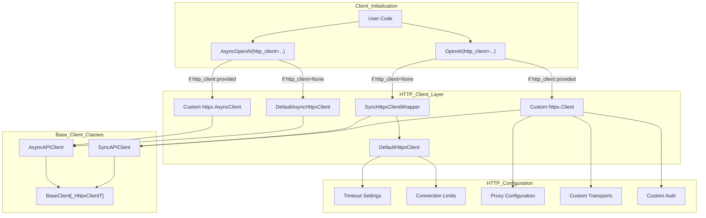
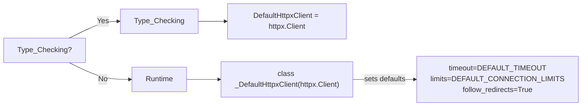
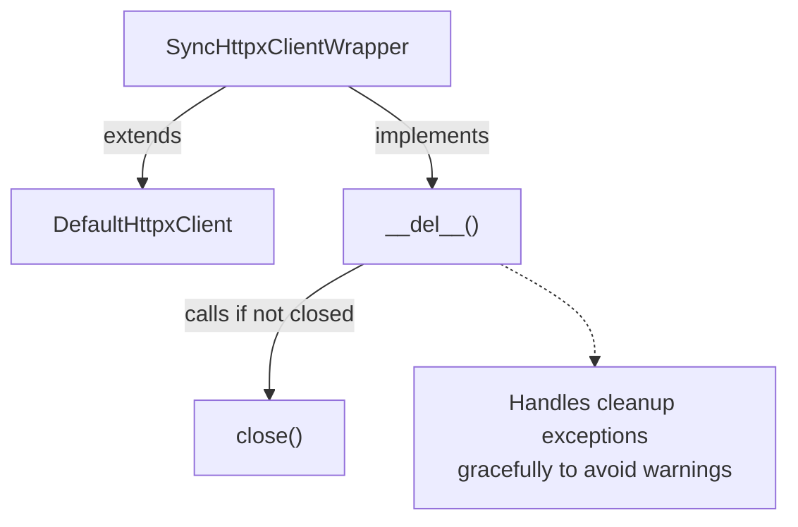
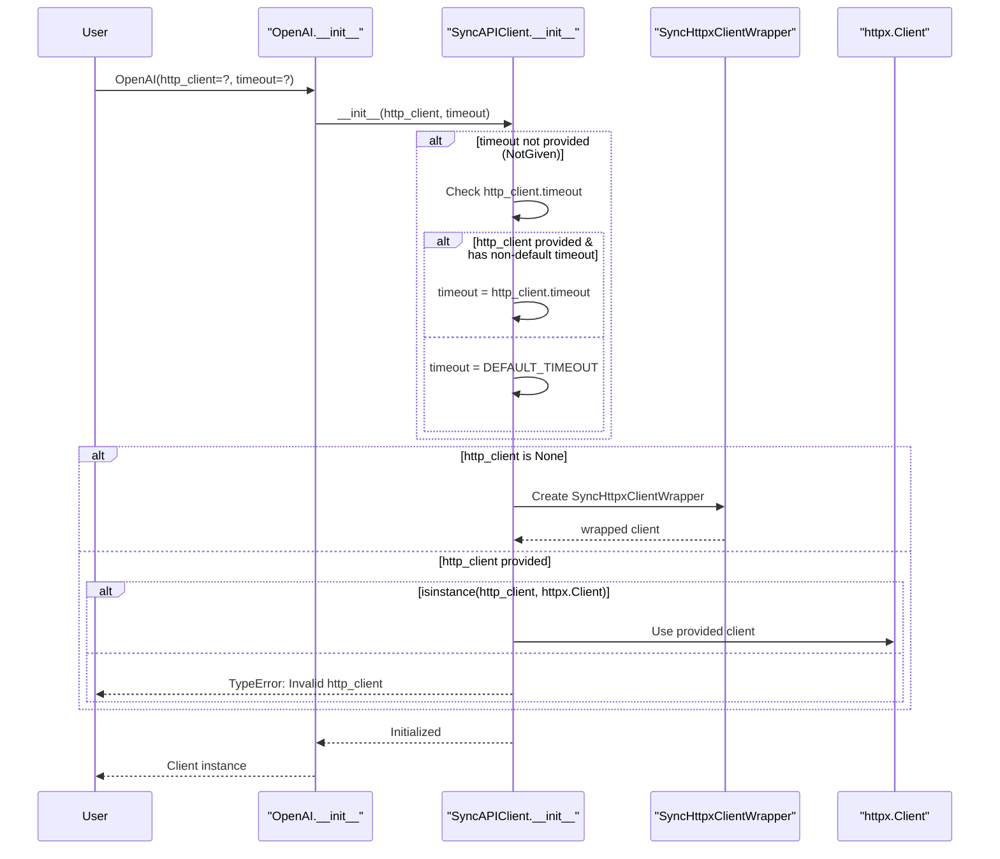
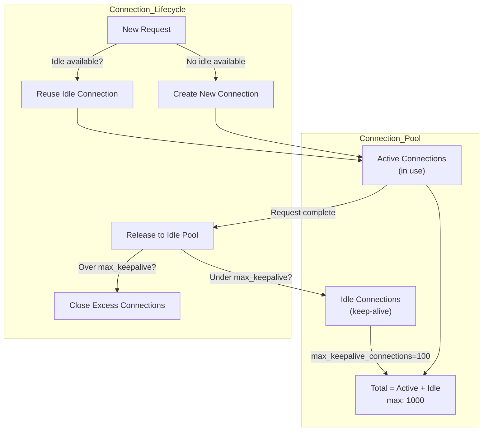
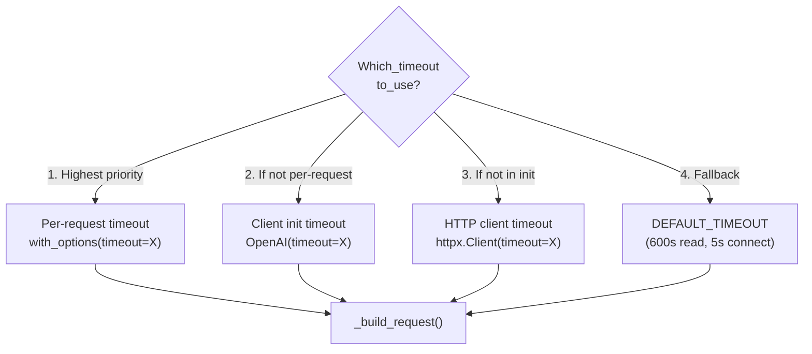
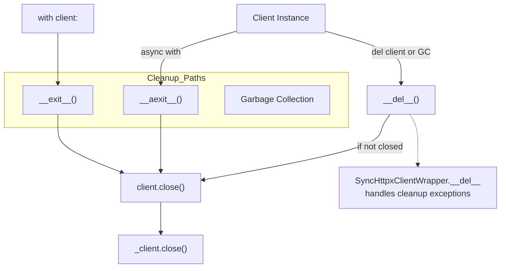
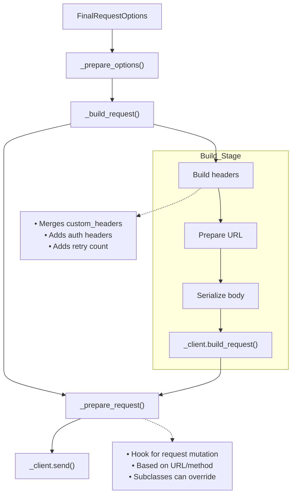

<!-- source: DeepWiki mcp.deepwiki.com · repo openai/openai-python · page 7.4 Custom HTTP Clients and Proxies · fetched 2026-10-26 -->

# Custom HTTP Clients and Proxies

<details>
<summary>Relevant source files</summary>

The following files were used as context for generating this wiki page:

- [Brewfile](Brewfile)
- [README.md](README.md)
- [examples/httpx2_client.py](examples/httpx2_client.py)
- [requirements-dev.lock](requirements-dev.lock)
- [requirements.lock](requirements.lock)
- [scripts/bootstrap](scripts/bootstrap)
- [scripts/format](scripts/format)
- [scripts/lint](scripts/lint)
- [scripts/mock](scripts/mock)
- [scripts/test](scripts/test)
- [scripts/utils/validate-bedrock-wheel.py](scripts/utils/validate-bedrock-wheel.py)
- [scripts/utils/validate-httpx2-wheel.py](scripts/utils/validate-httpx2-wheel.py)
- [src/openai/__init__.py](src/openai/__init__.py)
- [src/openai/_base_client.py](src/openai/_base_client.py)
- [src/openai/_client.py](src/openai/_client.py)
- [src/openai/_httpx2.py](src/openai/_httpx2.py)
- [src/openai/_qs.py](src/openai/_qs.py)
- [src/openai/lib/azure.py](src/openai/lib/azure.py)
- [src/openai/resources/beta/realtime/realtime.py](src/openai/resources/beta/realtime/realtime.py)
- [src/openai/resources/realtime/realtime.py](src/openai/resources/realtime/realtime.py)
- [tests/conftest.py](tests/conftest.py)
- [tests/lib/test_azure.py](tests/lib/test_azure.py)
- [tests/lib/test_bedrock_auth_conformance.py](tests/lib/test_bedrock_auth_conformance.py)
- [tests/test_client.py](tests/test_client.py)
- [tests/test_extract_files.py](tests/test_extract_files.py)
- [tests/test_files.py](tests/test_files.py)
- [tests/test_utils/test_logging.py](tests/test_utils/test_logging.py)
- [uv.lock](uv.lock)

</details>


This document explains how to customize the underlying HTTP client used by the OpenAI Python library. This includes configuring proxies, custom transports, connection pooling, and other advanced HTTP client settings. The library uses [httpx](https://www.python-httpx.org) as its HTTP client library and exposes its configuration options through the `http_client` parameter.

For basic client configuration (API keys, timeouts, retries), see [Client Configuration](#2.1). For error handling and retry behavior, see [Error Handling and Retry Logic](#3.4).

**Scope**: This page covers HTTP-layer customization. It does not cover request/response data transformation, which is handled separately by the data transformation layer (see [Data Transformation Pipeline](#6.1)).

## HTTP Client Architecture

The OpenAI library provides both synchronous and asynchronous clients, each backed by an `httpx` HTTP client. The architecture allows complete control over HTTP behavior by accepting custom `httpx` client instances.

Title: HTTP Client Architecture and Data Flow

Sources: [src/openai/_base_client.py:820-892](), [src/openai/_base_client.py:1497-1563]()

## Default HTTP Client Classes

The library provides helper classes that wrap `httpx` clients with sensible defaults. These classes configure the timeout, connection limits, and redirect behavior that the library expects.

### DefaultHttpxClient

The `DefaultHttpxClient` class is an alias (or subclass, depending on type-checking context) to `httpx.Client` with the following defaults:

| Setting | Default Value | Purpose |
|---------|---------------|---------|
| `timeout` | `httpx.Timeout(timeout=600, connect=5.0)` | 10-minute read timeout, 5-second connect timeout |
| `limits` | `httpx.Limits(max_connections=1000, max_keepalive_connections=100)` | Connection pooling limits |
| `follow_redirects` | `True` | Automatically follow HTTP redirects |

Title: DefaultHttpxClient Implementation Logic


**Important**: When you provide your own `httpx.Client` instance, `httpx`'s defaults are used, not the library's defaults. To preserve the library's defaults when customizing, instantiate `DefaultHttpxClient` instead of `httpx.Client`.

Sources: [src/openai/_base_client.py:789-806](), [src/openai/_constants.py:84-91](), [src/openai/_client.py:142-145]()

### DefaultAsyncHttpxClient

The async equivalent `DefaultAsyncHttpxClient` provides the same defaults for `httpx.AsyncClient`.

Sources: [src/openai/_base_client.py:1467-1495]()

### SyncHttpxClientWrapper

Internally, when no `http_client` is provided to the synchronous `OpenAI` client, the library wraps the default client in `SyncHttpxClientWrapper`. This wrapper ensures the HTTP client is properly closed even if an exception occurs during cleanup.

Title: Client Wrapper Cleanup Logic

Sources: [src/openai/_base_client.py:809-818]()

## Client Initialization Flow

The initialization flow determines whether to use a custom HTTP client or create a default one, and handles timeout precedence correctly.

Title: OpenAI Client Initialization Sequence


**Type Validation**: The library validates that the provided `http_client` is actually an instance of `httpx.Client` (or `httpx.AsyncClient` for async). Passing the wrong type raises a `TypeError`.

Sources: [src/openai/_base_client.py:824-868](), [src/openai/_base_client.py:836-848](), [tests/test_client.py:311-319]()

## Proxy Configuration

Proxies are configured through the underlying `httpx` client. The library supports HTTP, HTTPS, and SOCKS proxies via `httpx`'s proxy parameter.

### Basic Proxy Setup

```python
from openai import OpenAI, DefaultHttpxClient

client = OpenAI(
    http_client=DefaultHttpxClient(
        proxy="http://my-proxy.example.com:8080"
    )
)
```

### Proxy Environment Variables

`httpx` automatically respects standard proxy environment variables (`HTTP_PROXY`, `HTTPS_PROXY`, `ALL_PROXY`, `NO_PROXY`). To disable this behavior, pass `trust_env=False` to the `httpx` client constructor.

Sources: [src/openai/_client.py:142-145](), [README.md:746-773]()

## Connection Pooling and Limits

Connection pooling configuration affects performance and resource usage. The library's defaults are tuned for typical API usage patterns.

### Default Connection Limits

The library sets these defaults via `DEFAULT_CONNECTION_LIMITS`:

| Limit | Default | Purpose |
|-------|---------|---------|
| `max_connections` | 1000 | Maximum total connections (active + idle) |
| `max_keepalive_connections` | 100 | Maximum idle connections to keep alive |

Title: Connection Pool Lifecycle


### Connection Tracking

The test suite verifies that connections are properly closed after retries to prevent leaks.

Sources: [src/openai/_constants.py:90](), [tests/test_client.py:732-763]()

## Timeout Customization

Timeouts can be configured at multiple levels with specific precedence rules.

### Timeout Precedence

The library determines the effective timeout using this precedence (highest to lowest):

1. **Per-request timeout**: `client.with_options(timeout=X)`
2. **Client initialization timeout**: `OpenAI(timeout=X)`
3. **Custom HTTP client timeout**: `OpenAI(http_client=httpx.Client(timeout=X))`
4. **Library default**: `DEFAULT_TIMEOUT` (600 seconds read, 5 seconds connect)

Title: Timeout Precedence Logic


**Edge Case**: If you explicitly pass `httpx.Client(timeout=httpx.Timeout(5.0))` (which happens to equal `HTTPX_DEFAULT_TIMEOUT`), the library will not detect it as a custom timeout and will use `DEFAULT_TIMEOUT` instead.

Sources: [src/openai/_base_client.py:836-848](), [tests/test_client.py:280-310](), [src/openai/_base_client.py:122-128]()

## HTTP Client Lifecycle Management

### Context Manager Usage

Both clients support the context manager protocol for proper resource cleanup.

Title: Client Lifecycle and Cleanup


Sources: [src/openai/_base_client.py:873-892](), [src/openai/_base_client.py:809-818](), [README.md:774-786]()

## Request Building and HTTP Client Integration

The library builds requests through a multi-stage pipeline that integrates with the custom HTTP client.

Title: Request Building Pipeline


### _prepare_request Hook

Subclasses can override `_prepare_request()` to mutate requests based on their properties. This hook is called after `_build_request()` but before the request is sent to the HTTP client. For example, the `BaseAzureClient` uses similar logic to adjust URLs for deployments.

Sources: [src/openai/_base_client.py:475-558](), [src/openai/_base_client.py:901-911](), [src/openai/lib/azure.py:68-79]()

---

