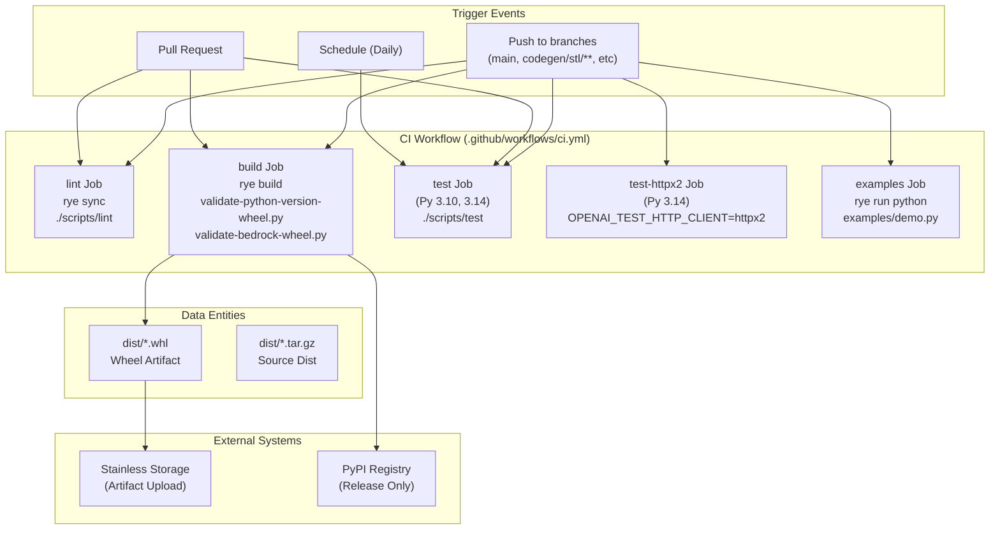
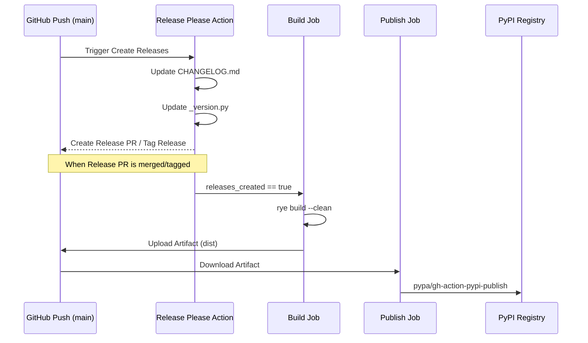

<!-- source: DeepWiki mcp.deepwiki.com · repo openai/openai-python · page 8.4 CI/CD Pipeline and Release Process · fetched 2026-10-26 -->

# CI/CD Pipeline and Release Process

Relevant source files

The following files were used as context for generating this wiki page:

- [.devcontainer/Dockerfile](.devcontainer/Dockerfile)
- [.devcontainer/devcontainer.json](.devcontainer/devcontainer.json)
- [.github/workflows/ci.yml](.github/workflows/ci.yml)
- [.github/workflows/create-releases.yml](.github/workflows/create-releases.yml)
- [.github/workflows/publish-pypi.yml](.github/workflows/publish-pypi.yml)
- [scripts/utils/upload-artifact.sh](scripts/utils/upload-artifact.sh)

This document describes the continuous integration and deployment infrastructure used by the OpenAI Python SDK. It covers the GitHub Actions workflows that run on every commit, the automated release process using `release-please`, and the PyPI publishing mechanism.

## Overview

The CI/CD pipeline is built entirely on GitHub Actions and consists of several core workflows:

- **CI Workflow** ([.github/workflows/ci.yml:1-204]()): Runs linting, building, testing (across multiple Python versions and HTTP clients), and example validation on every push and pull request.
- **Create Releases Workflow** ([.github/workflows/create-releases.yml:1-79]()): Triggers release automation and handles the publishing of tagged releases to PyPI.
- **Publish PyPI Workflow** ([.github/workflows/publish-pypi.yml:1-60]()): Manual workflow for re-running the publication process if automation fails.

The system uses `Rye 0.44.0` consistently across all environments for dependency management and build orchestration ([.github/workflows/ci.yml:34](), [.devcontainer/Dockerfile:6](), [.github/workflows/create-releases.yml:43]()).

## CI Pipeline Architecture

The CI pipeline ensures code quality and package integrity through a series of parallel jobs.

**Sources:** [.github/workflows/ci.yml:1-204]()

### Workflow Triggers

The CI workflow ([.github/workflows/ci.yml:2-20]()) triggers on:

- **Push events**: All branches except specific preview branches like `stl-preview-head/**`, `generated`, and `codegen/**` (except `codegen/stl/**`).
- **Pull request events**: All pull requests except those targeting preview branches.
- **Scheduled events**: Daily at 09:47 UTC to test against the matrix and next CPython prereleases ([.github/workflows/ci.yml:20]()).

Each job includes conditional checks ([.github/workflows/ci.yml:27](), [44](), [114]()) to ensure jobs run for pushes to the main repository or pull requests from forks, while avoiding redundant runs for internal metadata commits.

**Sources:** [.github/workflows/ci.yml:2-114]()

## Continuous Integration Jobs

### Lint Job

The lint job ([.github/workflows/ci.yml:23-42]()) validates code quality using the `rye` environment. It executes `./scripts/lint`, which triggers the chain including `ruff` for linting/formatting and `mypy`/`pyright` for type checking.

### Build Job and Artifact Management

The build job ([.github/workflows/ci.yml:43-109]()) creates distributable packages and validates them against different Python environments.

1.  **Build**: Executes `rye build` ([.github/workflows/ci.yml:64]()).
2.  **Wheel Validation**: 
    - Runs `scripts/utils/validate-python-version-wheel.py` to check Python version metadata ([.github/workflows/ci.yml:67]()).
    - Runs `scripts/utils/validate-bedrock-wheel.py` for Bedrock-specific packaging ([.github/workflows/ci.yml:70]()).
    - Runs `scripts/utils/validate-httpx2-wheel.py` on Python 3.10 and 3.14 ([.github/workflows/ci.yml:73](), [89]()).
    - Verifies that Python 3.9 correctly rejects the wheel as it is no longer supported ([.github/workflows/ci.yml:81]()).
3.  **Stainless Upload**: For internal repository pushes, it uses `scripts/utils/upload-artifact.sh` to upload the wheel to Stainless storage ([.github/workflows/ci.yml:108]()). This script uses a GitHub OIDC token to authenticate and obtain a signed URL for the upload ([scripts/utils/upload-artifact.sh:6-19]()).

**Sources:** [.github/workflows/ci.yml:43-109](), [scripts/utils/upload-artifact.sh:1-28]()

### Test Jobs

The CI suite runs tests across a matrix of Python versions and HTTP client configurations:

- **Standard Tests**: Runs on Python 3.10 and 3.14 ([.github/workflows/ci.yml:119]()). It uses `./scripts/bootstrap` to prepare the environment and `./scripts/test` to execute the suite ([.github/workflows/ci.yml:141-144]()).
- **HTTPX2 Tests**: A specialized job ([.github/workflows/ci.yml:146-181]()) runs tests on Python 3.14 with both the standard `httpx` client and the `httpx2` client by setting the `OPENAI_TEST_HTTP_CLIENT` environment variable ([.github/workflows/ci.yml:174](), [179]()).

**Sources:** [.github/workflows/ci.yml:110-181]()

## Release Automation and Publishing

The SDK uses `release-please` to automate versioning and changelog generation.

### Automated Release Workflow

The `Create releases` workflow ([.github/workflows/create-releases.yml:1-79]()) manages the lifecycle:

1.  **Release Trigger**: The `stainless-api/trigger-release-please` action handles versioning based on conventional commits ([.github/workflows/create-releases.yml:21-25]()).
2.  **Build Step**: If a release is created, the `build` job runs `rye build --clean` ([.github/workflows/create-releases.yml:49]()) and uploads the resulting `dist/` folder as a GitHub Action artifact ([.github/workflows/create-releases.yml:52-57]()). This job explicitly lacks OIDC access for security ([.github/workflows/create-releases.yml:32-33]()).
3.  **Publish Step**: The `publish` job downloads the artifact and uses `pypa/gh-action-pypi-publish` to push the package to PyPI using Trusted Publishing (OIDC) via `id-token: write` ([.github/workflows/create-releases.yml:68-78]()).

**Sources:** [.github/workflows/create-releases.yml:1-79]()

## Manual Publishing

In cases where the automated workflow fails, the `Publish PyPI` workflow ([.github/workflows/publish-pypi.yml:1-60]()) can be triggered manually via `workflow_dispatch` ([.github/workflows/publish-pypi.yml:5]()). It follows the same build-then-publish pattern to ensure that the environment that builds the code is separate from the environment that holds the OIDC identity for PyPI ([.github/workflows/publish-pypi.yml:12-16]()).

**Sources:** [.github/workflows/publish-pypi.yml:1-60]()

## Development Environment Support

### Dev Container

The project includes a VS Code Dev Container configuration ([.devcontainer/devcontainer.json:1-43]()) to provide a consistent environment.
- **Dockerfile**: Base image is `python:3.9`, with `Rye 0.44.0` installed into the `vscode` user's path ([.devcontainer/Dockerfile:1-7]()).
- **Post-Start**: Automatically runs `rye sync --all-features` to ensure all optional dependencies are available ([.devcontainer/devcontainer.json:10]()).
- **VS Code Settings**: Configures the Python extension to use the `.venv/bin/python` interpreter created by Rye ([.devcontainer/devcontainer.json:19-20]()).

**Sources:** [.devcontainer/Dockerfile:1-10](), [.devcontainer/devcontainer.json:1-43]()

---

