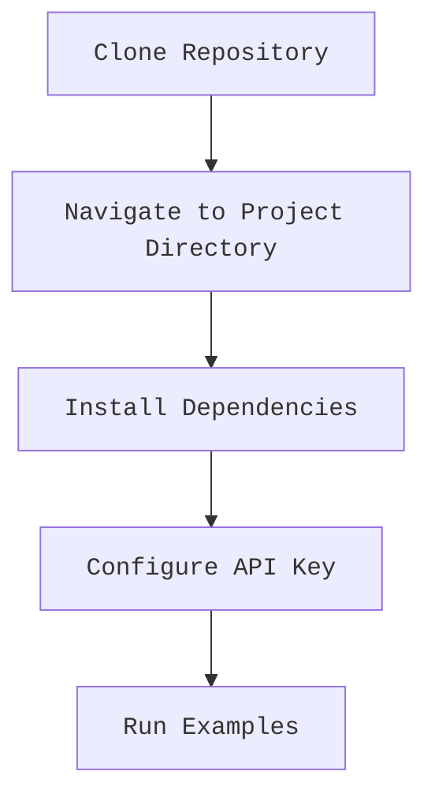
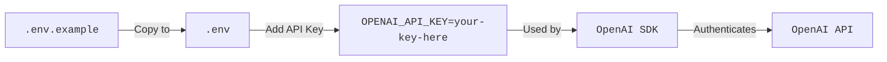
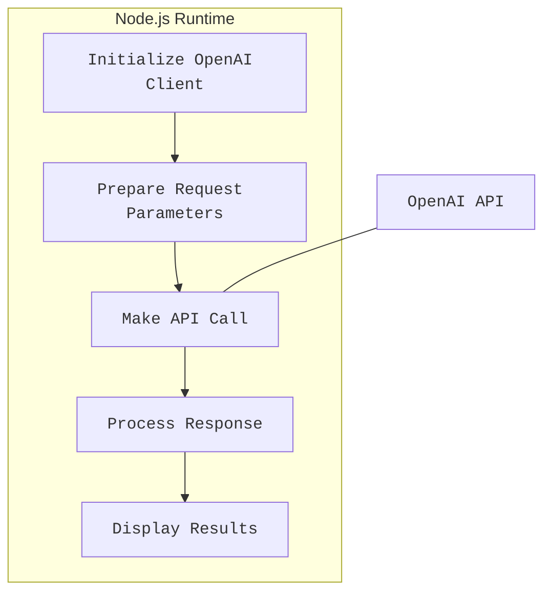
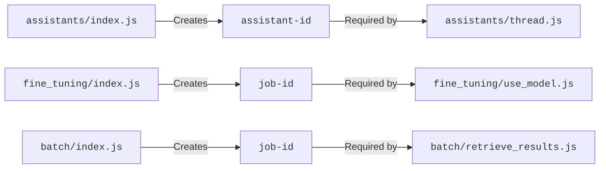
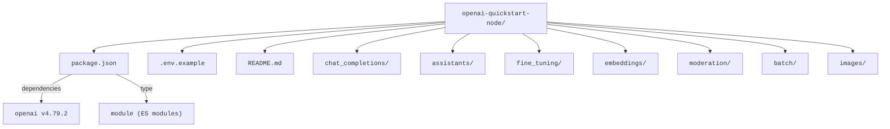

<!-- source: DeepWiki mcp.deepwiki.com · repo openai/openai-quickstart-node · page 2 Getting Started · fetched 2026-10-26 -->

# Getting Started

<details>
<summary>Relevant source files</summary>

The following files were used as context for generating this wiki page:

- [.env.example](.env.example)
- [README.md](README.md)
- [package-lock.json](package-lock.json)
- [package.json](package.json)

</details>


This document provides detailed instructions for setting up the OpenAI Node.js Quickstart repository on your local machine. You will learn how to clone the repository, install dependencies, configure your environment with the necessary API keys, and run the example scripts. For information about the specific examples included in the repository, see [OpenAI API Examples](#3).

## Prerequisites

Before getting started with the OpenAI Node.js Quickstart examples, ensure your system meets the following requirements:

| Requirement | Minimum Version | Notes |
|-------------|-----------------|-------|
| Node.js     | 16.0.0 or higher | [Download from nodejs.org](https://nodejs.org) |
| npm or other package manager | Latest stable version | Included with Node.js installation |
| OpenAI API Key | N/A | Obtain from [OpenAI platform dashboard](https://platform.openai.com/settings/organization/api-keys) |
| Git | Latest stable version | For cloning the repository |

Sources: [README.md:19-23]()

## Installation Process

Follow these steps to set up the OpenAI Node.js Quickstart repository on your local machine:

### Setup Workflow



Sources: [README.md:25-81]()

### Step 1: Clone the Repository

Open your terminal and run the following command to clone the repository:

```bash
git clone https://github.com/openai/openai-quickstart-node.git
```

Sources: [README.md:29-31]()

### Step 2: Navigate to the Project Directory

Change to the project directory:

```bash
cd openai-quickstart-node
```

Sources: [README.md:33-37]()

### Step 3: Install Dependencies

Install the required dependencies using npm:

```bash
npm install
```

This will install the OpenAI Node.js SDK version 4.79.2 and its dependencies as specified in the package.json file.

Sources: [README.md:39-43](), [package.json:10-12]()

## Environment Configuration

### Setting Up Your API Key

The OpenAI API requires authentication using your API key. The repository uses environment variables to securely store this key.



Sources: [README.md:45-69](), [.env.example:1-2]()

There are multiple ways to set up your API key:

#### Option 1: Create a .env file (Recommended)

1. Copy the provided `.env.example` file to create a `.env` file:
   ```bash
   cp .env.example .env
   ```

2. Edit the `.env` file and add your OpenAI API key:
   ```
   OPENAI_API_KEY=sk-your-api-key
   ```

#### Option 2: Set as Environment Variable in Terminal Session

For a temporary setup in your current terminal session:

**Bash (Mac/Linux):**
```bash
export OPENAI_API_KEY=sk-your-api-key
```

**PowerShell (Windows):**
```powershell
setx OPENAI_API_KEY "sk-your-api-key"
```

#### Option 3: Set Persistent Environment Variable

For a more permanent solution:

**Mac/Linux:**
Add this line to your `.bashrc` or `.zshrc` file:
```bash
export OPENAI_API_KEY=sk-your-api-key
```

**Windows:**
Set through System Properties > Environment Variables.

Sources: [README.md:45-69]()

## Running the Examples

The repository contains examples for various OpenAI APIs organized into separate directories. Each example can be run individually using the Node.js runtime.

### Example Execution Flow



Sources: [README.md:71-81]()

To run an example:

```bash
node path/to/script.js
```

For instance, to run the basic chat completions example:

```bash
node chat_completions/index.js
```

Some examples require outputs from previous examples as inputs. For these, you'll need to run the prerequisite example first and note the ID it generates.

### Examples With Dependencies



Sources: [README.md:85-156]()

For examples with dependencies, run them in the correct order:

1. First, run the initial script to create a resource:
   ```bash
   node assistants/index.js
   ```

2. Note the ID output (e.g., assistant-id)

3. Then run the dependent script with that ID:
   ```bash
   node assistants/thread.js assistant-id
   ```

## Available Examples Summary

The repository includes examples for the following OpenAI APIs:

| API Category | Basic Example | Additional Examples |
|--------------|---------------|---------------------|
| Chat Completions | chat_completions/index.js | multi_turn.js, function_calling.js, vision.js |
| Assistants | assistants/index.js | thread.js |
| Fine-tuning | fine_tuning/index.js | use_model.js |
| Embeddings | embeddings/index.js | - |
| Moderation | moderation/index.js | images.js |
| Batch | batch/index.js | retrieve_results.js |
| Images | images/index.js | - |

For details about each example, refer to [OpenAI API Examples](#3).

Sources: [README.md:85-156]()

## Project Structure

The OpenAI Quickstart Node.js project uses ES modules as specified in the package.json file. This means you'll see `import` statements rather than `require()` in the examples.



Sources: [package.json:1-14]()

## Troubleshooting

### Common Issues

1. **Authentication Errors**:
   - Verify your API key is correctly set in the environment variables or .env file
   - Check that your API key is active in the OpenAI dashboard

2. **Node.js Version Issues**:
   - Ensure you're running Node.js v16.0.0 or higher
   - Check your version with `node --version`

3. **Module Import Errors**:
   - The project uses ES modules. If you see import errors, make sure you're not mixing CommonJS and ES module syntax
   - Check that package.json has `"type": "module"`

4. **Missing Dependencies**:
   - Run `npm install` again to ensure all dependencies are installed

For more specific information about each API example, see [OpenAI API Examples](#3).

Sources: [package.json:13]()

---

