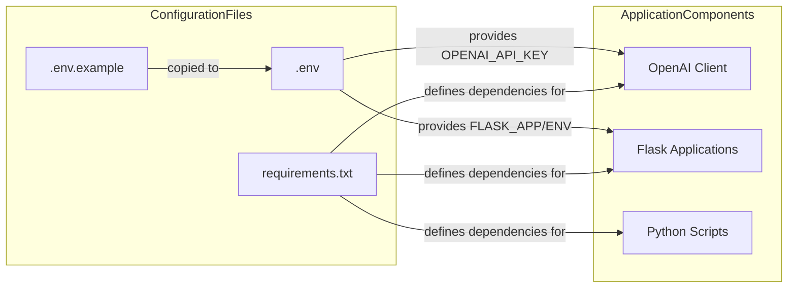
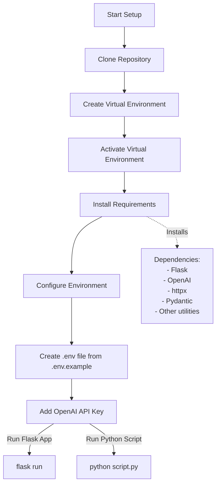
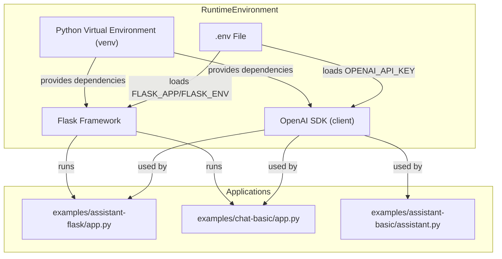

<!-- source: DeepWiki mcp.deepwiki.com · repo openai/openai-quickstart-python · page 2 Setup and Configuration · fetched 2026-10-26 -->

# Setup and Configuration

<details>
<summary>Relevant source files</summary>

The following files were used as context for generating this wiki page:

- [.env.example](.env.example)
- [.gitignore](.gitignore)
- [README.md](README.md)
- [requirements.txt](requirements.txt)

</details>


This page provides instructions for setting up the development environment for the OpenAI quickstart Python repository. It covers environment setup, dependency installation, API key configuration, and application execution processes.

For information about using the example applications after setup, see [Example Applications](#3).

## Prerequisites

Before proceeding with the setup, ensure you have:

- Python installed (from Python.org)
- Git installed for repository cloning
- An OpenAI API key from the OpenAI platform

Sources: [README.md:24-26]()

## Repository Structure

The repository contains configuration files that need to be properly set up:

| File | Purpose |
|------|---------|
| `.env.example` | Template for environment variables |
| `.env` | Your local environment configuration (created during setup) |
| `requirements.txt` | Python dependencies |



Sources: [.env.example](), [.gitignore:18](), [requirements.txt]()

## Setup Process

The following diagram illustrates the complete setup workflow:



Sources: [README.md:24-79]()

### 1. Clone the Repository

```bash
git clone https://github.com/openai/openai-quickstart-python.git
cd openai-quickstart-python
```

Sources: [README.md:28]()

### 2. Create and Activate a Virtual Environment

**For macOS/Linux:**
```bash
python -m venv venv
source venv/bin/activate
```

**For Windows:**
```bash
python -m venv venv
.\venv\Scripts\activate
```

The virtual environment (`venv/`) is excluded from version control in the `.gitignore` file to keep the repository clean.

Sources: [README.md:36-49](), [.gitignore:1]()

### 3. Install Dependencies

Install all required packages using pip:

```bash
pip install -r requirements.txt
```

The `requirements.txt` file includes these key dependencies:

| Dependency | Version | Purpose |
|------------|---------|---------|
| `openai` | 1.11.1 | Python SDK for OpenAI API |
| `Flask` | 3.0.2 | Web framework for the example applications |
| `httpx` | 0.26.0 | HTTP client used by the OpenAI SDK |
| `pydantic` | 2.6.1 | Data validation for API responses |
| `Jinja2` | 3.1.3 | Template engine for Flask applications |

Sources: [README.md:51-55](), [requirements.txt:1-21]()

## Environment Configuration

### Setting Up Environment Variables

1. Create an environment file by copying the example:

```bash
cp .env.example .env
```

2. Edit the `.env` file to configure the required variables:

```
FLASK_APP=app
FLASK_ENV=development
OPENAI_API_KEY=your-api-key-here
```

Sources: [README.md:57-61](), [.env.example:1-5]()

### API Key Configuration

The `OPENAI_API_KEY` environment variable is used to authenticate with the OpenAI API. The OpenAI Python SDK will automatically read this environment variable when you create a client instance:

```python
from openai import OpenAI
client = OpenAI()  # Automatically uses OPENAI_API_KEY from environment
```

**Important**: Keep your API key private and never commit it to version control. The `.env` file is included in `.gitignore` to prevent accidental exposure.

Sources: [README.md:63](), [.env.example:4-5](), [.gitignore:18](), [README.md:9-12]()

## Runtime Environment

The following diagram illustrates how the configuration components are used at runtime:



Sources: [README.md:9-22](), [README.md:65-79]()

## Running the Applications

The repository contains multiple example applications that can be run in different ways.

### Flask Applications

For Flask-based examples (assistant-flask and chat-basic):

```bash
flask run
```

This command starts a development server that makes the application available at http://localhost:5000.

Sources: [README.md:67-73]()

### Python Script Applications

For standalone Python scripts (like assistant-basic):

```bash
python examples/assistant-basic/assistant.py
```

Sources: [README.md:75-79]()

## Troubleshooting Common Issues

| Issue | Solution |
|-------|----------|
| **Invalid API Key** | Verify your API key is correctly copied to `.env` file |
| **ModuleNotFoundError** | Ensure virtual environment is activated and requirements are installed |
| **Flask app not found** | Check that `FLASK_APP=app` is set in `.env` |
| **Permission denied** | On Unix systems, you may need to add execute permission: `chmod +x path/to/script.py` |
| **File upload errors** | The `uploads` directory is excluded in `.gitignore`, create it manually if needed |

Sources: [.gitignore:19](), [.env.example:1-5]()

## Next Steps

After successful setup and configuration, you can explore the different example applications. Each demonstrates different functionalities of the OpenAI API:

- For detailed information about the example applications, see [Example Applications](#3)
- For API integration patterns used in the examples, see [OpenAI API Integration Patterns](#4)

---

