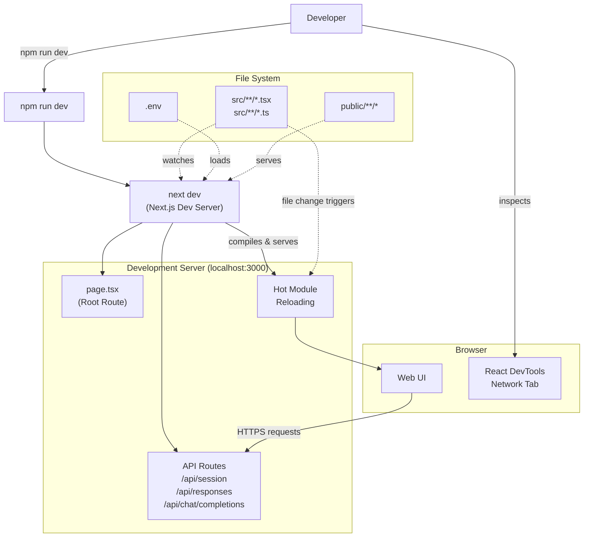
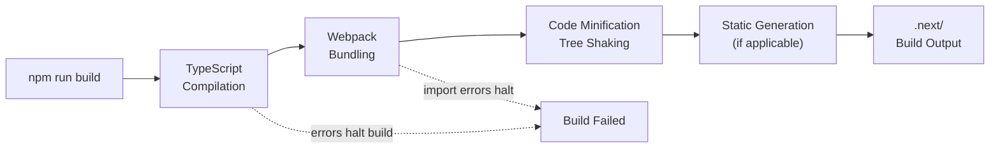
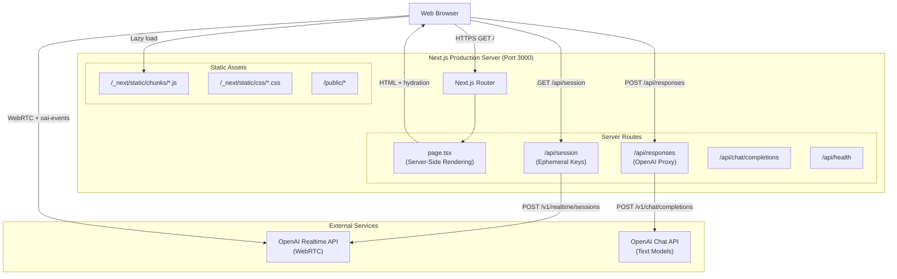
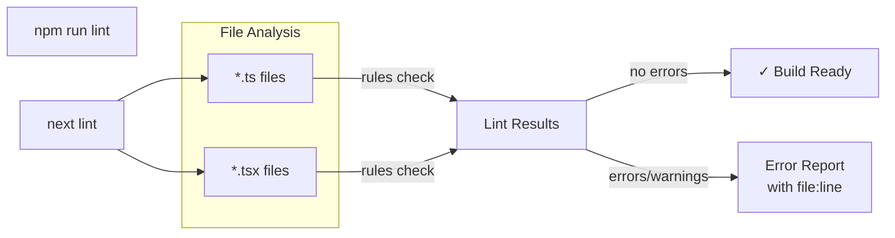
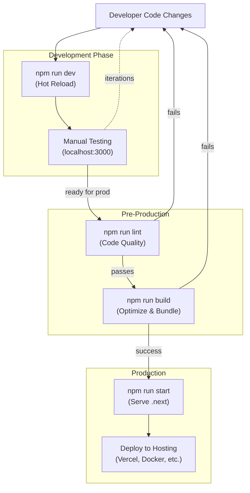

<!-- source: DeepWiki mcp.deepwiki.com · repo openai/openai-realtime-agents · page 6.2 Building and Running · fetched 2026-10-26 -->

# Building and Running

<details>
<summary>Relevant source files</summary>

The following files were used as context for generating this wiki page:

- [README.md](README.md)
- [package.json](package.json)
- [public/screenshot_handoff.png](public/screenshot_handoff.png)

</details>


This page documents the npm scripts and processes for building and running the OpenAI Realtime Agents demo application. It covers development workflows, production builds, and deployment considerations. For information about project dependencies and initial environment setup, see [Project Setup and Dependencies](#6.1).

## Development Mode

The development server provides hot module reloading and detailed error messages for rapid iteration on the application.

**Starting the Development Server:**

```bash
npm run dev
```

This executes the `dev` script defined in [package.json:6](), which runs `next dev`. The development server starts on `http://localhost:3000` by default.

**Development Server Characteristics:**

| Feature | Behavior |
|---------|----------|
| **Port** | 3000 (default, configurable via `-p` flag) |
| **Hot Reload** | Automatic reload on file changes in `src/` directory |
| **Source Maps** | Full source maps enabled for debugging |
| **Error Overlay** | Browser overlay shows compilation and runtime errors |
| **API Routes** | Located in `src/app/api/*` directories |
| **Static Assets** | Served from `public/` directory |

**URL Parameters:**

The application accepts URL parameters to configure the initial state:

```
http://localhost:3000?agentConfig=chatSupervisor&codec=opus
```

| Parameter | Purpose | Example Values |
|-----------|---------|----------------|
| `agentConfig` | Selects initial agent configuration | `chatSupervisor`, `customerServiceRetail`, `simpleHandoff` |
| `codec` | Sets audio codec preference | `opus`, `pcmu`, `pcma` |

**Environment Variables Required:**

Development mode requires the `OPENAI_API_KEY` environment variable. This can be set in:
- `.env` file (copy from `.env.sample`)
- Shell environment (`.bash_profile` or equivalent)

The API key is accessed server-side in API routes at [src/app/api/session/route.ts]() and [src/app/api/responses/route.ts]().

**Development Workflow Diagram:**



**Sources:** [README.md:22-28](), [package.json:6]()

## Production Build Process

The production build optimizes the application for deployment by minifying code, optimizing assets, and generating static pages.

**Building for Production:**

```bash
npm run build
```

This executes the `build` script at [package.json:7](), which runs `next build`.

**Build Process Steps:**



**Build Output Structure:**

The build process generates files in the `.next/` directory:

```
.next/
├── cache/              # Build cache for incremental builds
├── server/             # Server-side code
│   ├── app/           # App routes and API handlers
│   └── pages/         # Legacy pages directory (if used)
├── static/            # Static assets with content hashes
│   ├── chunks/       # JavaScript bundles
│   └── css/          # Compiled CSS
└── trace              # Build trace for analysis
```

**Build Configuration:**

The build respects configuration in `next.config.js` (if present). Key aspects:

| Configuration | Default Behavior |
|---------------|------------------|
| **Output** | Standalone server bundle |
| **TypeScript** | Strict type checking |
| **React** | React 19 with Server Components |
| **API Routes** | Bundled as serverless functions |
| **Assets** | Content hashing for cache busting |

**Build-Time vs Runtime Variables:**

Next.js distinguishes between build-time and runtime environment variables:

- **Build-time:** Variables prefixed with `NEXT_PUBLIC_` are inlined during build
- **Runtime:** Server-side variables (like `OPENAI_API_KEY`) are accessed at runtime

The `OPENAI_API_KEY` is intentionally **not** prefixed with `NEXT_PUBLIC_` to keep it server-side only, preventing exposure to the browser.

**Sources:** [package.json:7](), [README.md:22-28]()

## Production Deployment

After building, start the production server with the optimized build output.

**Starting the Production Server:**

```bash
npm run start
```

This executes the `start` script at [package.json:8](), which runs `next start`.

**Production Server Characteristics:**

| Feature | Behavior |
|---------|----------|
| **Port** | 3000 (default, configurable via `-p` flag) |
| **Performance** | Optimized with minified bundles |
| **Caching** | Static assets cached with content hashes |
| **Error Handling** | Generic error pages (no stack traces) |
| **Source Maps** | Disabled by default |

**Production Runtime Architecture:**



**Environment Variables in Production:**

The production server requires the same environment variables as development:

```bash
export OPENAI_API_KEY="sk-..."
npm run start
```

Or use a `.env` file:

```bash
# .env
OPENAI_API_KEY=sk-...
```

**Port Configuration:**

To run on a different port:

```bash
npm run start -- -p 8080
```

This starts the server on `http://localhost:8080`.

**Health Check Endpoint:**

The production server exposes a health check at `/api/health` for monitoring:

```bash
curl http://localhost:3000/api/health
```

**Sources:** [package.json:8](), [README.md:22-28]()

## Linting

Code quality checks are available via ESLint configuration.

**Running the Linter:**

```bash
npm run lint
```

This executes the `lint` script at [package.json:9](), which runs `next lint`.

**Linter Configuration:**

The project uses Next.js ESLint configuration from [eslint-config-next](https://nextjs.org/docs/app/building-your-application/configuring/eslint) as specified in [package.json:29](). This includes:

- React Hooks rules
- Next.js best practices
- TypeScript-aware linting

**Linting Workflow:**



**Auto-Fix:**

Some linting errors can be automatically fixed:

```bash
npm run lint -- --fix
```

**Integration with Build:**

While the `lint` script is separate from `build`, it's recommended to run linting before building for production to catch potential issues early.

**Sources:** [package.json:9](), [package.json:24-32]()

## Build Pipeline Summary

The complete development-to-deployment pipeline:



**Script Dependencies:**

| Script | Requires | Output |
|--------|----------|--------|
| `dev` | Source files, `.env` | Development server |
| `lint` | Source files | Console output |
| `build` | Source files, `.env` (optional) | `.next/` directory |
| `start` | `.next/` directory, `.env` | Production server |

**Common Build Issues:**

| Issue | Cause | Solution |
|-------|-------|----------|
| **TypeScript errors** | Type mismatches in source | Fix type errors in `.ts`/`.tsx` files |
| **Missing dependencies** | `node_modules/` not installed | Run `npm install` |
| **Environment variable errors** | Missing `OPENAI_API_KEY` at runtime | Set in `.env` or shell |
| **Port already in use** | Another process on port 3000 | Use `-p` flag to change port |

**Sources:** [package.json:5-9](), [README.md:22-28]()

## Docker Deployment (Optional)

While not included in the repository, the application can be containerized:

**Sample Dockerfile Pattern:**

```dockerfile
FROM node:20-alpine
WORKDIR /app
COPY package*.json ./
RUN npm ci --only=production
COPY . .
RUN npm run build
ENV PORT=3000
EXPOSE 3000
CMD ["npm", "run", "start"]
```

**Environment Variables in Docker:**

Pass the OpenAI API key at runtime:

```bash
docker run -p 3000:3000 -e OPENAI_API_KEY=sk-... app-image
```

**Sources:** [package.json:1-34](), [README.md:22-28]()

---

