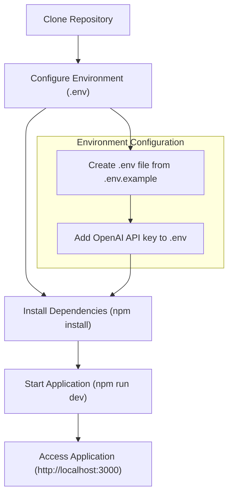
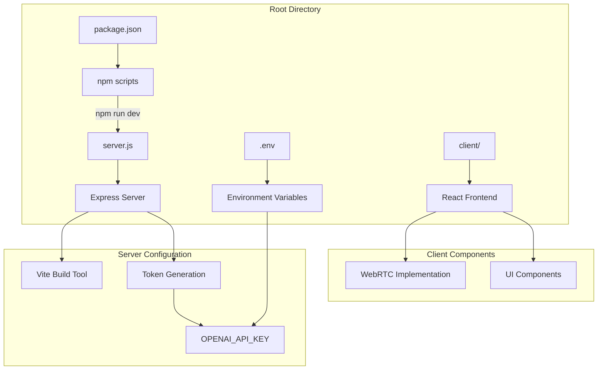
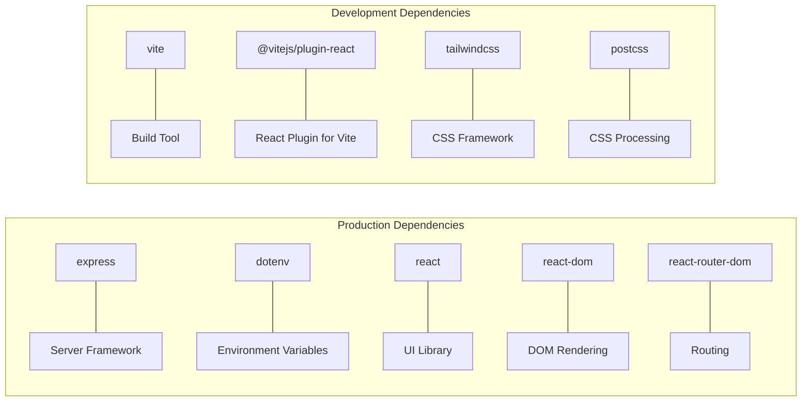

<!-- source: DeepWiki mcp.deepwiki.com · repo openai/openai-realtime-console · page 1.1 Project Setup · fetched 2026-10-26 -->

# Project Setup

<details>
<summary>Relevant source files</summary>

The following files were used as context for generating this wiki page:

- [.env.example](.env.example)
- [README.md](README.md)
- [package.json](package.json)

</details>


This document covers the step-by-step process for setting up and running the OpenAI Realtime Console locally. It focuses on environment configuration, dependency installation, and application startup. For information about the overall system architecture, see [System Architecture](#1.2).

## Prerequisites

Before setting up the project, ensure you have the following:

- [Node.js](https://nodejs.org) installed on your machine
- An OpenAI API key (obtainable from the [OpenAI dashboard](https://platform.openai.com/settings/api-keys))
- A terminal or command prompt to run commands

Sources: [README.md:5-14]()

## Setup Process



### 1. Environment Configuration

1. Create a `.env` file from the provided example:
   ```bash
   cp .env.example .env
   ```

2. Open the `.env` file and replace `<your-key-here>` with your actual OpenAI API key:
   ```
   OPENAI_API_KEY="sk-your-actual-api-key"
   ```

Sources: [README.md:7-11](), [.env.example:1]()

### 2. Dependencies Installation

Install all required dependencies using npm:

```bash
npm install
```

This will install both production and development dependencies defined in the `package.json` file.

Sources: [README.md:15-17](), [package.json:12-28]()

### 3. Starting the Application

Start the application in development mode:

```bash
npm run dev
```

This command runs the `server.js` file with the `--dev` flag, which serves the application on [http://localhost:3000](http://localhost:3000).

Sources: [README.md:19-25](), [package.json:4]()

## Project Structure



### Key Project Files

| File | Purpose |
|------|---------|
| `package.json` | Defines project dependencies and npm scripts |
| `.env` | Contains environment variables (particularly the OpenAI API key) |
| `server.js` | Main server file that serves the React frontend and handles API requests |
| `/client` | Directory containing the React frontend code |

Sources: [README.md:27-29](), [package.json:1-30]()

## NPM Scripts

The project includes several npm scripts defined in `package.json`:

| Script | Command | Purpose |
|--------|---------|---------|
| `dev` | `node server.js --dev` | Run the server in development mode |
| `start` | `node server.js` | Run the server in production mode |
| `build` | `npm run build:client && npm run build:server` | Build both client and server |
| `build:client` | `vite build --outDir dist/client --ssrManifest` | Build the client-side code |
| `build:server` | `vite build --outDir dist/server --ssr /index.js` | Build the server-side code |
| `lint` | `eslint . --ext .js,.jsx --fix` | Lint the codebase |

Sources: [package.json:3-11]()

## Dependencies Overview



The project uses a modern JavaScript stack with React for the frontend and Express for the backend. Vite is used as the build tool for fast development and optimized production builds.

Sources: [package.json:12-28]()

## Troubleshooting

Common setup issues and their solutions:

1. **API Key Issues**: If you encounter authentication errors, ensure your OpenAI API key is correctly set in the `.env` file and that it has access to the Realtime API.

2. **Port Conflicts**: If port 3000 is already in use, modify the port number in `server.js` or close the application using that port.

3. **Node.js Version**: This application requires a modern version of Node.js. If you encounter errors during installation or startup, check that your Node.js version is up to date.

Sources: [README.md:5-25]()

## Next Steps

After completing the setup, you can:

1. Access the application at [http://localhost:3000](http://localhost:3000)
2. Use the console to interact with the OpenAI Realtime API
3. Examine the JSON payloads for client and server events in the logging panel

For more information about the system architecture and how the components interact, refer to [System Architecture](#1.2).

Sources: [README.md:25-29]()

---

