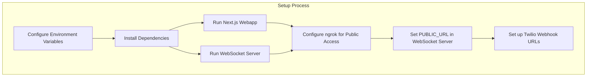
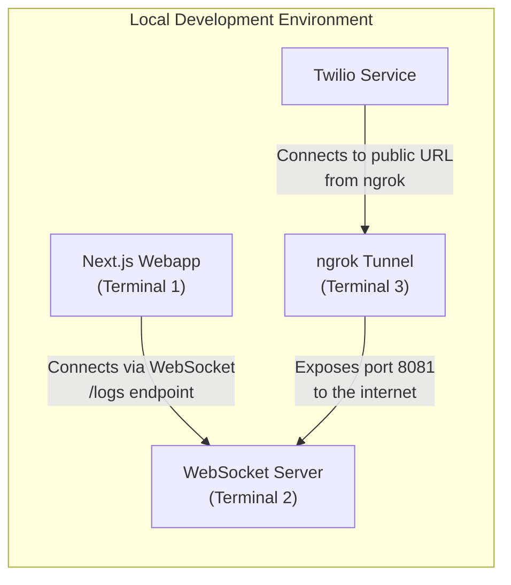
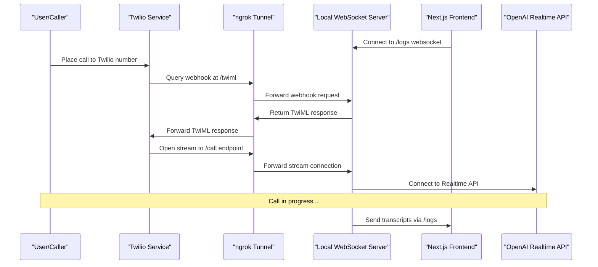
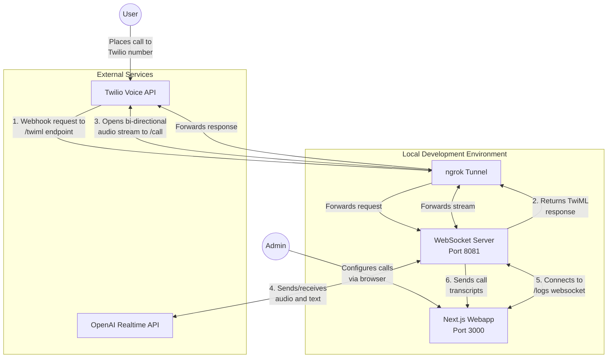

<!-- source: DeepWiki mcp.deepwiki.com · repo openai/openai-realtime-twilio-demo · page 4 Setup and Deployment · fetched 2026-10-26 -->

# Setup and Deployment

<details>
<summary>Relevant source files</summary>

The following files were used as context for generating this wiki page:

- [README.md](README.md)

</details>


This page provides comprehensive instructions for setting up and deploying the OpenAI Realtime Twilio Demo system. It covers the necessary environment configuration, steps for local development, and how to expose your local server using ngrok. For information about the system architecture and components, see [Architecture](#1.1) and [System Components](#1.2).



Sources: [README.md:7-17](), [README.md:65-83]()

## Environment Configuration

Before running the system, you need to configure environment variables for both the webapp and websocket server components. These configuration files contain critical authentication information for OpenAI and Twilio services.

### Required Environment Variables

#### WebSocket Server (.env)

```mermaid
classDiagram
    class "WebSocket Server ENV" {
        OPENAI_API_KEY: String
        PUBLIC_URL: String
        PORT: Number
        TWILIO_ACCOUNT_SID: String
        TWILIO_AUTH_TOKEN: String
    }
```

- `OPENAI_API_KEY`: Your OpenAI API key for accessing the Realtime API
- `PUBLIC_URL`: The public URL provided by ngrok (e.g., https://example.ngrok-free.app)
- `PORT`: The port the server will run on (default: 8081)
- `TWILIO_ACCOUNT_SID`: Your Twilio account SID
- `TWILIO_AUTH_TOKEN`: Your Twilio authentication token

#### Webapp (.env)

```mermaid
classDiagram
    class "Webapp ENV" {
        TWILIO_ACCOUNT_SID: String
        TWILIO_AUTH_TOKEN: String
        WEBSOCKET_URL: String
    }
```

- `TWILIO_ACCOUNT_SID`: Your Twilio account SID
- `TWILIO_AUTH_TOKEN`: Your Twilio authentication token
- `WEBSOCKET_URL`: WebSocket URL for connecting to the websocket server (typically your ngrok URL)

### Configuration Steps

1. Copy the example environment files:
   - Copy `websocket-server/.env.example` to `websocket-server/.env`
   - Copy `webapp/.env.example` to `webapp/.env`

2. Fill in your credentials:
   - Add your OpenAI API key
   - Add your Twilio account SID and authentication token
   - Leave the PUBLIC_URL blank until you have your ngrok URL

Sources: [README.md:85-89]()

## Local Development

Setting up the system for local development requires running both the webapp and websocket server components simultaneously. The recommended approach is to use multiple terminal windows to manage these processes.

### Setup Process

1. **Terminal 1: Start the Next.js Webapp**
   ```
   cd webapp
   npm install
   npm run dev
   ```
   This starts the frontend application, typically on port 3000 (http://localhost:3000).

2. **Terminal 2: Start the WebSocket Server**
   ```
   cd websocket-server
   npm install
   npm run dev
   ```
   This starts the backend server on port 8081 (or the port specified in your environment configuration).

3. **Terminal 3: Run ngrok (covered in the next section)**

### Development Architecture



Sources: [README.md:9-16](), [README.md:71-83]()

## Using ngrok

Ngrok creates a secure tunnel to expose your local development server to the internet, which is necessary for Twilio to connect to your WebSocket server.

### Setup Process

1. **Install ngrok** (if not already installed)
   - Download from [ngrok.com](https://ngrok.com) or use a package manager
   - Follow their setup instructions to authenticate your account

2. **Start ngrok in Terminal 3**
   ```
   ngrok http 8081
   ```
   This command exposes your local server running on port 8081 to the internet.

3. **Note the Forwarding URL**
   After running ngrok, it will display a "Forwarding" URL (e.g., `https://54c5-35-170-32-42.ngrok-free.app`). This is your server's temporary public address.

4. **Update Environment Variables**
   - Add the ngrok URL to `PUBLIC_URL` in `websocket-server/.env`
   - Update the `WEBSOCKET_URL` in `webapp/.env` if needed



### Troubleshooting ngrok

- **Connection errors**: Make sure your websocket server is running before starting ngrok
- **TwiML errors**: Verify that the `PUBLIC_URL` in your `.env` file matches the ngrok URL exactly
- **Session expired**: Ngrok free tier URLs expire, so you may need to update your environment variables if you restart ngrok

Sources: [README.md:91-105]()

## Complete System Setup Checklist

Follow this checklist to ensure your system is properly set up and ready for deployment:

| Step | Description | Status |
|------|-------------|--------|
| 1    | Clone repository | □ |
| 2    | Configure webapp/.env | □ |
| 3    | Configure websocket-server/.env | □ |
| 4    | Install webapp dependencies | □ |
| 5    | Install websocket-server dependencies | □ |
| 6    | Start webapp (Terminal 1) | □ |
| 7    | Start websocket-server (Terminal 2) | □ |
| 8    | Start ngrok (Terminal 3) | □ |
| 9    | Update PUBLIC_URL with ngrok URL | □ |
| 10   | Configure Twilio webhook to use ngrok URL | □ |
| 11   | Test connection from frontend | □ |

## Security Considerations

As noted in the repository README, this implementation is primarily for reference and demonstration purposes. Before deploying to production, consider the following security aspects:

- Implement proper authentication and authorization
- Add rate limiting to prevent abuse
- Secure your environment variables and credentials
- Audit dependencies for vulnerabilities
- Consider a more permanent solution than ngrok for production deployment

Sources: [README.md:107-109]()

## Component Interaction During Deployment

The following diagram illustrates how the different components interact once the system is deployed and running:



Sources: [README.md:19-40](), [README.md:46-60]()

---

