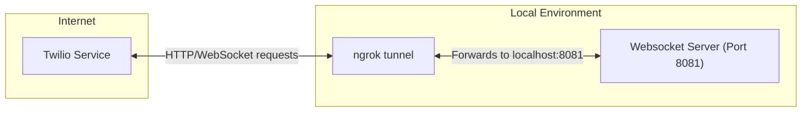
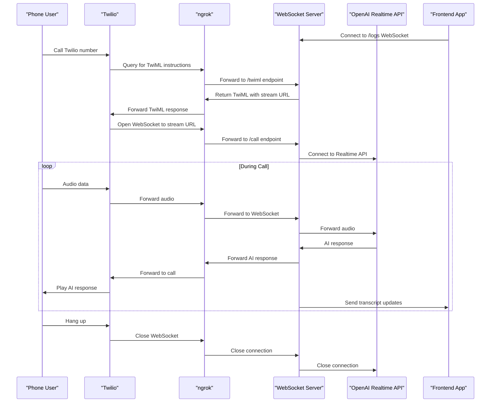

<!-- source: DeepWiki mcp.deepwiki.com · repo openai/openai-realtime-twilio-demo · page 4.3 Using ngrok · fetched 2026-10-26 -->

# Using ngrok

<details>
<summary>Relevant source files</summary>

The following files were used as context for generating this wiki page:

- [README.md](README.md)

</details>


This page explains the role of ngrok in the OpenAI Realtime Twilio Demo system, how to set it up, and how to configure your application to work with it. For information about local development setup, see [Local Development](#4.2).

## What is ngrok and Why It's Needed

ngrok is a tool that creates secure tunnels to expose a local development server to the internet. In this project, ngrok is critical because Twilio needs to be able to reach your locally running websocket server to:

1. Query the TwiML endpoint when a call comes in
2. Establish WebSocket connections for bi-directional audio streaming

Without ngrok, Twilio would be unable to reach your local development environment, making it impossible to test the phone calling features of this application.



Sources: [README.md:42-42](), [README.md:91-102]()

## Setting Up ngrok

### Installation

Before using ngrok, you need to install it. You can download it from the [ngrok website](https://ngrok.com) or install it using package managers.

### Running ngrok

Once installed, you can expose your local WebSocket server (which runs on port 8081 by default) using the following command in a dedicated terminal window:

```bash
ngrok http 8081
```

When ngrok starts, it will display information about the tunnel, including the all-important "Forwarding" URL, which looks something like this:

```
Forwarding                    https://54c5-35-170-32-42.ngrok-free.app -> http://localhost:8081
```

Make note of this URL as you'll need it for the next steps.

Sources: [README.md:15-15](), [README.md:97-101]()

## Configuring Your Application to Work with ngrok

Once you have the ngrok Forwarding URL, you need to configure your application to use it:

1. Set the `PUBLIC_URL` environment variable in `websocket-server/.env` to your ngrok Forwarding URL:

```
PUBLIC_URL=https://your-unique-ngrok-subdomain.ngrok-free.app
```

This URL will be used by the WebSocket server to generate the correct TwiML responses that tell Twilio where to connect.

Sources: [README.md:103-105]()

## ngrok in the System Architecture

The following diagram illustrates how ngrok fits into the overall system architecture:

```mermaid
flowchart TB
    User(("Phone User"))
    Twilio["Twilio Phone System"]
    
    subgraph "Local Environment"
        ngrok["ngrok tunnel"]
        subgraph "WebSocket Server"
            twiml["/twiml endpoint"]
            call["/call WebSocket"]
            logs["/logs WebSocket"]
        end
        Frontend["Frontend Application"]
        OpenAI["OpenAI Realtime API"]
    end
    
    User <--> Twilio
    Twilio <-->|"1. Query for TwiML\n2. Stream audio"| ngrok
    ngrok <-->|"Forward requests"| twiml
    ngrok <-->|"Forward WebSocket"| call
    call <--> OpenAI
    call -->|"Transcripts"| logs
    logs -->|"Call updates"| Frontend
```

The data flow through ngrok includes:

1. HTTP requests from Twilio to the `/twiml` endpoint to get call handling instructions
2. WebSocket connections from Twilio to the `/call` endpoint for bidirectional audio streaming
3. Responses from your local server back to Twilio

Sources: [README.md:46-60]()

## Call Flow with ngrok

The following sequence diagram shows the lifecycle of a call, highlighting ngrok's role:



Sources: [README.md:44-60]()

## Common Issues and Troubleshooting

### ngrok Session Expiration

ngrok free tier sessions expire after some time, requiring you to restart ngrok and update your `PUBLIC_URL`. When this happens:

1. Start a new ngrok session (`ngrok http 8081`)
2. Update the `PUBLIC_URL` in your `websocket-server/.env` file
3. Restart the WebSocket server

### Port Already in Use

If you see an error that port 8081 is already in use when starting ngrok, ensure that:
- You don't have another ngrok instance running
- The WebSocket server is running and using port 8081

### Twilio Cannot Connect

If Twilio cannot connect to your ngrok URL, check that:
- The ngrok session is active
- Your WebSocket server is running
- The `PUBLIC_URL` in `.env` matches the current ngrok URL exactly
- There are no typos in the URL

## Security Considerations

As noted in the README, this setup is primarily intended for development and testing. The ngrok tunneling approach has some security limitations:

1. Each time you restart ngrok, you get a new URL, requiring configuration updates
2. Free tier ngrok URLs are publicly accessible (though unlikely to be discovered)
3. The tunneled connection contains sensitive audio data

For production deployments, consider hosting the WebSocket server on a proper cloud infrastructure with permanent URLs and appropriate security measures.

Sources: [README.md:107-109]()

---

