# Page: Overview

# Overview

<details>
<summary>Relevant source files</summary>

The following files were used as context for generating this wiki page:

- [README.md](README.md)

</details>


This document provides an introduction to the OpenAI Realtime Twilio Demo, a system that integrates OpenAI's Realtime API with Twilio's phone calling capability to create an AI-powered phone calling assistant. For detailed architecture information, see [Architecture](#1.1), and for specific component details, see [System Components](#1.2).

## Purpose and Scope

The OpenAI Realtime Twilio Demo demonstrates how to build an AI calling assistant that can:

- Receive incoming phone calls through Twilio
- Process speech in real-time using OpenAI's Realtime API
- Generate AI responses that are spoken back to the caller
- Display call transcripts in a web interface
- Execute function calls in response to user requests

This overview covers the high-level architecture, component interactions, and call flow, without diving into implementation details that are covered in other sections.

Sources: [README.md:1-4](), [README.md:19-25]()

## System Components

The system consists of two primary applications:

| Component | Description | Purpose |
|-----------|-------------|---------|
| `webapp` | Next.js web application | Frontend for call configuration and transcript display |
| `websocket-server` | Express-based backend | Bridges communication between Twilio, OpenAI, and the frontend |

Additionally, the system relies on:

- **Twilio**: For phone call handling and audio streaming
- **OpenAI Realtime API**: For real-time speech processing and AI responses
- **ngrok**: For exposing the locally running server to the internet

Sources: [README.md:19-25](), [README.md:44-60]()

## System Architecture

### High-Level Architecture Diagram

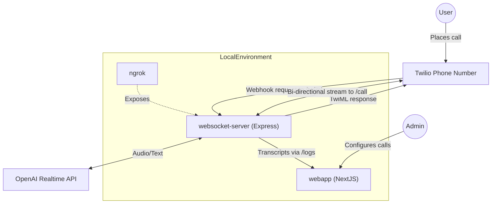

Sources: [README.md:19-44]()

### Code Entity Relationship Diagram

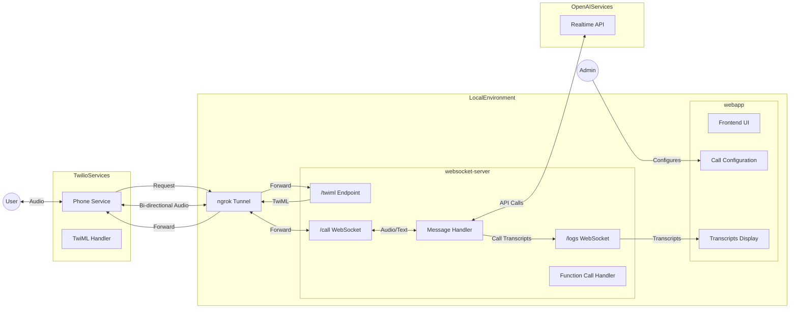

Sources: [README.md:19-44]()

## Call Lifecycle

The following sequence diagram illustrates the typical flow of an AI-powered phone call:

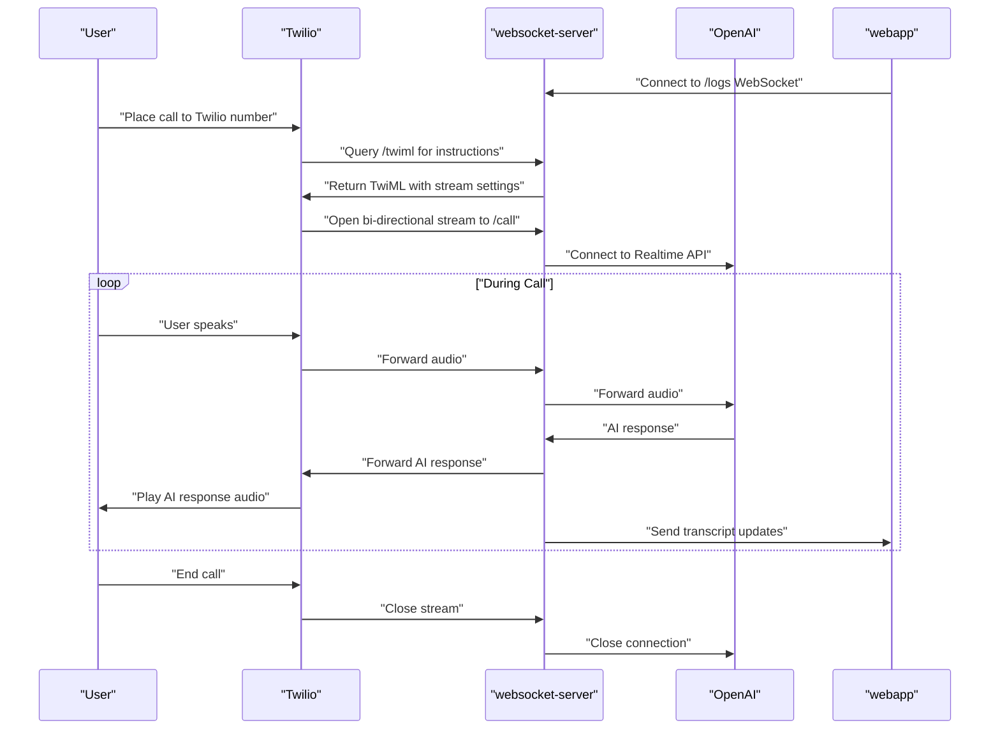

Sources: [README.md:44-60]()

## Key Components

### WebSocket Server

The WebSocket server is the core of the system, handling bidirectional communication between all components:

| Endpoint | Purpose |
|----------|---------|
| `/twiml` | Returns TwiML instructions to Twilio for handling calls |
| `/call` | WebSocket endpoint for bi-directional audio streaming with Twilio |
| `/logs` | WebSocket endpoint for sending real-time transcripts to the frontend |

For more details on the WebSocket server implementation, see [WebSocket Server](#2).

Sources: [README.md:26-28]()

### Next.js Web Application

The frontend webapp provides a user interface for configuration and monitoring:

| Feature | Purpose |
|---------|---------|
| Call Configuration | Configure Twilio phone numbers and settings |
| Transcript Display | View real-time transcripts of ongoing calls |
| Connection Status | Monitor connection status with the WebSocket server |

For more details on the frontend application, see [Frontend Application](#3).

Sources: [README.md:23-24]()

## TwiML Integration

Twilio uses TwiML (a form of XML) to specify how to handle a phone call. When a call comes in, the system provides TwiML instructions that tell Twilio to start a bi-directional stream with the WebSocket server:

```xml
<?xml version="1.0" encoding="UTF-8"?>
<Response>
  <Say>Connected</Say>
  <Connect>
    <Stream url="{{WS_URL}}" />
  </Connect>
  <Say>Disconnected</Say>
</Response>
```

The `{{WS_URL}}` placeholder is replaced with the WebSocket server's endpoint URL.

Sources: [README.md:27-40]()

## Function Calling Support

The system includes support for function calling, allowing the AI assistant to trigger actions during a call. The current implementation includes a mocking mechanism for testing and development purposes.

For more details on function calling, see [Function Calling](#2.4).

Sources: [README.md:61-64]()

## Getting Started

To run the system, you need:

1. OpenAI API key with access to the Realtime API
2. Twilio account with a phone number
3. ngrok account for exposing the local server

The typical setup involves running three separate processes:

| Terminal | Purpose | Command |
|----------|---------|---------|
| 1 | Run the webapp | `npm run dev` |
| 2 | Run the websocket-server | `npm run dev` |
| 3 | Run ngrok | `ngrok http 8081` |

For detailed setup instructions, see [Setup and Deployment](#4).

Sources: [README.md:9-16](), [README.md:66-105]()

## Security Considerations

The repository is provided as a reference implementation and demonstration. As noted in the README, the security practices may not be suitable for production use without additional review and hardening:

> This repo isn't polished, and the security practices leave some to be desired. Please only use this as reference, and make sure to audit your app with security and engineering before deploying!

Sources: [README.md:107-109]()

---

# Page: Architecture

# Architecture

<details>
<summary>Relevant source files</summary>

The following files were used as context for generating this wiki page:

- [README.md](README.md)
- [websocket-server/src/server.ts](websocket-server/src/server.ts)
- [websocket-server/src/sessionManager.ts](websocket-server/src/sessionManager.ts)

</details>


This page describes the overall system architecture of the OpenAI Realtime Twilio Demo, detailing how the different components interact with each other to enable AI-powered phone calls. For information about specific component implementations, see [System Components](#1.2).

## High-Level System Architecture

The OpenAI Realtime Twilio Demo consists of two main components:

1. **NextJS Webapp**: A frontend application for call configuration and transcript monitoring
2. **WebSocket Server**: A backend server that bridges communication between Twilio and OpenAI

These components work together with external services to create an AI-powered phone calling assistant:

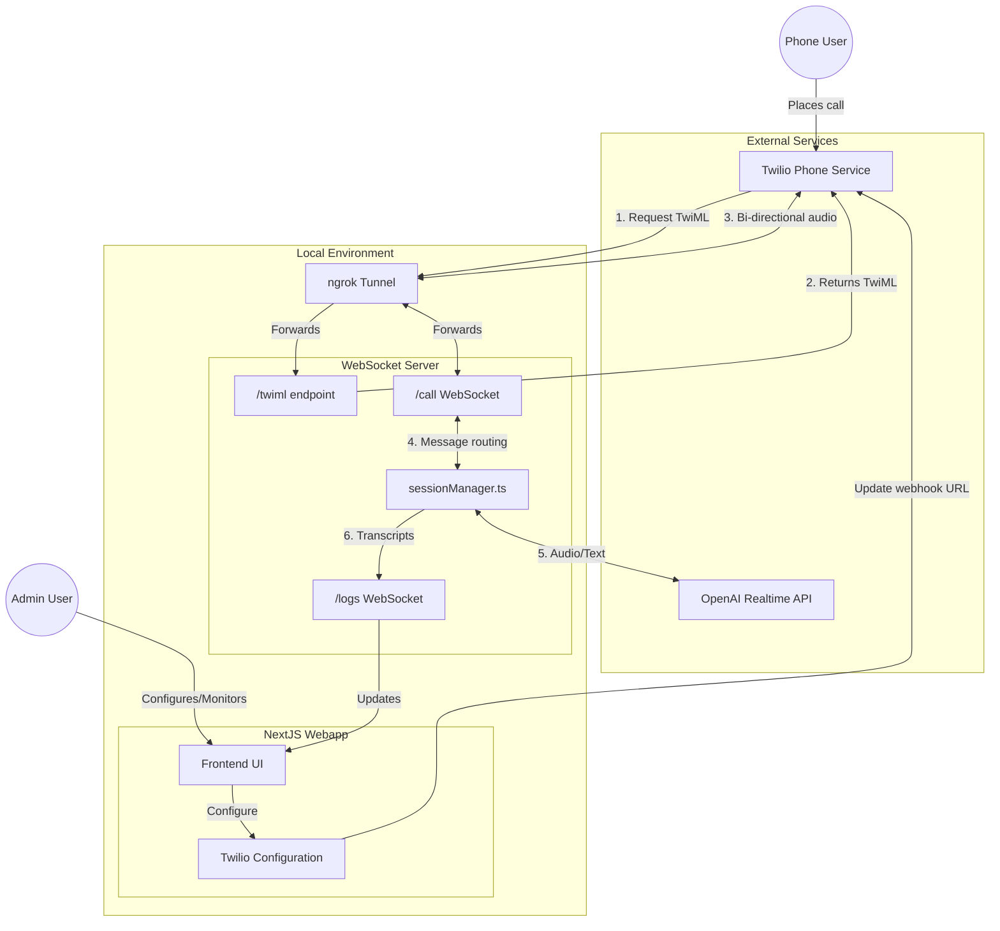

Sources: [README.md:19-42](), [websocket-server/src/server.ts:1-83]()

## Call Flow Sequence

The sequence of events during a call illustrates how the components interact over time:

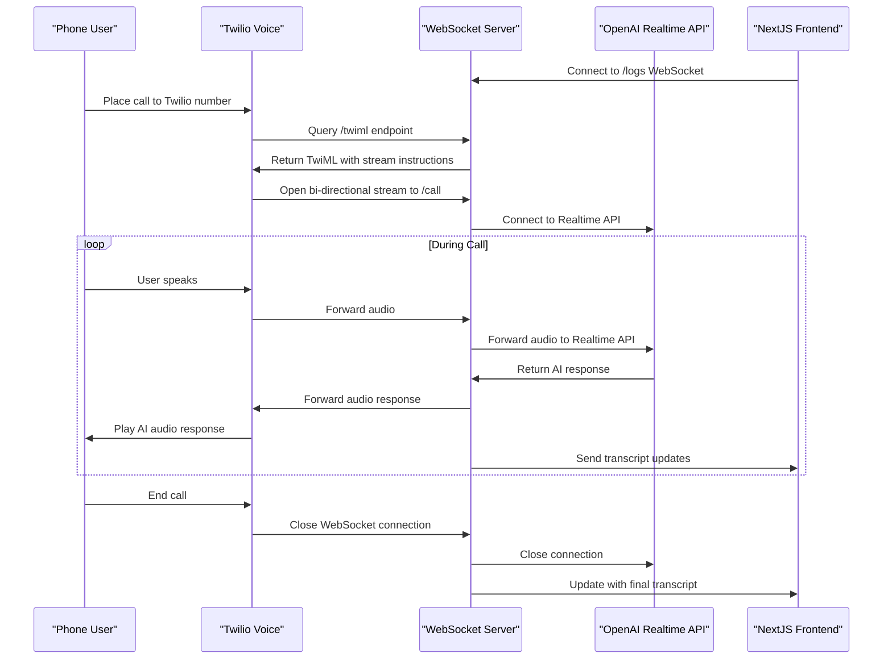

Sources: [README.md:44-60]()

## WebSocket Server Architecture

The WebSocket Server is the core of the system, managing three types of connections and routing messages between them:

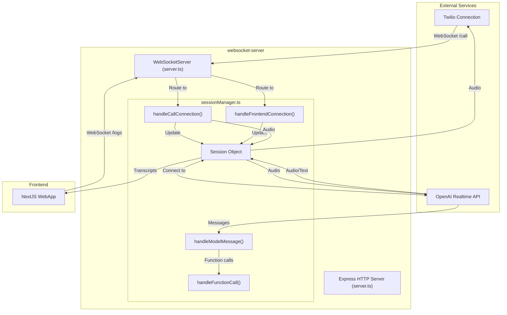

Sources: [websocket-server/src/server.ts:30-79](), [websocket-server/src/sessionManager.ts:1-153]()

## Session Management

The Session object is a central state manager that coordinates all connections and message routing:

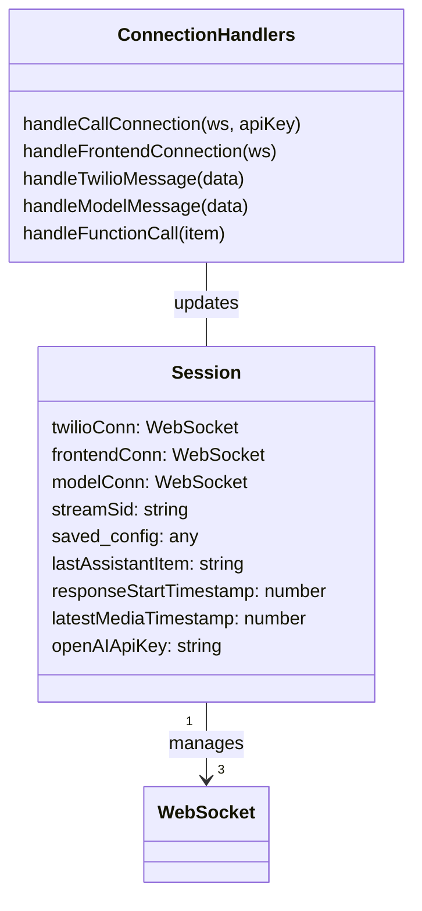

Sources: [websocket-server/src/sessionManager.ts:4-16]()

## Data Flow Architecture

The data flow in the system shows how audio and text messages are routed between components:

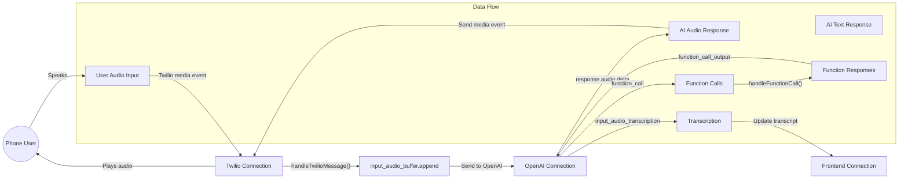

Sources: [websocket-server/src/sessionManager.ts:78-240]()

## Technical Implementation Details

### TwiML Generation

When a call comes in, Twilio requests instructions from the `/twiml` endpoint. The server responds with TwiML that directs Twilio to establish a WebSocket connection:

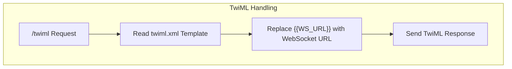

The TwiML template instructs Twilio to:
1. Say "Connected"
2. Establish a bi-directional stream to the WebSocket server
3. Say "Disconnected" when the call ends

Sources: [websocket-server/src/server.ts:33-47]()

### WebSocket Connection Management

The WebSocket server maintains three types of connections:

1. **Twilio Connection** (`/call`): Handles audio streaming with Twilio
2. **Frontend Connection** (`/logs`): Sends call transcripts to the frontend
3. **OpenAI Connection**: Connects to OpenAI's Realtime API

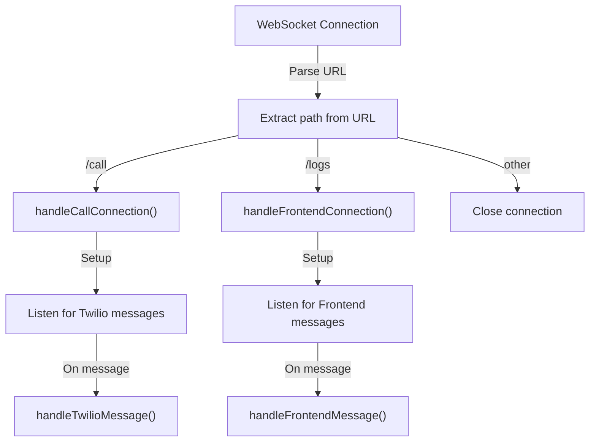

Sources: [websocket-server/src/server.ts:57-79](), [websocket-server/src/sessionManager.ts:18-48]()

### Function Calling

The system supports function calling, allowing the OpenAI model to trigger actions through predefined functions:

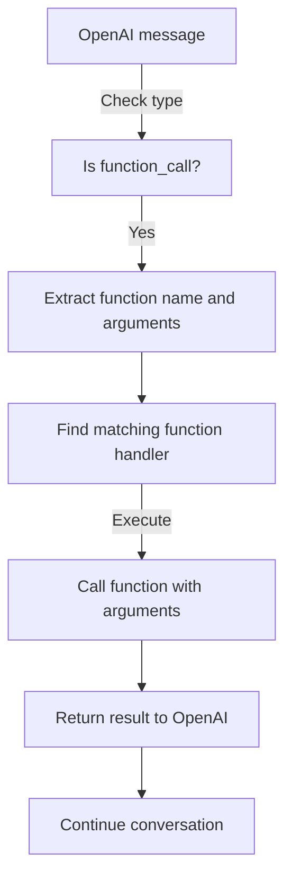

When the OpenAI model sends a function call, the system:
1. Identifies the appropriate function handler
2. Parses the arguments
3. Executes the function
4. Returns the result to continue the conversation

Sources: [websocket-server/src/sessionManager.ts:50-76](), [websocket-server/src/sessionManager.ts:185-207]()

## Integration with External Services

### Twilio Integration

The connection with Twilio involves:
1. A public URL (via ngrok) for Twilio to reach the WebSocket server
2. TwiML generation to instruct Twilio how to handle calls
3. Bi-directional audio streaming using Twilio's Media Streams API

### OpenAI Realtime API Integration

The connection with OpenAI's Realtime API involves:
1. Establishing a WebSocket connection with authentication
2. Configuring session parameters (voice, audio format, etc.)
3. Streaming audio input and receiving text/audio responses
4. Handling function calls for extended functionality

Sources: [websocket-server/src/sessionManager.ts:118-152]()

## Deployment Architecture

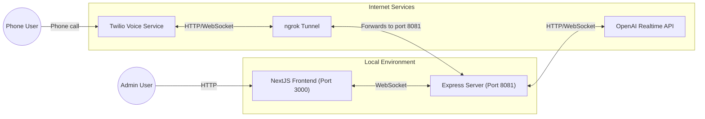

Sources: [README.md:9-17]()

---

# Page: System Components

# System Components

<details>
<summary>Relevant source files</summary>

The following files were used as context for generating this wiki page:

- [README.md](README.md)
- [websocket-server/src/server.ts](websocket-server/src/server.ts)
- [websocket-server/src/sessionManager.ts](websocket-server/src/sessionManager.ts)

</details>


This page details the core components that comprise the OpenAI Realtime Twilio Demo system. It describes each component's purpose, implementation, and interactions with other system elements. For a higher-level overview of the architecture, see [Architecture](#1.1).

## Core Components Overview

The OpenAI Realtime Twilio Demo consists of four primary components that work together to provide an AI-powered phone calling experience:

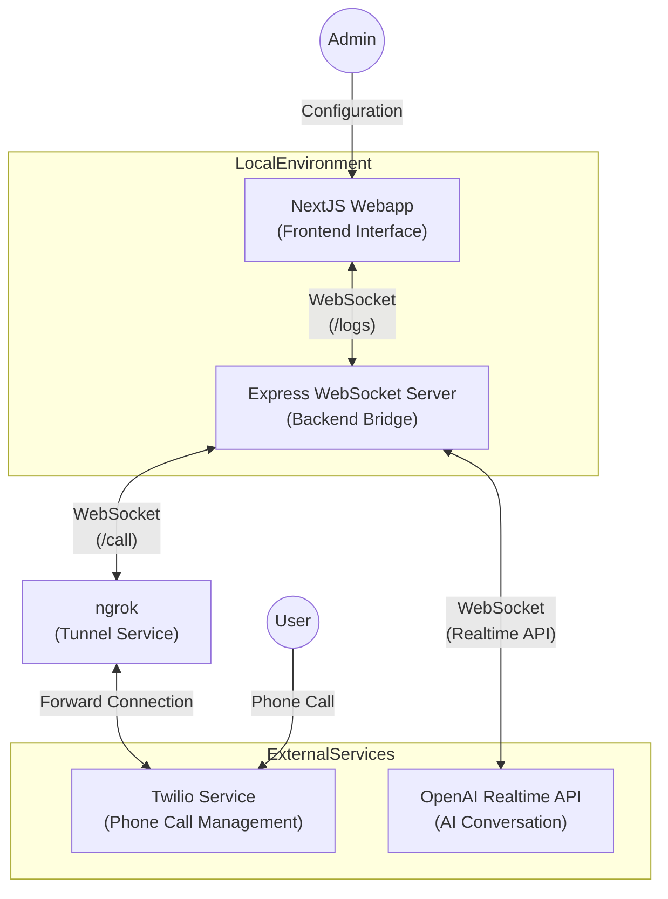

Sources: [README.md:19-25](), [websocket-server/src/server.ts:1-20]()

## NextJS Webapp

The webapp is built with Next.js and serves as the frontend interface for administrators to:
- Configure call settings
- View real-time call transcripts
- Set up Twilio phone numbers

The webapp connects to the websocket server via a persistent WebSocket connection to `/logs` to receive real-time updates about ongoing calls.

Sources: [README.md:23]()

## WebSocket Server

The websocket server is the central component that bridges all communications between Twilio, OpenAI's Realtime API, and the frontend webapp.

### Key Endpoints

| Endpoint | Type | Purpose |
|----------|------|---------|
| `/twiml` | HTTP | Provides TwiML instructions for Twilio to handle calls |
| `/call` | WebSocket | Receives bidirectional audio stream from Twilio |
| `/logs` | WebSocket | Sends real-time updates to the frontend |
| `/tools` | HTTP | Lists available function schemas for the AI |
| `/public-url` | HTTP | Returns the server's public URL (via ngrok) |

Sources: [websocket-server/src/server.ts:36-52]()

### Session Management

The websocket server maintains a central `Session` object that coordinates all connections and message routing:

```mermaid
classDiagram
    class "Session" {
        twilioConn: WebSocket
        frontendConn: WebSocket
        modelConn: WebSocket
        streamSid: string
        saved_config: any
        lastAssistantItem: string
        responseStartTimestamp: number
        latestMediaTimestamp: number
        openAIApiKey: string
    }
    
    class "handleCallConnection()" {
        +process Twilio messages
        +manage model connection
    }
    
    class "handleFrontendConnection()" {
        +process frontend messages
        +update session config
    }
    
    class "handleModelMessage()" {
        +process OpenAI messages
        +route responses
        +handle function calls
    }
    
    "Session" <-- "handleCallConnection()"
    "Session" <-- "handleFrontendConnection()"
    "Session" <-- "handleModelMessage()"
```

Sources: [websocket-server/src/sessionManager.ts:4-16](), [websocket-server/src/sessionManager.ts:18-36](), [websocket-server/src/sessionManager.ts:38-48]()

## Communication Flow

This diagram shows how messages flow through the system during a typical call:

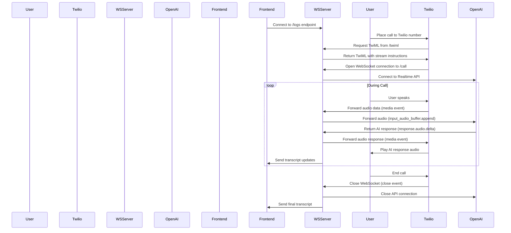

Sources: [README.md:46-60](), [websocket-server/src/sessionManager.ts:78-103](), [websocket-server/src/sessionManager.ts:154-209]()

## Twilio Integration

Twilio provides the phone calling infrastructure and connects to the system in two ways:

1. **HTTP Request Flow**: When a call is received, Twilio requests TwiML instructions from the `/twiml` endpoint
2. **WebSocket Connection**: After receiving TwiML, Twilio establishes a WebSocket connection to `/call` for bidirectional audio streaming

### TwiML Configuration

The server provides Twilio with TwiML that contains instructions to:
1. Say "Connected" to the caller
2. Establish a bidirectional stream to the WebSocket server
3. Say "Disconnected" when the call ends

Sources: [README.md:27-40](), [websocket-server/src/server.ts:40-47]()

## OpenAI Realtime API Integration

The WebSocket server connects to OpenAI's Realtime API to provide AI capabilities:

### Integration Features
- Forwards audio from Twilio to OpenAI for processing
- Receives AI-generated responses and forwards them to Twilio
- Handles function calling capabilities for performing actions
- Manages turn-taking in the conversation

### Session Configuration
When connecting to the OpenAI Realtime API, the server configures the session with:
- Modalities (text and audio)
- Voice selection (e.g., "ash")
- Audio formats (g711_ulaw for compatibility with Twilio)
- Turn detection settings (server_vad)

Sources: [websocket-server/src/sessionManager.ts:118-147]()

## Function Calling System

The system implements a function calling mechanism that allows the AI to perform actions:

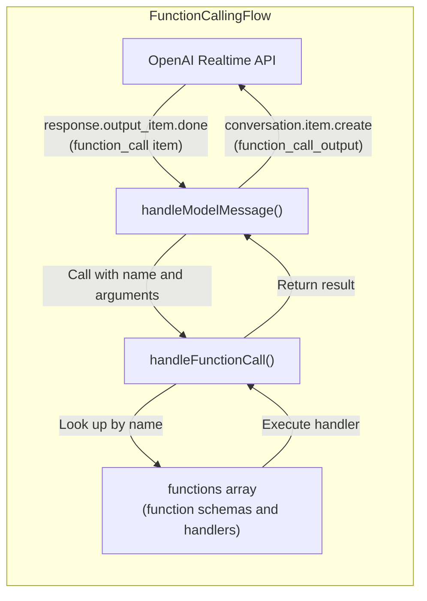

Sources: [websocket-server/src/sessionManager.ts:50-76](), [websocket-server/src/sessionManager.ts:185-207]()

## ngrok Integration

ngrok creates a secure tunnel to expose the locally running WebSocket server to the internet, enabling Twilio to connect to it.

### Role in the System
- Creates a public URL for the WebSocket server
- Forwards requests from Twilio to the local server
- Enables real-time communication between Twilio and the local environment

When the server starts, it expects the `PUBLIC_URL` environment variable to contain the ngrok URL that will be used to construct the WebSocket URL in the TwiML response.

Sources: [README.md:42](), [README.md:91-102](), [websocket-server/src/server.ts:18](), [websocket-server/src/server.ts:41-46]()

## Component Interactions Table

| From | To | Communication Method | Purpose |
|------|----|--------------------|---------|
| Frontend | WebSocket Server | WebSocket `/logs` | Receive call transcripts and updates |
| WebSocket Server | Frontend | WebSocket `/logs` | Send transcripts and call status |
| Twilio | WebSocket Server | HTTP GET `/twiml` | Get TwiML instructions |
| Twilio | WebSocket Server | WebSocket `/call` | Bidirectional audio streaming |
| WebSocket Server | Twilio | WebSocket `/call` | Send AI responses as audio |
| WebSocket Server | OpenAI | WebSocket | Send user audio and receive AI responses |
| OpenAI | WebSocket Server | WebSocket | Send function calls and audio responses |

Sources: [README.md:46-60](), [websocket-server/src/server.ts:57-79]()

The system components work together through these well-defined interfaces to create a seamless experience where a user can speak with an AI assistant over a phone call, with the conversation processed in real-time.

---

# Page: WebSocket Server

# WebSocket Server

<details>
<summary>Relevant source files</summary>

The following files were used as context for generating this wiki page:

- [README.md](README.md)
- [websocket-server/src/server.ts](websocket-server/src/server.ts)
- [websocket-server/src/sessionManager.ts](websocket-server/src/sessionManager.ts)

</details>


The WebSocket Server is the critical bridge component in the OpenAI Realtime Twilio Demo system, facilitating real-time communication between Twilio's voice service, OpenAI's Realtime API, and the Next.js frontend application. This page explains the server's architecture, how it handles connections and sessions, and its role in routing messages between system components.

For implementation details about individual server components, see [Server Implementation](#2.1). For session management specifics, see [Session Management](#2.2).

## Purpose and Core Responsibilities

The WebSocket Server acts as the central hub for all communication in the system with three primary responsibilities:

1. **Twilio Integration**: Processes incoming calls via Twilio webhooks and maintains bidirectional audio streams
2. **OpenAI Connectivity**: Establishes and manages connections to the OpenAI Realtime API
3. **Frontend Communication**: Provides real-time call transcripts and updates to the web interface

Sources: [README.md:21-24](), [websocket-server/src/server.ts:57-79]()

## System Architecture

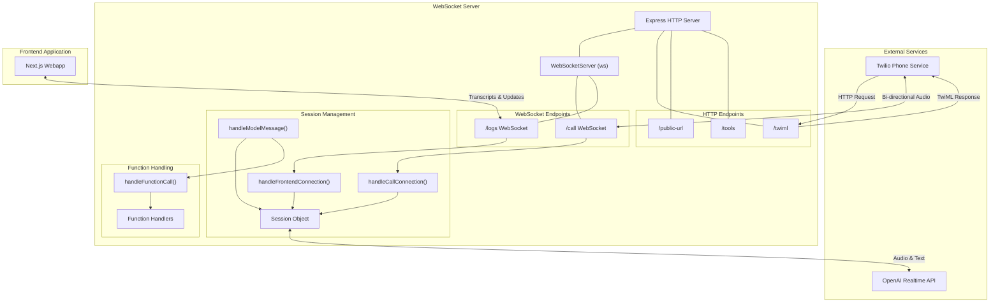

Sources: [websocket-server/src/server.ts:1-33](), [websocket-server/src/sessionManager.ts:1-17]()

## Server Initialization

The WebSocket Server is built on Express and the `ws` WebSocket library. It initializes the HTTP server and WebSocket server, sets up routes and endpoints, and begins listening for connections.

Key initialization components:

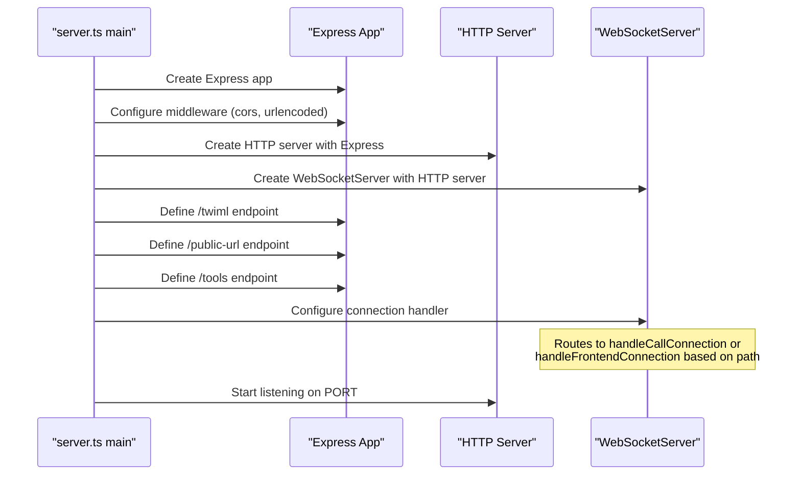

The server configures several key HTTP endpoints and WebSocket paths:

| Type | Endpoint | Purpose |
|------|----------|---------|
| HTTP | `/twiml` | Returns TwiML instructions for Twilio to establish a WebSocket connection |
| HTTP | `/public-url` | Returns the server's public URL (used for configuration) |
| HTTP | `/tools` | Lists available function schemas for the OpenAI model |
| WebSocket | `/call` | Endpoint for Twilio's bidirectional stream connection |
| WebSocket | `/logs` | Endpoint for the frontend to receive real-time updates |

Sources: [websocket-server/src/server.ts:16-83]()

## Session Management

The server uses a central session object to maintain state across multiple connections. This approach allows for coordinated message routing between Twilio, OpenAI, and the frontend.

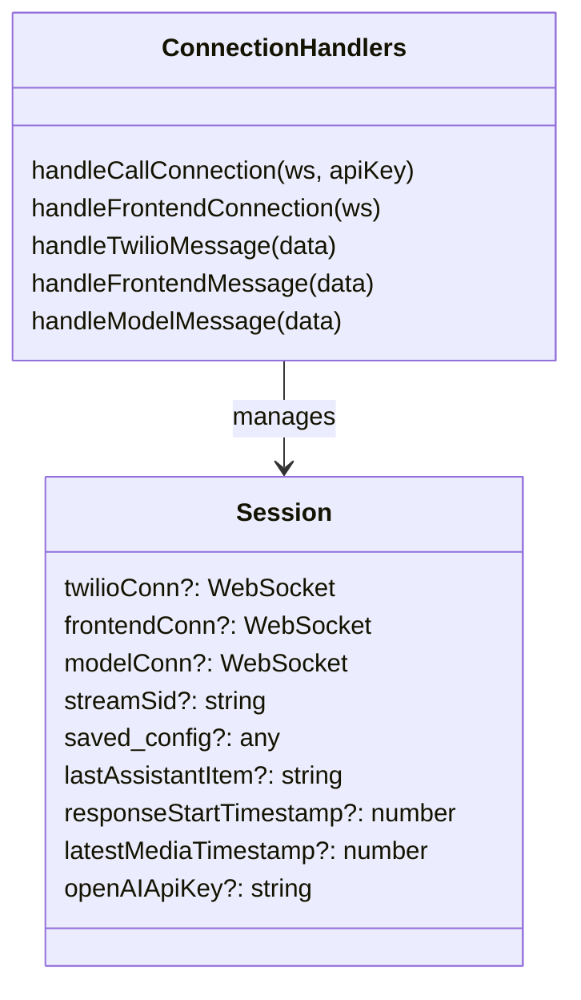

The session object tracks:
- Active WebSocket connections (Twilio, frontend, OpenAI)
- Call metadata (stream SID, timestamps)
- Configuration settings
- State for managing assistant responses

Connection lifecycles are managed with dedicated handlers that update the session state and set up appropriate event listeners for each connection type.

Sources: [websocket-server/src/sessionManager.ts:4-17](), [websocket-server/src/sessionManager.ts:18-48]()

## Connection Handling

The WebSocket Server handles three distinct connection types, each with its own lifecycle and message processing needs:

### Twilio Connection

When a call comes in to a Twilio phone number:

1. Twilio requests TwiML instructions from the `/twiml` endpoint
2. The server responds with TwiML that includes a WebSocket stream URL
3. Twilio establishes a WebSocket connection to the `/call` endpoint
4. The server handles the connection with `handleCallConnection`
5. As the call progresses, bidirectional audio is exchanged

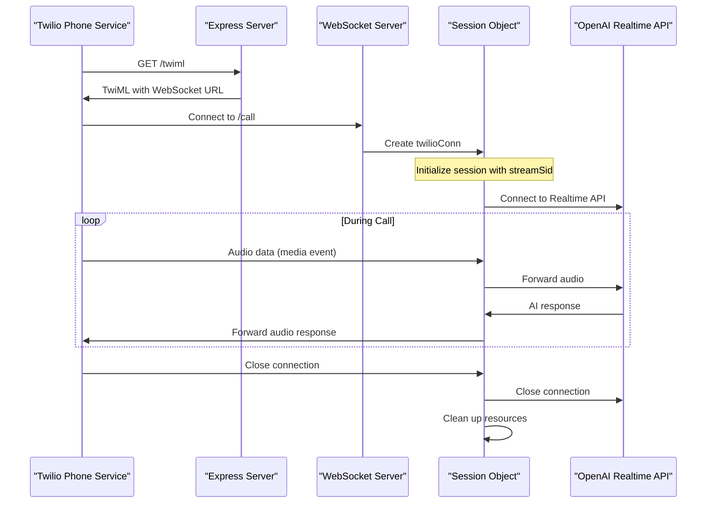

Sources: [websocket-server/src/server.ts:33-47](), [websocket-server/src/sessionManager.ts:18-36](), [websocket-server/src/sessionManager.ts:78-103]()

### Frontend Connection

The frontend application connects to receive real-time updates about ongoing calls:

1. Frontend connects to the `/logs` WebSocket endpoint
2. The server handles the connection with `handleFrontendConnection`
3. Updates about the call (transcripts, state changes) are sent to the frontend
4. The frontend can also send configuration updates to the server

Sources: [websocket-server/src/server.ts:72-76](), [websocket-server/src/sessionManager.ts:38-48](), [websocket-server/src/sessionManager.ts:105-116]()

### OpenAI Connection

The OpenAI Realtime API connection is established when a call begins:

1. When a Twilio call starts, the server connects to the OpenAI Realtime API
2. The server configures the session with modalities, voice settings, and audio formats
3. Audio from Twilio is forwarded to OpenAI for processing
4. OpenAI responses are forwarded back to Twilio
5. Transcripts and function calls are processed and routed as needed

Sources: [websocket-server/src/sessionManager.ts:118-152](), [websocket-server/src/sessionManager.ts:154-209]()

## Message Flow

The WebSocket Server orchestrates message flow between all components:

```mermaid
flowchart TD
    subgraph "Twilio Call Flow"
        TA["Twilio Audio Input"] -->|"media event"| TM["handleTwilioMessage()"]
        TM -->|"input_audio_buffer.append"| OS["OpenAI Session"]
        OS -->|"response.audio.delta"| TR["Twilio Response"]
    end
    
    subgraph "Frontend Flow"
        FI["Frontend Input"] -->|"session.update"| FM["handleFrontendMessage()"]
        FM -->|"Configuration updates"| OS
        OS -->|"All events"| FL["Frontend Logs"]
    end
    
    subgraph "Function Calling Flow"
        OS -->|"response.output_item.done"| FC["handleFunctionCall()"]
        FC -->|"Invoke function"| FH["Function Handlers"]
        FH -->|"Function result"| FC
        FC -->|"conversation.item.create"| OS
    end
    
    TM -.->|"Updates session state"| SessionState["Session State"]
    FM -.->|"Updates session state"| SessionState
    SessionState -.->|"Affects message handling"| OS
```

The server handles several message types:

| Source | Key Message Types | Handler | Purpose |
|--------|-------------------|---------|---------|
| Twilio | `start` | `handleTwilioMessage` | Initialize call session |
| Twilio | `media` | `handleTwilioMessage` | Forward audio to OpenAI |
| Twilio | `close` | `handleTwilioMessage` | End the call session |
| Frontend | `session.update` | `handleFrontendMessage` | Update session configuration |
| OpenAI | `response.audio.delta` | `handleModelMessage` | Forward AI audio to Twilio |
| OpenAI | `input_audio_buffer.speech_started` | `handleModelMessage` | Handle user speech detection |
| OpenAI | `response.output_item.done` | `handleModelMessage` | Process function calls |

Sources: [websocket-server/src/sessionManager.ts:78-240]()

## Function Calling Mechanism

The WebSocket Server includes a function calling system that allows the AI to perform actions during the call:

```mermaid
sequenceDiagram
    participant OpenAI as "OpenAI Realtime API"
    participant ModelHandler as "handleModelMessage()"
    participant FunctionCall as "handleFunctionCall()"
    participant FunctionHandlers as "Function Handlers"
    
    OpenAI->>ModelHandler: response.output_item.done (function_call)
    ModelHandler->>FunctionCall: Invoke with function name and arguments
    FunctionCall->>FunctionHandlers: Find and call appropriate handler
    FunctionHandlers->>FunctionCall: Return function result
    FunctionCall->>ModelHandler: Return formatted result
    ModelHandler->>OpenAI: conversation.item.create (function_call_output)
    ModelHandler->>OpenAI: response.create
```

The function calling flow:
1. OpenAI model sends a function call event
2. Server finds the matching function handler by name
3. Function arguments are parsed from JSON
4. The function is executed with provided arguments
5. Result is returned to the OpenAI model as function output
6. Model uses the output to continue the conversation

**Note**: As described in the README, this demo implementation mocks function calling responses for demonstration purposes. In a production environment, these functions would perform real actions.

Sources: [websocket-server/src/sessionManager.ts:50-76](), [websocket-server/src/sessionManager.ts:184-207](), [README.md:61-64]()

---

# Page: Server Implementation

# Server Implementation

<details>
<summary>Relevant source files</summary>

The following files were used as context for generating this wiki page:

- [websocket-server/src/server.ts](websocket-server/src/server.ts)
- [websocket-server/src/sessionManager.ts](websocket-server/src/sessionManager.ts)

</details>


The Server Implementation is the core component of the OpenAI Realtime Twilio Demo, establishing the connection bridge between Twilio voice calls, OpenAI's Realtime API, and the frontend application. This page details the server's initialization process, HTTP endpoints, WebSocket connection handling, and integration with the session management system.

For information about how the session manager handles connections and message routing, see [Session Management](#2.2).

## Server Architecture

```mermaid
flowchart TB
    subgraph "WebSocketServer"
        direction TB
        Express["ExpressApp"]
        HTTPServer["HTTPServer"]
        WSServer["WebSocketServer(ws)"]
        
        subgraph "HTTPEndpoints"
            TwiMLEndpoint["/twiml"]
            PublicURLEndpoint["/public-url"]
            ToolsEndpoint["/tools"]
        end
        
        subgraph "WebSocketHandlers"
            CallHandler["handleCallConnection()"]
            LogsHandler["handleFrontendConnection()"]
        end
        
        Express --> HTTPServer
        WSServer --> HTTPServer
        
        Express --> TwiMLEndpoint
        Express --> PublicURLEndpoint
        Express --> ToolsEndpoint
        
        WSServer --> ConnectionRouter["Connection Router"]
        ConnectionRouter -->|"/call"| CallHandler
        ConnectionRouter -->|"/logs"| LogsHandler
        
        CallHandler --> SessionManager["Session Manager"]
        LogsHandler --> SessionManager
    end
    
    TwilioClient["Twilio Voice Client"] -->|"HTTP Request"| TwiMLEndpoint
    TwilioClient -->|"WebSocket /call"| WSServer
    FrontendClient["Frontend Application"] -->|"WebSocket /logs"| WSServer
    FrontendClient -->|"HTTP Request"| PublicURLEndpoint
```

Sources: [websocket-server/src/server.ts:1-83]()

## Server Initialization

The server is initialized in `server.ts` through the following process:

1. Environment variables are loaded and validated
2. An Express application and HTTP server are created
3. A WebSocket server is attached to the HTTP server
4. HTTP endpoints are defined
5. WebSocket connection handling is configured
6. The server starts listening on the configured port

```mermaid
sequenceDiagram
    participant Server as server.ts
    participant Env as Environment
    participant Express as ExpressApp
    participant HTTP as HTTPServer
    participant WSS as WebSocketServer
    
    Server->>Env: Load with dotenv
    Server->>Env: Validate OPENAI_API_KEY
    Note over Server,Env: Exit if API key missing
    Server->>Express: Create Express app
    Server->>Express: Configure CORS
    Server->>HTTP: Create HTTP server
    Server->>WSS: Create WebSocket server
    Server->>Express: Load TwiML template
    Server->>Express: Define /twiml endpoint
    Server->>Express: Define /public-url endpoint
    Server->>Express: Define /tools endpoint
    Server->>WSS: Configure connection handler
    Server->>HTTP: Start listening on PORT
```

Sources: [websocket-server/src/server.ts:1-83]()

### Environment Configuration

The server requires several environment variables:

| Variable | Purpose | Default |
|----------|---------|---------|
| `PORT` | The port the server listens on | 8081 |
| `PUBLIC_URL` | Public URL for Twilio to connect to | "" |
| `OPENAI_API_KEY` | OpenAI API key for authentication | Required |

The server validates the presence of the OpenAI API key and exits if it's missing:

```typescript
if (!OPENAI_API_KEY) {
  console.error("OPENAI_API_KEY environment variable is required");
  process.exit(1);
}
```

Sources: [websocket-server/src/server.ts:15-24]()

## HTTP Endpoints

The server exposes three HTTP endpoints to support the Twilio integration and frontend application:

### 1. TwiML Endpoint (`/twiml`)

This endpoint generates TwiML (Twilio Markup Language) instructions when Twilio receives a call. It reads a template file and replaces placeholders with the WebSocket URL:

```typescript
app.all("/twiml", (req, res) => {
  const wsUrl = new URL(PUBLIC_URL);
  wsUrl.protocol = "wss:";
  wsUrl.pathname = `/call`;

  const twimlContent = twimlTemplate.replace("{{WS_URL}}", wsUrl.toString());
  res.type("text/xml").send(twimlContent);
});
```

The TwiML instructs Twilio to connect to the WebSocket server for real-time audio streaming.

Sources: [websocket-server/src/server.ts:33-47]()

### 2. Public URL Endpoint (`/public-url`)

This endpoint returns the server's public URL:

```typescript
app.get("/public-url", (req, res) => {
  res.json({ publicUrl: PUBLIC_URL });
});
```

The frontend uses this endpoint to determine the server's public address.

Sources: [websocket-server/src/server.ts:36-38]()

### 3. Tools Endpoint (`/tools`)

This endpoint lists the function schemas available to the OpenAI assistant:

```typescript
app.get("/tools", (req, res) => {
  res.json(functions.map((f) => f.schema));
});
```

This allows the frontend to display available function calling capabilities.

Sources: [websocket-server/src/server.ts:50-52]()

## WebSocket Connection Handling

The server handles WebSocket connections based on their request path. The main connection handler is implemented as follows:

```mermaid
flowchart TD
    Client["Client (Twilio/Frontend)"]
    WSConnection["WebSocket Connection"]
    PathParser["URL Path Parser"]
    ConnectionRouter["Connection Router"]
    
    Client -->|"Connect"| WSConnection
    WSConnection -->|"req.url"| PathParser
    PathParser -->|"Extract path"| ConnectionRouter
    
    ConnectionRouter -->|"/call"| CallPath["Call Handler"]
    ConnectionRouter -->|"/logs"| LogsPath["Logs Handler"]
    ConnectionRouter -->|"Unknown"| Unknown["Close Connection"]
    
    CallPath -->|"Close existing call"| CallStore["Store new call connection"]
    CallStore --> CallDelegate["Delegate to handleCallConnection()"]
    
    LogsPath -->|"Close existing logs"| LogsStore["Store new logs connection"]
    LogsStore --> LogsDelegate["Delegate to handleFrontendConnection()"]
    
    CallDelegate --> SessionMgr["Session Manager"]
    LogsDelegate --> SessionMgr
```

Sources: [websocket-server/src/server.ts:57-79]()

The server supports two main connection types:

1. **Call connections** (`/call`): Established by Twilio for real-time audio streaming
2. **Logs connections** (`/logs`): Established by the frontend for receiving logs and transcripts

The implementation ensures only one active connection of each type by closing any existing connection before storing a new one:

```typescript
wss.on("connection", (ws: WebSocket, req: IncomingMessage) => {
  const url = new URL(req.url || "", `http://${req.headers.host}`);
  const parts = url.pathname.split("/").filter(Boolean);

  if (parts.length < 1) {
    ws.close();
    return;
  }

  const type = parts[0];

  if (type === "call") {
    if (currentCall) currentCall.close();
    currentCall = ws;
    handleCallConnection(currentCall, OPENAI_API_KEY);
  } else if (type === "logs") {
    if (currentLogs) currentLogs.close();
    currentLogs = ws;
    handleFrontendConnection(currentLogs);
  } else {
    ws.close();
  }
});
```

Sources: [websocket-server/src/server.ts:57-79]()

## Integration with Session Management

After accepting WebSocket connections, the server delegates their handling to the session manager through two functions:

1. `handleCallConnection`: Processes connections from Twilio, managing audio streaming and call events
2. `handleFrontendConnection`: Processes connections from the frontend, providing transcript updates

These functions are imported from the session manager module:

```typescript
import {
  handleCallConnection,
  handleFrontendConnection,
} from "./sessionManager";
```

The session manager maintains a shared session object that tracks all connections and mediates communication between them. When a connection is delegated to the session manager, it sets up appropriate event handlers and updates the session state.

The server maintains references to the current call and logs connections:

```typescript
let currentCall: WebSocket | null = null;
let currentLogs: WebSocket | null = null;
```

These references allow the server to track and manage active connections, ensuring only one connection of each type is active at a time.

Sources: [websocket-server/src/server.ts:9-12](), [websocket-server/src/server.ts:54-55](), [websocket-server/src/server.ts:57-79]()

## Connection Flow

When a client connects to the WebSocket server, the following sequence occurs:

```mermaid
sequenceDiagram
    participant Client as Twilio/Frontend
    participant Server as WebSocketServer
    participant SessionMgr as SessionManager
    
    Client->>Server: Connect to /call or /logs
    Server->>Server: Parse URL path
    
    alt Path is /call
        Server->>Server: Close existing call connection
        Server->>SessionMgr: Call handleCallConnection()
        SessionMgr->>SessionMgr: Store connection in session
        SessionMgr->>SessionMgr: Set up Twilio message handler
    else Path is /logs
        Server->>Server: Close existing logs connection
        Server->>SessionMgr: Call handleFrontendConnection()
        SessionMgr->>SessionMgr: Store connection in session
        SessionMgr->>SessionMgr: Set up frontend message handler
    else Unknown path
        Server->>Client: Close connection
    end
    
    Client->>Server: Send messages
    Server->>SessionMgr: Forward messages to appropriate handler
```

Sources: [websocket-server/src/server.ts:57-79](), [websocket-server/src/sessionManager.ts:18-48]()

## Server Startup

The server starts listening on the configured port with:

```typescript
server.listen(PORT, () => {
  console.log(`Server running on http://localhost:${PORT}`);
});
```

This initiates the HTTP and WebSocket servers, making them available to handle requests and connections.

Sources: [websocket-server/src/server.ts:81-83]()

---

# Page: Session Management

# Session Management

<details>
<summary>Relevant source files</summary>

The following files were used as context for generating this wiki page:

- [websocket-server/src/server.ts](websocket-server/src/server.ts)
- [websocket-server/src/sessionManager.ts](websocket-server/src/sessionManager.ts)

</details>


This document describes the Session Management subsystem in the OpenAI Realtime Twilio Demo, which is responsible for handling WebSocket connections and routing messages between Twilio, the OpenAI model, and the frontend application. The Session Manager maintains state for active calls, facilitates message passing between components, and manages connection lifecycles.

For information about message processing details, see [Message Handling](#2.3). For function call implementation, see [Function Calling](#2.4).

## Session Structure

The Session Manager uses a centralized `Session` object to maintain state and coordinate communication between components. This object stores references to all active connections and call-specific state information.

### Session Interface Diagram

```mermaid
graph TD
    Session["session: Session Object"]
    TwilioConn["twilioConn: WebSocket"]
    FrontendConn["frontendConn: WebSocket"]
    ModelConn["modelConn: WebSocket"]
    StreamSid["streamSid: string"]
    Config["saved_config: any"]
    LastItem["lastAssistantItem: string"]
    ResponseTS["responseStartTimestamp: number"]
    MediaTS["latestMediaTimestamp: number"]
    APIKey["openAIApiKey: string"]
    
    Session --> TwilioConn
    Session --> FrontendConn
    Session --> ModelConn
    Session --> StreamSid
    Session --> Config
    Session --> LastItem
    Session --> ResponseTS
    Session --> MediaTS
    Session --> APIKey
```

Sources: [websocket-server/src/sessionManager.ts:4-14]()

### Session Properties

The Session object contains the following key properties:

| Property | Type | Description |
|----------|------|-------------|
| `twilioConn` | WebSocket | Connection to Twilio for audio streaming |
| `frontendConn` | WebSocket | Connection to admin interface for logs and configuration |
| `modelConn` | WebSocket | Connection to OpenAI's Realtime API |
| `streamSid` | string | Unique identifier for the Twilio audio stream |
| `saved_config` | any | Configuration settings from the frontend |
| `lastAssistantItem` | string | ID of the last assistant response item (for truncation) |
| `responseStartTimestamp` | number | Timestamp when the assistant started responding |
| `latestMediaTimestamp` | number | Latest timestamp of received audio from the user |
| `openAIApiKey` | string | API key for OpenAI |

Sources: [websocket-server/src/sessionManager.ts:4-14]()

## Connection Management

The Session Manager is responsible for managing three distinct WebSocket connections:

### Connection Architecture

```mermaid
flowchart TD
    subgraph "Server Components"
        WSS["WebSocketServer\n(server.ts)"]
        Session["session: Session\n(sessionManager.ts)"]
        
        HTC["handleCallConnection()"]
        HFC["handleFrontendConnection()"]
        TCM["tryConnectModel()"]
    end
    
    Twilio["Twilio Voice\n(/call endpoint)"]
    Frontend["Admin Interface\n(/logs endpoint)"]
    OpenAI["OpenAI Realtime API"]
    
    WSS -- "on connection to /call" --> HTC
    WSS -- "on connection to /logs" --> HFC
    
    HTC --> Session
    HFC --> Session
    TCM --> Session
    
    Twilio <---> HTC
    Frontend <---> HFC
    OpenAI <---> TCM
    
    Session --> TCM
```

Sources: 
- [websocket-server/src/server.ts:57-78]()
- [websocket-server/src/sessionManager.ts:18-47]()
- [websocket-server/src/sessionManager.ts:118-152]()

### Connection Handlers

Three primary handlers manage the different types of connections:

1. **Twilio Connection Handler** (`handleCallConnection`):
   - Stores the WebSocket connection from Twilio
   - Sets up event listeners for audio data and control messages
   - Initializes the OpenAI model connection when a call starts
   - Cleans up resources when the call ends

2. **Frontend Connection Handler** (`handleFrontendConnection`):
   - Manages the WebSocket connection to the admin interface
   - Handles configuration updates and log subscriptions
   - Forwards call transcripts to the frontend

3. **Model Connection Handler** (`tryConnectModel`):
   - Establishes the connection to OpenAI's Realtime API
   - Configures the model session with voice settings and audio formats
   - Processes AI responses and function call requests

Sources: 
- [websocket-server/src/sessionManager.ts:18-47]()
- [websocket-server/src/sessionManager.ts:118-152]()

## Message Routing

The Session Manager functions as a central message router between all connected systems. Each connection has dedicated message handlers that process and forward messages appropriately.

### Message Flow Diagram

```mermaid
sequenceDiagram
    participant User as "User (Phone Call)"
    participant Twilio as "twilioConn"
    participant SessionMgr as "Session Manager"
    participant OpenAI as "modelConn"
    participant Frontend as "frontendConn"
    
    User->>Twilio: "Speaks (audio)"
    Twilio->>SessionMgr: "event: media"
    Note over SessionMgr: "handleTwilioMessage()"
    SessionMgr->>OpenAI: "type: input_audio_buffer.append"
    
    OpenAI->>SessionMgr: "type: response.audio.delta"
    Note over SessionMgr: "handleModelMessage()"
    SessionMgr->>Twilio: "event: media with payload"
    Twilio->>User: "Plays AI response"
    
    OpenAI->>SessionMgr: "type: response.text.delta"
    SessionMgr->>Frontend: "Send transcript update"
    
    Frontend->>SessionMgr: "type: session.update"
    Note over SessionMgr: "handleFrontendMessage()"
    SessionMgr->>OpenAI: "Forward configuration"
```

Sources: 
- [websocket-server/src/sessionManager.ts:78-103]()
- [websocket-server/src/sessionManager.ts:105-116]()
- [websocket-server/src/sessionManager.ts:154-208]()

### Message Handlers

The Session Manager implements three specialized message handlers:

1. **`handleTwilioMessage`**:
   - Processes audio data received from the user's call
   - Handles call start and end events
   - Forwards audio data to the OpenAI model
   - Tracks media timestamps for response timing

2. **`handleFrontendMessage`**:
   - Processes configuration updates from the admin interface
   - Forwards session configuration to the OpenAI model
   - Maintains saved configuration in the session state

3. **`handleModelMessage`**:
   - Processes text and audio responses from the OpenAI model
   - Forwards audio responses to Twilio
   - Sends transcript updates to the frontend
   - Triggers function call processing when requested by the model
   - Handles speech interruptions via truncation

Sources: 
- [websocket-server/src/sessionManager.ts:78-103]()
- [websocket-server/src/sessionManager.ts:105-116]()
- [websocket-server/src/sessionManager.ts:154-208]()

## Session Lifecycle

The Session Manager maintains clear lifecycle stages for each call session, from initialization to termination.

### Lifecycle State Diagram

```mermaid
stateDiagram-v2
    [*] --> Initialized: "Create empty session"
    
    Initialized --> TwilioConnected: "handleCallConnection()"
    TwilioConnected --> ModelConnected: "tryConnectModel()"
    
    Initialized --> FrontendConnected: "handleFrontendConnection()"
    FrontendConnected --> Configured: "session.update message"
    
    ModelConnected --> ActiveCall: "All connections established"
    Configured --> ActiveCall: "Twilio and Model ready"
    
    ActiveCall --> UserInterruption: "input_audio_buffer.speech_started"
    UserInterruption --> ActiveCall: "handleTruncation()"
    
    ActiveCall --> FunctionCallState: "response.output_item.done"
    FunctionCallState --> ActiveCall: "handleFunctionCall()"
    
    ActiveCall --> TwilioDisconnected: "twilioConn.close()"
    ActiveCall --> ModelDisconnected: "modelConn.close()"
    ActiveCall --> FrontendDisconnected: "frontendConn.close()"
    
    TwilioDisconnected --> [*]: "closeModel(), reset session"
    ModelDisconnected --> [*]: "cleanup if no Twilio connection"
    FrontendDisconnected --> [*]: "cleanup if no other connections"
    
    ActiveCall --> [*]: "closeAllConnections()"
```

Sources: 
- [websocket-server/src/sessionManager.ts:18-36]()
- [websocket-server/src/sessionManager.ts:38-47]()
- [websocket-server/src/sessionManager.ts:211-240]()
- [websocket-server/src/sessionManager.ts:242-266]()

### Speech Interruption and Truncation

The Session Manager handles speech interruptions through a truncation mechanism:

1. When the user starts speaking while the AI is responding, the system detects this via the `input_audio_buffer.speech_started` event
2. The `handleTruncation` function is triggered to:
   - Calculate the elapsed time since the AI started responding
   - Send a truncation request to OpenAI to cut off the current response
   - Send a clear event to Twilio to stop playing the current audio
   - Reset response tracking state

This creates a more natural conversation flow by allowing the user to interrupt the AI.

Sources: [websocket-server/src/sessionManager.ts:211-240]()

## Utility Functions

The Session Manager includes several utility functions to facilitate its operations:

| Function | Purpose |
|----------|---------|
| `cleanupConnection` | Safely closes a WebSocket connection |
| `parseMessage` | Converts raw WebSocket data to JSON objects |
| `jsonSend` | Safely sends JSON data over a WebSocket |
| `isOpen` | Checks if a WebSocket connection is open and ready |
| `closeModel` | Cleans up the OpenAI model connection |
| `closeAllConnections` | Terminates all active connections and resets session state |

Sources: 
- [websocket-server/src/sessionManager.ts:242-287]()
- [websocket-server/src/sessionManager.ts:268-287]()

## Function Call Integration

When the OpenAI model requests a function call, the Session Manager coordinates the process:

```mermaid
sequenceDiagram
    participant OpenAI as "modelConn"
    participant SessionMgr as "Session Manager"
    participant FnHandler as "functionHandlers"
    
    OpenAI->>SessionMgr: "type: response.output_item.done\nitem.type: function_call"
    Note over SessionMgr: "handleModelMessage()"
    SessionMgr->>SessionMgr: "handleFunctionCall(item)"
    SessionMgr->>FnHandler: "Find handler by name"
    FnHandler->>SessionMgr: "Execute function and return result"
    SessionMgr->>OpenAI: "type: conversation.item.create\nitem.type: function_call_output"
    SessionMgr->>OpenAI: "type: response.create"
```

Sources: 
- [websocket-server/src/sessionManager.ts:50-76]()
- [websocket-server/src/sessionManager.ts:154-208]()

The `handleFunctionCall` function:
1. Locates the appropriate function handler from the imported functions
2. Parses the function arguments from JSON
3. Executes the function and captures the result
4. Returns the result to the OpenAI model to continue the conversation

For more detailed information about function calling implementation, see [Function Calling](#2.4).

---

# Page: Message Handling

# Message Handling

<details>
<summary>Relevant source files</summary>

The following files were used as context for generating this wiki page:

- [websocket-server/src/server.ts](websocket-server/src/server.ts)
- [websocket-server/src/sessionManager.ts](websocket-server/src/sessionManager.ts)

</details>


This page details the message processing and routing mechanisms that enable communication between Twilio, OpenAI, and the frontend within the WebSocket server. It focuses on how different types of messages are parsed, processed, and forwarded to appropriate destinations, forming the core communication layer of the system. For information about WebSocket connection management, see [Session Management](#2.2), and for details on function calling functionality, see [Function Calling](#2.4).

## Message Flow Overview

The WebSocket server acts as a central hub that processes and routes messages between three main components: Twilio (providing user audio input and playing AI responses), OpenAI (generating AI responses and transcriptions), and the frontend web application (displaying call logs and providing configuration).

```mermaid
flowchart TD
    subgraph "External Systems"
        Twilio["Twilio Voice Service"]
        OpenAI["OpenAI Realtime API"]
        Frontend["Web Frontend"]
    end

    subgraph "Session"
        TwilioConn["twilioConn"]
        ModelConn["modelConn"]
        FrontendConn["frontendConn"]
    end

    subgraph "Message Handlers"
        HandleTwilioMessage["handleTwilioMessage()"]
        HandleModelMessage["handleModelMessage()"]
        HandleFrontendMessage["handleFrontendMessage()"]
        HandleFunctionCall["handleFunctionCall()"]
    end

    Twilio <-->|"JSON messages"| TwilioConn
    OpenAI <-->|"JSON messages"| ModelConn
    Frontend <-->|"JSON messages"| FrontendConn

    TwilioConn -->|"RawData"| HandleTwilioMessage
    ModelConn -->|"RawData"| HandleModelMessage
    FrontendConn -->|"RawData"| HandleFrontendMessage

    HandleTwilioMessage -->|"Audio/Control"| ModelConn
    HandleModelMessage -->|"Audio/Transcripts"| TwilioConn
    HandleModelMessage -->|"Function Call"| HandleFunctionCall
    HandleModelMessage -->|"Logs"| FrontendConn
    HandleFunctionCall -->|"Function Results"| ModelConn
    HandleFrontendMessage -->|"Configuration"| ModelConn
```

Sources: [websocket-server/src/sessionManager.ts:78-103](), [websocket-server/src/sessionManager.ts:105-116](), [websocket-server/src/sessionManager.ts:154-209](), [websocket-server/src/sessionManager.ts:50-76]()

## Message Types and Handlers

The system processes various message types through dedicated handler functions that interpret and route messages to their appropriate destinations.

### Twilio Message Handling

Twilio messages are handled by the `handleTwilioMessage` function, which processes three main event types:

| Event Type | Description | Handler Actions |
|------------|-------------|----------------|
| `start` | Initiates a call | Stores streamSid, resets timestamps, connects to OpenAI |
| `media` | Contains audio data | Updates timestamp, forwards audio to OpenAI |
| `close` | Ends the call | Closes all connections |

```mermaid
flowchart LR
    TwilioMessage["Twilio Message"]
    ParseMessage["parseMessage()"]
    EventSwitch{"Event Type?"}
    
    Start["start: 
    - Save streamSid
    - Reset timestamps
    - Connect to OpenAI"]
    
    Media["media:
    - Update timestamp
    - Forward audio to OpenAI"]
    
    Close["close:
    - Close all connections"]
    
    TwilioMessage --> ParseMessage
    ParseMessage --> EventSwitch
    EventSwitch -->|"start"| Start
    EventSwitch -->|"media"| Media
    EventSwitch -->|"close"| Close
```

Sources: [websocket-server/src/sessionManager.ts:78-103]()

### OpenAI Model Message Handling

Messages from the OpenAI model are handled by `handleModelMessage` and can include several event types:

| Event Type | Description | Handler Actions |
|------------|-------------|----------------|
| `input_audio_buffer.speech_started` | User started speaking | Trigger truncation of AI response |
| `response.audio.delta` | AI audio chunk | Forward audio to Twilio |
| `response.output_item.done` | Function call completed | Process function call if needed |

```mermaid
flowchart TD
    ModelMessage["OpenAI Model Message"]
    ParseMessage["parseMessage()"]
    EventSwitch{"Event Type?"}
    
    SpeechStarted["input_audio_buffer.speech_started:
    - Handle truncation"]
    
    AudioDelta["response.audio.delta:
    - Update timestamps
    - Forward audio to Twilio
    - Send mark event"]
    
    ItemDone["response.output_item.done:
    - Check for function calls
    - Process function if needed"]
    
    ModelMessage --> ParseMessage
    ParseMessage --> EventSwitch
    EventSwitch -->|"input_audio_buffer.speech_started"| SpeechStarted
    EventSwitch -->|"response.audio.delta"| AudioDelta
    EventSwitch -->|"response.output_item.done"| ItemDone
    
    SpeechStarted --> HandleTruncation["handleTruncation()"]
    ItemDone -->|"if function_call"| HandleFunctionCall["handleFunctionCall()"]
```

Sources: [websocket-server/src/sessionManager.ts:154-209]()

### Frontend Message Handling

Messages from the frontend are processed by `handleFrontendMessage` and primarily consist of configuration updates:

```mermaid
flowchart LR
    FrontendMessage["Frontend Message"]
    ParseMessage["parseMessage()"]
    
    FrontendMessage --> ParseMessage
    ParseMessage --> ForwardToModel["Forward to OpenAI Model"]
    ParseMessage -->|"if session.update"| UpdateConfig["Update session.saved_config"]
```

Sources: [websocket-server/src/sessionManager.ts:105-116]()

## Audio Data Flow

Audio data flows bidirectionally between Twilio and OpenAI through the WebSocket server, with specific processing for each direction:

### User Audio (Twilio to OpenAI)

When a user speaks, Twilio sends audio data as media events to the WebSocket server, which forwards it to OpenAI's Realtime API:

```mermaid
sequenceDiagram
    participant User
    participant Twilio
    participant WSServer as WebSocket Server
    participant OpenAI
    
    User->>+Twilio: Speaks
    Twilio->>+WSServer: {event: "media", media: {payload: [audio data]}}
    WSServer->>WSServer: Update latestMediaTimestamp
    WSServer->>+OpenAI: {type: "input_audio_buffer.append", audio: [audio data]}
```

Sources: [websocket-server/src/sessionManager.ts:90-97]()

### AI Response Audio (OpenAI to Twilio)

When the AI responds, OpenAI sends audio chunks that the server forwards to Twilio:

```mermaid
sequenceDiagram
    participant OpenAI
    participant WSServer as WebSocket Server
    participant Twilio
    participant User
    
    OpenAI->>+WSServer: {type: "response.audio.delta", delta: [audio data]}
    Note right of WSServer: Record first response timestamp if needed
    Note right of WSServer: Store assistant item_id for potential truncation
    WSServer->>+Twilio: {event: "media", streamSid: "xxx", media: {payload: [audio data]}}
    WSServer->>Twilio: {event: "mark", streamSid: "xxx"}
    Twilio->>+User: Plays audio
```

Sources: [websocket-server/src/sessionManager.ts:165-182]()

## Speech Interruption and Truncation

The system implements a mechanism to handle user interruptions during AI response playback. When a user starts speaking while the AI is responding, the system truncates the current AI response:

```mermaid
flowchart TD
    SpeechStarted["Speech Started Event"]
    CheckConditions{"Has lastAssistantItem and\nresponseStartTimestamp?"}
    CalculateElapsed["Calculate elapsed time since response started"]
    TruncateMessage["Send conversation.item.truncate to OpenAI"]
    ClearAudio["Send clear event to Twilio"]
    ResetState["Reset lastAssistantItem and responseStartTimestamp"]
    
    SpeechStarted --> CheckConditions
    CheckConditions -->|"No"| EndFlow["End"]
    CheckConditions -->|"Yes"| CalculateElapsed
    CalculateElapsed --> TruncateMessage
    TruncateMessage --> ClearAudio
    ClearAudio --> ResetState
```

Sources: [websocket-server/src/sessionManager.ts:211-240]()

## Function Call Processing

When the OpenAI model generates a function call, the system processes it through a dedicated mechanism that finds the appropriate handler and returns the result:

```mermaid
flowchart TD
    FunctionCallEvent["Function Call Event"]
    FindHandler["Find function handler by name"]
    ParseArguments["Parse JSON arguments"]
    ExecuteFunction["Execute function handler"]
    ReturnResult["Return result to OpenAI model"]
    
    FunctionCallEvent --> FindHandler
    FindHandler --> ParseArguments
    ParseArguments --> ExecuteFunction
    ExecuteFunction --> ReturnResult
    ReturnResult --> CreateResponse["Send response.create to OpenAI"]
```

Sources: [websocket-server/src/sessionManager.ts:50-76](), [websocket-server/src/sessionManager.ts:187-205]()

## Message Parsing and Sending

The system includes utility functions for parsing incoming raw WebSocket data and sending outgoing JSON messages:

| Function | Purpose | Implementation |
|----------|---------|----------------|
| `parseMessage` | Parses raw WebSocket data into JSON | Converts data to string and parses as JSON |
| `jsonSend` | Sends an object as a JSON string | Checks if WebSocket is open, then sends JSON-stringified object |
| `isOpen` | Checks if a WebSocket connection is open | Verifies WebSocket exists and has OPEN state |

Sources: [websocket-server/src/sessionManager.ts:272-287]()

## Integration with Session Management

Message handling is tightly integrated with the session management system. The session object maintains references to all three connection types and provides context for message processing:

```mermaid
classDiagram
    class Session {
        twilioConn: WebSocket
        frontendConn: WebSocket
        modelConn: WebSocket
        streamSid: string
        saved_config: any
        lastAssistantItem: string
        responseStartTimestamp: number
        latestMediaTimestamp: number
        openAIApiKey: string
    }
    
    class MessageHandling {
        handleTwilioMessage(data)
        handleModelMessage(data)
        handleFrontendMessage(data)
        handleFunctionCall(item)
        handleTruncation()
    }
    
    Session -- MessageHandling : Provides context for
```

Sources: [websocket-server/src/sessionManager.ts:4-14]()

---

# Page: Function Calling

# Function Calling

<details>
<summary>Relevant source files</summary>

The following files were used as context for generating this wiki page:

- [README.md](README.md)
- [websocket-server/src/server.ts](websocket-server/src/server.ts)
- [websocket-server/src/sessionManager.ts](websocket-server/src/sessionManager.ts)

</details>


This document explains the function calling mechanism in the OpenAI Realtime Twilio Demo, which allows the AI assistant to perform actions or retrieve information by invoking predefined functions. Function calling enables the AI to go beyond conversation by triggering code execution when needed during a call.

For information about general message handling, see [Message Handling](#2.3).

## Overview of Function Calling

The function calling system in this demo enables the AI to request specific operations by calling functions with arguments. The system implements a mock function calling mechanism that simulates external API calls or operations without actually executing them.

```mermaid
flowchart TD
    A["OpenAI Realtime API"] -->|"Issues function_call"| B["SessionManager"]
    B -->|"Processes call"| C["Function Handler"]
    C -->|"Returns result"| B
    B -->|"Sends function_call_output"| A
    A -->|"Incorporates result in response"| D["Twilio Call"]
```

Sources: [websocket-server/src/sessionManager.ts:50-76](), [websocket-server/src/sessionManager.ts:185-207]()

## Function Definition Structure

Functions are defined in a separate module (`functionHandlers.ts`) and imported into the session manager. Each function consists of:

1. A schema defining the function's name, description, and parameters
2. A handler implementation that processes the arguments and returns a result

```mermaid
classDiagram
    class "Function Definition" {
        schema: FunctionSchema
        handler(args: any): Promise<any>
    }
    
    class "FunctionSchema" {
        name: string
        description: string
        parameters: JSONSchema
    }
    
    "Function Definition" --> "FunctionSchema"
```

Sources: [websocket-server/src/sessionManager.ts:50-52](), [websocket-server/src/server.ts:50-52]()

## Function Call Flow

The function calling process follows a specific sequence of events:

1. The AI assistant decides it needs to call a function
2. The model sends a message with a function call request
3. The session manager receives this request and invokes the function handler
4. The function handler processes the request and returns a result
5. The result is sent back to the model
6. The model incorporates the result into its next response

```mermaid
sequenceDiagram
    participant OpenAI as "OpenAI Realtime API"
    participant Session as "Session Manager"
    participant Handler as "Function Handler"
    
    OpenAI->>Session: response.output_item.done (function_call)
    Session->>Handler: handleFunctionCall(item)
    Handler->>Handler: Find matching function
    Handler->>Handler: Parse arguments
    Handler->>Handler: Execute function
    Handler->>Session: Return result
    Session->>OpenAI: conversation.item.create (function_call_output)
    Session->>OpenAI: response.create
    OpenAI->>Session: New response with result incorporated
```

Sources: [websocket-server/src/sessionManager.ts:185-207](), [websocket-server/src/sessionManager.ts:50-76]()

## Implementation Details

### Function Handler

The function handler is responsible for processing function calls:

1. Finding the appropriate function definition based on the function name
2. Parsing the arguments from JSON format
3. Executing the function with the parsed arguments
4. Handling any errors that occur during execution
5. Returning the result or error message

```
handleFunctionCall(item: { name: string; arguments: string })
```

This function takes an item containing the function name and arguments as a JSON string, and returns a promise that resolves to the function result.

Sources: [websocket-server/src/sessionManager.ts:50-76]()

### Function Call Detection

The system detects function calls in the model's response through the message handling logic:

```typescript
case "response.output_item.done": {
  const { item } = event;
  if (item.type === "function_call") {
    handleFunctionCall(item)
      .then((output) => {
        // Send result back to model
      })
      .catch((err) => {
        console.error("Error handling function call:", err);
      });
  }
  break;
}
```

When a message with type `response.output_item.done` is received and the item type is `function_call`, the system invokes the function handler.

Sources: [websocket-server/src/sessionManager.ts:185-207]()

### Function Call Response

After processing a function call, the system sends two messages back to the model:

1. A `conversation.item.create` message with the function call output
2. A `response.create` message to prompt the model to generate a new response

```typescript
jsonSend(session.modelConn, {
  type: "conversation.item.create",
  item: {
    type: "function_call_output",
    call_id: item.call_id,
    output: JSON.stringify(output),
  },
});
jsonSend(session.modelConn, { type: "response.create" });
```

Sources: [websocket-server/src/sessionManager.ts:191-200]()

## API Endpoint for Tool Schemas

The server exposes an endpoint at `/tools` that returns a list of available function schemas:

```typescript
app.get("/tools", (req, res) => {
  res.json(functions.map((f) => f.schema));
});
```

This allows clients to discover what functions are available and their parameter requirements.

Sources: [websocket-server/src/server.ts:50-52]()

## Integration with Session Management

The function calling mechanism is integrated with the session management system:

```mermaid
flowchart TD
    A["Twilio Connection"] -->|"Audio data"| B["Session Manager"]
    C["Frontend Connection"] -->|"Configuration"| B
    B <-->|"Messages"| D["OpenAI Connection"]
    
    subgraph "Session Manager"
        B -->|"Detects function call"| E["Function Call Handler"]
        E -->|"Processes"| F["Function Definitions"]
        F -->|"Returns result"| E
        E -->|"Sends result"| D
    end
```

The session manager handles all communication between Twilio, the frontend, and the OpenAI API. When a function call is detected in the OpenAI response, it's processed by the function call handler and the result is sent back to the OpenAI API.

Sources: [websocket-server/src/sessionManager.ts:1-17](), [websocket-server/src/sessionManager.ts:154-209]()

## Example Function Call Lifecycle

1. The AI assistant determines it needs to call a function (e.g., looking up weather information)
2. The OpenAI API sends a message with `type: "response.output_item.done"` and an item with `type: "function_call"`
3. The session manager receives this message and extracts the function call details
4. The function handler finds the appropriate function and executes it
5. The result is sent back to the OpenAI API
6. The OpenAI API incorporates the result in its next response
7. The response is sent to Twilio and converted to speech for the user

This mock implementation allows for quick prototyping without external API dependencies, while providing a framework that could be extended with real function implementations in a production environment.

Sources: [README.md:61-64](), [websocket-server/src/sessionManager.ts:154-209]()

---

# Page: Frontend Application

# Frontend Application

<details>
<summary>Relevant source files</summary>

The following files were used as context for generating this wiki page:

- [README.md](README.md)
- [webapp/app/layout.tsx](webapp/app/layout.tsx)
- [webapp/app/page.tsx](webapp/app/page.tsx)

</details>


The Frontend Application is a Next.js web application that serves as the user interface for the OpenAI Realtime Twilio Demo. It provides administrators with a dashboard for configuring Twilio phone calls and viewing real-time call transcripts. For information about the backend server that handles the communication between Twilio and OpenAI, see [WebSocket Server](#2).

## Purpose and Overview

The Frontend Application is designed to serve as a control center and monitoring interface for the AI calling system. It fulfills several key functions:

1. Displaying real-time transcripts of ongoing calls between users and the AI assistant
2. Providing configuration options for Twilio phone numbers 
3. Offering a user-friendly interface for monitoring call activity
4. Connecting to the WebSocket server to receive log updates

Sources: [README.md:21-24]()

## Architecture

The Frontend Application is built using Next.js, a React framework for building web applications. The application follows a component-based architecture with a clear separation of concerns.

### Component Structure

```mermaid
flowchart TD
    Page["page.tsx - Main Page"]
    Layout["layout.tsx - Root Layout"]
    CallInterface["CallInterface Component"]
    
    subgraph "UI Components"
        TranscriptDisplay["Transcript Display"]
        CallConfig["Call Configuration"]
    end
    
    subgraph "Services"
        WSConnection["WebSocket Connection to /logs"]
        TwilioAPI["Twilio API Integration"]
    end
    
    Layout --> Page
    Page --> CallInterface
    CallInterface --> TranscriptDisplay
    CallInterface --> CallConfig
    TranscriptDisplay --> WSConnection
    CallConfig --> TwilioAPI
```

Sources: [webapp/app/page.tsx](), [webapp/app/layout.tsx](), [README.md:23-24]()

### Data Flow

The following diagram illustrates how data flows through the Frontend Application and how it interacts with other components of the system:

```mermaid
sequenceDiagram
    participant Admin as "Administrator"
    participant Frontend as "Frontend Application"
    participant WSServer as "WebSocket Server"
    participant Twilio as "Twilio Service"
    participant OpenAI as "OpenAI Realtime API"
    
    Frontend->>WSServer: Connect to /logs WebSocket endpoint
    WSServer-->>Frontend: Connection established
    
    Admin->>Frontend: Configure Twilio phone number
    Frontend->>Twilio: Update phone configuration
    
    Note over Twilio,OpenAI: Call begins
    Twilio->>WSServer: Audio from user
    WSServer->>OpenAI: Forward audio
    OpenAI->>WSServer: AI response
    WSServer->>Twilio: Forward AI response
    
    WSServer->>Frontend: Send transcript update
    Frontend->>Frontend: Update UI display
    Frontend-->>Admin: Display updated transcript
```

Sources: [README.md:45-60]()

## Key Components

### Main Page

The main page of the application imports and renders the `CallInterface` component, which serves as the entry point for the application interface:

```tsx
import CallInterface from "@/components/call-interface";

export default function Page() {
  return <CallInterface />;
}
```

Sources: [webapp/app/page.tsx]()

### Call Interface

The `CallInterface` component is the central component of the Frontend Application. It's responsible for:

1. Rendering the user interface for call configuration
2. Displaying real-time call transcripts
3. Establishing and maintaining the WebSocket connection to the backend
4. Providing call management functionality

Sources: [webapp/app/page.tsx](), [README.md:23-24]()

### WebSocket Connection

The Frontend Application establishes a WebSocket connection to the backend server's `/logs` endpoint. This connection allows the frontend to receive real-time updates about call transcripts and system status:

```mermaid
flowchart LR
    Frontend["Frontend Application"]
    WSServer["WebSocket Server"]
    
    Frontend <--"WebSocket connection to /logs"--> WSServer
    WSServer --"Transcript updates"--> Frontend
```

The connection flow is:
1. When the frontend application loads, it establishes a WebSocket connection to the server
2. It connects to the `/logs` endpoint, ready to receive call data
3. During a call, the WebSocket server sends transcript updates to the frontend
4. The frontend displays these updates in real-time

Sources: [README.md:49-50](), [README.md:56-60]()

### Twilio Integration

Based on the system diagrams, the Frontend Application includes functionality for configuring Twilio phone numbers, likely setting webhook URLs to point to the WebSocket server for call handling.

## Layout and Styling

The application uses the Inter font from Google Fonts and defines metadata for the application:

```typescript
export const metadata: Metadata = {
  title: "OpenAI Realtime + Twilio",
  description:
    "Sample phone call assistant app for OpenAI Realtime API and Twilio",
};
```

The application layout wraps all content in a basic HTML structure with the Inter font applied:

```typescript
export default function RootLayout({
  children,
}: Readonly<{
  children: React.ReactNode;
}>) {
  return (
    <html lang="en">
      <body className={inter.className}>{children}</body>
    </html>
  );
}
```

Sources: [webapp/app/layout.tsx]()

## System Context

The Frontend Application fits into the overall system architecture as follows:

```mermaid
flowchart TD
    User(("User")) -->|"Places call to"| TwilioPhone["Twilio Phone Number"]
    Admin(("Admin")) -->|"Uses"| Frontend["Frontend Application"]
    
    TwilioPhone <-->|"Bi-directional audio stream"| WSServer["WebSocket Server"]
    WSServer <-->|"Audio/Text"| OpenAI["OpenAI Realtime API"]
    
    WSServer -->|"Transcript logs"| Frontend
    Frontend -->|"Configure phone numbers"| TwilioPhone
    
    subgraph "Local Environment"
        Frontend
        WSServer
        Ngrok["ngrok Tunnel"]
    end
    
    TwilioPhone --> Ngrok
    Ngrok --> WSServer
```

In this system:
- End users place calls to a Twilio-managed phone number
- The WebSocket server handles the communication between Twilio and OpenAI's Realtime API
- The Frontend Application receives transcript logs from the WebSocket server
- Administrators use the Frontend Application to configure calls and monitor activity

Sources: [README.md:19-25](), [README.md:45-60]()

## Environment Configuration and Setup

The Frontend Application requires environment variables to be set in `webapp/.env`. These typically include:

- OpenAI API credentials
- Twilio API credentials
- WebSocket server URL

For local development, the application can be started with:

```shell
cd webapp
npm install
npm run dev
```

This will start the Next.js development server, typically on port 3000.

Sources: [README.md:11-16](), [README.md:69-75]()

## Conclusion

The Frontend Application provides a user-friendly interface for configuring, monitoring, and managing the OpenAI Realtime Twilio Demo. It works in conjunction with the WebSocket server to create a complete system for AI-powered phone calls, allowing administrators to configure Twilio phone numbers and view real-time call transcripts.

For more information about the WebSocket server, see [WebSocket Server](#2). For details on setting up and deploying the entire system, see [Setup and Deployment](#4).

---

# Page: Call Interface

# Call Interface

<details>
<summary>Relevant source files</summary>

The following files were used as context for generating this wiki page:

- [README.md](README.md)
- [webapp/app/page.tsx](webapp/app/page.tsx)

</details>


## Purpose and Overview

The Call Interface is the primary user-facing component of the OpenAI Realtime Twilio Demo. It serves as the control center for configuring AI-powered phone calls and monitoring real-time conversations. This component handles both the setup of Twilio phone numbers and the display of call transcripts, providing administrators with a comprehensive view of the AI phone calling system.

The Call Interface component is imported and used as the main content of the application's homepage, as seen in the application's page component:

Sources:
- `webapp/app/page.tsx:1-5`
- `README.md:21-25`

## Component Architecture

The Call Interface component resides within the Next.js frontend application and interfaces with both the WebSocket server and Twilio's API. Here's how it fits into the overall system architecture:

```mermaid
graph TD
    subgraph "Next.js Webapp"
        Page["Page Component<br>/app/page.tsx"] --> CallInterface["CallInterface Component<br>/components/call-interface"]
        
        subgraph "CallInterface Component"
            Config["Configuration Panel"]
            Transcript["Transcript Display"]
            WSClient["WebSocket Client"]
            TwilioClient["Twilio API Client"]
        end
        
        CallInterface --> Config
        CallInterface --> Transcript
        CallInterface --> WSClient
        CallInterface --> TwilioClient
    end
    
    WSClient -->|"Connect to /logs endpoint"| WebsocketServer["WebSocket Server"]
    TwilioClient -->|"Configure phone numbers"| TwilioAPI["Twilio API"]
    WebsocketServer -->|"Send transcript updates"| WSClient
```

Sources:
- `README.md:23-25`
- `webapp/app/page.tsx:1-5`

## Data Flow

The Call Interface manages bidirectional data flow between the user interface, the WebSocket server, and Twilio's API. This sequence diagram illustrates the typical flow of data during configuration and a call:

```mermaid
sequenceDiagram
    participant User as "Admin User"
    participant CI as "CallInterface"
    participant WS as "WebSocket Server"
    participant Twilio as "Twilio API"
    
    User->>CI: Access webapp
    CI->>WS: Connect to /logs endpoint
    WS-->>CI: Connection established
    
    User->>CI: Configure Twilio settings
    CI->>Twilio: Update phone configuration
    Twilio-->>CI: Configuration confirmed
    
    note over User,Twilio: When a call occurs
    
    WS->>CI: Send initial call notification
    
    loop During Active Call
        WS->>CI: Forward transcript updates
        CI->>User: Display updated transcript
    end
```

Sources:
- `README.md:44-60`

## Call Configuration Features

The Call Interface provides functionality for administrators to configure Twilio phone numbers that will be used for AI-powered calls:

```mermaid
graph TD
    subgraph "Call Configuration"
        PhoneConfig["Phone Number Configuration"]
        WebhookConfig["Webhook URL Configuration"]
        AIConfig["AI Assistant Configuration"]
    end
    
    PhoneConfig -->|"Set up"| TwilioPhone["Twilio Phone Numbers"]
    WebhookConfig -->|"Configure webhook to"| WSEndpoint["WebSocket Server Endpoint"]
    AIConfig -->|"Define behavior for"| AIAssistant["AI Calling Assistant"]
    
    TwilioPhone -->|"Routes calls to"| WSEndpoint
    WSEndpoint -->|"Connects to"| AIAssistant
```

The configuration features likely include:
- Setting up and managing Twilio phone numbers
- Configuring the webhook URL to point to the WebSocket server
- Setting parameters for the AI assistant's behavior
- Viewing the status of current configurations

Sources:
- `README.md:23-24`
- `README.md:85-102`

## Transcript Display

A key feature of the Call Interface is the real-time display of call transcripts, which gives administrators visibility into the conversations between callers and the AI assistant:

```mermaid
graph TD
    subgraph "Transcript Display Component"
        WSConnection["WebSocket Connection"]
        TranscriptState["Transcript State"]
        MessageList["Message List Component"]
        MessageItem["Message Item Component"]
    end
    
    WSConnection -->|"Receives messages from"| LogsEndpoint["/logs WebSocket Endpoint"]
    WSConnection -->|"Updates"| TranscriptState
    TranscriptState -->|"Renders"| MessageList
    MessageList -->|"Contains multiple"| MessageItem
    
    subgraph "Message Types"
        UserMessage["User Messages"]
        AIMessage["AI Assistant Messages"]
        FunctionCall["Function Call Messages"]
    end
    
    MessageItem -->|"Renders as"| UserMessage
    MessageItem -->|"Renders as"| AIMessage
    MessageItem -->|"Renders as"| FunctionCall
```

The transcript display:
- Establishes a WebSocket connection to the server's `/logs` endpoint
- Receives and processes real-time message updates
- Renders messages with appropriate formatting based on the speaker (user vs. AI)
- May highlight function calls made by the AI assistant
- Updates in real-time as new messages arrive

Sources:
- `README.md:25`
- `README.md:49-60`

## WebSocket Connection Management

The Call Interface relies on a WebSocket connection to receive real-time updates from the server:

```mermaid
stateDiagram-v2
    [*] --> "Disconnected"
    "Disconnected" --> "Connecting": "Component mounts"
    "Connecting" --> "Connected": "Connection established"
    "Connecting" --> "Connection Error": "Connection fails"
    "Connected" --> "Receiving Updates": "Call active"
    "Receiving Updates" --> "Connected": "Call ends"
    "Connected" --> "Disconnected": "Component unmounts"
    "Connection Error" --> "Reconnecting": "Auto retry"
    "Reconnecting" --> "Connecting": "Attempt reconnection"
```

The WebSocket connection logic typically includes:
- Automatic connection when the component mounts
- Connection status tracking and display
- Error handling for failed connections
- Reconnection attempts when the connection is lost
- Processing of received message data

Sources:
- `README.md:49-51`
- `README.md:56-60`

## Integration with Twilio

The Call Interface component integrates with Twilio's API to configure phone numbers:

```mermaid
graph TD
    subgraph "Twilio Integration"
        TwilioClient["Twilio API Client"]
        PhoneConfig["Phone Number Configuration"]
        WebhookSetting["Voice URL Webhook Setting"]
    end
    
    TwilioClient -->|"Retrieves"| AvailableNumbers["Available Phone Numbers"]
    TwilioClient -->|"Updates"| PhoneConfig
    PhoneConfig -->|"Sets"| WebhookSetting
    WebhookSetting -->|"Points to"| NgrokURL["Ngrok URL for WebSocket Server"]
    
    subgraph "WebSocket Server"
        TwiMLEndpoint["/twiml Endpoint"]
        CallEndpoint["/call Endpoint"]
    end
    
    NgrokURL -->|"Routes to"| TwiMLEndpoint
    TwiMLEndpoint -->|"Provides instructions for"| CallEndpoint
```

The integration involves:
- Setting up Twilio API credentials
- Retrieving and displaying available phone numbers
- Configuring the webhook URL to point to the WebSocket server
- Ensuring the proper TwiML is returned when a call is received

Sources:
- `README.md:85-106`
- `README.md:27-40`

## User Interface Layout

Based on the screenshot in the README and the functionality described, the Call Interface likely has a layout similar to:

```mermaid
graph TD
    subgraph "CallInterface UI"
        Header["Header/Navigation"]
        
        subgraph "Main Content"
            ConfigSection["Configuration Section"]
            TranscriptSection["Transcript Section"]
        end
        
        Footer["Status/Controls Footer"]
    end
    
    Header --> ConfigSection
    Header --> TranscriptSection
    ConfigSection --> Footer
    TranscriptSection --> Footer
    
    subgraph "Configuration Section"
        TwilioConfig["Twilio Configuration"]
        PhoneSettings["Phone Number Settings"]
        WebhookURL["Webhook URL Display"]
    end
    
    subgraph "Transcript Section"
        TranscriptHeader["Transcript Header/Controls"]
        MessageDisplay["Message Display Area"]
        ConnectionStatus["WebSocket Connection Status"]
    end
```

The interface features:
- A clean, modern UI design
- A transcript display area showing the conversation in real-time
- Configuration controls for Twilio settings
- Status indicators for connection and call state

Sources:
- `README.md:5` (screenshot reference)
- `README.md:25` (description of transcript display)

## Technical Implementation

The Call Interface is implemented as a React component in the Next.js application. It's imported into the main page component:

```jsx
// From webapp/app/page.tsx
import CallInterface from "@/components/call-interface";

export default function Page() {
  return <CallInterface />;
}
```

The implementation likely involves:
- React hooks for state management (useState, useEffect)
- WebSocket connection establishment and management
- API calls to Twilio for configuration
- UI components for displaying transcripts and configuration options

Sources:
- `webapp/app/page.tsx:1-5`

## Summary

The Call Interface component serves as the central administrative tool for the OpenAI Realtime Twilio Demo. It provides a comprehensive interface for configuring Twilio phone numbers and monitoring real-time AI-powered phone conversations. Through its integration with the WebSocket server and Twilio's API, it enables administrators to set up, monitor, and manage the entire system from a single web interface.

The component plays a critical role in the overall system architecture by providing the human-facing control center for the AI phone calling system, bridging the gap between the technical backend services and the administrative users.

Sources:
- `README.md:19-25`
- `README.md:42-60`
- `webapp/app/page.tsx:1-5`

---

# Page: Twilio API Integration

# Twilio API Integration

<details>
<summary>Relevant source files</summary>

The following files were used as context for generating this wiki page:

- [webapp/app/api/twilio/numbers/route.ts](webapp/app/api/twilio/numbers/route.ts)
- [webapp/app/api/twilio/route.ts](webapp/app/api/twilio/route.ts)
- [webapp/app/api/twilio/webhook-local/route.ts](webapp/app/api/twilio/webhook-local/route.ts)

</details>


This page documents the Twilio API integration within the frontend application of the OpenAI Realtime Twilio Demo. It covers how the Next.js webapp interacts with Twilio's API to manage phone numbers and configure webhooks. For information on how the WebSocket server handles Twilio calls, see [WebSocket Server](#2).

## Overview

The frontend application includes several API endpoints that serve as a bridge between the webapp UI and Twilio's services. These endpoints allow for:

1. Verifying Twilio credentials
2. Retrieving phone numbers from the Twilio account
3. Updating phone number configurations to use the application's webhook
4. Retrieving the local webhook URL for configuration

```mermaid
flowchart TD
    subgraph "Frontend Application"
        UI["Admin UI Interface"]
        
        subgraph "API Routes"
            CredCheck["/api/twilio"]
            NumbersList["/api/twilio/numbers"]
            WebhookUrl["/api/twilio/webhook-local"]
        end
    end
    
    subgraph "Twilio Services"
        TwilioAPI["Twilio REST API"]
        PhoneNumbers["Phone Numbers"]
    end
    
    UI -->|"Configure phone numbers"| NumbersList
    UI -->|"Check credentials"| CredCheck
    UI -->|"Get webhook URL"| WebhookUrl
    
    NumbersList <-->|"Fetch/Update"| TwilioAPI
    TwilioAPI -->|"Manage"| PhoneNumbers
    
    PhoneNumbers -->|"Voice calls"| Webhook["WebSocket Server\n(Voice Webhook)"]
```

Sources: [webapp/app/api/twilio/numbers/route.ts](), [webapp/app/api/twilio/route.ts](), [webapp/app/api/twilio/webhook-local/route.ts]()

## API Endpoints

The frontend includes three API routes that handle Twilio-related functionality:

| Endpoint | Method | Purpose | Source |
|----------|--------|---------|--------|
| `/api/twilio` | GET | Verify Twilio credentials are configured | [webapp/app/api/twilio/route.ts]() |
| `/api/twilio/numbers` | GET | Retrieve Twilio phone numbers | [webapp/app/api/twilio/numbers/route.ts:3-15]() |
| `/api/twilio/numbers` | POST | Update a phone number's voice URL | [webapp/app/api/twilio/numbers/route.ts:17-31]() |
| `/api/twilio/webhook-local` | GET | Get the local webhook URL | [webapp/app/api/twilio/webhook-local/route.ts]() |

Sources: [webapp/app/api/twilio/numbers/route.ts](), [webapp/app/api/twilio/route.ts](), [webapp/app/api/twilio/webhook-local/route.ts]()

### Credential Verification

The credential verification endpoint checks if the required Twilio credentials are set in the environment variables:

```mermaid
flowchart LR
    Client["Browser Client"] -->|"GET /api/twilio"| CredEndpoint["/api/twilio Route"]
    CredEndpoint -->|"Check env variables"| EnvVars["TWILIO_ACCOUNT_SID\nTWILIO_AUTH_TOKEN"]
    CredEndpoint -->|"Response: {credentialsSet: true/false}"| Client
```

Sources: [webapp/app/api/twilio/route.ts:1-6]()

### Phone Number Management

The phone number endpoints allow listing and updating Twilio phone numbers:

```mermaid
sequenceDiagram
    participant Client as Admin UI
    participant API as "/api/twilio/numbers"
    participant Twilio as "Twilio API Client"
    
    Client->>API: GET request
    activate API
    API->>Twilio: twilioClient.incomingPhoneNumbers.list()
    Twilio-->>API: Return phone numbers (max 20)
    API-->>Client: JSON response with phone numbers
    deactivate API
    
    Client->>API: POST {phoneNumberSid, voiceUrl}
    activate API
    API->>Twilio: twilioClient.incomingPhoneNumbers(sid).update()
    Twilio-->>API: Updated phone number details
    API-->>Client: JSON response with updated phone number
    deactivate API
```

Sources: [webapp/app/api/twilio/numbers/route.ts]()

### Webhook URL Retrieval

The webhook URL endpoint provides the configured webhook URL from environment variables:

```mermaid
flowchart LR
    Client["Browser Client"] -->|"GET /api/twilio/webhook-local"| Endpoint
    Endpoint["Webhook URL Endpoint"] -->|"Read"| EnvVar["TWILIO_WEBHOOK_URL"]
    Endpoint -->|"Response: {webhookUrl: url}"| Client
```

Sources: [webapp/app/api/twilio/webhook-local/route.ts]()

## Integration Flow

The following diagram illustrates the complete flow of Twilio API integration in the application:

```mermaid
flowchart TD
    Admin["Admin User"] -->|"Access"| UI["Admin UI"]
    
    subgraph "Configuration Process"
        UI -->|"1. Check credentials"| CredCheck["/api/twilio"]
        UI -->|"2. List phone numbers"| NumbersList["/api/twilio/numbers GET"]
        UI -->|"3. Get webhook URL"| WebhookUrl["/api/twilio/webhook-local"]
        UI -->|"4. Select number\nand update webhook"| UpdateNumber["/api/twilio/numbers POST"]
    end
    
    CredCheck -->|"Verify credentials\nexist"| TwilioClient["twilioClient"]
    NumbersList -->|"Fetch numbers"| TwilioClient
    UpdateNumber -->|"Update phone\nvoice URL"| TwilioClient
    
    TwilioClient <-->|"API Calls"| TwilioAPI["Twilio REST API"]
    
    subgraph "Call Handling"
        PhoneNumber["Configured\nPhone Number"]
        WebhookServer["WebSocket Server"]
    end
    
    UpdateNumber -.->|"Configure to use"| PhoneNumber
    PhoneNumber -->|"Incoming call\ntriggered"| WebhookServer
```

Sources: [webapp/app/api/twilio/numbers/route.ts](), [webapp/app/api/twilio/route.ts](), [webapp/app/api/twilio/webhook-local/route.ts]()

## Twilio Client Initialization

The Twilio client is initialized in a separate module and imported by the API routes. It uses the Twilio SDK to create a client using the account SID and auth token from environment variables.

```mermaid
flowchart LR
    EnvVars["Environment Variables
    TWILIO_ACCOUNT_SID
    TWILIO_AUTH_TOKEN"] -->|"Used to initialize"| TwilioClient["twilioClient"]
    
    TwilioClient -->|"Imported by"| NumbersRoute["/api/twilio/numbers route"]
    
    NumbersRoute -->|"list()"| IncomingPhoneNumbers["incomingPhoneNumbers API"]
    NumbersRoute -->|"update()"| PhoneNumberUpdate["Single phone number update API"]
```

Sources: [webapp/app/api/twilio/numbers/route.ts:1]()

## Key Implementation Details

### Phone Number Listing

The GET endpoint for `/api/twilio/numbers` fetches up to 20 phone numbers from the Twilio account:

```mermaid
flowchart TD
    Start["Start GET request"] --> CheckClient{"Check if\ntwilioClient exists"}
    CheckClient -->|"No"| ErrorResponse["Return error response"]
    CheckClient -->|"Yes"| FetchNumbers["Fetch incoming phone numbers
    limit: 20"]
    FetchNumbers --> ReturnJSON["Return JSON response
    with phone numbers"]
```

Sources: [webapp/app/api/twilio/numbers/route.ts:3-15]()

### Phone Number Update

The POST endpoint for `/api/twilio/numbers` updates a specific phone number's voice URL:

```mermaid
flowchart TD
    Start["Start POST request"] --> CheckClient{"Check if\ntwilioClient exists"}
    CheckClient -->|"No"| ErrorResponse["Return error response"]
    CheckClient -->|"Yes"| ParseRequest["Parse request body
    {phoneNumberSid, voiceUrl}"]
    ParseRequest --> UpdateNumber["Update phone number
    with new voiceUrl"]
    UpdateNumber --> ReturnJSON["Return JSON response
    with updated phone number"]
```

Sources: [webapp/app/api/twilio/numbers/route.ts:17-31]()

## Summary

The Twilio API integration in the frontend application provides a simple yet effective way to manage Twilio phone numbers and configure them to use the application's WebSocket server for handling calls. The integration consists of several API endpoints that interact with Twilio's REST API to check credentials, list phone numbers, and update their configuration.

By updating a phone number's voice URL to point to the application's webhook endpoint, incoming calls to that number will be routed to the WebSocket server, enabling the AI-powered phone calling assistant functionality.

---

# Page: Styling and Layout

# Styling and Layout

<details>
<summary>Relevant source files</summary>

The following files were used as context for generating this wiki page:

- [webapp/app/favicon.ico](webapp/app/favicon.ico)
- [webapp/app/globals.css](webapp/app/globals.css)
- [webapp/app/layout.tsx](webapp/app/layout.tsx)

</details>


This page documents the styling and layout architecture used in the OpenAI Realtime Twilio Demo webapp. The frontend application utilizes modern CSS approaches and component architecture to maintain a consistent and responsive user interface.

## Overview

The OpenAI Realtime Twilio Demo employs a combination of Tailwind CSS for utility-based styling and CSS variables for theming. The interface is built using React components within a Next.js framework, providing a responsive layout that adapts to different viewport sizes.

Sources: [webapp/app/globals.css](), [webapp/app/layout.tsx]()

## Styling Architecture

The styling system is built on three main pillars:

1. **Tailwind CSS**: Utility-first CSS framework that provides predefined classes
2. **CSS Variables**: Custom properties used for theming and consistent color usage
3. **Component-based styling**: Style encapsulation at the component level

### Styling Architecture Diagram

```mermaid
flowchart TD
    subgraph "Core Styling System"
        TWBase["Tailwind Base Layer"]
        TWComp["Tailwind Components Layer"]
        TWUtil["Tailwind Utilities Layer"]
        CSSVars["CSS Variables/Theme"]
    end

    subgraph "Application Components"
        Layout["layout.tsx (Root Layout)"]
        Pages["Page Components"]
        UIComponents["UI Components"]
    end

    subgraph "Styling Output"
        FinalCSS["Final CSS Classes"]
        ThemeColors["Themed Colors"]
        ResponsiveLayout["Responsive Layouts"]
    end

    TWBase --> FinalCSS
    TWComp --> FinalCSS
    TWUtil --> FinalCSS
    CSSVars --> ThemeColors
    Layout --> ResponsiveLayout
    ThemeColors --> UIComponents
    FinalCSS --> UIComponents
    UIComponents --> Pages
    ResponsiveLayout --> Pages
```

Sources: [webapp/app/globals.css:1-3]()

## Tailwind CSS Configuration

The application uses Tailwind CSS's layering system to organize styles:

1. **Base layer**: Resets and fundamental styles
2. **Components layer**: Reusable component styles
3. **Utilities layer**: Single-purpose utility classes

The Tailwind configuration is imported at the top of the globals.css file, establishing the foundation for all styling in the application.

Sources: [webapp/app/globals.css:1-3]()

## Theming System

The application implements a comprehensive theming system using CSS variables. This enables:

1. Light and dark mode support
2. Consistent color application across components
3. Easy theme customization without changing component code

### CSS Variables and Theme Structure

```mermaid
flowchart TD
    subgraph "Theme Definition"
        direction LR
        Root["Root Theme Variables"]
        Dark["Dark Theme Variables"]
    end

    subgraph "Variable Categories"
        direction TB
        Background["Background Colors"]
        Foreground["Foreground Colors"]
        Primary["Primary Colors"]
        Secondary["Secondary Colors"]
        Accent["Accent Colors"]
        Destructive["Destructive Colors"]
        UI["UI Element Colors"]
        Chart["Chart Colors"]
    end

    subgraph "Application"
        Components["React Components"]
        TailwindClasses["Tailwind Classes"]
    end

    Root --> Background
    Root --> Foreground
    Root --> Primary
    Root --> Secondary
    Root --> Accent
    Root --> Destructive
    Root --> UI
    Root --> Chart
    
    Dark -.-> Background
    Dark -.-> Foreground
    Dark -.-> Primary
    Dark -.-> Secondary
    Dark -.-> Accent
    Dark -.-> Destructive
    Dark -.-> UI
    Dark -.-> Chart
    
    Background --> TailwindClasses
    Foreground --> TailwindClasses
    Primary --> TailwindClasses
    Secondary --> TailwindClasses
    Accent --> TailwindClasses
    Destructive --> TailwindClasses
    UI --> TailwindClasses
    Chart --> TailwindClasses
    
    TailwindClasses --> Components
```

The theming system defines variables for:

| Category | Purpose | Example Variables |
|----------|---------|-------------------|
| Background | Page and element backgrounds | `--background`, `--card` |
| Foreground | Text and icon colors | `--foreground`, `--card-foreground` |
| Primary | Primary UI elements | `--primary`, `--primary-foreground` |
| Secondary | Secondary UI elements | `--secondary`, `--secondary-foreground` |
| Accent | Accent highlights | `--accent`, `--accent-foreground` |
| Destructive | Error and warning states | `--destructive`, `--destructive-foreground` |
| UI Elements | Borders, inputs, rings | `--border`, `--input`, `--ring` |
| Chart Colors | Data visualization | `--chart-1` through `--chart-5` |

Sources: [webapp/app/globals.css:5-60]()

## Application Root Layout

The application's root layout component (`layout.tsx`) serves as the structural foundation for all pages. It:

1. Imports and applies the Inter font from Google Fonts
2. Sets up metadata for the application
3. Establishes the basic HTML structure
4. Applies the font class to the body element

### Root Layout Structure

```mermaid
flowchart TD
    subgraph "layout.tsx"
        MetaData["Metadata Configuration"]
        InterFont["Inter Font Import"]
        HTMLStructure["HTML Structure"]
    end

    subgraph "Page Rendering Flow"
        RootLayout["RootLayout Component"]
        ChildPages["Page Components (children)"]
        HTMLOutput["Final HTML Output"]
    end

    InterFont --> RootLayout
    MetaData --> RootLayout
    HTMLStructure --> RootLayout
    RootLayout --> ChildPages
    ChildPages --> HTMLOutput
```

Sources: [webapp/app/layout.tsx]()

## CSS Base Styling

Base styling is applied to all elements through Tailwind's `@apply` directive, ensuring consistent defaults:

- All elements inherit border styling from the `--border` CSS variable
- The body element receives background and text colors from theme variables

```
@layer base {
  * {
    @apply border-border;
  }
  body {
    @apply bg-background text-foreground;
  }
}
```

This approach ensures that all components have a consistent foundation that respects the current theme.

Sources: [webapp/app/globals.css:62-69]()

## Responsive Design

While not explicitly defined in the provided files, the use of Tailwind CSS implies a responsive design approach using Tailwind's breakpoint system. This allows components to adapt their layout and styling based on viewport size.

### Responsive Design System

```mermaid
flowchart LR
    subgraph "Viewport Sizes"
        Mobile["Mobile (Default)"]
        SM["Small (sm:)"]
        MD["Medium (md:)"]
        LG["Large (lg:)"]
        XL["Extra Large (xl:)"]
        XXL["2XL (2xl:)"]
    end

    subgraph "Component Behavior"
        StackedLayout["Stacked Layout"]
        GridLayout["Grid Layout"]
        SideBySide["Side-by-Side Layout"]
        FullFeatures["Full Feature Set"]
    end

    Mobile --> StackedLayout
    SM --> GridLayout
    MD --> SideBySide
    LG --> FullFeatures
    XL --> FullFeatures
    XXL --> FullFeatures
```

## Best Practices for Component Styling

When extending the application with new components, the following practices should be observed:

1. Use Tailwind utility classes for component styling
2. Reference theme variables through Tailwind classes (e.g., `bg-background`, `text-primary`)
3. Implement responsive designs using Tailwind breakpoint prefixes
4. Avoid inline styles or additional CSS files when possible
5. For complex components, consider using Tailwind's `@apply` in component-specific styles

## Integration with Application Components

The styling system integrates with the application components through Tailwind classes and theme variables. This creates a cohesive visual experience throughout the interface.

### Component Styling Integration

```mermaid
flowchart TD
    subgraph "Styling System"
        TailwindClasses["Tailwind Utility Classes"]
        ThemeVars["Theme CSS Variables"]
    end

    subgraph "Application Components"
        CallInterface["Call Interface"]
        TranscriptDisplay["Transcript Display"]
        ConfigPanel["Configuration Panel"]
        StatusIndicators["Status Indicators"]
    end

    TailwindClasses --> CallInterface
    TailwindClasses --> TranscriptDisplay
    TailwindClasses --> ConfigPanel
    TailwindClasses --> StatusIndicators
    
    ThemeVars --> TailwindClasses
```

The modular nature of this styling approach allows for consistent theming while maintaining component-specific styling needs.

Sources: [webapp/app/globals.css](), [webapp/app/layout.tsx]()

---

# Page: Setup and Deployment

# Setup and Deployment

<details>
<summary>Relevant source files</summary>

The following files were used as context for generating this wiki page:

- [README.md](README.md)

</details>


This page provides comprehensive instructions for setting up and deploying the OpenAI Realtime Twilio Demo system. It covers the necessary environment configuration, steps for local development, and how to expose your local server using ngrok. For information about the system architecture and components, see [Architecture](#1.1) and [System Components](#1.2).

```mermaid
flowchart TD
    subgraph "Setup Process"
        A["Configure Environment Variables"] --> B["Install Dependencies"]
        B --> C["Run Next.js Webapp"]
        B --> D["Run WebSocket Server"]
        C --> E["Configure ngrok for Public Access"]
        D --> E
        E --> F["Set PUBLIC_URL in WebSocket Server"]
        F --> G["Set up Twilio Webhook URLs"]
    end
```

Sources: [README.md:7-17](), [README.md:65-83]()

## Environment Configuration

Before running the system, you need to configure environment variables for both the webapp and websocket server components. These configuration files contain critical authentication information for OpenAI and Twilio services.

### Required Environment Variables

#### WebSocket Server (.env)

```mermaid
classDiagram
    class "WebSocket Server ENV" {
        OPENAI_API_KEY: String
        PUBLIC_URL: String
        PORT: Number
        TWILIO_ACCOUNT_SID: String
        TWILIO_AUTH_TOKEN: String
    }
```

- `OPENAI_API_KEY`: Your OpenAI API key for accessing the Realtime API
- `PUBLIC_URL`: The public URL provided by ngrok (e.g., https://example.ngrok-free.app)
- `PORT`: The port the server will run on (default: 8081)
- `TWILIO_ACCOUNT_SID`: Your Twilio account SID
- `TWILIO_AUTH_TOKEN`: Your Twilio authentication token

#### Webapp (.env)

```mermaid
classDiagram
    class "Webapp ENV" {
        TWILIO_ACCOUNT_SID: String
        TWILIO_AUTH_TOKEN: String
        WEBSOCKET_URL: String
    }
```

- `TWILIO_ACCOUNT_SID`: Your Twilio account SID
- `TWILIO_AUTH_TOKEN`: Your Twilio authentication token
- `WEBSOCKET_URL`: WebSocket URL for connecting to the websocket server (typically your ngrok URL)

### Configuration Steps

1. Copy the example environment files:
   - Copy `websocket-server/.env.example` to `websocket-server/.env`
   - Copy `webapp/.env.example` to `webapp/.env`

2. Fill in your credentials:
   - Add your OpenAI API key
   - Add your Twilio account SID and authentication token
   - Leave the PUBLIC_URL blank until you have your ngrok URL

Sources: [README.md:85-89]()

## Local Development

Setting up the system for local development requires running both the webapp and websocket server components simultaneously. The recommended approach is to use multiple terminal windows to manage these processes.

### Setup Process

1. **Terminal 1: Start the Next.js Webapp**
   ```
   cd webapp
   npm install
   npm run dev
   ```
   This starts the frontend application, typically on port 3000 (http://localhost:3000).

2. **Terminal 2: Start the WebSocket Server**
   ```
   cd websocket-server
   npm install
   npm run dev
   ```
   This starts the backend server on port 8081 (or the port specified in your environment configuration).

3. **Terminal 3: Run ngrok (covered in the next section)**

### Development Architecture

```mermaid
flowchart LR
    subgraph "Local Development Environment"
        direction TB
        A["Next.js Webapp\n(Terminal 1)"] -->|"Connects via WebSocket\n/logs endpoint"| B["WebSocket Server\n(Terminal 2)"]
        C["ngrok Tunnel\n(Terminal 3)"] -->|"Exposes port 8081\nto the internet"| B
        D["Twilio Service"] -->|"Connects to public URL\nfrom ngrok"| C
    end
```

Sources: [README.md:9-16](), [README.md:71-83]()

## Using ngrok

Ngrok creates a secure tunnel to expose your local development server to the internet, which is necessary for Twilio to connect to your WebSocket server.

### Setup Process

1. **Install ngrok** (if not already installed)
   - Download from [ngrok.com](https://ngrok.com) or use a package manager
   - Follow their setup instructions to authenticate your account

2. **Start ngrok in Terminal 3**
   ```
   ngrok http 8081
   ```
   This command exposes your local server running on port 8081 to the internet.

3. **Note the Forwarding URL**
   After running ngrok, it will display a "Forwarding" URL (e.g., `https://54c5-35-170-32-42.ngrok-free.app`). This is your server's temporary public address.

4. **Update Environment Variables**
   - Add the ngrok URL to `PUBLIC_URL` in `websocket-server/.env`
   - Update the `WEBSOCKET_URL` in `webapp/.env` if needed

```mermaid
sequenceDiagram
    participant User as "User/Caller"
    participant Twilio as "Twilio Service"
    participant Ngrok as "ngrok Tunnel"
    participant WSS as "Local WebSocket Server"
    participant Frontend as "Next.js Frontend"
    participant OpenAI as "OpenAI Realtime API"
    
    Frontend->>WSS: Connect to /logs websocket
    User->>Twilio: Place call to Twilio number
    Twilio->>Ngrok: Query webhook at /twiml
    Ngrok->>WSS: Forward webhook request
    WSS->>Ngrok: Return TwiML response
    Ngrok->>Twilio: Forward TwiML response
    Twilio->>Ngrok: Open stream to /call endpoint
    Ngrok->>WSS: Forward stream connection
    WSS->>OpenAI: Connect to Realtime API
    
    Note over User,OpenAI: Call in progress...
    
    WSS->>Frontend: Send transcripts via /logs
```

### Troubleshooting ngrok

- **Connection errors**: Make sure your websocket server is running before starting ngrok
- **TwiML errors**: Verify that the `PUBLIC_URL` in your `.env` file matches the ngrok URL exactly
- **Session expired**: Ngrok free tier URLs expire, so you may need to update your environment variables if you restart ngrok

Sources: [README.md:91-105]()

## Complete System Setup Checklist

Follow this checklist to ensure your system is properly set up and ready for deployment:

| Step | Description | Status |
|------|-------------|--------|
| 1    | Clone repository | □ |
| 2    | Configure webapp/.env | □ |
| 3    | Configure websocket-server/.env | □ |
| 4    | Install webapp dependencies | □ |
| 5    | Install websocket-server dependencies | □ |
| 6    | Start webapp (Terminal 1) | □ |
| 7    | Start websocket-server (Terminal 2) | □ |
| 8    | Start ngrok (Terminal 3) | □ |
| 9    | Update PUBLIC_URL with ngrok URL | □ |
| 10   | Configure Twilio webhook to use ngrok URL | □ |
| 11   | Test connection from frontend | □ |

## Security Considerations

As noted in the repository README, this implementation is primarily for reference and demonstration purposes. Before deploying to production, consider the following security aspects:

- Implement proper authentication and authorization
- Add rate limiting to prevent abuse
- Secure your environment variables and credentials
- Audit dependencies for vulnerabilities
- Consider a more permanent solution than ngrok for production deployment

Sources: [README.md:107-109]()

## Component Interaction During Deployment

The following diagram illustrates how the different components interact once the system is deployed and running:

```mermaid
graph TD
    subgraph "External Services"
        Twilio["Twilio Voice API"]
        OpenAI["OpenAI Realtime API"]
    end
    
    subgraph "Local Development Environment"
        WebApp["Next.js Webapp\nPort 3000"]
        WSServer["WebSocket Server\nPort 8081"]
        Ngrok["ngrok Tunnel"]
    end
    
    User((User)) -->|"Places call to\nTwilio number"| Twilio
    Admin((Admin)) -->|"Configures calls\nvia browser"| WebApp
    
    Twilio -->|"1. Webhook request to\n/twiml endpoint"| Ngrok
    Ngrok -->|"Forwards request"| WSServer
    WSServer -->|"2. Returns TwiML\nresponse"| Ngrok
    Ngrok -->|"Forwards response"| Twilio
    
    Twilio <-->|"3. Opens bi-directional\naudio stream to /call"| Ngrok
    Ngrok <-->|"Forwards stream"| WSServer
    
    WSServer <-->|"4. Sends/receives\naudio and text"| OpenAI
    
    WebApp <-->|"5. Connects to\n/logs websocket"| WSServer
    WSServer -->|"6. Sends call\ntranscripts"| WebApp
```

Sources: [README.md:19-40](), [README.md:46-60]()

---

# Page: Environment Configuration

# Environment Configuration

<details>
<summary>Relevant source files</summary>

The following files were used as context for generating this wiki page:

- [README.md](README.md)
- [webapp/.env.example](webapp/.env.example)
- [webapp/.gitignore](webapp/.gitignore)

</details>


This page details the necessary environment variables and configuration settings required to set up and run the OpenAI Realtime Twilio Demo. Proper configuration of both the webapp and websocket-server components is essential for the system to function correctly. For information about local development setup, see [Local Development](#4.2).

## Overview of Configuration Requirements

The OpenAI Realtime Twilio Demo requires configuration in two main components:

1. **NextJS Webapp** - Frontend interface for call configuration and transcript display
2. **WebSocket Server** - Backend that handles connections between Twilio and OpenAI

Each component has its own set of environment variables that must be configured before the system can operate properly.

```mermaid
flowchart TD
    subgraph "System Components"
        WebApp["NextJS Webapp"]
        WSServer["WebSocket Server"]
    end
    
    subgraph "Environment Files"
        WebAppEnv["/webapp/.env"]
        WSServerEnv["/websocket-server/.env"]
    end
    
    WebAppEnv -->|"Configures"| WebApp
    WSServerEnv -->|"Configures"| WSServer
    
    subgraph "External Services"
        Twilio["Twilio Service"]
        OpenAI["OpenAI Realtime API"]
        Ngrok["ngrok Tunnel"]
    end
    
    WebAppEnv -.->|"Auth credentials for"| Twilio
    WSServerEnv -.->|"Auth credentials for"| OpenAI
    WSServerEnv -.->|"Public URL from"| Ngrok
```

Sources: [README.md:17-17](), [README.md:87-90]()

## Environment Variables by Component

The system relies on several environment variables split between the two main components:

| Component | Environment File | Purpose |
|-----------|------------------|---------|
| NextJS Webapp | `/webapp/.env` | Configure Twilio authentication for phone number management |
| WebSocket Server | `/websocket-server/.env` | Configure OpenAI authentication, Twilio connection, and public URL |

Sources: [README.md:87-90](), [webapp/.env.example:1-4]()

## Webapp Configuration

The webapp primarily needs Twilio credentials to manage and configure phone numbers. These credentials should be placed in the `/webapp/.env` file.

### Required Variables

```
TWILIO_ACCOUNT_SID="your_twilio_account_sid"
TWILIO_AUTH_TOKEN="your_twilio_auth_token"
```

### How to Obtain Credentials

1. Create or log in to your [Twilio account](https://www.twilio.com)
2. Navigate to the Twilio Console dashboard
3. Locate your Account SID and Auth Token
4. Copy these values into your `/webapp/.env` file

Sources: [webapp/.env.example:1-4](), [README.md:87-90]()

## WebSocket Server Configuration

The WebSocket server requires more extensive configuration as it acts as the bridge between Twilio, OpenAI, and the frontend application.

### Required Variables

```
# OpenAI credentials
OPENAI_API_KEY="your_openai_api_key"

# Server configuration
PORT=8081  # Default port the server runs on
PUBLIC_URL="https://your-ngrok-url"  # URL from ngrok for public access

# Optional Twilio credentials (may be needed for some features)
TWILIO_ACCOUNT_SID="your_twilio_account_sid"
TWILIO_AUTH_TOKEN="your_twilio_auth_token"
```

The `PUBLIC_URL` is particularly important as it allows Twilio to reach your locally running WebSocket server through the ngrok tunnel.

Sources: [README.md:94-105]()

## Environment Configuration Workflow

```mermaid
sequenceDiagram
    participant User
    participant Local as Local Environment
    participant Ngrok
    participant Twilio
    participant OpenAI

    User->>Local: 1. Create .env files for both components
    User->>Local: 2. Set Twilio credentials
    User->>Local: 3. Set OpenAI API key
    User->>Ngrok: 4. Start ngrok tunnel
    Ngrok-->>User: 5. Return public URL
    User->>Local: 6. Set PUBLIC_URL in websocket-server/.env
    Local->>Twilio: 7. Configure webhook URL (via webapp)
    Twilio-->>Local: 8. Accept configuration
    Local->>OpenAI: 9. Authenticate with API key
    OpenAI-->>Local: 10. Grant API access
```

Sources: [README.md:65-83]()

## Environment Variable Usage Flow

The following diagram illustrates how environment variables are used throughout the system:

```mermaid
flowchart TD
    subgraph "Configuration Files"
        WebAppEnv["/webapp/.env"]
        WSEnv["/websocket-server/.env"]
    end

    subgraph "WebApp Components"
        TwilioClient["TwilioClient"]
        PhoneConfig["PhoneNumberConfiguration"]
    end

    subgraph "WebSocket Server Components"
        HttpServer["ExpressServer"]
        WSServer["WebSocketServer"]
        OpenAIClient["OpenAIClient"]
        TwilioHandler["TwilioHandler"]
    end

    WebAppEnv -->|"TWILIO_ACCOUNT_SID,\nTWILIO_AUTH_TOKEN"| TwilioClient
    TwilioClient -->|"Authenticated API Access"| PhoneConfig

    WSEnv -->|"PORT"| HttpServer
    WSEnv -->|"PUBLIC_URL"| TwilioHandler
    WSEnv -->|"OPENAI_API_KEY"| OpenAIClient

    TwilioHandler -->|"Generate TwiML\nwith correct URLs"| WSServer
    OpenAIClient -->|"Authenticated API Access"| WSServer
```

Sources: [README.md:21-25](), [README.md:87-90](), [README.md:94-105]()

## Setting Up ngrok for Public URL

Since Twilio needs to reach your WebSocket server which is running locally, you need to expose it using a service like ngrok. The generated public URL must be configured in your environment variables.

### Steps to Configure ngrok URL

1. Install ngrok if not already installed
2. Start ngrok on the same port as your WebSocket server (default: 8081)
   ```
   ngrok http 8081
   ```
3. Note the "Forwarding" URL provided by ngrok (e.g., `https://54c5-35-170-32-42.ngrok-free.app`)
4. Set this URL as the `PUBLIC_URL` in `websocket-server/.env`

```mermaid
flowchart LR
    LocalServer["WebSocket Server\n(localhost:8081)"]
    NgrokTunnel["ngrok Tunnel"]
    PublicURL["Public URL\n(in .env)"]
    Twilio["Twilio Service"]

    LocalServer <-->|"Forwards traffic"| NgrokTunnel
    NgrokTunnel -->|"Generates"| PublicURL
    PublicURL -->|"Configured in"| WSEnv["websocket-server/.env"]
    Twilio -->|"Connects to"| PublicURL
```

Sources: [README.md:94-105]()

## Verifying Configuration

Before running the application, verify that your environment files are properly configured:

1. Ensure both `webapp/.env` and `websocket-server/.env` exist and contain all required variables
2. Confirm that the ngrok tunnel is active and the URL matches the `PUBLIC_URL` in your websocket-server configuration
3. Check that your Twilio and OpenAI credentials are valid

### Common Configuration Issues

- **Missing .env files**: Make sure to rename `.env.example` to `.env` in both directories
- **Invalid ngrok URL**: If your ngrok session expires, you'll need to update the `PUBLIC_URL` with the new forwarding URL
- **Port conflicts**: If port 8081 is already in use, you can change the PORT in `websocket-server/.env` but remember to update your ngrok command accordingly

Sources: [README.md:17-17](), [README.md:87-90](), [README.md:94-105]()

## Security Considerations

As noted in the README, this demo repository isn't polished from a security perspective. When deploying to production, consider these security improvements:

- Use environment variable encryption for sensitive credentials
- Implement proper authentication for the WebSocket connections
- Ensure secure storage of API keys and tokens
- Consider using a more robust method than ngrok for production deployments

Sources: [README.md:107-109]()

---

# Page: Local Development

# Local Development

<details>
<summary>Relevant source files</summary>

The following files were used as context for generating this wiki page:

- [README.md](README.md)
- [webapp/.env.example](webapp/.env.example)

</details>


This document explains how to set up and run the OpenAI Realtime Twilio Demo in a local development environment. It covers the process of configuring and running all system components on your local machine and testing the functionality of the AI-powered calling assistant.

For information about environment variables and configuration requirements, see [Environment Configuration](#4.1). For detailed instructions on using ngrok to expose your local server to Twilio, see [Using ngrok](#4.3).

## System Overview for Local Development

The local development environment requires three separate components running simultaneously:

```mermaid
flowchart TD
    subgraph "Local Development Environment"
        WebApp["NextJS Webapp\n(Port 3000)"]
        WSServer["Websocket Server\n(Port 8081)"]
        Ngrok["ngrok tunnel\n(Forwards to 8081)"]
        
        WebApp <-->|"/logs WebSocket"| WSServer
    end
    
    subgraph "External Services"
        Twilio["Twilio Voice Service"]
        OpenAI["OpenAI Realtime API"]
    end
    
    Ngrok <-->|"Tunneling"| WSServer
    Twilio <-->|"/call WebSocket"| Ngrok
    Twilio -->|"/twiml HTTP request"| Ngrok
    WSServer <-->|"API Calls"| OpenAI
    
    User((User)) -->|"Places Call"| Twilio
    Developer((Developer)) -->|"Configures"| WebApp
```

Sources: [README.md:11-16](), [README.md:21-25](), [README.md:42-51]()

## Prerequisites

Before starting local development, ensure you have the following:

| Requirement | Purpose | Notes |
|-------------|---------|-------|
| Node.js & npm | To run the webapp and websocket server | Latest LTS version recommended |
| OpenAI API key | To access the Realtime API | Requires appropriate access level |
| Twilio account | To handle phone calls | Need Account SID and Auth Token |
| ngrok account | To expose local server | Free tier works for testing |
| Git | To clone the repository | - |

Sources: [README.md:85-89](), [webapp/.env.example:1-4]()

## Setup Process

Setting up the local development environment involves a three-terminal approach to run all the necessary components simultaneously.

### 1. Clone and Configure the Repository

First, clone the repository and set up the environment variables for both components:

#### Webapp Environment Configuration

Create a `.env` file in the `webapp` directory based on the provided example:

```
TWILIO_ACCOUNT_SID="your_twilio_account_sid"
TWILIO_AUTH_TOKEN="your_twilio_auth_token"
```

#### Websocket Server Environment Configuration

Create a `.env` file in the `websocket-server` directory with:

```
OPENAI_API_KEY="your_openai_api_key"
PUBLIC_URL="your_ngrok_forwarding_url"
```

Note: The `PUBLIC_URL` will be set after starting ngrok in a later step.

Sources: [README.md:17](), [webapp/.env.example:1-4](), [README.md:85-89]()

### 2. Start the Components

You need three terminal windows to run all components of the system:

```mermaid
sequenceDiagram
    participant T1 as "Terminal 1 (Webapp)"
    participant T2 as "Terminal 2 (Websocket Server)"
    participant T3 as "Terminal 3 (ngrok)"
    
    Note over T1,T3: Start components in this order
    
    T1->>T1: cd webapp
    T1->>T1: npm install
    T1->>T1: npm run dev
    Note over T1: NextJS webapp running on port 3000
    
    T2->>T2: cd websocket-server
    T2->>T2: npm install
    T2->>T2: npm run dev
    Note over T2: Websocket server running on port 8081
    
    T3->>T3: ngrok http 8081
    Note over T3: ngrok creates public URL for websocket server
    
    T2->>T2: Update PUBLIC_URL in .env with ngrok URL
    T2->>T2: Restart websocket server
```

#### Terminal 1: Start the Webapp

```bash
cd webapp
npm install
npm run dev
```

This starts the NextJS frontend application on port 3000, accessible at http://localhost:3000.

#### Terminal 2: Start the Websocket Server

```bash
cd websocket-server
npm install
npm run dev
```

This starts the Express websocket server on port 8081.

#### Terminal 3: Start ngrok

```bash
ngrok http 8081
```

This creates a public URL (like `https://abc123.ngrok-free.app`) that forwards to your local websocket server.

Sources: [README.md:11-16](), [README.md:67-83](), [README.md:91-101]()

### 3. Configure the Public URL

After starting ngrok, copy the forwarding URL it displays. Update the `PUBLIC_URL` in your `websocket-server/.env` file with this URL, then restart the websocket server for the changes to take effect.

```
PUBLIC_URL="https://your-unique-subdomain.ngrok-free.app"
```

Sources: [README.md:103-105]()

## Development Workflow

The following diagram illustrates the typical development workflow once your environment is set up:

```mermaid
graph TD
    Start["Start all components"]
    Config["Configure Twilio webhook URL\nin webapp UI"]
    Connect["Frontend connects to\nwebsocket server /logs"]
    Test["Test by making a call\nto Twilio number"]
    Debug["Monitor logs in terminal\nand frontend UI"]
    Modify["Modify code as needed"]
    Restart["Restart affected component"]
    
    Start --> Config
    Config --> Connect
    Connect --> Test
    Test --> Debug
    Debug --> Modify
    Modify --> Restart
    Restart --> Test
```

Sources: [README.md:46-60]()

## Call Flow in Development Environment

This diagram shows the flow of data during a call in the development environment:

```mermaid
sequenceDiagram
    participant User as "Caller"
    participant Twilio as "Twilio Service"
    participant Ngrok as "ngrok Tunnel"
    participant WSServer as "Websocket Server"
    participant OpenAI as "OpenAI Realtime API"
    participant Frontend as "NextJS Frontend"
    
    Frontend->>WSServer: Connect to /logs endpoint
    User->>Twilio: Place call to Twilio number
    Twilio->>Ngrok: Query webhook for TwiML
    Ngrok->>WSServer: Forward to /twiml endpoint
    WSServer->>Ngrok: Return TwiML with stream instructions
    Ngrok->>Twilio: Forward TwiML response
    Twilio->>Ngrok: Open bi-directional stream
    Ngrok->>WSServer: Forward to /call endpoint
    WSServer->>OpenAI: Connect to Realtime API
    
    loop During Call
        User->>Twilio: User speaks
        Twilio->>Ngrok: Forward audio
        Ngrok->>WSServer: Forward to websocket server
        WSServer->>OpenAI: Forward audio to API
        OpenAI->>WSServer: Send AI response
        WSServer->>Ngrok: Forward AI response
        Ngrok->>Twilio: Forward response
        Twilio->>User: Play AI response audio
        WSServer->>Frontend: Send transcript updates via /logs
    end
```

Sources: [README.md:44-60]()

## Function Call Testing

The demo includes a mechanism for testing function calls without implementing actual functionality:

```mermaid
flowchart LR
    subgraph "Websocket Server"
        MessageHandler["Message Handler"]
        FunctionMock["Function Call Mocking"]
    end
    
    OpenAI["OpenAI Realtime API"]
    
    OpenAI -->|"Function call request"| MessageHandler
    MessageHandler -->|"Route function call"| FunctionMock
    FunctionMock -->|"Mock response"| MessageHandler
    MessageHandler -->|"Send result"| OpenAI
```

During development, the system mocks function calls instead of executing real functionality. This allows for rapid testing of the AI assistant's capabilities.

Sources: [README.md:61-64]()

## Troubleshooting

Here are common issues you might encounter during local development:

| Issue | Possible Cause | Solution |
|-------|---------------|----------|
| Websocket connection failing | ngrok URL not updated in `PUBLIC_URL` | Update `.env` file and restart the websocket server |
| Twilio not connecting to websocket | Incorrect webhook URL configuration | Verify the URL in Twilio configuration |
| OpenAI API errors | Invalid API key or insufficient permissions | Check your API key and OpenAI account access |
| Changes not taking effect | Server not restarted after config changes | Always restart the server after changing environment variables |

Remember that the ngrok URL changes each time you restart ngrok (unless you have a paid plan), so you'll need to update both the `PUBLIC_URL` in your environment variables and the Twilio webhook URL accordingly.

Sources: [README.md:107-109]()

## Security Considerations

As noted in the README, this demo implementation has limitations for security and is intended for reference and learning purposes. For production deployments, conduct proper security audits and engineering reviews.

Sources: [README.md:107-109]()

---

# Page: Using ngrok

# Using ngrok

<details>
<summary>Relevant source files</summary>

The following files were used as context for generating this wiki page:

- [README.md](README.md)

</details>


This page explains the role of ngrok in the OpenAI Realtime Twilio Demo system, how to set it up, and how to configure your application to work with it. For information about local development setup, see [Local Development](#4.2).

## What is ngrok and Why It's Needed

ngrok is a tool that creates secure tunnels to expose a local development server to the internet. In this project, ngrok is critical because Twilio needs to be able to reach your locally running websocket server to:

1. Query the TwiML endpoint when a call comes in
2. Establish WebSocket connections for bi-directional audio streaming

Without ngrok, Twilio would be unable to reach your local development environment, making it impossible to test the phone calling features of this application.

```mermaid
flowchart LR
    subgraph "Internet"
        Twilio["Twilio Service"]
    end
    
    subgraph "Local Environment"
        Ngrok["ngrok tunnel"]
        WebsocketServer["Websocket Server (Port 8081)"]
    end
    
    Twilio <-->|"HTTP/WebSocket requests"| Ngrok
    Ngrok <-->|"Forwards to localhost:8081"| WebsocketServer
```

Sources: [README.md:42-42](), [README.md:91-102]()

## Setting Up ngrok

### Installation

Before using ngrok, you need to install it. You can download it from the [ngrok website](https://ngrok.com) or install it using package managers.

### Running ngrok

Once installed, you can expose your local WebSocket server (which runs on port 8081 by default) using the following command in a dedicated terminal window:

```bash
ngrok http 8081
```

When ngrok starts, it will display information about the tunnel, including the all-important "Forwarding" URL, which looks something like this:

```
Forwarding                    https://54c5-35-170-32-42.ngrok-free.app -> http://localhost:8081
```

Make note of this URL as you'll need it for the next steps.

Sources: [README.md:15-15](), [README.md:97-101]()

## Configuring Your Application to Work with ngrok

Once you have the ngrok Forwarding URL, you need to configure your application to use it:

1. Set the `PUBLIC_URL` environment variable in `websocket-server/.env` to your ngrok Forwarding URL:

```
PUBLIC_URL=https://your-unique-ngrok-subdomain.ngrok-free.app
```

This URL will be used by the WebSocket server to generate the correct TwiML responses that tell Twilio where to connect.

Sources: [README.md:103-105]()

## ngrok in the System Architecture

The following diagram illustrates how ngrok fits into the overall system architecture:

```mermaid
flowchart TB
    User(("Phone User"))
    Twilio["Twilio Phone System"]
    
    subgraph "Local Environment"
        ngrok["ngrok tunnel"]
        subgraph "WebSocket Server"
            twiml["/twiml endpoint"]
            call["/call WebSocket"]
            logs["/logs WebSocket"]
        end
        Frontend["Frontend Application"]
        OpenAI["OpenAI Realtime API"]
    end
    
    User <--> Twilio
    Twilio <-->|"1. Query for TwiML\n2. Stream audio"| ngrok
    ngrok <-->|"Forward requests"| twiml
    ngrok <-->|"Forward WebSocket"| call
    call <--> OpenAI
    call -->|"Transcripts"| logs
    logs -->|"Call updates"| Frontend
```

The data flow through ngrok includes:

1. HTTP requests from Twilio to the `/twiml` endpoint to get call handling instructions
2. WebSocket connections from Twilio to the `/call` endpoint for bidirectional audio streaming
3. Responses from your local server back to Twilio

Sources: [README.md:46-60]()

## Call Flow with ngrok

The following sequence diagram shows the lifecycle of a call, highlighting ngrok's role:

```mermaid
sequenceDiagram
    participant User as "Phone User"
    participant Twilio as "Twilio"
    participant ngrok as "ngrok"
    participant Server as "WebSocket Server"
    participant OpenAI as "OpenAI Realtime API"
    participant Frontend as "Frontend App"
    
    Frontend->>Server: Connect to /logs WebSocket
    User->>Twilio: Call Twilio number
    Twilio->>ngrok: Query for TwiML instructions
    ngrok->>Server: Forward to /twiml endpoint
    Server->>ngrok: Return TwiML with stream URL
    ngrok->>Twilio: Forward TwiML response
    Twilio->>ngrok: Open WebSocket to stream URL
    ngrok->>Server: Forward to /call endpoint
    Server->>OpenAI: Connect to Realtime API
    
    loop During Call
        User->>Twilio: Audio data
        Twilio->>ngrok: Forward audio
        ngrok->>Server: Forward to WebSocket
        Server->>OpenAI: Forward audio
        OpenAI->>Server: AI response
        Server->>ngrok: Forward AI response
        ngrok->>Twilio: Forward to call
        Twilio->>User: Play AI response
        Server->>Frontend: Send transcript updates
    end
    
    User->>Twilio: Hang up
    Twilio->>ngrok: Close WebSocket
    ngrok->>Server: Close connection
    Server->>OpenAI: Close connection
```

Sources: [README.md:44-60]()

## Common Issues and Troubleshooting

### ngrok Session Expiration

ngrok free tier sessions expire after some time, requiring you to restart ngrok and update your `PUBLIC_URL`. When this happens:

1. Start a new ngrok session (`ngrok http 8081`)
2. Update the `PUBLIC_URL` in your `websocket-server/.env` file
3. Restart the WebSocket server

### Port Already in Use

If you see an error that port 8081 is already in use when starting ngrok, ensure that:
- You don't have another ngrok instance running
- The WebSocket server is running and using port 8081

### Twilio Cannot Connect

If Twilio cannot connect to your ngrok URL, check that:
- The ngrok session is active
- Your WebSocket server is running
- The `PUBLIC_URL` in `.env` matches the current ngrok URL exactly
- There are no typos in the URL

## Security Considerations

As noted in the README, this setup is primarily intended for development and testing. The ngrok tunneling approach has some security limitations:

1. Each time you restart ngrok, you get a new URL, requiring configuration updates
2. Free tier ngrok URLs are publicly accessible (though unlikely to be discovered)
3. The tunneled connection contains sensitive audio data

For production deployments, consider hosting the WebSocket server on a proper cloud infrastructure with permanent URLs and appropriate security measures.

Sources: [README.md:107-109]()

---

# Page: Legal Information

# Legal Information

<details>
<summary>Relevant source files</summary>

The following files were used as context for generating this wiki page:

- [LICENSE](LICENSE)

</details>


This document outlines the legal framework governing the OpenAI Realtime Twilio Demo repository, including licensing terms, usage permissions, and important considerations for implementers. For technical details about the system architecture, please refer to [Overview](#1) and [Architecture](#1.1).

## License Overview

The OpenAI Realtime Twilio Demo is released under the MIT License, a permissive open-source license that allows for extensive freedom in using, modifying, and distributing the software, with minimal restrictions.

```mermaid
flowchart LR
    subgraph "License Structure"
        LicenseFile["LICENSE file\n(MIT License)"]
        Copyright["Copyright © 2024 OpenAI"]
    end
    
    LicenseFile --> CodeComponents["Repository Components"]
    CodeComponents --> WebsocketServer["websocket-server/"]
    CodeComponents --> WebApp["webapp/"]
    
    WebsocketServer --> ServerJS["server.js"]
    WebsocketServer --> SessionJS["session.js"]
    
    WebApp --> NextConfig["next.config.js"]
    WebApp --> PagesDir["pages/"]
```

Sources: [LICENSE:1-4]()

## MIT License Terms

The MIT License grants the following permissions and comes with minimal requirements:

### Permissions

The license explicitly grants users permission to:

| Permission | Application to this Codebase |
|------------|------------------------------|
| Use | Deploy the Twilio-OpenAI integration as described |
| Copy | Duplicate the codebase for development or production |
| Modify | Customize the AI behavior, function calling capabilities, or UI |
| Merge | Incorporate into larger systems or applications |
| Publish | Release modified versions |
| Distribute | Share the system with others |
| Sublicense | Allow others to use your modified version |
| Sell | Commercialize the system or derivatives |

Sources: [LICENSE:5-10]()

### Requirements

To comply with the MIT License, users must:

1. Include the original copyright notice (Copyright (c) 2024 OpenAI)
2. Include the permission notice (the full license text)

This notice must be included in all copies or substantial portions of the software.

Sources: [LICENSE:12-13]()

## Warranty Disclaimer and Liability Limitation

The MIT License includes a clear disclaimer of warranty and limitation of liability:

```
THE SOFTWARE IS PROVIDED "AS IS", WITHOUT WARRANTY OF ANY KIND, EXPRESS OR
IMPLIED, INCLUDING BUT NOT LIMITED TO THE WARRANTIES OF MERCHANTABILITY,
FITNESS FOR A PARTICULAR PURPOSE AND NONINFRINGEMENT. IN NO EVENT SHALL THE
AUTHORS OR COPYRIGHT HOLDERS BE LIABLE FOR ANY CLAIM, DAMAGES OR OTHER
LIABILITY, WHETHER IN AN ACTION OF CONTRACT, TORT OR OTHERWISE, ARISING FROM,
OUT OF OR IN CONNECTION WITH THE SOFTWARE OR THE USE OR OTHER DEALINGS IN THE
SOFTWARE.
```

This means that:
- The software is provided without warranties of any kind
- The authors or copyright holders cannot be held liable for any claims or damages
- Users implement and deploy this system at their own risk

Sources: [LICENSE:15-21]()

## Additional Legal Considerations

### Third-Party Service Integration

While the codebase itself is MIT-licensed, implementing this system requires integration with third-party services that have their own terms of service:

```mermaid
flowchart TD
    subgraph "System Components and Legal Requirements"
        RepoCode["Repository Code\n(MIT License)"]
        
        ExternalServices["External Service\nRequirements"]
    end
    
    RepoCode --> WebsocketServer["websocket-server/"]
    RepoCode --> WebApp["webapp/"]
    
    WebsocketServer --> TwilioIntegration["Twilio Integration"]
    WebsocketServer --> OpenAIIntegration["OpenAI Integration"]
    WebsocketServer --> NgrokTunnel["ngrok Tunnel"]
    
    ExternalServices --> TwilioToS["Twilio Terms of Service"]
    ExternalServices --> OpenAIToS["OpenAI Terms of Service"]
    ExternalServices --> NgrokToS["ngrok Terms of Service"]
    
    TwilioIntegration -.-> TwilioToS
    OpenAIIntegration -.-> OpenAIToS
    NgrokTunnel -.-> NgrokToS
```

Sources: [LICENSE:1-21]()

### Regulatory Considerations

Implementers should be aware of potential regulatory requirements:

1. **Telecommunications Regulations**: Systems handling voice calls may be subject to telecommunications regulations
2. **AI Disclosure**: Some jurisdictions require disclosure that callers are interacting with an AI system
3. **Call Recording**: Recording or transcribing calls may require consent in many jurisdictions
4. **Data Privacy**: Processing call audio and transcripts may involve data privacy requirements (GDPR, CCPA, etc.)

## Summary

The OpenAI Realtime Twilio Demo is provided under the permissive MIT License, allowing for extensive freedom in using, modifying, and distributing the software. When implementing this system, users must:

1. Retain the copyright and license notices
2. Understand there are no warranties or liabilities
3. Comply with third-party service terms (OpenAI, Twilio, ngrok)
4. Consider applicable regulations regarding telecommunications, AI systems, and data privacy

Sources: [LICENSE:1-21]()