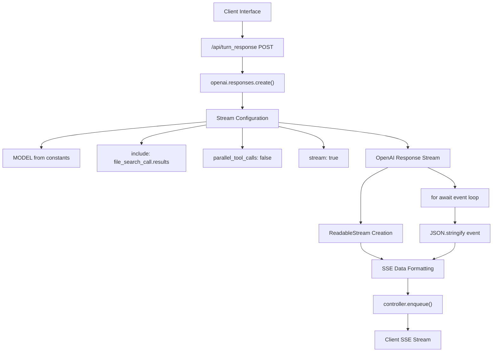
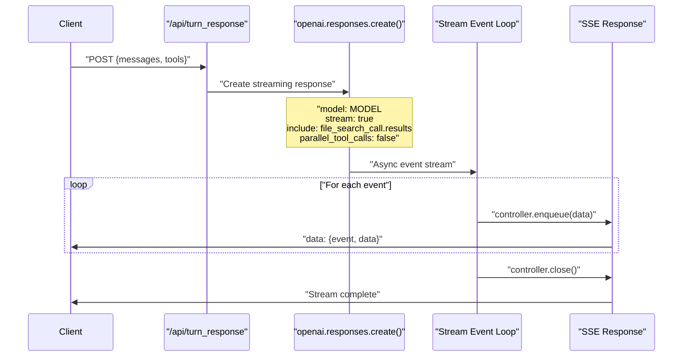
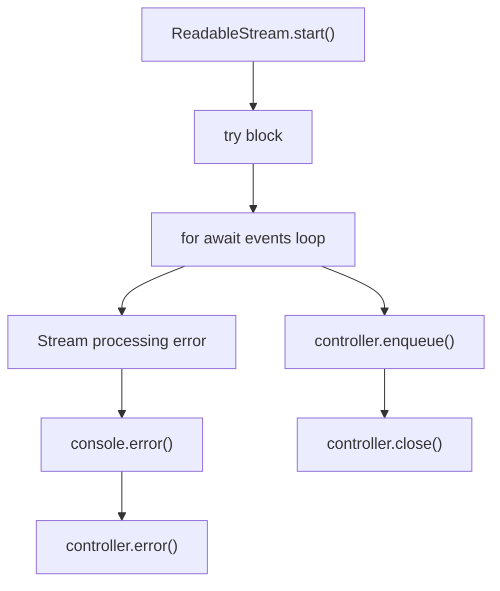
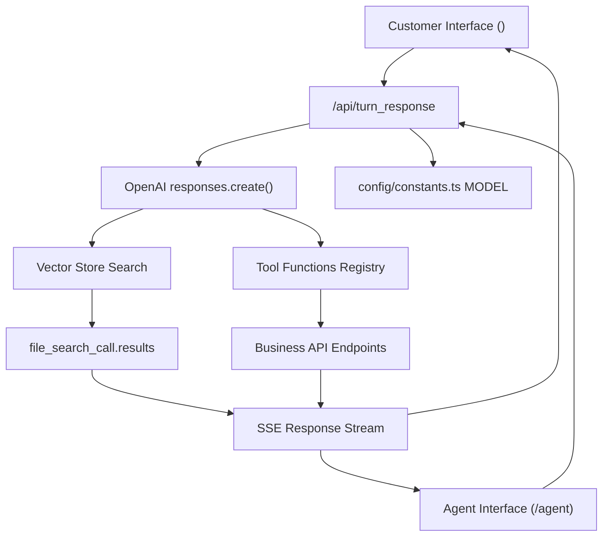

<!-- source: DeepWiki mcp.deepwiki.com · repo openai/openai-support-agent-demo · page 3.6 AI Response APIs · fetched 2026-10-26 -->

# AI Response APIs

<details>
<summary>Relevant source files</summary>

The following files were used as context for generating this wiki page:

- [app/api/turn_response/route.ts](app/api/turn_response/route.ts)

</details>


This document covers the REST API endpoints responsible for handling AI agent responses and streaming communication between the system and OpenAI's response generation API. These APIs enable real-time AI-powered conversations with integrated tool calling and knowledge base search capabilities.

For information about the tool functions that the AI can invoke, see [Tool Functions System](#2.2). For vector store integration details, see [Vector Store APIs](#3.4).

## Turn Response API

The `/api/turn_response` endpoint serves as the primary interface for AI response generation, handling streaming conversations between users and the AI agent.

### Endpoint Overview

| Method | Path | Purpose |
|--------|------|---------|
| POST | `/api/turn_response` | Generate streaming AI responses with tool calling support |

### Request Format

The endpoint accepts JSON payloads with the following structure:

| Field | Type | Required | Description |
|-------|------|----------|-------------|
| `messages` | Array | Yes | Conversation history in OpenAI message format |
| `tools` | Array | Yes | Available tool functions for the AI to invoke |

### Response Format

The API returns Server-Sent Events (SSE) with `Content-Type: text/event-stream`. Each event contains:

```
data: {"event": "event_type", "data": {...}}
```

The response stream includes all OpenAI response events, including `file_search_call.results` for knowledge base integration.

### Streaming Implementation Architecture



Sources: [app/api/turn_response/route.ts:1-59]()

### OpenAI Integration Details

The API leverages OpenAI's streaming responses API with specific configuration:



Sources: [app/api/turn_response/route.ts:10-19]()

## Configuration Parameters

The API uses several key configuration parameters:

| Parameter | Source | Purpose |
|-----------|--------|---------|
| `MODEL` | `config/constants` | OpenAI model specification |
| `stream: true` | Hardcoded | Enable streaming responses |
| `include: ["file_search_call.results"]` | Hardcoded | Include vector store search results |
| `parallel_tool_calls: false` | Hardcoded | Execute tool calls sequentially |

## Error Handling

The API implements comprehensive error handling at multiple levels:

### Stream-Level Error Handling



### HTTP-Level Error Handling

| Error Type | HTTP Status | Response Format |
|------------|-------------|-----------------|
| Request parsing error | 500 | `{"error": "error_message"}` |
| OpenAI API error | 500 | `{"error": "error_message"}` |
| Stream processing error | Stream terminates | SSE connection closed |

Sources: [app/api/turn_response/route.ts:35-58]()

## Integration Points

The turn response API serves as the central hub connecting multiple system components:



Sources: [app/api/turn_response/route.ts:1-59]()

## Usage Integration

The API is consumed by both customer and agent interfaces through identical HTTP requests but with different UI handling:

- **Customer Interface**: Direct conversation flow
- **Agent Interface**: Human-in-the-loop supervision with response approval

The streaming nature enables real-time updates in both interfaces, allowing agents to see AI suggestions as they're generated and customers to receive immediate responses.

Sources: [app/api/turn_response/route.ts:7-8]()

---

