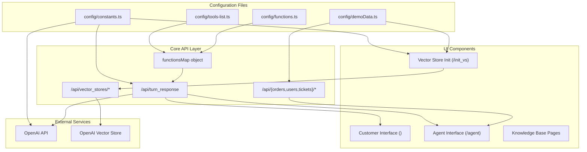
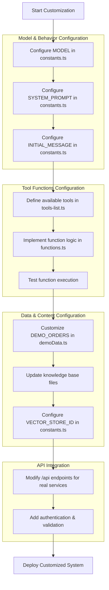
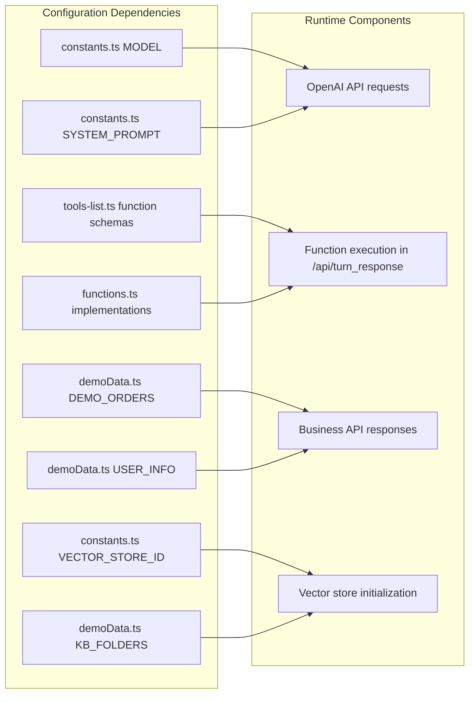

<!-- source: DeepWiki mcp.deepwiki.com · repo openai/openai-support-agent-demo · page 5 Configuration and Customization · fetched 2026-10-26 -->

# Configuration and Customization

Relevant source files

The following files were used as context for generating this wiki page:

- [README.md](README.md)

This document covers how to configure and customize the OpenAI Support Agent Demo for different use cases and requirements. It provides an overview of the configuration architecture and explains how different configuration files control various aspects of the system behavior, from AI model settings to demo data and tool functions.

For detailed information about individual configuration files, see [Configuration Files](#5.1). For customizing demo data and knowledge base content, see [Demo Data and Content](#5.2). For visual customization, see [Styling and Assets](#5.3).

## Configuration Architecture

The system uses a modular configuration architecture where different aspects of functionality are controlled by separate configuration files that feed into various system components.

### Configuration Flow Diagram

Sources: [README.md:109-119](), [config/constants.ts](), [config/tools-list.ts](), [config/functions.ts](), [config/demoData.ts]()

## Customization Workflow

The following diagram shows the typical workflow for customizing the system for a specific use case:

### Customization Process Flow

Sources: [README.md:109-119](), [config/constants.ts](), [config/tools-list.ts](), [config/functions.ts](), [config/demoData.ts]()

## Key Configuration Areas

The system provides several key areas for customization, each controlled by specific configuration files:

| Configuration Area | Primary File | Purpose | Key Components |
|-------------------|-------------|---------|----------------|
| AI Model & Behavior | `config/constants.ts` | Controls OpenAI model, prompts, and system behavior | `MODEL`, `SYSTEM_PROMPT`, `INITIAL_MESSAGE` |
| Tool Functions | `config/tools-list.ts` + `config/functions.ts` | Defines available AI tools and their implementations | `functionsMap`, tool schemas, function logic |
| Demo Data | `config/demoData.ts` | Provides sample data for demonstration | `DEMO_ORDERS`, `USER_INFO`, `KB_FOLDERS` |
| Vector Store | `config/constants.ts` | Configures knowledge base integration | `VECTOR_STORE_ID`, vector store settings |

### Configuration Dependencies

Sources: [config/constants.ts](), [config/tools-list.ts](), [config/functions.ts](), [config/demoData.ts](), [api/turn_response.ts]()

## Configuration File Overview

The system uses four primary configuration files that control different aspects of functionality:

### Core Configuration Files Structure

| File | Primary Exports | Controls |
|------|----------------|----------|
| `config/constants.ts` | `MODEL`, `SYSTEM_PROMPT`, `INITIAL_MESSAGE`, `VECTOR_STORE_ID` | AI behavior, model selection, vector store integration |
| `config/tools-list.ts` | Function schemas for OpenAI tools | Available AI function calls and their parameters |
| `config/functions.ts` | `functionsMap` object | Implementation logic for AI function calls |
| `config/demoData.ts` | `DEMO_ORDERS`, `USER_INFO`, `KB_FOLDERS` | Sample data for demonstration and testing |

For detailed documentation of each configuration file's structure and options, see [Configuration Files](#5.1).

## Environment and Runtime Configuration

Beyond the TypeScript configuration files, the system also uses environment variables for runtime configuration:

| Environment Variable | Purpose | Required |
|---------------------|---------|----------|
| `OPENAI_API_KEY` | OpenAI API authentication | Yes |
| `NODE_ENV` | Runtime environment (development/production) | No |

The `OPENAI_API_KEY` can be set either globally in your system or in a `.env` file at the project root.

Sources: [README.md:40-49](), [.env.example]()

## Production Customization Considerations

When customizing this demo for production use, consider the following areas that require additional implementation:

- **Authentication**: Add user authentication and session management
- **Input Validation**: Implement guardrails for user inputs and AI responses  
- **Real API Integration**: Replace demo APIs with actual business system integrations
- **Error Handling**: Add comprehensive error handling and logging
- **Security**: Implement proper security measures for function calls and data access
- **Rate Limiting**: Add rate limiting for API endpoints
- **Monitoring**: Add logging and monitoring for AI interactions and function executions

Sources: [README.md:120-121]()

---

