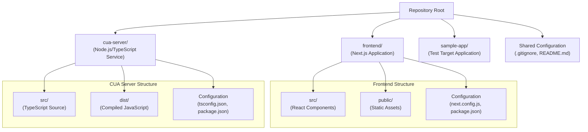
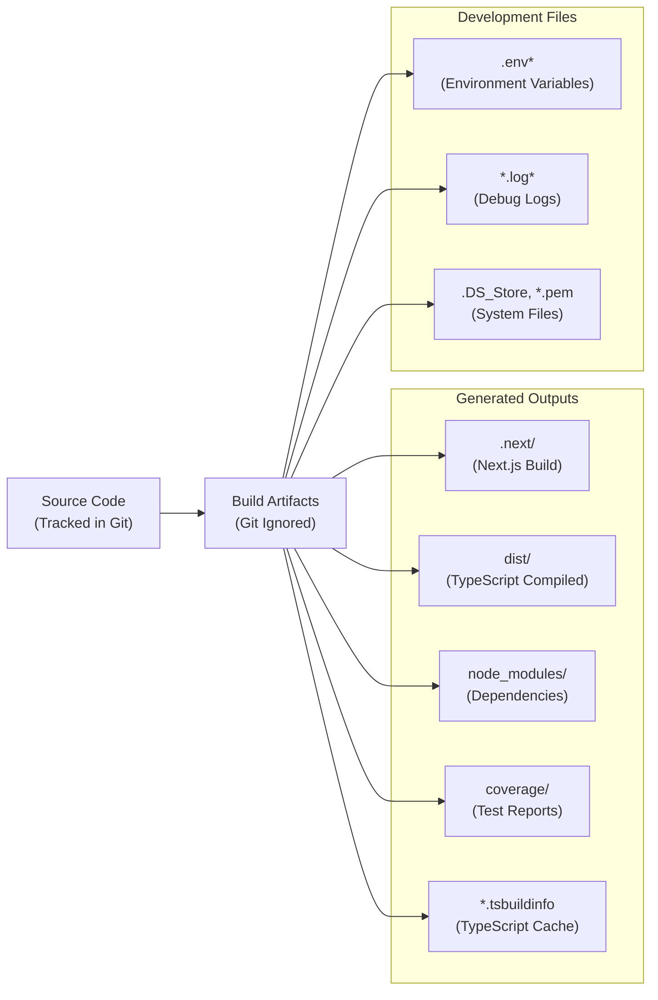
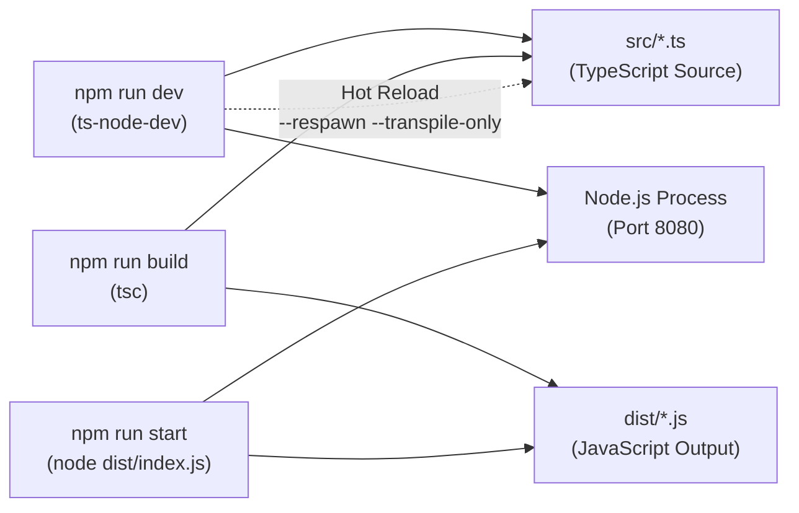
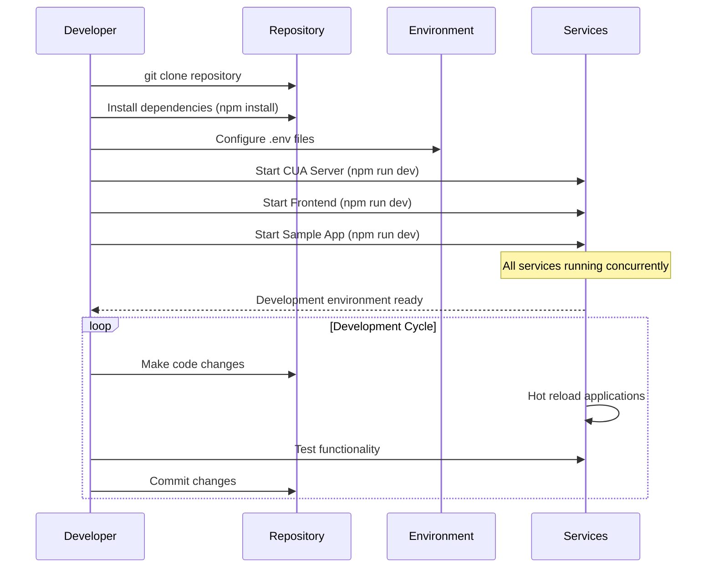
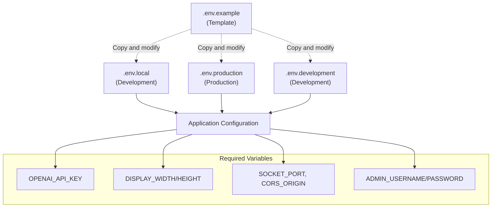
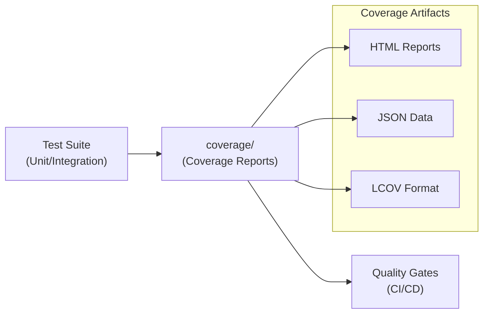
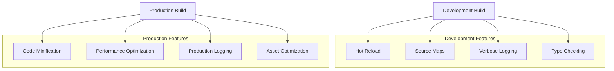
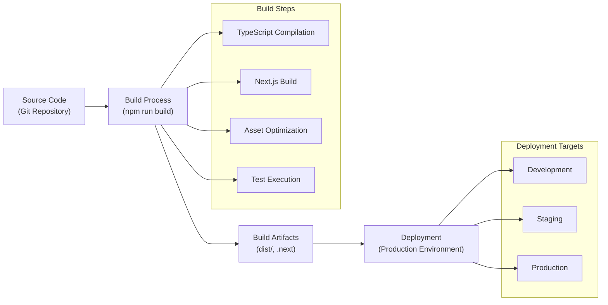

<!-- source: DeepWiki mcp.deepwiki.com · repo openai/openai-testing-agent-demo · page 6 Development Guide · fetched 2026-10-26 -->

# Development Guide

Relevant source files

The following files were used as context for generating this wiki page:

- [.gitignore](.gitignore)
- [cua-server/package.json](cua-server/package.json)
- [cua-server/tsconfig.json](cua-server/tsconfig.json)

This document provides comprehensive information for developers working on the Testing Agent Demo project, including project structure, build processes, development workflows, and deployment considerations. It covers the technical aspects of developing and maintaining the three core applications: Frontend, CUA Server, and Sample Test App.

For information about system architecture and component interactions, see [System Architecture](#3). For detailed API documentation of individual components, see [CUA Server](#4) and [Frontend Application](#5).

## Project Structure and Organization

### Monorepo Layout

The Testing Agent Demo is organized as a monorepo containing three distinct applications that work together to provide AI-driven web testing capabilities.

**Directory Structure Overview:**
- `frontend/` - Next.js web application for test configuration and monitoring
- `cua-server/` - Node.js backend service for AI-driven browser automation
- `sample-app/` - Sample e-commerce application used as a testing target
- Root-level configuration files for project-wide settings

Sources: [.gitignore:1-42]()

### Build Artifacts and Generated Files

The project generates several types of build artifacts that are excluded from version control:

**Key Ignored Patterns:**
- `/node_modules` - Package dependencies
- `/.next/` - Next.js build output
- `/build`, `/dist` - Compiled application bundles
- `/coverage` - Test coverage reports
- `.env*` - Environment configuration files (except `.env.example`)

Sources: [.gitignore:3-41]()

## Build Systems and Tooling

### CUA Server Build Configuration

The CUA Server uses TypeScript with a standard compilation setup for Node.js deployment.

#### TypeScript Configuration

| Setting | Value | Purpose |
|---------|-------|---------|
| `target` | `ES2020` | Modern JavaScript features support |
| `module` | `CommonJS` | Node.js compatibility |
| `outDir` | `dist` | Compiled output directory |
| `rootDir` | `src` | Source code directory |
| `strict` | `true` | Enhanced type checking |
| `esModuleInterop` | `true` | Better module compatibility |

#### Build Scripts

**Available Scripts:**
- `npm run dev` - Development mode with hot reload using `ts-node-dev`
- `npm run build` - Compile TypeScript to JavaScript in `dist/` directory
- `npm run start` - Run compiled JavaScript from `dist/index.js`

Sources: [cua-server/package.json:2-6](), [cua-server/tsconfig.json:1-13]()

### Dependencies and Package Management

#### Core Dependencies

| Package | Version | Purpose |
|---------|---------|---------|
| `socket.io` | `^4.8.1` | WebSocket communication |
| `playwright` | `^1.52.0` | Browser automation |
| `openai` | `^4.87.3` | OpenAI API integration |
| `pino` | `^9.6.0` | Structured logging |
| `pino-pretty` | `^13.0.0` | Development log formatting |
| `uuid` | `^11.1.0` | Unique identifier generation |

#### Development Dependencies

| Package | Version | Purpose |
|---------|---------|---------|
| `typescript` | `^5` | TypeScript compiler |
| `ts-node-dev` | `^2.0.0` | Development server with hot reload |
| `@types/node` | `^20` | Node.js type definitions |

Sources: [cua-server/package.json:7-19]()

## Development Workflows

### Local Development Setup

**Setup Steps:**
1. Clone repository and install dependencies for all three applications
2. Configure environment variables (OpenAI API key, ports, etc.)
3. Start all services in development mode
4. Verify inter-service communication via WebSocket connections

### Hot Reload and Development Server

The CUA Server uses `ts-node-dev` with specific flags for optimal development experience:

| Flag | Purpose |
|------|---------|
| `--respawn` | Automatically restart on file changes |
| `--transpile-only` | Skip type checking for faster restarts |

This configuration enables rapid iteration while developing TypeScript code without full compilation cycles.

Sources: [cua-server/package.json:5]()

## Configuration Management

### Environment Variables

The project uses environment-based configuration with the following pattern:

**Environment File Handling:**
- `.env.example` - Template file tracked in Git
- `.env*` - Actual configuration files ignored by Git
- Environment-specific overrides supported for different deployment targets

Sources: [.gitignore:35-37]()

### TypeScript Configuration

The TypeScript configuration follows Node.js best practices:

| Configuration | Setting | Rationale |
|---------------|---------|-----------|
| Module System | `CommonJS` | Node.js compatibility |
| Target | `ES2020` | Modern JavaScript features |
| Source Maps | Implied | Debugging support |
| Strict Mode | `true` | Enhanced type safety |
| JSON Modules | `true` | Configuration file imports |

Sources: [cua-server/tsconfig.json:2-11]()

## Testing and Quality Assurance

### Test Coverage and Reporting

The project supports test coverage reporting through the `/coverage` directory:

Coverage reports are generated in multiple formats for different tools and CI/CD integration.

Sources: [.gitignore:16]()

### Development and Production Builds

**Build Optimization:**
- Development builds prioritize fast iteration and debugging
- Production builds focus on performance and minimal bundle size
- TypeScript compilation produces optimized JavaScript for Node.js

## Deployment Considerations

### Service Dependencies

The system requires careful orchestration of multiple services during deployment:

| Service | Port | Dependencies |
|---------|------|--------------|
| Frontend | 3000 | CUA Server WebSocket |
| CUA Server | 8080 | OpenAI API, Playwright |
| Sample App | 3005 | None (standalone) |

### Runtime Requirements

**System Dependencies:**
- Node.js runtime environment
- Playwright browser binaries
- OpenAI API access
- WebSocket-capable network configuration

**Resource Considerations:**
- Browser automation requires significant memory
- Screenshot processing impacts CPU usage
- OpenAI API calls introduce network latency

Sources: [cua-server/package.json:11-12]()

### Build and Deployment Pipeline

**Deployment Sequence:**
1. Install dependencies for all applications
2. Build CUA Server using TypeScript compiler
3. Build Frontend using Next.js build system
4. Configure environment variables for target environment
5. Start services in correct order (CUA Server first, then Frontend)

Sources: [cua-server/package.json:3-4]()