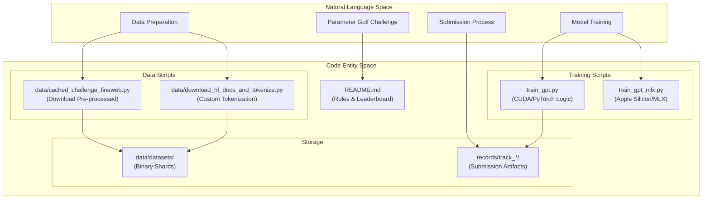
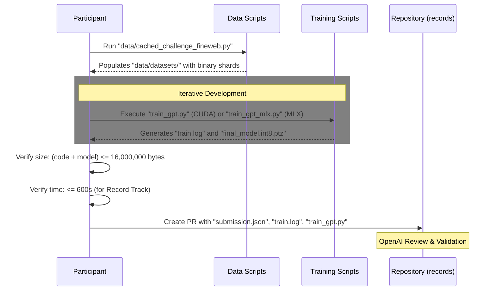

<!-- source: DeepWiki mcp.deepwiki.com · repo openai/parameter-golf · page 1 Overview · fetched 2026-10-26 -->

# Overview

Relevant source files

The following files were used as context for generating this wiki page:

- [README.md](README.md)
- [requirements.txt](requirements.txt)

This document introduces the **OpenAI Model Craft Challenge: Parameter Golf**: its objective, constraints, evaluation methodology, and repository structure. Parameter Golf is a machine learning optimization challenge where participants train the best possible language model that fits in a 16MB artifact and trains in under 10 minutes on 8xH100s, evaluated by compression performance on a held-out validation set. [README.md:6-6]()

---

## Challenge Objective

Parameter Golf is an **L(N) optimization problem**: minimize validation loss given a fixed parameter budget (N), unconstrained by data, compute steps, or architecture choices. [README.md:8-10]() The challenge is inspired by [NanoGPT Speedrunning](https://github.com/KellerJordan/modded-nanogpt), which optimizes L(T) (lowest loss in constrained time).

The evaluation metric is **bits-per-byte (bpb)** on the FineWeb validation set, a tokenizer-agnostic compression metric. [README.md:6-6]() Lower bpb indicates better language modeling performance. The validation set is fixed: the first 50,000 documents from FineWeb, ensuring consistent evaluation across all submissions. [README.md:6-6]()

**Sources**: [README.md:6-10]()

---

## Core Constraints

All submissions must satisfy three hard constraints:

| Constraint | Specification | What Counts |
|------------|---------------|-------------|
| **Artifact Size** | ≤ 16,000,000 bytes (decimal 16MB) | `train_gpt.py` code bytes + compressed model bytes (INT8 quantized + zlib compressed) |
| **Training Time** | ≤ 10 minutes on 8×H100 GPUs (record track) | Wall-clock time from script start to completion |
| **Evaluation Access** | No external data or network access | Model must be self-contained; no downloads during evaluation |

The artifact size limit encourages aggressive compression techniques (quantization, pruning, novel tokenizers), while the training time limit forces efficient architectures and optimizers. Non-record submissions bypass the 10-minute constraint but must still satisfy the 16MB limit. [README.md:12-12]()

**Sources**: [README.md:6-13]()

---

## Repository Structure

The repository is organized into distinct functional areas, each serving a specific role in the challenge workflow:

### Repository Data Flow and Entity Mapping

This diagram maps natural language concepts to the specific code entities and files that implement them.

**Key Files and Directories**:

| Path | Purpose |
|------|---------|
| `README.md` | Challenge rules, getting started guide, leaderboard. [README.md:1-27]() |
| `train_gpt.py` | Main CUDA training script containing `GPT` model and `Muon` optimizer. |
| `train_gpt_mlx.py` | Apple Silicon variant using the MLX framework for local iteration. |
| `data/cached_challenge_fineweb.py` | Downloads pre-tokenized FineWeb dataset from Hugging Face Hub. |
| `data/download_hf_docs_and_tokenize.py` | Rebuilds dataset from canonical `docs_selected.jsonl` with custom tokenizers. |
| `records/track_10min_16mb/` | Leaderboard submissions meeting the 10-minute constraint. [README.md:33-52]() |
| `records/track_non_record_16mb/` | Entries exploring the parameter-limited frontier without time limits. [README.md:12-12]() |

**Sources**: [README.md:6-52](), [requirements.txt:1-10]()

---

## Challenge Tracks

Parameter Golf operates two parallel tracks:

### Record Track (`records/track_10min_16mb/`)

The main leaderboard for state-of-the-art submissions. [README.md:29-32]() Requirements:
- **Training time**: ≤ 10 minutes on 8×H100 GPUs. [README.md:6-6]()
- **Artifact size**: ≤ 16,000,000 bytes. [README.md:6-6]()
- **Performance threshold**: To be considered a "record," submissions typically need to show significant improvement over existing SOTA. [README.md:33-52]()

### Non-Record Track (`records/track_non_record_16mb/`)

Accepts submissions that exceed the 10-minute training limit but still satisfy the 16MB artifact constraint. [README.md:12-12]() This track is for:
- Unlimited compute approaches exploring the parameter-limited frontier.
- Novel architectures or compression schemes.
- Experimental techniques requiring longer training.

**Sources**: [README.md:6-12](), [README.md:29-52]()

---

## Participant Workflow

This diagram illustrates the lifecycle of a submission from environment setup to leaderboard inclusion.

**Workflow Steps**:

1. **Setup**: Install dependencies from `requirements.txt` (e.g., `torch`, `tiktoken`, `sentencepiece`). [requirements.txt:1-10]()
2. **Data**: Download FineWeb shards using `data/cached_challenge_fineweb.py`.
3. **Training**: Configure hyperparameters and run `train_gpt.py` with `torchrun` for distributed training.
4. **Validation**: Verify artifact size (≤ 16MB) and training time (≤ 10 min for record track).
5. **Submission**: Create a folder in the appropriate `records/` subdirectory and submit a Pull Request. [README.md:33-52]()

**Sources**: [README.md:6-52](), [requirements.txt:1-10]()

---

## Design Space and Innovation

The challenge constraints define a multi-dimensional optimization space:

### Architecture and Compression
- **Test-time compute**: Extended inference computation per prediction. [README.md:8-8]()
- **Parameter tying**: Shared embeddings or weight sharing across layers. [README.md:8-8]()
- **Quantization**: INT8, BitNets, or novel low-precision schemes. [README.md:8-8]()
- **Optimizers**: Use of `Muon` (from `modded-nanogpt`) or custom second-order methods to accelerate convergence within the 10-minute window. [README.md:8-8]()

### Evaluation Metric: Bits-Per-Byte (bpb)
The challenge uses `val_bpb` (bits-per-byte) as the primary evaluation metric. It is a tokenizer-agnostic measure of how well the model compresses the FineWeb validation set. [README.md:6-6]()

**Sources**: [README.md:6-10]()

---

## Support and Community

- **Compute Grants**: OpenAI is sponsoring $1,000,000 in compute credits to help participants. [README.md:14-15]()
- **Participant Form**: Used to attribute submissions and reach out about opportunities. [README.md:17-23]()
- **Timeline**: The challenge runs from March 18th to April 30th. [README.md:25-25]()

**Sources**: [README.md:14-25]()

---

