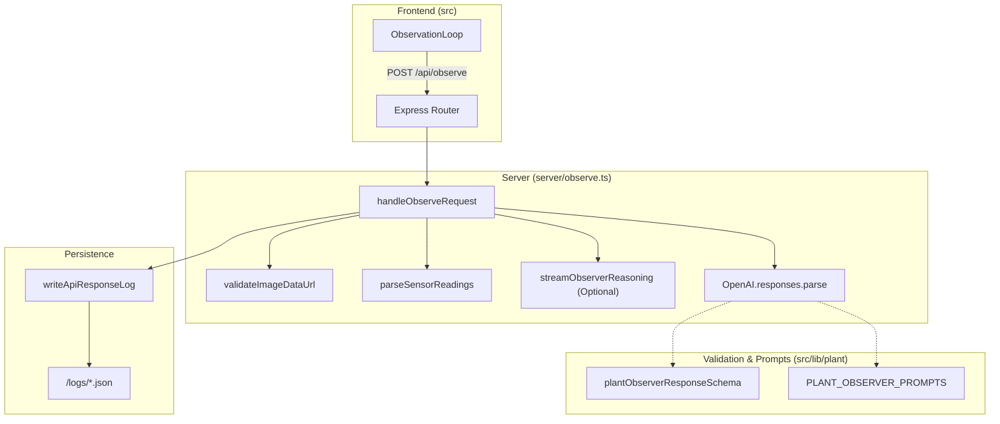
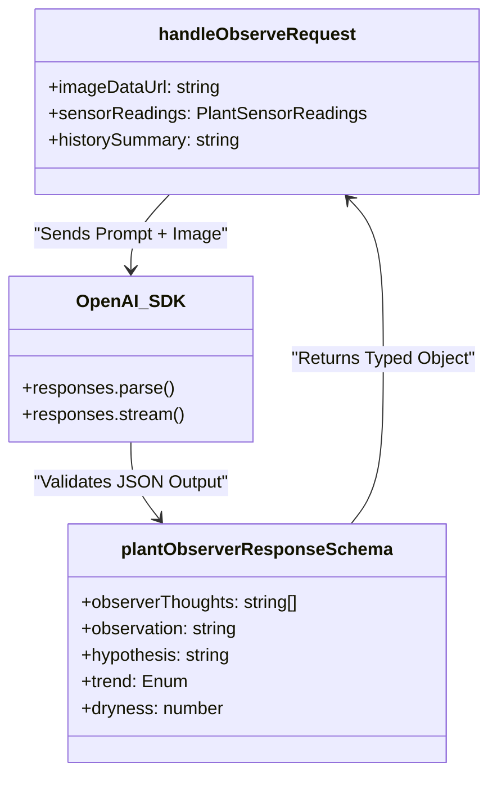

<!-- source: DeepWiki mcp.deepwiki.com · repo openai/planttalk · page 3.1 Vision API Endpoints (`/api/analyze` & `/api/observe`) · fetched 2026-10-26 -->

# Vision API Endpoints (`/api/analyze` & `/api/observe`)

Relevant source files

The following files were used as context for generating this wiki page:

- [server/observe.ts](server/observe.ts)
- [src/lib/api/response-logging.ts](src/lib/api/response-logging.ts)
- [src/lib/plant/prompts.ts](src/lib/plant/prompts.ts)
- [src/lib/plant/schemas.ts](src/lib/plant/schemas.ts)

The Vision API layer in the Express server acts as a secure proxy and data-fusion engine for OpenAI's vision models. It processes incoming camera frames and sensor data, applies domain-specific prompts, and enforces strict structured output validation using Zod schemas.

## Overview of Endpoints

The server exposes two primary POST endpoints in `server/observe.ts` [server/observe.ts:1-31]():

1.  **`POST /api/analyze`**: A one-shot endpoint used primarily for the "Plant Analysis" debug/test tool. It performs a deep visual inspection of a single image without historical context.
2.  **`POST /api/observe`**: The core of the periodic observation loop. It fuses current image data, live sensor readings, hardware status, and historical observation summaries into a single prompt to generate a structured record of the plant's state.

### Technical Constraints
- **Model**: Both endpoints utilize `gpt-5.4` (configured as `plantAnalysisModel`) [server/observe.ts:17]().
- **Timeout**: A hard ceiling of 120 seconds (`MODEL_CALL_TIMEOUT_MS`) is enforced to prevent stalled LLM calls from wedging the observation loop [server/observe.ts:27]().
- **Payload Limit**: Images are validated against a `MAX_IMAGE_DATA_URL_LENGTH` of approximately 8MB (base64 encoded) [server/observe.ts:21]().

## Data Flow: Vision Analysis Pipeline

The following diagram illustrates how raw sensor data and images from the frontend are transformed into structured JSON by the server.

### Vision Request Lifecycle
| Step | Description | Code Reference |
| :--- | :--- | :--- |
| **Validation** | Checks for API keys and validates the base64 image string. | [server/observe.ts:32-35]() |
| **Fusion** | Merges `sensorReadings`, `hardwareSummary`, and `historySummary` into the prompt. | [server/observe.ts:86-116]() |
| **Inference** | Calls OpenAI with `response_format` set to a Zod-backed JSON schema. | [server/observe.ts:124-133]() |
| **Logging** | Successful observations are written to the `/logs` directory as JSON files. | [server/observe.ts:145](), [src/lib/api/response-logging.ts:20-30]() |

### Code Entity Mapping: Request Handling
This diagram maps the logical flow of a request to the specific functions and schemas in the codebase.

Sources: [server/observe.ts:80-151](), [src/lib/plant/schemas.ts:48-75](), [src/lib/api/response-logging.ts:20-30]()

## Periodic Observation (`/api/observe`)

The `/api/observe` endpoint supports both standard JSON responses and a streaming NDJSON mode for "reasoning summaries."

### Sensor Reading Validation
Before calling the LLM, the server validates sensor data using `parseSensorReadings` [server/observe.ts:86](). It ensures that readings like `moisture` and `light` fall within the `PLANT_SENSOR_LIMITS` [server/observe.ts:11-15]().

### Prompt Engineering
The endpoint utilizes `PLANT_OBSERVER_PROMPTS` [src/lib/plant/prompts.ts:50]().
- **System Prompt**: Instructs the model to act as a scientific observer, compare data against history, and handle "stale" or "manual" sensor data with skepticism [src/lib/plant/prompts.ts:51-63]().
- **User Prompt**: A dynamic template that injects the `sensorSummary`, `hardwareSummary`, and `historySummary` [src/lib/plant/prompts.ts:64-82]().

### Streaming Reasoning (NDJSON)
When the `stream` flag is true, the server switches to `streamObserverReasoning` [server/observe.ts:154]().
- **Content-Type**: `application/x-ndjson` [server/observe.ts:164]().
- **Events**: It streams `reasoning_summary_delta` and `reasoning_summary_done` events to the client [server/observe.ts:197-205](). This allows the UI to show the plant's "thoughts" in real-time before the final structured observation is complete.
- **Abort Logic**: If the client disconnects (`res.on("close")`), the OpenAI stream is immediately aborted to save tokens and server resources [server/observe.ts:186-190]().

Sources: [server/observe.ts:154-215](), [src/lib/plant/prompts.ts:50-83]()

## One-Shot Analysis (`/api/analyze`)

The `/api/analyze` endpoint is a simpler version of the observation logic, used for testing and initial setup [server/observe.ts:31]().

- **Input**: Only requires a `image` data URL [server/observe.ts:34]().
- **Prompt**: Uses `PLANT_ANALYSIS_PROMPTS`, which focuses on visual estimation of size (using a U.S. quarter as a reference if present), branching, and texture [src/lib/plant/prompts.ts:16-37]().
- **Schema**: Validated against `plantAttributeAnalysisSchema` [src/lib/plant/schemas.ts:9-35]().

## Structured Output Schemas

The project relies on Zod to bridge the gap between LLM text generation and typed TypeScript objects.

| Schema Name | Fields | Purpose |
| :--- | :--- | :--- |
| `plantAttributeAnalysisSchema` | `dryness`, `size`, `branching`, `physicalTexture` | Detailed physical metrics for one-shot analysis. [src/lib/plant/schemas.ts:9-35]() |
| `plantObserverResponseSchema` | `observerThoughts`, `observation`, `hypothesis`, `trend`, `dryness` | Periodic state tracking for the plant's long-term memory. [src/lib/plant/schemas.ts:48-75]() |

### Data Relationship Diagram
This diagram shows how the server-side logic interacts with the Zod schemas and the OpenAI SDK.

Sources: [server/observe.ts:80-151](), [src/lib/plant/schemas.ts:48-75]()

## Response Logging

Every successful observation is logged to the server's local filesystem in the `/logs` directory [src/lib/api/response-logging.ts:4]().
- **Filename Format**: `YYYYMMDDHHMMSSms.json` (e.g., `20231027103015500.json`) [src/lib/api/response-logging.ts:6-18]().
- **Function**: `writeApiResponseLog(payload)` handles the directory creation and asynchronous write [src/lib/api/response-logging.ts:20-30]().

Sources: [src/lib/api/response-logging.ts:1-36]()

---

