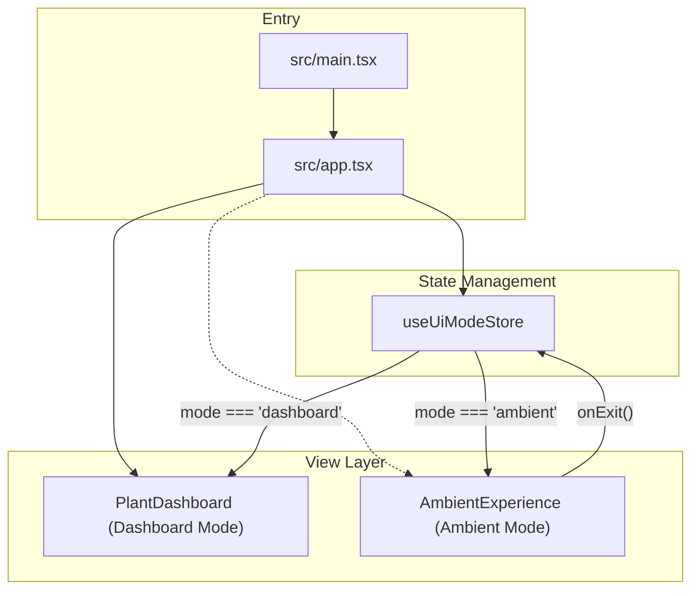
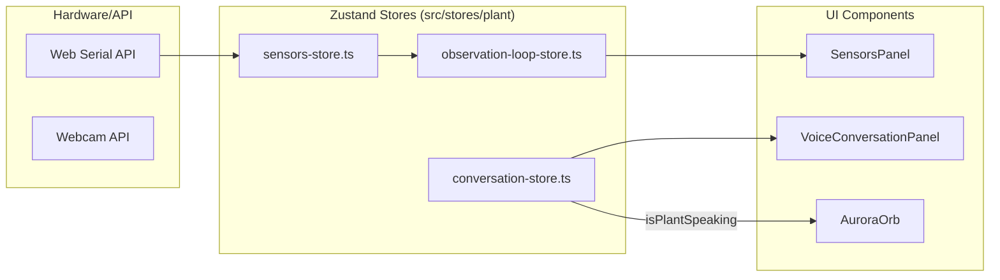

<!-- source: DeepWiki mcp.deepwiki.com · repo openai/planttalk · page 4 Frontend Application · fetched 2026-10-26 -->

# Frontend Application

Relevant source files

The following files were used as context for generating this wiki page:

- [index.html](index.html)
- [src/app.tsx](src/app.tsx)
- [src/main.tsx](src/main.tsx)
- [src/styles.css](src/styles.css)

The Plant Talk frontend is a React-based Single Page Application (SPA) built with Vite and styled using PicoCSS. It serves as the orchestration layer that connects hardware sensor data, camera feeds, and the OpenAI Realtime API into a unified interface. The application is designed to support two distinct operational modes: a technical **Dashboard** for monitoring system internals and an **Ambient Mode** for public-facing kiosk installations.

## Entry Point and App Structure

The application initializes at `src/main.tsx`, which mounts the `App` component into the `index.html` root element [index.html:13-15](). It dynamically sets the document title based on the `PLANT_NAME` constant [src/main.tsx:9-15]().

The `App` component acts as the top-level controller. It does not use a traditional router; instead, it uses a state-driven conditional rendering approach managed by the `useUiModeStore` [src/app.tsx:8-30](). This allows the background processes—such as the observation loop and sensor monitoring—to persist even when switching between views.

### Application Layout Flow
The diagram below illustrates the mounting sequence and the relationship between the two primary views.

**View Orchestration Diagram**

Sources: [src/main.tsx:1-15](), [src/app.tsx:1-30](), [index.html:13-17]()

## Primary Views

The application switches between two primary interfaces depending on the `mode` state in `useUiModeStore`.

| View | Component | Purpose |
| :--- | :--- | :--- |
| **Dashboard** | `PlantDashboard` | Technical view showing sensor telemetry, camera preview, LLM reasoning logs, and manual overrides. |
| **Ambient Mode** | `AmbientExperience` | A high-fidelity, public-facing overlay featuring WebGL visuals and a simplified "Press to Talk" interface. |

### Dashboard Mode
The Dashboard is the default view. It utilizes a responsive CSS grid that adjusts from 1 to 4 columns based on screen width [src/styles.css:28-51](). It is composed of multiple panels that expose the internal state of the plant's "brain" and "senses."

For details on the specific panels and the observation loop, see [Dashboard Components](#4.1).

### Ambient Mode
Ambient Mode is rendered as an overlay on top of the dashboard [src/app.tsx:27-27](). This ensures that while the user sees a clean, artistic interface, the underlying `PlantDashboard` components remain mounted to handle hardware communication and API requests.

For details on the WebGL visuals and kiosk UX, see [Ambient Mode (Public Experience)](#4.2).

Sources: [src/app.tsx:6-29](), [src/styles.css:28-51]()

## State Wiring (Zustand)

The frontend relies on **Zustand** stores to bridge the gap between low-level logic (like Web Serial streams or WebRTC audio) and the React UI. Components subscribe to specific slices of state to minimize re-renders.

**Data Flow: Sensors to UI**

Key store interactions include:
*   **UI Mode Store**: Manages the toggle between `dashboard` and `ambient` views [src/stores/plant/ui-mode-store.ts]().
*   **Sensor Store**: Tracks real-time moisture and light data from the Arduino [src/stores/plant/sensors-store.ts]().
*   **Conversation Store**: Manages the OpenAI Realtime connection and audio levels [src/stores/plant/conversation-store.ts]().

Sources: [src/app.tsx:9-10](), [src/styles.css:99-103]()

## Global Styles

The application uses **PicoCSS** for semantic HTML styling with minimal overrides. Custom styles in `src/styles.css` handle:
*   **The Dashboard Grid**: A responsive layout using `grid-template-columns` [src/styles.css:28-51]().
*   **Animations**: The `.flash-on-update` class used to highlight new analysis results [src/styles.css:77-80]().
*   **Audio Visualizers**: Styles for `.level-meters` used in voice conversation [src/styles.css:99-103]().

Sources: [src/styles.css:1-103](), [src/main.tsx:3-4]()

---

