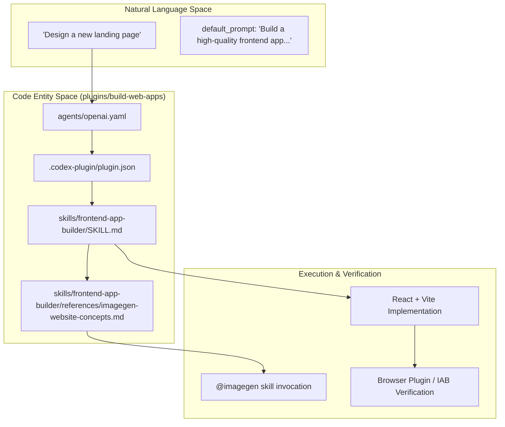
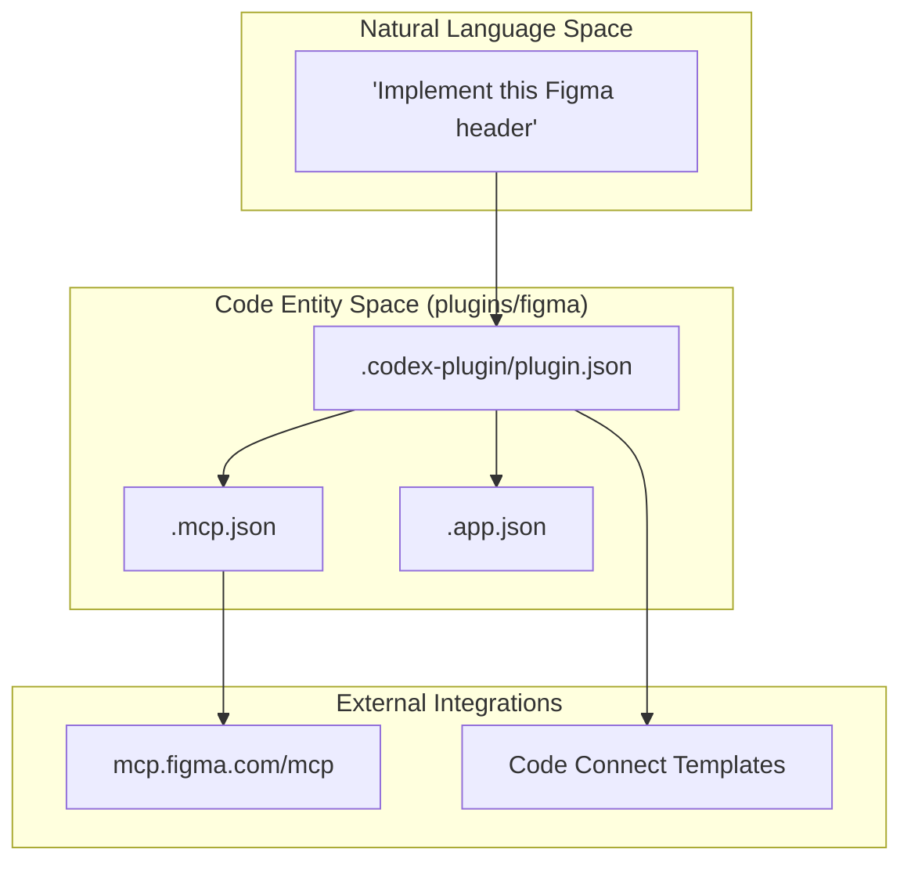

<!-- source: DeepWiki mcp.deepwiki.com · repo openai/plugins · page 4 Coding and Development Plugins · fetched 2026-10-26 -->

# Coding and Development Plugins

Relevant source files

The following files were used as context for generating this wiki page:

- [.agents/plugins/api_marketplace.json](.agents/plugins/api_marketplace.json)
- [plugins/base44/.codex-plugin/plugin.json](plugins/base44/.codex-plugin/plugin.json)
- [plugins/build-web-apps/.codex-plugin/plugin.json](plugins/build-web-apps/.codex-plugin/plugin.json)
- [plugins/build-web-apps/README.md](plugins/build-web-apps/README.md)
- [plugins/build-web-apps/agents/openai.yaml](plugins/build-web-apps/agents/openai.yaml)
- [plugins/build-web-apps/skills/frontend-app-builder/SKILL.md](plugins/build-web-apps/skills/frontend-app-builder/SKILL.md)
- [plugins/build-web-apps/skills/frontend-app-builder/agents/openai.yaml](plugins/build-web-apps/skills/frontend-app-builder/agents/openai.yaml)
- [plugins/build-web-apps/skills/frontend-app-builder/references/imagegen-website-concepts.md](plugins/build-web-apps/skills/frontend-app-builder/references/imagegen-website-concepts.md)
- [plugins/build-web-apps/skills/frontend-testing-debugging/SKILL.md](plugins/build-web-apps/skills/frontend-testing-debugging/SKILL.md)
- [plugins/build-web-apps/skills/frontend-testing-debugging/agents/openai.yaml](plugins/build-web-apps/skills/frontend-testing-debugging/agents/openai.yaml)
- [plugins/figma/.codex-plugin/plugin.json](plugins/figma/.codex-plugin/plugin.json)
- [plugins/figma/.mcp.json](plugins/figma/.mcp.json)
- [plugins/github/.codex-plugin/plugin.json](plugins/github/.codex-plugin/plugin.json)
- [plugins/github/.mcp.json](plugins/github/.mcp.json)
- [plugins/github/README.md](plugins/github/README.md)
- [plugins/github/assets/logo.png](plugins/github/assets/logo.png)
- [plugins/shopify/.codex-plugin/plugin.json](plugins/shopify/.codex-plugin/plugin.json)
- [plugins/supabase/.codex-plugin/plugin.json](plugins/supabase/.codex-plugin/plugin.json)
- [plugins/vercel/.codex-plugin/plugin.json](plugins/vercel/.codex-plugin/plugin.json)

This section provides an overview of the plugins designed to assist with the full software development lifecycle—from design implementation and mobile/web app building to CI/CD debugging and cloud infrastructure management. These plugins leverage the **Skill system**, **App Connectors**, and the **Model Context Protocol (MCP)** to bridge natural language requirements with technical execution.

## Plugin Categories

The coding ecosystem is divided into several specialized domains. Each domain is covered in detail on its own child page.

### GitHub and Source Control
The GitHub plugin provides high-level orchestration for repository management. It utilizes a hybrid approach, combining app-connector tools with CLI-based workflows to handle PR triage, CI debugging, and automated code publishing.
*   **Key Skills**: `github` (triage), `gh-fix-ci` (debugging), `gh-address-comments` (review follow-up), and `yeet` (publishing) [plugins/github/.codex-plugin/plugin.json:21-21]().
*   **Workflow**: Uses a `codex/` branch naming convention and automated PR creation [plugins/github/.codex-plugin/plugin.json:4-4]().
*   **For details, see [GitHub Plugin](#4.1)**.

### Design-to-Code (Figma)
The Figma plugin focuses on translating visual designs into production-ready code. It is an app-backed plugin defined in `plugins/figma/.app.json` and uses the `figma` MCP server for tool execution [plugins/figma/.codex-plugin/plugin.json:20-21]().
*   **Key Skills**: `figma-implement-design`, `figma-code-connect-components`, and `figma-create-design-system-rules` [plugins/figma/.codex-plugin/plugin.json:25-25]().
*   **Functionality**: Maps Figma components to source code using **Code Connect** and generates project-specific design system rules [plugins/figma/.codex-plugin/plugin.json:14-17]().
*   **For details, see [Figma Plugin](#4.2)**.

### App Building (iOS, Web, Android, Game Studio, Expo)
These plugins provide specialized environments for different platforms.
*   **Build Web Apps**: A full-stack plugin that integrates Vercel, Stripe, Supabase, and Shadcn [plugins/build-web-apps/.codex-plugin/plugin.json:21-25](). It features the `frontend-app-builder` skill which enforces a "design-first" workflow using Image Gen concepts [plugins/build-web-apps/skills/frontend-app-builder/SKILL.md:12-16]().
*   **Game Studio**: Facilitates 2D and 3D game development [.agents/plugins/api_marketplace.json:8-12]().
*   **Expo**: Handles React Native workflows, EAS Build, and SDK upgrades [.agents/plugins/api_marketplace.json:149-153]().
*   **For details, see [App Building Plugins (iOS, macOS, Web, Android, Game Studio, Expo)](#4.3)**.

### Cloud and Infrastructure
Infrastructure-as-Code and deployment workflows are handled by dedicated plugins for major cloud providers.
*   **Providers**: Cloudflare (Workers/Durable Objects), Vercel (Next.js/AI SDK), Netlify, Render, Neon Postgres (Serverless DB), and Supabase.
*   **Integration**: These plugins heavily rely on MCP servers to perform actions like branching databases or deploying workers [plugins/figma/.mcp.json:1-9]().
*   **For details, see [Cloud Deployment Plugins (Cloudflare, Vercel, Netlify, Render, Neon Postgres, Supabase)](#4.4)**.

### Specialized Creative and Payments
*   **Canva**: Handles branded presentations and social media resizing.
*   **Stripe**: Provides best-practice references and upgrade paths for payment integrations via the `stripe-best-practices` skill.
*   **For details, see [Design and Creative Plugins (Canva, Hugging Face, HyperFrames, Remotion, HeyGen, MagicPath)](#4.5)** and **[Payments and Finance Plugins (Stripe, Ramp)](#4.6)**.

### Developer Tools and Infrastructure
*   **OpenAI Developers**: Manages API keys and Agents SDK troubleshooting.
*   **Codex Security**: Performs security scanning and attack-path-analysis [.agents/plugins/api_marketplace.json:248-252]().
*   **Base44**: Build and deploy full-stack apps with CLI project management [plugins/base44/.codex-plugin/plugin.json:4-4]().
*   **For details, see [Developer Tools and Infrastructure Plugins (OpenAI Developers, ChatGPT Apps, CodeRabbit, Codex Security, CircleCI, Temporal, Twilio, Sentry, Replay.io, DigitalOcean, OpenAI Ads Conversions)](#4.7)**.

### Superpowers (Methodology)
The Superpowers plugin implements a complete software development methodology for coding agents, including Test-Driven Development (TDD) and subagent-driven development [.agents/plugins/api_marketplace.json:23-27]().
*   **For details, see [Superpowers Plugin (Agent Development Methodology)](#4.8)**.

## System Architecture Overview

The following diagrams illustrate how the natural language intent is mapped to specific code entities and external integrations.

### Frontend App Builder Workflow
This diagram shows how the `build-web-apps` plugin bridges natural language design requests to verified browser implementations.

**Sources:** [plugins/build-web-apps/.codex-plugin/plugin.json:28-31](), [plugins/build-web-apps/agents/openai.yaml:1-6](), [plugins/build-web-apps/skills/frontend-app-builder/SKILL.md:8-30](), [plugins/build-web-apps/skills/frontend-app-builder/references/imagegen-website-concepts.md:5-16]()

### Design-to-Code Flow (Figma)
This diagram illustrates the connection between Figma design assets and the local codebase via the MCP server.

**Sources:** [plugins/figma/.codex-plugin/plugin.json:20-25](), [plugins/figma/.mcp.json:1-9](), [plugins/figma/.app.json:1-7]()

## Summary Table of Coding Plugins

| Plugin | Category | Key Capabilities | Primary Tech Stack |
| :--- | :--- | :--- | :--- |
| `github` | Developer Tools | Read, Write, Interactive | GitHub API, Git CLI |
| `figma` | Creativity | Read, Write, Interactive | Figma API, Code Connect |
| `build-web-apps` | Developer Tools | Read, Write, Interactive | React, Vite, Shadcn |
| `vercel` | Developer Tools | Read, Write, Interactive | Next.js, AI SDK, Edge |
| `shopify` | Developer Tools | Read, Write | GraphQL, Liquid, Hydrogen |
| `base44` | Developer Tools | Read, Write, Interactive | JS/TS SDK, CLI |

**Sources:** [plugins/github/.codex-plugin/plugin.json:29-33](), [plugins/figma/.codex-plugin/plugin.json:27-32](), [plugins/build-web-apps/.codex-plugin/plugin.json:33-34](), [plugins/vercel/.codex-plugin/plugin.json:34-39](), [plugins/shopify/.codex-plugin/plugin.json:26-31](), [plugins/base44/.codex-plugin/plugin.json:20-21]()

---

