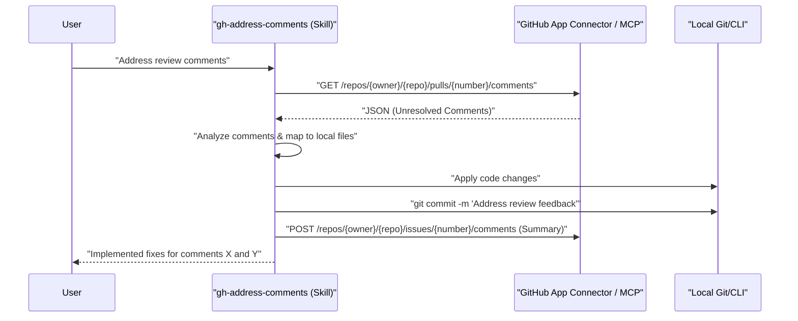

<!-- source: DeepWiki mcp.deepwiki.com · repo openai/plugins · page 4.1 GitHub Plugin · fetched 2026-10-26 -->

# GitHub Plugin

<details>
<summary>Relevant source files</summary>

The following files were used as context for generating this wiki page:

- [.agents/plugins/api_marketplace.json](.agents/plugins/api_marketplace.json)
- [plugins/base44/.codex-plugin/plugin.json](plugins/base44/.codex-plugin/plugin.json)
- [plugins/cloudflare/skills/agents-sdk/agents/openai.yaml](plugins/cloudflare/skills/agents-sdk/agents/openai.yaml)
- [plugins/figma/.codex-plugin/plugin.json](plugins/figma/.codex-plugin/plugin.json)
- [plugins/figma/.mcp.json](plugins/figma/.mcp.json)
- [plugins/github/.codex-plugin/plugin.json](plugins/github/.codex-plugin/plugin.json)
- [plugins/github/.mcp.json](plugins/github/.mcp.json)
- [plugins/github/README.md](plugins/github/README.md)
- [plugins/github/assets/logo.png](plugins/github/assets/logo.png)
- [plugins/github/skills/gh-address-comments/agents/openai.yaml](plugins/github/skills/gh-address-comments/agents/openai.yaml)
- [plugins/github/skills/gh-fix-ci/agents/openai.yaml](plugins/github/skills/gh-fix-ci/agents/openai.yaml)
- [plugins/github/skills/github/agents/openai.yaml](plugins/github/skills/github/agents/openai.yaml)
- [plugins/github/skills/yeet/agents/openai.yaml](plugins/github/skills/yeet/agents/openai.yaml)
- [plugins/shopify/.codex-plugin/plugin.json](plugins/shopify/.codex-plugin/plugin.json)
- [plugins/supabase/.codex-plugin/plugin.json](plugins/supabase/.codex-plugin/plugin.json)
- [plugins/vercel/.codex-plugin/plugin.json](plugins/vercel/.codex-plugin/plugin.json)

</details>


The GitHub plugin enables a hybrid workflow for repository management, combining high-level repository triage via the GitHub API with targeted CLI-based operations for code modification and CI debugging [plugins/github/.codex-plugin/plugin.json:4-4](). It is categorized as a **Developer Tools** capability plugin, supporting both interactive inspection and write operations [plugins/github/.codex-plugin/plugin.json:29-33]().

## Core Skills

The plugin is composed of four specialized skills, each targeting a specific phase of the development lifecycle. These skills are discovered via the `skills` directory defined in the manifest [plugins/github/.codex-plugin/plugin.json:21-21]().

| Skill | Display Name | Purpose | Default Prompt |
| :--- | :--- | :--- | :--- |
| `github` | **GitHub** | General triage of PRs, issues, and repository orientation [plugins/github/skills/github/agents/openai.yaml:2-3](). | "Use $github to inspect pull requests and issues..." [plugins/github/skills/github/agents/openai.yaml:6-6]() |
| `gh-fix-ci` | **CI Debug** | Inspection and remediation of failing GitHub Actions checks [plugins/github/skills/gh-fix-ci/agents/openai.yaml:2-3](). | "Use $gh-fix-ci to inspect the failing GitHub Actions checks..." [plugins/github/skills/gh-fix-ci/agents/openai.yaml:6-6]() |
| `gh-address-comments` | **Review Follow-up** | Resolving actionable feedback from pull request reviews [plugins/github/skills/gh-address-comments/agents/openai.yaml:2-3](). | "Use $gh-address-comments to review unresolved pull request feedback..." [plugins/github/skills/gh-address-comments/agents/openai.yaml:6-6]() |
| `yeet` | **Publish Changes** | Automated commit, push, and PR creation workflow [plugins/github/skills/yeet/agents/openai.yaml:2-3](). | "Use $yeet to confirm intended changes, create a commit, and open a PR." [plugins/github/skills/yeet/agents/openai.yaml:6-6]() |

**Sources:** [plugins/github/skills/github/agents/openai.yaml:1-6](), [plugins/github/skills/gh-fix-ci/agents/openai.yaml:1-6](), [plugins/github/skills/gh-address-comments/agents/openai.yaml:1-6](), [plugins/github/skills/yeet/agents/openai.yaml:1-6]()

## Hybrid Architecture

The GitHub plugin utilizes a **hybrid connector + CLI approach**. It relies on an App Connector (defined in `.app.json`) for authenticated API access to GitHub's REST and GraphQL endpoints for ChatGPT-login sessions [plugins/github/README.md:8-11](). For API-key based sessions, it utilizes a hosted **Model Context Protocol (MCP)** server [plugins/github/README.md:13-17]().

### Authentication and Connectivity
The plugin supports two primary connection modes:
1.  **App Connector**: Used for standard Codex sessions. Codex manages the OAuth flow and makes authorized tools available without requiring manual token management [plugins/github/README.md:8-11]().
2.  **MCP Server**: Connects to `https://api.githubcopilot.com/mcp/` [plugins/github/.mcp.json:5-5](). This requires a `GITHUB_PAT_TOKEN` environment variable [plugins/github/.mcp.json:6-6]().

### Natural Language to Code Entity Mapping

The following diagram illustrates how natural language requests are routed through the GitHub skills to specific code entities and external interfaces.

**Diagram: Skill Routing and Entity Mapping**
```mermaid
graph TD
    subgraph "Natural Language Space"
        UserRequest["'Fix the failing tests on my PR'"]
    end

    subgraph "Code Entity Space (plugins/github)"
        SkillSelector["Skill Selection Logic"]
        FixCISkill["gh-fix-ci/agents/openai.yaml"]
        YeetSkill["yeet/agents/openai.yaml"]
        Manifest["plugin.json (Capabilities: Interactive, Write)"]
        MCPServer["mcpServers (github)"]
    end

    subgraph "External Interface Space"
        GH_API["GitHub REST/GraphQL API"]
        GH_CLI["GitHub CLI (gh)"]
        LocalFS["Local Filesystem / Git"]
        GitHubMCP["api.githubcopilot.com/mcp/"]
    end

    UserRequest --> SkillSelector
    SkillSelector -->|Matches CI Failure| FixCISkill
    SkillSelector -->|Matches Publish Intent| YeetSkill
    
    FixCISkill --> GH_API : "Fetch Action Logs"
    FixCISkill --> GitHubMCP : "Use MCP Tools"
    YeetSkill --> GH_CLI : "gh pr create"
    YeetSkill --> LocalFS : "git commit"
    
    Manifest -.->|Defines| SkillSelector
    Manifest -.->|References| MCPServer
```
**Sources:** [plugins/github/.codex-plugin/plugin.json:21-33](), [plugins/github/skills/gh-fix-ci/agents/openai.yaml:6-6](), [plugins/github/skills/yeet/agents/openai.yaml:6-6](), [plugins/github/.mcp.json:1-9]()

## Development Workflows

### Branch Naming and PR Creation
The plugin follows a standardized convention for automated changes. When the `yeet` skill is invoked, it facilitates the transition from local changes to a remote PR [plugins/github/skills/yeet/agents/openai.yaml:6-6]().
*   **Branch Prefix**: Automated branches typically use the `codex/` prefix to distinguish them from manual developer branches.
*   **PR Workflow**: The `yeet` skill handles the sequence of `git add`, `git commit`, `git push`, and finally triggers the PR creation via the GitHub API or CLI [plugins/github/skills/yeet/agents/openai.yaml:3-3]().

### Implementation Data Flow

The diagram below shows the data flow during a `gh-address-comments` operation, bridging the gap between GitHub's review system and the local environment.

**Diagram: Review Follow-up Data Flow**

**Sources:** [plugins/github/skills/gh-address-comments/agents/openai.yaml:1-6](), [plugins/github/.codex-plugin/plugin.json:4-4](), [plugins/github/README.md:8-19]()

## Technical Specifications

### Manifest Metadata
The plugin identifies itself to the system using the following metadata in `plugin.json`:
*   **Category**: `Developer Tools` [plugins/github/.codex-plugin/plugin.json:29-29]()
*   **Capabilities**: `Interactive`, `Write` [plugins/github/.codex-plugin/plugin.json:30-33]()
*   **Brand Color**: `#24292F` (GitHub Slate) [plugins/github/.codex-plugin/plugin.json:43-43]()
*   **Icons**: Uses `github-small.svg` for the composer and `logo.png` for the main logo [plugins/github/.codex-plugin/plugin.json:40-41]()

### Rate Limit Handling
The plugin is designed to handle GitHub's secondary rate limits by focusing on "targeted CLI fallbacks" [plugins/github/.codex-plugin/plugin.json:27-27](). This minimizes the number of API calls required for large-scale repository inspections by performing log analysis and file manipulation locally whenever possible.

**Sources:** [plugins/github/.codex-plugin/plugin.json:1-45](), [plugins/github/README.md:1-19]()

---

