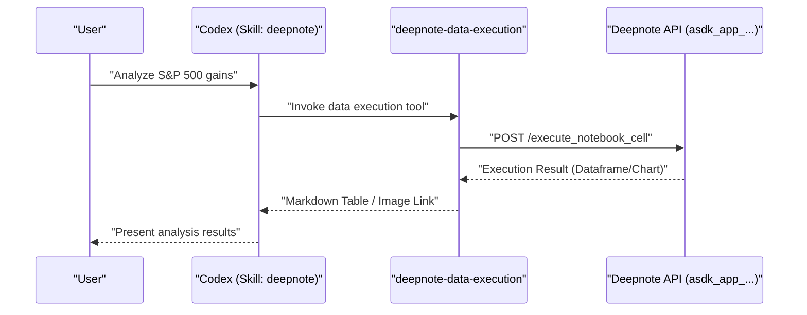
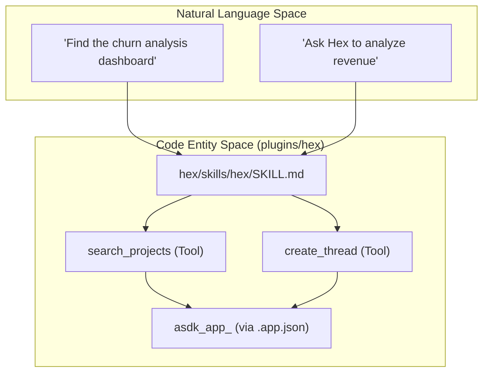

<!-- source: DeepWiki mcp.deepwiki.com · repo openai/plugins · page 5.3 Analytics and BI Plugins (PostHog, Deepnote, Hex, Amplitude, MotherDuck) · fetched 2026-10-26 -->

# Analytics and BI Plugins (PostHog, Deepnote, Hex, Amplitude, MotherDuck)

Relevant source files

The following files were used as context for generating this wiki page:

- [plugins/deepnote/.app.json](plugins/deepnote/.app.json)
- [plugins/deepnote/.codex-plugin/plugin.json](plugins/deepnote/.codex-plugin/plugin.json)
- [plugins/deepnote/README.md](plugins/deepnote/README.md)
- [plugins/deepnote/assets/composer.svg](plugins/deepnote/assets/composer.svg)
- [plugins/deepnote/assets/logo.png](plugins/deepnote/assets/logo.png)
- [plugins/deepnote/skills/deepnote-data-execution/SKILL.md](plugins/deepnote/skills/deepnote-data-execution/SKILL.md)
- [plugins/deepnote/skills/deepnote-links/SKILL.md](plugins/deepnote/skills/deepnote-links/SKILL.md)
- [plugins/deepnote/skills/deepnote-notebook-editing/SKILL.md](plugins/deepnote/skills/deepnote-notebook-editing/SKILL.md)
- [plugins/deepnote/skills/deepnote-notebooks/SKILL.md](plugins/deepnote/skills/deepnote-notebooks/SKILL.md)
- [plugins/deepnote/skills/deepnote/SKILL.md](plugins/deepnote/skills/deepnote/SKILL.md)
- [plugins/deepnote/skills/deepnote/references/workspace-summary.md](plugins/deepnote/skills/deepnote/references/workspace-summary.md)
- [plugins/hex/.app.json](plugins/hex/.app.json)
- [plugins/hex/.codex-plugin/plugin.json](plugins/hex/.codex-plugin/plugin.json)
- [plugins/hex/README.md](plugins/hex/README.md)
- [plugins/hex/assets/hex.png](plugins/hex/assets/hex.png)
- [plugins/hex/skills/hex/SKILL.md](plugins/hex/skills/hex/SKILL.md)
- [plugins/linear/.app.json](plugins/linear/.app.json)
- [plugins/linear/.codex-plugin/plugin.json](plugins/linear/.codex-plugin/plugin.json)
- [plugins/linear/.mcp.json](plugins/linear/.mcp.json)
- [plugins/linear/skills/linear/LICENSE.txt](plugins/linear/skills/linear/LICENSE.txt)
- [plugins/linear/skills/linear/SKILL.md](plugins/linear/skills/linear/SKILL.md)
- [plugins/linear/skills/linear/agents/openai.yaml](plugins/linear/skills/linear/agents/openai.yaml)
- [plugins/linear/skills/linear/assets/linear-small.svg](plugins/linear/skills/linear/assets/linear-small.svg)
- [plugins/linear/skills/linear/assets/linear.png](plugins/linear/skills/linear/assets/linear.png)
- [plugins/motherduck/.app.json](plugins/motherduck/.app.json)
- [plugins/motherduck/.codex-plugin/plugin.json](plugins/motherduck/.codex-plugin/plugin.json)
- [plugins/posthog/.app.json](plugins/posthog/.app.json)
- [plugins/posthog/.codex-plugin/plugin.json](plugins/posthog/.codex-plugin/plugin.json)
- [plugins/posthog/assets/app-icon.png](plugins/posthog/assets/app-icon.png)
- [plugins/posthog/assets/logo-dark.png](plugins/posthog/assets/logo-dark.png)
- [plugins/posthog/assets/logo.png](plugins/posthog/assets/logo.png)
- [plugins/posthog/assets/screenshot-1.png](plugins/posthog/assets/screenshot-1.png)
- [plugins/posthog/assets/screenshot-2.png](plugins/posthog/assets/screenshot-2.png)
- [plugins/posthog/skills/posthog/LICENSE.txt](plugins/posthog/skills/posthog/LICENSE.txt)
- [plugins/posthog/skills/posthog/SKILL.md](plugins/posthog/skills/posthog/SKILL.md)
- [plugins/posthog/skills/posthog/agents/openai.yaml](plugins/posthog/skills/posthog/agents/openai.yaml)

This section documents the integration of industry-standard product analytics, collaborative data notebooks, and cloud data warehousing platforms. These plugins enable Codex to perform complex data exploration, execute SQL workflows, manage experiments, and synthesize product insights directly within the chat interface.

## PostHog: Product Analytics and Experimentation

The PostHog plugin provides an interface for analyzing product data, managing feature flags, and conducting experiments. It is categorized under "Data & Analytics" and supports interactive read/write capabilities [plugins/posthog/.codex-plugin/plugin.json:27-37]().

### Capabilities and Integration
PostHog integrates via an app connector defined in `plugins/posthog/.app.json` [plugins/posthog/.codex-plugin/plugin.json:26](). The plugin allows agents to:
*   **Query Insights:** Ask questions about signups, user retention, and drop-off points [plugins/posthog/.codex-plugin/plugin.json:41-45]().
*   **Feature Management:** Create and toggle feature flags [plugins/posthog/.codex-plugin/plugin.json:30]().
*   **Technical Auditing:** Analyze errors, search documentation, and inspect LLM analytics [plugins/posthog/.codex-plugin/plugin.json:30]().

**Sources:**
* [plugins/posthog/.codex-plugin/plugin.json:1-54]()
* [plugins/posthog/.app.json:1-7]()

---

## Deepnote: Collaborative Data Workspace

Deepnote is a collaborative data workspace for notebooks and SQL workflows. The plugin allows Codex to interact with connected Deepnote projects to explore data and automate analysis [plugins/deepnote/.codex-plugin/plugin.json:4-25]().

### Specialized Skills
The Deepnote plugin utilizes several specialized skills located in `plugins/deepnote/skills/` [plugins/deepnote/.codex-plugin/plugin.json:20]():
*   **`deepnote-notebook-editing`**: Direct manipulation of notebook cells.
*   **`deepnote-data-execution`**: Running code and SQL blocks within the Deepnote environment.
*   **`deepnote-links`**: Managing and referencing external assets and internal notebook links.
*   **Workspace Summary**: Utilizing `workspace-summary.md` to provide context on recent activity and active data connections [plugins/deepnote/.codex-plugin/plugin.json:37-39]().

### Data Flow: Notebook Execution
The following diagram illustrates how a user request for data analysis is routed through the Deepnote skill system to the execution environment.

**Deepnote Execution Workflow**

**Sources:**
* [plugins/deepnote/.codex-plugin/plugin.json:1-47]()
* [plugins/deepnote/skills/deepnote/SKILL.md:1-20]()

---

## Hex: Data Notebooks and Threads

The Hex plugin serves as a wrapper for the Hex ChatGPT app and MCP connector [plugins/hex/README.md:1-3](). It is specifically designed for searching workspace assets and interacting with "Hex Threads" [plugins/hex/.codex-plugin/plugin.json:4]().

### Implementation Logic
Hex implementation relies on a specific routing skill that prevents Hex from becoming the default owner for generic metrics unless explicitly requested [plugins/hex/skills/hex/SKILL.md:10-15]().

*   **Discovery**: Uses `search_projects` to find existing dashboards or analyses [plugins/hex/skills/hex/SKILL.md:17-19]().
*   **Interaction**: Uses `get_thread` to read state and `continue_thread` to push new logic to Hex [plugins/hex/skills/hex/SKILL.md:21-24]().
*   **Safety**: All thread modifications (`create_thread`, `continue_thread`) are treated as write actions requiring explicit user confirmation [plugins/hex/skills/hex/SKILL.md:44-48]().

**Hex System Mapping**

**Sources:**
* [plugins/hex/.codex-plugin/plugin.json:1-41]()
* [plugins/hex/skills/hex/SKILL.md:1-48]()
* [plugins/hex/README.md:1-20]()

---

## MotherDuck: DuckDB-Powered Data Warehouse

MotherDuck provides a serverless DuckDB data warehouse. The plugin enables natural language querying against cloud-hosted datasets and interactive visualizations.

### Core Features
*   **Dataset Exploration**: Inspecting schemas and metadata within MotherDuck.
*   **Natural Language to SQL**: Translating user intent into DuckDB-compatible SQL queries.
*   **Dives Visualizations**: Utilizing the "Dives" system for interactive, meaning-preserving visual designs.

**Sources:**
* [plugins/motherduck/.codex-plugin/plugin.json:1-10]()
* [plugins/motherduck/.app.json:1-5]()

---

## Comparison of Analytics Plugins

| Plugin | Primary Category | Key Tools/Functions | Auth Pattern |
| :--- | :--- | :--- | :--- |
| **PostHog** | Product Analytics | `create_feature_flag`, `query_insights` | App Connector |
| **Deepnote** | Data Science | `execute_notebook_cell`, `edit_notebook` | App Connector |
| **Hex** | BI / Notebooks | `search_projects`, `create_thread` | MCP / App Connector |
| **MotherDuck** | Data Warehouse | SQL Query Execution, Schema Inspection | App Connector |

**Sources:**
* [plugins/posthog/.codex-plugin/plugin.json:21-37]()
* [plugins/deepnote/.codex-plugin/plugin.json:22-32]()
* [plugins/hex/.codex-plugin/plugin.json:21-31]()
* [plugins/motherduck/.codex-plugin/plugin.json:1-10]()

---

