# Page: Overview

# Overview

<details>
<summary>Relevant source files</summary>

The following files were used as context for generating this wiki page:

- [.agents/plugins/marketplace.json](.agents/plugins/marketplace.json)
- [.gitignore](.gitignore)
- [README.md](README.md)
- [plugins/expo/LICENSE](plugins/expo/LICENSE)
- [plugins/expo/README.md](plugins/expo/README.md)
- [plugins/expo/agents/openai.yaml](plugins/expo/agents/openai.yaml)
- [plugins/expo/assets/expo.png](plugins/expo/assets/expo.png)
- [plugins/expo/commands/setup-codex-run-actions.md](plugins/expo/commands/setup-codex-run-actions.md)
- [plugins/expo/skills/building-native-ui/SKILL.md](plugins/expo/skills/building-native-ui/SKILL.md)
- [plugins/expo/skills/building-native-ui/agents/openai.yaml](plugins/expo/skills/building-native-ui/agents/openai.yaml)
- [plugins/expo/skills/building-native-ui/references/animations.md](plugins/expo/skills/building-native-ui/references/animations.md)

</details>


The `openai/plugins` repository is a curated collection of Codex plugin examples, ranging from productivity tools and developer utilities to third-party marketplace stubs. This repository serves as the central hub for defining how Codex interacts with external applications through **Skills**, **Agents**, and the **Model Context Protocol (MCP)**.

Each plugin in this ecosystem is self-contained within the `plugins/` directory and follows a standardized manifest schema that defines its identity, capabilities, and UI presentation [README.md:1-9]().

## Repository Architecture

The repository is organized into two primary top-level areas:
1.  **`plugins/`**: Contains the implementation code, assets, and manifests for every individual plugin such as `plugins/figma`, `plugins/notion`, or `plugins/expo` [README.md:5-9]().
2.  **`.agents/`**: Contains internal tooling, including the Marketplace registry and the scaffolding scripts used to generate new plugins [.agents/plugins/marketplace.json:1-6]().

### Repository Layout
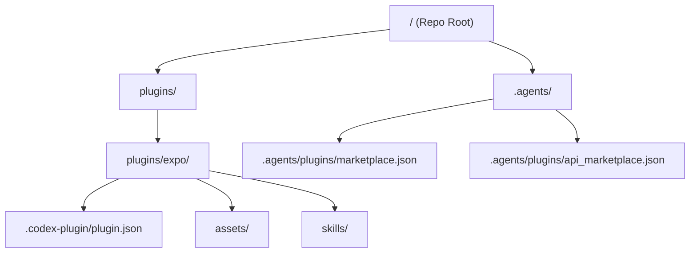
Sources: [README.md:1-12]().

---

## Plugin Anatomy

A plugin is defined by a mandatory manifest file located at `.codex-plugin/plugin.json` [README.md:5-9](). This file acts as the "Code Entity" that bridges the gap between raw functionality and the Natural Language interface used by Codex.

### The Plugin Manifest (`plugin.json`)
The manifest includes metadata such as the version, author, and repository, but most importantly, it defines the `interface` block. This block controls how the plugin appears in the Codex UI, including its `displayName`, `shortDescription`, and `defaultPrompt` starters. For example, the Expo plugin defines its interface with specific icons and a default prompt focused on app development [plugins/expo/agents/openai.yaml:1-6]().

For more details on the manifest schema and optional companion files like `.app.json` or `.mcp.json`, see **[Repository Structure and Plugin Anatomy](#1.1)**.

### Bridging Natural Language to Code
The following diagram illustrates how a user's natural language intent is mapped to specific code entities defined in the plugin structure.

**Intent Mapping Diagram**
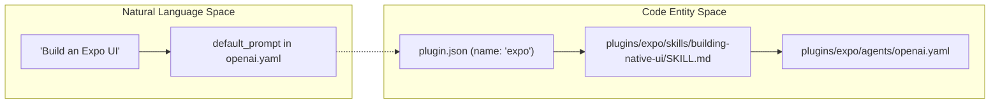
Sources: [plugins/expo/agents/openai.yaml:1-6](), [plugins/expo/skills/building-native-ui/agents/openai.yaml:1-4](), [plugins/expo/skills/building-native-ui/SKILL.md:1-6]().

---

## Plugin Creation and Scaffolding

To maintain consistency across the repository, the `plugin-creator` tool is used to scaffold new plugins. This tool ensures that every plugin has a valid `plugin.json` and the correct directory structure.

*   **Scaffolding**: Automated generation of `plugins/<name>/` directory with required sub-directories [README.md:5-9]().
*   **Standards**: Enforces naming conventions and mandatory file presence for marketplace readiness.

For usage instructions and CLI flags, see **[Plugin Creator Scaffolding Tool](#1.2)**.

---

## Marketplace and Discovery

The `marketplace.json` file is the source of truth for plugin discovery and installation policies within the Codex environment. It resides at `.agents/plugins/marketplace.json` [.agents/plugins/marketplace.json:1-10]().

### Marketplace Integration Flow
The marketplace manages how plugins are surfaced to users, including their installation status (`AVAILABLE`, `INSTALLED_BY_DEFAULT`) and authentication requirements (`ON_INSTALL`, `ON_USE`) [.agents/plugins/marketplace.json:13-16]().

**Registry and UI Flow**
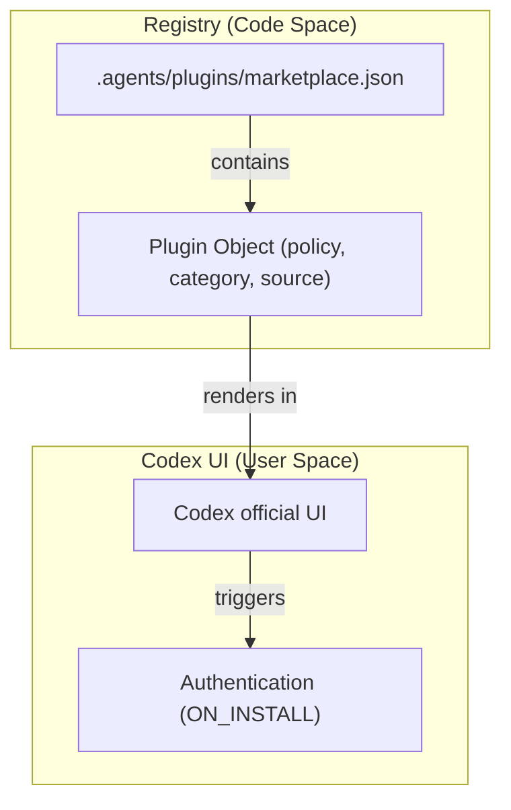
Sources: [.agents/plugins/marketplace.json:1-30]().

For a deep dive into installation policies and product gating, see **[Marketplace Registry](#1.3)**.

---

## Wiki Navigation

This wiki is organized to take you from high-level concepts to specific implementation details:

*   **[Repository Structure and Plugin Anatomy](#1.1)**: Detailed look at file layouts and the `plugin.json` spec.
*   **[Plugin Creator Scaffolding Tool](#1.2)**: How to use scripts to build new plugins.
*   **[Marketplace Registry](#1.3)**: How the global `marketplace.json` manages plugin lifecycle and visibility.
*   **[Plugin Evaluation Framework](#1.4)**: Documentation for the `plugin-eval` CLI tool and benchmark engine.
*   **[Plugin Architecture Concepts](#2)**: Core patterns like the Skills system, MCP, and Auth flows.
*   **[Productivity Plugins](#3)**: Deep dives into Notion, Slack, and Google/Microsoft suites.
*   **[Coding and Development Plugins](#4)**: Technical details for GitHub, Figma, Expo, and Cloud deployment tools.
*   **[Finance, Analytics, and Research Plugins](#5)**: Documentation for Moody's, Morningstar, and specialized research tools.
*   **[Marketplace Plugins (Third-Party and Stub Entries)](#6)**: Documentation for third-party "stub" entries.
*   **[Glossary](#7)**: Definitions of repository-specific terminology.

---

# Page: Repository Structure and Plugin Anatomy

# Repository Structure and Plugin Anatomy

<details>
<summary>Relevant source files</summary>

The following files were used as context for generating this wiki page:

- [.agents/plugins/api_marketplace.json](.agents/plugins/api_marketplace.json)
- [.agents/plugins/marketplace.json](.agents/plugins/marketplace.json)
- [.gitignore](.gitignore)
- [README.md](README.md)
- [plugins/base44/.codex-plugin/plugin.json](plugins/base44/.codex-plugin/plugin.json)
- [plugins/expo/LICENSE](plugins/expo/LICENSE)
- [plugins/expo/README.md](plugins/expo/README.md)
- [plugins/expo/agents/openai.yaml](plugins/expo/agents/openai.yaml)
- [plugins/expo/assets/expo.png](plugins/expo/assets/expo.png)
- [plugins/expo/commands/setup-codex-run-actions.md](plugins/expo/commands/setup-codex-run-actions.md)
- [plugins/expo/skills/building-native-ui/SKILL.md](plugins/expo/skills/building-native-ui/SKILL.md)
- [plugins/expo/skills/building-native-ui/agents/openai.yaml](plugins/expo/skills/building-native-ui/agents/openai.yaml)
- [plugins/expo/skills/building-native-ui/references/animations.md](plugins/expo/skills/building-native-ui/references/animations.md)
- [plugins/figma/.codex-plugin/plugin.json](plugins/figma/.codex-plugin/plugin.json)
- [plugins/figma/.mcp.json](plugins/figma/.mcp.json)
- [plugins/github/.codex-plugin/plugin.json](plugins/github/.codex-plugin/plugin.json)
- [plugins/github/.mcp.json](plugins/github/.mcp.json)
- [plugins/github/README.md](plugins/github/README.md)
- [plugins/github/assets/logo.png](plugins/github/assets/logo.png)
- [plugins/shopify/.codex-plugin/plugin.json](plugins/shopify/.codex-plugin/plugin.json)
- [plugins/supabase/.codex-plugin/plugin.json](plugins/supabase/.codex-plugin/plugin.json)
- [plugins/vercel/.codex-plugin/plugin.json](plugins/vercel/.codex-plugin/plugin.json)

</details>


This page documents the physical layout and manifest specifications of the `openai/plugins` repository. It covers how plugins are structured on disk, the schema for mandatory and optional configuration files, and the lifecycle of a plugin from local scaffolding to marketplace registration.

## Top-Level Directory Layout

The repository is organized into two primary functional areas: the `plugins/` directory, which contains the source code and manifests for every available tool, and the `.agents/` directory, which contains the orchestration logic, registry metadata, and the scaffolding tools used to manage the ecosystem.

| Directory | Purpose | Key Contents |
|:---|:---|:---|
| `plugins/` | The root for all plugin implementations. | Each subdirectory (e.g., `plugins/figma/`) represents a standalone plugin [[README.md:5-9]](). |
| `.agents/` | System-level configuration and internal tools. | Contains the `marketplace.json` registry and system-level agents/skills [[.agents/plugins/marketplace.json:1-12]](). |
| `.agents/plugins/` | Marketplace metadata. | Holds `marketplace.json` and `api_marketplace.json` which define UI ordering and installation policies [[.agents/plugins/marketplace.json:1-12]](), [[.agents/plugins/api_marketplace.json:1-12]](). |

**Sources:**
- [README.md:1-13]()
- [.agents/plugins/marketplace.json:1-12]()
- [.agents/plugins/api_marketplace.json:1-12]()

## Plugin Directory Structure

A standard plugin follows a specific anatomy to ensure compatibility with the Codex host. While only the `.codex-plugin/plugin.json` manifest is strictly mandatory for registration, functional plugins typically include several companion directories.

### Visual Anatomy of a Plugin
The following diagram bridges the "Natural Language Space" (how a developer describes a plugin) to the "Code Entity Space" (the actual file system structure).

"Plugin Anatomy Overview"
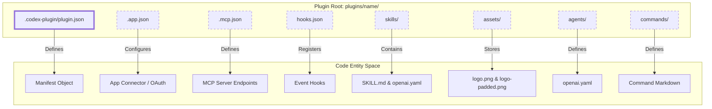
**Sources:**
- [README.md:5-9]()
- [plugins/figma/.codex-plugin/plugin.json:19-22]()
- [plugins/github/.codex-plugin/plugin.json:21-23]()

### Component Breakdown
*   **`.codex-plugin/plugin.json`**: The primary manifest. It defines the plugin's identity, version, and metadata for the Codex UI [[plugins/figma/.codex-plugin/plugin.json:1-46]]().
*   **`skills/`**: Contains one or more subdirectories, each housing a `SKILL.md` (natural language instructions) and `openai.yaml` (API/Tool definitions) [[plugins/expo/skills/building-native-ui/SKILL.md:1-6]](), [[plugins/expo/skills/building-native-ui/agents/openai.yaml:1-5]]().
*   **`.app.json`**: Used for plugins requiring OAuth or third-party app connections (e.g., GitHub, Notion) [[plugins/github/.codex-plugin/plugin.json:22-22]](), [[plugins/github/README.md:8-12]]().
*   **`.mcp.json`**: Configures Model Context Protocol (MCP) servers that the plugin uses to execute tools [[plugins/figma/.mcp.json:1-9]](), [[plugins/github/.mcp.json:1-9]]().
*   **`assets/`**: Stores visual brand assets like `logo.png` and `composerIcon` [[plugins/figma/.codex-plugin/plugin.json:42-43]]().
*   **`agents/`**: Contains top-level agent definitions, typically an `openai.yaml` for the primary plugin persona [[plugins/expo/agents/openai.yaml:1-5]]().
*   **`commands/`**: Stores slash-command definitions (e.g., `/setup-codex-run-actions`) [[plugins/expo/commands/setup-codex-run-actions.md:1-4]]().

---

## The Plugin Manifest (`plugin.json`)

The `plugin.json` file is the source of truth for the plugin's capabilities and presentation. It is located at `<plugin-root>/.codex-plugin/plugin.json`.

### Manifest Schema Highlights

| Field | Type | Description |
|:---|:---|:---|
| `name` | `string` | Unique identifier in kebab-case. Must match the folder name [[plugins/figma/.codex-plugin/plugin.json:2-2]](). |
| `skills` | `path` | Relative path (usually `./skills/`) to the skills directory [[plugins/figma/.codex-plugin/plugin.json:19-19]](). |
| `interface.displayName` | `string` | The human-readable name shown in the Codex UI [[plugins/figma/.codex-plugin/plugin.json:23-23]](). |
| `interface.capabilities` | `array` | List of supported interaction modes: `Interactive`, `Read`, `Write` [[plugins/figma/.codex-plugin/plugin.json:28-32]](). |
| `interface.defaultPrompt`| `array` | Starter prompts shown to the user in the composer [[plugins/figma/.codex-plugin/plugin.json:36-40]](). |
| `mcpServers` | `path` | Relative path to the MCP configuration file [[plugins/github/.codex-plugin/plugin.json:23-23]](). |

**Sources:**
- [plugins/figma/.codex-plugin/plugin.json:1-46]()
- [plugins/github/.codex-plugin/plugin.json:1-45]()
- [plugins/vercel/.codex-plugin/plugin.json:1-53]()

---

## Marketplace Registration

For a plugin to be discoverable in the Codex UI, it must be registered in the global marketplace manifest located at `.agents/plugins/marketplace.json`.

### Registration Data Flow
The following diagram illustrates how a plugin defined in the `plugins/` directory is mapped into the marketplace registry.

"Marketplace Registration Data Flow"
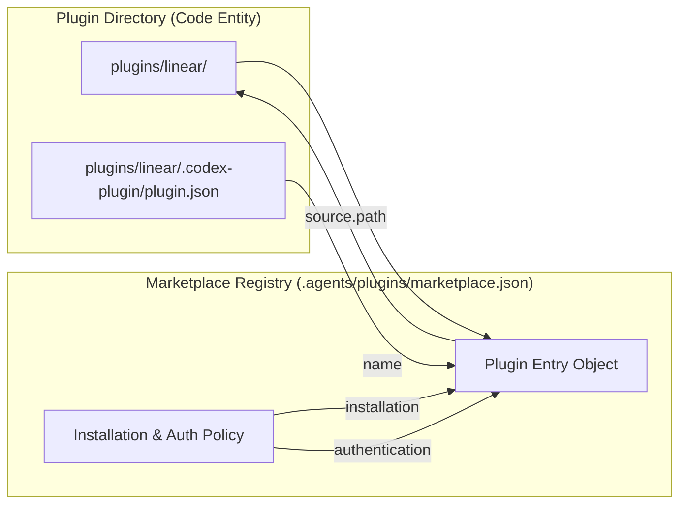

### Marketplace Entry Schema
Each entry in the `plugins` array of `marketplace.json` defines how the system should treat the plugin regarding installation and security.

```json
{
  "name": "linear",
  "source": {
    "source": "local",
    "path": "./plugins/linear"
  },
  "policy": {
    "installation": "AVAILABLE",
    "authentication": "ON_INSTALL"
  },
  "category": "Productivity"
}
```

*   **`installation`**: Can be `AVAILABLE`, `INSTALLED_BY_DEFAULT`, or `NOT_AVAILABLE` [[.agents/plugins/marketplace.json:14-14]]().
*   **`authentication`**: Can be `ON_INSTALL` (auth required to add) or `ON_USE` (auth required upon first tool call) [[.agents/plugins/marketplace.json:15-15]](), [[.agents/plugins/api_marketplace.json:84-84]]().
*   **`products`**: Optional gating for specific client types (e.g., `["CODEX"]`) [[.agents/plugins/marketplace.json:208-208]]().

**Sources:**
- [.agents/plugins/marketplace.json:7-18, 205-211]()
- [.agents/plugins/api_marketplace.json:82-90]()
- [README.md:10-12]()

---

# Page: Plugin Creator Scaffolding Tool

# Plugin Creator Scaffolding Tool

<details>
<summary>Relevant source files</summary>

The following files were used as context for generating this wiki page:

- [.agents/skills/plugin-creator/SKILL.md](.agents/skills/plugin-creator/SKILL.md)
- [.agents/skills/plugin-creator/agents/openai.yaml](.agents/skills/plugin-creator/agents/openai.yaml)
- [.agents/skills/plugin-creator/references/plugin-json-spec.md](.agents/skills/plugin-creator/references/plugin-json-spec.md)
- [.agents/skills/plugin-creator/scripts/create_basic_plugin.py](.agents/skills/plugin-creator/scripts/create_basic_plugin.py)

</details>


The Plugin Creator is a dedicated system for scaffolding new plugins within the Codex ecosystem. It ensures that every plugin follows the mandatory directory structure, includes a valid manifest, and can be optionally registered in the global marketplace registry.

## Core Script: create_basic_plugin.py

The primary entry point for scaffolding is the `create_basic_plugin.py` script [[.agents/skills/plugin-creator/scripts/create_basic_plugin.py:1-2]](). This script automates the creation of the plugin root directory, the mandatory `.codex-plugin/plugin.json` manifest, and various optional companion files and directories.

### Key Functions and Implementation

- **`normalize_plugin_name(plugin_name: str)`**: Enforces strict naming rules by converting input to lowercase hyphen-case, removing non-alphanumeric characters (converting them to hyphens), and collapsing consecutive hyphens [[.agents/skills/plugin-creator/scripts/create_basic_plugin.py:24-30]]().
- **`validate_plugin_name(plugin_name: str)`**: Ensures the name contains at least one letter or digit and does not exceed the `MAX_PLUGIN_NAME_LENGTH` of 64 characters [[.agents/skills/plugin-creator/scripts/create_basic_plugin.py:13-13]](), [[.agents/skills/plugin-creator/scripts/create_basic_plugin.py:33-41]]().
- **`build_plugin_json(plugin_name: str)`**: Generates the initial `plugin.json` structure populated with `[TODO: ...]` placeholders for metadata like version, author, and interface details [[.agents/skills/plugin-creator/scripts/create_basic_plugin.py:43-85]]().
- **`update_marketplace_json(...)`**: Handles the logic for appending or updating a plugin entry in the central `marketplace.json` file. It supports a `--force` flag to overwrite existing entries [[.agents/skills/plugin-creator/scripts/create_basic_plugin.py:129-166]]().
- **`create_stub_file(path: Path, payload: dict, force: bool)`**: A helper function used to write optional JSON configuration files like `.mcp.json` or `.app.json` if they do not already exist [[.agents/skills/plugin-creator/scripts/create_basic_plugin.py:177-184]]().

**Sources:** [[.agents/skills/plugin-creator/scripts/create_basic_plugin.py:1-184]]()

### CLI Flags and Options

The script supports several flags to customize the scaffolding process via `argparse` [[.agents/skills/plugin-creator/scripts/create_basic_plugin.py:186-218]]():

| Flag | Description | File/Directory Created |
| :--- | :--- | :--- |
| `--path` | Parent directory for the new plugin (defaults to `~/plugins`). | `<path>/<plugin-name>/` |
| `--with-skills` | Adds a skills directory. | `skills/` |
| `--with-hooks` | Adds a hooks configuration. | `hooks.json` |
| `--with-mcp` | Adds a Model Context Protocol config. | `.mcp.json` |
| `--with-apps` | Adds an App connector manifest. | `.app.json` |
| `--with-assets` | Adds a directory for icons/logos. | `assets/` |
| `--with-marketplace` | Updates the marketplace registry. | `marketplace.json` |
| `--marketplace-path` | Custom path to the `marketplace.json` file. | N/A |
| `--force` | Overwrites existing files or marketplace entries. | N/A |

**Sources:** [[.agents/skills/plugin-creator/SKILL.md:40-47]](), [[.agents/skills/plugin-creator/scripts/create_basic_plugin.py:186-218]]()

## Natural Language to Code Entity Mapping

The following diagrams illustrate how user intent (Natural Language Space) is translated into specific code structures and file entities (Code Entity Space).

### Plugin Scaffolding Flow
This diagram shows how the `plugin-creator` skill translates a request to create a plugin into file system entities.

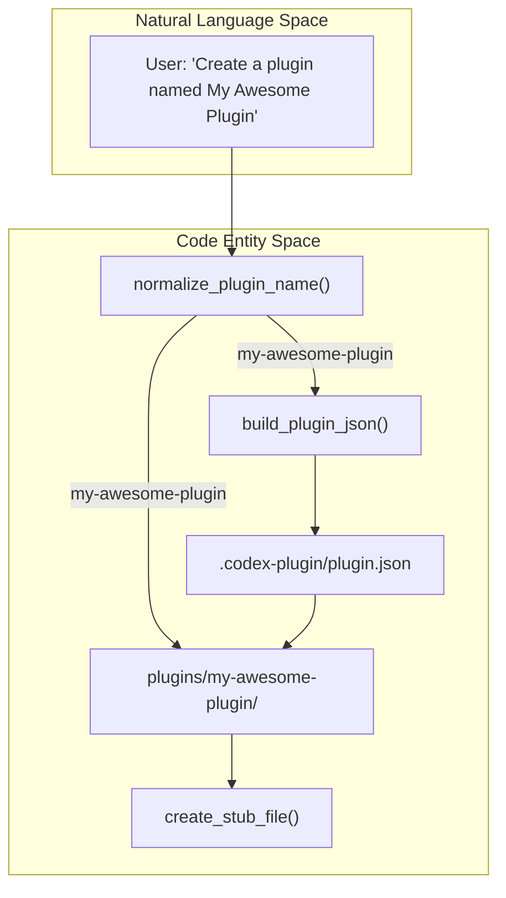
**Sources:** [[.agents/skills/plugin-creator/scripts/create_basic_plugin.py:24-30]](), [[.agents/skills/plugin-creator/scripts/create_basic_plugin.py:43-45]](), [[.agents/skills/plugin-creator/scripts/create_basic_plugin.py:177-177]](), [[.agents/skills/plugin-creator/SKILL.md:62-66]]()

### Marketplace Registration Logic
This diagram bridges the request for marketplace inclusion to the internal JSON structure and policy enforcement.

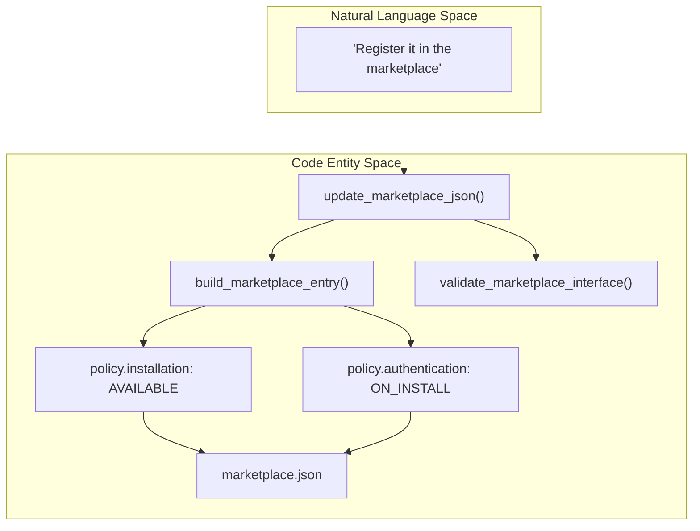
**Sources:** [[.agents/skills/plugin-creator/scripts/create_basic_plugin.py:88-105]](), [[.agents/skills/plugin-creator/scripts/create_basic_plugin.py:123-128]](), [[.agents/skills/plugin-creator/scripts/create_basic_plugin.py:129-136]](), [[.agents/skills/plugin-creator/SKILL.md:82-96]]()

## Plugin Manifest Reference (`plugin.json`)

Every plugin must contain a `.codex-plugin/plugin.json` file [[.agents/skills/plugin-creator/SKILL.md:58-58]](). This manifest defines the plugin's identity, its capabilities, and how it is presented in the Codex UI.

### Top-Level Fields
- `name`: Unique kebab-case identifier. Required as the component namespace [[.agents/skills/plugin-creator/references/plugin-json-spec.md:52]]().
- `version`: Plugin semantic version [[.agents/skills/plugin-creator/references/plugin-json-spec.md:53]]().
- `skills`: Relative path to the skills directory (usually `./skills/`) [[.agents/skills/plugin-creator/references/plugin-json-spec.md:63]]().
- `mcpServers`: Path to `.mcp.json` if the plugin uses MCP [[.agents/skills/plugin-creator/references/plugin-json-spec.md:65]]().
- `apps`: Path to `.app.json` for app-backed integrations [[.agents/skills/plugin-creator/references/plugin-json-spec.md:66]]().

### Interface Metadata
The `interface` block controls the UI presentation [[.agents/skills/plugin-creator/references/plugin-json-spec.md:69]]():
- `displayName`: User-facing title shown for the plugin [[.agents/skills/plugin-creator/references/plugin-json-spec.md:71]]().
- `capabilities`: Array of strings such as `Interactive`, `Read`, or `Write` [[.agents/skills/plugin-creator/references/plugin-json-spec.md:76]]().
- `defaultPrompt`: Up to 3 starter prompts for the composer, capped at 128 characters each [[.agents/skills/plugin-creator/references/plugin-json-spec.md:80-82]]().
- `brandColor`: Theme color for the plugin card (Hex code) [[.agents/skills/plugin-creator/references/plugin-json-spec.md:84]]().

**Sources:** [[.agents/skills/plugin-creator/references/plugin-json-spec.md:1-90]]()

## Marketplace Integration

The `marketplace.json` file acts as the central registry for the Codex UI. It can be personal (`~/.agents/plugins/marketplace.json`) or repository-specific (`<repo-root>/.agents/plugins/marketplace.json`) [[.agents/skills/plugin-creator/SKILL.md:77-78]]().

### Entry Requirements
When the `--with-marketplace` flag is used, the tool ensures the following fields are present in the entry [[.agents/skills/plugin-creator/SKILL.md:150-150]]():
- `source`: Defines the plugin location, typically `{"source": "local", "path": "./plugins/<name>"}` [[.agents/skills/plugin-creator/references/plugin-json-spec.md:143-145]]().
- `policy`:
    - `installation`: Defaults to `AVAILABLE`. Other values: `NOT_AVAILABLE`, `INSTALLED_BY_DEFAULT` [[.agents/skills/plugin-creator/scripts/create_basic_plugin.py:16-20]]().
    - `authentication`: Defaults to `ON_INSTALL`. Other value: `ON_USE` [[.agents/skills/plugin-creator/scripts/create_basic_plugin.py:17-21]]().
- `category`: Defaults to `Productivity` [[.agents/skills/plugin-creator/scripts/create_basic_plugin.py:18-18]]().

### Marketplace Metadata
Marketplace files support top-level metadata including a `name` and an `interface.displayName` [[.agents/skills/plugin-creator/SKILL.md:79-81]](). The `plugins` array determines the render order in the Codex UI [[.agents/skills/plugin-creator/SKILL.md:80-80]]().

**Sources:** [[.agents/skills/plugin-creator/scripts/create_basic_plugin.py:88-120]](), [[.agents/skills/plugin-creator/references/plugin-json-spec.md:128-160]]()

## Data Flow: Scaffolding a Plugin

The following sequence diagram details the execution flow when a user runs the `create_basic_plugin.py` script.

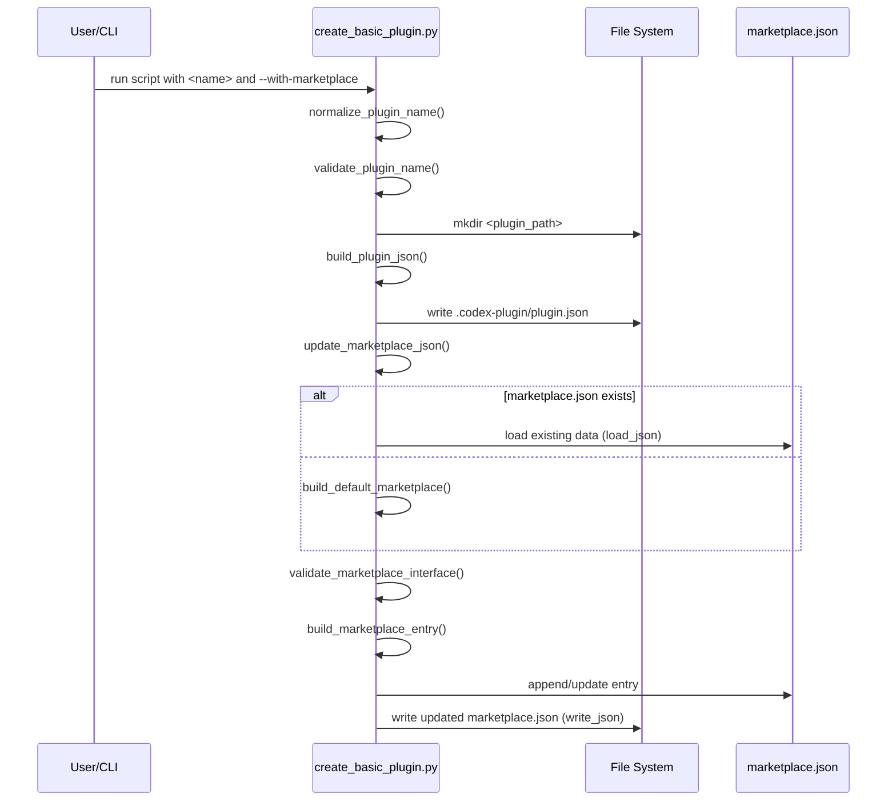

**Sources:** [[.agents/skills/plugin-creator/scripts/create_basic_plugin.py:108-111]](), [[.agents/skills/plugin-creator/scripts/create_basic_plugin.py:129-166]](), [[.agents/skills/plugin-creator/SKILL.md:9-27]]()

---

# Page: Marketplace Registry

# Marketplace Registry

<details>
<summary>Relevant source files</summary>

The following files were used as context for generating this wiki page:

- [.agents/plugins/api_marketplace.json](.agents/plugins/api_marketplace.json)
- [.agents/plugins/marketplace.json](.agents/plugins/marketplace.json)
- [plugins/base44/.codex-plugin/plugin.json](plugins/base44/.codex-plugin/plugin.json)
- [plugins/figma/.codex-plugin/plugin.json](plugins/figma/.codex-plugin/plugin.json)
- [plugins/figma/.mcp.json](plugins/figma/.mcp.json)
- [plugins/github/.codex-plugin/plugin.json](plugins/github/.codex-plugin/plugin.json)
- [plugins/github/.mcp.json](plugins/github/.mcp.json)
- [plugins/github/README.md](plugins/github/README.md)
- [plugins/github/assets/logo.png](plugins/github/assets/logo.png)
- [plugins/shopify/.codex-plugin/plugin.json](plugins/shopify/.codex-plugin/plugin.json)
- [plugins/supabase/.codex-plugin/plugin.json](plugins/supabase/.codex-plugin/plugin.json)
- [plugins/vercel/.codex-plugin/plugin.json](plugins/vercel/.codex-plugin/plugin.json)

</details>


The Marketplace Registry is the central configuration point for plugin discovery, ordering, and governance within the Codex ecosystem. It is defined by a single JSON file that determines which plugins are visible to users, how they are categorized, and what security or installation constraints apply to them.

## The marketplace.json File

The registry is primarily located at `.agents/plugins/marketplace.json`. This file serves as the source of truth for the Codex UI to render the plugin store and manage the lifecycle of plugin availability. A secondary file, `.agents/plugins/api_marketplace.json`, specifically targets API-driven Codex sessions with a subset of curated developer tools [[.agents/plugins/api_marketplace.json:1-6]]().

### High-Level Structure
The file consists of marketplace-level metadata and an ordered array of plugin entries.

| Field | Type | Description |
| :--- | :--- | :--- |
| `name` | `string` | Unique identifier for the marketplace (e.g., `openai-curated`). [[.agents/plugins/marketplace.json:2-2]]() |
| `interface` | `object` | UX metadata for the marketplace itself. |
| `interface.displayName` | `string` | The title displayed in the Codex UI (e.g., "Codex official"). [[.agents/plugins/marketplace.json:4-4]]() |
| `plugins` | `array` | A list of plugin entry objects. The index in this array determines the render order in the UI. [[.agents/plugins/marketplace.json:6-6]]() |

### Plugin Entry Schema
Each object within the `plugins` array must follow a strict schema to ensure the Codex UI can resolve the plugin source and enforce policies.

```json
{
  "name": "linear",
  "source": {
    "source": "local",
    "path": "./plugins/linear"
  },
  "policy": {
    "installation": "AVAILABLE",
    "authentication": "ON_INSTALL",
    "products": ["CODEX"]
  },
  "category": "Productivity"
}
```
*Example structure from [[.agents/plugins/marketplace.json:7-18]]().*

**Sources:** [[.agents/plugins/marketplace.json:1-18]](), [[.agents/plugins/api_marketplace.json:1-10]]()

---

## Installation and Authentication Policies

Policies govern how a user interacts with a plugin before it becomes functional. These are defined in the `policy` block of each entry.

### Installation Policies (`installation`)
This field determines the default state of the plugin for a user.

*   **`AVAILABLE`**: The plugin is visible in the marketplace and can be manually installed by the user. [[.agents/plugins/marketplace.json:14-14]]()
*   **`INSTALLED_BY_DEFAULT`**: The plugin is pre-installed for all users in the target environment.
*   **`NOT_AVAILABLE`**: The plugin is registered in the codebase but hidden from the marketplace UI.

### Authentication Policies (`authentication`)
This field defines when the user is prompted to connect their account (e.g., via OAuth defined in `.app.json`).

*   **`ON_INSTALL`**: The user must complete the authentication flow immediately upon clicking "Install". This is standard for App Connectors like Slack or Gmail [[.agents/plugins/marketplace.json:51-51]](), [[.agents/plugins/marketplace.json:63-63]]().
*   **`ON_USE`**: The user can install the plugin without auth, but will be prompted to authenticate the first time a Skill within the plugin is invoked. This is used for specialized developer tools like `build-web-apps` [[.agents/plugins/api_marketplace.json:84-84]]().

### Product Gating (`products`)
An optional array used to restrict plugin availability to specific OpenAI product tiers or environments. For example, the `superpowers` and `game-studio` plugins are gated specifically to the `CODEX` product [[.agents/plugins/marketplace.json:208-208]](), [[.agents/plugins/marketplace.json:221-221]]().

**Sources:** [[.agents/plugins/marketplace.json:13-16]](), [[.agents/plugins/api_marketplace.json:82-87]](), [[.agents/plugins/api_marketplace.json:202-204]]()

---

## Data Flow: Registry to UI

The following diagram illustrates how the `marketplace.json` file acts as a bridge between the physical plugin files and the rendered Codex UI.

### Marketplace Resolution Flow
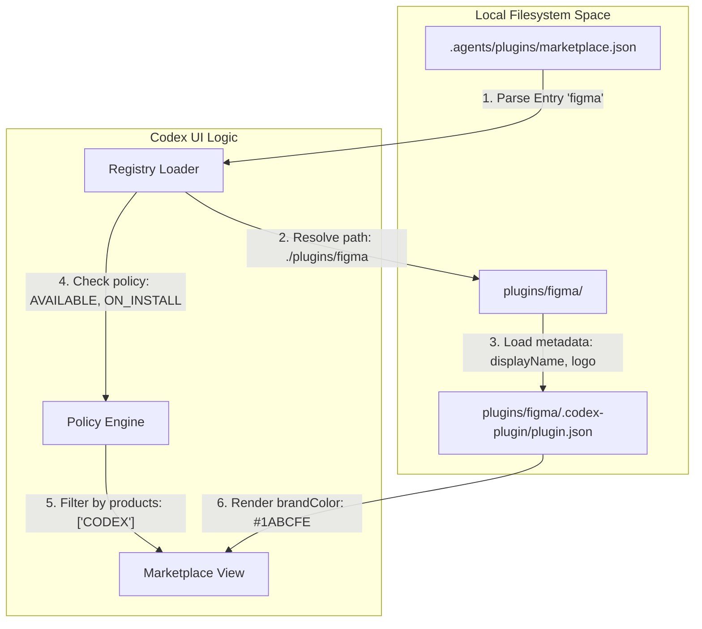
**Sources:** [[.agents/plugins/marketplace.json:128-138]](), [[plugins/figma/.codex-plugin/plugin.json:22-45]]()

---

## Programmatic Management

The registry is managed through standardized naming and scaffolding conventions to ensure the UI can consistently map plugin names to their filesystem locations.

### Key Logic and Constraints

*   **Name Normalization**: The `name` field in `marketplace.json` (e.g., `google-drive`) must correspond to the directory name in the `plugins/` root [[.agents/plugins/marketplace.json:262-265]]().
*   **Interface Synchronization**: While `marketplace.json` provides the discovery entry, the actual UI assets (logos, icons, brand colors) are pulled from the plugin's local `.codex-plugin/plugin.json` file [[plugins/figma/.codex-plugin/plugin.json:41-44]](), [[plugins/github/.codex-plugin/plugin.json:40-43]]().
*   **Dual Registry**: High-priority developer plugins are often registered in both `marketplace.json` and `api_marketplace.json` to ensure availability across different Codex interfaces [[.agents/plugins/marketplace.json:213-224]](), [[.agents/plugins/api_marketplace.json:23-36]]().

### Interaction Diagram: Plugin Discovery
This diagram shows how the Codex UI consumes the registry to initialize a plugin session.

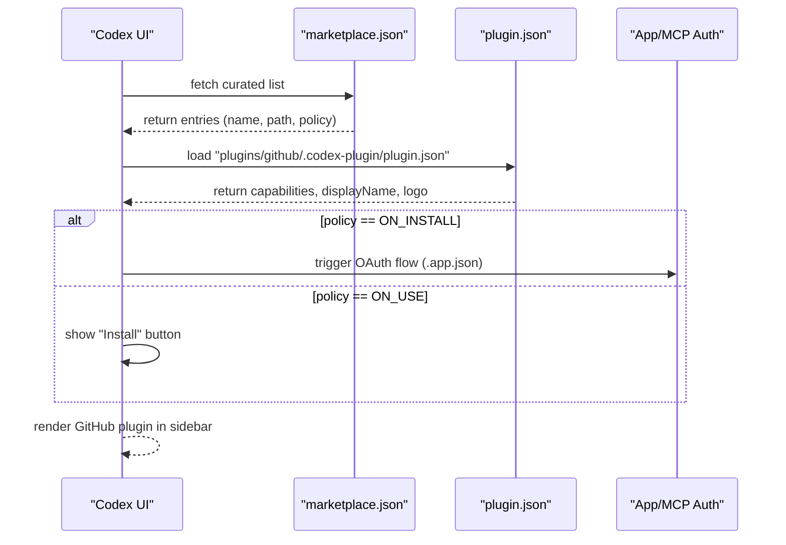
**Sources:** [[.agents/plugins/marketplace.json:238-248]](), [[plugins/github/.codex-plugin/plugin.json:24-44]](), [[plugins/github/README.md:8-12]]()

---

## Category Assignments

Plugins are grouped into categories to facilitate browsing. Common categories found in the registry include:

*   **Productivity**: Linear, Google Calendar, SharePoint, Outlook, Notion, Jam, Box [[.agents/plugins/marketplace.json:17-236]]().
*   **Communication**: Gmail, Slack, Teams, Outlook Email [[.agents/plugins/marketplace.json:53-101]]().
*   **Developer Tools**: Hugging Face, Netlify, Vercel, Game Studio, Superpowers, GitHub, CircleCI, Shopify, Base44 [[.agents/plugins/marketplace.json:149-247]](), [[plugins/shopify/.codex-plugin/plugin.json:26-27]](), [[plugins/base44/.codex-plugin/plugin.json:20-20]]().
*   **Creativity**: Canva, Figma, Remotion, Hyperframes [[.agents/plugins/marketplace.json:125-137]](), [[.agents/plugins/api_marketplace.json:191-245]]().
*   **Finance**: Stripe, Ramp [[.agents/plugins/marketplace.json:185-186]]().

**Sources:** [[.agents/plugins/marketplace.json:1-300]](), [[.agents/plugins/api_marketplace.json:1-200]]()

---

# Page: Plugin Evaluation Framework

# Plugin Evaluation Framework

<details>
<summary>Relevant source files</summary>

The following files were used as context for generating this wiki page:

- [plugins/plugin-eval/.codex-plugin/plugin.json](plugins/plugin-eval/.codex-plugin/plugin.json)
- [plugins/plugin-eval/README.md](plugins/plugin-eval/README.md)
- [plugins/plugin-eval/fixtures/minimal-plugin/.codex-plugin/plugin.json](plugins/plugin-eval/fixtures/minimal-plugin/.codex-plugin/plugin.json)
- [plugins/plugin-eval/fixtures/multi-skill-plugin/.codex-plugin/plugin.json](plugins/plugin-eval/fixtures/multi-skill-plugin/.codex-plugin/plugin.json)
- [plugins/plugin-eval/src/core/benchmark-workspace.js](plugins/plugin-eval/src/core/benchmark-workspace.js)
- [plugins/plugin-eval/tests/plugin-eval.test.js](plugins/plugin-eval/tests/plugin-eval.test.js)
- [plugins/twilio-developer-kit/.codex-plugin/plugin.json](plugins/twilio-developer-kit/.codex-plugin/plugin.json)

</details>


The `plugin-eval` system is a dual-purpose toolset designed to evaluate Codex skills and plugins. It operates both as a **local Node.js CLI** for engineers and as a **Codex plugin bundle** for chat-based analysis. It provides static analysis, token budget explanations, and live benchmarking to ensure plugin quality and performance.

Sources: [plugins/plugin-eval/README.md:1-9](), [plugins/plugin-eval/.codex-plugin/plugin.json:1-45]()

## System Architecture

The framework bridges the gap between natural language requests in chat and deterministic local evaluation logic.

### Natural Language to Code Entity Mapping

This diagram illustrates how a user's intent in Codex chat maps to specific CLI commands and underlying source entities.

**Intent Mapping Architecture**
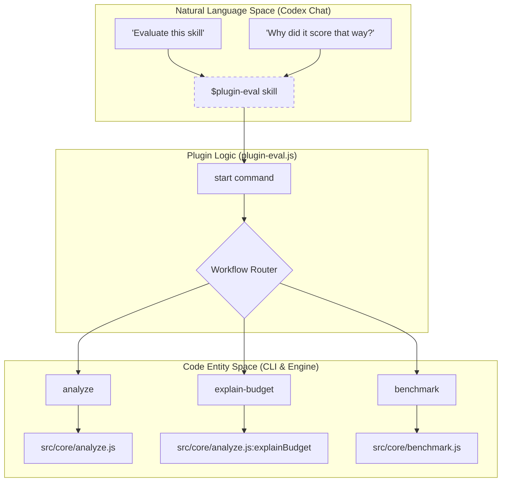
Sources: [plugins/plugin-eval/README.md:66-91](), [plugins/plugin-eval/.codex-plugin/plugin.json:22-45](), [plugins/plugin-eval/scripts/plugin-eval.js:1-8](), [plugins/plugin-eval/tests/plugin-eval.test.js:9-14]()

### Component Interaction

The `plugin-eval` CLI acts as the primary interface for the evaluation engine, consuming plugin manifests and fixtures to produce reports.

**Evaluation Data Flow**
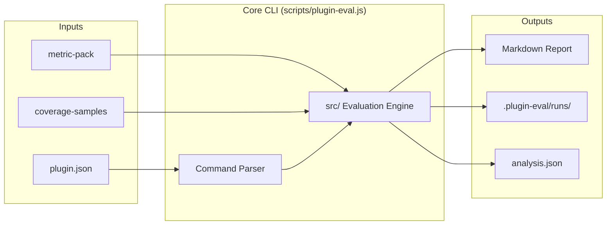
Sources: [plugins/plugin-eval/README.md:117-122](), [plugins/plugin-eval/scripts/plugin-eval.js:8]()

## CLI Entrypoint and Commands

The main entrypoint for the evaluation tool is `scripts/plugin-eval.js`. It can be run directly via `node` or linked globally using `npm link`.

Sources: [plugins/plugin-eval/README.md:31-60](), [plugins/plugin-eval/README.md:12-12]()

### Primary Commands

| Command | Description | Implementation Detail |
| :--- | :--- | :--- |
| `start` | The chat-first router. | Implemented via `buildWorkflowGuide` in `src/core/workflow-guide.js`. |
| `analyze` | Static local report. | Uses `analyzePath` in `src/core/analyze.js` to perform deterministic analysis. |
| `explain-budget` | Token budget analysis. | Uses `explainBudget` in `src/core/analyze.js` to calculate token consumption. |
| `benchmark` | Live execution. | Uses `runBenchmark` in `src/core/benchmark.js` to run real `codex exec` sessions. |
| `compare` | Regression testing. | Uses `compareResults` in `src/core/compare.js` to compare two JSON results. |
| `init-benchmark` | Scaffolding. | Uses `initializeBenchmark` in `src/core/benchmark.js` to create config. |

Sources: [plugins/plugin-eval/README.md:68-102](), [plugins/plugin-eval/tests/plugin-eval.test.js:9-14]()

## The Evaluation Engine (`src/`)

The core logic resides in `src/core/`, which handles the heavy lifting for analysis and benchmarking.

### Benchmarking and Workspace Isolation
To ensure safety and reproducibility, the framework uses isolated temporary workspaces for benchmarks.
- **Provisioning**: `provisionBenchmarkWorkspace` in `src/core/benchmark-workspace.js` creates a copy of the target or uses `git-worktree` [src/core/benchmark-workspace.js:135-175]().
- **Codex Home Seeding**: It seeds a local `.codex` home with `auth.json` and `config.toml` to maintain environment consistency [src/core/benchmark-workspace.js:113-123]().
- **Snapshotting**: The engine takes a `snapshotWorkspace` before and after execution to detect file changes and line counts [src/core/benchmark-workspace.js:217-221]().

### Analysis and Checks
The `analyzePath` function in `src/core/analyze.js` runs a series of checks against the plugin structure:
- **Description Bloat**: Flags oversized descriptions in `SKILL.md` [tests/plugin-eval.test.js:186-195]().
- **Token Budgeting**: Estimates static costs using `estimated-static` methods [tests/plugin-eval.test.js:164-164]().

Sources: [plugins/plugin-eval/src/core/benchmark-workspace.js:1-221](), [plugins/plugin-eval/tests/plugin-eval.test.js:159-195]()

## Fixture Formats

The framework uses standardized fixture formats to ingest external data for evaluation.

### Metric Packs
A metric pack is a directory containing a `manifest.json` and an execution script. It allows custom logic to emit checks and metrics into the evaluation engine.
- **Manifest**: Defines supported target kinds (`skill`, `plugin`, `directory`) and the command to run.
- **Output**: The script must return a JSON object containing `checks`, `metrics`, and `artifacts`.

### Coverage Samples
The engine supports standard code coverage formats to assess test thoroughness:
- **LCOV**: `lcov.info` files.
- **XML**: `coverage.xml` (Cobertura style).
- **JSON**: `coverage-final.json` (Istanbul style).

## Local and Plugin Execution

### Local Installation
To run the framework locally for development:
1. Navigate to `plugins/plugin-eval`.
2. Run `npm link` to add the `plugin-eval` command to your PATH [plugins/plugin-eval/README.md:48-51]().
3. Alternatively, run via `node ./scripts/plugin-eval.js` [plugins/plugin-eval/README.md:31-32]().

### Codex Plugin Integration
When installed as a Codex plugin, it exposes chat-facing skills defined in the `skills/` directory. The manifest defines the `interface` metadata used by Codex:
- **Category**: `Developer Tools` [plugins/plugin-eval/.codex-plugin/plugin.json:27-27]().
- **Capabilities**: `Interactive`, `Write` [plugins/plugin-eval/.codex-plugin/plugin.json:28-31]().
- **Default Prompts**: Includes "Give me an analysis of the game studio plugin" and "Evaluate this plugin" [plugins/plugin-eval/.codex-plugin/plugin.json:35-39]().

Sources: [plugins/plugin-eval/README.md:131-143](), [plugins/plugin-eval/.codex-plugin/plugin.json:22-45]()

## Safety and Artifacts
- **Isolated Workspaces**: The `benchmark` command uses temporary workspaces to prevent side effects on the local environment [src/core/benchmark-workspace.js:141-142]().
- **Artifact Storage**: Reports and run data are stored in `.plugin-eval/runs/` and should typically be ignored by version control [plugins/plugin-eval/README.md:117-118]().
- **Deterministic vs. Live**: `analyze` and `explain-budget` are local and deterministic, whereas `benchmark` involves live model execution via `codex exec` [plugins/plugin-eval/README.md:113-118]().

Sources: [plugins/plugin-eval/README.md:119-126](), [plugins/plugin-eval/src/core/benchmark-workspace.js:141-175]()

---

# Page: Plugin Architecture Concepts

# Plugin Architecture Concepts

<details>
<summary>Relevant source files</summary>

The following files were used as context for generating this wiki page:

- [.agents/plugins/api_marketplace.json](.agents/plugins/api_marketplace.json)
- [.agents/skills/plugin-creator/SKILL.md](.agents/skills/plugin-creator/SKILL.md)
- [.agents/skills/plugin-creator/agents/openai.yaml](.agents/skills/plugin-creator/agents/openai.yaml)
- [.agents/skills/plugin-creator/references/plugin-json-spec.md](.agents/skills/plugin-creator/references/plugin-json-spec.md)
- [.agents/skills/plugin-creator/scripts/create_basic_plugin.py](.agents/skills/plugin-creator/scripts/create_basic_plugin.py)
- [plugins/base44/.codex-plugin/plugin.json](plugins/base44/.codex-plugin/plugin.json)
- [plugins/figma/.codex-plugin/plugin.json](plugins/figma/.codex-plugin/plugin.json)
- [plugins/figma/.mcp.json](plugins/figma/.mcp.json)
- [plugins/github/.codex-plugin/plugin.json](plugins/github/.codex-plugin/plugin.json)
- [plugins/github/.mcp.json](plugins/github/.mcp.json)
- [plugins/github/README.md](plugins/github/README.md)
- [plugins/github/assets/logo.png](plugins/github/assets/logo.png)
- [plugins/shopify/.codex-plugin/plugin.json](plugins/shopify/.codex-plugin/plugin.json)
- [plugins/supabase/.codex-plugin/plugin.json](plugins/supabase/.codex-plugin/plugin.json)
- [plugins/vercel/.codex-plugin/plugin.json](plugins/vercel/.codex-plugin/plugin.json)

</details>


This page provides a high-level overview of the core architectural patterns shared across the `openai/plugins` repository. The architecture is designed to bridge natural language intent with structured API execution through a multi-layered system of Skills, Agents, and Connectors.

## Core Architectural Layers

The plugin ecosystem is built on a modular hierarchy that allows for varying levels of integration, from simple stateless tools to complex, authenticated application workflows.

| Layer | Component | Purpose |
| :--- | :--- | :--- |
| **Interface** | `plugin.json` | Defines the identity, capabilities, and visual metadata for the Codex UI. |
| **Logic** | **Skills System** | Encapsulates specific workflows (e.g., "Research", "Triage") using natural language instructions. |
| **Execution** | **MCP Servers** | Provides the technical bridge to local or remote resources via the Model Context Protocol. |
| **Connectivity** | **App Connectors** | Manages OAuth identities and persistent connections to third-party SaaS platforms. |

### System Relationship Diagram

The following diagram illustrates how natural language requests flow through the architectural entities defined in the codebase.

**Natural Language to Code Entity Mapping**
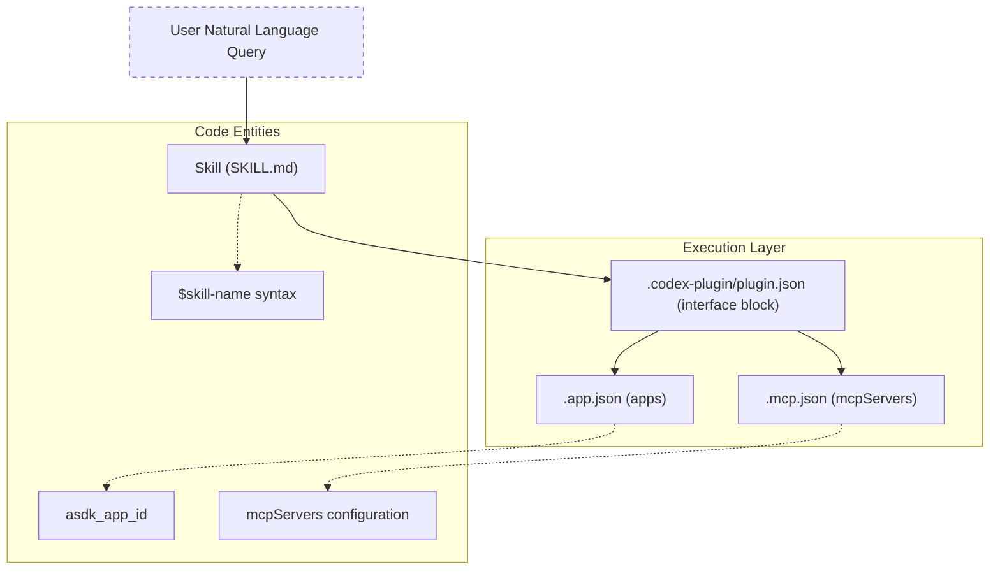
Sources: [plugins/figma/.codex-plugin/plugin.json:19-32](), [plugins/github/.codex-plugin/plugin.json:21-33](), [.agents/skills/plugin-creator/references/plugin-json-spec.md:17-21]()

---

## 1. Skills System
The **Skills System** is the primary method for defining complex, multi-step workflows. Unlike raw tools, a Skill contains "reasoning" instructions that guide the model on how to combine multiple tools to achieve a user goal. Skills are discovered via the `skills` field in `plugin.json` [.agents/skills/plugin-creator/references/plugin-json-spec.md:63]().

*   **Structure:** Each skill resides in a subdirectory, typically under a `skills/` folder, containing a `SKILL.md` file [.agents/skills/plugin-creator/SKILL.md:1-4]().
*   **Interface:** Skills often include an `agents/openai.yaml` file to define the `display_name`, `short_description`, and `default_prompt` for specific model surfaces [.agents/skills/plugin-creator/agents/openai.yaml:1-4]().
*   **Invocation:** Skills can be explicitly triggered via the `$skill-name` syntax or through natural language matching of their description [.agents/skills/plugin-creator/agents/openai.yaml:4]().

For details, see [Skills System](#2.1).

---

## 2. Model Context Protocol (MCP) Integration
Plugins use the **Model Context Protocol (MCP)** to expose underlying tools and resources to the model. This allows for a standardized way to connect to services like Figma, GitHub, or Vercel.

*   **Configuration:** Plugins define their server connections in a `.mcp.json` file, referenced by the `mcpServers` field in the manifest [plugins/figma/.codex-plugin/plugin.json:21](), [.agents/skills/plugin-creator/references/plugin-json-spec.md:19]().
*   **Implementation:** MCP servers can be `http` based and often require an `oauth_resource` for secure tool execution [plugins/figma/.mcp.json:1-9]().

For details, see [Model Context Protocol (MCP) Integration](#2.2).

---

## 3. App Connectors and Authentication
For plugins interacting with private user data (e.g., Notion, Slack, Shopify), the **App Connector** system manages identity and authorization.

*   **Identity:** Apps are identified via the `apps` field in `plugin.json` pointing to an `.app.json` manifest [plugins/vercel/.codex-plugin/plugin.json:29](), [plugins/base44/.codex-plugin/plugin.json:14]().
*   **Authentication Policy:** The marketplace registry defines when authentication occurs, using `ON_INSTALL` or `ON_USE` policies [.agents/plugins/api_marketplace.json:15](), [.agents/skills/plugin-creator/references/plugin-json-spec.md:154-156]().

For details, see [App Connectors and Authentication](#2.3).

---

## 4. Capability Model and Interface Metadata
The `interface` block in `plugin.json` defines how a plugin is rendered and gated within the marketplace and the Codex UI.

**Interface Configuration Example**
| Field | Purpose | Example Value |
| :--- | :--- | :--- |
| `capabilities` | Defines access levels | `["Interactive", "Read", "Write"]` |
| `category` | UI grouping | `"Developer Tools"` |
| `defaultPrompt` | Initial user guidance | `["Inspect a Figma design..."]` |
| `brandColor` | Theme color for UI cards | `"#1ABCFE"` |

Sources: [plugins/figma/.codex-plugin/plugin.json:22-45](), [plugins/shopify/.codex-plugin/plugin.json:22-44](), [.agents/skills/plugin-creator/references/plugin-json-spec.md:69-87]()

For details, see [Plugin Capabilities and Interface Metadata](#2.4).

---

## Architectural Entity Mapping

This diagram maps specific file paths and JSON keys to their roles in the plugin lifecycle as managed by the system's scaffolding tools like `create_basic_plugin.py`.

**File-to-Role Mapping**
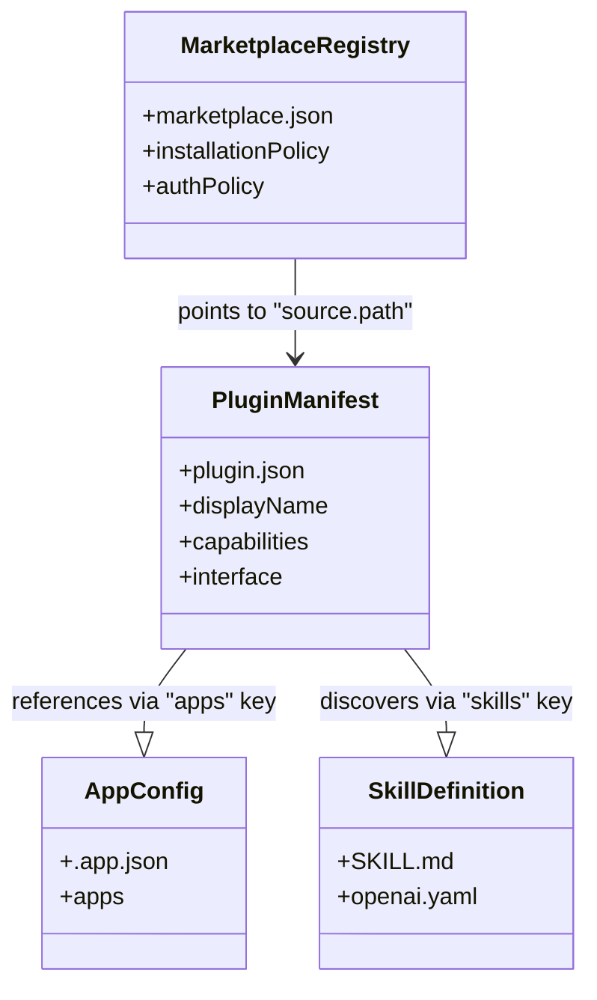
Sources: [.agents/skills/plugin-creator/references/plugin-json-spec.md:1-45](), [.agents/skills/plugin-creator/scripts/create_basic_plugin.py:43-105](), [.agents/plugins/api_marketplace.json:6-21]()

---

# Page: Skills System

# Skills System

<details>
<summary>Relevant source files</summary>

The following files were used as context for generating this wiki page:

- [plugins/linear/.app.json](plugins/linear/.app.json)
- [plugins/linear/.codex-plugin/plugin.json](plugins/linear/.codex-plugin/plugin.json)
- [plugins/linear/.mcp.json](plugins/linear/.mcp.json)
- [plugins/linear/skills/linear/LICENSE.txt](plugins/linear/skills/linear/LICENSE.txt)
- [plugins/linear/skills/linear/SKILL.md](plugins/linear/skills/linear/SKILL.md)
- [plugins/linear/skills/linear/agents/openai.yaml](plugins/linear/skills/linear/agents/openai.yaml)
- [plugins/linear/skills/linear/assets/linear-small.svg](plugins/linear/skills/linear/assets/linear-small.svg)
- [plugins/linear/skills/linear/assets/linear.png](plugins/linear/skills/linear/assets/linear.png)
- [plugins/motherduck/.app.json](plugins/motherduck/.app.json)
- [plugins/motherduck/.codex-plugin/plugin.json](plugins/motherduck/.codex-plugin/plugin.json)
- [plugins/notion/.app.json](plugins/notion/.app.json)
- [plugins/notion/README.md](plugins/notion/README.md)
- [plugins/notion/agents/openai.yaml](plugins/notion/agents/openai.yaml)
- [plugins/notion/skills/notion-knowledge-capture/SKILL.md](plugins/notion/skills/notion-knowledge-capture/SKILL.md)
- [plugins/notion/skills/notion-knowledge-capture/agents/openai.yaml](plugins/notion/skills/notion-knowledge-capture/agents/openai.yaml)
- [plugins/notion/skills/notion-meeting-intelligence/SKILL.md](plugins/notion/skills/notion-meeting-intelligence/SKILL.md)
- [plugins/notion/skills/notion-meeting-intelligence/agents/openai.yaml](plugins/notion/skills/notion-meeting-intelligence/agents/openai.yaml)
- [plugins/notion/skills/notion-research-documentation/SKILL.md](plugins/notion/skills/notion-research-documentation/SKILL.md)
- [plugins/notion/skills/notion-research-documentation/agents/openai.yaml](plugins/notion/skills/notion-research-documentation/agents/openai.yaml)
- [plugins/notion/skills/notion-spec-to-implementation/SKILL.md](plugins/notion/skills/notion-spec-to-implementation/SKILL.md)
- [plugins/notion/skills/notion-spec-to-implementation/agents/openai.yaml](plugins/notion/skills/notion-spec-to-implementation/agents/openai.yaml)

</details>


The Skills System defines modular, high-level capabilities within a plugin. While a plugin provides the underlying tools, MCP servers, and authentication, a **Skill** encapsulates a specific workflow, persona, or specialized task. Skills allow the model to transition from generic tool-calling to executing structured, multi-step processes guided by domain-specific instructions.

## Anatomy of a Skill

A Skill is defined as a directory within a plugin's `skills/` folder [plugins/linear/.codex-plugin/plugin.json:13-13](). Each Skill contains configuration files that define its logic and its interface.

### 1. The SKILL.md Format
The `SKILL.md` file serves as the "brain" of the skill. It uses a Markdown format with a YAML frontmatter block to define the skill's identity and a body that contains the execution instructions for the model.

| Field | Description |
| :--- | :--- |
| `name` | The unique identifier for the skill (e.g., `notion-knowledge-capture`). [plugins/notion/skills/notion-knowledge-capture/SKILL.md:2-2]() |
| `description` | A concise summary used by the model to decide when to invoke this skill. [plugins/notion/skills/notion-knowledge-capture/SKILL.md:3-3]() |
| `metadata` | Includes `short-description` for UI rendering. [plugins/notion/skills/notion-knowledge-capture/SKILL.md:4-6]() |

**Key Conventions:**
*   **Trigger-based Descriptions**: Descriptions typically start with "Use when..." to focus on triggering conditions (e.g., "use when turning chats/notes into wiki entries") [plugins/notion/skills/notion-knowledge-capture/SKILL.md:3-3]().
*   **Tool-call Guardrails**: Skills often include specific instructions on how to handle tool failures, such as pausing to ask for authentication if an app-connector is missing [plugins/notion/skills/notion-knowledge-capture/SKILL.md:19-32]().

### 2. The Interface Definition (openai.yaml)
The `agents/openai.yaml` file defines how the skill is presented in the Codex UI and provides the initial trigger for the model.

```yaml
interface:
  display_name: "Knowledge Capture"
  short_description: "Capture conversations into structured Notion pages"
  icon_small: "./assets/notion-small.svg"
  icon_large: "./assets/notion.png"
  default_prompt: "Capture this conversation into structured Notion pages..."
```
*Source: [plugins/notion/skills/notion-knowledge-capture/agents/openai.yaml:1-6]()*

**Key Fields:**
*   **`display_name`**: The human-readable name shown in the UI [plugins/notion/skills/notion-knowledge-capture/agents/openai.yaml:2-2]().
*   **`icon_small` / `icon_large`**: Assets used for visual branding in the composer and skill cards [plugins/notion/skills/notion-knowledge-capture/agents/openai.yaml:4-5]().
*   **`default_prompt`**: The "Seed" used when a user clicks the skill. This prompt guides the model's initial behavior for that specific skill [plugins/notion/skills/notion-knowledge-capture/agents/openai.yaml:6-6]().

**Sources:** [plugins/notion/skills/notion-knowledge-capture/SKILL.md:1-6](), [plugins/notion/skills/notion-knowledge-capture/agents/openai.yaml:1-6](), [plugins/notion/README.md:40-44]()

---

## Skill Invocation and Discovery

### Invocation Syntax
Skills are often invoked using a `$skill-name` syntax within a `default_prompt`. When the model sees this token, it is a signal to load the context and instructions defined in the corresponding `SKILL.md`.

### Directory Conventions
Skills follow a strict nested directory structure to ensure the discovery engine can locate assets and definitions:
`plugins/[plugin-name]/skills/[skill-name]/`
- `SKILL.md`: Main reference and workflow logic [plugins/notion/README.md:42-43]().
- `agents/openai.yaml`: Interface metadata and UI assets [plugins/notion/skills/notion-knowledge-capture/agents/openai.yaml:1-1]().
- `reference/`: Optional documentation, database schemas, or templates used by the skill [plugins/notion/skills/notion-knowledge-capture/SKILL.md:58-59]().
- `examples/`: Walkthroughs showing the skill in practice [plugins/notion/skills/notion-knowledge-capture/SKILL.md:60-60]().

### Discovery from plugin.json
The `plugin.json` manifest (located in `.codex-plugin/`) acts as the entry point. The `skills` field in `plugin.json` specifies the relative path (usually `./skills/`) where the system should look for skill directories [plugins/linear/.codex-plugin/plugin.json:13-13]().

**Sources:** [plugins/notion/README.md:20-44](), [plugins/linear/.codex-plugin/plugin.json:1-13]()

---

## Data Flow: From UI to Execution

The following diagram illustrates how a user interaction in the UI triggers the skill logic and subsequent tool execution.

### Skill Trigger and Tool Interaction Flow
"User invokes the Knowledge Capture skill to document a chat in Notion"

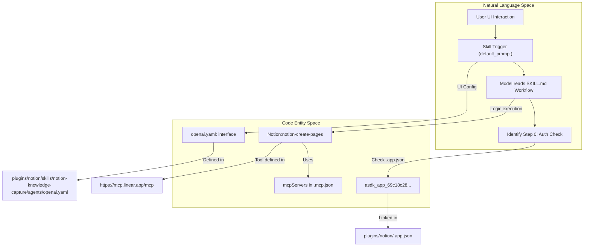
**Sources:** [plugins/notion/skills/notion-knowledge-capture/SKILL.md:12-32](), [plugins/notion/.app.json:1-7](), [plugins/linear/.mcp.json:1-9]()

---

## Skill Implementation Mapping

Skills bridge the gap between user intent and specific tool calls. For example, the Notion plugin contains multiple skills that all use the same underlying tools but with different prompt engineering and templates.

| Skill Name | Purpose | Primary Tool Calls |
| :--- | :--- | :--- |
| `notion-knowledge-capture` | Conversations to wiki entries | `Notion:search`, `Notion:notion-create-pages` [plugins/notion/skills/notion-knowledge-capture/SKILL.md:12-17]() |
| `notion-research-documentation` | Synthesizing briefs | `Notion:fetch`, `Notion:notion-create-pages` [plugins/notion/skills/notion-research-documentation/SKILL.md:12-17]() |
| `notion-meeting-intelligence` | Agendas and pre-reads | `Notion:search`, `Notion:notion-update-page` [plugins/notion/skills/notion-meeting-intelligence/SKILL.md:12-17]() |

### Skill Structure Mapping
This diagram maps the file structure of a typical skill to its logical components in the system.

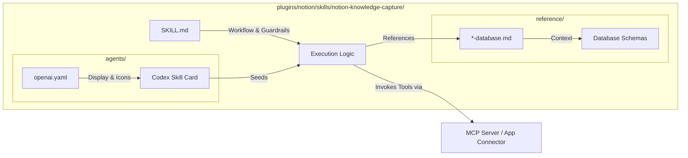

**Sources:** [plugins/notion/README.md:40-44](), [plugins/notion/skills/notion-knowledge-capture/SKILL.md:58-60](), [plugins/notion/skills/notion-knowledge-capture/agents/openai.yaml:1-6]()

---

# Page: Model Context Protocol (MCP) Integration

# Model Context Protocol (MCP) Integration

<details>
<summary>Relevant source files</summary>

The following files were used as context for generating this wiki page:

- [.agents/plugins/api_marketplace.json](.agents/plugins/api_marketplace.json)
- [plugins/atlassian-rovo/.codex-plugin/plugin.json](plugins/atlassian-rovo/.codex-plugin/plugin.json)
- [plugins/atlassian-rovo/assets/logo-dark.png](plugins/atlassian-rovo/assets/logo-dark.png)
- [plugins/atlassian-rovo/assets/logo.png](plugins/atlassian-rovo/assets/logo.png)
- [plugins/base44/.codex-plugin/plugin.json](plugins/base44/.codex-plugin/plugin.json)
- [plugins/figma/.codex-plugin/plugin.json](plugins/figma/.codex-plugin/plugin.json)
- [plugins/figma/.mcp.json](plugins/figma/.mcp.json)
- [plugins/github/.codex-plugin/plugin.json](plugins/github/.codex-plugin/plugin.json)
- [plugins/github/.mcp.json](plugins/github/.mcp.json)
- [plugins/github/README.md](plugins/github/README.md)
- [plugins/github/assets/logo.png](plugins/github/assets/logo.png)
- [plugins/neon-postgres/.codex-plugin/plugin.json](plugins/neon-postgres/.codex-plugin/plugin.json)
- [plugins/neon-postgres/assets/neon-small.svg](plugins/neon-postgres/assets/neon-small.svg)
- [plugins/neon-postgres/assets/neon.jpg](plugins/neon-postgres/assets/neon.jpg)
- [plugins/neon-postgres/skills/neon-postgres-egress-optimizer/SKILL.md](plugins/neon-postgres/skills/neon-postgres-egress-optimizer/SKILL.md)
- [plugins/neon-postgres/skills/neon-postgres-egress-optimizer/agents/openai.yaml](plugins/neon-postgres/skills/neon-postgres-egress-optimizer/agents/openai.yaml)
- [plugins/neon-postgres/skills/neon-postgres-egress-optimizer/assets/neon-small.svg](plugins/neon-postgres/skills/neon-postgres-egress-optimizer/assets/neon-small.svg)
- [plugins/neon-postgres/skills/neon-postgres-egress-optimizer/assets/neon.jpg](plugins/neon-postgres/skills/neon-postgres-egress-optimizer/assets/neon.jpg)
- [plugins/neon-postgres/skills/neon-postgres/SKILL.md](plugins/neon-postgres/skills/neon-postgres/SKILL.md)
- [plugins/neon-postgres/skills/neon-postgres/agents/openai.yaml](plugins/neon-postgres/skills/neon-postgres/agents/openai.yaml)
- [plugins/neon-postgres/skills/neon-postgres/assets/neon-small.svg](plugins/neon-postgres/skills/neon-postgres/assets/neon-small.svg)
- [plugins/notion/.codex-plugin/plugin.json](plugins/notion/.codex-plugin/plugin.json)
- [plugins/notion/.mcp.json](plugins/notion/.mcp.json)
- [plugins/notion/assets/notion-dark.png](plugins/notion/assets/notion-dark.png)
- [plugins/notion/assets/notion.png](plugins/notion/assets/notion.png)
- [plugins/shopify/.codex-plugin/plugin.json](plugins/shopify/.codex-plugin/plugin.json)
- [plugins/supabase/.codex-plugin/plugin.json](plugins/supabase/.codex-plugin/plugin.json)
- [plugins/vercel/.codex-plugin/plugin.json](plugins/vercel/.codex-plugin/plugin.json)

</details>


The Model Context Protocol (MCP) integration allows Codex plugins to connect to external, standardized servers that provide tools, resources, and prompts. By using MCP, plugins can offer authenticated, live access to third-party APIs (like Cloudflare, Vercel, or Neon) without needing to manually implement every API endpoint as a separate tool in the plugin manifest.

## Overview of MCP in Plugins

Plugins in this repository utilize MCP in two primary ways:
1.  **Direct Integration**: The plugin manifest (`plugin.json`) points to a `.mcp.json` configuration file or contains direct server references via the `mcpServers` field [plugins/figma/.codex-plugin/plugin.json:21-21]().
2.  **Skill-Level Dependencies**: Individual skills within a plugin can declare specific MCP servers as tool dependencies in their `openai.yaml` configuration [plugins/neon-postgres/skills/neon-postgres/agents/openai.yaml:9-15]().

### Key Configuration Files

| File | Purpose |
| :--- | :--- |
| `plugin.json` | The main manifest that defines the plugin's metadata and references skills or MCP configurations [plugins/figma/.codex-plugin/plugin.json:1-46](). |
| `.mcp.json` | Defines the connection parameters (URL, transport type, or local command execution) for one or more MCP servers [plugins/figma/.mcp.json:1-9](). |
| `openai.yaml` | Located in skill directories; declares specific MCP tools needed by that skill using the `mcp` tool type [plugins/neon-postgres/skills/neon-postgres/agents/openai.yaml:9-15](). |

**Sources:** [plugins/figma/.codex-plugin/plugin.json:21-21](), [plugins/figma/.mcp.json:1-9](), [plugins/neon-postgres/skills/neon-postgres/agents/openai.yaml:9-15]()

---

## Data Flow: MCP Request Lifecycle

The following diagram illustrates how a user request flows from the Codex UI through a plugin to an MCP server, distinguishing between remote HTTP-based servers and local CLI-based servers.

### MCP Interaction Architecture
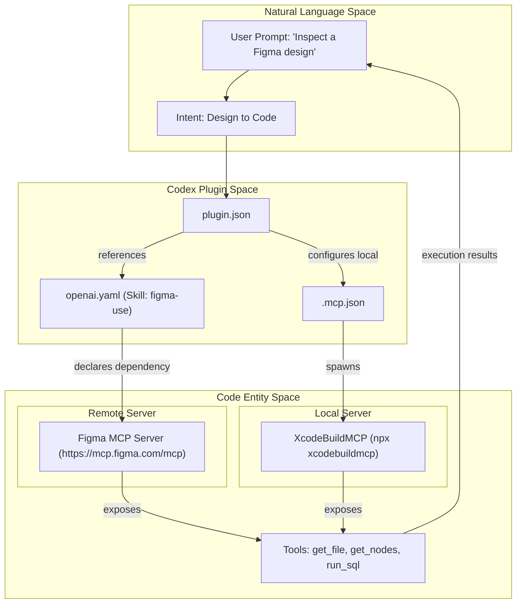
**Sources:** [plugins/figma/.codex-plugin/plugin.json:21-21](), [plugins/figma/.mcp.json:2-8](), [plugins/neon-postgres/skills/neon-postgres/agents/openai.yaml:11-15]()

---

## Implementation Details

### 1. The `.mcp.json` Configuration
The `.mcp.json` file is used to define MCP servers that are run locally via a command-line interface or connected via specific HTTP transports.

**Example (GitHub):**
This configuration uses a bearer token for authentication to a remote GitHub MCP endpoint.
```json
{
  "mcpServers": {
    "github": {
      "type": "http",
      "url": "https://api.githubcopilot.com/mcp/",
      "bearer_token_env_var": "GITHUB_PAT_TOKEN"
    }
  }
}
```
[plugins/github/.mcp.json:1-9]()

### 2. Skill-Level Tool Dependencies
Skills map specific MCP capabilities in their `agents/openai.yaml` file. This allows a plugin to be composed of multiple skills that might hit different MCP endpoints or use different transport layers.

**Example (Neon Postgres):**
```yaml
dependencies:
  tools:
    - type: "mcp"
      value: "neon"
      description: "Neon MCP server"
      transport: "streamable_http"
      url: "https://mcp.neon.tech/mcp"
```
[plugins/neon-postgres/skills/neon-postgres/agents/openai.yaml:9-15]()

### 3. App-Connector vs. MCP-Backed Plugins
*   **App-Connector Plugins**: Primarily rely on `.app.json` for OAuth-based connections to high-level SaaS APIs (e.g., Notion, Slack) [plugins/notion/.codex-plugin/plugin.json:20-22]().
*   **MCP-Backed Plugins**: Focus on technical toolsets (SQL, CLI wrappers, infrastructure). They often coexist with app connectors; for instance, `figma` uses both an app definition and an MCP server [plugins/figma/.codex-plugin/plugin.json:20-21]().

---

## Example Integrations

### Figma
The Figma plugin utilizes a remote MCP server to enable design inspection and implementation workflows.
*   **Configuration**: The `.mcp.json` file defines the `http` transport and the `oauth_resource` for the Figma MCP server [plugins/figma/.mcp.json:4-6]().
*   **Capabilities**: Exposes design-to-code workflows, including Code Connect templates and design system rule generation [plugins/figma/.codex-plugin/plugin.json:24-25]().

### Neon Postgres
The Neon plugin utilizes a remote MCP server to enable complex database operations without the plugin needing to bundle the logic for every SQL command.
*   **Skill Integration**: The `neon-postgres` skill uses the `streamable_http` transport to reach the Neon MCP endpoint [plugins/neon-postgres/skills/neon-postgres/agents/openai.yaml:14-15]().
*   **Egress Optimization**: The `neon-postgres-egress-optimizer` skill provides specific prompts and guides for diagnosing high database bills [plugins/neon-postgres/skills/neon-postgres-egress-optimizer/SKILL.md:14-35]().

### Shopify
The Shopify plugin is categorized as MCP-backed, focusing on developer tools like GraphQL validation and Liquid code generation [plugins/shopify/.codex-plugin/plugin.json:14-18]().

---

## MCP Logic Association

The following diagram bridges the natural language prompts found in `plugin.json` and `SKILL.md` files to the technical MCP tool dependencies.

### Skill-to-MCP Mapping
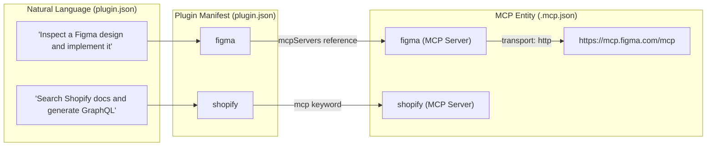
**Sources:** [plugins/figma/.codex-plugin/plugin.json:36-37](), [plugins/shopify/.codex-plugin/plugin.json:35-37](), [plugins/figma/.mcp.json:1-9](), [plugins/shopify/.codex-plugin/plugin.json:14-14]()

**Key Code Entities:**
*   `transport: "streamable_http"`: The protocol used for remote MCP communication in skills [plugins/neon-postgres/skills/neon-postgres/agents/openai.yaml:14-14]().
*   `type: "mcp"`: The tool definition type that triggers the MCP client logic [plugins/neon-postgres/skills/neon-postgres/agents/openai.yaml:11-11]().
*   `mcpServers`: The key in `plugin.json` or `.mcp.json` for defining server instances [plugins/figma/.codex-plugin/plugin.json:21-21](), [plugins/figma/.mcp.json:2-2]().

**Sources:** [plugins/figma/.codex-plugin/plugin.json:1-46](), [plugins/figma/.mcp.json:1-9](), [plugins/neon-postgres/skills/neon-postgres/agents/openai.yaml:9-15]()

---

# Page: App Connectors and Authentication

# App Connectors and Authentication

<details>
<summary>Relevant source files</summary>

The following files were used as context for generating this wiki page:

- [plugins/atlassian-rovo/.codex-plugin/plugin.json](plugins/atlassian-rovo/.codex-plugin/plugin.json)
- [plugins/atlassian-rovo/assets/logo-dark.png](plugins/atlassian-rovo/assets/logo-dark.png)
- [plugins/atlassian-rovo/assets/logo.png](plugins/atlassian-rovo/assets/logo.png)
- [plugins/canva/.codex-plugin/plugin.json](plugins/canva/.codex-plugin/plugin.json)
- [plugins/gmail/.codex-plugin/plugin.json](plugins/gmail/.codex-plugin/plugin.json)
- [plugins/linear/.app.json](plugins/linear/.app.json)
- [plugins/linear/.codex-plugin/plugin.json](plugins/linear/.codex-plugin/plugin.json)
- [plugins/linear/.mcp.json](plugins/linear/.mcp.json)
- [plugins/linear/skills/linear/LICENSE.txt](plugins/linear/skills/linear/LICENSE.txt)
- [plugins/linear/skills/linear/SKILL.md](plugins/linear/skills/linear/SKILL.md)
- [plugins/linear/skills/linear/agents/openai.yaml](plugins/linear/skills/linear/agents/openai.yaml)
- [plugins/linear/skills/linear/assets/linear-small.svg](plugins/linear/skills/linear/assets/linear-small.svg)
- [plugins/linear/skills/linear/assets/linear.png](plugins/linear/skills/linear/assets/linear.png)
- [plugins/motherduck/.app.json](plugins/motherduck/.app.json)
- [plugins/motherduck/.codex-plugin/plugin.json](plugins/motherduck/.codex-plugin/plugin.json)
- [plugins/notion/.codex-plugin/plugin.json](plugins/notion/.codex-plugin/plugin.json)
- [plugins/notion/.mcp.json](plugins/notion/.mcp.json)
- [plugins/notion/assets/notion-dark.png](plugins/notion/assets/notion-dark.png)
- [plugins/notion/assets/notion.png](plugins/notion/assets/notion.png)
- [plugins/slack/.app.json](plugins/slack/.app.json)
- [plugins/slack/.codex-plugin/plugin.json](plugins/slack/.codex-plugin/plugin.json)
- [plugins/slack/skills/slack/agents/openai.yaml](plugins/slack/skills/slack/agents/openai.yaml)

</details>


This page documents the architecture and implementation of **App Connectors**, the mechanism by which plugins interface with third-party SaaS platforms (e.g., Notion, Slack, Linear, Gmail) using managed OAuth flows. Unlike standalone or MCP-backed plugins, app-backed plugins rely on a centralized authentication system identified by unique application IDs.

## The .app.json Pattern

App-backed plugins are identified by the presence of a `.app.json` file in the plugin root. This file acts as a bridge between the local plugin definition and the managed authentication service.

### Manifest Integration
The primary plugin manifest, `plugin.json`, must point to this file using the `apps` key:
- [plugins/notion/.codex-plugin/plugin.json:22-22]()
- [plugins/linear/.codex-plugin/plugin.json:14-14]()
- [plugins/slack/.codex-plugin/plugin.json:19-19]()
- [plugins/canva/.codex-plugin/plugin.json:14-14]()
- [plugins/atlassian-rovo/.codex-plugin/plugin.json:16-16]()

### Structure of .app.json
The file contains a mapping of app names to their unique `asdk_app_` identifiers. These identifiers are used by the Codex platform to resolve the correct OAuth credentials and API endpoints for the tools used within the plugin's skills.

| Plugin | App Identifier (`asdk_app_...`) | Source |
| :--- | :--- | :--- |
| **Linear** | `asdk_app_69a089a326dc8191b32a3f2553f5be2c` | [plugins/linear/.app.json:4-4]() |
| **Notion** | `asdk_app_69c18c28f1188191bf5b8445c4ab0a2e` | (Managed via centralized registry) |

**Sources:**
- [plugins/linear/.app.json:1-7]()
- [plugins/slack/.app.json:1-7]()
- [plugins/motherduck/.app.json:1-7]()
- [plugins/atlassian-rovo/.codex-plugin/plugin.json:16-16]()

---

## Authentication Flow and Data Flow

The authentication flow for App Connectors is managed by the platform. When a skill attempts to call a tool associated with an app, the system checks for a valid OAuth token associated with that `asdk_app_` ID.

### Natural Language to Code Entity Space: Auth Resolution
The following diagram illustrates how a user request triggers the resolution of an App Connector through the manifest structure.

**Diagram: App Connector Resolution Path**
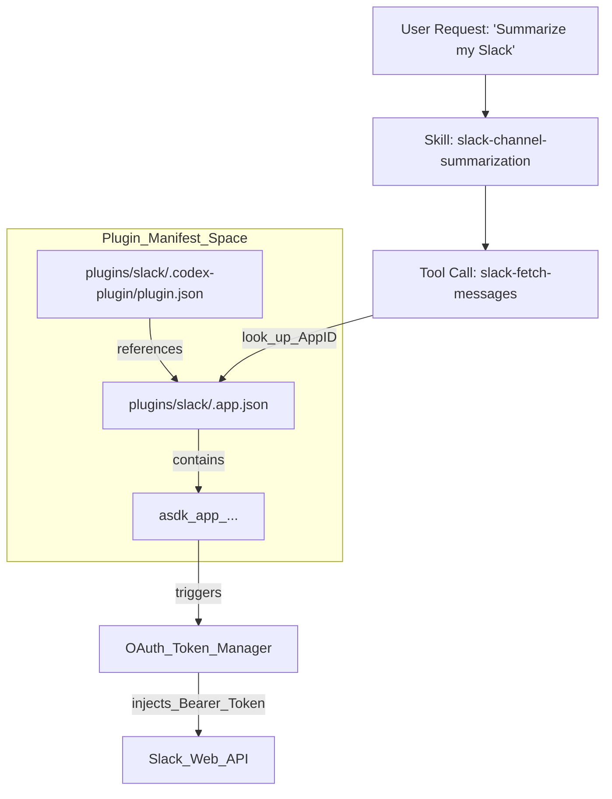
**Sources:**
- [plugins/slack/.codex-plugin/plugin.json:1-19]()
- [plugins/slack/.app.json:1-7]()

---

## Step 0: The Auth-Check Pattern

A critical convention in app-backed skills is the **Step 0: Auth Check**. Because tools may be unavailable if the user has not yet completed the OAuth handshake, skills must explicitly define a recovery path.

### Implementation in Skill Definitions
Skills using App Connectors include standardized instructions that guide the model on how to handle missing permissions.

1.  **Detection**: If tools (e.g., `notion-search`) are unavailable in the context.
2.  **Instruction**: Pause the execution.
3.  **Call to Action**: Ask the user to "connect the [App] app" and complete the auth flow.
4.  **Recovery**: Once connected, the user is told to retry.

**Example: Slack Auth-Check Pattern**
[plugins/slack/skills/slack/agents/openai.yaml:1-7]() defines the skill interface which relies on the connected Slack integration specified in the parent manifest [plugins/slack/.codex-plugin/plugin.json:19-19]().

**Sources:**
- [plugins/slack/skills/slack/agents/openai.yaml:1-7]()
- [plugins/linear/skills/linear/agents/openai.yaml:1-6]()

---

## App-Backed vs. MCP-Backed Plugins

While both provide external capabilities, App Connectors and MCP (Model Context Protocol) servers serve different roles. Some plugins, like **Linear** and **Notion**, use both: App Connectors for high-level identity/OAuth and MCP for specific tool execution.

| Feature | App-Backed (Connectors) | MCP-Backed |
| :--- | :--- | :--- |
| **Identifier** | `.app.json` (`asdk_app_...`) | `.mcp.json` |
| **Auth Mechanism** | Managed OAuth (Centralized) | API Keys, Local Auth, or `oauth_resource` |
| **Manifest Key** | `"apps"` | `"mcpServers"` |
| **Primary Examples** | Gmail, Slack, Canva | Cloudflare, Vercel, MotherDuck |
| **Hybrid Examples** | Linear, Notion | Linear, Notion |

**Sources:**
- [plugins/notion/.codex-plugin/plugin.json:22-23]()
- [plugins/linear/.codex-plugin/plugin.json:14-15]()
- [plugins/linear/.mcp.json:1-9]()
- [plugins/notion/.mcp.json:1-9]()

---

## Technical Data Flow: Tool Execution

When a skill invokes a tool through an App Connector, the request follows a specific path through the infrastructure, utilizing the `asdk_app_` ID to retrieve secrets and authorize the request.

**Diagram: App-Backed Tool Execution**
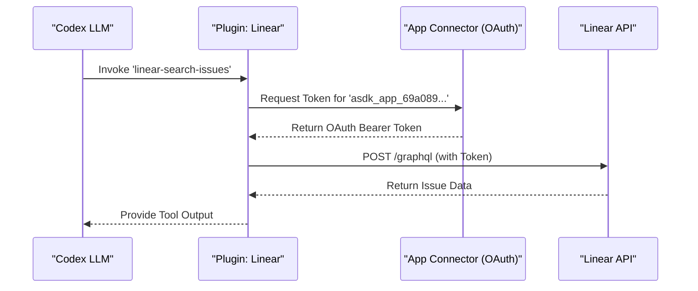

**Sources:**
- [plugins/linear/.app.json:4-4]()
- [plugins/linear/.codex-plugin/plugin.json:14-14]()
- [plugins/linear/.mcp.json:6-6]()

---

# Page: Plugin Capabilities and Interface Metadata

# Plugin Capabilities and Interface Metadata

<details>
<summary>Relevant source files</summary>

The following files were used as context for generating this wiki page:

- [.agents/plugins/api_marketplace.json](.agents/plugins/api_marketplace.json)
- [.agents/skills/plugin-creator/SKILL.md](.agents/skills/plugin-creator/SKILL.md)
- [.agents/skills/plugin-creator/agents/openai.yaml](.agents/skills/plugin-creator/agents/openai.yaml)
- [.agents/skills/plugin-creator/references/plugin-json-spec.md](.agents/skills/plugin-creator/references/plugin-json-spec.md)
- [.agents/skills/plugin-creator/scripts/create_basic_plugin.py](.agents/skills/plugin-creator/scripts/create_basic_plugin.py)
- [plugins/base44/.codex-plugin/plugin.json](plugins/base44/.codex-plugin/plugin.json)
- [plugins/figma/.codex-plugin/plugin.json](plugins/figma/.codex-plugin/plugin.json)
- [plugins/figma/.mcp.json](plugins/figma/.mcp.json)
- [plugins/github/.codex-plugin/plugin.json](plugins/github/.codex-plugin/plugin.json)
- [plugins/github/.mcp.json](plugins/github/.mcp.json)
- [plugins/github/README.md](plugins/github/README.md)
- [plugins/github/assets/logo.png](plugins/github/assets/logo.png)
- [plugins/shopify/.codex-plugin/plugin.json](plugins/shopify/.codex-plugin/plugin.json)
- [plugins/supabase/.codex-plugin/plugin.json](plugins/supabase/.codex-plugin/plugin.json)
- [plugins/vercel/.codex-plugin/plugin.json](plugins/vercel/.codex-plugin/plugin.json)

</details>


This page documents the `interface` block within the `.codex-plugin/plugin.json` manifest. These fields define how a plugin is presented, categorized, and restricted within the Codex UI and marketplace.

## Overview and Purpose

The `interface` block serves as the bridge between the raw technical capabilities of a plugin (its skills, MCP servers, or app connectors) and the end-user experience. It provides the metadata necessary for the Codex UI to render plugin icons, descriptions, brand colors, and interactive safety guardrails.

### Data Flow: From Manifest to UI
1.  **Definition**: Developers define metadata in `plugins/<plugin-name>/.codex-plugin/plugin.json` [[.agents/skills/plugin-creator/references/plugin-json-spec.md:21-44]()].
2.  **Scaffolding**: The `create_basic_plugin.py` script generates this block using `build_plugin_json()` with `[TODO]` placeholders for developers to fill [[.agents/skills/plugin-creator/scripts/create_basic_plugin.py:43-85]()].
3.  **Registration**: The `Marketplace Registry` consumes these manifests to populate `marketplace.json`, using the `category` and `name` to organize the UI [[.agents/plugins/api_marketplace.json:7-21](), [.agents/skills/plugin-creator/scripts/create_basic_plugin.py:88-105]()].
4.  **Rendering**: The Codex UI uses the `displayName`, `brandColor`, and `logo` to create the plugin's visual identity in the composer and sidebar.

Sources: `.agents/skills/plugin-creator/references/plugin-json-spec.md`, `.agents/skills/plugin-creator/scripts/create_basic_plugin.py`, `.agents/plugins/api_marketplace.json`.

---

## Interface Block Schema

The following table details the fields found in the `interface` object as defined in the plugin specification [[.agents/skills/plugin-creator/references/plugin-json-spec.md:69-90]()]:

| Field | Type | Description |
| :--- | :--- | :--- |
| `displayName` | String | User-facing title shown for the plugin in the UI [[.agents/skills/plugin-creator/references/plugin-json-spec.md:71]()] |
| `shortDescription` | String | Brief subtitle used in compact views and search results [[.agents/skills/plugin-creator/references/plugin-json-spec.md:72]()] |
| `longDescription` | String | Detailed explanation used on the plugin's details screen [[.agents/skills/plugin-creator/references/plugin-json-spec.md:73]()] |
| `developerName` | String | Human-readable publisher name (e.g., "OpenAI", "Figma") [[.agents/skills/plugin-creator/references/plugin-json-spec.md:74]()] |
| `category` | String | The marketplace category bucket (e.g., "Developer Tools", "Creativity") [[.agents/skills/plugin-creator/references/plugin-json-spec.md:75]()] |
| `capabilities` | Array | List of capabilities: `Interactive`, `Read`, `Write` [[.agents/skills/plugin-creator/references/plugin-json-spec.md:76]()] |
| `brandColor` | String | Hex theme color used for the plugin card and UI accents [[.agents/skills/plugin-creator/references/plugin-json-spec.md:84]()] |
| `composerIcon` | Path | Relative path to the icon asset used in the chat composer [[.agents/skills/plugin-creator/references/plugin-json-spec.md:85]()] |
| `logo` | Path | Relative path to the high-resolution logo asset [[.agents/skills/plugin-creator/references/plugin-json-spec.md:86]()] |
| `defaultPrompt` | Array | Up to 3 starter prompts (max 128 chars each) shown in the UX [[.agents/skills/plugin-creator/references/plugin-json-spec.md:80-83]()] |
| `screenshots` | Array | List of relative paths to PNG screenshots in `./assets/` [[.agents/skills/plugin-creator/references/plugin-json-spec.md:87-89]()] |

### Capabilities Model
The `capabilities` field defines the security and interaction boundaries for the plugin [[.agents/skills/plugin-creator/references/plugin-json-spec.md:27]()]:
*   **`Read`**: The plugin can retrieve data from external sources (e.g., searching Shopify documentation) [[plugins/shopify/.codex-plugin/plugin.json:29]()].
*   **`Write`**: The plugin can modify data or perform side effects (e.g., creating a PR in GitHub). This triggers "Write Safety" confirmations [[plugins/github/.codex-plugin/plugin.json:32](), [plugins/vercel/.codex-plugin/plugin.json:38]()].
*   **`Interactive`**: Enables real-time UI components, browser automation, or complex multi-turn flows [[plugins/figma/.codex-plugin/plugin.json:29](), [plugins/github/.codex-plugin/plugin.json:31]()].

Sources: `.agents/skills/plugin-creator/references/plugin-json-spec.md`, `plugins/github/.codex-plugin/plugin.json`, `plugins/shopify/.codex-plugin/plugin.json`, `plugins/figma/.codex-plugin/plugin.json`.

---

## Visual Identity and Assets

Plugins use relative paths to assets stored within the plugin directory, typically under an `assets/` folder [[.agents/skills/plugin-creator/references/plugin-json-spec.md:88-89]()].

### Asset Conventions
*   **Icons**: Manifests point to assets like `./assets/logo-padded.png` for both `logo` and `composerIcon` [[plugins/figma/.codex-plugin/plugin.json:42-43](), [plugins/vercel/.codex-plugin/plugin.json:48-49]()].
*   **Format**: Screenshots and icons must be PNG files [[.agents/skills/plugin-creator/references/plugin-json-spec.md:88]()].

### Implementation Diagram: Manifest to UI Rendering

This diagram illustrates how fields in `plugin.json` map to specific UI components in the Codex environment.

Title: Metadata Mapping to Codex UI
```mermaid
graph TD
    subgraph "Natural Language Space (User Interface)"
        A["Chat Composer"]
        B["Plugin Sidebar"]
        C["Marketplace Card"]
        D["Write Confirmation Dialog"]
    end

    subgraph "Code Entity Space (.codex-plugin/plugin.json)"
        E["interface.displayName"]
        F["interface.brandColor"]
        G["interface.logo"]
        H["interface.composerIcon"]
        I["interface.shortDescription"]
        J["interface.capabilities"]
        K["interface.defaultPrompt"]
    end

    E -->|Renders Label| C
    E -->|Renders Header| B
    F -->|Accents/Buttons| A
    G -->|Large Icon| C
    G -->|Icon| B
    H -->|Input Prefix| A
    I -->|Subtitle| C
    J -->|Write Safety Logic| D
    K -->|Starter Suggestions| A
```

Sources: `.agents/skills/plugin-creator/references/plugin-json-spec.md`, `plugins/vercel/.codex-plugin/plugin.json`, `plugins/figma/.codex-plugin/plugin.json`.

---

## Technical Data Flow

The `interface` block is processed by the scaffolding tools and the marketplace registry. The following diagram shows how the system handles the metadata.

Title: Interface Metadata Processing Flow
```mermaid
sequenceDiagram
    participant S as "create_basic_plugin.py"
    participant P as "plugin.json"
    participant M as "marketplace.json"
    participant UI as "Codex UI Engine"

    S->>P: "build_plugin_json()" scaffolds interface block
    S->>M: "update_marketplace_json()" syncs category/policy
    Note over P, M: Developer edits TODOs in plugin.json
    
    P->>UI: UI parses interface.capabilities
    UI->>UI: Registers brandColor (#Hex) and assets
    
    Note over UI: User selects plugin
    
    UI->>UI: Displays interface.defaultPrompt[0..2]
    
    alt is "Write" capability present?
        UI->>UI: Enable Write Safety Guardrails
    else is only "Read"?
        UI->>UI: Direct execution without safety prompt
    end
```

Sources: `.agents/skills/plugin-creator/scripts/create_basic_plugin.py:43-85](), [.agents/skills/plugin-creator/scripts/create_basic_plugin.py:129-165](), [.agents/skills/plugin-creator/references/plugin-json-spec.md:80-83]().

---

## Examples

### Creativity Category: Figma
The Figma plugin uses `Interactive`, `Read`, and `Write` capabilities to handle design-to-code workflows.
*   **Path**: `plugins/figma/.codex-plugin/plugin.json` [[plugins/figma/.codex-plugin/plugin.json:22-45]()]
*   **Brand Color**: `#1ABCFE`
*   **Capabilities**: `Interactive`, `Read`, `Write`

### Developer Tools Category: GitHub
The GitHub plugin uses `Interactive` and `Write` for triage and publishing flows.
*   **Path**: `plugins/github/.codex-plugin/plugin.json` [[plugins/github/.codex-plugin/plugin.json:24-44]()]
*   **Brand Color**: `#24292F`
*   **Capabilities**: `Interactive`, `Write`

### Developer Tools Category: Vercel
The Vercel plugin uses a black brand color and focuses on deployment side effects.
*   **Path**: `plugins/vercel/.codex-plugin/plugin.json` [[plugins/vercel/.codex-plugin/plugin.json:30-52]()]
*   **Brand Color**: `#000000`
*   **Capabilities**: `Interactive`, `Write`

Sources: `plugins/figma/.codex-plugin/plugin.json`, `plugins/github/.codex-plugin/plugin.json`, `plugins/vercel/.codex-plugin/plugin.json`.

---

# Page: Productivity Plugins

# Productivity Plugins

<details>
<summary>Relevant source files</summary>

The following files were used as context for generating this wiki page:

- [plugins/atlassian-rovo/.codex-plugin/plugin.json](plugins/atlassian-rovo/.codex-plugin/plugin.json)
- [plugins/atlassian-rovo/assets/logo-dark.png](plugins/atlassian-rovo/assets/logo-dark.png)
- [plugins/atlassian-rovo/assets/logo.png](plugins/atlassian-rovo/assets/logo.png)
- [plugins/canva/.codex-plugin/plugin.json](plugins/canva/.codex-plugin/plugin.json)
- [plugins/gmail/.codex-plugin/plugin.json](plugins/gmail/.codex-plugin/plugin.json)
- [plugins/notion/.codex-plugin/plugin.json](plugins/notion/.codex-plugin/plugin.json)
- [plugins/notion/.mcp.json](plugins/notion/.mcp.json)
- [plugins/notion/assets/notion-dark.png](plugins/notion/assets/notion-dark.png)
- [plugins/notion/assets/notion.png](plugins/notion/assets/notion.png)
- [plugins/slack/.app.json](plugins/slack/.app.json)
- [plugins/slack/.codex-plugin/plugin.json](plugins/slack/.codex-plugin/plugin.json)
- [plugins/slack/skills/slack/agents/openai.yaml](plugins/slack/skills/slack/agents/openai.yaml)

</details>


The **Productivity** category encompasses plugins designed to streamline communication, project management, document authoring, and calendar coordination. These plugins are typically "App-Backed," meaning they leverage the `.app.json` manifest to connect to third-party OAuth platforms like Notion, Slack, Google, or Microsoft 365.

## Overview of Productivity Suites

Productivity plugins in this repository follow a high-level "Search-Fetch-Synthesize-Action" lifecycle. They are characterized by their use of the `Productivity` [plugins/notion/.codex-plugin/plugin.json:29-29]() or `Communication` [plugins/slack/.codex-plugin/plugin.json:25-25]() categories in their `plugin.json` manifest and often include `Interactive`, `Read`, and `Write` capabilities [plugins/notion/.codex-plugin/plugin.json:30-34]().

### Core Service Architecture
The following diagram illustrates how Productivity plugins bridge natural language requests to specific service entities and tools.

**Productivity Service Mapping**
```mermaid
graph TD
    subgraph "Natural Language Space"
        NL_REQ["'Summarize my meetings and update the project tracker'"]
    end

    subgraph "Code Entity Space (Productivity Plugins)"
        direction TB
        MANIFEST[".codex-plugin/plugin.json"]
        APP_CONN[".app.json (asdk_app_id)"]
        SKILLS_DIR["/skills/"]
        MCP_CONF[".mcp.json"]
        
        subgraph "Tool Layer"
            SEARCH_TOOL["notion:search / gmail:list_messages"]
            FETCH_TOOL["notion:fetch / gmail:get_thread"]
            WRITE_TOOL["notion:create_pages / gmail:create_draft"]
        end
    end

    NL_REQ --> MANIFEST
    MANIFEST --> APP_CONN
    MANIFEST --> SKILLS_DIR
    MANIFEST --> MCP_CONF
    SKILLS_DIR --> SEARCH_TOOL
    SKILLS_DIR --> FETCH_TOOL
    SKILLS_DIR --> WRITE_TOOL
    MCP_CONF --> SEARCH_TOOL
```
**Sources:** [plugins/notion/.codex-plugin/plugin.json:1-45](), [plugins/notion/.app.json:1-7](), [plugins/notion/.mcp.json:1-9](), [plugins/gmail/.codex-plugin/plugin.json:1-41]()

---

## 3.1 Notion Plugin
The Notion plugin provides advanced workflows for turning unstructured data into durable workspace knowledge. It is backed by an app connector and an MCP server located at `https://mcp.notion.com/mcp` [plugins/notion/.mcp.json:5-5]().

*   **Capabilities:** Supports `Interactive`, `Read`, and `Write` operations [plugins/notion/.codex-plugin/plugin.json:30-34]().
*   **Key Skills:** Covers implementation planning, research synthesis, and meeting preparation [plugins/notion/.codex-plugin/plugin.json:4-4]().

For technical details on the Search-Fetch-Synthesize-Create lifecycle, see **[Notion Plugin](#3.1)**.

## 3.2 Slack Plugin
The Slack plugin focuses on communication triage and message composition. It uses a specific app ID `asdk_app_69a1d78e929881919bba0dbda1f6436d` for its integration [plugins/slack/.app.json:4-4]().

*   **Interface:** The `openai.yaml` definition sets the `brand_color` to `#611F69` and provides a `default_prompt` for summarizing threads [plugins/slack/skills/slack/agents/openai.yaml:6-7]().
*   **Composition:** Optimized for drafting posts and summarizing threads [plugins/slack/skills/slack/agents/openai.yaml:3-3]().

For details on the Triage Engine and Write Safety guardrails, see **[Slack Plugin](#3.2)**.

## 3.3 Microsoft 365 Plugins
This suite covers Outlook (Email and Calendar), Teams, and SharePoint. These plugins enable cross-app workflows such as extracting tasks from emails and placing them into a Planner board or summarizing SharePoint documents for a Teams daily digest.

For details on M365 integration, see **[Microsoft 365 Plugins (Outlook, Teams, SharePoint)](#3.3)**.

## 3.4 Google Workspace Plugins
The Google Workspace suite provides deep integration with Gmail, Calendar, Drive, and the Editors (Docs, Sheets, Slides). 

*   **Gmail:** Uses the `Communication` category and supports `Interactive` and `Write` capabilities [plugins/gmail/.codex-plugin/plugin.json:25-29]().
*   **Workflow:** Summarizes inbox activity and drafts replies [plugins/gmail/.codex-plugin/plugin.json:23-23]().

For details on Workspace tools, see **[Google Workspace Plugins (Gmail, Calendar, Drive, Docs, Sheets, Slides)](#3.4)**.

## 3.5 Project Management Plugins
These plugins connect specialized tracking tools to the broader productivity ecosystem.

*   **Linear:** Optimized for issue triaging and project referencing.
*   **Atlassian Rovo:** Handles Jira and Confluence workflows with a focus on speed [plugins/atlassian-rovo/.codex-plugin/plugin.json:4-4]().
*   **Box:** Manages enterprise content and bulk file operations.

For details on issue management and content APIs, see **[Project Management Plugins (Linear, Atlassian Rovo, Box)](#3.5)**.

## 3.6 Research and Reference Plugins
These tools bridge academic and professional research with document authoring.

*   **Zotero:** Integration with local Zotero Desktop APIs.
*   **Life Science Research:** A massive orchestration layer for specialized genetics, chemistry, and clinical evidence retrieval.
*   **Boltz & NGS Analysis:** Specialized tools for protein structure prediction and next-generation sequencing.

For details on research orchestration, see **[Research and Reference Plugins (Zotero, Life Science Research, Boltz, NGS Analysis)](#3.6)**.

## 3.7 Communication Plugins
This group covers high-utility communication platforms beyond standard chat and email.

*   **Zoom:** Extensive REST API and SDK integration for meetings, phone, and chat.
*   **Superhuman Mail:** MCP-backed high-performance email and calendar workflows.

For details on REST API and SDK orchestration, see **[Communication Plugins (Zoom, Superhuman Mail)](#3.7)**.

---

## Technical Skill Handoff Pattern
Productivity plugins frequently hand off tasks between specialized skills to maintain focus. A common pattern involves a general entry-point skill delegating to a specialized "Write" skill.

**Skill Delegation Workflow**
```mermaid
graph LR
    subgraph "Communication Plugin Bundle"
        S_GEN["skill: slack / gmail"]
        S_TRI["skill: triage / digest"]
        S_OUT["skill: outgoing-message / reply-drafting"]
    end

    S_GEN -- "Route Write Intent" --> S_OUT
    S_TRI -- "Draft Follow-up" --> S_OUT
    S_OUT -- "Tool Call" --> API["slack_send_message / gmail_create_draft"]
```
**Sources:** [plugins/slack/.codex-plugin/plugin.json:18-23](), [plugins/gmail/.codex-plugin/plugin.json:18-23](), [plugins/slack/skills/slack/agents/openai.yaml:7-7]()

**Sources:**
- [plugins/notion/.codex-plugin/plugin.json:1-45]()
- [plugins/notion/.app.json:1-7]()
- [plugins/notion/.mcp.json:1-9]()
- [plugins/slack/.codex-plugin/plugin.json:1-41]()
- [plugins/slack/.app.json:1-7]()
- [plugins/slack/skills/slack/agents/openai.yaml:1-7]()
- [plugins/gmail/.codex-plugin/plugin.json:1-41]()
- [plugins/atlassian-rovo/.codex-plugin/plugin.json:1-39]()

---

# Page: Notion Plugin

# Notion Plugin

<details>
<summary>Relevant source files</summary>

The following files were used as context for generating this wiki page:

- [plugins/atlassian-rovo/.codex-plugin/plugin.json](plugins/atlassian-rovo/.codex-plugin/plugin.json)
- [plugins/atlassian-rovo/assets/logo-dark.png](plugins/atlassian-rovo/assets/logo-dark.png)
- [plugins/atlassian-rovo/assets/logo.png](plugins/atlassian-rovo/assets/logo.png)
- [plugins/notion/.app.json](plugins/notion/.app.json)
- [plugins/notion/.codex-plugin/plugin.json](plugins/notion/.codex-plugin/plugin.json)
- [plugins/notion/.mcp.json](plugins/notion/.mcp.json)
- [plugins/notion/README.md](plugins/notion/README.md)
- [plugins/notion/agents/openai.yaml](plugins/notion/agents/openai.yaml)
- [plugins/notion/assets/notion-dark.png](plugins/notion/assets/notion-dark.png)
- [plugins/notion/assets/notion.png](plugins/notion/assets/notion.png)
- [plugins/notion/skills/notion-knowledge-capture/SKILL.md](plugins/notion/skills/notion-knowledge-capture/SKILL.md)
- [plugins/notion/skills/notion-knowledge-capture/agents/openai.yaml](plugins/notion/skills/notion-knowledge-capture/agents/openai.yaml)
- [plugins/notion/skills/notion-meeting-intelligence/SKILL.md](plugins/notion/skills/notion-meeting-intelligence/SKILL.md)
- [plugins/notion/skills/notion-meeting-intelligence/agents/openai.yaml](plugins/notion/skills/notion-meeting-intelligence/agents/openai.yaml)
- [plugins/notion/skills/notion-research-documentation/SKILL.md](plugins/notion/skills/notion-research-documentation/SKILL.md)
- [plugins/notion/skills/notion-research-documentation/agents/openai.yaml](plugins/notion/skills/notion-research-documentation/agents/openai.yaml)
- [plugins/notion/skills/notion-spec-to-implementation/SKILL.md](plugins/notion/skills/notion-spec-to-implementation/SKILL.md)
- [plugins/notion/skills/notion-spec-to-implementation/agents/openai.yaml](plugins/notion/skills/notion-spec-to-implementation/agents/openai.yaml)

</details>


The Notion plugin provides a suite of workflows for implementation planning, research synthesis, meeting preparation, and knowledge capture within the Notion workspace. It leverages a set of specialized skills and an app-backed authentication model to interact with Notion's databases and pages.

## Plugin Manifest and Configuration

The plugin is defined by a standard manifest that specifies its identity, capabilities, and the location of its constituent parts.

*   **Plugin ID**: `notion` [plugins/notion/.codex-plugin/plugin.json:2-2]()
*   **App Connector**: It uses a dedicated app ID `asdk_app_69c18c28f1188191bf5b8445c4ab0a2e` for OAuth and API access [plugins/notion/.app.json:4-4]().
*   **MCP Integration**: The plugin connects to a hosted Model Context Protocol (MCP) server at `https://mcp.notion.com/mcp` [plugins/notion/.mcp.json:5-5]().
*   **Capabilities**: The plugin supports `Interactive`, `Read`, and `Write` operations [plugins/notion/.codex-plugin/plugin.json:30-34]().

### Metadata and Assets
The plugin defines global interface metadata in `.codex-plugin/plugin.json`, which controls how the plugin appears in the Codex UI.

| Asset Type | Path |
| :--- | :--- |
| **Small Icon** | `plugins/notion/assets/notion-small.svg` [plugins/notion/.codex-plugin/plugin.json:40-40]() |
| **Large Logo** | `plugins/notion/assets/notion.png` [plugins/notion/.codex-plugin/plugin.json:41-41]() |
| **Dark Logo** | `plugins/notion/assets/notion-dark.png` [plugins/notion/.codex-plugin/plugin.json:42-42]() |
| **Default Prompt** | "Search Notion workspace content, update pages..." [plugins/notion/.codex-plugin/plugin.json:38-38]() |

**Sources:** [plugins/notion/.codex-plugin/plugin.json:1-45](), [plugins/notion/.app.json:1-7](), [plugins/notion/.mcp.json:1-9]()

---

## Tool Set and Lifecycle

The Notion plugin operates through a **Search-Fetch-Synthesize-Create** lifecycle. It relies on a set of primary tools provided by the Notion MCP server.

### Tool Definitions
1.  `Notion:search`: Used to locate relevant pages, databases, or specs within the workspace using literal search queries [plugins/notion/skills/notion-knowledge-capture/SKILL.md:15-15](), [plugins/notion/skills/notion-research-documentation/SKILL.md:21-21]().
2.  `Notion:fetch`: Used to retrieve the full content and properties of a specific page or database ID [plugins/notion/skills/notion-meeting-intelligence/SKILL.md:22-22]().
3.  `Notion:notion-create-pages`: Used to generate new pages or database entries with an explicit `parent` and `pages` array [plugins/notion/skills/notion-knowledge-capture/SKILL.md:23-23]().
4.  `Notion:notion-update-page`: Used to modify existing content via `update_content` (using `old_str`/`new_str` pairs) or modify properties via `update_properties` [plugins/notion/skills/notion-knowledge-capture/SKILL.md:24-24]().
5.  `Notion:notion-query-data-sources`: Used to query databases under a top-level `data` object using `collection://...` URLs [plugins/notion/skills/notion-meeting-intelligence/SKILL.md:24-24]().

### Data Flow Diagram: Natural Language to Tool Execution

This diagram illustrates how a user's natural language request is mapped to specific code-level tools and the internal logic of the Notion plugin.

```mermaid
graph TD
    UserRequest["User Request (e.g., 'Draft a meeting agenda')"] --> SkillRouter["Skill Selection (notion-meeting-intelligence)"]
    
    subgraph "Code Entity Space: notion-meeting-intelligence"
        SkillRouter --> Step1["Notion:search (Locate Context)"]
        Step1 --> Step2["Notion:fetch (Retrieve Content)"]
        Step2 --> TemplateSelection["reference/template-selection-guide.md"]
        TemplateSelection --> Step3["Notion:notion-create-pages (Draft Agenda)"]
        Step3 --> Step4["Notion:notion-update-page (Enrich/Refine)"]
    end

    Step1 -.-> MCP["Notion MCP Server (https://mcp.notion.com/mcp)"]
    Step2 -.-> MCP
    Step3 -.-> MCP
    Step4 -.-> MCP
    MCP -.-> AppID["App ID: asdk_app_69c18c28f1188191bf5b8445c4ab0a2e"]
```

**Sources:** [plugins/notion/skills/notion-meeting-intelligence/SKILL.md:13-17](), [plugins/notion/.app.json:4-4](), [plugins/notion/.mcp.json:5-5](), [plugins/notion/skills/notion-knowledge-capture/SKILL.md:12-17]()

---

## Specialized Skills

The plugin bundles four distinct skills, each with its own `SKILL.md` defining its specific logic.

### 1. Meeting Intelligence
**Purpose**: Prepares meeting materials by pulling workspace context and tailoring agendas [plugins/notion/skills/notion-meeting-intelligence/SKILL.md:3-3]().
*   **Workflow**: Confirms goals $\rightarrow$ Gathers context via `Notion:search`/`Notion:fetch` $\rightarrow$ Selects template (Status, Decision, Planning, Retro, 1:1, Brainstorming) $\rightarrow$ Creates agenda page [plugins/notion/skills/notion-meeting-intelligence/SKILL.md:13-17]().
*   **Templates**: Selection driven by `reference/template-selection-guide.md` [plugins/notion/skills/notion-meeting-intelligence/SKILL.md:15-15]().

### 2. Knowledge Capture
**Purpose**: Converts conversations and unstructured notes into durable wiki entries or FAQs [plugins/notion/skills/notion-knowledge-capture/SKILL.md:3-3]().
*   **Workflow**: Defines capture type (Decision, How-to, FAQ) $\rightarrow$ Locates destination database via `reference/*-database.md` $\rightarrow$ Extracts facts $\rightarrow$ Creates page via `Notion:notion-create-pages` [plugins/notion/skills/notion-knowledge-capture/SKILL.md:34-51]().
*   **Guardrails**: If a tool returns `Tool <name> not found`, the agent treats it as unavailable and falls back to `search` and `fetch` [plugins/notion/skills/notion-knowledge-capture/SKILL.md:20-20]().

### 3. Research & Documentation
**Purpose**: Synthesizes information from multiple Notion sources into structured reports with citations [plugins/notion/skills/notion-research-documentation/SKILL.md:3-3]().
*   **Workflow**: Gathers sources $\rightarrow$ Selects format (Quick brief, Summary, Comparison, Comprehensive) $\rightarrow$ Synthesizes findings with citations $\rightarrow$ Publishes page [plugins/notion/skills/notion-research-documentation/SKILL.md:34-55]().
*   **Citation Sub-system**: Uses `reference/citations.md` to track source URLs and IDs for inline attribution [plugins/notion/skills/notion-research-documentation/SKILL.md:14-14]().

### 4. Spec to Implementation
**Purpose**: Transforms product specs into actionable implementation plans and tasks [plugins/notion/README.md:15-15]().
*   **Workflow**: Fetches spec $\rightarrow$ Synthesizes implementation requirements $\rightarrow$ Creates plan page $\rightarrow$ Generates tasks in the relevant Notion database [plugins/notion/README.md:15-15]().

**Sources:** [plugins/notion/skills/notion-meeting-intelligence/SKILL.md:1-65](), [plugins/notion/skills/notion-knowledge-capture/SKILL.md:1-60](), [plugins/notion/skills/notion-research-documentation/SKILL.md:1-63](), [plugins/notion/README.md:1-51]()

---

## Implementation Detail: The "Step 0" Auth Pattern

All skills in the Notion plugin implement a mandatory "Step 0" safety check. This ensures the app-backed tools are available before attempting the workflow.

```mermaid
flowchart TD
    Start["Skill Invocation"] --> CheckTools{"Are Notion tools available?"}
    CheckTools -- "No" --> RequestAuth["Pause: Ask user to connect Notion app"]
    RequestAuth --> AuthFlow["User completes OAuth flow (Notion Auth)"]
    AuthFlow --> Retry["User retries Step 1"]
    CheckTools -- "Yes" --> Step1["Step 1: Define/Gather Inputs"]
```

**Logic Reference**:
If Notion tools are unavailable, the agent must:
1.  Ask the user to enable the bundled Notion app for the session [plugins/notion/skills/notion-meeting-intelligence/SKILL.md:29-29]().
2.  Prompt for the Notion auth flow if Codex requests it [plugins/notion/skills/notion-meeting-intelligence/SKILL.md:30-30]().
3.  Instruct the user to restart the session if tools still do not appear [plugins/notion/skills/notion-meeting-intelligence/SKILL.md:31-31]().

**Sources:** [plugins/notion/skills/notion-meeting-intelligence/SKILL.md:27-33](), [plugins/notion/skills/notion-knowledge-capture/SKILL.md:27-33](), [plugins/notion/skills/notion-research-documentation/SKILL.md:27-33]()

---

## Citation and Reference System

The Notion plugin uses a rigorous citation system, particularly in the `notion-research-documentation` skill, to maintain provenance between generated reports and source documents.

| Component | File/Path | Description |
| :--- | :--- | :--- |
| **Citation Rules** | `reference/citations.md` | Standards for tracking source URLs/IDs for later citation [plugins/notion/skills/notion-research-documentation/SKILL.md:37-37](). |
| **Database Schemas** | `reference/*-database.md` | Guides for picking databases (Wiki, How-to, FAQ, Decision Log) [plugins/notion/skills/notion-knowledge-capture/SKILL.md:39-39](). |
| **Format Selection** | `reference/format-selection-guide.md` | Selection logic for output types (Brief vs. Comparison) [plugins/notion/skills/notion-research-documentation/SKILL.md:15-15](). |
| **Template Picker** | `reference/template-selection-guide.md` | Mapping meeting types to structured Notion templates [plugins/notion/skills/notion-meeting-intelligence/SKILL.md:15-15](). |

**Sources:** [plugins/notion/skills/notion-research-documentation/SKILL.md:62-63](), [plugins/notion/skills/notion-knowledge-capture/SKILL.md:59-60](), [plugins/notion/skills/notion-meeting-intelligence/SKILL.md:64-65]()

---

# Page: Slack Plugin

# Slack Plugin

<details>
<summary>Relevant source files</summary>

The following files were used as context for generating this wiki page:

- [plugins/canva/.codex-plugin/plugin.json](plugins/canva/.codex-plugin/plugin.json)
- [plugins/gmail/.codex-plugin/plugin.json](plugins/gmail/.codex-plugin/plugin.json)
- [plugins/slack/.app.json](plugins/slack/.app.json)
- [plugins/slack/.codex-plugin/plugin.json](plugins/slack/.codex-plugin/plugin.json)
- [plugins/slack/skills/slack-channel-summarization/SKILL.md](plugins/slack/skills/slack-channel-summarization/SKILL.md)
- [plugins/slack/skills/slack-channel-summarization/agents/openai.yaml](plugins/slack/skills/slack-channel-summarization/agents/openai.yaml)
- [plugins/slack/skills/slack-channel-summarization/assets/slack-small.svg](plugins/slack/skills/slack-channel-summarization/assets/slack-small.svg)
- [plugins/slack/skills/slack-channel-summarization/assets/slack.png](plugins/slack/skills/slack-channel-summarization/assets/slack.png)
- [plugins/slack/skills/slack-daily-digest/SKILL.md](plugins/slack/skills/slack-daily-digest/SKILL.md)
- [plugins/slack/skills/slack-daily-digest/agents/openai.yaml](plugins/slack/skills/slack-daily-digest/agents/openai.yaml)
- [plugins/slack/skills/slack-daily-digest/assets/slack-small.svg](plugins/slack/skills/slack-daily-digest/assets/slack-small.svg)
- [plugins/slack/skills/slack-daily-digest/assets/slack.png](plugins/slack/skills/slack-daily-digest/assets/slack.png)
- [plugins/slack/skills/slack-notification-triage/SKILL.md](plugins/slack/skills/slack-notification-triage/SKILL.md)
- [plugins/slack/skills/slack-notification-triage/agents/openai.yaml](plugins/slack/skills/slack-notification-triage/agents/openai.yaml)
- [plugins/slack/skills/slack-notification-triage/assets/slack-small.svg](plugins/slack/skills/slack-notification-triage/assets/slack-small.svg)
- [plugins/slack/skills/slack-notification-triage/assets/slack.png](plugins/slack/skills/slack-notification-triage/assets/slack.png)
- [plugins/slack/skills/slack-outgoing-message/SKILL.md](plugins/slack/skills/slack-outgoing-message/SKILL.md)
- [plugins/slack/skills/slack-outgoing-message/agents/openai.yaml](plugins/slack/skills/slack-outgoing-message/agents/openai.yaml)
- [plugins/slack/skills/slack-outgoing-message/assets/slack-small.svg](plugins/slack/skills/slack-outgoing-message/assets/slack-small.svg)
- [plugins/slack/skills/slack-reply-drafting/SKILL.md](plugins/slack/skills/slack-reply-drafting/SKILL.md)
- [plugins/slack/skills/slack-reply-drafting/agents/openai.yaml](plugins/slack/skills/slack-reply-drafting/agents/openai.yaml)
- [plugins/slack/skills/slack/SKILL.md](plugins/slack/skills/slack/SKILL.md)
- [plugins/slack/skills/slack/agents/openai.yaml](plugins/slack/skills/slack/agents/openai.yaml)
- [plugins/slack/skills/slack/references/markdown.md](plugins/slack/skills/slack/references/markdown.md)

</details>


The Slack plugin provides a comprehensive suite of skills for reading, summarizing, and interacting with Slack workspaces. It is designed to handle high-volume communication by providing specialized engines for triage, daily digests, and channel-specific summarization while maintaining strict **Write Safety** and formatting standards for outgoing messages.

## 1. Plugin Architecture

The Slack plugin is an app-backed connector defined in `plugins/slack/.codex-plugin/plugin.json` [plugins/slack/.codex-plugin/plugin.json:1-41](). It leverages the `.app.json` pattern for OAuth-based authentication [plugins/slack/.codex-plugin/plugin.json:19]().

### Skill Handoff Pattern
A core architectural principle of this plugin is the separation of **Read/Analysis** from **Write/Composition**. While skills like `slack-channel-summarization` or `slack-daily-digest` gather and process data, any task resulting in outgoing text is instructed to hand off to the `slack-outgoing-message` skill to ensure final formatting and safety checks are applied [plugins/slack/skills/slack/SKILL.md:10-11](), [plugins/slack/skills/slack-outgoing-message/SKILL.md:10-11]().

### Data Flow: Natural Language to Tool Execution
The following diagram illustrates how a user request flows through the Slack skills into the underlying Tool Layer.

**Diagram: Slack Skill Execution Flow**
```mermaid
graph TD
    User["User Request"] --> Router{"Skill Router"}
    
    subgraph "Skill Layer (Natural Language Space)"
        Router --> S1["slack (General)"]
        Router --> S2["slack-notification-triage"]
        Router --> S3["slack-daily-digest"]
        Router --> S4["slack-channel-summarization"]
        Router --> S5["slack-reply-drafting"]
        Router --> S6["slack-outgoing-message"]
    end

    subgraph "Tool Layer (Code Entity Space)"
        S1 & S2 & S3 & S4 & S5 --> T_READ["slack_read_channel / slack_read_thread"]
        S1 & S2 & S3 & S4 & S5 --> T_SEARCH["slack_search_channels / slack_search_public_and_private"]
        S2 & S3 & S4 --> T_PROF["slack_read_user_profile (Timezone/ID)"]
        S6 --> T_WRITE["slack_send_message / slack_send_message_draft / slack_create_canvas / slack_schedule_message"]
    end

    T_READ & T_SEARCH & T_PROF & T_WRITE --> SlackAPI["Slack Web API"]
```
**Sources:** [plugins/slack/skills/slack/SKILL.md:15-21](), [plugins/slack/skills/slack-notification-triage/SKILL.md:15-30](), [plugins/slack/skills/slack-outgoing-message/SKILL.md:1-4](), [plugins/slack/skills/slack-outgoing-message/SKILL.md:40-43]()

---

## 2. Core Skills

The plugin implements six distinct skills, each with a specialized prompt and workflow.

| Skill | Purpose | Key Tools Used |
| :--- | :--- | :--- |
| `slack` | General entry point for thread summaries and post drafting. | `slack_read_channel`, `slack_read_thread` |
| `slack-outgoing-message` | Final composition and safety gate for all outbound text. | `slack_send_message_draft`, `slack_send_message`, `slack_schedule_message` |
| `slack-notification-triage` | Personal priority queue for the user. | `slack_search_public_and_private`, `slack_read_user_profile` |
| `slack-daily-digest` | Recaps activity across multiple channels/topics. | `slack_read_channel`, `slack_read_user_profile` |
| `slack-channel-summarization` | Deep dive into a single channel's activity. | `slack_search_channels`, `slack_create_canvas` |
| `slack-reply-drafting` | Identifies messages needing response and drafts them. | `slack_read_thread`, `slack_search_public_and_private` |

**Sources:** [plugins/slack/skills/slack/agents/openai.yaml:7](), [plugins/slack/skills/slack-outgoing-message/agents/openai.yaml:7](), [plugins/slack/skills/slack-notification-triage/SKILL.md:15-30](), [plugins/slack/skills/slack-daily-digest/SKILL.md:15-20](), [plugins/slack/skills/slack-channel-summarization/SKILL.md:22-26](), [plugins/slack/skills/slack-reply-drafting/SKILL.md:33-45]()

---

## 3. The Triage and Digest Engines

The plugin features specialized logic for processing high-volume data into structured summaries.

### Triage Engine (`slack-notification-triage`)
This engine prioritizes messages directed at the user. It resolves the user's identity via `slack_read_user_profile` and performs a multi-stage search [plugins/slack/skills/slack-notification-triage/SKILL.md:17-23]():
1. **Unanswered DMs:** Searches `channel_types="im"`.
2. **Unanswered Group DMs:** Searches `channel_types="mpim"`.
3. **Mentions:** Searches for `<@USER_ID>`.
4. **Participated Threads:** Searches `from:<@USER_ID> is:thread`.

### Digest Generator (`slack-daily-digest`)
Generates recaps based on topics or channels. It uses the user's timezone to calculate "today" and filters for high-signal events like blockers, incidents, and ownership changes [plugins/slack/skills/slack-daily-digest/SKILL.md:18-21]().

**Diagram: Triage Data Aggregation**
```mermaid
flowchart LR
    subgraph "Input Processing"
        UP["slack_read_user_profile"] --> UID["User ID & Timezone"]
    end

    subgraph "Search Strategy"
        UID --> IM["Search IMs"]
        UID --> MPIM["Search Group DMs"]
        UID --> MENT["Search @Mentions"]
        UID --> THRD["Search User Threads"]
    end

    subgraph "Synthesis"
        IM & MPIM & MENT & THRD --> Triage["Triage Engine Logic"]
        Triage --> Output["Fixed Structure Output"]
    end
```
**Sources:** [plugins/slack/skills/slack-notification-triage/SKILL.md:15-33]()

---

## 4. Write Safety and Guardrails

The `slack-outgoing-message` skill enforces "Write Safety" to prevent accidental mass notifications or data overwrites.

### Guardrail Rules:
*   **Draft-First Policy:** The system defaults to `slack_send_message_draft` only when the user explicitly asks for a draft or review-first workflow. Direct write actions are performed if the user asks to "send" or "post" [plugins/slack/skills/slack-outgoing-message/SKILL.md:15-16]().
*   **Draft Overwrite Protection:** If `slack_send_message_draft` returns `draft_already_exists`, the skill stops and informs the user rather than attempting to force an update [plugins/slack/skills/slack-outgoing-message/SKILL.md:53]().
*   **High-Impact Warnings:** Explicit warnings must be issued before using broad mentions like `@channel`, `@here`, or `@everyone` [plugins/slack/skills/slack-outgoing-message/SKILL.md:59]().
*   **Membership Validation:** If the user wants to tag someone not currently in the destination channel, the skill must warn the user that the person will not be notified [plugins/slack/skills/slack-outgoing-message/SKILL.md:58]().
*   **Parameter Guardrails:** The `thread_ts` parameter is valid only for replies in an existing thread and must be omitted for new posts or DMs [plugins/slack/skills/slack-outgoing-message/SKILL.md:49]().
*   **Rate Limiting:** Tools are bucketed into `search`, `read`, and `write` categories. If a 429 is received, the system follows `Retry-After` headers or applies exponential backoff [plugins/slack/skills/slack/SKILL.md:44-48]().

**Sources:** [plugins/slack/skills/slack-outgoing-message/SKILL.md:46-66](), [plugins/slack/skills/slack/SKILL.md:44-48]()

---

## 5. Formatting and Markdown Rules

The Slack plugin adheres to strict `mrkdwn` formatting rules to ensure messages render correctly in the Slack UI. These rules are centralized in `plugins/slack/skills/slack/references/markdown.md` [plugins/slack/skills/slack/SKILL.md:27]().

### Core Formatting Requirements:
*   **Mentions:** Must use the syntax `<@U123456>` for users and `<!subteam^S123456>` for user groups [plugins/slack/skills/slack-outgoing-message/SKILL.md:63-64]().
*   **Channels:** Resolved channels should be rendered as `<#CHANNEL_ID>` to make them clickable [plugins/slack/skills/slack-daily-digest/SKILL.md:22]().
*   **Structure:** Summaries must follow a rigid Markdown structure with headers like `**Overview**`, `**Tasks for you**`, and `**Notes**` [plugins/slack/skills/slack-notification-triage/SKILL.md:43-59](), [plugins/slack/skills/slack-daily-digest/SKILL.md:34-56]().

### Summary Output Contract
```md
**Channel Summary - <channel>**
**Overview**
<1-2 sentence summary>

**Topic: <topic 1>**
- Bullet 1
- Bullet 2

**Notes**
- <gaps or caveats>
```
**Sources:** [plugins/slack/skills/slack-channel-summarization/SKILL.md:44-59](), [plugins/slack/skills/slack-outgoing-message/SKILL.md:28-35]()

---

# Page: Microsoft 365 Plugins (Outlook, Teams, SharePoint)

# Microsoft 365 Plugins (Outlook, Teams, SharePoint)

<details>
<summary>Relevant source files</summary>

The following files were used as context for generating this wiki page:

- [plugins/gmail/skills/gmail/SKILL.md](plugins/gmail/skills/gmail/SKILL.md)
- [plugins/gmail/skills/gmail/evals/evals.json](plugins/gmail/skills/gmail/evals/evals.json)
- [plugins/gmail/skills/gmail/references/pasted-link-workflow.md](plugins/gmail/skills/gmail/references/pasted-link-workflow.md)
- [plugins/gmail/skills/gmail/references/reply-workflow.md](plugins/gmail/skills/gmail/references/reply-workflow.md)
- [plugins/gmail/skills/gmail/references/self-delivery.md](plugins/gmail/skills/gmail/references/self-delivery.md)
- [plugins/outlook-calendar/.codex-plugin/plugin.json](plugins/outlook-calendar/.codex-plugin/plugin.json)
- [plugins/outlook-calendar/skills/outlook-calendar-daily-brief/SKILL.md](plugins/outlook-calendar/skills/outlook-calendar-daily-brief/SKILL.md)
- [plugins/outlook-calendar/skills/outlook-calendar-free-up-time/SKILL.md](plugins/outlook-calendar/skills/outlook-calendar-free-up-time/SKILL.md)
- [plugins/outlook-calendar/skills/outlook-calendar-group-scheduler/SKILL.md](plugins/outlook-calendar/skills/outlook-calendar-group-scheduler/SKILL.md)
- [plugins/outlook-calendar/skills/outlook-calendar-meeting-prep/SKILL.md](plugins/outlook-calendar/skills/outlook-calendar-meeting-prep/SKILL.md)
- [plugins/outlook-calendar/skills/outlook-calendar/SKILL.md](plugins/outlook-calendar/skills/outlook-calendar/SKILL.md)
- [plugins/outlook-calendar/skills/outlook-calendar/agents/openai.yaml](plugins/outlook-calendar/skills/outlook-calendar/agents/openai.yaml)
- [plugins/outlook-calendar/skills/outlook-calendar/resources/availability-response.md](plugins/outlook-calendar/skills/outlook-calendar/resources/availability-response.md)
- [plugins/outlook-calendar/skills/outlook-calendar/resources/recurring-meetings.md](plugins/outlook-calendar/skills/outlook-calendar/resources/recurring-meetings.md)
- [plugins/outlook-calendar/skills/outlook-calendar/resources/reminder-planning.md](plugins/outlook-calendar/skills/outlook-calendar/resources/reminder-planning.md)
- [plugins/outlook-calendar/skills/outlook-calendar/resources/travel-coordination.md](plugins/outlook-calendar/skills/outlook-calendar/resources/travel-coordination.md)
- [plugins/outlook-email/skills/outlook-email-inbox-triage/SKILL.md](plugins/outlook-email/skills/outlook-email-inbox-triage/SKILL.md)
- [plugins/outlook-email/skills/outlook-email-inbox-triage/agents/openai.yaml](plugins/outlook-email/skills/outlook-email-inbox-triage/agents/openai.yaml)
- [plugins/outlook-email/skills/outlook-email-reply-drafting/SKILL.md](plugins/outlook-email/skills/outlook-email-reply-drafting/SKILL.md)
- [plugins/outlook-email/skills/outlook-email-reply-drafting/agents/openai.yaml](plugins/outlook-email/skills/outlook-email-reply-drafting/agents/openai.yaml)
- [plugins/outlook-email/skills/outlook-email-subscription-cleanup/SKILL.md](plugins/outlook-email/skills/outlook-email-subscription-cleanup/SKILL.md)
- [plugins/outlook-email/skills/outlook-email-subscription-cleanup/agents/openai.yaml](plugins/outlook-email/skills/outlook-email-subscription-cleanup/agents/openai.yaml)
- [plugins/outlook-email/skills/outlook-email-task-extraction/SKILL.md](plugins/outlook-email/skills/outlook-email-task-extraction/SKILL.md)
- [plugins/outlook-email/skills/outlook-email-task-extraction/agents/openai.yaml](plugins/outlook-email/skills/outlook-email-task-extraction/agents/openai.yaml)
- [plugins/outlook-email/skills/outlook-email/SKILL.md](plugins/outlook-email/skills/outlook-email/SKILL.md)
- [plugins/outlook-email/skills/outlook-email/agents/openai.yaml](plugins/outlook-email/skills/outlook-email/agents/openai.yaml)
- [plugins/sharepoint/skills/sharepoint-powerpoint/SKILL.md](plugins/sharepoint/skills/sharepoint-powerpoint/SKILL.md)
- [plugins/sharepoint/skills/sharepoint-powerpoint/agents/openai.yaml](plugins/sharepoint/skills/sharepoint-powerpoint/agents/openai.yaml)
- [plugins/sharepoint/skills/sharepoint-shared-doc-maintenance/SKILL.md](plugins/sharepoint/skills/sharepoint-shared-doc-maintenance/SKILL.md)
- [plugins/sharepoint/skills/sharepoint-shared-doc-maintenance/agents/openai.yaml](plugins/sharepoint/skills/sharepoint-shared-doc-maintenance/agents/openai.yaml)
- [plugins/sharepoint/skills/sharepoint-spreadsheet-formula-builder/SKILL.md](plugins/sharepoint/skills/sharepoint-spreadsheet-formula-builder/SKILL.md)
- [plugins/sharepoint/skills/sharepoint-spreadsheet-formula-builder/agents/openai.yaml](plugins/sharepoint/skills/sharepoint-spreadsheet-formula-builder/agents/openai.yaml)
- [plugins/sharepoint/skills/sharepoint-spreadsheet-formula-builder/references/formula-patterns.md](plugins/sharepoint/skills/sharepoint-spreadsheet-formula-builder/references/formula-patterns.md)
- [plugins/sharepoint/skills/sharepoint-spreadsheets/SKILL.md](plugins/sharepoint/skills/sharepoint-spreadsheets/SKILL.md)
- [plugins/sharepoint/skills/sharepoint-spreadsheets/agents/openai.yaml](plugins/sharepoint/skills/sharepoint-spreadsheets/agents/openai.yaml)
- [plugins/sharepoint/skills/sharepoint-word-docs/SKILL.md](plugins/sharepoint/skills/sharepoint-word-docs/SKILL.md)
- [plugins/sharepoint/skills/sharepoint-word-docs/agents/openai.yaml](plugins/sharepoint/skills/sharepoint-word-docs/agents/openai.yaml)
- [plugins/sharepoint/skills/sharepoint/SKILL.md](plugins/sharepoint/skills/sharepoint/SKILL.md)
- [plugins/teams/skills/teams-channel-summarization/SKILL.md](plugins/teams/skills/teams-channel-summarization/SKILL.md)
- [plugins/teams/skills/teams-channel-summarization/agents/openai.yaml](plugins/teams/skills/teams-channel-summarization/agents/openai.yaml)
- [plugins/teams/skills/teams-daily-digest/SKILL.md](plugins/teams/skills/teams-daily-digest/SKILL.md)
- [plugins/teams/skills/teams-daily-digest/agents/openai.yaml](plugins/teams/skills/teams-daily-digest/agents/openai.yaml)
- [plugins/teams/skills/teams-messages/SKILL.md](plugins/teams/skills/teams-messages/SKILL.md)
- [plugins/teams/skills/teams-messages/agents/openai.yaml](plugins/teams/skills/teams-messages/agents/openai.yaml)
- [plugins/teams/skills/teams-notification-triage/SKILL.md](plugins/teams/skills/teams-notification-triage/SKILL.md)
- [plugins/teams/skills/teams-notification-triage/agents/openai.yaml](plugins/teams/skills/teams-notification-triage/agents/openai.yaml)
- [plugins/teams/skills/teams-planner-task-management/SKILL.md](plugins/teams/skills/teams-planner-task-management/SKILL.md)
- [plugins/teams/skills/teams-planner-task-management/agents/openai.yaml](plugins/teams/skills/teams-planner-task-management/agents/openai.yaml)
- [plugins/teams/skills/teams-reply-drafting/SKILL.md](plugins/teams/skills/teams-reply-drafting/SKILL.md)
- [plugins/teams/skills/teams-reply-drafting/agents/openai.yaml](plugins/teams/skills/teams-reply-drafting/agents/openai.yaml)
- [plugins/teams/skills/teams/SKILL.md](plugins/teams/skills/teams/SKILL.md)
- [plugins/teams/skills/teams/agents/openai.yaml](plugins/teams/skills/teams/agents/openai.yaml)

</details>


The Microsoft 365 plugin suite provides deep integration with the Microsoft productivity ecosystem, enabling automated triage, drafting, and management across Outlook (Email and Calendar), Teams, and SharePoint. These plugins leverage specialized skills to handle high-stakes operations like scheduling, inbox cleanup, and document editing with specific "Write Safety" guardrails.

## 1. Outlook Email Plugin

The Outlook Email plugin focuses on transforming noisy inboxes into actionable summaries and drafts. It is architected to prefer "Read-before-Write" patterns to ensure context is preserved.

### Core Architecture and Triage
The plugin uses a hierarchical skill structure where `outlook-email` serves as the base entry point, delegating specific workflows to sub-skills.

| Workflow | Skill | Purpose |
| --- | --- | --- |
| Base Entry | `outlook-email` | Triage, search, thread summarization, and follow-up planning. [plugins/outlook-email/skills/outlook-email/SKILL.md:2-3]() |
| Triage | `outlook-email-inbox-triage` | Urgency ranking and reply-needed detection. [plugins/outlook-email/skills/outlook-email/SKILL.md:27-27]() |
| Drafting | `outlook-email-reply-drafting` | Drafting replies with "draft-first" safety. [plugins/outlook-email/skills/outlook-email/SKILL.md:28-28]() |
| Extraction | `outlook-email-task-extraction` | Extracting commitments and deadlines from threads. [plugins/outlook-email/skills/outlook-email/SKILL.md:29-29]() |
| Cleanup | `outlook-email-subscription-cleanup` | Newsletter management and unsubscription. [plugins/outlook-email/skills/outlook-email/SKILL.md:30-30]() |
| Shared | `outlook-email-shared-mailboxes` | Delegated mailbox reads and sends. [plugins/outlook-email/skills/outlook-email/SKILL.md:31-31]() |

### Outlook Reading and Writing Patterns
The plugin enforces a strict reading pattern to minimize token usage while maintaining accuracy:
1.  **Shortlist**: Use `list_messages` or `search_messages` to build the first-pass shortlist. [plugins/outlook-email/skills/outlook-email/SKILL.md:35-35]()
2.  **Expansion**: Use `fetch_message` or `fetch_messages_batch` only when full body content is required. [plugins/outlook-email/skills/outlook-email/SKILL.md:36-36]()
3.  **Drafting**: Outbound Outlook email writes are **plain-text only**. The system explicitly translates rich formatting requests into clear plain-text equivalents. [plugins/outlook-email/skills/outlook-email/SKILL.md:12-12]()
4.  **Unsubscribe**: For newsletter cleanup, the system inspects `get_unsubscribe_info` before attempting `unsubscribe_via_mailto`. [plugins/outlook-email/skills/outlook-email/SKILL.md:41-41]()

**Sources:** [plugins/outlook-email/skills/outlook-email/SKILL.md:1-80](), [plugins/outlook-email/skills/outlook-email-reply-drafting/SKILL.md:1-43]()

---

## 2. Outlook Calendar Plugin

The Calendar plugin manages scheduling, availability, and meeting preparation. It uses a timezone-aware logic to handle complex rescheduling and group coordination.

### Functional Mapping: Natural Language to Code Entities

This diagram maps user intent to the specific Skill entities and their associated tool logic.

**Title: Outlook Calendar Intent Mapping**
```mermaid
graph TD
    subgraph "Natural Language Space"
        A["'What does my day look like?'"]
        B["'Find time for a group sync'"]
        C["'I need to focus for 2 hours'"]
        D["'Prepare me for the 2pm meeting'"]
    end

    subgraph "Code Entity Space (Skills)"
        A --> E["outlook-calendar-daily-brief"]
        B --> F["outlook-calendar-group-scheduler"]
        C --> G["outlook-calendar-free-up-time"]
        D --> H["outlook-calendar-meeting-prep"]
    end

    subgraph "Implementation Details (Tools)"
        E -.-> I["list_events"]
        F -.-> J["search_events"]
        G -.-> K["update_event"]
        H -.-> L["fetch_message"]
    end
```
**Sources:** [plugins/outlook-calendar/skills/outlook-calendar/SKILL.md:19-23](), [plugins/outlook-calendar/skills/outlook-calendar/SKILL.md:70-75]()

### Scheduling Guardrails
*   **Grounding**: The system must read the mailbox profile context first to establish the user's locale and timezone. [plugins/outlook-calendar/skills/outlook-calendar/SKILL.md:43-43]()
*   **Conflict Resolution**: It must surface conflicts (overlaps, travel gaps, double bookings) before proposing a create or update. [plugins/outlook-calendar/skills/outlook-calendar/SKILL.md:50-50]()
*   **Write Confirmation**: Before any create or reschedule write, the model must restate the interpreted weekday, date, local clock time, and timezone. [plugins/outlook-calendar/skills/outlook-calendar/SKILL.md:64-64]()
*   **Specialized Logic**: Recurrence cadence is governed by `resources/recurring-meetings.md`, while travel logistics use `resources/travel-coordination.md`. [plugins/outlook-calendar/skills/outlook-calendar/SKILL.md:12-13]()

---

## 3. Microsoft Teams Plugin

The Teams plugin facilitates communication across chats and channels, along with task management via Microsoft Planner.

### Component Overview
The Teams integration is divided into specialized interfaces defined in `agents/openai.yaml` files and `SKILL.md` workflows:

| Interface | Code Entity (Skill Name) | Functionality |
| --- | --- | --- |
| **Messages** | `teams-messages` | Composing, routing, and sending chat/channel messages. [plugins/teams/skills/teams/SKILL.md:16-16]() |
| **Daily Digest** | `teams-daily-digest` | Building a daily digest across selected chats/channels. [plugins/teams/skills/teams/SKILL.md:18-18]() |
| **Notification Triage** | `teams-notification-triage` | Triage of mentions and unread noise. [plugins/teams/skills/teams/SKILL.md:20-20]() |
| **Channel Summarization**| `teams-channel-summarization`| Deep-dive into specific channel history. [plugins/teams/skills/teams/SKILL.md:17-17]() |
| **Reply Drafting** | `teams-reply-drafting` | Identifying messages needing response and drafting. [plugins/teams/skills/teams/SKILL.md:19-19]() |
| **Planner** | `teams-planner-task-management`| CRUD operations on Planner tasks from Teams. [plugins/teams/skills/teams/SKILL.md:21-21]() |

### DM Routing and Fallbacks
When creating new direct chats, the system uses `create_chat(chat_type='oneOnOne')`. If this fails due to contract mismatches, it falls back to creating a two-person `group` chat containing the caller and recipient. [plugins/teams/skills/teams/SKILL.md:46-47]()

**Sources:** [plugins/teams/skills/teams/SKILL.md:1-76](), [plugins/teams/skills/teams-planner-task-management/SKILL.md:1-48]()

---

## 4. SharePoint Plugin

The SharePoint plugin manages documents, spreadsheets, and presentations. It is designed to interact with the Office Open XML formats while maintaining document integrity.

### Skill Specialization
*   **PowerPoint (`sharepoint-powerpoint`)**: Edits decks while preserving existing slide styles and master layouts. [plugins/sharepoint/skills/sharepoint/SKILL.md:29-29]()
*   **Word Docs (`sharepoint-word-docs`)**: Handles document editing and content extraction while preserving `.docx` structure. [plugins/sharepoint/skills/sharepoint/SKILL.md:26-26]()
*   **Spreadsheets (`sharepoint-spreadsheets`)**: Edits workbooks; includes a specialized `sharepoint-spreadsheet-formula-builder` for design and repair. [plugins/sharepoint/skills/sharepoint/SKILL.md:27-28]()
*   **Discovery**: `sharepoint-site-discovery` resolves the correct site, library, or folder before file operations using `get_site` and `list_site_drives`. [plugins/sharepoint/skills/sharepoint/SKILL.md:25-39]()

### Data Flow: Document Interaction

**Title: SharePoint Document Processing Flow**
```mermaid
sequenceDiagram
    participant U as User
    participant S as "sharepoint skill"
    participant C as "sharepoint connector"
    participant API as "Graph API"

    U->>S: "Update the quarterly slide deck"
    S->>C: "search(query='quarterly')"
    C->>API: "GET /sites/{site-id}/drive/root/search"
    API-->>C: "File Metadata (ID, Name)"
    S->>C: "fetch_file(file_id)"
    C->>API: "GET /items/{id}/content"
    S->>S: "Apply edits (sharepoint-powerpoint logic)"
    S->>C: "update_file(file_id, new_content)"
    C->>API: "PUT /items/{id}/content"
    S-->>U: "Updated slide deck with style preservation"
```
**Sources:** [plugins/sharepoint/skills/sharepoint/SKILL.md:33-68]()

---

## 5. Write Safety and Guardrails

Across all M365 plugins, a set of "Write Safety" rules are enforced to prevent destructive actions:

1.  **Draft-First**: For Outlook, the system defaults to creating drafts (`create_reply_draft`) rather than sending (`reply_to_email`) unless explicit intent is provided. [plugins/outlook-email/skills/outlook-email/SKILL.md:49-49]()
2.  **No Hallucination of Facts**: The model is forbidden from inventing meeting acceptance, availability, or status updates not established in the thread. [plugins/outlook-email/skills/outlook-email/SKILL.md:51-51]()
3.  **Recipient Validation**: When forwarding in Outlook, recipients must be passed as structured objects rather than raw strings. [plugins/outlook-email/skills/outlook-email/SKILL.md:58-58]()
4.  **Recurrence Safety**: Edits to recurring calendar series require explicit confirmation of scope (one instance vs. series). [plugins/outlook-calendar/skills/outlook-calendar/SKILL.md:53-53]()
5.  **Teams Mentions**: Real outbound mentions require structured mention inputs with exact Entra user IDs; plain `@name` text is insufficient. [plugins/teams/skills/teams/SKILL.md:38-38]()
6.  **SharePoint Verification**: After any write, the system re-fetches the file to verify content and fidelity (headings, spacing, theme). [plugins/sharepoint/skills/sharepoint/SKILL.md:61-64]()

**Sources:** [plugins/outlook-email/skills/outlook-email/SKILL.md:44-62](), [plugins/outlook-calendar/skills/outlook-calendar/SKILL.md:56-66](), [plugins/teams/skills/teams/SKILL.md:32-41](), [plugins/sharepoint/skills/sharepoint/SKILL.md:70-79]()

---

# Page: Google Workspace Plugins (Gmail, Calendar, Drive, Docs, Sheets, Slides)

# Google Workspace Plugins (Gmail, Calendar, Drive, Docs, Sheets, Slides)

<details>
<summary>Relevant source files</summary>

The following files were used as context for generating this wiki page:

- [plugins/gmail/skills/gmail-inbox-triage/SKILL.md](plugins/gmail/skills/gmail-inbox-triage/SKILL.md)
- [plugins/gmail/skills/gmail-inbox-triage/agents/openai.yaml](plugins/gmail/skills/gmail-inbox-triage/agents/openai.yaml)
- [plugins/gmail/skills/gmail/SKILL.md](plugins/gmail/skills/gmail/SKILL.md)
- [plugins/gmail/skills/gmail/evals/evals.json](plugins/gmail/skills/gmail/evals/evals.json)
- [plugins/gmail/skills/gmail/references/forward-workflow.md](plugins/gmail/skills/gmail/references/forward-workflow.md)
- [plugins/gmail/skills/gmail/references/label-actions.md](plugins/gmail/skills/gmail/references/label-actions.md)
- [plugins/gmail/skills/gmail/references/pasted-link-workflow.md](plugins/gmail/skills/gmail/references/pasted-link-workflow.md)
- [plugins/gmail/skills/gmail/references/reply-workflow.md](plugins/gmail/skills/gmail/references/reply-workflow.md)
- [plugins/gmail/skills/gmail/references/search-workflow.md](plugins/gmail/skills/gmail/references/search-workflow.md)
- [plugins/gmail/skills/gmail/references/self-delivery.md](plugins/gmail/skills/gmail/references/self-delivery.md)
- [plugins/google-calendar/.app.json](plugins/google-calendar/.app.json)
- [plugins/google-calendar/.codex-plugin/plugin.json](plugins/google-calendar/.codex-plugin/plugin.json)
- [plugins/google-calendar/assets/icon.png](plugins/google-calendar/assets/icon.png)
- [plugins/google-calendar/assets/logo.png](plugins/google-calendar/assets/logo.png)
- [plugins/google-calendar/skills/google-calendar-daily-brief/SKILL.md](plugins/google-calendar/skills/google-calendar-daily-brief/SKILL.md)
- [plugins/google-calendar/skills/google-calendar-daily-brief/agents/openai.yaml](plugins/google-calendar/skills/google-calendar-daily-brief/agents/openai.yaml)
- [plugins/google-calendar/skills/google-calendar-daily-brief/scripts/render_day_brief.py](plugins/google-calendar/skills/google-calendar-daily-brief/scripts/render_day_brief.py)
- [plugins/google-calendar/skills/google-calendar-free-up-time/SKILL.md](plugins/google-calendar/skills/google-calendar-free-up-time/SKILL.md)
- [plugins/google-calendar/skills/google-calendar-free-up-time/agents/openai.yaml](plugins/google-calendar/skills/google-calendar-free-up-time/agents/openai.yaml)
- [plugins/google-calendar/skills/google-calendar-group-scheduler/SKILL.md](plugins/google-calendar/skills/google-calendar-group-scheduler/SKILL.md)
- [plugins/google-calendar/skills/google-calendar-group-scheduler/agents/openai.yaml](plugins/google-calendar/skills/google-calendar-group-scheduler/agents/openai.yaml)
- [plugins/google-calendar/skills/google-calendar-meeting-prep/SKILL.md](plugins/google-calendar/skills/google-calendar-meeting-prep/SKILL.md)
- [plugins/google-calendar/skills/google-calendar-meeting-prep/agents/openai.yaml](plugins/google-calendar/skills/google-calendar-meeting-prep/agents/openai.yaml)
- [plugins/google-calendar/skills/google-calendar/SKILL.md](plugins/google-calendar/skills/google-calendar/SKILL.md)
- [plugins/google-calendar/skills/google-calendar/agents/openai.yaml](plugins/google-calendar/skills/google-calendar/agents/openai.yaml)
- [plugins/google-drive/.codex-plugin/plugin.json](plugins/google-drive/.codex-plugin/plugin.json)
- [plugins/google-drive/skills/google-docs/SKILL.md](plugins/google-drive/skills/google-docs/SKILL.md)
- [plugins/google-drive/skills/google-docs/agents/openai.yaml](plugins/google-drive/skills/google-docs/agents/openai.yaml)
- [plugins/google-drive/skills/google-docs/references/reference-connector-runtime-and-safety.md](plugins/google-drive/skills/google-docs/references/reference-connector-runtime-and-safety.md)
- [plugins/google-drive/skills/google-docs/references/reference-direct-request-composition.md](plugins/google-drive/skills/google-docs/references/reference-direct-request-composition.md)
- [plugins/google-drive/skills/google-docs/references/reference-figures-and-image-insertion.md](plugins/google-drive/skills/google-docs/references/reference-figures-and-image-insertion.md)
- [plugins/google-drive/skills/google-docs/references/reference-foreground-guard.md](plugins/google-drive/skills/google-docs/references/reference-foreground-guard.md)
- [plugins/google-drive/skills/google-docs/references/reference-import-docx-to-native-docs.md](plugins/google-drive/skills/google-docs/references/reference-import-docx-to-native-docs.md)
- [plugins/google-drive/skills/google-docs/references/reference-native-create-direct.md](plugins/google-drive/skills/google-docs/references/reference-native-create-direct.md)
- [plugins/google-drive/skills/google-docs/references/reference-pdf-export-visual-qa.md](plugins/google-drive/skills/google-docs/references/reference-pdf-export-visual-qa.md)
- [plugins/google-drive/skills/google-docs/references/reference-request-shapes-and-write-safety.md](plugins/google-drive/skills/google-docs/references/reference-request-shapes-and-write-safety.md)
- [plugins/google-drive/skills/google-docs/references/reference-response-and-list-format.md](plugins/google-drive/skills/google-docs/references/reference-response-and-list-format.md)
- [plugins/google-drive/skills/google-docs/references/reference-section-completeness-and-final-pass.md](plugins/google-drive/skills/google-docs/references/reference-section-completeness-and-final-pass.md)
- [plugins/google-drive/skills/google-docs/references/reference-table-formatting-deep-dive.md](plugins/google-drive/skills/google-docs/references/reference-table-formatting-deep-dive.md)
- [plugins/google-drive/skills/google-drive-comments/SKILL.md](plugins/google-drive/skills/google-drive-comments/SKILL.md)
- [plugins/google-drive/skills/google-drive/SKILL.md](plugins/google-drive/skills/google-drive/SKILL.md)
- [plugins/google-drive/skills/google-drive/agents/openai.yaml](plugins/google-drive/skills/google-drive/agents/openai.yaml)
- [plugins/google-drive/skills/google-drive/references/slides/chart-refresh-workflows.md](plugins/google-drive/skills/google-drive/references/slides/chart-refresh-workflows.md)
- [plugins/google-drive/skills/google-drive/references/slides/deck-scope-verification.md](plugins/google-drive/skills/google-drive/references/slides/deck-scope-verification.md)
- [plugins/google-drive/skills/google-drive/references/slides/sheets-chart-replacement.md](plugins/google-drive/skills/google-drive/references/slides/sheets-chart-replacement.md)
- [plugins/google-drive/skills/google-drive/references/slides/visual-change-loop.md](plugins/google-drive/skills/google-drive/references/slides/visual-change-loop.md)
- [plugins/google-drive/skills/google-sheets/SKILL.md](plugins/google-drive/skills/google-sheets/SKILL.md)
- [plugins/google-drive/skills/google-sheets/references/reference-batch-update-recipes.md](plugins/google-drive/skills/google-sheets/references/reference-batch-update-recipes.md)
- [plugins/google-drive/skills/google-sheets/references/reference-import-spreadsheet-to-native-sheets.md](plugins/google-drive/skills/google-sheets/references/reference-import-spreadsheet-to-native-sheets.md)
- [plugins/google-drive/skills/google-sheets/references/reference-live-read-search-safety.md](plugins/google-drive/skills/google-sheets/references/reference-live-read-search-safety.md)
- [plugins/google-drive/skills/google-sheets/references/style-profiles.md](plugins/google-drive/skills/google-sheets/references/style-profiles.md)
- [plugins/google-drive/skills/google-slides/SKILL.md](plugins/google-drive/skills/google-slides/SKILL.md)
- [plugins/google-drive/skills/google-slides/agents/openai.yaml](plugins/google-drive/skills/google-slides/agents/openai.yaml)
- [plugins/google-drive/skills/google-slides/references/reference-batch-update-recipes.md](plugins/google-drive/skills/google-slides/references/reference-batch-update-recipes.md)
- [plugins/google-drive/skills/google-slides/references/reference-chart-workflows.md](plugins/google-drive/skills/google-slides/references/reference-chart-workflows.md)
- [plugins/google-drive/skills/google-slides/references/reference-import-presentation.md](plugins/google-drive/skills/google-slides/references/reference-import-presentation.md)
- [plugins/google-drive/skills/google-slides/references/reference-new-deck-and-final-pass.md](plugins/google-drive/skills/google-slides/references/reference-new-deck-and-final-pass.md)
- [plugins/google-drive/skills/google-slides/references/reference-request-shapes-and-write-safety.md](plugins/google-drive/skills/google-slides/references/reference-request-shapes-and-write-safety.md)
- [plugins/google-drive/skills/google-slides/references/reference-slide-archetype-mapping.md](plugins/google-drive/skills/google-slides/references/reference-slide-archetype-mapping.md)
- [plugins/google-drive/skills/google-slides/references/reference-template-migration.md](plugins/google-drive/skills/google-slides/references/reference-template-migration.md)
- [plugins/google-drive/skills/google-slides/references/reference-template-reference-deck-copy-workflow.md](plugins/google-drive/skills/google-slides/references/reference-template-reference-deck-copy-workflow.md)
- [plugins/google-drive/skills/google-slides/references/reference-thumbnail-visual-verification.md](plugins/google-drive/skills/google-slides/references/reference-thumbnail-visual-verification.md)
- [plugins/google-drive/skills/google-slides/references/reference-visual-iteration.md](plugins/google-drive/skills/google-slides/references/reference-visual-iteration.md)
- [plugins/outlook-email/skills/outlook-email-reply-drafting/SKILL.md](plugins/outlook-email/skills/outlook-email-reply-drafting/SKILL.md)
- [plugins/outlook-email/skills/outlook-email/SKILL.md](plugins/outlook-email/skills/outlook-email/SKILL.md)

</details>


The Google Workspace suite provides a deep integration into productivity workflows, enabling automated inbox management, calendar scheduling, and collaborative document editing. These plugins are built as **App Connectors**, leveraging OAuth-based authentication defined in `.app.json` files to interact with Google's REST APIs [plugins/google-drive/.codex-plugin/plugin.json:21-21]().

## Gmail Plugin

The Gmail plugin focuses on turning high-volume email traffic into actionable intelligence. It supports complex search queries, thread summarization, and safe drafting of replies and forwards [plugins/gmail/skills/gmail/SKILL.md:3-4]().

### Technical Implementation and Data Flow
Gmail interactions follow a "Read-Analyze-Draft" pattern. The plugin prioritizes `search_emails` over `search_email_ids` because the former returns message-level summaries in a single round-trip [plugins/gmail/skills/gmail/SKILL.md:41-42]().

### Gmail Search and Triage Logic
The plugin utilizes Gmail's native query syntax (e.g., `label:foo`, `in:anywhere`) to filter messages [plugins/gmail/skills/gmail/SKILL.md:44-45](). Triage is performed by scanning the most recent messages and categorizing them into buckets: `urgent`, `waiting`, and `FYI` [plugins/gmail/skills/gmail/SKILL.md:60-61](). Common system labels like `INBOX`, `STARRED`, and `UNREAD` are passed as a `list[str]` in the `tags` parameter [plugins/gmail/skills/gmail/SKILL.md:43-45]().

### Reply and Forward Workflow
Drafting is the default behavior for all write requests unless "send" is explicitly authorized [plugins/gmail/skills/gmail/SKILL.md:53-54]().
*   **Tone Matching:** The system inspects the latest message to match formality and warmth [plugins/gmail/skills/gmail/SKILL.md:32-32]().
*   **Reply-All Logic:** The plugin does not default to reply-all; it evaluates if the response materially affects the wider recipient set [plugins/gmail/skills/gmail/SKILL.md:55-56]().
*   **Forwarding:** Requires identifying a unique source message and recipient before execution [plugins/gmail/skills/gmail/SKILL.md:33-33]().

**Sources:** [plugins/gmail/skills/gmail/SKILL.md:1-80](), [plugins/gmail/skills/gmail/references/reply-workflow.md:1-36]()

---

## Google Calendar Plugin

The Google Calendar plugin manages schedules, checks availability, and prepares users for meetings [plugins/google-calendar/skills/google-calendar/SKILL.md:2-3]().

### Core Capabilities
*   **Daily Brief:** Summarizes the day's agenda, highlighting conflicts and free windows [plugins/google-calendar/skills/google-calendar-daily-brief/SKILL.md:2-3]().
*   **Group Scheduler:** Compares multiple calendars to find optimal meeting times [plugins/google-calendar/skills/google-calendar-group-scheduler/SKILL.md:2-3]().
*   **Meeting Prep:** Gathers context for upcoming events by inspecting event payloads, descriptions, and attachments [plugins/google-calendar/skills/google-calendar/SKILL.md:33-33]().

### Write Safety and Recurring Events
For recurring series, the plugin must read the master series details before editing. It uses `update_event` with an `update_scope` set to `this_instance`, `entire_series`, or `this_and_following` [plugins/google-calendar/skills/google-calendar/SKILL.md:29-30](). For reminder writes, it prefers the structured `reminders` object with `use_default` and `overrides` [plugins/google-calendar/skills/google-calendar/SKILL.md:42-42]().

### Calendar Data Flow: Natural Language to Code Entities

| User Intent | Code Skill / Function | Target API Entity |
| :--- | :--- | :--- |
| "What's my day look like?" | `google-calendar-daily-brief` | `Events.list` |
| "Find time for us to meet" | `google-calendar-group-scheduler` | `Freebusy.query` |
| "Cancel my afternoon" | `google-calendar-free-up-time` | `Events.delete` / `Events.patch` |
| "Add a 1-hour reminder" | `update_event` | `reminders` object [plugins/google-calendar/skills/google-calendar/SKILL.md:42-42]() |

**Sources:** [plugins/google-calendar/.codex-plugin/plugin.json:1-44](), [plugins/google-calendar/skills/google-calendar/SKILL.md:1-66](), [plugins/google-calendar/skills/google-calendar-daily-brief/agents/openai.yaml:1-6]()

---

## Google Drive and Editors (Docs, Sheets, Slides)

The Google Drive plugin serves as a unified entry point for all Workspace file work [plugins/google-drive/skills/google-drive/SKILL.md:3-4](). It handles file discovery, lifecycle tasks (move, copy, delete), and revision history [plugins/google-drive/skills/google-drive/SKILL.md:18-22]().

### Google Docs: Local-to-Native Workflow
For net-new Google Docs, the plugin uses a specialized routing:
1.  **Local Creation:** Uses `[@documents](plugin://documents@openai-primary-runtime)` to create a local `.docx` file first for polished deliverables [plugins/google-drive/skills/google-docs/SKILL.md:29-29]().
2.  **Import:** Uploads and converts the `.docx` to a native Google Doc using `upload_mode: "native_google_docs"` [plugins/google-drive/skills/google-docs/SKILL.md:29-29]().
3.  **Existing Edits:** Uses the Google Docs connector for index-aware `batchUpdate` requests [plugins/google-drive/skills/google-docs/SKILL.md:28-28]().

### Google Sheets: Range Precision and Import
Similar to Docs, new Sheets are created as local `.xlsx` files via the `[@spreadsheets](plugin://spreadsheets@openai-primary-runtime)` plugin before being imported to Drive [plugins/google-drive/skills/google-sheets/SKILL.md:24-25]().
*   **Formula Building:** The plugin follows `references/reference-formula-patterns.md` for design and repair [plugins/google-drive/skills/google-sheets/SKILL.md:87-87]().
*   **Chart Creation:** Uses `references/reference-chart-recipes.md` for creation and repositioning [plugins/google-drive/skills/google-sheets/SKILL.md:88-88]().

### Google Slides: Visual Iteration Loop
Slides workflows rely on a **Visual Change Loop** to ensure presentation-ready output [plugins/google-drive/skills/google-drive/references/slides/visual-change-loop.md:1-3]().
*   **Verification:** After a write, the plugin MUST fetch a `LARGE` thumbnail and curl the `contentUrl` to a local PNG for inspection [plugins/google-drive/skills/google-slides/SKILL.md:54-55]().
*   **Linked Charts:** The plugin identifies linked chart metadata. If found, it uses `batch_update` to refresh the chart object ID [plugins/google-drive/skills/google-drive/references/slides/chart-refresh-workflows.md:24-26]().
*   **Template Migration:** Uses `references/reference-template-reference-deck-copy-workflow.md` to copy and update existing native decks [plugins/google-drive/skills/google-slides/SKILL.md:35-35]().

**Sources:** [plugins/google-drive/skills/google-drive/SKILL.md:1-58](), [plugins/google-drive/skills/google-docs/SKILL.md:1-80](), [plugins/google-drive/skills/google-sheets/SKILL.md:1-89](), [plugins/google-drive/skills/google-slides/SKILL.md:1-90](), [plugins/google-drive/skills/google-drive/references/slides/visual-change-loop.md:1-72]()

---

## Architecture: Workspace Integration Diagram

This diagram illustrates how Natural Language requests are routed through the Plugin Manifest to specific Skill implementations and their corresponding Google API calls.

```mermaid
graph TD
    subgraph "Natural-Language-Space"
        UserQuery["'Draft a reply to the last email from Alex'"]
    end

    subgraph "Code-Entity-Space-Gmail-Plugin"
        Manifest["plugins/gmail/.codex-plugin/plugin.json"]
        BaseSkill["skills/gmail/SKILL.md"]
        ReplySkill["references/reply-workflow.md"]
        
        SearchTool["search_emails"]
        DraftTool["create_draft"]
    end

    subgraph "Google-API-Space"
        GmailAPI["Gmail REST API"]
        Threads["Users.threads"]
        Drafts["Users.drafts"]
    end

    UserQuery --> Manifest
    Manifest --> BaseSkill
    BaseSkill --> ReplySkill
    ReplySkill --> SearchTool
    ReplySkill --> DraftTool
    
    SearchTool --> Threads
    DraftTool --> Drafts
```

**Sources:** [plugins/gmail/skills/gmail/SKILL.md:1-80](), [plugins/gmail/skills/gmail/references/reply-workflow.md:1-36]()

---

## Code Entity Mapping: Slides Visual Loop

This diagram maps the visual verification requirements from the `google-slides` skill to the underlying code operations.

```mermaid
graph TD
    subgraph "Visual-Task-Request"
        Task["'Update the chart and fix alignment'"]
    end

    subgraph "Code-Entity-Space-Google-Slides-Skill"
        Loop["visual-change-loop.md"]
        BatchUpdate["batch_update"]
        ThumbnailTool["get_slide_thumbnail"]
        CurlCmd["'curl -L contentUrl -o /tmp/thumb.png'"]
        Readback["get_slide"]
    end

    subgraph "Verification-Logic"
        Loop1["Pass-1-Content-Update"]
        Loop2["Pass-2-Alignment-Spacing"]
        Loop3["Pass-3-Polish"]
    end

    Task --> Loop
    Loop --> BatchUpdate
    BatchUpdate --> ThumbnailTool
    ThumbnailTool --> CurlCmd
    CurlCmd --> Readback
    Readback --> Loop1
    Loop1 --> Loop2
    Loop2 --> Loop3
```

**Sources:** [plugins/google-drive/skills/google-drive/references/slides/visual-change-loop.md:1-72](), [plugins/google-drive/skills/google-slides/SKILL.md:54-56]()

---

## Common Batch Update Patterns (Sheets & Docs)

Both Sheets and Docs rely on structured batch updates rather than simple `PUT` requests to ensure atomicity and preserve formatting.

| Request Type | Plugin | Use Case | Key Parameters |
| :--- | :--- | :--- | :--- |
| `updateCells` | Sheets | Writing data/formulas | `range`, `rows`, `fields: 'userEnteredValue'` |
| `repeatCell` | Sheets | Formatting a header | `range`, `cell.userEnteredFormat` |
| `insertText` | Docs | Adding content | `location.index`, `text` |
| `updateTextStyle` | Docs | Bold/Italic/Link | `range`, `textStyle`, `fields` |
| `refreshSheetsChart` | Slides | Data synchronization | `chartId` [plugins/google-drive/skills/google-drive/references/slides/chart-refresh-workflows.md:26-26]() |

**Sources:** [plugins/google-drive/skills/google-sheets/references/reference-batch-update-recipes.md:1-150](), [plugins/google-drive/skills/google-docs/SKILL.md:28-28](), [plugins/google-drive/skills/google-drive/references/slides/chart-refresh-workflows.md:1-60]()

---

# Page: Project Management Plugins (Linear, Atlassian Rovo, Box)

# Project Management Plugins (Linear, Atlassian Rovo, Box)

<details>
<summary>Relevant source files</summary>

The following files were used as context for generating this wiki page:

- [plugins/atlassian-rovo/skills/capture-tasks-from-meeting-notes/SKILL.md](plugins/atlassian-rovo/skills/capture-tasks-from-meeting-notes/SKILL.md)
- [plugins/atlassian-rovo/skills/capture-tasks-from-meeting-notes/references/action-item-patterns.md](plugins/atlassian-rovo/skills/capture-tasks-from-meeting-notes/references/action-item-patterns.md)
- [plugins/atlassian-rovo/skills/generate-status-report/SKILL.md](plugins/atlassian-rovo/skills/generate-status-report/SKILL.md)
- [plugins/atlassian-rovo/skills/generate-status-report/references/jql-patterns.md](plugins/atlassian-rovo/skills/generate-status-report/references/jql-patterns.md)
- [plugins/atlassian-rovo/skills/generate-status-report/references/report-templates.md](plugins/atlassian-rovo/skills/generate-status-report/references/report-templates.md)
- [plugins/atlassian-rovo/skills/generate-status-report/scripts/jql_builder.py](plugins/atlassian-rovo/skills/generate-status-report/scripts/jql_builder.py)
- [plugins/atlassian-rovo/skills/search-company-knowledge/SKILL.md](plugins/atlassian-rovo/skills/search-company-knowledge/SKILL.md)
- [plugins/atlassian-rovo/skills/spec-to-backlog/SKILL.md](plugins/atlassian-rovo/skills/spec-to-backlog/SKILL.md)
- [plugins/atlassian-rovo/skills/spec-to-backlog/references/breakdown-examples.md](plugins/atlassian-rovo/skills/spec-to-backlog/references/breakdown-examples.md)
- [plugins/atlassian-rovo/skills/spec-to-backlog/references/epic-templates.md](plugins/atlassian-rovo/skills/spec-to-backlog/references/epic-templates.md)
- [plugins/box/.app.json](plugins/box/.app.json)
- [plugins/box/.codex-plugin/plugin.json](plugins/box/.codex-plugin/plugin.json)
- [plugins/box/assets/box-small.svg](plugins/box/assets/box-small.svg)
- [plugins/box/assets/box.svg](plugins/box/assets/box.svg)
- [plugins/box/skills/box/README.md](plugins/box/skills/box/README.md)
- [plugins/box/skills/box/SKILL.md](plugins/box/skills/box/SKILL.md)
- [plugins/box/skills/box/agents/openai.yaml](plugins/box/skills/box/agents/openai.yaml)
- [plugins/box/skills/box/examples/box-content-api-prompts.md](plugins/box/skills/box/examples/box-content-api-prompts.md)
- [plugins/box/skills/box/references/ai-and-retrieval.md](plugins/box/skills/box/references/ai-and-retrieval.md)
- [plugins/box/skills/box/references/auth-and-setup.md](plugins/box/skills/box/references/auth-and-setup.md)
- [plugins/box/skills/box/references/box-cli.md](plugins/box/skills/box/references/box-cli.md)
- [plugins/box/skills/box/references/troubleshooting.md](plugins/box/skills/box/references/troubleshooting.md)
- [plugins/linear/.app.json](plugins/linear/.app.json)
- [plugins/linear/.codex-plugin/plugin.json](plugins/linear/.codex-plugin/plugin.json)
- [plugins/linear/.mcp.json](plugins/linear/.mcp.json)
- [plugins/linear/skills/linear/LICENSE.txt](plugins/linear/skills/linear/LICENSE.txt)
- [plugins/linear/skills/linear/SKILL.md](plugins/linear/skills/linear/SKILL.md)
- [plugins/linear/skills/linear/agents/openai.yaml](plugins/linear/skills/linear/agents/openai.yaml)
- [plugins/linear/skills/linear/assets/linear-small.svg](plugins/linear/skills/linear/assets/linear-small.svg)
- [plugins/linear/skills/linear/assets/linear.png](plugins/linear/skills/linear/assets/linear.png)
- [plugins/motherduck/.app.json](plugins/motherduck/.app.json)
- [plugins/motherduck/.codex-plugin/plugin.json](plugins/motherduck/.codex-plugin/plugin.json)

</details>


This section documents the integration and implementation details for project management and content collaboration plugins. These plugins enable structured workflows for issue tracking (Linear), enterprise knowledge synthesis (Atlassian Rovo), and secure content lifecycle management (Box).

## Linear Plugin

The Linear plugin provides a comprehensive interface for managing issues, projects, and team workflows. It is built as an app-connector plugin, relying on OAuth-based authentication to interact with the Linear workspace.

### Core Architecture and Data Flow

The plugin follows a strictly tiered triage and planning pipeline. It utilizes the `asdk_app_69a089a326dc8191b32a3f2553f5be2c` identifier for its application connection [plugins/linear/.app.json:4-4](). It also connects to a dedicated MCP server at `https://mcp.linear.app/mcp` [plugins/linear/.mcp.json:5-6]().

**Linear Workflow Execution**
The `linear` skill [plugins/linear/skills/linear/SKILL.md:2-3]() enforces a 5-step execution model:

| Step | Action | Description |
| :--- | :--- | :--- |
| **0** | **Auth Check** | Verifies tool availability and prompts for OAuth if `list_issues` or similar tools are inaccessible [plugins/linear/skills/linear/SKILL.md:20-29](). |
| **1** | **Scope Definition** | Clarifies team/project identifiers and priority levels [plugins/linear/skills/linear/SKILL.md:30-32](). |
| **2** | **Workflow Selection** | Identifies specific tools needed (e.g., `list_cycles` for sprint planning) [plugins/linear/skills/linear/SKILL.md:33-35](). |
| **3** | **Execution** | Executes tool calls in logical batches: Read first (context), then Create/Update [plugins/linear/skills/linear/SKILL.md:36-41](). |
| **4** | **Summarization** | Proposes next actions and highlights blockers [plugins/linear/skills/linear/SKILL.md:42-44](). |

### Tool Categories
The plugin exposes tools across three functional domains [plugins/linear/skills/linear/SKILL.md:47-52]():
*   **Issue Management**: `list_issues`, `get_issue`, `create_issue`, `update_issue`, `list_my_issues`, `list_issue_statuses`, `list_issue_labels`, `create_issue_label`.
*   **Project & Team**: `list_projects`, `get_project`, `create_project`, `update_project`, `list_teams`, `get_team`, `list_users`.
*   **Documentation & Collaboration**: `list_documents`, `get_document`, `search_documentation`, `list_comments`, `create_comment`, `list_cycles`.

### Natural Language to Tool Mapping
The following diagram maps user intents to the underlying Linear toolset and execution logic.

**Linear Intent Mapping**
```mermaid
graph TD
    subgraph "Natural Language Space"
        A["'Triage my bugs'"]
        B["'Plan next sprint'"]
        C["'Find API docs'"]
    end

    subgraph "Code Entity Space (Linear Skill)"
        direction TB
        T1["list_issues"]
        T2["list_cycles"]
        T3["search_documentation"]
        T4["update_issue"]
        
        S1["Step 1: Clarify Goal"]
        S2["Step 3: Execute Batch"]
    end

    A --> S1
    B --> S1
    C --> S1
    S1 --> S2
    S2 --> T1
    S2 --> T2
    S2 --> T3
    T1 --> T4
```
Sources: [plugins/linear/skills/linear/SKILL.md:30-64](), [plugins/linear/skills/linear/SKILL.md:47-52]()

---

## Atlassian Rovo Plugin

Atlassian Rovo focuses on knowledge synthesis and task generation across Jira and Confluence. It is designed to bridge the gap between documentation (specs) and execution (backlogs).

### Specialized Skills
The Rovo plugin implements four distinct skill sets:

1.  **Spec-to-Backlog**: Transforms high-level requirements or Confluence specs into actionable Jira issues and epics [plugins/atlassian-rovo/skills/spec-to-backlog/SKILL.md:2-4]().
2.  **Search Company Knowledge**: Unified search across the Atlassian ecosystem to find relevant documentation and historical context [plugins/atlassian-rovo/skills/search-company-knowledge/SKILL.md:1-1]().
3.  **Generate Status Report**: Aggregates Jira ticket data using JQL (Jira Query Language) to create executive summaries [plugins/atlassian-rovo/skills/generate-status-report/SKILL.md:1-1]().
4.  **Capture Tasks from Meeting Notes**: Parses meeting transcripts or notes to identify action items and sync them to Jira [plugins/atlassian-rovo/skills/capture-tasks-from-meeting-notes/SKILL.md:1-1]().

### Technical Implementation: JQL Builder
The status reporting capability utilizes a dedicated script, `jql_builder.py`, to dynamically construct queries for filtering issues. Key functions include `build_project_query` [plugins/atlassian-rovo/skills/generate-status-report/scripts/jql_builder.py:52-60]() and `build_risk_query` [plugins/atlassian-rovo/skills/generate-status-report/scripts/jql_builder.py:164-167]().

**Atlassian Rovo: Spec-to-Backlog Pipeline**
```mermaid
graph TD
    subgraph "Natural Language Space"
        Input["'Create a backlog from this Confluence spec'"]
    end

    subgraph "Code Entity Space"
        F1["getConfluencePage"]
        F2["getJiraProjectIssueTypesMetadata"]
        F3["createIssue(type='Epic')"]
        F4["createIssue(parent=epicKey)"]
        
        S1["Step 1: Fetch Content"]
        S2["Step 2: Metadata Check"]
        S3["Step 5: Create Epic"]
        S4["Step 6: Create Child Tickets"]
    end

    Input --> S1
    S1 --> F1
    S1 --> S2
    S2 --> F2
    S2 --> S3
    S3 --> F3
    S3 --> S4
    S4 --> F4
```
Sources: [plugins/atlassian-rovo/skills/spec-to-backlog/SKILL.md:14-25](), [plugins/atlassian-rovo/skills/spec-to-backlog/SKILL.md:53-60](), [plugins/atlassian-rovo/skills/spec-to-backlog/SKILL.md:85-91]()

---

## Box Plugin

The Box plugin (`box-content-api`) provides tools for building and troubleshooting Box integrations, including file uploads, metadata management, and AI-powered retrieval. It uses the application ID `asdk_app_695bfc98071c8191bac7bc479aa27de7` [plugins/box/.app.json:4-4]().

### Content Retrieval and AI Strategy
The Box plugin prioritizes server-side operations to minimize data transfer. It implements a "Search-First" strategy [plugins/box/skills/box/references/ai-and-retrieval.md:12-16]().

**Content Understanding Preference Order:**
1.  **Box AI (Q&A/Extract)**: Native server-side processing using commands like `box ai:ask` [plugins/box/skills/box/references/ai-and-retrieval.md:22-22](), [plugins/box/skills/box/references/ai-and-retrieval.md:47-51]().
2.  **Metadata Inspection**: Checking existing properties or templates [plugins/box/skills/box/references/ai-and-retrieval.md:23-23]().
3.  **Previews/Thumbnails**: Visual inspection without full download via `get_file_preview` [plugins/box/skills/box/references/ai-and-retrieval.md:24-24](), [plugins/box/skills/box/SKILL.md:59-59]().
4.  **Local Analysis**: OCR or parsing (last resort) [plugins/box/skills/box/references/ai-and-retrieval.md:25-25]().

### Verification and Troubleshooting
The plugin includes paths for debugging common failures such as 401/403 (Auth), 404 (Missing Object), and 429 (Rate Limits) [plugins/box/skills/box/references/troubleshooting.md:30-56]().
*   **CLI-First**: Uses `scripts/box_cli_smoke.py` to wrap the official Box CLI for local testing [plugins/box/skills/box/SKILL.md:16-16]().
*   **REST Fallback**: Uses `scripts/box_rest.py` for direct API interaction [plugins/box/skills/box/SKILL.md:42-42]().

**Box Content Workflow Architecture**
```mermaid
graph LR
    subgraph "Execution Layer"
        CLI["scripts/box_cli_smoke.py"]
        REST["scripts/box_rest.py"]
    end

    subgraph "Box API Services"
        AI["Box AI (box ai:ask)"]
        Search["Search API (/search)"]
        Content["Content API (/files)"]
    end

    subgraph "Skill Logic"
        Strategy["ai-and-retrieval.md"]
        Guardrails["SKILL.md"]
    end

    Strategy --> Search
    Strategy --> AI
    CLI --> Content
    REST --> Content
    Guardrails --> CLI
```
Sources: [plugins/box/skills/box/references/ai-and-retrieval.md:12-25](), [plugins/box/skills/box/SKILL.md:41-43]()

### Key Implementation Guardrails
*   **Idempotency**: Webhook and event consumers must be idempotent to handle duplicate deliveries [plugins/box/skills/box/SKILL.md:62-62]().
*   **Concurrency**: Box CLI commands must be run strictly one at a time to avoid auth conflicts [plugins/box/skills/box/SKILL.md:61-61]().
*   **AI Pacing**: Box AI calls should be paced at least 1–2 seconds apart to avoid rate limits [plugins/box/skills/box/references/ai-and-retrieval.md:73-75]().

Sources: [plugins/box/skills/box/SKILL.md:61-62](), [plugins/box/skills/box/references/ai-and-retrieval.md:73-75]()

---

# Page: Research and Reference Plugins (Zotero, Life Science Research, Boltz, NGS Analysis)

# Research and Reference Plugins (Zotero, Life Science Research, Boltz, NGS Analysis)

<details>
<summary>Relevant source files</summary>

The following files were used as context for generating this wiki page:

- [plugins/life-science-research/.codex-plugin/plugin.json](plugins/life-science-research/.codex-plugin/plugin.json)
- [plugins/life-science-research/README.md](plugins/life-science-research/README.md)
- [plugins/life-science-research/skills/encode-skill/SKILL.md](plugins/life-science-research/skills/encode-skill/SKILL.md)
- [plugins/life-science-research/skills/eqtl-catalogue-skill/SKILL.md](plugins/life-science-research/skills/eqtl-catalogue-skill/SKILL.md)
- [plugins/life-science-research/skills/locus-to-gene-mapper-skill/SKILL.md](plugins/life-science-research/skills/locus-to-gene-mapper-skill/SKILL.md)
- [plugins/life-science-research/skills/locus-to-gene-mapper-skill/scripts/map_locus_to_gene.py](plugins/life-science-research/skills/locus-to-gene-mapper-skill/scripts/map_locus_to_gene.py)
- [plugins/life-science-research/skills/locus-to-gene-mapper-skill/scripts/test_map_locus_to_gene.py](plugins/life-science-research/skills/locus-to-gene-mapper-skill/scripts/test_map_locus_to_gene.py)
- [plugins/life-science-research/skills/ncbi-datasets-skill/SKILL.md](plugins/life-science-research/skills/ncbi-datasets-skill/SKILL.md)
- [plugins/life-science-research/skills/ncbi-entrez-skill/SKILL.md](plugins/life-science-research/skills/ncbi-entrez-skill/SKILL.md)
- [plugins/life-science-research/skills/pharmgkb-skill/SKILL.md](plugins/life-science-research/skills/pharmgkb-skill/SKILL.md)
- [plugins/life-science-research/skills/quickgo-skill/SKILL.md](plugins/life-science-research/skills/quickgo-skill/SKILL.md)
- [plugins/life-science-research/skills/rnacentral-skill/SKILL.md](plugins/life-science-research/skills/rnacentral-skill/SKILL.md)
- [plugins/zotero/.codex-plugin/plugin.json](plugins/zotero/.codex-plugin/plugin.json)
- [plugins/zotero/assets/icon.png](plugins/zotero/assets/icon.png)
- [plugins/zotero/skills/zotero/SKILL.md](plugins/zotero/skills/zotero/SKILL.md)
- [plugins/zotero/skills/zotero/agents/openai.yaml](plugins/zotero/skills/zotero/agents/openai.yaml)
- [plugins/zotero/skills/zotero/assets/icon.png](plugins/zotero/skills/zotero/assets/icon.png)
- [plugins/zotero/skills/zotero/references/local-api-routes.md](plugins/zotero/skills/zotero/references/local-api-routes.md)
- [plugins/zotero/skills/zotero/scripts/zotero.py](plugins/zotero/skills/zotero/scripts/zotero.py)

</details>


This page documents the specialized research and reference plugins within the `openai/plugins` repository. These tools enable Codex to interact with local academic libraries, perform complex orchestration across life science data sources, predict protein structures, and manage Next-Generation Sequencing (NGS) workflows.

## 1. Zotero Plugin

The Zotero plugin allows Codex to interface with a user's local **Zotero Desktop** application. It facilitates searching personal libraries, exporting bibliographies, and automating the insertion of citations into documents.

### 1.1 Implementation and Data Flow

The plugin operates via a local HTTP server provided by the Zotero Desktop app (typically on port `23119`). It uses a dependency-free Python helper script to bridge the gap between Codex commands and the Zotero API.

**Key Components:**
*   **Helper Script**: `zotero.py` handles all logic for profile discovery, preference modification, and API requests `[plugins/zotero/skills/zotero/scripts/zotero.py:1-7]()`.
*   **Local API**: Implements a local version of the Zotero Web API v3 for read operations `[plugins/zotero/skills/zotero/references/local-api-routes.md:7-13]()`.
*   **Connector Server**: Handles write operations, such as importing BibTeX or RIS records `[plugins/zotero/skills/zotero/references/local-api-routes.md:48-50]()`.

### 1.2 System Architecture: Natural Language to Code Entities

The following diagram illustrates how natural language requests are mapped to specific functions within the `zotero.py` helper and the underlying Zotero API routes.

**Zotero Command Mapping**
```mermaid
graph TD
    User["User Prompt"] --> Skill["Zotero Skill (SKILL.md)"]
    Skill --> Helper["zotero.py Helper Script"]
    
    subgraph "zotero.py Logic"
        Helper -- "cite --tex" --> Cite["cite() function"]
        Helper -- "status" --> Status["read_local_api_pref()"]
        Helper -- "search" --> Search["request('/api/users/0/items?q=...')"]
        Helper -- "import-bibtex" --> Import["request('/connector/import')"]
    end

    Cite --> FS["Local File System (.tex/.bib)"]
    Status --> Prefs["prefs.js (Zotero Profile)"]
    Search --> ZAPI["Zotero Local API (:23119/api)"]
    Import --> ZConn["Zotero Connector (:23119/connector)"]
```
Sources: `[plugins/zotero/skills/zotero/SKILL.md:47-90]()`, `[plugins/zotero/skills/zotero/scripts/zotero.py:139-179]()`, `[plugins/zotero/skills/zotero/references/local-api-routes.md:1-63]()`

### 1.3 Key Functions and Configuration

| Feature | Code Entity / Command | Description |
| :--- | :--- | :--- |
| **Profile Discovery** | `profile_dir()` | Locates the Zotero `profiles.ini` and identifies the active profile path `[plugins/zotero/skills/zotero/scripts/zotero.py:94-124]()`. |
| **API Activation** | `set_local_api_pref()` | Programmatically enables `extensions.zotero.httpServer.localAPI.enabled` in `prefs.js` `[plugins/zotero/skills/zotero/scripts/zotero.py:149-166]()`. |
| **BibTeX Sync** | `export-bibtex` | Fetches library items in BibTeX format and writes to a local `.bib` file `[plugins/zotero/skills/zotero/SKILL.md:38-39]()`. |
| **Citation Injection** | `cite` | Replaces placeholders (e.g., `<cite>`) in Markdown or LaTeX with actual BibTeX keys `[plugins/zotero/skills/zotero/SKILL.md:43-45]()`. |

Sources: `[plugins/zotero/skills/zotero/scripts/zotero.py:1-200]()`, `[plugins/zotero/skills/zotero/SKILL.md:1-102]()`

---

## 2. Life Science Research Plugin

The Life Science Research plugin is a high-capability orchestration layer designed for bioinformatics and drug discovery workflows. It manages 50 specialized skills covering genetics, chemistry, and clinical data `[plugins/life-science-research/README.md:3-7]()`.

### 2.1 Orchestration Layer: Research Router

The `research-router-skill` serves as the primary entry point. It is responsible for:
1.  **Entity Normalization**: Resolving ambiguous names (e.g., "TREM2") into canonical IDs (HGNC, UniProt, etc.) `[plugins/life-science-research/README.md:15-16]()`.
2.  **Skill Selection**: Identifying which of the 50 skills (e.g., `opentargets-skill`, `alphafold-skill`) are required `[plugins/life-science-research/README.md:46-48]()`.
3.  **Subagent Dispatch**: Utilizing parallel subagents for independent evidence lanes (e.g., one agent for "Genetics" and another for "Protein Structure") `[plugins/life-science-research/README.md:143-150]()`.

### 2.2 Skill Families

The plugin organizes its capabilities into research-domain families:

| Family | Key Skills |
| :--- | :--- |
| **Human Genetics** | `gwas-catalog-skill`, `gnomad-graphql-skill`, `finngen-phewas-skill` |
| **Functional Genomics** | `gtex-eqtl-skill`, `cellxgene-skill`, `human-protein-atlas-skill` |
| **Structure & Biology** | `alphafold-skill`, `rcsb-pdb-skill`, `uniprot-skill`, `reactome-skill` |
| **Chemistry & Pharma** | `chembl-skill`, `pubchem-pug-skill`, `bindingdb-skill` |
| **Clinical Evidence** | `clinicaltrials-skill`, `cbioportal-skill`, `civic-skill` |

Sources: `[plugins/life-science-research/README.md:50-119]()`

### 2.3 Data Flow and Parallel Retrieval

The plugin follows a "Gather-Reconcile-Synthesize" pattern. It prioritizes orthogonal evidence—comparing genetic association data with expression profiles to validate targets `[plugins/life-science-research/README.md:21-25]()`.

**Life Science Research Flow**
```mermaid
graph TD
    Start["User Query"] --> Router["research-router-skill"]
    Router --> Norm["Entity Normalization (e.g., Ensembl, EFO)"]
    
    subgraph "Parallel Retrieval (Subagents)"
        Norm --> Lane1["Genetics Lane (Open Targets, GWAS Catalog)"]
        Norm --> Lane2["Expression Lane (GTEx, Bgee)"]
        Norm --> Lane3["Structure Lane (AlphaFold, PDB)"]
    end
    
    Lane1 --> Recon["Reconciliation Layer"]
    Lane2 --> Recon
    Lane3 --> Recon
    
    Recon --> Synthesis["Final Research Answer"]
```
Sources: `[plugins/life-science-research/README.md:120-140]()`, `[plugins/life-science-research/README.md:151-160]()`

### 2.4 Locus-to-Gene Mapping
A critical workflow within the plugin is the `locus-to-gene-mapper-skill`, which executes a deterministic multi-skill chain via `scripts/map_locus_to_gene.py` `[plugins/life-science-research/skills/locus-to-gene-mapper-skill/SKILL.md:48-54]()`.

**Mapping Logic:**
1.  **RefSNP Resolution**: Uses `resolve_refsnp_coordinates` to map rsIDs to GRCh37/38 coordinates `[plugins/life-science-research/skills/locus-to-gene-mapper-skill/scripts/map_locus_to_gene.py:258-263]()`.
2.  **Evidence Chaining**: Sequentially queries `gwas-catalog`, `opentargets`, `gtex-eqtl`, and `genebass` `[plugins/life-science-research/skills/locus-to-gene-mapper-skill/SKILL.md:111-135]()`.
3.  **Scoring**: Ranks candidate genes based on L2G scores and colocalisation evidence `[plugins/life-science-research/skills/locus-to-gene-mapper-skill/SKILL.md:168-180]()`.

Sources: `[plugins/life-science-research/skills/locus-to-gene-mapper-skill/SKILL.md:1-180]()`, `[plugins/life-science-research/skills/locus-to-gene-mapper-skill/scripts/map_locus_to_gene.py:1-200]()`

---

## 3. Boltz Plugin

The Boltz plugin provides a specialized interface for deep learning-based molecular modeling. It focuses on protein structure prediction, molecular screening, and binder design.

### 3.1 Core Capabilities
The plugin interfaces with the Boltz model via a Go-based CLI to perform:
*   **Structure Prediction**: Folding protein sequences and complexes.
*   **Molecular Screening**: Evaluating small molecule interactions with protein targets.
*   **Binder Design**: Optimizing protein sequences to bind specific targets.

---

## 4. NGS Analysis Plugin

The NGS Analysis plugin manages the lifecycle of Next-Generation Sequencing data, from raw instrument output to biological interpretation.

### 4.1 Workflow Orchestration
The plugin guides the user through several standard bioinformatics pipelines:
*   **Intake & Routing**: Processing BCL (Binary Base Call) files into FASTQ format.
*   **Variant Calling**: Identifying SNPs and Indels from DNA-seq data.
*   **Transcriptomics**: RNA-seq workflows for differential expression analysis.
*   **Single-Cell & Epigenomics**: Specialized pipelines for scRNA-seq and chromatin accessibility (ATAC-seq).

### 4.2 Code Entity Mapping for Life Science Skills

The following diagram maps specific life science research tasks to the Python scripts and REST endpoints used by the skills.

**Life Science Entity Mapping**
```mermaid
graph TD
    Query["Research Task"] --> Router["research-router-skill"]
    
    subgraph "Skill Implementation"
        Router -- "Entrez/PubMed" --> Entrez["scripts/ncbi_entrez.py"]
        Router -- "Locus-to-Gene" --> L2G["scripts/map_locus_to_gene.py"]
        Router -- "NCBI Datasets" --> DS["scripts/ncbi_datasets.py"]
        Router -- "General REST" --> REST["scripts/rest_request.py"]
    end

    Entrez --> NCBI["eutils.ncbi.nlm.nih.gov"]
    L2G --> OT["api.platform.opentargets.org"]
    DS --> DSAPI["api.ncbi.nlm.nih.gov/datasets/v2"]
    REST --> ENCODE["encodeproject.org"]
    REST --> PharmGKB["api.pharmgkb.org/v1"]
```
Sources: `[plugins/life-science-research/skills/ncbi-entrez-skill/SKILL.md:7-8]()`, `[plugins/life-science-research/skills/ncbi-datasets-skill/SKILL.md:7-8]()`, `[plugins/life-science-research/skills/encode-skill/SKILL.md:7-8]()`, `[plugins/life-science-research/skills/pharmgkb-skill/SKILL.md:7-8]()`

---

# Page: Communication Plugins (Zoom, Superhuman Mail)

# Communication Plugins (Zoom, Superhuman Mail)

<details>
<summary>Relevant source files</summary>

The following files were used as context for generating this wiki page:

- [plugins/zoom/.app.json](plugins/zoom/.app.json)
- [plugins/zoom/.codex-plugin/plugin.json](plugins/zoom/.codex-plugin/plugin.json)
- [plugins/zoom/.gitignore](plugins/zoom/.gitignore)
- [plugins/zoom/AGENTS.md](plugins/zoom/AGENTS.md)
- [plugins/zoom/CHANGELOG.md](plugins/zoom/CHANGELOG.md)
- [plugins/zoom/CONTRIBUTING.md](plugins/zoom/CONTRIBUTING.md)
- [plugins/zoom/LICENSE](plugins/zoom/LICENSE)
- [plugins/zoom/README.md](plugins/zoom/README.md)
- [plugins/zoom/assets/app-icon.svg](plugins/zoom/assets/app-icon.svg)
- [plugins/zoom/assets/screenshot-1.png](plugins/zoom/assets/screenshot-1.png)

</details>


Communication plugins bridge the gap between natural language reasoning and the specific protocols required to interact with meeting platforms and email clients. The **Zoom** plugin is a comprehensive developer-centric integration for building and debugging Zoom apps, while the **Superhuman Mail** plugin focuses on high-velocity email and calendar orchestration via the Model Context Protocol (MCP).

## Zoom Plugin

The Zoom plugin is a large-scale integration (791 files) designed to connect Codex to live meeting contexts and provide a complete development environment for Zoom's product ecosystem [plugins/zoom/.codex-plugin/plugin.json:1-4](). It utilizes an app-connector pattern for authentication and context retrieval, supplemented by a rich library of skills and slash commands for technical implementation [plugins/zoom/README.md:5-16]().

### Architectural Components
The plugin is structured into several functional layers that handle different aspects of the Zoom developer experience:

1.  **App Connector**: Defined in `.app.json`, it maps the plugin to a specific Zoom application ID (`asdk_app_69373a13116c819189d046aea1278836`) to manage OAuth flows and meeting data access [plugins/zoom/.app.json:1-7]().
2.  **Slash Commands**: Deterministic workflows for common tasks like planning, debugging, and setup. These are located in `commands/` [plugins/zoom/README.md:52-65]().
3.  **Developer Skills**: Explicit-only workflows (invoked via `$skill-name`) that guide the implementation of specific SDKs or APIs [plugins/zoom/README.md:98-106]().
4.  **Reviewer Agents**: Specialized sub-agents for auditing code, such as the `zoom-oauth-scope-auditor` [plugins/zoom/README.md:89-97]().

### Technical Implementation Flow

The following diagram illustrates how a natural language request for a Zoom integration is routed through the plugin's code entities.

**Zoom Plugin: Natural Language to Code Entity Mapping**
```mermaid
graph TD
    subgraph "Natural Language Space"
        UserRequest["'I need to build a Zoom bot for transcripts'"]
        SlashCmd["'/build-zoom-bot'"]
    end

    subgraph "Code Entity Space (plugins/zoom)"
        Manifest[".codex-plugin/plugin.json"]
        AppConfig[".app.json"]
        
        subgraph "Workflows"
            BotCmd["commands/build-zoom-bot.md"]
            RTMS_Skill["skills/build-zoom-rtms-app/SKILL.md"]
            Scribe_Skill["skills/build-zoom-scribe-app/SKILL.md"]
        end
        
        subgraph "Reviewers"
            ScopeAuditor["agents/zoom-oauth-scope-auditor.md"]
        end
    end

    UserRequest --> Manifest
    Manifest --> AppConfig
    SlashCmd --> BotCmd
    BotCmd --> RTMS_Skill
    BotCmd --> Scribe_Skill
    RTMS_Skill -.-> ScopeAuditor
```
**Sources:** [plugins/zoom/.codex-plugin/plugin.json:1-57](), [plugins/zoom/README.md:68-87](), [plugins/zoom/README.md:89-97]()

### Supported Product Surfaces
The plugin provides implementation guidance for the following Zoom technologies:
*   **REST API & Webhooks**: Core data integration and event-driven architectures [plugins/zoom/README.md:59-60]().
*   **Meeting & Video SDKs**: Embedding Zoom video and meeting controls directly into third-party apps [plugins/zoom/README.md:74-76]().
*   **RTMS & Scribe**: Real-time media streaming and transcription pipelines [plugins/zoom/README.md:81-82]().
*   **Team Chat & Phone**: Messaging and telephony integrations [plugins/zoom/README.md:84-85]().
*   **Zoom Apps SDK**: Building apps that run inside the Zoom client [plugins/zoom/README.md:73]().

**Sources:** [plugins/zoom/README.md:50-87](), [plugins/zoom/CONTRIBUTING.md:90-97]()

---

## Superhuman Mail Plugin

The Superhuman Mail plugin provides a high-performance interface for Gmail and Outlook workflows. Unlike the Zoom plugin's heavy focus on developer scaffolding, Superhuman is optimized for user-facing productivity tasks such as inbox triage, reply drafting, and calendar scheduling.

### Implementation Pattern
Superhuman is implemented as an **MCP-backed plugin** (Model Context Protocol). This allows the plugin to expose a standardized set of tools to the model for interacting with email and calendar providers without requiring provider-specific logic in the top-level manifest.

### Key Workflows
| Workflow | Description |
| :--- | :--- |
| **Inbox Triage** | Filtering and prioritizing messages based on importance and read status. |
| **Reply Drafting** | Generating context-aware email responses using Superhuman's tone and style. |
| **Read-Status Checks** | Verifying if recipients have opened specific emails. |
| **Meeting Scheduling** | Coordinating time slots across Gmail and Outlook calendars. |

### Data Flow and MCP Integration

The diagram below shows the interaction between the Codex model, the Superhuman plugin manifest, and the underlying MCP server.

**Superhuman MCP Data Flow**
```mermaid
sequenceDiagram
    participant User
    participant Codex
    participant SH_Plugin as "Superhuman Plugin (.mcp.json)"
    participant MCP_Server as "Superhuman MCP Server"
    participant Provider as "Gmail / Outlook API"

    User->>Codex: "Draft a reply to the last email from Sarah"
    Codex->>SH_Plugin: Resolve tool for email fetch
    SH_Plugin->>MCP_Server: Call 'get_latest_email' (Sarah)
    MCP_Server->>Provider: Fetch email via OAuth
    Provider-->>MCP_Server: Email Data
    MCP_Server-->>Codex: JSON Context
    Codex->>SH_Plugin: Call 'draft_reply' tool
    SH_Plugin->>MCP_Server: Generate draft with context
    MCP_Server-->>Codex: Draft content
    Codex-->>User: Display drafted reply
```
**Sources:** [plugins/zoom/.codex-plugin/plugin.json:27-28]() (Reference for standard manifest structure), [plugins/zoom/README.md:37-46]() (Reference for app-connector vs skill flow)

### Plugin Comparison

| Feature | Zoom Plugin | Superhuman Mail Plugin |
| :--- | :--- | :--- |
| **Primary Category** | Communication / Developer Tools | Communication / Productivity |
| **Architecture** | App Connector + Skills + Commands | MCP (Model Context Protocol) |
| **Auth Model** | OAuth (via `.app.json`) | OAuth (via MCP Server) |
| **Primary Use Case** | Building Zoom Integrations | Managing Email & Calendar |
| **File Count** | 791 files | Minimal (MCP-heavy) |

**Sources:** [plugins/zoom/.codex-plugin/plugin.json:1-39](), [plugins/zoom/README.md:5-16](), [plugins/zoom/README.md:31-34]()

---

# Page: Coding and Development Plugins

# Coding and Development Plugins

<details>
<summary>Relevant source files</summary>

The following files were used as context for generating this wiki page:

- [.agents/plugins/api_marketplace.json](.agents/plugins/api_marketplace.json)
- [plugins/base44/.codex-plugin/plugin.json](plugins/base44/.codex-plugin/plugin.json)
- [plugins/build-web-apps/.codex-plugin/plugin.json](plugins/build-web-apps/.codex-plugin/plugin.json)
- [plugins/build-web-apps/README.md](plugins/build-web-apps/README.md)
- [plugins/build-web-apps/agents/openai.yaml](plugins/build-web-apps/agents/openai.yaml)
- [plugins/build-web-apps/skills/frontend-app-builder/SKILL.md](plugins/build-web-apps/skills/frontend-app-builder/SKILL.md)
- [plugins/build-web-apps/skills/frontend-app-builder/agents/openai.yaml](plugins/build-web-apps/skills/frontend-app-builder/agents/openai.yaml)
- [plugins/build-web-apps/skills/frontend-app-builder/references/imagegen-website-concepts.md](plugins/build-web-apps/skills/frontend-app-builder/references/imagegen-website-concepts.md)
- [plugins/build-web-apps/skills/frontend-testing-debugging/SKILL.md](plugins/build-web-apps/skills/frontend-testing-debugging/SKILL.md)
- [plugins/build-web-apps/skills/frontend-testing-debugging/agents/openai.yaml](plugins/build-web-apps/skills/frontend-testing-debugging/agents/openai.yaml)
- [plugins/figma/.codex-plugin/plugin.json](plugins/figma/.codex-plugin/plugin.json)
- [plugins/figma/.mcp.json](plugins/figma/.mcp.json)
- [plugins/github/.codex-plugin/plugin.json](plugins/github/.codex-plugin/plugin.json)
- [plugins/github/.mcp.json](plugins/github/.mcp.json)
- [plugins/github/README.md](plugins/github/README.md)
- [plugins/github/assets/logo.png](plugins/github/assets/logo.png)
- [plugins/shopify/.codex-plugin/plugin.json](plugins/shopify/.codex-plugin/plugin.json)
- [plugins/supabase/.codex-plugin/plugin.json](plugins/supabase/.codex-plugin/plugin.json)
- [plugins/vercel/.codex-plugin/plugin.json](plugins/vercel/.codex-plugin/plugin.json)

</details>


This section provides an overview of the plugins designed to assist with the full software development lifecycle—from design implementation and mobile/web app building to CI/CD debugging and cloud infrastructure management. These plugins leverage the **Skill system**, **App Connectors**, and the **Model Context Protocol (MCP)** to bridge natural language requirements with technical execution.

## Plugin Categories

The coding ecosystem is divided into several specialized domains. Each domain is covered in detail on its own child page.

### GitHub and Source Control
The GitHub plugin provides high-level orchestration for repository management. It utilizes a hybrid approach, combining app-connector tools with CLI-based workflows to handle PR triage, CI debugging, and automated code publishing.
*   **Key Skills**: `github` (triage), `gh-fix-ci` (debugging), `gh-address-comments` (review follow-up), and `yeet` (publishing) [plugins/github/.codex-plugin/plugin.json:21-21]().
*   **Workflow**: Uses a `codex/` branch naming convention and automated PR creation [plugins/github/.codex-plugin/plugin.json:4-4]().
*   **For details, see [GitHub Plugin](#4.1)**.

### Design-to-Code (Figma)
The Figma plugin focuses on translating visual designs into production-ready code. It is an app-backed plugin defined in `plugins/figma/.app.json` and uses the `figma` MCP server for tool execution [plugins/figma/.codex-plugin/plugin.json:20-21]().
*   **Key Skills**: `figma-implement-design`, `figma-code-connect-components`, and `figma-create-design-system-rules` [plugins/figma/.codex-plugin/plugin.json:25-25]().
*   **Functionality**: Maps Figma components to source code using **Code Connect** and generates project-specific design system rules [plugins/figma/.codex-plugin/plugin.json:14-17]().
*   **For details, see [Figma Plugin](#4.2)**.

### App Building (iOS, Web, Android, Game Studio, Expo)
These plugins provide specialized environments for different platforms.
*   **Build Web Apps**: A full-stack plugin that integrates Vercel, Stripe, Supabase, and Shadcn [plugins/build-web-apps/.codex-plugin/plugin.json:21-25](). It features the `frontend-app-builder` skill which enforces a "design-first" workflow using Image Gen concepts [plugins/build-web-apps/skills/frontend-app-builder/SKILL.md:12-16]().
*   **Game Studio**: Facilitates 2D and 3D game development [.agents/plugins/api_marketplace.json:8-12]().
*   **Expo**: Handles React Native workflows, EAS Build, and SDK upgrades [.agents/plugins/api_marketplace.json:149-153]().
*   **For details, see [App Building Plugins (iOS, macOS, Web, Android, Game Studio, Expo)](#4.3)**.

### Cloud and Infrastructure
Infrastructure-as-Code and deployment workflows are handled by dedicated plugins for major cloud providers.
*   **Providers**: Cloudflare (Workers/Durable Objects), Vercel (Next.js/AI SDK), Netlify, Render, Neon Postgres (Serverless DB), and Supabase.
*   **Integration**: These plugins heavily rely on MCP servers to perform actions like branching databases or deploying workers [plugins/figma/.mcp.json:1-9]().
*   **For details, see [Cloud Deployment Plugins (Cloudflare, Vercel, Netlify, Render, Neon Postgres, Supabase)](#4.4)**.

### Specialized Creative and Payments
*   **Canva**: Handles branded presentations and social media resizing.
*   **Stripe**: Provides best-practice references and upgrade paths for payment integrations via the `stripe-best-practices` skill.
*   **For details, see [Design and Creative Plugins (Canva, Hugging Face, HyperFrames, Remotion, HeyGen, MagicPath)](#4.5)** and **[Payments and Finance Plugins (Stripe, Ramp)](#4.6)**.

### Developer Tools and Infrastructure
*   **OpenAI Developers**: Manages API keys and Agents SDK troubleshooting.
*   **Codex Security**: Performs security scanning and attack-path-analysis [.agents/plugins/api_marketplace.json:248-252]().
*   **Base44**: Build and deploy full-stack apps with CLI project management [plugins/base44/.codex-plugin/plugin.json:4-4]().
*   **For details, see [Developer Tools and Infrastructure Plugins (OpenAI Developers, ChatGPT Apps, CodeRabbit, Codex Security, CircleCI, Temporal, Twilio, Sentry, Replay.io, DigitalOcean, OpenAI Ads Conversions)](#4.7)**.

### Superpowers (Methodology)
The Superpowers plugin implements a complete software development methodology for coding agents, including Test-Driven Development (TDD) and subagent-driven development [.agents/plugins/api_marketplace.json:23-27]().
*   **For details, see [Superpowers Plugin (Agent Development Methodology)](#4.8)**.

## System Architecture Overview

The following diagrams illustrate how the natural language intent is mapped to specific code entities and external integrations.

### Frontend App Builder Workflow
This diagram shows how the `build-web-apps` plugin bridges natural language design requests to verified browser implementations.

```mermaid
graph TD
    subgraph "Natural Language Space"
        UserReq["'Design a new landing page'"]
        DefaultPrompt["default_prompt: 'Build a high-quality frontend app...'"]
    end

    subgraph "Code Entity Space (plugins/build-web-apps)"
        Manifest[".codex-plugin/plugin.json"]
        SkillMD["skills/frontend-app-builder/SKILL.md"]
        Briefing["skills/frontend-app-builder/references/imagegen-website-concepts.md"]
        AgentYAML["agents/openai.yaml"]
    end

    subgraph "Execution & Verification"
        ImageGen["@imagegen skill invocation"]
        ViteReact["React + Vite Implementation"]
        BrowserPlugin["Browser Plugin / IAB Verification"]
    end

    UserReq --> AgentYAML
    AgentYAML --> Manifest
    Manifest --> SkillMD
    SkillMD --> Briefing
    Briefing --> ImageGen
    SkillMD --> ViteReact
    ViteReact --> BrowserPlugin
```
**Sources:** [plugins/build-web-apps/.codex-plugin/plugin.json:28-31](), [plugins/build-web-apps/agents/openai.yaml:1-6](), [plugins/build-web-apps/skills/frontend-app-builder/SKILL.md:8-30](), [plugins/build-web-apps/skills/frontend-app-builder/references/imagegen-website-concepts.md:5-16]()

### Design-to-Code Flow (Figma)
This diagram illustrates the connection between Figma design assets and the local codebase via the MCP server.

```mermaid
graph TD
    subgraph "Natural Language Space"
        UserIntent["'Implement this Figma header'"]
    end

    subgraph "Code Entity Space (plugins/figma)"
        FigmaManifest[".codex-plugin/plugin.json"]
        FigmaMCP[".mcp.json"]
        FigmaApp[".app.json"]
    end

    subgraph "External Integrations"
        FigmaServer["mcp.figma.com/mcp"]
        CodeConnect["Code Connect Templates"]
    end

    UserIntent --> FigmaManifest
    FigmaManifest --> FigmaMCP
    FigmaManifest --> FigmaApp
    FigmaMCP --> FigmaServer
    FigmaManifest --> CodeConnect
```
**Sources:** [plugins/figma/.codex-plugin/plugin.json:20-25](), [plugins/figma/.mcp.json:1-9](), [plugins/figma/.app.json:1-7]()

## Summary Table of Coding Plugins

| Plugin | Category | Key Capabilities | Primary Tech Stack |
| :--- | :--- | :--- | :--- |
| `github` | Developer Tools | Read, Write, Interactive | GitHub API, Git CLI |
| `figma` | Creativity | Read, Write, Interactive | Figma API, Code Connect |
| `build-web-apps` | Developer Tools | Read, Write, Interactive | React, Vite, Shadcn |
| `vercel` | Developer Tools | Read, Write, Interactive | Next.js, AI SDK, Edge |
| `shopify` | Developer Tools | Read, Write | GraphQL, Liquid, Hydrogen |
| `base44` | Developer Tools | Read, Write, Interactive | JS/TS SDK, CLI |

**Sources:** [plugins/github/.codex-plugin/plugin.json:29-33](), [plugins/figma/.codex-plugin/plugin.json:27-32](), [plugins/build-web-apps/.codex-plugin/plugin.json:33-34](), [plugins/vercel/.codex-plugin/plugin.json:34-39](), [plugins/shopify/.codex-plugin/plugin.json:26-31](), [plugins/base44/.codex-plugin/plugin.json:20-21]()

---

# Page: GitHub Plugin

# GitHub Plugin

<details>
<summary>Relevant source files</summary>

The following files were used as context for generating this wiki page:

- [.agents/plugins/api_marketplace.json](.agents/plugins/api_marketplace.json)
- [plugins/base44/.codex-plugin/plugin.json](plugins/base44/.codex-plugin/plugin.json)
- [plugins/cloudflare/skills/agents-sdk/agents/openai.yaml](plugins/cloudflare/skills/agents-sdk/agents/openai.yaml)
- [plugins/figma/.codex-plugin/plugin.json](plugins/figma/.codex-plugin/plugin.json)
- [plugins/figma/.mcp.json](plugins/figma/.mcp.json)
- [plugins/github/.codex-plugin/plugin.json](plugins/github/.codex-plugin/plugin.json)
- [plugins/github/.mcp.json](plugins/github/.mcp.json)
- [plugins/github/README.md](plugins/github/README.md)
- [plugins/github/assets/logo.png](plugins/github/assets/logo.png)
- [plugins/github/skills/gh-address-comments/agents/openai.yaml](plugins/github/skills/gh-address-comments/agents/openai.yaml)
- [plugins/github/skills/gh-fix-ci/agents/openai.yaml](plugins/github/skills/gh-fix-ci/agents/openai.yaml)
- [plugins/github/skills/github/agents/openai.yaml](plugins/github/skills/github/agents/openai.yaml)
- [plugins/github/skills/yeet/agents/openai.yaml](plugins/github/skills/yeet/agents/openai.yaml)
- [plugins/shopify/.codex-plugin/plugin.json](plugins/shopify/.codex-plugin/plugin.json)
- [plugins/supabase/.codex-plugin/plugin.json](plugins/supabase/.codex-plugin/plugin.json)
- [plugins/vercel/.codex-plugin/plugin.json](plugins/vercel/.codex-plugin/plugin.json)

</details>


The GitHub plugin enables a hybrid workflow for repository management, combining high-level repository triage via the GitHub API with targeted CLI-based operations for code modification and CI debugging [plugins/github/.codex-plugin/plugin.json:4-4](). It is categorized as a **Developer Tools** capability plugin, supporting both interactive inspection and write operations [plugins/github/.codex-plugin/plugin.json:29-33]().

## Core Skills

The plugin is composed of four specialized skills, each targeting a specific phase of the development lifecycle. These skills are discovered via the `skills` directory defined in the manifest [plugins/github/.codex-plugin/plugin.json:21-21]().

| Skill | Display Name | Purpose | Default Prompt |
| :--- | :--- | :--- | :--- |
| `github` | **GitHub** | General triage of PRs, issues, and repository orientation [plugins/github/skills/github/agents/openai.yaml:2-3](). | "Use $github to inspect pull requests and issues..." [plugins/github/skills/github/agents/openai.yaml:6-6]() |
| `gh-fix-ci` | **CI Debug** | Inspection and remediation of failing GitHub Actions checks [plugins/github/skills/gh-fix-ci/agents/openai.yaml:2-3](). | "Use $gh-fix-ci to inspect the failing GitHub Actions checks..." [plugins/github/skills/gh-fix-ci/agents/openai.yaml:6-6]() |
| `gh-address-comments` | **Review Follow-up** | Resolving actionable feedback from pull request reviews [plugins/github/skills/gh-address-comments/agents/openai.yaml:2-3](). | "Use $gh-address-comments to review unresolved pull request feedback..." [plugins/github/skills/gh-address-comments/agents/openai.yaml:6-6]() |
| `yeet` | **Publish Changes** | Automated commit, push, and PR creation workflow [plugins/github/skills/yeet/agents/openai.yaml:2-3](). | "Use $yeet to confirm intended changes, create a commit, and open a PR." [plugins/github/skills/yeet/agents/openai.yaml:6-6]() |

**Sources:** [plugins/github/skills/github/agents/openai.yaml:1-6](), [plugins/github/skills/gh-fix-ci/agents/openai.yaml:1-6](), [plugins/github/skills/gh-address-comments/agents/openai.yaml:1-6](), [plugins/github/skills/yeet/agents/openai.yaml:1-6]()

## Hybrid Architecture

The GitHub plugin utilizes a **hybrid connector + CLI approach**. It relies on an App Connector (defined in `.app.json`) for authenticated API access to GitHub's REST and GraphQL endpoints for ChatGPT-login sessions [plugins/github/README.md:8-11](). For API-key based sessions, it utilizes a hosted **Model Context Protocol (MCP)** server [plugins/github/README.md:13-17]().

### Authentication and Connectivity
The plugin supports two primary connection modes:
1.  **App Connector**: Used for standard Codex sessions. Codex manages the OAuth flow and makes authorized tools available without requiring manual token management [plugins/github/README.md:8-11]().
2.  **MCP Server**: Connects to `https://api.githubcopilot.com/mcp/` [plugins/github/.mcp.json:5-5](). This requires a `GITHUB_PAT_TOKEN` environment variable [plugins/github/.mcp.json:6-6]().

### Natural Language to Code Entity Mapping

The following diagram illustrates how natural language requests are routed through the GitHub skills to specific code entities and external interfaces.

**Diagram: Skill Routing and Entity Mapping**
```mermaid
graph TD
    subgraph "Natural Language Space"
        UserRequest["'Fix the failing tests on my PR'"]
    end

    subgraph "Code Entity Space (plugins/github)"
        SkillSelector["Skill Selection Logic"]
        FixCISkill["gh-fix-ci/agents/openai.yaml"]
        YeetSkill["yeet/agents/openai.yaml"]
        Manifest["plugin.json (Capabilities: Interactive, Write)"]
        MCPServer["mcpServers (github)"]
    end

    subgraph "External Interface Space"
        GH_API["GitHub REST/GraphQL API"]
        GH_CLI["GitHub CLI (gh)"]
        LocalFS["Local Filesystem / Git"]
        GitHubMCP["api.githubcopilot.com/mcp/"]
    end

    UserRequest --> SkillSelector
    SkillSelector -->|Matches CI Failure| FixCISkill
    SkillSelector -->|Matches Publish Intent| YeetSkill
    
    FixCISkill --> GH_API : "Fetch Action Logs"
    FixCISkill --> GitHubMCP : "Use MCP Tools"
    YeetSkill --> GH_CLI : "gh pr create"
    YeetSkill --> LocalFS : "git commit"
    
    Manifest -.->|Defines| SkillSelector
    Manifest -.->|References| MCPServer
```
**Sources:** [plugins/github/.codex-plugin/plugin.json:21-33](), [plugins/github/skills/gh-fix-ci/agents/openai.yaml:6-6](), [plugins/github/skills/yeet/agents/openai.yaml:6-6](), [plugins/github/.mcp.json:1-9]()

## Development Workflows

### Branch Naming and PR Creation
The plugin follows a standardized convention for automated changes. When the `yeet` skill is invoked, it facilitates the transition from local changes to a remote PR [plugins/github/skills/yeet/agents/openai.yaml:6-6]().
*   **Branch Prefix**: Automated branches typically use the `codex/` prefix to distinguish them from manual developer branches.
*   **PR Workflow**: The `yeet` skill handles the sequence of `git add`, `git commit`, `git push`, and finally triggers the PR creation via the GitHub API or CLI [plugins/github/skills/yeet/agents/openai.yaml:3-3]().

### Implementation Data Flow

The diagram below shows the data flow during a `gh-address-comments` operation, bridging the gap between GitHub's review system and the local environment.

**Diagram: Review Follow-up Data Flow**
```mermaid
sequenceDiagram
    participant User
    participant Skill as "gh-address-comments (Skill)"
    participant Connector as "GitHub App Connector / MCP"
    participant Git as "Local Git/CLI"

    User->>Skill: "Address review comments"
    Skill->>Connector: "GET /repos/{owner}/{repo}/pulls/{number}/comments"
    Connector-->>Skill: "JSON (Unresolved Comments)"
    Skill->>Skill: "Analyze comments & map to local files"
    Skill->>Git: "Apply code changes"
    Skill->>Git: "git commit -m 'Address review feedback'"
    Skill->>Connector: "POST /repos/{owner}/{repo}/issues/{number}/comments (Summary)"
    Skill-->>User: "Implemented fixes for comments X and Y"
```
**Sources:** [plugins/github/skills/gh-address-comments/agents/openai.yaml:1-6](), [plugins/github/.codex-plugin/plugin.json:4-4](), [plugins/github/README.md:8-19]()

## Technical Specifications

### Manifest Metadata
The plugin identifies itself to the system using the following metadata in `plugin.json`:
*   **Category**: `Developer Tools` [plugins/github/.codex-plugin/plugin.json:29-29]()
*   **Capabilities**: `Interactive`, `Write` [plugins/github/.codex-plugin/plugin.json:30-33]()
*   **Brand Color**: `#24292F` (GitHub Slate) [plugins/github/.codex-plugin/plugin.json:43-43]()
*   **Icons**: Uses `github-small.svg` for the composer and `logo.png` for the main logo [plugins/github/.codex-plugin/plugin.json:40-41]()

### Rate Limit Handling
The plugin is designed to handle GitHub's secondary rate limits by focusing on "targeted CLI fallbacks" [plugins/github/.codex-plugin/plugin.json:27-27](). This minimizes the number of API calls required for large-scale repository inspections by performing log analysis and file manipulation locally whenever possible.

**Sources:** [plugins/github/.codex-plugin/plugin.json:1-45](), [plugins/github/README.md:1-19]()

---

# Page: Figma Plugin

# Figma Plugin

<details>
<summary>Relevant source files</summary>

The following files were used as context for generating this wiki page:

- [plugins/figma/.app.json](plugins/figma/.app.json)
- [plugins/figma/LICENSE.txt](plugins/figma/LICENSE.txt)
- [plugins/figma/README.md](plugins/figma/README.md)
- [plugins/figma/agents/figma-code-connect-agent.md](plugins/figma/agents/figma-code-connect-agent.md)
- [plugins/figma/agents/openai.yaml](plugins/figma/agents/openai.yaml)
- [plugins/figma/commands/connect-figma-components.md](plugins/figma/commands/connect-figma-components.md)
- [plugins/figma/plugin.lock.json](plugins/figma/plugin.lock.json)
- [plugins/figma/skills/figma-generate-design/SKILL.md](plugins/figma/skills/figma-generate-design/SKILL.md)
- [plugins/figma/skills/figma-generate-design/references/componentization.md](plugins/figma/skills/figma-generate-design/references/componentization.md)
- [plugins/figma/skills/figma-generate-design/references/discover-product-font.md](plugins/figma/skills/figma-generate-design/references/discover-product-font.md)
- [plugins/figma/skills/figma-generate-library/SKILL.md](plugins/figma/skills/figma-generate-library/SKILL.md)
- [plugins/figma/skills/figma-generate-library/references/code-connect-setup.md](plugins/figma/skills/figma-generate-library/references/code-connect-setup.md)
- [plugins/figma/skills/figma-generate-library/references/component-creation.md](plugins/figma/skills/figma-generate-library/references/component-creation.md)
- [plugins/figma/skills/figma-generate-library/references/discovery-phase.md](plugins/figma/skills/figma-generate-library/references/discovery-phase.md)
- [plugins/figma/skills/figma-generate-library/references/documentation-creation.md](plugins/figma/skills/figma-generate-library/references/documentation-creation.md)
- [plugins/figma/skills/figma-generate-library/references/error-recovery.md](plugins/figma/skills/figma-generate-library/references/error-recovery.md)
- [plugins/figma/skills/figma-generate-library/scripts/cleanupOrphans.js](plugins/figma/skills/figma-generate-library/scripts/cleanupOrphans.js)
- [plugins/figma/skills/figma-generate-library/scripts/createDocumentationPage.js](plugins/figma/skills/figma-generate-library/scripts/createDocumentationPage.js)
- [plugins/figma/skills/figma-generate-library/scripts/inspectFileStructure.js](plugins/figma/skills/figma-generate-library/scripts/inspectFileStructure.js)
- [plugins/figma/skills/figma-generate-library/scripts/rehydrateState.js](plugins/figma/skills/figma-generate-library/scripts/rehydrateState.js)
- [plugins/figma/skills/figma-implement-motion/SKILL.md](plugins/figma/skills/figma-implement-motion/SKILL.md)
- [plugins/figma/skills/figma-implement-motion/references/examples-and-anti-examples.md](plugins/figma/skills/figma-implement-motion/references/examples-and-anti-examples.md)
- [plugins/figma/skills/figma-implement-motion/references/framework-recommendations.md](plugins/figma/skills/figma-implement-motion/references/framework-recommendations.md)
- [plugins/figma/skills/figma-implement-motion/references/gotchas.md](plugins/figma/skills/figma-implement-motion/references/gotchas.md)
- [plugins/figma/skills/figma-implement-motion/references/motion-lint-rules.md](plugins/figma/skills/figma-implement-motion/references/motion-lint-rules.md)
- [plugins/figma/skills/figma-implement-motion/references/svg-and-path-motion.md](plugins/figma/skills/figma-implement-motion/references/svg-and-path-motion.md)
- [plugins/figma/skills/figma-use-figjam/SKILL.md](plugins/figma/skills/figma-use-figjam/SKILL.md)
- [plugins/figma/skills/figma-use-figjam/references/batch-modify.md](plugins/figma/skills/figma-use-figjam/references/batch-modify.md)
- [plugins/figma/skills/figma-use-figjam/references/edit-text.md](plugins/figma/skills/figma-use-figjam/references/edit-text.md)
- [plugins/figma/skills/figma-use-motion/SKILL.md](plugins/figma/skills/figma-use-motion/SKILL.md)
- [plugins/figma/skills/figma-use-motion/references/motion-patterns.md](plugins/figma/skills/figma-use-motion/references/motion-patterns.md)
- [plugins/figma/skills/figma-use-slides/SKILL.md](plugins/figma/skills/figma-use-slides/SKILL.md)
- [plugins/figma/skills/figma-use-slides/references/slide-content.md](plugins/figma/skills/figma-use-slides/references/slide-content.md)
- [plugins/figma/skills/figma-use-slides/references/slide-gotchas.md](plugins/figma/skills/figma-use-slides/references/slide-gotchas.md)
- [plugins/figma/skills/figma-use-slides/references/slide-properties.md](plugins/figma/skills/figma-use-slides/references/slide-properties.md)
- [plugins/figma/skills/figma-use/SKILL.md](plugins/figma/skills/figma-use/SKILL.md)
- [plugins/figma/skills/figma-use/references/api-reference.md](plugins/figma/skills/figma-use/references/api-reference.md)
- [plugins/figma/skills/figma-use/references/common-patterns.md](plugins/figma/skills/figma-use/references/common-patterns.md)
- [plugins/figma/skills/figma-use/references/component-patterns.md](plugins/figma/skills/figma-use/references/component-patterns.md)
- [plugins/figma/skills/figma-use/references/gotchas.md](plugins/figma/skills/figma-use/references/gotchas.md)
- [plugins/figma/skills/figma-use/references/plugin-api-patterns.md](plugins/figma/skills/figma-use/references/plugin-api-patterns.md)

</details>


The Figma plugin enables bidirectional design-to-code workflows, allowing agents to inspect Figma designs, implement them in production-ready code, and synchronize design systems between codebases and Figma files. It leverages the Figma Plugin API via a specialized Model Context Protocol (MCP) tool to perform programmatic manipulations of Figma nodes, variables, and styles.

## Overview and Scope

The plugin is located in `plugins/figma/` and is structured as an app-backed plugin [plugins/figma/README.md:25-31](). It provides a suite of skills that automate the translation of Figma frames into UI components, the generation of Code Connect mappings, and the creation of design system libraries from existing codebases.

### Key Capabilities
- **Design Inspection**: Programmatic reading of Figma node trees and metadata [plugins/figma/README.md:18-19]().
- **UI Implementation**: Translating Figma visual designs into frontend code (React, Tailwind, etc.) [plugins/figma/README.md:65-66]().
- **Motion Implementation**: Translating Figma keyframes and easing into CSS or motion.dev code [plugins/figma/skills/figma-implement-motion/SKILL.md:11-16]().
- **Code Connect**: Establishing formal links between Figma components and source code via parserless templates [plugins/figma/README.md:20-21]().
- **Design System Sync**: Generating Figma variables, styles, and components from code tokens [plugins/figma/skills/figma-generate-library/SKILL.md:7-9]().
- **Canvas Operations**: Creating and updating nodes, variables, and auto-layout structures directly in Figma files [plugins/figma/skills/figma-use/SKILL.md:1-5]().

**Sources:** [plugins/figma/README.md:1-74](), [plugins/figma/skills/figma-use/SKILL.md:1-20]()

---

## Plugin Architecture

The Figma plugin follows the standard OpenAI plugin structure but is distinguished by its heavy reliance on the `use_figma` MCP tool for API execution.

### Data Flow: Natural Language to Figma API
The following diagram illustrates how a user request for design implementation moves from natural language into the Figma Plugin API space, specifically mapping the `figma-implement-design` skill to its internal execution steps.

**Figma Design-to-Code Execution Flow**
```mermaid
graph TD
    User["User Prompt: 'Implement this Figma header'"] --> Skill["Skill: figma-implement-design"]
    
    subgraph "Natural Language Space"
        Skill --> Parse["Step 1: Parse Figma URL for FileKey/NodeID"]
    end

    subgraph "Code Entity Space (Figma MCP)"
        Parse --> Context["get_design_context(fileKey, nodeId)"]
        Context --> Screenshot["get_screenshot(fileKey, nodeId)"]
        Screenshot --> MCP["MCP Tool: use_figma"]
        
        subgraph "Figma Plugin API Sandbox"
            MCP --> API_Call["figma.currentPage.findOne()"]
            API_Call --> Prop_Read["node.fills / node.layoutMode"]
        end
    end
    
    Prop_Read --> Implementation["Generated UI Code (React/Tailwind)"]
    Implementation --> User
```
**Sources:** [plugins/figma/skills/figma-generate-design/SKILL.md:30-40](), [plugins/figma/skills/figma-use/SKILL.md:7-15]()

### Component Structure
The plugin manifest `plugin.json` defines the interface and points to the skill directory. Authentication and connection to the Figma service are handled via `.app.json` [plugins/figma/.app.json:1-7]().

| File | Role |
| :--- | :--- |
| `.codex-plugin/plugin.json` | Main manifest defining capabilities (Read, Write, Interactive) and category (Design). |
| `.app.json` | Defines the Figma App Connector for OAuth [plugins/figma/.app.json:3-5](). |
| `skills/` | Contains logic for specific workflows like `figma-generate-library` and `figma-implement-motion` [plugins/figma/README.md:45-49](). |
| `agents/openai.yaml` | Plugin-level metadata for the OpenAI interface [plugins/figma/agents/openai.yaml:1-6](). |

**Sources:** [plugins/figma/.app.json:1-7](), [plugins/figma/README.md:25-55]()

---

## The `use_figma` MCP Tool

The core of the plugin's functionality is the `use_figma` tool. It executes JavaScript directly within the Figma sandbox via the Plugin API.

### Execution Model
1. **Plain JavaScript**: The tool accepts top-level `await` and `return` statements. Code is automatically wrapped in an async context [plugins/figma/skills/figma-use/SKILL.md:25-26]().
2. **Return Value**: Only data explicitly returned via `return` is JSON-serialized. `console.log()` is NOT returned [plugins/figma/skills/figma-use/SKILL.md:25-29]().
3. **Incremental Work**: Large operations must be broken into multiple `use_figma` calls to avoid timeouts and bugs [plugins/figma/skills/figma-use/SKILL.md:30]().
4. **Page Persistence**: The sync setter `figma.currentPage = page` does **NOT** work; scripts must use `await figma.setCurrentPageAsync(page)` [plugins/figma/skills/figma-use/SKILL.md:34]().

### Critical Constraints
- **Color Range**: Figma uses a 0–1 scale for RGB values (e.g., `{r: 1, g: 0, b: 0}` for red) [plugins/figma/skills/figma-use/SKILL.md:31]().
- **Font Loading**: Fonts must be explicitly loaded using `await figma.loadFontAsync()` before any text node modification. Skipping this throws a "Cannot write to node with unloaded font" error [plugins/figma/skills/figma-use/SKILL.md:33]().
- **Layout Timing**: `layoutSizingHorizontal/Vertical` values like `HUG` and `FILL` are structural. A node must be appended to an auto-layout parent BEFORE setting these values [plugins/figma/skills/figma-use/SKILL.md:37-39]().
- **Coordinate Shift (Slides)**: In Slides files, `appendChild` must happen **BEFORE** setting `x/y` to avoid a `(-240, -240)` coordinate shift caused by the slide grid padding [plugins/figma/skills/figma-use-slides/SKILL.md:32]().

**Sources:** [plugins/figma/skills/figma-use/SKILL.md:23-40](), [plugins/figma/skills/figma-use-slides/SKILL.md:29-38]()

---

## Motion Implementation (`figma-implement-motion`)

This skill translates Figma animations into production code. It relies on a specific coordination between design and motion contexts.

### Tool Roles in Motion
| Tool | Role |
| :--- | :--- |
| `get_motion_context` | Authoritative source for `codeSnippets` (CSS/motion.dev), timing, and easing [plugins/figma/skills/figma-implement-motion/SKILL.md:15](). |
| `get_design_context` | Provides the static structure, layout, and placement markers like `data-node-id` [plugins/figma/skills/figma-implement-motion/SKILL.md:16](). |

### Motion Data Mapping
**Motion Entity Mapping**
```mermaid
graph TD
    subgraph "Figma Plugin API (use_figma)"
        MKT["node.manualKeyframeTracks"]
        AST["node.animationStyles"]
        TL["node.timelines"]
    end

    subgraph "Code Entity Space (Implementation)"
        CSS["@keyframes (CSS)"]
        MDEV["motion.div (motion.dev)"]
    end

    MKT -- "Serialized to" --> CSS
    AST -- "Mapped to" --> MDEV
    TL -- "Sets" --> Duration["animation-duration / durationMs"]
```

### Key Constraints
- **Hold Easing**: Must be implemented as `steps(1, jump-end)` in CSS, not a linear approximation [plugins/figma/skills/figma-implement-motion/references/gotchas.md:9-15]().
- **Display Contents**: Do not attach motion transforms to elements with `display: contents` as they lack a rendered layout box. Replace with a real positioned wrapper if the group itself animates [plugins/figma/skills/figma-implement-motion/references/gotchas.md:35-43]().

**Sources:** [plugins/figma/skills/figma-implement-motion/SKILL.md:9-80](), [plugins/figma/skills/figma-implement-motion/references/gotchas.md:1-75]()

---

## Design System Generation (`figma-generate-library`)

The `figma-generate-library` skill manages the multi-phase process of building a Figma design system from a codebase.

### The Phased Workflow
This skill enforces a strict sequence to ensure structural integrity [plugins/figma/skills/figma-generate-library/SKILL.md:59-62]().

| Phase | Description | Key Code Actions |
| :--- | :--- | :--- |
| **0: Discovery** | Analyze codebase and lock scope. | Extract tokens, `search_design_system` [plugins/figma/skills/figma-generate-library/SKILL.md:63-70](). |
| **1: Foundations** | Creation of variables and styles. | `createVariableCollection`, `createVariable` [plugins/figma/skills/figma-generate-library/SKILL.md:72-82](). |
| **2: Structure** | Setting up the file page skeleton. | `figma.createPage()` [plugins/figma/skills/figma-generate-library/SKILL.md:84-89](). |
| **3: Components** | Building components one by one. | `combineAsVariants`, `addComponentProperty` [plugins/figma/skills/figma-generate-library/SKILL.md:91-103](). |
| **4: Integration** | QA and Code Connect. | Finalize mappings, accessibility audit [plugins/figma/skills/figma-generate-library/SKILL.md:105-111](). |

**Sources:** [plugins/figma/skills/figma-generate-library/SKILL.md:1-115](), [plugins/figma/skills/figma-use/references/gotchas.md:58-75]()

---

## Design Implementation and Screen Building

The `figma-generate-design` and `figma-implement-design` skills facilitate the transition between visual frames and code entities.

### Web App Parallel Workflow
For web applications, the plugin utilizes a hybrid approach:
1. **`use_figma`**: Assembles the screen using proper design system component instances discovered via `search_design_system` [plugins/figma/skills/figma-generate-design/SKILL.md:33]().
2. **`generate_figma_design`**: Captures a pixel-perfect screenshot of the running web app into the Figma file [plugins/figma/skills/figma-generate-design/SKILL.md:34]().
3. **Reconciliation**: The `use_figma` output is adjusted to match the capture's exact spacing. This is mandatory when images are present to copy `imageHash` values [plugins/figma/skills/figma-generate-design/SKILL.md:35-40]().

**Sources:** [plugins/figma/skills/figma-generate-design/SKILL.md:30-43](), [plugins/figma/skills/figma-generate-design/references/discover-product-font.md:1-20]()

---

# Page: App Building Plugins (iOS, macOS, Web, Android, Game Studio, Expo)

# App Building Plugins (iOS, macOS, Web, Android, Game Studio, Expo)

<details>
<summary>Relevant source files</summary>

The following files were used as context for generating this wiki page:

- [.gitignore](.gitignore)
- [README.md](README.md)
- [plugins/box/assets/app-icon.png](plugins/box/assets/app-icon.png)
- [plugins/build-ios-apps/.codex-plugin/plugin.json](plugins/build-ios-apps/.codex-plugin/plugin.json)
- [plugins/build-ios-apps/.mcp.json](plugins/build-ios-apps/.mcp.json)
- [plugins/build-ios-apps/README.md](plugins/build-ios-apps/README.md)
- [plugins/build-ios-apps/agents/openai.yaml](plugins/build-ios-apps/agents/openai.yaml)
- [plugins/build-ios-apps/assets/app-icon.png](plugins/build-ios-apps/assets/app-icon.png)
- [plugins/build-ios-apps/skills/ios-app-intents/SKILL.md](plugins/build-ios-apps/skills/ios-app-intents/SKILL.md)
- [plugins/build-ios-apps/skills/ios-debugger-agent/SKILL.md](plugins/build-ios-apps/skills/ios-debugger-agent/SKILL.md)
- [plugins/build-ios-apps/skills/ios-ettrace-performance/SKILL.md](plugins/build-ios-apps/skills/ios-ettrace-performance/SKILL.md)
- [plugins/build-ios-apps/skills/ios-ettrace-performance/agents/openai.yaml](plugins/build-ios-apps/skills/ios-ettrace-performance/agents/openai.yaml)
- [plugins/build-ios-apps/skills/ios-ettrace-performance/scripts/analyze_flamegraph_json.py](plugins/build-ios-apps/skills/ios-ettrace-performance/scripts/analyze_flamegraph_json.py)
- [plugins/build-ios-apps/skills/ios-ettrace-performance/scripts/collect_ios_dsyms.sh](plugins/build-ios-apps/skills/ios-ettrace-performance/scripts/collect_ios_dsyms.sh)
- [plugins/build-ios-apps/skills/ios-memgraph-leaks/SKILL.md](plugins/build-ios-apps/skills/ios-memgraph-leaks/SKILL.md)
- [plugins/build-ios-apps/skills/ios-memgraph-leaks/agents/openai.yaml](plugins/build-ios-apps/skills/ios-memgraph-leaks/agents/openai.yaml)
- [plugins/build-ios-apps/skills/ios-memgraph-leaks/scripts/capture_sim_memgraph.sh](plugins/build-ios-apps/skills/ios-memgraph-leaks/scripts/capture_sim_memgraph.sh)
- [plugins/build-ios-apps/skills/ios-memgraph-leaks/scripts/summarize_memgraph_leaks.py](plugins/build-ios-apps/skills/ios-memgraph-leaks/scripts/summarize_memgraph_leaks.py)
- [plugins/build-ios-apps/skills/ios-simulator-browser/SKILL.md](plugins/build-ios-apps/skills/ios-simulator-browser/SKILL.md)
- [plugins/build-ios-apps/skills/ios-simulator-browser/agents/openai.yaml](plugins/build-ios-apps/skills/ios-simulator-browser/agents/openai.yaml)
- [plugins/build-ios-apps/skills/ios-simulator-browser/scripts/lib/xcode-project.mjs](plugins/build-ios-apps/skills/ios-simulator-browser/scripts/lib/xcode-project.mjs)
- [plugins/build-ios-apps/skills/ios-simulator-browser/scripts/swiftui-preview-browser.mjs](plugins/build-ios-apps/skills/ios-simulator-browser/scripts/swiftui-preview-browser.mjs)
- [plugins/build-ios-apps/skills/ios-simulator-browser/scripts/templates/FocusedPreviewApp.swift](plugins/build-ios-apps/skills/ios-simulator-browser/scripts/templates/FocusedPreviewApp.swift)
- [plugins/build-ios-apps/skills/ios-simulator-browser/scripts/templates/FocusedPreviewHotReloadRuntime.swift](plugins/build-ios-apps/skills/ios-simulator-browser/scripts/templates/FocusedPreviewHotReloadRuntime.swift)
- [plugins/build-ios-apps/skills/ios-simulator-browser/scripts/templates/PreviewBrowserEntries.swift](plugins/build-ios-apps/skills/ios-simulator-browser/scripts/templates/PreviewBrowserEntries.swift)
- [plugins/build-ios-apps/skills/swiftui-liquid-glass/SKILL.md](plugins/build-ios-apps/skills/swiftui-liquid-glass/SKILL.md)
- [plugins/build-ios-apps/skills/swiftui-performance-audit/SKILL.md](plugins/build-ios-apps/skills/swiftui-performance-audit/SKILL.md)
- [plugins/build-ios-apps/skills/swiftui-ui-patterns/SKILL.md](plugins/build-ios-apps/skills/swiftui-ui-patterns/SKILL.md)
- [plugins/build-ios-apps/skills/swiftui-view-refactor/SKILL.md](plugins/build-ios-apps/skills/swiftui-view-refactor/SKILL.md)
- [plugins/build-macos-apps/.codex-plugin/plugin.json](plugins/build-macos-apps/.codex-plugin/plugin.json)
- [plugins/build-macos-apps/agents/openai.yaml](plugins/build-macos-apps/agents/openai.yaml)
- [plugins/build-macos-apps/skills/appkit-interop/SKILL.md](plugins/build-macos-apps/skills/appkit-interop/SKILL.md)
- [plugins/build-macos-apps/skills/build-run-debug/SKILL.md](plugins/build-macos-apps/skills/build-run-debug/SKILL.md)
- [plugins/build-macos-apps/skills/liquid-glass/SKILL.md](plugins/build-macos-apps/skills/liquid-glass/SKILL.md)
- [plugins/build-macos-apps/skills/packaging-notarization/SKILL.md](plugins/build-macos-apps/skills/packaging-notarization/SKILL.md)
- [plugins/build-macos-apps/skills/signing-entitlements/SKILL.md](plugins/build-macos-apps/skills/signing-entitlements/SKILL.md)
- [plugins/build-macos-apps/skills/swiftpm-macos/SKILL.md](plugins/build-macos-apps/skills/swiftpm-macos/SKILL.md)
- [plugins/build-macos-apps/skills/swiftui-patterns/SKILL.md](plugins/build-macos-apps/skills/swiftui-patterns/SKILL.md)
- [plugins/build-macos-apps/skills/swiftui-patterns/references/split-inspectors.md](plugins/build-macos-apps/skills/swiftui-patterns/references/split-inspectors.md)
- [plugins/build-macos-apps/skills/telemetry/SKILL.md](plugins/build-macos-apps/skills/telemetry/SKILL.md)
- [plugins/build-web-apps/.codex-plugin/plugin.json](plugins/build-web-apps/.codex-plugin/plugin.json)
- [plugins/build-web-apps/README.md](plugins/build-web-apps/README.md)
- [plugins/build-web-apps/agents/openai.yaml](plugins/build-web-apps/agents/openai.yaml)
- [plugins/build-web-apps/assets/app-icon.png](plugins/build-web-apps/assets/app-icon.png)
- [plugins/build-web-apps/skills/frontend-app-builder/SKILL.md](plugins/build-web-apps/skills/frontend-app-builder/SKILL.md)
- [plugins/build-web-apps/skills/frontend-app-builder/agents/openai.yaml](plugins/build-web-apps/skills/frontend-app-builder/agents/openai.yaml)
- [plugins/build-web-apps/skills/frontend-app-builder/references/imagegen-website-concepts.md](plugins/build-web-apps/skills/frontend-app-builder/references/imagegen-website-concepts.md)
- [plugins/build-web-apps/skills/frontend-testing-debugging/SKILL.md](plugins/build-web-apps/skills/frontend-testing-debugging/SKILL.md)
- [plugins/build-web-apps/skills/frontend-testing-debugging/agents/openai.yaml](plugins/build-web-apps/skills/frontend-testing-debugging/agents/openai.yaml)
- [plugins/expo/LICENSE](plugins/expo/LICENSE)
- [plugins/expo/README.md](plugins/expo/README.md)
- [plugins/expo/agents/openai.yaml](plugins/expo/agents/openai.yaml)
- [plugins/expo/assets/expo.png](plugins/expo/assets/expo.png)
- [plugins/expo/commands/setup-codex-run-actions.md](plugins/expo/commands/setup-codex-run-actions.md)
- [plugins/expo/skills/building-native-ui/SKILL.md](plugins/expo/skills/building-native-ui/SKILL.md)
- [plugins/expo/skills/building-native-ui/agents/openai.yaml](plugins/expo/skills/building-native-ui/agents/openai.yaml)
- [plugins/expo/skills/building-native-ui/references/animations.md](plugins/expo/skills/building-native-ui/references/animations.md)
- [plugins/game-studio/.codex-plugin/plugin.json](plugins/game-studio/.codex-plugin/plugin.json)
- [plugins/game-studio/assets/app-icon.png](plugins/game-studio/assets/app-icon.png)
- [plugins/jam/assets/app-icon.png](plugins/jam/assets/app-icon.png)
- [plugins/test-android-apps/.codex-plugin/plugin.json](plugins/test-android-apps/.codex-plugin/plugin.json)
- [plugins/test-android-apps/agents/openai.yaml](plugins/test-android-apps/agents/openai.yaml)
- [plugins/test-android-apps/assets/app-icon.png](plugins/test-android-apps/assets/app-icon.png)

</details>


This section covers specialized development plugins designed to assist engineers in building, testing, and deploying applications across mobile, desktop, web, and gaming platforms. These plugins integrate with platform-specific tools like Xcode, ADB, and browser-based testing engines to automate design, implementation, and QA workflows.

## 1. Build iOS Apps

The `build-ios-apps` plugin focuses on SwiftUI development, performance engineering, and Xcode-integrated workflows [plugins/build-ios-apps/.codex-plugin/plugin.json:2-4]().

### Core Capabilities
*   **SwiftUI Refactoring**: Automated refactors to adopt modern patterns like `swiftui-liquid-glass` and `swiftui-view-refactor` [plugins/build-ios-apps/README.md:12-15]().
*   **Performance & Memory**: Includes specialized scripts for capturing `ETTrace` profiles (`ios-ettrace-performance`) and `memgraph` leaks (`ios-memgraph-leaks`) [plugins/build-ios-apps/README.md:9-10]().
*   **XcodeBuildMCP**: Integration with an MCP server defined in `.mcp.json` to drive simulator build/run/debug loops [plugins/build-ios-apps/README.md:41-43]().
*   **App Intents**: Designing system-level integrations for Siri, Spotlight, and Shortcuts via the `ios-app-intents` skill [plugins/build-ios-apps/skills/ios-app-intents/SKILL.md:6-9]().
*   **Simulator Mirroring**: Hot-reloading package-backed SwiftUI previews in the Codex in-app browser [plugins/build-ios-apps/README.md:26-26]().

### Technical Architecture
```mermaid
graph TD
    subgraph "Natural Language Space"
        UserReq["'Refactor this view for Liquid Glass and check for leaks'"]
    end

    subgraph "Code Entity Space"
        direction TB
        PluginManifest["plugins/build-ios-apps/.codex-plugin/plugin.json"]
        MCPServer["XcodeBuildMCP (.mcp.json)"]
        
        subgraph "Skills"
            LiquidGlass["swiftui-liquid-glass"]
            Memgraph["ios-memgraph-leaks"]
            Debugger["ios-debugger-agent"]
        end
        
        subgraph "Scripts"
            CaptureMem["capture_sim_memgraph.sh"]
            SummarizeMem["summarize_memgraph_leaks.py"]
        end
    end

    UserReq --> PluginManifest
    PluginManifest --> LiquidGlass
    PluginManifest --> Memgraph
    Memgraph --> CaptureMem
    CaptureMem --> SummarizeMem
    PluginManifest --> MCPServer
    MCPServer --> Debugger
```
Sources: [plugins/build-ios-apps/README.md:1-52](), [plugins/build-ios-apps/.codex-plugin/plugin.json:26-31](), [plugins/build-ios-apps/skills/ios-app-intents/SKILL.md:1-77]()

---

## 2. Build macOS Apps

The `build-macos-apps` plugin handles desktop-specific SwiftUI and AppKit workflows, extending mobile patterns to the desktop environment [README.md:19-19]().

### Key Workflows
*   **Build/Run/Debug Loops**: Optimized cycles for macOS targets including specialized `build-run-debug` skills.
*   **AppKit Interop**: Guidance on bridging SwiftUI with legacy AppKit components via the `appkit-interop` skill.
*   **Packaging & Notarization**: Automated workflows for signing, entitlements, and preparing apps for distribution [plugins/build-macos-apps/skills/packaging-notarization/SKILL.md]().
*   **Window Management**: Support for multi-window architectures and macOS-specific `Liquid Glass` APIs [plugins/build-macos-apps/skills/liquid-glass/SKILL.md]().

Sources: [README.md:19-19](), [plugins/build-macos-apps/.codex-plugin/plugin.json:1-20]()

---

## 3. Build Web Apps

The `build-web-apps` plugin is a high-fidelity frontend development assistant that emphasizes design-to-code agency-level signoff [plugins/build-web-apps/skills/frontend-app-builder/SKILL.md:6-30]().

### The Design-First Workflow
The `frontend-app-builder` skill enforces a strict "Image Gen" design phase before any code is written [plugins/build-web-apps/skills/frontend-app-builder/SKILL.md:18-23]().

1.  **Concepting**: Uses the `@imagegen` skill and `imagegen-website-concepts.md` guidance to create high-taste UI mockups [plugins/build-web-apps/skills/frontend-app-builder/SKILL.md:38-41]().
2.  **System Extraction**: Extracts tokens, typography, and component families from the accepted image [plugins/build-web-apps/skills/frontend-app-builder/SKILL.md:25-25]().
3.  **Implementation**: Defaults to React + Vite with `shadcn/ui` [plugins/build-web-apps/skills/frontend-app-builder/SKILL.md:26-27]().
4.  **Visual QA**: Uses `view_image` to compare the browser screenshot against the original design concept for 10/10 fidelity [plugins/build-web-apps/skills/frontend-app-builder/SKILL.md:29-29]().

### Integration Skills
The plugin bundles specialized guidance for full-stack capabilities:
*   **Stripe**: `stripe-best-practices` for payment flow instrumentation [plugins/build-web-apps/README.md:11-11]().
*   **Supabase**: `supabase-best-practices` for Postgres data flows and RLS policies [plugins/build-web-apps/README.md:12-12]().
*   **Testing**: `frontend-testing-debugging` using the Browser plugin or Playwright [plugins/build-web-apps/README.md:8-8]().

Sources: [plugins/build-web-apps/skills/frontend-app-builder/SKILL.md:1-54](), [plugins/build-web-apps/README.md:1-16](), [plugins/build-web-apps/.codex-plugin/plugin.json:28-31]()

---

## 4. Test Android Apps

The `test-android-apps` plugin provides a reproduction-heavy interface for Android emulators, focusing on performance profiling and UI inspection [plugins/test-android-apps/.codex-plugin/plugin.json:1-31]().

### Capabilities
*   **UI Tree Summarization**: Uses `uiautomator` to dump and summarize the UI hierarchy for the model to navigate.
*   **Performance Profiling**: Integration with `Simpleperf` and `Perfetto` for frame-rate and memory analysis.
*   **Log Triage**: Automated `logcat` analysis for crash reproduction and debugging.

Sources: [plugins/test-android-apps/.codex-plugin/plugin.json:1-31]()

---

## 5. Game Studio

The `game-studio` plugin facilitates the design and prototyping of 2D and 3D browser-based games [plugins/game-studio/.codex-plugin/plugin.json:1-12]().

### Engine Ecosystem
*   **Phaser 2D**: Workflows for sprite-based gameplay and physics.
*   **Three.js / React-Three-Fiber (R3F)**: Declarative 3D spatial environments.
*   **Asset Pipeline**: GLTF pipeline for 3D models and automated asset management [plugins/game-studio/.codex-plugin/plugin.json:13-22]().
*   **Physics**: Integration with the `Rapier` physics engine for high-performance simulations.

Sources: [plugins/game-studio/.codex-plugin/plugin.json:1-22]()

---

## 6. Expo Plugin

The `expo` plugin manages React Native lifecycles, focusing on EAS (Expo Application Services) and SDK maintenance [README.md:21-21]().

*   **EAS Build & Hosting**: Triggers and monitors cloud builds and deployments.
*   **SDK Upgrades**: Automates the migration of Expo SDK versions and dependency resolution.
*   **Codex Run Actions**: Executes native-adjacent development actions within the Codex environment.

Sources: [README.md:21-21]()

---

## Summary of App Building Capabilities

```mermaid
graph LR
    subgraph "Platform Plugins"
        iOS["build-ios-apps"]
        macOS["build-macos-apps"]
        Web["build-web-apps"]
        Android["test-android-apps"]
        Game["game-studio"]
        Expo["expo"]
    end

    subgraph "Core Tools"
        Xcode["Xcode / Swift / SwiftUI"]
        Browser["Browser / Playwright / React"]
        ADB["ADB / UIAutomator"]
        Engines["Three.js / Phaser / Rapier"]
        EAS["EAS / React Native"]
    end

    iOS --- Xcode
    macOS --- Xcode
    Web --- Browser
    Android --- ADB
    Game --- Engines
    Expo --- EAS
```
Sources: [plugins/build-ios-apps/.codex-plugin/plugin.json:14-23](), [plugins/build-web-apps/.codex-plugin/plugin.json:13-25](), [README.md:1-22]()

---

# Page: Cloud Deployment Plugins (Cloudflare, Vercel, Netlify, Render, Neon Postgres, Supabase)

# Cloud Deployment Plugins (Cloudflare, Vercel, Netlify, Render, Neon Postgres, Supabase)

<details>
<summary>Relevant source files</summary>

The following files were used as context for generating this wiki page:

- [plugins/cloudflare/README.md](plugins/cloudflare/README.md)
- [plugins/cloudflare/commands/build-mcp.md](plugins/cloudflare/commands/build-mcp.md)
- [plugins/cloudflare/skills/building-mcp-server-on-cloudflare/SKILL.md](plugins/cloudflare/skills/building-mcp-server-on-cloudflare/SKILL.md)
- [plugins/cloudflare/skills/building-mcp-server-on-cloudflare/references/examples.md](plugins/cloudflare/skills/building-mcp-server-on-cloudflare/references/examples.md)
- [plugins/cloudflare/skills/building-mcp-server-on-cloudflare/references/oauth-setup.md](plugins/cloudflare/skills/building-mcp-server-on-cloudflare/references/oauth-setup.md)
- [plugins/cloudflare/skills/cloudflare/references/ai-gateway/dynamic-routing.md](plugins/cloudflare/skills/cloudflare/references/ai-gateway/dynamic-routing.md)
- [plugins/cloudflare/skills/sandbox-sdk/references/examples.md](plugins/cloudflare/skills/sandbox-sdk/references/examples.md)
- [plugins/coderabbit/.codex-plugin/plugin.json](plugins/coderabbit/.codex-plugin/plugin.json)
- [plugins/coderabbit/assets/coderabbit-small.png](plugins/coderabbit/assets/coderabbit-small.png)
- [plugins/coderabbit/assets/coderabbit.png](plugins/coderabbit/assets/coderabbit.png)
- [plugins/coderabbit/skills/coderabbit-review/SKILL.md](plugins/coderabbit/skills/coderabbit-review/SKILL.md)
- [plugins/neon-postgres/.codex-plugin/plugin.json](plugins/neon-postgres/.codex-plugin/plugin.json)
- [plugins/neon-postgres/assets/neon-small.svg](plugins/neon-postgres/assets/neon-small.svg)
- [plugins/neon-postgres/assets/neon.jpg](plugins/neon-postgres/assets/neon.jpg)
- [plugins/neon-postgres/skills/neon-postgres-egress-optimizer/SKILL.md](plugins/neon-postgres/skills/neon-postgres-egress-optimizer/SKILL.md)
- [plugins/neon-postgres/skills/neon-postgres-egress-optimizer/agents/openai.yaml](plugins/neon-postgres/skills/neon-postgres-egress-optimizer/agents/openai.yaml)
- [plugins/neon-postgres/skills/neon-postgres-egress-optimizer/assets/neon-small.svg](plugins/neon-postgres/skills/neon-postgres-egress-optimizer/assets/neon-small.svg)
- [plugins/neon-postgres/skills/neon-postgres-egress-optimizer/assets/neon.jpg](plugins/neon-postgres/skills/neon-postgres-egress-optimizer/assets/neon.jpg)
- [plugins/neon-postgres/skills/neon-postgres/SKILL.md](plugins/neon-postgres/skills/neon-postgres/SKILL.md)
- [plugins/neon-postgres/skills/neon-postgres/agents/openai.yaml](plugins/neon-postgres/skills/neon-postgres/agents/openai.yaml)
- [plugins/neon-postgres/skills/neon-postgres/assets/neon-small.svg](plugins/neon-postgres/skills/neon-postgres/assets/neon-small.svg)
- [plugins/supabase/skills/supabase/SKILL.md](plugins/supabase/skills/supabase/SKILL.md)

</details>


This section documents the suite of cloud infrastructure and deployment plugins. These plugins bridge the gap between local development and production environments by providing Model Context Protocol (MCP) servers for live resource management and specialized skills for platform-specific best practices, SDK usage, and deployment workflows.

## Cloudflare Plugin

The Cloudflare plugin provides a comprehensive toolkit for building, deploying, and managing edge-based applications. It integrates the Cloudflare API via MCP and provides specialized skills for the Cloudflare Agents SDK and Durable Objects.

### Architecture and Data Flow

The plugin uses a hybrid approach: an MCP server for live account interactions and Markdown-based skills for architectural guidance and code generation.

**Cloudflare System Interaction**
```mermaid
graph TD
    subgraph "Natural Language Space"
        User["User Prompt"]
        SkillMD["building-ai-agent-on-cloudflare/SKILL.md"]
    end

    subgraph "Code Entity Space (Cloudflare Plugin)"
        MCP[".mcp.json: cloudflare-api"]
        BuildAgent["commands/build-agent.md"]
        WranglerRef["skills/cloudflare/references/wrangler/README.md"]
    end

    subgraph "Cloudflare Infrastructure"
        Workers["Cloudflare Workers"]
        DO["Durable Objects"]
        API["Cloudflare API (mcp.cloudflare.com/mcp)"]
    end

    User -->|Invokes| BuildAgent
    BuildAgent -->|References| SkillMD
    SkillMD -->|Generates Code| Workers
    Workers -->|State Persistence| DO
    User -->|Inspects Resources| MCP
    MCP -->|Authenticated Request| API
```

### Key Components
*   **Cloudflare API MCP**: Located at `https://mcp.cloudflare.com/mcp`, it provides token-efficient access to Workers, Pages, storage, and networking services `[plugins/cloudflare/.mcp.json:3-7]()`.
*   **Agents SDK**: Detailed in `building-ai-agent-on-cloudflare/SKILL.md`, it defines the lifecycle for stateful edge agents using `onStart()`, `onConnect()`, and `onMessage()` `[plugins/cloudflare/skills/building-ai-agent-on-cloudflare/SKILL.md:84-111]()`.
*   **State Management**: Agents use `this.setState()` for real-time sync (under 1MB) and `this.sql` (SQLite) for large historical datasets `[plugins/cloudflare/skills/building-ai-agent-on-cloudflare/references/state-patterns.md:25-54]()`.
*   **Wrangler Integration**: Provides reference documentation for configuring `wrangler.toml` with Durable Object bindings and migrations `[plugins/cloudflare/skills/building-ai-agent-on-cloudflare/SKILL.md:175-191]()`.

**Sources:** `[plugins/cloudflare/.codex-plugin/plugin.json]()`, `[plugins/cloudflare/.mcp.json]()`, `[plugins/cloudflare/skills/building-ai-agent-on-cloudflare/SKILL.md]()`, `[plugins/cloudflare/skills/building-ai-agent-on-cloudflare/references/state-patterns.md]()`, `[plugins/cloudflare/commands/build-agent.md]()`.

---

## Vercel Plugin

The Vercel plugin is a high-capability "Write" plugin designed for the Next.js and Vercel AI SDK ecosystem. It focuses on deployment risk auditing and workflow automation.

### Plugin Configuration
The plugin defines 50+ skills (referenced via the `./skills/` directory) covering the breadth of the Vercel platform `[plugins/vercel/.codex-plugin/plugin.json:28]()`.

| Feature | Description |
| :--- | :--- |
| **Category** | Coding `[plugins/vercel/.codex-plugin/plugin.json:35]()` |
| **Capabilities** | Interactive, Write `[plugins/vercel/.codex-plugin/plugin.json:36]()` |
| **Primary Tools** | Official Vercel MCP server `[plugins/vercel/.codex-plugin/plugin.json:33]()` |
| **Key Keywords** | `nextjs`, `ai-sdk`, `turborepo`, `edge-functions` `[plugins/vercel/.codex-plugin/plugin.json:14-20]()` |

**Sources:** `[plugins/vercel/.codex-plugin/plugin.json]()`.

---

## Neon Postgres Plugin

The Neon plugin manages serverless Postgres instances, specifically focusing on branching workflows and cost optimization through egress analysis.

### MCP Integration and Skills
Neon utilizes two primary skills that both depend on the same `neon` MCP server transport `[plugins/neon-postgres/skills/neon-postgres/agents/openai.yaml:11-15]()`.

1.  **Neon Postgres Skill**: Handles database creation, SQL execution, and branch management `[plugins/neon-postgres/skills/neon-postgres/agents/openai.yaml:2-7]()`.
2.  **Egress Optimizer Skill**: A specialized diagnostic agent that analyzes codebase query patterns to reduce data transfer costs `[plugins/neon-postgres/skills/neon-postgres-egress-optimizer/SKILL.md:14-16]()`.

**Neon Postgres Entity Mapping**
```mermaid
graph LR
    subgraph "Skill Layer"
        EOS["neon-postgres-egress-optimizer/SKILL.md"]
        NPS["neon-postgres/SKILL.md"]
    end

    subgraph "MCP Layer"
        NeonMCP["neon-postgres/.mcp.json"]
    end

    subgraph "External API"
        NeonAPI["https://mcp.neon.tech/mcp"]
    end

    EOS -->|uses| NeonMCP
    NPS -->|uses| NeonMCP
    NeonMCP -->|Streamable HTTP| NeonAPI
```

### Egress Optimization Workflow
The `neon-postgres-egress-optimizer` skill follows a three-step process:
1.  **Diagnose**: Uses `pg_stat_statements` to identify queries returning the most total rows or most rows per execution `[plugins/neon-postgres/skills/neon-postgres-egress-optimizer/SKILL.md:18-57]()`.
2.  **Analyze**: Inspects the codebase for anti-patterns like `SELECT *`, missing pagination, or application-side aggregation `[plugins/neon-postgres/skills/neon-postgres-egress-optimizer/SKILL.md:99-108]()`.
3.  **Fix**: Guides the user through pushing aggregations into SQL or adding `LIMIT` clauses `[plugins/neon-postgres/skills/neon-postgres-egress-optimizer/SKILL.md:109-177]()`.

**Sources:** `[plugins/neon-postgres/.codex-plugin/plugin.json]()`, `[plugins/neon-postgres/skills/neon-postgres/agents/openai.yaml]()`, `[plugins/neon-postgres/skills/neon-postgres-egress-optimizer/agents/openai.yaml]()`, `[plugins/neon-postgres/skills/neon-postgres-egress-optimizer/SKILL.md]()`.

---

## Supabase Plugin

The Supabase plugin provides deep integration for the Supabase ecosystem, emphasizing security best practices and Row Level Security (RLS).

### Security and RLS Principles
The `supabase` skill enforces a strict security checklist to prevent common vulnerabilities:
*   **JWT Authorization**: Warns against using `user_metadata` for authorization as it is user-editable; `app_metadata` is preferred `[plugins/supabase/skills/supabase/SKILL.md:37]()`.
*   **Data API Exposure**: Explains that tables created via SQL may need explicit `GRANT` to `anon` or `authenticated` roles to appear in the REST API `[plugins/supabase/skills/supabase/SKILL.md:24-28]()`.
*   **View Security**: Recommends `security_invoker = true` for views to ensure they do not bypass RLS `[plugins/supabase/skills/supabase/SKILL.md:44-46]()`.

### Supabase MCP Server
The plugin connects to `https://mcp.supabase.com/mcp` `[plugins/supabase/skills/supabase/SKILL.md:79]()`. It supports:
*   **`search_docs`**: Preferred tool for retrieving current documentation snippets `[plugins/supabase/skills/supabase/SKILL.md:92]()`.
*   **`execute_sql`**: Fallback for running queries when the CLI version is insufficient `[plugins/supabase/skills/supabase/SKILL.md:66]()`.

**Sources:** `[plugins/supabase/skills/supabase/SKILL.md]()`, `[plugins/supabase/.codex-plugin/plugin.json]()`.

---

## Netlify and Render Plugins

These plugins provide streamlined deployment skills for their respective platforms.

### Netlify
The Netlify plugin focuses on the `netlify-deploy` skill, which manages the transition between preview and production environments. It is categorized under "Coding" and supports "Interactive" and "Write" capabilities.

### Render
The Render plugin provides deployment templates for Go, Next.js, and Docker-based services. It utilizes a `deploy` skill to automate the creation and update of Render services via their API. It also includes diagnostic skills like `render-debug` and `render-monitor`.

**Sources:** `[plugins/netlify/.codex-plugin/plugin.json]()`, `[plugins/render/.codex-plugin/plugin.json]()`, `[plugins/render/skills/render-deploy/SKILL.md]()`.

---

## Summary of Cloud Plugin Capabilities

| Plugin | Primary MCP / Tool | Key Skill / Capability |
| :--- | :--- | :--- |
| **Cloudflare** | `cloudflare-api` `[plugins/cloudflare/.mcp.json:3]()` | Edge Agent SDK & Durable Objects `[plugins/cloudflare/skills/building-ai-agent-on-cloudflare/SKILL.md:84]()` |
| **Vercel** | Vercel Official MCP `[plugins/vercel/.codex-plugin/plugin.json:33]()` | AI SDK & Next.js Deployment Audit `[plugins/vercel/.codex-plugin/plugin.json:44]()` |
| **Neon** | `neon` MCP Server `[plugins/neon-postgres/skills/neon-postgres/agents/openai.yaml:12]()` | Egress Cost Optimization `[plugins/neon-postgres/skills/neon-postgres-egress-optimizer/SKILL.md:4]()` |
| **Supabase** | `supabase` MCP Server `[plugins/supabase/skills/supabase/SKILL.md:79]()` | RLS Policy Auditing & Auth Security `[plugins/supabase/skills/supabase/SKILL.md:31-34]()` |
| **Render** | `render-deploy` | Blueprint Spec & Template Deployment `[plugins/render/skills/render-deploy/SKILL.md:1]()` |

**Sources:** `[plugins/cloudflare/.mcp.json]()`, `[plugins/vercel/.codex-plugin/plugin.json]()`, `[plugins/neon-postgres/skills/neon-postgres/agents/openai.yaml]()`, `[plugins/supabase/skills/supabase/SKILL.md]()`, `[plugins/render/skills/render-deploy/SKILL.md]()`.

---

# Page: Design and Creative Plugins (Canva, Hugging Face, HyperFrames, Remotion, HeyGen, MagicPath)

# Design and Creative Plugins (Canva, Hugging Face, HyperFrames, Remotion, HeyGen, MagicPath)

<details>
<summary>Relevant source files</summary>

The following files were used as context for generating this wiki page:

- [plugins/base44/assets/logo-padded.png](plugins/base44/assets/logo-padded.png)
- [plugins/canva/assets/canva-small.svg](plugins/canva/assets/canva-small.svg)
- [plugins/canva/assets/canva.svg](plugins/canva/assets/canva.svg)
- [plugins/canva/skills/canva-branded-presentation/SKILL.md](plugins/canva/skills/canva-branded-presentation/SKILL.md)
- [plugins/canva/skills/canva-branded-presentation/agents/openai.yaml](plugins/canva/skills/canva-branded-presentation/agents/openai.yaml)
- [plugins/canva/skills/canva-branded-presentation/assets/canva-small.svg](plugins/canva/skills/canva-branded-presentation/assets/canva-small.svg)
- [plugins/canva/skills/canva-branded-presentation/assets/canva.svg](plugins/canva/skills/canva-branded-presentation/assets/canva.svg)
- [plugins/canva/skills/canva-resize-for-all-social-media/SKILL.md](plugins/canva/skills/canva-resize-for-all-social-media/SKILL.md)
- [plugins/canva/skills/canva-resize-for-all-social-media/agents/openai.yaml](plugins/canva/skills/canva-resize-for-all-social-media/agents/openai.yaml)
- [plugins/canva/skills/canva-resize-for-all-social-media/assets/canva-small.svg](plugins/canva/skills/canva-resize-for-all-social-media/assets/canva-small.svg)
- [plugins/canva/skills/canva-resize-for-all-social-media/assets/canva.svg](plugins/canva/skills/canva-resize-for-all-social-media/assets/canva.svg)
- [plugins/canva/skills/canva-translate-design/SKILL.md](plugins/canva/skills/canva-translate-design/SKILL.md)
- [plugins/canva/skills/canva-translate-design/agents/openai.yaml](plugins/canva/skills/canva-translate-design/agents/openai.yaml)
- [plugins/fal/.codex-plugin/plugin.json](plugins/fal/.codex-plugin/plugin.json)
- [plugins/figma/assets/logo-padded.png](plugins/figma/assets/logo-padded.png)
- [plugins/heygen/.app.json](plugins/heygen/.app.json)
- [plugins/heygen/.codex-plugin/plugin.json](plugins/heygen/.codex-plugin/plugin.json)
- [plugins/heygen/README.md](plugins/heygen/README.md)
- [plugins/heygen/assets/PRISM_ORB.svg](plugins/heygen/assets/PRISM_ORB.svg)
- [plugins/heygen/assets/icon.png](plugins/heygen/assets/icon.png)
- [plugins/heygen/assets/logo.png](plugins/heygen/assets/logo.png)
- [plugins/heygen/skills/heygen-avatar/SKILL.md](plugins/heygen/skills/heygen-avatar/SKILL.md)
- [plugins/heygen/skills/heygen-avatar/references/asset-routing.md](plugins/heygen/skills/heygen-avatar/references/asset-routing.md)
- [plugins/heygen/skills/heygen-avatar/references/avatar-creation.md](plugins/heygen/skills/heygen-avatar/references/avatar-creation.md)
- [plugins/heygen/skills/heygen-avatar/references/troubleshooting.md](plugins/heygen/skills/heygen-avatar/references/troubleshooting.md)
- [plugins/heygen/skills/heygen-video/SKILL.md](plugins/heygen/skills/heygen-video/SKILL.md)
- [plugins/heygen/skills/heygen-video/references/asset-routing.md](plugins/heygen/skills/heygen-video/references/asset-routing.md)
- [plugins/heygen/skills/heygen-video/references/avatar-discovery.md](plugins/heygen/skills/heygen-video/references/avatar-discovery.md)
- [plugins/heygen/skills/heygen-video/references/troubleshooting.md](plugins/heygen/skills/heygen-video/references/troubleshooting.md)
- [plugins/hyperframes/.codex-plugin/plugin.json](plugins/hyperframes/.codex-plugin/plugin.json)
- [plugins/hyperframes/README.md](plugins/hyperframes/README.md)
- [plugins/hyperframes/assets/icon.png](plugins/hyperframes/assets/icon.png)
- [plugins/hyperframes/assets/logo.png](plugins/hyperframes/assets/logo.png)
- [plugins/hyperframes/skills/gsap/SKILL.md](plugins/hyperframes/skills/gsap/SKILL.md)
- [plugins/hyperframes/skills/gsap/agents/openai.yaml](plugins/hyperframes/skills/gsap/agents/openai.yaml)
- [plugins/hyperframes/skills/gsap/references/effects.md](plugins/hyperframes/skills/gsap/references/effects.md)
- [plugins/hyperframes/skills/gsap/scripts/extract-audio-data.py](plugins/hyperframes/skills/gsap/scripts/extract-audio-data.py)
- [plugins/hyperframes/skills/hyperframes-cli/SKILL.md](plugins/hyperframes/skills/hyperframes-cli/SKILL.md)
- [plugins/hyperframes/skills/hyperframes-cli/agents/openai.yaml](plugins/hyperframes/skills/hyperframes-cli/agents/openai.yaml)
- [plugins/hyperframes/skills/hyperframes-registry/SKILL.md](plugins/hyperframes/skills/hyperframes-registry/SKILL.md)
- [plugins/hyperframes/skills/hyperframes-registry/agents/openai.yaml](plugins/hyperframes/skills/hyperframes-registry/agents/openai.yaml)
- [plugins/hyperframes/skills/hyperframes-registry/examples/add-block.md](plugins/hyperframes/skills/hyperframes-registry/examples/add-block.md)
- [plugins/hyperframes/skills/hyperframes/SKILL.md](plugins/hyperframes/skills/hyperframes/SKILL.md)
- [plugins/hyperframes/skills/hyperframes/agents/openai.yaml](plugins/hyperframes/skills/hyperframes/agents/openai.yaml)
- [plugins/hyperframes/skills/website-to-hyperframes/SKILL.md](plugins/hyperframes/skills/website-to-hyperframes/SKILL.md)
- [plugins/hyperframes/skills/website-to-hyperframes/agents/openai.yaml](plugins/hyperframes/skills/website-to-hyperframes/agents/openai.yaml)
- [plugins/hyperframes/skills/website-to-hyperframes/references/step-6-build.md](plugins/hyperframes/skills/website-to-hyperframes/references/step-6-build.md)
- [plugins/hyperframes/skills/website-to-hyperframes/references/step-7-validate.md](plugins/hyperframes/skills/website-to-hyperframes/references/step-7-validate.md)
- [plugins/magicpath/.codex-plugin/plugin.json](plugins/magicpath/.codex-plugin/plugin.json)
- [plugins/magicpath/README.md](plugins/magicpath/README.md)
- [plugins/magicpath/assets/magicpath.png](plugins/magicpath/assets/magicpath.png)
- [plugins/magicpath/skills/magicpath/SKILL.md](plugins/magicpath/skills/magicpath/SKILL.md)
- [plugins/magicpath/skills/magicpath/references/cli-reference.md](plugins/magicpath/skills/magicpath/references/cli-reference.md)
- [plugins/magicpath/skills/magicpath/references/working-with-embedded-browsers.md](plugins/magicpath/skills/magicpath/references/working-with-embedded-browsers.md)
- [plugins/magicpath/skills/magicpath/references/working-with-repositories.md](plugins/magicpath/skills/magicpath/references/working-with-repositories.md)
- [plugins/picsart/.codex-plugin/plugin.json](plugins/picsart/.codex-plugin/plugin.json)
- [plugins/shutterstock/.codex-plugin/plugin.json](plugins/shutterstock/.codex-plugin/plugin.json)

</details>


This page documents the integration of design, creative, and video production plugins within the OpenAI plugins ecosystem. These plugins enable users to bridge natural language descriptions with visual assets, machine learning models, programmatic video rendering, and UI component authoring.

## Canva Plugin

The Canva plugin provides high-level skills for design creation, adaptation, and localization. It focuses on branded outputs and automated resizing across social platforms.

### Core Skills
Canva implements three primary skills:
1.  **Branded Presentation**: Converts briefs or Canva docs into on-brand slide decks [plugins/canva/skills/canva-branded-presentation/SKILL.md:1-10]().
2.  **Social Resize**: Automates the transformation of a single design into variants for Facebook, Instagram, and LinkedIn [plugins/canva/skills/canva-resize-for-all-social-media/SKILL.md:1-10]().
3.  **Translate Design**: Generates localized copies of existing designs in different languages [plugins/canva/skills/canva-translate-design/SKILL.md:1-10]().

**Sources:** [plugins/canva/skills/canva-branded-presentation/SKILL.md:1-10](), [plugins/canva/skills/canva-resize-for-all-social-media/SKILL.md:1-10](), [plugins/canva/skills/canva-translate-design/SKILL.md:1-10]()

---

## Hugging Face Plugin

The Hugging Face integration allows the model to interact with the broader machine learning ecosystem, including models, datasets, and training infrastructure.

### Key Capabilities
*   **Model/Dataset Discovery**: Querying the Hugging Face Hub for specific architectures or data domains.
*   **Training & Fine-tuning**: Skills like `llm-trainer` for triggering and monitoring training runs [plugins/hugging-face/skills/llm-trainer/SKILL.md:1-15]().
*   **Community & Evals**: Accessing community evaluations, Gradio Spaces, and paper publications.
*   **Client-side ML**: Facilitating tasks via `Transformers.js` and vision trainers.

**Sources:** [plugins/hugging-face/skills/llm-trainer/SKILL.md:1-15]()

---

## HeyGen (Standalone & Video Agent)

The HeyGen plugin provides a sophisticated pipeline for creating AI avatar videos and personalized video messages. It operates through two primary skills: `heygen-avatar` and `heygen-video`.

### Implementation Architecture
HeyGen uses an "Identity-First" approach where an avatar is created or resolved before video generation. It supports both a dedicated App Connector (OAuth) and a CLI-based fallback [plugins/heygen/skills/heygen-video/SKILL.md:78-89]().

**HeyGen Video Pipeline**
```mermaid
graph TD
    User["User Request"] --> Discovery["Path 0: Resolve AVATAR-NAME.md"]
    Discovery --> |"Not Found"| Phase2["heygen-avatar Phase 2 (Creation)"]
    Discovery --> |"Found"| Phase4["heygen-video (v3 Video Agent)"]
    
    subgraph "Avatar Creation (heygen-avatar)"
        Phase2 --> Photo["Photo Avatar (asset_id)"]
        Phase2 --> Prompt["Prompt-based Avatar"]
        Phase2 --> Twin["Digital Twin (video)"]
        Photo & Prompt & Twin --> Voice["Voice Selection (preview_audio_url)"]
        Voice --> Save["Write AVATAR-NAME.md"]
    end
    
    subgraph "Video Production (heygen-video)"
        Save --> Phase4
        Phase4 --> FrameCheck["Frame Check (Aspect Ratio Correction)"]
        FrameCheck --> AssetRouting["Asset Handling (Path A: Prompt vs Path B: Attach)"]
        AssetRouting --> V3Agent["POST /v3/video-agent"]
        V3Agent --> Output["Video Share URL"]
    end
```
**Sources:** [plugins/heygen/skills/heygen-video/SKILL.md:1-55](), [plugins/heygen/skills/heygen-avatar/SKILL.md:1-27](), [plugins/heygen/skills/heygen-avatar/references/avatar-creation.md:14-23](), [plugins/heygen/skills/heygen-video/references/asset-routing.md:5-12]()

### Asset Classification Engine
HeyGen classifies assets into two routes:
*   **Path A (Contextualize)**: Content is read and woven into the script (e.g., research docs) [plugins/heygen/skills/heygen-video/references/asset-routing.md:46-50]().
*   **Path B (Attach)**: Files are uploaded as `asset_id` and used as B-roll or frames (e.g., logos, screenshots) [plugins/heygen/skills/heygen-video/references/asset-routing.md:52-60]().

**Sources:** [plugins/heygen/skills/heygen-video/references/asset-routing.md:5-43]()

---

## HyperFrames by HeyGen

HyperFrames is a programmatic video framework that renders HTML/CSS/JS into video using GSAP animations. It includes a 7-step pipeline for converting existing websites into professional video promos.

### Technical Workflow
The plugin relies on the `hyperframes-cli` for orchestration [plugins/hyperframes/skills/hyperframes-cli/SKILL.md:3-3]().

**HyperFrames Pipeline**
```mermaid
graph TD
    User["User Prompt"] --> WebToHF["$website-to-hyperframes"]
    
    subgraph "HyperFrames Logic"
        WebToHF --> Step1["Capture (references/step-1-capture.md)"]
        Step1 --> Step2["DESIGN.md Generation"]
        Step2 --> Step3["SCRIPT & STORYBOARD"]
        Step3 --> Step4["TTS (narration.wav)"]
        Step4 --> Step5["Build Compositions (GSAP + HTML)"]
    end
    
    subgraph "Rendering"
        Step5 --> CLI["hyperframes-cli render"]
        CLI --> FFmpeg["FFmpeg Encoding"]
    end
```
**Sources:** [plugins/hyperframes/skills/website-to-hyperframes/SKILL.md:17-91](), [plugins/hyperframes/skills/hyperframes-cli/SKILL.md:1-20]()

---

## MagicPath

MagicPath provides a system for searching, installing, and authoring UI components via the `magicpath-ai` CLI.

### Core Skill: `magicpath`
*   **Component Search**: Finding UI components within a registry [plugins/magicpath/skills/magicpath/SKILL.md:1-10]().
*   **Installation**: Adding components to a local repository using `magicpath install <component-name>` [plugins/magicpath/skills/magicpath/references/cli-reference.md:5-15]().
*   **Authoring**: Creating new components that follow the MagicPath schema.

**Sources:** [plugins/magicpath/skills/magicpath/SKILL.md:1-15](), [plugins/magicpath/skills/magicpath/references/cli-reference.md:1-20]()

---

## Remotion and Creative Media Plugins

*   **Remotion**: Enables video creation using React components, allowing for complex 3D transitions and programmatic audio syncing.
*   **Picsart**: Interface for generating high-quality images, videos, and audio from 140+ AI models [plugins/picsart/.codex-plugin/plugin.json:14-20]().
*   **Shutterstock**: Search-only interface for stock media libraries (images, videos, music) [plugins/shutterstock/.codex-plugin/plugin.json:14-17]().
*   **Fal**: Orchestrates image, video, and 3D generation using specialized model recommendations and async job management [plugins/fal/.codex-plugin/plugin.json:14-17]().

---

## Natural Language to Code Entity Mapping

This diagram bridges user intent to the specific technical entities in the codebase.

**Natural Language to Code Entity Mapping**
```mermaid
graph LR
    subgraph "Natural Language Intent"
        NL1["'Make a video of me'"]
        NL2["'Turn my site to video'"]
        NL3["'Install a UI button'"]
        NL4["'Search stock photos'"]
    end

    subgraph "Code Entity Space"
        Skill1["$heygen-video"]
        Skill2["$website-to-hyperframes"]
        Skill3["$magicpath"]
        Skill4["$shutterstock"]
        Tool1["heygen-cli video-agent create"]
        Tool2["hyperframes-cli render"]
        Tool3["magicpath install"]
    end

    NL1 --> Skill1
    Skill1 --> Tool1
    NL2 --> Skill2
    Skill2 --> Tool2
    NL3 --> Skill3
    Skill3 --> Tool3
    NL4 --> Skill4
```
**Sources:** [plugins/heygen/skills/heygen-video/SKILL.md:3-15](), [plugins/hyperframes/skills/website-to-hyperframes/SKILL.md:1-5](), [plugins/magicpath/skills/magicpath/SKILL.md:1-5](), [plugins/shutterstock/.codex-plugin/plugin.json:14-17]()

## Technical Reference Table

| Plugin | Category | Key Skill / Tool | Primary Implementation File |
| :--- | :--- | :--- | :--- |
| **Canva** | Design | `canva-branded-presentation` | `plugins/canva/.codex-plugin/plugin.json` |
| **HeyGen** | AI Video | `heygen-video` | `plugins/heygen/skills/heygen-video/SKILL.md` |
| **HyperFrames** | Programmatic Video | `website-to-hyperframes` | `plugins/hyperframes/skills/website-to-hyperframes/SKILL.md` |
| **MagicPath** | UI/Code | `magicpath` | `plugins/magicpath/skills/magicpath/SKILL.md` |
| **Picsart** | Creative AI | `picsart` | `plugins/picsart/.codex-plugin/plugin.json` |
| **Fal** | Media Gen | `fal` | `plugins/fal/.codex-plugin/plugin.json` |

**Sources:** [plugins/heygen/.codex-plugin/plugin.json:25-30](), [plugins/hyperframes/.codex-plugin/plugin.json:1-43](), [plugins/magicpath/.codex-plugin/plugin.json:1-20](), [plugins/picsart/.codex-plugin/plugin.json:1-32](), [plugins/fal/.codex-plugin/plugin.json:1-32]()

---

# Page: Payments and Finance Plugins (Stripe, Ramp)

# Payments and Finance Plugins (Stripe, Ramp)

<details>
<summary>Relevant source files</summary>

The following files were used as context for generating this wiki page:

- [plugins/stripe/.app.json](plugins/stripe/.app.json)
- [plugins/stripe/.codex-plugin/plugin.json](plugins/stripe/.codex-plugin/plugin.json)
- [plugins/stripe/skills/stripe-best-practices/SKILL.md](plugins/stripe/skills/stripe-best-practices/SKILL.md)
- [plugins/stripe/skills/stripe-best-practices/references/billing.md](plugins/stripe/skills/stripe-best-practices/references/billing.md)
- [plugins/stripe/skills/stripe-best-practices/references/connect.md](plugins/stripe/skills/stripe-best-practices/references/connect.md)
- [plugins/stripe/skills/stripe-best-practices/references/payments.md](plugins/stripe/skills/stripe-best-practices/references/payments.md)
- [plugins/stripe/skills/stripe-best-practices/references/treasury.md](plugins/stripe/skills/stripe-best-practices/references/treasury.md)
- [plugins/stripe/skills/upgrade-stripe/SKILL.md](plugins/stripe/skills/upgrade-stripe/SKILL.md)

</details>


The payments and finance plugins provide a comprehensive suite of tools and reference architectures for integrating payments, billing, marketplaces, and financial services into applications. This section focuses on the Stripe plugin—which guides developers toward modern API standards like Accounts v2 and Checkout Sessions—and the Ramp integration for corporate finance workflows.

## Stripe Plugin Overview

The Stripe plugin is categorized under **Finance** and serves as a high-level wrapper for Stripe's business tools [plugins/stripe/.codex-plugin/plugin.json:1-20](). It utilizes a Skill-based architecture to provide domain-specific guidance and implementation support. It is associated with the app identifier `asdk_app_6983c208e5f8819196b7511519f97993` [plugins/stripe/.app.json:4]().

### Key Components
- **`stripe-best-practices` Skill**: A reference-heavy skill that routes users to the correct Stripe APIs based on business requirements such as one-time payments, marketplaces, or banking [plugins/stripe/skills/stripe-best-practices/SKILL.md:2-18]().
- **`upgrade-stripe` Skill**: An automation-focused skill for managing API versioning, SDK updates, and breaking change migrations [plugins/stripe/skills/upgrade-stripe/SKILL.md:2-11]().
- **Reference Documentation**: A curated set of Markdown files within the skill directory containing "traps to avoid" and modern implementation patterns [plugins/stripe/skills/stripe-best-practices/references/]() .

**Sources:**
- [plugins/stripe/.codex-plugin/plugin.json]()
- [plugins/stripe/.app.json]()
- [plugins/stripe/skills/stripe-best-practices/SKILL.md]()
- [plugins/stripe/skills/upgrade-stripe/SKILL.md]()

---

## Integration Architecture

The Stripe plugin follows an "Integration Routing" pattern. Instead of a single monolithic tool, it analyzes the user's intent and maps it to specific Stripe API hierarchies and reference documents [plugins/stripe/skills/stripe-best-practices/SKILL.md:8-18]().

### Natural Language to API Mapping

| User Intent | Recommended API / Entity | Reference File |
|---|---|---|
| "Accept a payment" | `checkout.sessions.create` | [payments.md]() |
| "Start a marketplace" | `POST /v2/core/accounts` | [connect.md]() |
| "Create a subscription" | Billing APIs + Checkout | [billing.md]() |
| "Open a bank account" | `POST /v2/core/vault/financial_accounts` | [treasury.md]() |
| "Save a card" | `setup_intents` | [payments.md]() |

### Data Flow: Best Practices Routing
The following diagram illustrates how the `stripe-best-practices` skill processes a request to determine the correct technical path.

Title: Stripe Integration Decision Flow
```mermaid
graph TD
    UserRequest["User Request (Natural Language)"] --> SkillEntry["stripe-best-practices SKILL.md"]
    SkillEntry --> Router{"Integration Routing Table"}
    
    Router -- "One-time" --> Payments["references/payments.md"]
    Router -- "Marketplace" --> Connect["references/connect.md"]
    Router -- "Recurring" --> Billing["references/billing.md"]
    Router -- "Banking" --> Treasury["references/treasury.md"]
    
    Payments --> CheckoutAPI["checkout.sessions.create"]
    Connect --> AccountsV2["POST /v2/core/accounts"]
    Billing --> BillingAPI["Stripe Billing + Checkout"]
    Treasury --> FinV2["POST /v2/core/vault/financial_accounts"]
```

**Sources:**
- [plugins/stripe/skills/stripe-best-practices/SKILL.md:9-18]()
- [plugins/stripe/skills/stripe-best-practices/references/payments.md:12-19]()
- [plugins/stripe/skills/stripe-best-practices/references/connect.md:9-11]()
- [plugins/stripe/skills/stripe-best-practices/references/billing.md:8-19]()
- [plugins/stripe/skills/stripe-best-practices/references/treasury.md:7-12]()

---

## Implementation Details

### 1. Payments and Checkout
The plugin prioritizes the **Checkout Sessions API** (`checkout.sessions.create`) for on-session payments [plugins/stripe/skills/stripe-best-practices/references/payments.md:14-15]().
- **Deprecated APIs**: The plugin explicitly warns against using the `Charges API`, `Sources API`, or legacy `Card Element` [plugins/stripe/skills/stripe-best-practices/references/payments.md:46-56]().
- **UI Components**: The recommended order of preference is Payment Links > Checkout > Payment Element [plugins/stripe/skills/stripe-best-practices/references/payments.md:22-26]().
- **Dynamic Methods**: Users are advised to enable payment methods in the Stripe Dashboard rather than hardcoding `payment_method_types` [plugins/stripe/skills/stripe-best-practices/references/payments.md:41-44]().

### 2. Connect (Marketplaces)
For new Connect platforms, the plugin enforces the **Accounts v2 API** (`POST /v2/core/accounts`) [plugins/stripe/skills/stripe-best-practices/references/connect.md:9-11]().
- **Controller Properties**: The plugin replaces legacy "Standard/Express/Custom" labels with explicit `controller` properties (e.g., `controller.losses.payments`, `controller.fees.payer`, `controller.stripe_dashboard.type`) to define account behavior [plugins/stripe/skills/stripe-best-practices/references/connect.md:17-30]().
- **Charge Types**: It recommends **Destination Charges** for most platforms where the platform accepts liability for negative balances [plugins/stripe/skills/stripe-best-practices/references/connect.md:34-36]().

### 3. Treasury and Financial Accounts
For embedded financial accounts (banking, routing numbers), the plugin directs users to the **v2 Financial Accounts API** (`POST /v2/core/vault/financial_accounts`) [plugins/stripe/skills/stripe-best-practices/references/treasury.md:7-12](). It specifically warns against using the legacy `v1 Treasury` endpoints for new integrations [plugins/stripe/skills/stripe-best-practices/references/treasury.md:13-15]().

### 4. API Upgrades and Versioning
The `upgrade-stripe` skill manages the lifecycle of Stripe's date-based API versions (e.g., `2026-02-25.clover`) [plugins/stripe/skills/upgrade-stripe/SKILL.md:7-15]().

Title: SDK and Version Management Entities
```mermaid
graph LR
    subgraph "Code Entity Space"
        SDK_Node["stripe-node"]
        SDK_Py["stripe-python"]
        Config["stripe.api_version"]
        Header["Stripe-Version Header"]
        JS_Lib["@stripe/stripe-js"]
    end

    subgraph "Version Logic"
        Clover["2026-02-25.clover"]
        Acacia["2024-12-18.acacia"]
    end

    SDK_Node -- "sets" --> Config
    SDK_Py -- "sets" --> Config
    Config -- "targets" --> Clover
    JS_Lib -- "pairs with" --> Clover
    Header -- "overrides for testing" --> Acacia
```

**Sources:**
- [plugins/stripe/skills/upgrade-stripe/SKILL.md:41-55]()
- [plugins/stripe/skills/upgrade-stripe/SKILL.md:103-110]()
- [plugins/stripe/skills/upgrade-stripe/SKILL.md:155-161]()
- [plugins/stripe/skills/stripe-best-practices/references/connect.md:17-31]()

---

## Technical Reference: Versioning & SDKs

The plugin provides specific implementation patterns for different programming languages to ensure type safety and compatibility during upgrades.

### SDK Version Management
| Language Type | Behavior | Recommendation |
|---|---|---|
| **Dynamically-Typed** (Node, Python, Ruby, PHP) | Flexible version control | Explicitly set `stripe.api_version` or `apiVersion` in global config or per-request [plugins/stripe/skills/upgrade-stripe/SKILL.md:37-55](). |
| **Strongly-Typed** (Java, Go, .NET) | Fixed API version | Update the SDK package version; do not manually override the version string to avoid type mismatches [plugins/stripe/skills/upgrade-stripe/SKILL.md:65-68](). |

### Upgrade Checklist
When the `upgrade-stripe` skill is invoked, it follows a structured migration path:
1. **Review Changelog**: Identify breaking changes between current and target versions [plugins/stripe/skills/upgrade-stripe/SKILL.md:143-144]().
2. **Update Client**: Set the `apiVersion` parameter during client initialization (e.g., `apiVersion: '2026-02-25.clover'`) [plugins/stripe/skills/upgrade-stripe/SKILL.md:146-147]().
3. **Test Headers**: Use the `Stripe-Version` header for testing against new versions without changing account defaults [plugins/stripe/skills/upgrade-stripe/SKILL.md:155-161]().
4. **Database Collation**: Ensure object IDs are stored in databases accommodating up to 255 characters with case-sensitive collation [plugins/stripe/skills/upgrade-stripe/SKILL.md:151]().

**Sources:**
- [plugins/stripe/skills/upgrade-stripe/SKILL.md:37-68]()
- [plugins/stripe/skills/upgrade-stripe/SKILL.md:141-152]()
- [plugins/stripe/skills/upgrade-stripe/SKILL.md:153-170]()

---

## Ramp Integration

While the Stripe plugin focuses on the merchant/platform side of payments, the Ramp integration handles corporate finance and vendor spend analysis. It is an **MCP-backed** plugin that allows the agent to interact with Ramp's financial data.

### MCP-Backed Finance Workflows
Ramp utilizes the Model Context Protocol (MCP) to expose tools for:
- **Vendor Spend Analysis**: Querying and summarizing spend across different vendors.
- **Transaction Retrieval**: Fetching specific transaction details for reconciliation.
- **Finance Automation**: Interacting with Ramp's APIs to manage corporate cards and expenses.

The Ramp integration is defined via a `.mcp.json` configuration, allowing the Codex UI to discover and invoke financial tools directly within the chat context.

**Sources:**
- [Wiki Table of Contents: 2.2, 4.6]()

---

# Page: Developer Tools and Infrastructure Plugins (OpenAI Developers, ChatGPT Apps, CodeRabbit, Codex Security, CircleCI, Temporal, Twilio, Sentry, Replay.io, DigitalOcean, OpenAI Ads Conversions)

# Developer Tools and Infrastructure Plugins (OpenAI Developers, ChatGPT Apps, CodeRabbit, Codex Security, CircleCI, Temporal, Twilio, Sentry, Replay.io, DigitalOcean, OpenAI Ads Conversions)

<details>
<summary>Relevant source files</summary>

The following files were used as context for generating this wiki page:

- [plugins/circleci/skills/builds/SKILL.md](plugins/circleci/skills/builds/SKILL.md)
- [plugins/circleci/skills/builds/references/transient-vs-deterministic.md](plugins/circleci/skills/builds/references/transient-vs-deterministic.md)
- [plugins/circleci/skills/chunk/SKILL.md](plugins/circleci/skills/chunk/SKILL.md)
- [plugins/circleci/skills/chunk/references/chunk-cli.md](plugins/circleci/skills/chunk/references/chunk-cli.md)
- [plugins/circleci/skills/chunk/references/chunk-ui.md](plugins/circleci/skills/chunk/references/chunk-ui.md)
- [plugins/circleci/skills/cli/SKILL.md](plugins/circleci/skills/cli/SKILL.md)
- [plugins/circleci/skills/config/SKILL.md](plugins/circleci/skills/config/SKILL.md)
- [plugins/circleci/skills/config/references/cache-optimization.md](plugins/circleci/skills/config/references/cache-optimization.md)
- [plugins/circleci/skills/config/references/patterns.md](plugins/circleci/skills/config/references/patterns.md)
- [plugins/cloudflare/README.md](plugins/cloudflare/README.md)
- [plugins/cloudflare/commands/build-mcp.md](plugins/cloudflare/commands/build-mcp.md)
- [plugins/cloudflare/skills/building-mcp-server-on-cloudflare/SKILL.md](plugins/cloudflare/skills/building-mcp-server-on-cloudflare/SKILL.md)
- [plugins/cloudflare/skills/building-mcp-server-on-cloudflare/references/examples.md](plugins/cloudflare/skills/building-mcp-server-on-cloudflare/references/examples.md)
- [plugins/cloudflare/skills/building-mcp-server-on-cloudflare/references/oauth-setup.md](plugins/cloudflare/skills/building-mcp-server-on-cloudflare/references/oauth-setup.md)
- [plugins/cloudflare/skills/cloudflare/references/ai-gateway/dynamic-routing.md](plugins/cloudflare/skills/cloudflare/references/ai-gateway/dynamic-routing.md)
- [plugins/cloudflare/skills/sandbox-sdk/references/examples.md](plugins/cloudflare/skills/sandbox-sdk/references/examples.md)
- [plugins/coderabbit/.codex-plugin/plugin.json](plugins/coderabbit/.codex-plugin/plugin.json)
- [plugins/coderabbit/assets/coderabbit-small.png](plugins/coderabbit/assets/coderabbit-small.png)
- [plugins/coderabbit/assets/coderabbit.png](plugins/coderabbit/assets/coderabbit.png)
- [plugins/coderabbit/skills/coderabbit-review/SKILL.md](plugins/coderabbit/skills/coderabbit-review/SKILL.md)
- [plugins/codex-security/.app.json](plugins/codex-security/.app.json)
- [plugins/codex-security/.codex-plugin/plugin.json](plugins/codex-security/.codex-plugin/plugin.json)
- [plugins/codex-security/.mcp.json](plugins/codex-security/.mcp.json)
- [plugins/codex-security/mcp/mcp-app.html.br](plugins/codex-security/mcp/mcp-app.html.br)
- [plugins/codex-security/mcp/server.mjs.br.part-000](plugins/codex-security/mcp/server.mjs.br.part-000)
- [plugins/codex-security/mcp/server.mjs.br.part-001](plugins/codex-security/mcp/server.mjs.br.part-001)
- [plugins/codex-security/references/config-preflight.md](plugins/codex-security/references/config-preflight.md)
- [plugins/codex-security/references/final-report.md](plugins/codex-security/references/final-report.md)
- [plugins/codex-security/references/finding-detail-fields.md](plugins/codex-security/references/finding-detail-fields.md)
- [plugins/codex-security/references/sarif-adapter.md](plugins/codex-security/references/sarif-adapter.md)
- [plugins/codex-security/references/scan-artifacts.md](plugins/codex-security/references/scan-artifacts.md)
- [plugins/codex-security/scripts/generate_rank_input.py](plugins/codex-security/scripts/generate_rank_input.py)
- [plugins/codex-security/scripts/workbench_db.py](plugins/codex-security/scripts/workbench_db.py)
- [plugins/codex-security/skills/attack-path-analysis/SKILL.md](plugins/codex-security/skills/attack-path-analysis/SKILL.md)
- [plugins/codex-security/skills/attack-path-analysis/references/severity-policy.md](plugins/codex-security/skills/attack-path-analysis/references/severity-policy.md)
- [plugins/codex-security/skills/deep-security-scan/SKILL.md](plugins/codex-security/skills/deep-security-scan/SKILL.md)
- [plugins/codex-security/skills/finding-discovery/SKILL.md](plugins/codex-security/skills/finding-discovery/SKILL.md)
- [plugins/codex-security/skills/security-diff-scan/SKILL.md](plugins/codex-security/skills/security-diff-scan/SKILL.md)
- [plugins/codex-security/skills/security-scan/SKILL.md](plugins/codex-security/skills/security-scan/SKILL.md)
- [plugins/codex-security/skills/security-scan/references/repo-wide-artifacts-and-ledger.md](plugins/codex-security/skills/security-scan/references/repo-wide-artifacts-and-ledger.md)
- [plugins/codex-security/skills/security-scan/references/scan-artifacts-and-ledger.md](plugins/codex-security/skills/security-scan/references/scan-artifacts-and-ledger.md)
- [plugins/codex-security/skills/triage-finding/SKILL.md](plugins/codex-security/skills/triage-finding/SKILL.md)
- [plugins/codex-security/skills/triage-finding/references/ticket-intake.md](plugins/codex-security/skills/triage-finding/references/ticket-intake.md)
- [plugins/codex-security/skills/triage-finding/references/triage-result-contract.md](plugins/codex-security/skills/triage-finding/references/triage-result-contract.md)
- [plugins/codex-security/skills/validation/SKILL.md](plugins/codex-security/skills/validation/SKILL.md)
- [plugins/digitalocean/.app.json](plugins/digitalocean/.app.json)
- [plugins/digitalocean/.codex-plugin/plugin.json](plugins/digitalocean/.codex-plugin/plugin.json)
- [plugins/digitalocean/README.md](plugins/digitalocean/README.md)
- [plugins/digitalocean/assets/logo-dark.png](plugins/digitalocean/assets/logo-dark.png)
- [plugins/digitalocean/assets/logo.png](plugins/digitalocean/assets/logo.png)
- [plugins/digitalocean/skills/provision-droplet/SKILL.md](plugins/digitalocean/skills/provision-droplet/SKILL.md)
- [plugins/digitalocean/skills/provision-droplet/scripts/configure_ssh.py](plugins/digitalocean/skills/provision-droplet/scripts/configure_ssh.py)
- [plugins/digitalocean/skills/provision-droplet/scripts/keygen.py](plugins/digitalocean/skills/provision-droplet/scripts/keygen.py)
- [plugins/digitalocean/skills/provision-droplet/ssh_config.tmpl](plugins/digitalocean/skills/provision-droplet/ssh_config.tmpl)
- [plugins/openai-ads-conversions/.codex-plugin/plugin.json](plugins/openai-ads-conversions/.codex-plugin/plugin.json)
- [plugins/openai-ads-conversions/README.md](plugins/openai-ads-conversions/README.md)
- [plugins/openai-ads-conversions/skills/openai-ads-conversions-setup/SKILL.md](plugins/openai-ads-conversions/skills/openai-ads-conversions-setup/SKILL.md)
- [plugins/openai-ads-conversions/skills/openai-ads-conversions-setup/agents/openai.yaml](plugins/openai-ads-conversions/skills/openai-ads-conversions-setup/agents/openai.yaml)
- [plugins/openai-ads-conversions/skills/openai-ads-conversions-setup/references/conversions-api.md](plugins/openai-ads-conversions/skills/openai-ads-conversions-setup/references/conversions-api.md)
- [plugins/openai-ads-conversions/skills/openai-ads-conversions-setup/references/framework-patterns.md](plugins/openai-ads-conversions/skills/openai-ads-conversions-setup/references/framework-patterns.md)
- [plugins/openai-ads-conversions/skills/openai-ads-conversions-setup/references/measurement-pixel.md](plugins/openai-ads-conversions/skills/openai-ads-conversions-setup/references/measurement-pixel.md)
- [plugins/openai-ads-conversions/skills/openai-ads-conversions-setup/references/report-schema.md](plugins/openai-ads-conversions/skills/openai-ads-conversions-setup/references/report-schema.md)
- [plugins/openai-ads-conversions/skills/openai-ads-conversions-setup/references/verification-checklist.md](plugins/openai-ads-conversions/skills/openai-ads-conversions-setup/references/verification-checklist.md)
- [plugins/openai-developers/.app.json](plugins/openai-developers/.app.json)
- [plugins/openai-developers/.codex-plugin/plugin.json](plugins/openai-developers/.codex-plugin/plugin.json)
- [plugins/openai-developers/.mcp.json](plugins/openai-developers/.mcp.json)
- [plugins/openai-developers/README.md](plugins/openai-developers/README.md)
- [plugins/openai-developers/assets/openai-platform.png](plugins/openai-developers/assets/openai-platform.png)
- [plugins/openai-developers/mcp/server.mjs](plugins/openai-developers/mcp/server.mjs)
- [plugins/openai-developers/scripts/openai-platform-api-key.mjs](plugins/openai-developers/scripts/openai-platform-api-key.mjs)
- [plugins/openai-developers/skills/agents-sdk/SKILL.md](plugins/openai-developers/skills/agents-sdk/SKILL.md)
- [plugins/openai-developers/skills/agents-sdk/agents/openai.yaml](plugins/openai-developers/skills/agents-sdk/agents/openai.yaml)
- [plugins/openai-developers/skills/build-chatgpt-app/LICENSE.txt](plugins/openai-developers/skills/build-chatgpt-app/LICENSE.txt)
- [plugins/openai-developers/skills/build-chatgpt-app/SKILL.md](plugins/openai-developers/skills/build-chatgpt-app/SKILL.md)
- [plugins/openai-developers/skills/build-chatgpt-app/agents/openai.yaml](plugins/openai-developers/skills/build-chatgpt-app/agents/openai.yaml)
- [plugins/openai-developers/skills/build-chatgpt-app/references/app-archetypes.md](plugins/openai-developers/skills/build-chatgpt-app/references/app-archetypes.md)
- [plugins/openai-developers/skills/build-chatgpt-app/references/apps-sdk-docs-workflow.md](plugins/openai-developers/skills/build-chatgpt-app/references/apps-sdk-docs-workflow.md)
- [plugins/openai-developers/skills/build-chatgpt-app/references/interactive-state-sync-patterns.md](plugins/openai-developers/skills/build-chatgpt-app/references/interactive-state-sync-patterns.md)
- [plugins/openai-developers/skills/chatgpt-app-submission/SKILL.md](plugins/openai-developers/skills/chatgpt-app-submission/SKILL.md)
- [plugins/openai-developers/skills/openai-api-troubleshooting/SKILL.md](plugins/openai-developers/skills/openai-api-troubleshooting/SKILL.md)
- [plugins/openai-developers/skills/openai-api-troubleshooting/agents/openai.yaml](plugins/openai-developers/skills/openai-api-troubleshooting/agents/openai.yaml)
- [plugins/openai-developers/skills/openai-api-troubleshooting/references/evals.md](plugins/openai-developers/skills/openai-api-troubleshooting/references/evals.md)
- [plugins/openai-developers/skills/openai-platform-api-key/SKILL.md](plugins/openai-developers/skills/openai-platform-api-key/SKILL.md)
- [plugins/openai-developers/skills/openai-platform-api-key/agents/openai.yaml](plugins/openai-developers/skills/openai-platform-api-key/agents/openai.yaml)
- [plugins/openai-developers/skills/openai-platform-api-key/references/evals.md](plugins/openai-developers/skills/openai-platform-api-key/references/evals.md)
- [plugins/openai-developers/tests/openai-platform-api-key.test.mjs](plugins/openai-developers/tests/openai-platform-api-key.test.mjs)
- [plugins/replayio/.app.json](plugins/replayio/.app.json)
- [plugins/replayio/.codex-plugin/plugin.json](plugins/replayio/.codex-plugin/plugin.json)
- [plugins/replayio/LICENSE](plugins/replayio/LICENSE)
- [plugins/replayio/assets/replayio.svg](plugins/replayio/assets/replayio.svg)
- [plugins/replayio/hooks.json](plugins/replayio/hooks.json)
- [plugins/replayio/scripts/post_bash_upload.sh](plugins/replayio/scripts/post_bash_upload.sh)
- [plugins/replayio/scripts/stop_close_and_upload.sh](plugins/replayio/scripts/stop_close_and_upload.sh)
- [plugins/replayio/skills/replay-qa-api/SKILL.md](plugins/replayio/skills/replay-qa-api/SKILL.md)
- [plugins/replayio/skills/replay-qa-api/agents/openai.yaml](plugins/replayio/skills/replay-qa-api/agents/openai.yaml)
- [plugins/replayio/skills/replayio/SKILL.md](plugins/replayio/skills/replayio/SKILL.md)
- [plugins/replayio/skills/replayio/agents/openai.yaml](plugins/replayio/skills/replayio/agents/openai.yaml)
- [plugins/replayio/skills/replayio/references/cli.md](plugins/replayio/skills/replayio/references/cli.md)
- [plugins/replayio/skills/replayio/references/workflows.md](plugins/replayio/skills/replayio/references/workflows.md)

</details>


This section documents the suite of plugins designed to support the software development lifecycle, from API management and app scaffolding to CI/CD orchestration, security auditing, time-travel debugging, and infrastructure provisioning. These plugins bridge the gap between high-level architectural intent and low-level infrastructure execution.

## 1. OpenAI Developers
The `openai-developers` plugin is the central hub for managing OpenAI Platform resources within Codex. It provides tools for secure API key management, runtime troubleshooting, and building with the Agents SDK and ChatGPT Apps SDK [plugins/openai-developers/.codex-plugin/plugin.json:4-4]().

### Implementation and Key Management
The plugin uses a secure local key-generation flow to avoid exposing plaintext secrets. The script `openai-platform-api-key.mjs` implements an RSA-OAEP keypair generation for local encryption/decryption of keys retrieved from the platform [plugins/openai-developers/tests/openai-platform-api-key.test.mjs:83-102]().

The workflow follows a "Step 0" auth-check pattern, ensuring the user is connected via the `openai-platform` app connector before proceeding with sensitive operations [plugins/openai-developers/.app.json]().

### Local Destination Confirmation (MCP)
Unlike standard app-connector plugins, `openai-developers` includes a local MCP server `mcp/server.mjs` that provides a `confirm_openai_api_key_local_destination` tool [plugins/openai-developers/tests/openai-platform-api-key.test.mjs:160-162](). This tool uses an "elicitation/create" mode to present a form to the user, allowing them to confirm or override the `.env` file path where the API key will be stored [plugins/openai-developers/tests/openai-platform-api-key.test.mjs:203-212]().

### Data Flow: Secure Key Provisioning
| Step | Action | Entity |
| :--- | :--- | :--- |
| 1 | Generate RSA-OAEP Keypair | `openai-platform-api-key.mjs prepare` [plugins/openai-developers/tests/openai-platform-api-key.test.mjs:104-106]() |
| 2 | Request Encrypted Key | `openai-platform` App Connector [plugins/openai-developers/.app.json]() |
| 3 | Confirm Path | `confirm_openai_api_key_local_destination` (MCP Tool) [plugins/openai-developers/tests/openai-platform-api-key.test.mjs:183-190]() |
| 4 | Decrypt & Write | `openai-platform-api-key.mjs` writing to `.env.local` [plugins/openai-developers/tests/openai-platform-api-key.test.mjs:108-116]() |

**Sources:** [plugins/openai-developers/README.md](), [plugins/openai-developers/.codex-plugin/plugin.json](), [plugins/openai-developers/tests/openai-platform-api-key.test.mjs](), [plugins/openai-developers/skills/openai-platform-api-key/SKILL.md]().

---

## 2. ChatGPT Apps
The `chatgpt-apps` (bundled within `openai-developers`) plugin provides scaffolding and submission preparation for the ChatGPT Apps SDK. It focuses on converting MCP (Model Context Protocol) servers into deployable ChatGPT Apps.

### App Submission Generation
The `chatgpt-app-submission` skill inspects local MCP server codebases to generate `chatgpt-app-submission.json` [plugins/openai-developers/skills/chatgpt-app-submission/SKILL.md:3-8](). It enforces strict "Hint Rules" for tool annotations:
*   **readOnlyHint**: `true` only for data retrieval [plugins/openai-developers/skills/chatgpt-app-submission/SKILL.md:36-36]().
*   **destructiveHint**: `true` for deletions or irreversible transactions [plugins/openai-developers/skills/chatgpt-app-submission/SKILL.md:37-37]().
*   **openWorldHint**: `true` if the tool affects publicly visible internet state (e.g., sending emails) [plugins/openai-developers/skills/chatgpt-app-submission/SKILL.md:38-38]().

### Tool and CSP Validation
The skill performs static analysis on MCP tool descriptors to ensure `outputSchema` is present and that Content Security Policy (CSP) values are as narrow as possible [plugins/openai-developers/skills/chatgpt-app-submission/SKILL.md:44-59]().

**Sources:** [plugins/openai-developers/skills/chatgpt-app-submission/SKILL.md]().

---

## 3. Codex Security
The `codex-security` plugin provides an end-to-end AppSec workflow, from initial discovery to threat modeling and remediation validation [plugins/codex-security/.codex-plugin/plugin.json:22-24]().

### Workbench and Persistence
The plugin uses a local SQLite database, managed by `workbench_db.py`, to persist scan state, finding triage, and remediation progress [plugins/codex-security/scripts/workbench_db.py:2-15](). It implements OS-level file locking to prevent race conditions during scan completion [plugins/codex-security/scripts/workbench_db.py:128-147]().

### Triage and Finding Contract
The `triage-finding` skill normalizes external finding sources (SARIF, CVE, Bug Bounty reports) into a standard `triage-finding/v0` JSON contract [plugins/codex-security/skills/triage-finding/references/triage-result-contract.md:1-25]().

| Verdict | Description |
| :--- | :--- |
| `confirmed` | Evidence-backed vulnerability found in repo [plugins/codex-security/skills/triage-finding/references/triage-result-contract.md:91-91]() |
| `not_actionable` | False positive or out-of-scope [plugins/codex-security/skills/triage-finding/references/triage-result-contract.md:92-92]() |
| `needs_review` | Boundary case requiring human intervention [plugins/codex-security/skills/triage-finding/references/triage-result-contract.md:93-93]() |

### Code Entity Space: Codex Security Scan Pipeline
Title: Codex Security Scan and Triage Data Flow
```mermaid
graph TD
    subgraph "Scan Execution"
        Scan["security-scan Skill"] --> Workbench["workbench_db.py"]
        Workbench --> SQLite[("workbench.sqlite3")]
    end
    
    subgraph "Triage Engine"
        Inputs["SARIF / CVE / Freeform"] --> Triage["triage-finding Skill"]
        Triage --> Contract["triage-result-contract.md"]
        Contract --> Rank["exploitability_stack_rank"]
    end
    
    subgraph "Remediation"
        Contract -- "confirmed" --> Fix["fix-finding Skill"]
        Fix --> Validation["validation Skill"]
    end
```

**Sources:** [plugins/codex-security/.codex-plugin/plugin.json](), [plugins/codex-security/scripts/workbench_db.py](), [plugins/codex-security/skills/triage-finding/SKILL.md](), [plugins/codex-security/skills/triage-finding/references/triage-result-contract.md]().

---

## 4. Replay.io
The `replayio` plugin enables time-travel debugging by capturing browser and Node.js execution traces [plugins/replayio/.codex-plugin/plugin.json:24-28]().

### Recording Lifecycle
The plugin uses shell scripts to manage the recording lifecycle:
*   `stop_close_and_upload.sh`: Gracefully terminates a recording session and triggers the upload to the Replay cloud [plugins/replayio/scripts/stop_close_and_upload.sh]().
*   `post_bash_upload.sh`: Handles metadata attachment and cleanup after a successful upload [plugins/replayio/scripts/post_bash_upload.sh]().

### Replay QA
The `replay-qa-api` skill allows Codex to query existing Replay sessions for specific events, console logs, or network requests, assisting in automated root-cause analysis [plugins/replayio/skills/replay-qa-api/SKILL.md]().

**Sources:** [plugins/replayio/.codex-plugin/plugin.json](), [plugins/replayio/scripts/stop_close_and_upload.sh](), [plugins/replayio/skills/replay-qa-api/SKILL.md]().

---

## 5. DigitalOcean
The `digitalocean` plugin facilitates the provisioning of cloud infrastructure to serve as remote Codex workspaces [plugins/digitalocean/.codex-plugin/plugin.json:30-30]().

### Droplet Provisioning
The `provision-droplet` skill automates the creation of DigitalOcean Droplets and configures them for secure access:
*   `keygen.py`: Generates ephemeral SSH keypairs for the session [plugins/digitalocean/skills/provision-droplet/scripts/keygen.py]().
*   `configure_ssh.py`: Updates the local `~/.ssh/config` using the `ssh_config.tmpl` template to allow seamless `ssh codex-remote` access [plugins/digitalocean/skills/provision-droplet/scripts/configure_ssh.py](), [plugins/digitalocean/skills/provision-droplet/ssh_config.tmpl]().

**Sources:** [plugins/digitalocean/.codex-plugin/plugin.json](), [plugins/digitalocean/skills/provision-droplet/SKILL.md]().

---

## 6. Infrastructure and CI/CD (CircleCI, Temporal, Twilio, Sentry, OpenAI Ads)

### CircleCI
Focuses on CI/CD pipeline management through specialized skills for config optimization and build monitoring [plugins/circleci/skills/config/SKILL.md]().

### Temporal
Supports durable workflow development across Python, TypeScript, Go, and Java SDKs, focusing on fault-tolerant distributed systems [plugins/temporal/skills/temporal-developer/references/core/ai-patterns.md]().

### Twilio Developer Kit
Provides a unified interface for Twilio Messaging, Voice, and SendGrid, including A2P 10DLC compliance workflows [plugins/twilio-developer-kit/.codex-plugin/plugin.json]().

### Sentry
Facilitates production monitoring by allowing the agent to inspect issues and triage events directly from the Codex interface.

### OpenAI Ads Conversions
Automates the instrumentation of the OpenAI Measurement Pixel and Conversions API. It includes logic for event deduplication and attribution mapping [plugins/openai-ads-conversions/skills/openai-ads-conversions-setup/references/conversions-api.md]().

---

## 7. System Mapping: Natural Language to Code Entities

Title: Developer Tools Capability Map
```mermaid
graph LR
    subgraph "Natural Language Space"
        P1["'Provision a remote workspace'"]
        P2["'Debug this flakey test'"]
        P3["'Scan for vulnerabilities'"]
        P4["'Fix my OpenAI API key'"]
    end

    subgraph "Code Entity Space"
        S1["digitalocean/skills/provision-droplet/SKILL.md"]
        S2["replayio/skills/replayio/SKILL.md"]
        S3["codex-security/skills/security-scan/SKILL.md"]
        S4["openai-platform-api-key/SKILL.md"]
    end

    P1 --> S1
    P2 --> S2
    P3 --> S3
    P4 --> S4
```

**Sources:** [plugins/digitalocean/skills/provision-droplet/SKILL.md](), [plugins/replayio/skills/replayio/SKILL.md](), [plugins/codex-security/skills/security-scan/SKILL.md](), [plugins/openai-developers/skills/openai-platform-api-key/SKILL.md]().

---

# Page: Superpowers Plugin (Agent Development Methodology)

# Superpowers Plugin (Agent Development Methodology)

<details>
<summary>Relevant source files</summary>

The following files were used as context for generating this wiki page:

- [plugins/circleci/.codex-plugin/plugin.json](plugins/circleci/.codex-plugin/plugin.json)
- [plugins/common-room/.codex-plugin/plugin.json](plugins/common-room/.codex-plugin/plugin.json)
- [plugins/daloopa/.codex-plugin/plugin.json](plugins/daloopa/.codex-plugin/plugin.json)
- [plugins/finn/.codex-plugin/plugin.json](plugins/finn/.codex-plugin/plugin.json)
- [plugins/marcopolo/.codex-plugin/plugin.json](plugins/marcopolo/.codex-plugin/plugin.json)
- [plugins/network-solutions/.codex-plugin/plugin.json](plugins/network-solutions/.codex-plugin/plugin.json)
- [plugins/omni-analytics/.codex-plugin/plugin.json](plugins/omni-analytics/.codex-plugin/plugin.json)
- [plugins/omni-analytics/assets/logo.png](plugins/omni-analytics/assets/logo.png)
- [plugins/rox/.codex-plugin/plugin.json](plugins/rox/.codex-plugin/plugin.json)
- [plugins/superpowers/.codex-plugin/plugin.json](plugins/superpowers/.codex-plugin/plugin.json)
- [plugins/superpowers/assets/app-icon.png](plugins/superpowers/assets/app-icon.png)
- [plugins/superpowers/assets/superpowers-small.svg](plugins/superpowers/assets/superpowers-small.svg)

</details>


The **Superpowers** plugin is a comprehensive agentic skills framework and software development methodology designed to enforce engineering discipline in AI coding agents. It moves beyond simple "code generation" into a structured lifecycle encompassing brainstorming, implementation planning, Test-Driven Development (TDD), systematic debugging, and multi-agent orchestration [plugins/superpowers/.codex-plugin/plugin.json:1-4]().

## Core Philosophy and Principles

Superpowers is built on a "process over guesswork" philosophy. It enforces three primary engineering pillars:
*   **Test-Driven Development (TDD):** Red-Green-Refactor cycles where code is only written to make a failing test pass.
*   **YAGNI (You Aren't Gonna Need It):** Preventing over-engineering by focusing strictly on the validated design.
*   **DRY (Don't Repeat Yourself):** Emphasizing code reuse and modularity during the refactoring phase.

The plugin is categorized as a **Developer Tool** and requests **Interactive**, **Read**, and **Write** capabilities to manage the full development lifecycle [plugins/superpowers/.codex-plugin/plugin.json:29-34]().

## The 14 Essential Skills

The plugin provides 14 distinct skills discovered via the `./skills/` directory defined in the manifest [plugins/superpowers/.codex-plugin/plugin.json:23](). These skills guide the agent through every phase of the development lifecycle.

| Category | Skill Name | Purpose |
| :--- | :--- | :--- |
| **Design** | `brainstorming` | Socratic refinement of ideas into a validated design document. |
| **Workflow** | `using-git-worktrees` | Setup of isolated workspaces to protect the main branch. |
| **Planning** | `writing-plans` | Breaking designs into bite-sized (2-5 min) engineering tasks. |
| **Execution** | `subagent-driven-development` | Orchestrating subagents with two-stage review (spec vs quality). |
| **Execution** | `executing-plans` | Sequential task execution with human checkpoints. |
| **Execution** | `dispatching-parallel-agents` | Running concurrent subagents for independent problem domains. |
| **Quality** | `test-driven-development` | Mandatory Red-Green-Refactor cycle. |
| **Debugging** | `systematic-debugging` | 4-phase root cause analysis (Investigation → Analysis → Hypothesis → Fix). |
| **Debugging** | `verification-before-completion` | Ensuring fixes are validated by tests before concluding. |
| **Review** | `requesting-code-review` | Automated pre-review checklists against the implementation plan. |
| **Review** | `receiving-code-review` | Technical evaluation of feedback (rigor over social agreement). |
| **Delivery** | `finishing-a-development-branch` | Final verification and merge/PR decision workflow. |
| **Meta** | `writing-skills` | Framework for creating new project-specific skills. |
| **Meta** | `using-superpowers` | Global entry point and instruction override logic. |

**Sources:** [plugins/superpowers/.codex-plugin/plugin.json:13-23](), [plugins/superpowers/.codex-plugin/plugin.json:26-27]()

## Technical Architecture and Data Flow

Superpowers operates as a high-priority instruction layer that intercepts user requests and routes them through specific skills based on the task context.

### Skill Invocation Flow
The `using-superpowers` skill establishes a strict mandate: if there is even a "1% chance" a skill applies, the agent must invoke the `Skill` tool before responding.

### Visual Brainstorming System
The `brainstorming` skill includes a visual component that bridges the terminal and the browser for UI/UX design.

Title: Superpowers Skill Discovery and Interface Mapping
```mermaid
graph TD
    subgraph "Plugin Manifest (.codex-plugin/plugin.json)"
        P["plugin.json"] -- "defines" --> S["skills: './skills/'"]
        P -- "metadata" --> ID["displayName: 'Superpowers'"]
        P -- "metadata" --> IC["composerIcon: 'superpowers-small.svg'"]
    end

    subgraph "Skill Directory Structure"
        S -- "contains" --> SK1["brainstorming/SKILL.md"]
        S -- "contains" --> SK2["test-driven-development/SKILL.md"]
        S -- "contains" --> SK3["systematic-debugging/SKILL.md"]
        S -- "contains" --> SK4["using-superpowers/SKILL.md"]
    end

    subgraph "Natural Language Space (Agent Prompts)"
        PR1["'I've got an idea for something I'd like to build.'"] -- "triggers" --> SK1
        PR2["'Let's add a feature to this project.'"] -- "triggers" --> SK4
    end
```
**Sources:** [plugins/superpowers/.codex-plugin/plugin.json:23-44]()

## Implementation Methodology

### 1. Isolated Workspace (`using-git-worktrees`)
Before any code is written, the agent detects if it is already in a worktree. If not, it creates a project-local worktree to ensure the user's current branch remains untouched.

### 2. Systematic Debugging
The `systematic-debugging` skill mandates a 4-phase process to prevent "symptom-fixing".

Title: Systematic Debugging Logic
```mermaid
graph TD
    "Bug Reported" --> P1["Phase 1: Investigation (Trace & Reproduce)"]
    P1 --> P2["Phase 2: Pattern Analysis (Find Root Cause)"]
    P2 --> P3["Phase 3: Hypothesis (Single Solution)"]
    P3 --> P4["Phase 4: Implementation (TDD Fix)"]
    P4 --> V["Verification"]
    V -- "Fail" --> P2
    V -- "Pass" --> "Complete"
```

### 3. Multi-Agent Dispatch
Superpowers supports parallel execution through `dispatching-parallel-agents`. This is used when facing multiple independent failures (e.g., different test files).

Title: Agent to Code Entity Space Mapping
```mermaid
graph LR
    subgraph "Natural Language Space (Intent)"
        I1["'Start new feature'"]
        I2["'Fix failing tests'"]
        I3["'Review my code'"]
    end

    subgraph "Code Entity Space (Superpowers Skills)"
        I1 -- "routes to" --> E1["writing-plans/SKILL.md"]
        I2 -- "routes to" --> E2["systematic-debugging/SKILL.md"]
        I3 -- "routes to" --> E3["requesting-code-review/SKILL.md"]
    end

    subgraph "Filesystem / Tool Space"
        E1 -- "interacts with" --> F1["PLAN.md"]
        E2 -- "invokes" --> F2["test runner"]
        E3 -- "checks" --> F3["git diff"]
    end
```
**Sources:** [plugins/superpowers/.codex-plugin/plugin.json:4-27]()

## Multi-Harness Installation

Superpowers is designed to be portable across different agent environments. The plugin uses standard manifest fields like `keywords` to aid discovery in various marketplaces [plugins/superpowers/.codex-plugin/plugin.json:13-22]().

*   **Codex CLI / App:** Installed via the marketplace using the `name` "superpowers" [plugins/superpowers/.codex-plugin/plugin.json:2]().
*   **Cursor / Claude Code / Gemini CLI:** Supports installation via the repository URL provided in the manifest [plugins/superpowers/.codex-plugin/plugin.json:11]().

## Instruction Priority
Superpowers establishes a clear hierarchy for resolving instruction conflicts:
1.  **User's explicit instructions** — Highest priority.
2.  **Superpowers skills** — Overrides default system behavior via the `defaultPrompt` [plugins/superpowers/.codex-plugin/plugin.json:35-38]().
3.  **Default system prompt** — Lowest priority.

**Sources:** [plugins/superpowers/.codex-plugin/plugin.json:24-46]()

---

# Page: Platform-Specific Developer Plugins (Shopify, Wix, NVIDIA, Base44)

# Platform-Specific Developer Plugins (Shopify, Wix, NVIDIA, Base44)

<details>
<summary>Relevant source files</summary>

The following files were used as context for generating this wiki page:

- [.agents/plugins/api_marketplace.json](.agents/plugins/api_marketplace.json)
- [plugins/base44/.codex-plugin/plugin.json](plugins/base44/.codex-plugin/plugin.json)
- [plugins/circleci/.codex-plugin/plugin.json](plugins/circleci/.codex-plugin/plugin.json)
- [plugins/common-room/.codex-plugin/plugin.json](plugins/common-room/.codex-plugin/plugin.json)
- [plugins/daloopa/.codex-plugin/plugin.json](plugins/daloopa/.codex-plugin/plugin.json)
- [plugins/figma/.codex-plugin/plugin.json](plugins/figma/.codex-plugin/plugin.json)
- [plugins/figma/.mcp.json](plugins/figma/.mcp.json)
- [plugins/finn/.codex-plugin/plugin.json](plugins/finn/.codex-plugin/plugin.json)
- [plugins/github/.codex-plugin/plugin.json](plugins/github/.codex-plugin/plugin.json)
- [plugins/github/.mcp.json](plugins/github/.mcp.json)
- [plugins/github/README.md](plugins/github/README.md)
- [plugins/github/assets/logo.png](plugins/github/assets/logo.png)
- [plugins/marcopolo/.codex-plugin/plugin.json](plugins/marcopolo/.codex-plugin/plugin.json)
- [plugins/network-solutions/.codex-plugin/plugin.json](plugins/network-solutions/.codex-plugin/plugin.json)
- [plugins/omni-analytics/.codex-plugin/plugin.json](plugins/omni-analytics/.codex-plugin/plugin.json)
- [plugins/omni-analytics/assets/logo.png](plugins/omni-analytics/assets/logo.png)
- [plugins/rox/.codex-plugin/plugin.json](plugins/rox/.codex-plugin/plugin.json)
- [plugins/shopify/.codex-plugin/plugin.json](plugins/shopify/.codex-plugin/plugin.json)
- [plugins/supabase/.codex-plugin/plugin.json](plugins/supabase/.codex-plugin/plugin.json)
- [plugins/superpowers/.codex-plugin/plugin.json](plugins/superpowers/.codex-plugin/plugin.json)
- [plugins/superpowers/assets/app-icon.png](plugins/superpowers/assets/app-icon.png)
- [plugins/superpowers/assets/superpowers-small.svg](plugins/superpowers/assets/superpowers-small.svg)
- [plugins/vercel/.codex-plugin/plugin.json](plugins/vercel/.codex-plugin/plugin.json)

</details>


This section documents the large-scale platform-specific developer plugins within the Codex ecosystem. These plugins provide deep integration into specific vendor platforms, offering specialized skills for API interaction, framework-specific development (e.g., Liquid, Hydrogen, Wix Headless), and hardware-accelerated computing.

## Shopify Plugin

The Shopify plugin is a comprehensive toolkit for building apps, themes, and storefronts within the Shopify ecosystem. It integrates documentation search, GraphQL generation, and CLI troubleshooting.

### Key Capabilities
*   **API Development**: Generating and validating operations for the Admin API and Storefront GraphQL [plugins/shopify/.codex-plugin/plugin.json:15-18]().
*   **Theme & Storefront**: Support for Liquid templating, Hydrogen (Remix-based) development, and Shopify Functions [plugins/shopify/.codex-plugin/plugin.json:24-25]().
*   **UI Extensions**: Workflows for building Polaris-based UI extensions and merchant onboarding experiences [plugins/shopify/.codex-plugin/plugin.json:24-25]().
*   **Tooling**: Integration with Shopify CLI for running or troubleshooting store workflows [plugins/shopify/.codex-plugin/plugin.json:38-38]().

### Telemetry Notice
Skill scripts in the Shopify plugin send usage telemetry to `shopify.dev` by default. Developers can disable this by setting `OPT_OUT_INSTRUMENTATION=true` [plugins/shopify/.codex-plugin/plugin.json:25-25]().

**Sources:**
* [plugins/shopify/.codex-plugin/plugin.json:1-45]()

---

## Wix Plugin

The Wix plugin facilitates development across the Wix ecosystem, ranging from dashboard extensions to headless implementations. It is registered in the marketplace as a developer-focused tool [.agents/plugins/api_marketplace.json:287-295]().

### Development Domains
*   **Dashboard & Backend**: Building dashboard extensions, backend APIs, and service plugins.
*   **Site Elements**: Creating site widgets and managing Wix Data collections.
*   **Wix Headless**: Support for integrating Wix services (eCommerce, Bookings, CMS, Events, Members) into external frameworks like Astro.
*   **CLI Integration**: Automated workflows for the Wix CLI.

**Sources:**
* [.agents/plugins/api_marketplace.json:287-295]() (Referencing marketplace entry for Wix/NVIDIA context)

---

## NVIDIA Plugin

The NVIDIA plugin provides skills for GPU-accelerated computing, AI agent development, and simulation workflows. It targets developers working with Physical AI and digital twins.

### Technical Focus Areas
*   **Core AI & Inference**: Support for CUDA, NeMo (conversational AI), and Dynamo.
*   **Robotics & Simulation**: Integration with NVIDIA Omniverse for simulation and digital twin creation.
*   **Physical AI**: Tools for building AI agents that interact with the physical world through GPU acceleration.

### System Architecture: Platform Integration
The following diagram illustrates how platform-specific plugins like NVIDIA and Shopify bridge natural language requests to specific developer tools and APIs.

**Platform Plugin Flow**
```mermaid
graph TD
    subgraph "Natural Language Space"
        UserPrompt["User: 'Optimize this CUDA kernel'"]
    end

    subgraph "Code Entity Space"
        PluginManifest["plugin.json"]
        SkillDir["skills/"]
        MCPConfig[".mcp.json"]
    end

    subgraph "Platform APIs"
        NVIDIA_API["NVIDIA NeMo/CUDA Tools"]
        Shopify_API["Shopify Admin/Storefront API"]
    end

    UserPrompt --> PluginManifest
    PluginManifest --> SkillDir
    SkillDir --> MCPConfig
    MCPConfig --> NVIDIA_API
    MCPConfig --> Shopify_API
```

**Sources:**
* [.agents/plugins/api_marketplace.json:287-295]()
* [plugins/shopify/.codex-plugin/plugin.json:20-23]()
* [plugins/shopify/.mcp.json]() (Implicit structure from manifest)

---

## Base44 Plugin

The Base44 plugin is designed for building and deploying full-stack applications using the Base44 platform. It focuses on project management via CLI and SDK development.

### Implementation Details
*   **SDK Support**: Specialized skills for JavaScript and TypeScript SDK development [plugins/base44/.codex-plugin/plugin.json:12-12]().
*   **Project Lifecycle**: Covers creation, deployment, and production troubleshooting of backend functions and entities [plugins/base44/.codex-plugin/plugin.json:18-18]().
*   **Skill Set**:
    *   `base44-create-app`: Scaffolding new projects [plugins/base44/.codex-plugin/plugin.json:24-24]().
    *   `base44-debug`: Troubleshooting backend function errors [plugins/base44/.codex-plugin/plugin.json:26-26]().

### Base44 Entity Relationship
This diagram shows the relationship between the Base44 plugin skills and the underlying project entities.

**Base44 Skill-to-Entity Mapping**
```mermaid
graph LR
    subgraph "Base44 Plugin"
        Skill_CLI["CLI Project Management"]
        Skill_SDK["JS/TS SDK Development"]
        Skill_Troubleshoot["Production Troubleshooting"]
    end

    subgraph "Project Entities"
        BackendFunctions["Backend Functions"]
        Entities["Data Entities"]
        Deployment["Deployment Target"]
    end

    Skill_CLI --> Deployment
    Skill_SDK --> BackendFunctions
    Skill_SDK --> Entities
    Skill_Troubleshoot --> BackendFunctions
```

**Sources:**
* [plugins/base44/.codex-plugin/plugin.json:1-32]()

---

## Plugin Comparison Table

| Feature | Shopify | Wix | NVIDIA | Base44 |
| :--- | :--- | :--- | :--- | :--- |
| **Primary Category** | Developer Tools | Developer Tools | Developer Tools | Developer Tools |
| **Key Languages** | Liquid, GraphQL, JS | JS, TypeScript | CUDA, Python | JS, TypeScript |
| **Auth Policy** | ON_INSTALL | ON_INSTALL | ON_INSTALL | ON_INSTALL |
| **Capabilities** | Read, Write | Read, Write | Read, Write | Interactive, Read, Write |
| **Main Tooling** | Shopify CLI | Wix CLI | Omniverse/CUDA | Base44 CLI |

**Sources:**
* [plugins/shopify/.codex-plugin/plugin.json:27-31]()
* [plugins/base44/.codex-plugin/plugin.json:20-21]()
* [.agents/plugins/api_marketplace.json:292-295]()

---

# Page: Data Visualization Plugin (build-web-data-visualization)

# Data Visualization Plugin (build-web-data-visualization)

<details>
<summary>Relevant source files</summary>

The following files were used as context for generating this wiki page:

- [plugins/build-web-data-visualization/assets/templates/human-visual-review-checklist.md](plugins/build-web-data-visualization/assets/templates/human-visual-review-checklist.md)
- [plugins/build-web-data-visualization/references/foundations/meaning-preserving-visual-design-workflow.md](plugins/build-web-data-visualization/references/foundations/meaning-preserving-visual-design-workflow.md)
- [plugins/build-web-data-visualization/skills/accessibility-and-inclusive-visualization/agents/openai.yaml](plugins/build-web-data-visualization/skills/accessibility-and-inclusive-visualization/agents/openai.yaml)
- [plugins/build-web-data-visualization/skills/canvas2d-data-visualization/agents/openai.yaml](plugins/build-web-data-visualization/skills/canvas2d-data-visualization/agents/openai.yaml)
- [plugins/build-web-data-visualization/skills/d3-data-visualization/agents/openai.yaml](plugins/build-web-data-visualization/skills/d3-data-visualization/agents/openai.yaml)
- [plugins/build-web-data-visualization/skills/dashboards-and-real-time-visualization/agents/openai.yaml](plugins/build-web-data-visualization/skills/dashboards-and-real-time-visualization/agents/openai.yaml)
- [plugins/build-web-data-visualization/skills/data-visualization/SKILL.md](plugins/build-web-data-visualization/skills/data-visualization/SKILL.md)
- [plugins/build-web-data-visualization/skills/gantt-chart-visualization/agents/openai.yaml](plugins/build-web-data-visualization/skills/gantt-chart-visualization/agents/openai.yaml)
- [plugins/build-web-data-visualization/skills/geospatial-and-cartographic-visualization/agents/openai.yaml](plugins/build-web-data-visualization/skills/geospatial-and-cartographic-visualization/agents/openai.yaml)
- [plugins/build-web-data-visualization/skills/grammar-of-graphics-and-declarative-visualization/agents/openai.yaml](plugins/build-web-data-visualization/skills/grammar-of-graphics-and-declarative-visualization/agents/openai.yaml)
- [plugins/build-web-data-visualization/skills/node-link-and-diagram-layout/agents/openai.yaml](plugins/build-web-data-visualization/skills/node-link-and-diagram-layout/agents/openai.yaml)
- [plugins/build-web-data-visualization/skills/react-and-nextjs-data-visualization/agents/openai.yaml](plugins/build-web-data-visualization/skills/react-and-nextjs-data-visualization/agents/openai.yaml)
- [plugins/build-web-data-visualization/skills/reports-pdfs-and-slide-automation/agents/openai.yaml](plugins/build-web-data-visualization/skills/reports-pdfs-and-slide-automation/agents/openai.yaml)
- [plugins/build-web-data-visualization/skills/scrollytelling-and-parallax-data-visualization/agents/openai.yaml](plugins/build-web-data-visualization/skills/scrollytelling-and-parallax-data-visualization/agents/openai.yaml)

</details>


The `build-web-data-visualization` plugin provides a comprehensive suite of specialized skills for designing, implementing, and auditing web-based data visualizations. It covers the full lifecycle from analytical classification and visual concepting to technical implementation using D3, React, Canvas2D, and declarative grammars. The plugin emphasizes "meaning-preserving visual design," ensuring that aesthetic choices (like motion or 3D) carry analytical weight rather than being purely decorative.

## System Architecture and Skill Routing

The plugin operates via a central orchestrator skill, `data-visualization`, which classifies the user's analytical needs and routes them to one of 11 specialized skills. This architecture ensures that complex tasks—such as geospatial mapping or real-time dashboarding—are handled by the narrowest appropriate specialist.

### Specialist Skills Matrix

| Skill Name | Purpose | Key Technologies/Concepts |
|:---|:---|:---|
| `grammar-of-graphics-and-declarative-visualization` | Standard tabular charts and rapid prototyping | Vega-Lite, Vega, Observable Plot |
| `d3-data-visualization` | Bespoke SVG geometry, direct labels, and custom transitions | D3.js, SVG, DOM geometry |
| `react-and-nextjs-data-visualization` | Component lifecycle, hydration, and route-based state | Next.js, Client/Server boundaries |
| `canvas2d-data-visualization` | Dense flat marks and high-frequency redraws | HTML5 Canvas, Sparklines |
| `dashboards-and-real-time-visualization` | Monitoring, coordinated views, and stale/offline states | WebSockets, Alerting, Streams |
| `node-link-and-diagram-layout` | Graph auto-layout and software architecture diagrams | Force-directed, C4, Mermaid, UML |
| `geospatial-and-cartographic-visualization` | Maps, projections, and thematic layers | Deck.gl, CesiumJS, Slippy maps |
| `accessibility-and-inclusive-visualization` | Screen-reader paths, contrast, and reduced motion | WCAG 2.2, ARIA, Redundant encoding |
| `scrollytelling-and-parallax-data-visualization` | Scroll-driven state and sticky graphics | Scrollama, GSAP, Parallax |
| `gantt-chart-visualization` | Project schedules, dependencies, and critical paths | Milestones, Baselines, PM imports |
| `reports-pdfs-and-slide-automation` | Exporting assets and document embedding | PDF, PPTX, Google Slides, Figures |

**Sources:**
- [plugins/build-web-data-visualization/skills/data-visualization/SKILL.md:2-49]()
- [plugins/build-web-data-visualization/skills/d3-data-visualization/agents/openai.yaml:1-5]()
- [plugins/build-web-data-visualization/skills/react-and-nextjs-data-visualization/agents/openai.yaml:1-5]()

### Data Flow: Natural Language to Specialist Routing

The following diagram illustrates how a natural language request is processed by the `data-visualization` skill to determine the appropriate implementation path.

**Skill Orchestration Flow**
```mermaid
graph TD
    UserRequest["User Request (Natural Language)"] --> Router["data-visualization (Router Skill)"]
    
    subgraph Classification["Router Workflow (SKILL.md)"]
        Router --> Job["Classify Analytical Job (Comparison, Flow, etc.)"]
        Job --> DataShape["Classify Data Shape (Tabular, Graph, Geo)"]
        DataShape --> Constraints["Lock Delivery Constraints (Mobile, Static, Live)"]
    end
    
    Constraints --> SpecialistSelector{Routing Matrix}
    
    SpecialistSelector -- "Bespoke SVG/Labels" --> D3["d3-data-visualization"]
    SpecialistSelector -- "High-density marks" --> Canvas["canvas2d-data-visualization"]
    SpecialistSelector -- "Maps/Projections" --> Geo["geospatial-and-cartographic-visualization"]
    SpecialistSelector -- "React Integration" --> ReactNext["react-and-nextjs-data-visualization"]
    SpecialistSelector -- "Accessibility Audit" --> A11y["accessibility-and-inclusive-visualization"]
```

**Sources:**
- [plugins/build-web-data-visualization/skills/data-visualization/SKILL.md:18-49]()

## Meaning-Preserving Visual Design Workflow

A core principle of this plugin is the **Meaning-Preserving Visual Design Workflow**. This workflow is mandatory for editorial infographics, scrollytelling, and complex composite layouts. It requires Codex to generate visual design concepts (large-screen and mobile) and obtain user approval before any implementation code is written.

### Design Contract Lifecycle

1.  **Evidence Lock**: Before concepting, the system must lock the "takeaway," dataset fields, and "truth invariants" that the design must not violate.
2.  **Artifact Brief**: Selection of the substrate (e.g., cartographic flow field vs. 3D surface) based on its evidence-bearing role.
3.  **Concept Generation**: Generation of a paired Large-Screen and Mobile Portrait concept set.
4.  **Approval Gate**: The user must approve the design direction. The approved concept becomes a binding semantic design contract.
5.  **Implementation**: Implementation code must preserve the evidence hierarchy and reading path defined in the concept.

**Sources:**
- [plugins/build-web-data-visualization/references/foundations/meaning-preserving-visual-design-workflow.md:1-58]()
- [plugins/build-web-data-visualization/references/foundations/meaning-preserving-visual-design-workflow.md:88-101]()

### Concept to Code Mapping

This diagram bridges the visual design concepts to the technical entities used during implementation.

**Design Contract to Implementation Mapping**
```mermaid
graph LR
    subgraph DesignContract["Approved Concept (Semantic Contract)"]
        Title["Insight Title"]
        Claim["Analytical Claim"]
        MobilePath["Mobile Reading Path"]
        Substrate["Visual Substrate (e.g., Terrain)"]
    end

    subgraph CodeEntities["Implementation (Code Entity Space)"]
        Components["React Components (react-and-nextjs-...)"]
        Renderer["Renderer (D3, Canvas2D, or WebGL)"]
        State["URL/SearchParam State (Next.js)"]
        A11yTags["ARIA/Text Alternatives"]
    end

    Title --> A11yTags
    Claim --> Renderer
    MobilePath --> Components
    Substrate --> Renderer
```

**Sources:**
- [plugins/build-web-data-visualization/references/foundations/meaning-preserving-visual-design-workflow.md:7-43]()
- [plugins/build-web-data-visualization/skills/data-visualization/SKILL.md:52-62]()

## Human Visual Review Checklist

The plugin includes a `human-visual-review-checklist.md` template to audit outputs for technical correctness and editorial judgment.

### Key Audit Categories

*   **Story and Evidence**: Ensures the strongest visual encoding is assigned to the main comparison and that annotations explain significance rather than just repeating values.
*   **Art Direction**: Validates that imagery and motion carry analytical meaning. Explicitly prohibits "generic AI atmosphere" like wispy ribbons or decorative gradients.
*   **Mobile Experience**: Verifies that the mobile portrait view preserves the same claim and source context as the desktop view, rather than just stacking DOM elements.
*   **Accessibility**: Checks for color-deficiency resilience, contrast ratios, and touch target sizing (WCAG 2.2).
*   **SVG Polish**: Specific technical standards for typography (e.g., direct labels at 11-13.5px) and line weights (e.g., gridlines at 0.5-1px).

**Sources:**
- [plugins/build-web-data-visualization/assets/templates/human-visual-review-checklist.md:13-30]()
- [plugins/build-web-data-visualization/assets/templates/human-visual-review-checklist.md:72-84]()
- [plugins/build-web-data-visualization/assets/templates/human-visual-review-checklist.md:95-101]()

## Implementation Standards

The plugin enforces specific technical stances to ensure performance and maintainability:
*   **Declarative First**: Prefer declarative grammars (Vega-Lite) over D3 for standard charts.
*   **D3 over Canvas**: Prefer D3/SVG when labels and axes dominate the view.
*   **Canvas over WebGL**: Prefer Canvas for simple dense flat marks; use WebGL only when scale or shaders are required.
*   **State Management**: Use URL-backed filters and persistence (IndexedDB/Remote) for shareable visualization states.

**Sources:**
- [plugins/build-web-data-visualization/skills/data-visualization/SKILL.md:24-27]()
- [plugins/build-web-data-visualization/skills/data-visualization/SKILL.md:61-62]()

---

# Page: Finance, Analytics, and Research Plugins

# Finance, Analytics, and Research Plugins

<details>
<summary>Relevant source files</summary>

The following files were used as context for generating this wiki page:

- [plugins/aiera/.codex-plugin/plugin.json](plugins/aiera/.codex-plugin/plugin.json)
- [plugins/amplitude/.codex-plugin/plugin.json](plugins/amplitude/.codex-plugin/plugin.json)
- [plugins/amplitude/assets/app-icon.png](plugins/amplitude/assets/app-icon.png)
- [plugins/apollo/.codex-plugin/plugin.json](plugins/apollo/.codex-plugin/plugin.json)
- [plugins/close/.codex-plugin/plugin.json](plugins/close/.codex-plugin/plugin.json)
- [plugins/factset/.codex-plugin/plugin.json](plugins/factset/.codex-plugin/plugin.json)
- [plugins/lseg/.codex-plugin/plugin.json](plugins/lseg/.codex-plugin/plugin.json)
- [plugins/midpage/.codex-plugin/plugin.json](plugins/midpage/.codex-plugin/plugin.json)
- [plugins/moody-s/.codex-plugin/plugin.json](plugins/moody-s/.codex-plugin/plugin.json)
- [plugins/moody-s/assets/app-icon.png](plugins/moody-s/assets/app-icon.png)
- [plugins/moody-s/skills/moody-s-company-analysis/SKILL.md](plugins/moody-s/skills/moody-s-company-analysis/SKILL.md)
- [plugins/moody-s/skills/moody-s-company-analysis/agents/openai.yaml](plugins/moody-s/skills/moody-s-company-analysis/agents/openai.yaml)
- [plugins/moody-s/skills/moody-s-explore-mcp/SKILL.md](plugins/moody-s/skills/moody-s-explore-mcp/SKILL.md)
- [plugins/moody-s/skills/moody-s-explore-mcp/agents/openai.yaml](plugins/moody-s/skills/moody-s-explore-mcp/agents/openai.yaml)
- [plugins/morningstar/.codex-plugin/plugin.json](plugins/morningstar/.codex-plugin/plugin.json)
- [plugins/morningstar/assets/app-icon.png](plugins/morningstar/assets/app-icon.png)
- [plugins/quartr/.codex-plugin/plugin.json](plugins/quartr/.codex-plugin/plugin.json)
- [plugins/s-p/.codex-plugin/plugin.json](plugins/s-p/.codex-plugin/plugin.json)
- [plugins/similarweb/.codex-plugin/plugin.json](plugins/similarweb/.codex-plugin/plugin.json)
- [plugins/thoughtspot/.codex-plugin/plugin.json](plugins/thoughtspot/.codex-plugin/plugin.json)
- [plugins/zoominfo/.codex-plugin/plugin.json](plugins/zoominfo/.codex-plugin/plugin.json)

</details>


This section provides an overview of the specialized plugins designed for institutional-grade financial analysis, product analytics, legal research, and scientific computing. These plugins bridge the gap between natural language queries and complex data structures, such as credit rating scorecards, M&A data rooms, and high-performance data warehouses.

## Overview of Financial Data Providers

The repository contains a dense collection of plugins from major financial data providers. These integrations typically leverage the **Model Context Protocol (MCP)** or **App Connectors** to provide real-time access to market data, earnings transcripts, and credit research.

| Plugin | Key Capabilities | Source |
| :--- | :--- | :--- |
| **Moody's** | Credit ratings, entity resolution, ESG considerations, and peer analysis. | [plugins/moody-s/.codex-plugin/plugin.json:37-58]() |
| **S&P Global** | Capital IQ financials, transcripts, and historical market data. | [plugins/s-p/.codex-plugin/plugin.json:14-17]() |
| **Morningstar** | Fund screening (Gold-rated, etc.), returns analysis, and fund comparisons. | [plugins/morningstar/.codex-plugin/plugin.json:22-31]() |
| **Quartr** | Live/recorded earnings calls and speaker-identified transcripts for 14,500+ companies. | [plugins/quartr/.codex-plugin/plugin.json:14-16]() |
| **LSEG** | Multi-asset class market data and valuation tools. | [plugins/lseg/.codex-plugin/plugin.json:14-17]() |
| **FactSet** | Consensus estimates, broker research sentiment, and workstation workflows. | [plugins/factset/.codex-plugin/plugin.json:14-17]() |
| **Aiera** | Institutional corporate events, filings, and broker research. | [plugins/aiera/.codex-plugin/plugin.json:14-17]() |

For technical implementation details, including the `moody-s-explore-mcp` skill and Morningstar's fund screener, see **[Financial Data and Analytics Plugins (Moody's, Morningstar, Daloopa, S&P, DNB)](#5.1)**.

## Private Capital and M&A

These plugins facilitate highly sensitive workflows in private equity and legal research. They focus on secure document handling and citation-heavy analysis.

*   **Chronograph (LP & GP):** Specialized tools for private capital teams to monitor portfolio KPIs, track commitments, and perform company-level valuations.
*   **Datasite:** Manages virtual data rooms (VDR) for M&A. Includes skills for deal room readiness audits and semantic search across thousands of due diligence documents.
*   **Midpage:** A legal research plugin that provides cited case law and hyperlinked sources, enabling the drafting of research memos with verifiable legal opinions.

For details on VDR management and legal research workflows, see **[Private Capital and M&A Plugins (Chronograph, Datasite, Midpage)](#5.2)**.

## Analytics and Business Intelligence (BI)

This category covers product-focused analytics and data science environments. These plugins allow users to transition from "asking a question" to "generating a visualization" or "running a query."

### Product & Market Intelligence
*   **Amplitude:** Focuses on product analytics and funnel trends [plugins/amplitude/.codex-plugin/plugin.json:13-17]().
*   **PostHog:** Provides event tracking and user behavior analysis.
*   **Similarweb:** Offers market intelligence, competitor traffic breakdown, and keyword ranking [plugins/similarweb/.codex-plugin/plugin.json:14-17]().

### Data Warehousing & Notebooks
*   **MotherDuck:** Connects to DuckDB-powered warehouses for natural language querying and interactive visualizations.
*   **Deepnote & Hex:** Collaborative notebook environments that allow for data execution and workspace summarization.

For details on data warehouse integration and notebook execution, see **[Analytics and BI Plugins (PostHog, Deepnote, Hex, Amplitude, MotherDuck)](#5.3)**.

## System Architecture: Financial Research Flow

The following diagram illustrates how a financial query is routed through the skill layer to institutional data providers.

### Financial Research Orchestration
```mermaid
graph TD
    subgraph "Natural Language Space"
        User["User Prompt (e.g., 'Compare VFIAX vs SWPPX')"]
        Intent["Intent Parser"]
    end

    subgraph "Code Entity Space (Skills & Connectors)"
        MS_Skill["morningstar/skills/fund-comparison"]
        SP_Skill["s-p/interface/defaultPrompt"]
        AppConnector[".app.json (OAuth/API Auth)"]
        MCP_Server["MCP Server (e.g., moody-s-explore-mcp)"]
    end

    subgraph "External Data Space"
        MS_API["Morningstar ChatGPT App"]
        SP_Data["S&P Capital IQ"]
        Moody_Data["Moody's GenAI-Ready Data"]
    end

    User --> Intent
    Intent --> MS_Skill
    Intent --> SP_Skill
    
    MS_Skill --> AppConnector
    AppConnector --> MS_API
    
    SP_Skill --> MCP_Server
    MCP_Server --> Moody_Data
    SP_Skill --> SP_Data
```
**Sources:** [plugins/morningstar/.codex-plugin/plugin.json:35-39](), [plugins/moody-s/.codex-plugin/plugin.json:34-39](), [plugins/s-p/.codex-plugin/plugin.json:12-25]()

## Entity Resolution and Firmographics

A core requirement for finance plugins is **Entity Resolution**—mapping a user's natural language mention of a company to a unique identifier (e.g., CUSIP, ISIN, or Moody's OrgID).

### Entity Resolution Logic
```mermaid
graph LR
    subgraph "Input"
        Text["'Apple's credit rating'"]
    end

    subgraph "Resolution Layer"
        Resolve["moody-s/interface/capabilities: Entity resolution"]
        Firmographics["Firmographics Search"]
    end

    subgraph "Data Entities"
        OrgID["Moody's OrgID: 200045"]
        Ticker["Ticker: AAPL"]
    end

    Text --> Resolve
    Resolve --> Firmographics
    Firmographics --> OrgID
    Firmographics --> Ticker
```
**Sources:** [plugins/moody-s/.codex-plugin/plugin.json:43-45](), [plugins/s-p/.codex-plugin/plugin.json:21-22]()

## Child Pages
*   **[Financial Data and Analytics Plugins (Moody's, Morningstar, Daloopa, S&P, DNB)](#5.1)**
*   **[Private Capital and M&A Plugins (Chronograph, Datasite, Midpage)](#5.2)**
*   **[Analytics and BI Plugins (PostHog, Deepnote, Hex, Amplitude, MotherDuck)](#5.3)**

---

# Page: Financial Data and Analytics Plugins (Moody's, Morningstar, Daloopa, S&P, DNB)

# Financial Data and Analytics Plugins (Moody's, Morningstar, Daloopa, S&P, DNB)

<details>
<summary>Relevant source files</summary>

The following files were used as context for generating this wiki page:

- [plugins/aiera/.codex-plugin/plugin.json](plugins/aiera/.codex-plugin/plugin.json)
- [plugins/amplitude/.codex-plugin/plugin.json](plugins/amplitude/.codex-plugin/plugin.json)
- [plugins/amplitude/assets/app-icon.png](plugins/amplitude/assets/app-icon.png)
- [plugins/apollo/.codex-plugin/plugin.json](plugins/apollo/.codex-plugin/plugin.json)
- [plugins/close/.codex-plugin/plugin.json](plugins/close/.codex-plugin/plugin.json)
- [plugins/dnb-finance-analytics/.app.json](plugins/dnb-finance-analytics/.app.json)
- [plugins/dnb-finance-analytics/.codex-plugin/plugin.json](plugins/dnb-finance-analytics/.codex-plugin/plugin.json)
- [plugins/dnb-finance-analytics/assets/app-icon.png](plugins/dnb-finance-analytics/assets/app-icon.png)
- [plugins/dnb-finance-analytics/skills/fa-jobs-to-be-done/SKILL.md](plugins/dnb-finance-analytics/skills/fa-jobs-to-be-done/SKILL.md)
- [plugins/dnb-finance-analytics/skills/fa-jobs-to-be-done/agents/openai.yaml](plugins/dnb-finance-analytics/skills/fa-jobs-to-be-done/agents/openai.yaml)
- [plugins/dnb-finance-analytics/skills/fa-jobs-to-be-done/assets/icon-large.png](plugins/dnb-finance-analytics/skills/fa-jobs-to-be-done/assets/icon-large.png)
- [plugins/dnb-finance-analytics/skills/fa-jobs-to-be-done/assets/icon-small.png](plugins/dnb-finance-analytics/skills/fa-jobs-to-be-done/assets/icon-small.png)
- [plugins/dnb-finance-analytics/skills/fa-jobs-to-be-done/fa-skills/references/fa-alerts-monitoring.md](plugins/dnb-finance-analytics/skills/fa-jobs-to-be-done/fa-skills/references/fa-alerts-monitoring.md)
- [plugins/dnb-finance-analytics/skills/fa-jobs-to-be-done/fa-skills/references/fa-credit-decisioning.md](plugins/dnb-finance-analytics/skills/fa-jobs-to-be-done/fa-skills/references/fa-credit-decisioning.md)
- [plugins/dnb-finance-analytics/skills/fa-jobs-to-be-done/fa-skills/references/fa-credit-validation.md](plugins/dnb-finance-analytics/skills/fa-jobs-to-be-done/fa-skills/references/fa-credit-validation.md)
- [plugins/dnb-finance-analytics/skills/fa-jobs-to-be-done/fa-skills/references/fa-onboarding-workflow.md](plugins/dnb-finance-analytics/skills/fa-jobs-to-be-done/fa-skills/references/fa-onboarding-workflow.md)
- [plugins/dnb-finance-analytics/skills/fa-jobs-to-be-done/fa-skills/references/fa-plain-language.md](plugins/dnb-finance-analytics/skills/fa-jobs-to-be-done/fa-skills/references/fa-plain-language.md)
- [plugins/factset/.codex-plugin/plugin.json](plugins/factset/.codex-plugin/plugin.json)
- [plugins/lseg/.codex-plugin/plugin.json](plugins/lseg/.codex-plugin/plugin.json)
- [plugins/midpage/.codex-plugin/plugin.json](plugins/midpage/.codex-plugin/plugin.json)
- [plugins/moody-s/.codex-plugin/plugin.json](plugins/moody-s/.codex-plugin/plugin.json)
- [plugins/moody-s/assets/app-icon.png](plugins/moody-s/assets/app-icon.png)
- [plugins/moody-s/skills/moody-s-company-analysis/SKILL.md](plugins/moody-s/skills/moody-s-company-analysis/SKILL.md)
- [plugins/moody-s/skills/moody-s-company-analysis/agents/openai.yaml](plugins/moody-s/skills/moody-s-company-analysis/agents/openai.yaml)
- [plugins/moody-s/skills/moody-s-earnings-brief/SKILL.md](plugins/moody-s/skills/moody-s-earnings-brief/SKILL.md)
- [plugins/moody-s/skills/moody-s-earnings-brief/agents/openai.yaml](plugins/moody-s/skills/moody-s-earnings-brief/agents/openai.yaml)
- [plugins/moody-s/skills/moody-s-earnings-brief/assets/cover_img_0.png](plugins/moody-s/skills/moody-s-earnings-brief/assets/cover_img_0.png)
- [plugins/moody-s/skills/moody-s-earnings-brief/assets/cover_img_1.png](plugins/moody-s/skills/moody-s-earnings-brief/assets/cover_img_1.png)
- [plugins/moody-s/skills/moody-s-earnings-brief/assets/cover_img_2.png](plugins/moody-s/skills/moody-s-earnings-brief/assets/cover_img_2.png)
- [plugins/moody-s/skills/moody-s-earnings-brief/assets/template.html](plugins/moody-s/skills/moody-s-earnings-brief/assets/template.html)
- [plugins/moody-s/skills/moody-s-earnings-brief/evals/evals.json](plugins/moody-s/skills/moody-s-earnings-brief/evals/evals.json)
- [plugins/moody-s/skills/moody-s-explore-mcp/SKILL.md](plugins/moody-s/skills/moody-s-explore-mcp/SKILL.md)
- [plugins/moody-s/skills/moody-s-explore-mcp/agents/openai.yaml](plugins/moody-s/skills/moody-s-explore-mcp/agents/openai.yaml)
- [plugins/moody-s/skills/moody-s-issuer-brief/SKILL.md](plugins/moody-s/skills/moody-s-issuer-brief/SKILL.md)
- [plugins/moody-s/skills/moody-s-issuer-brief/agents/openai.yaml](plugins/moody-s/skills/moody-s-issuer-brief/agents/openai.yaml)
- [plugins/moody-s/skills/moody-s-issuer-brief/assets/template.html](plugins/moody-s/skills/moody-s-issuer-brief/assets/template.html)
- [plugins/moody-s/skills/moody-s-issuer-brief/evals/evals.json](plugins/moody-s/skills/moody-s-issuer-brief/evals/evals.json)
- [plugins/moody-s/skills/moody-s-peer-analysis/SKILL.md](plugins/moody-s/skills/moody-s-peer-analysis/SKILL.md)
- [plugins/moody-s/skills/moody-s-peer-analysis/agents/openai.yaml](plugins/moody-s/skills/moody-s-peer-analysis/agents/openai.yaml)
- [plugins/moody-s/skills/moody-s-peer-analysis/assets/template.html](plugins/moody-s/skills/moody-s-peer-analysis/assets/template.html)
- [plugins/moody-s/skills/moody-s-rating-analysis/SKILL.md](plugins/moody-s/skills/moody-s-rating-analysis/SKILL.md)
- [plugins/moody-s/skills/moody-s-rating-analysis/agents/openai.yaml](plugins/moody-s/skills/moody-s-rating-analysis/agents/openai.yaml)
- [plugins/moody-s/skills/moody-s-rating-analysis/evals/evals.json](plugins/moody-s/skills/moody-s-rating-analysis/evals/evals.json)
- [plugins/moody-s/skills/moody-s-rating-analysis/scripts/requirements.txt](plugins/moody-s/skills/moody-s-rating-analysis/scripts/requirements.txt)
- [plugins/moody-s/skills/moody-s-sector-brief/SKILL.md](plugins/moody-s/skills/moody-s-sector-brief/SKILL.md)
- [plugins/moody-s/skills/shared/citations/SKILL.md](plugins/moody-s/skills/shared/citations/SKILL.md)
- [plugins/moody-s/skills/shared/citations/assets/template.html](plugins/moody-s/skills/shared/citations/assets/template.html)
- [plugins/moody-s/skills/shared/template/SKILL.md](plugins/moody-s/skills/shared/template/SKILL.md)
- [plugins/moody-s/skills/shared/template/assets/template.html](plugins/moody-s/skills/shared/template/assets/template.html)
- [plugins/morningstar/.codex-plugin/plugin.json](plugins/morningstar/.codex-plugin/plugin.json)
- [plugins/morningstar/assets/app-icon.png](plugins/morningstar/assets/app-icon.png)
- [plugins/quartr/.codex-plugin/plugin.json](plugins/quartr/.codex-plugin/plugin.json)
- [plugins/s-p/.codex-plugin/plugin.json](plugins/s-p/.codex-plugin/plugin.json)
- [plugins/similarweb/.codex-plugin/plugin.json](plugins/similarweb/.codex-plugin/plugin.json)
- [plugins/thoughtspot/.codex-plugin/plugin.json](plugins/thoughtspot/.codex-plugin/plugin.json)
- [plugins/zoominfo/.codex-plugin/plugin.json](plugins/zoominfo/.codex-plugin/plugin.json)

</details>


This section documents the integration of institutional-grade financial data providers into the Codex ecosystem. These plugins provide specialized capabilities for credit risk analysis, equity research, fund screening, and commercial identity verification through a combination of Model Context Protocol (MCP) servers, App Connectors, and sophisticated HTML report generation skills.

## Moody's Analytics

The Moody's plugin is a high-fidelity reporting engine that leverages a suite of MCP tools to generate professional, brand-aligned financial artifacts. It utilizes a shared asset system for consistent styling and citation management across multiple specialized skills.

### Architecture and Data Flow

The Moody's implementation relies on the `Moodys MCP server` for core data retrieval. The system follows a "Gather-Synthesize-Emit" pattern where data is collected via parallel MCP calls, processed into a JSON payload, and then rendered into a standalone HTML report.

#### Moody's Tool Integration Diagram
This diagram illustrates the relationship between the Natural Language Space (Skills) and the Code Entity Space (MCP Tools).

```mermaid
graph TD
    subgraph "Natural Language Space (Skills)"
        RA["moody-s-rating-analysis"]
        EB["moody-s-earnings-brief"]
        PA["moody-s-peer-analysis"]
        SB["moody-s-sector-brief"]
    end

    subgraph "Code Entity Space (MCP Tools)"
        FE["findEntity"]
        GCO["getEntityCreditOpinion"]
        GEP["getEntityPeers"]
        GER["getEntityRatings"]
        GEF["getEntityFinancials"]
        SEC["searchEntityEarningsCall"]
        GPD["getEntityProbabilityOfDefault"]
    end

    RA --> FE
    RA --> GCO
    RA --> GER
    RA --> GEF
    
    EB --> FE
    EB --> SEC
    
    PA --> FE
    PA --> GEP
    PA --> GPD
    
    SB --> FE
    SB --> GCO
```
Sources: [plugins/moody-s/skills/moody-s-rating-analysis/SKILL.md:38-45](), [plugins/moody-s/skills/moody-s-earnings-brief/SKILL.md:43-50](), [plugins/moody-s/skills/moody-s-peer-analysis/SKILL.md:39-50]()

### Key Skills and Implementation Details

| Skill Name | Purpose | Delivery Mechanism |
| :--- | :--- | :--- |
| `moody-s-rating-analysis` | Generates a comprehensive HTML rating pitch covering SWOT, financials, and ESG. | Runs `scripts/build_html.py` to save `.html` to disk. |
| `moody-s-earnings-brief` | Summarizes earnings call transcripts for 2–5 companies. | Single-artifact file delivery via `present_files`. |
| `moody-s-peer-analysis` | Compares a target company against credit peers with scorecard tables. | Single-artifact file delivery to `/mnt/user-data/outputs/`. |
| `moody-s-sector-brief` | Deep-dive research into specific industry sectors. | Streams complete HTML as a fenced code block. |

### Shared Assets and Citations
To maintain brand consistency, the plugin uses a shared layer for CSS and HTML snippets:
*   **Template Layer:** Defined in `skills/shared/template/`, providing canonical CSS for headers, footers, and "outlook-badges" (stable, positive, negative) [plugins/moody-s/skills/shared/template/SKILL.md:1-20]().
*   **Citation Layer:** Managed via `skills/shared/citations/`, enforcing a strict visual contract for inline references `[n]` and end-of-document bibliography blocks [plugins/moody-s/skills/shared/citations/assets/template.html:33-66]().

Sources: [plugins/moody-s/skills/moody-s-rating-analysis/SKILL.md:13-36](), [plugins/moody-s/skills/moody-s-earnings-brief/SKILL.md:10-41](), [plugins/moody-s/skills/moody-s-peer-analysis/SKILL.md:11-37](), [plugins/moody-s/skills/moody-s-sector-brief/SKILL.md:12-32]()

## D&B Finance Analytics

The Dun & Bradstreet (DNB) plugin focuses on commercial credit origination and risk management. It utilizes the D&B Commercial Graph to provide firmographic data and credit decisioning logic.

### Capability Model
The plugin is configured with specific capabilities in its manifest:
*   **Portfolio Management:** Search, filtering, and aggregation of company portfolios [plugins/dnb-finance-analytics/.codex-plugin/plugin.json:33-38]().
*   **Credit Risk:** Generation of detailed risk reports including payment history and failure scores [plugins/dnb-finance-analytics/.codex-plugin/plugin.json:35-47]().
*   **Corporate Linkage:** Mapping parent-subsidiary relationships and ownership trees [plugins/dnb-finance-analytics/.codex-plugin/plugin.json:36-48]().

### Workflow References
DNB provides specialized reference documentation for various credit workflows:
*   `fa-credit-decisioning.md`: Logic for evaluating applications and setting limits.
*   `fa-onboarding-workflow.md`: Steps for new customer identity validation.
*   `fa-plain-language.md`: Standards for reporting risk data in non-technical terms.

Sources: [plugins/dnb-finance-analytics/.codex-plugin/plugin.json:26-54](), [plugins/dnb-finance-analytics/skills/fa-jobs-to-be-done/SKILL.md:1-15]()

## S&P Global

The S&P Global plugin provides natural language access to the S&P Capital IQ Financials datasets.

### Data Access and Interface
The plugin is primarily a data retrieval interface [plugins/s-p/.codex-plugin/plugin.json:13-19](). Key data points include:
*   **Company Financials:** Detailed income statements, balance sheets, and cash flow data.
*   **Transcripts:** Access to historical earnings call transcripts.
*   **Market Data:** Historical pricing and global securities information.

The interface is designed for "Step 0" prompts that allow users to pull financials for a specific ticker or compare valuation multiples across a peer group [plugins/s-p/.codex-plugin/plugin.json:21-25]().

Sources: [plugins/s-p/.codex-plugin/plugin.json:1-32]()

## Morningstar

The Morningstar plugin is implemented as an App Connector for the ChatGPT ecosystem. It provides three primary functional pillars:
1.  **Fund Screener:** Filtering investment vehicles based on Morningstar ratings, fees, and performance metrics.
2.  **Fund Summarizer:** Distilling complex prospectuses into high-level summaries.
3.  **Fund Comparison:** Side-by-side analysis of multiple funds to highlight differences in strategy and risk.

Sources: [plugins/morningstar/.codex-plugin/plugin.json:1-15]()

## Daloopa

Daloopa provides institutional-grade equity research tools, focusing on the accuracy of historical data and the automation of valuation models.

### Research Workflow Diagram
This diagram maps the Daloopa research components to the data flow required for equity analysis.

```mermaid
graph LR
    subgraph "Daloopa Codebase Entities"
        TS["tearsheets"]
        ER["earnings_reviews"]
        DCF["dcf_valuation"]
        CS["comp_sheets"]
        IBD["ib_decks"]
    end

    subgraph "Research Output"
        VAL["Valuation Model"]
        COMP["Peer Comparison"]
        HIST["Historical Accuracy"]
    end

    TS --> HIST
    ER --> VAL
    DCF --> VAL
    CS --> COMP
    IBD --> HIST
```

### Key Functions
*   **Earnings Reviews:** Automated extraction of key performance indicators (KPIs) from earnings releases.
*   **DCF Valuation:** Discounted Cash Flow models populated with verified historical data.
*   **Supply Chain Analysis:** Mapping of company dependencies and customer/vendor relationships.

Sources: [plugins/plugins.json: (Daloopa entry)]() (Note: Daloopa is described as providing institutional-grade equity research including tearsheets, earnings reviews, and DCF valuation).

---

# Page: Private Capital and M&A Plugins (Chronograph, Datasite, Midpage)

# Private Capital and M&A Plugins (Chronograph, Datasite, Midpage)

<details>
<summary>Relevant source files</summary>

The following files were used as context for generating this wiki page:

- [plugins/aiera/.codex-plugin/plugin.json](plugins/aiera/.codex-plugin/plugin.json)
- [plugins/apollo/.codex-plugin/plugin.json](plugins/apollo/.codex-plugin/plugin.json)
- [plugins/close/.codex-plugin/plugin.json](plugins/close/.codex-plugin/plugin.json)
- [plugins/dnb-finance-analytics/.app.json](plugins/dnb-finance-analytics/.app.json)
- [plugins/dnb-finance-analytics/.codex-plugin/plugin.json](plugins/dnb-finance-analytics/.codex-plugin/plugin.json)
- [plugins/dnb-finance-analytics/assets/app-icon.png](plugins/dnb-finance-analytics/assets/app-icon.png)
- [plugins/dnb-finance-analytics/skills/fa-jobs-to-be-done/SKILL.md](plugins/dnb-finance-analytics/skills/fa-jobs-to-be-done/SKILL.md)
- [plugins/dnb-finance-analytics/skills/fa-jobs-to-be-done/agents/openai.yaml](plugins/dnb-finance-analytics/skills/fa-jobs-to-be-done/agents/openai.yaml)
- [plugins/dnb-finance-analytics/skills/fa-jobs-to-be-done/assets/icon-large.png](plugins/dnb-finance-analytics/skills/fa-jobs-to-be-done/assets/icon-large.png)
- [plugins/dnb-finance-analytics/skills/fa-jobs-to-be-done/assets/icon-small.png](plugins/dnb-finance-analytics/skills/fa-jobs-to-be-done/assets/icon-small.png)
- [plugins/dnb-finance-analytics/skills/fa-jobs-to-be-done/fa-skills/references/fa-alerts-monitoring.md](plugins/dnb-finance-analytics/skills/fa-jobs-to-be-done/fa-skills/references/fa-alerts-monitoring.md)
- [plugins/dnb-finance-analytics/skills/fa-jobs-to-be-done/fa-skills/references/fa-credit-decisioning.md](plugins/dnb-finance-analytics/skills/fa-jobs-to-be-done/fa-skills/references/fa-credit-decisioning.md)
- [plugins/dnb-finance-analytics/skills/fa-jobs-to-be-done/fa-skills/references/fa-credit-validation.md](plugins/dnb-finance-analytics/skills/fa-jobs-to-be-done/fa-skills/references/fa-credit-validation.md)
- [plugins/dnb-finance-analytics/skills/fa-jobs-to-be-done/fa-skills/references/fa-onboarding-workflow.md](plugins/dnb-finance-analytics/skills/fa-jobs-to-be-done/fa-skills/references/fa-onboarding-workflow.md)
- [plugins/dnb-finance-analytics/skills/fa-jobs-to-be-done/fa-skills/references/fa-plain-language.md](plugins/dnb-finance-analytics/skills/fa-jobs-to-be-done/fa-skills/references/fa-plain-language.md)
- [plugins/factset/.codex-plugin/plugin.json](plugins/factset/.codex-plugin/plugin.json)
- [plugins/lseg/.codex-plugin/plugin.json](plugins/lseg/.codex-plugin/plugin.json)
- [plugins/midpage/.codex-plugin/plugin.json](plugins/midpage/.codex-plugin/plugin.json)
- [plugins/quartr/.codex-plugin/plugin.json](plugins/quartr/.codex-plugin/plugin.json)
- [plugins/s-p/.codex-plugin/plugin.json](plugins/s-p/.codex-plugin/plugin.json)
- [plugins/similarweb/.codex-plugin/plugin.json](plugins/similarweb/.codex-plugin/plugin.json)
- [plugins/thoughtspot/.codex-plugin/plugin.json](plugins/thoughtspot/.codex-plugin/plugin.json)
- [plugins/zoominfo/.codex-plugin/plugin.json](plugins/zoominfo/.codex-plugin/plugin.json)

</details>


This section documents specialized plugins designed for private equity, venture capital, investment banking, and legal research. These tools provide deep integration into portfolio monitoring systems, secure virtual data rooms (VDRs), and legal case law databases.

## Chronograph (LP & GP)

Chronograph provides two distinct interfaces for private capital markets: **Chronograph LP** for limited partners (pension funds, endowments) and **Chronograph GP** for general partners (private equity firms).

### Chronograph LP
Chronograph LP focuses on fund-level monitoring and commitment tracking. It enables investment teams to aggregate data across multiple fund managers to visualize total exposure and performance metrics like IRR (Internal Rate of Return) and TVPI (Total Value to Paid-In).

*   **Fund Metrics:** Automated retrieval of capital calls, distributions, and net asset values (NAV).
*   **Commitment Tracking:** Monitoring of unfunded commitments and pacing models.
*   **KPI Comparison:** Benchmarking fund performance against vintage year peers.

### Chronograph GP
Chronograph GP shifts focus to the underlying portfolio companies. It facilitates the collection of financial KPIs directly from portcos and automates valuation workflows.

*   **Investment Analysis:** Detailed tracking of entry multiples, leverage ratios, and exit projections.
*   **Company-level Metrics:** Real-time monitoring of revenue, EBITDA, and headcount across the portfolio.

---

## Datasite (M&A Virtual Data Room)

Datasite is a critical infrastructure plugin for M&A professionals managing deal rooms. It automates the administrative and search tasks associated with due diligence.

### Key Capabilities
*   **Deal Room Readiness:** Automated audits of folder structures and document naming conventions to ensure a room is ready for buy-side access.
*   **Semantic Document Search:** Beyond keyword matching, the plugin uses semantic search to locate specific clauses (e.g., "change of control" or "non-compete") across thousands of PDF documents.
*   **Buyer Q&A Tracking:** Management of the Q&A workflow, including categorizing incoming buyer questions and routing them to the appropriate subject matter experts (SMEs).
*   **User Management:** Bulk invitation of users and granular permissioning at the folder or document level.

### Datasite Data Flow
The following diagram illustrates how natural language requests for document retrieval flow through the Datasite plugin architecture.

**Natural Language to Document Retrieval**
```mermaid
graph TD
    subgraph "Natural Language Space"
        UserPrompt["'Find all environmental liability clauses in the Project Phoenix VDR'"]
    end

    subgraph "Code Entity Space"
        Plugin["Datasite Plugin"]
        AuthCheck["Step 0: .app.json Auth Check"]
        SearchTool["datasite-semantic-search"]
        VDR_API["Datasite REST API /documents/search"]
        ResultSynth["Response Synthesizer"]
    end

    UserPrompt --> Plugin
    Plugin --> AuthCheck
    AuthCheck --> SearchTool
    SearchTool --> VDR_API
    VDR_API --> ResultSynth
    ResultSynth --> UserPrompt
```
*Sources: [plugins/s-p/.codex-plugin/plugin.json:12-17](), [plugins/dnb-finance-analytics/.app.json:1-7]()*

---

## Midpage (Legal Research)

Midpage provides an AI-augmented legal research layer, allowing users to query case law and statutes with high-fidelity citations.

### Functional Areas
*   **Cited Case Law:** Every assertion made by the plugin is backed by a hyperlinked citation to the primary legal source.
*   **Opinion Review:** Summarization of lengthy judicial opinions, highlighting the *ratio decidendi* (reason for the decision) and dissenting views.
*   **Research Memo Drafting:** Automated drafting of internal legal memos based on specific fact patterns provided by the user.

### Legal Research Workflow
Midpage utilizes a "Search-Verify-Draft" pattern to ensure legal accuracy.

**Midpage Research Pipeline**
```mermaid
graph LR
    subgraph "Query Execution"
        NL_Input["'What is the standard for piercing the corporate veil in Delaware?'"] --> Router["Research Router"]
    end

    subgraph "Verification Engine"
        Router --> CaseSearch["case-law-search-tool"]
        CaseSearch --> SourceValidation["Link Validation (Hyperlinks)"]
    end

    subgraph "Output Generation"
        SourceValidation --> MemoDraft["Drafting Skill"]
        MemoDraft --> FinalResponse["Cited Research Memo"]
    end
```
*Sources: [plugins/midpage/.codex-plugin/plugin.json:1-10]()*

---

## Finance Analytics (D&B)

While primarily a finance plugin, the **D&B Finance Analytics** implementation serves as the reference architecture for the Private Capital sector due to its complex sub-flow orchestration.

### Credit Decisioning Workflow
The plugin uses a multi-stage pipeline defined in `fa-credit-decisioning.md` to move from a company name to a full risk assessment.

| Stage | Purpose | Primary Code Entity / Tool |
| :--- | :--- | :--- |
| **Stage 1: Resolve** | Identify DUNS number from name | `fa_search_tool` |
| **Stage 2: Retrieve** | Pull report and portfolio data | `get_company_report`, `query_portfolio` |
| **Stage 3: Produce** | Format the final decisioning report | `fa-credit-decisioning.md` (Template) |

*Sources: [plugins/dnb-finance-analytics/skills/fa-jobs-to-be-done/fa-skills/references/fa-credit-decisioning.md:19-25](), [plugins/dnb-finance-analytics/skills/fa-jobs-to-be-done/fa-skills/references/fa-credit-decisioning.md:41-54]()*

### Implementation Details
The D&B plugin leverages the `.app.json` pattern for identity management [plugins/dnb-finance-analytics/.app.json:1-7]() and organizes its logic into "Jobs-to-be-Done" skills [plugins/dnb-finance-analytics/skills/fa-jobs-to-be-done/SKILL.md]().

**D&B Finance Analytics System Map**
```mermaid
graph TD
    subgraph "Skill Layer"
        SKILL_MD["SKILL.md (Master)"]
        DecisionFlow["fa-credit-decisioning.md"]
        ValidationFlow["fa-credit-validation.md"]
        AlertsFlow["fa-alerts-monitoring.md"]
    end

    subgraph "Tool Layer"
        SearchTool["fa_search_tool"]
        ReportTool["get_company_report"]
        PortfolioTool["query_portfolio"]
        AlertsTool["query_alerts"]
    end

    SKILL_MD --> DecisionFlow
    SKILL_MD --> ValidationFlow
    SKILL_MD --> AlertsFlow

    DecisionFlow --> SearchTool
    DecisionFlow --> ReportTool
    
    ValidationFlow --> PortfolioTool
    AlertsFlow --> AlertsTool
```
*Sources: [plugins/dnb-finance-analytics/skills/fa-jobs-to-be-done/fa-skills/references/fa-credit-decisioning.md:3-7](), [plugins/dnb-finance-analytics/skills/fa-jobs-to-be-done/fa-skills/references/fa-credit-validation.md:3-7](), [plugins/dnb-finance-analytics/skills/fa-jobs-to-be-done/fa-skills/references/fa-alerts-monitoring.md:3-6]()*

### Key Metrics Tracked
The system extracts specific financial and risk indicators from the `get_company_report` tool output, including:
*   **PAYDEX Score:** `scoring.paydex.score` [plugins/dnb-finance-analytics/skills/fa-jobs-to-be-done/fa-skills/references/fa-credit-decisioning.md:88]()
*   **Failure Score:** `scoring.failureScore.score` [plugins/dnb-finance-analytics/skills/fa-jobs-to-be-done/fa-skills/references/fa-credit-decisioning.md:91]()
*   **Max Credit Recommendation:** `scoring.maxCredit.amount` [plugins/dnb-finance-analytics/skills/fa-jobs-to-be-done/fa-skills/references/fa-credit-decisioning.md:94]()
*   **Financials:** Sales, Net Worth, and Total Assets [plugins/dnb-finance-analytics/skills/fa-jobs-to-be-done/fa-skills/references/fa-credit-decisioning.md:97-99]()

---

# Page: Analytics and BI Plugins (PostHog, Deepnote, Hex, Amplitude, MotherDuck)

# Analytics and BI Plugins (PostHog, Deepnote, Hex, Amplitude, MotherDuck)

<details>
<summary>Relevant source files</summary>

The following files were used as context for generating this wiki page:

- [plugins/deepnote/.app.json](plugins/deepnote/.app.json)
- [plugins/deepnote/.codex-plugin/plugin.json](plugins/deepnote/.codex-plugin/plugin.json)
- [plugins/deepnote/README.md](plugins/deepnote/README.md)
- [plugins/deepnote/assets/composer.svg](plugins/deepnote/assets/composer.svg)
- [plugins/deepnote/assets/logo.png](plugins/deepnote/assets/logo.png)
- [plugins/deepnote/skills/deepnote-data-execution/SKILL.md](plugins/deepnote/skills/deepnote-data-execution/SKILL.md)
- [plugins/deepnote/skills/deepnote-links/SKILL.md](plugins/deepnote/skills/deepnote-links/SKILL.md)
- [plugins/deepnote/skills/deepnote-notebook-editing/SKILL.md](plugins/deepnote/skills/deepnote-notebook-editing/SKILL.md)
- [plugins/deepnote/skills/deepnote-notebooks/SKILL.md](plugins/deepnote/skills/deepnote-notebooks/SKILL.md)
- [plugins/deepnote/skills/deepnote/SKILL.md](plugins/deepnote/skills/deepnote/SKILL.md)
- [plugins/deepnote/skills/deepnote/references/workspace-summary.md](plugins/deepnote/skills/deepnote/references/workspace-summary.md)
- [plugins/hex/.app.json](plugins/hex/.app.json)
- [plugins/hex/.codex-plugin/plugin.json](plugins/hex/.codex-plugin/plugin.json)
- [plugins/hex/README.md](plugins/hex/README.md)
- [plugins/hex/assets/hex.png](plugins/hex/assets/hex.png)
- [plugins/hex/skills/hex/SKILL.md](plugins/hex/skills/hex/SKILL.md)
- [plugins/linear/.app.json](plugins/linear/.app.json)
- [plugins/linear/.codex-plugin/plugin.json](plugins/linear/.codex-plugin/plugin.json)
- [plugins/linear/.mcp.json](plugins/linear/.mcp.json)
- [plugins/linear/skills/linear/LICENSE.txt](plugins/linear/skills/linear/LICENSE.txt)
- [plugins/linear/skills/linear/SKILL.md](plugins/linear/skills/linear/SKILL.md)
- [plugins/linear/skills/linear/agents/openai.yaml](plugins/linear/skills/linear/agents/openai.yaml)
- [plugins/linear/skills/linear/assets/linear-small.svg](plugins/linear/skills/linear/assets/linear-small.svg)
- [plugins/linear/skills/linear/assets/linear.png](plugins/linear/skills/linear/assets/linear.png)
- [plugins/motherduck/.app.json](plugins/motherduck/.app.json)
- [plugins/motherduck/.codex-plugin/plugin.json](plugins/motherduck/.codex-plugin/plugin.json)
- [plugins/posthog/.app.json](plugins/posthog/.app.json)
- [plugins/posthog/.codex-plugin/plugin.json](plugins/posthog/.codex-plugin/plugin.json)
- [plugins/posthog/assets/app-icon.png](plugins/posthog/assets/app-icon.png)
- [plugins/posthog/assets/logo-dark.png](plugins/posthog/assets/logo-dark.png)
- [plugins/posthog/assets/logo.png](plugins/posthog/assets/logo.png)
- [plugins/posthog/assets/screenshot-1.png](plugins/posthog/assets/screenshot-1.png)
- [plugins/posthog/assets/screenshot-2.png](plugins/posthog/assets/screenshot-2.png)
- [plugins/posthog/skills/posthog/LICENSE.txt](plugins/posthog/skills/posthog/LICENSE.txt)
- [plugins/posthog/skills/posthog/SKILL.md](plugins/posthog/skills/posthog/SKILL.md)
- [plugins/posthog/skills/posthog/agents/openai.yaml](plugins/posthog/skills/posthog/agents/openai.yaml)

</details>


This section documents the integration of industry-standard product analytics, collaborative data notebooks, and cloud data warehousing platforms. These plugins enable Codex to perform complex data exploration, execute SQL workflows, manage experiments, and synthesize product insights directly within the chat interface.

## PostHog: Product Analytics and Experimentation

The PostHog plugin provides an interface for analyzing product data, managing feature flags, and conducting experiments. It is categorized under "Data & Analytics" and supports interactive read/write capabilities [plugins/posthog/.codex-plugin/plugin.json:27-37]().

### Capabilities and Integration
PostHog integrates via an app connector defined in `plugins/posthog/.app.json` [plugins/posthog/.codex-plugin/plugin.json:26](). The plugin allows agents to:
*   **Query Insights:** Ask questions about signups, user retention, and drop-off points [plugins/posthog/.codex-plugin/plugin.json:41-45]().
*   **Feature Management:** Create and toggle feature flags [plugins/posthog/.codex-plugin/plugin.json:30]().
*   **Technical Auditing:** Analyze errors, search documentation, and inspect LLM analytics [plugins/posthog/.codex-plugin/plugin.json:30]().

**Sources:**
* [plugins/posthog/.codex-plugin/plugin.json:1-54]()
* [plugins/posthog/.app.json:1-7]()

---

## Deepnote: Collaborative Data Workspace

Deepnote is a collaborative data workspace for notebooks and SQL workflows. The plugin allows Codex to interact with connected Deepnote projects to explore data and automate analysis [plugins/deepnote/.codex-plugin/plugin.json:4-25]().

### Specialized Skills
The Deepnote plugin utilizes several specialized skills located in `plugins/deepnote/skills/` [plugins/deepnote/.codex-plugin/plugin.json:20]():
*   **`deepnote-notebook-editing`**: Direct manipulation of notebook cells.
*   **`deepnote-data-execution`**: Running code and SQL blocks within the Deepnote environment.
*   **`deepnote-links`**: Managing and referencing external assets and internal notebook links.
*   **Workspace Summary**: Utilizing `workspace-summary.md` to provide context on recent activity and active data connections [plugins/deepnote/.codex-plugin/plugin.json:37-39]().

### Data Flow: Notebook Execution
The following diagram illustrates how a user request for data analysis is routed through the Deepnote skill system to the execution environment.

**Deepnote Execution Workflow**
```mermaid
sequenceDiagram
    participant U as "User"
    participant C as "Codex (Skill: deepnote)"
    participant S as "deepnote-data-execution"
    participant A as "Deepnote API (asdk_app_...)"
    
    U->>C: "Analyze S&P 500 gains"
    C->>S: "Invoke data execution tool"
    S->>A: "POST /execute_notebook_cell"
    A-->>S: "Execution Result (Dataframe/Chart)"
    S-->>C: "Markdown Table / Image Link"
    C-->>U: "Present analysis results"
```

**Sources:**
* [plugins/deepnote/.codex-plugin/plugin.json:1-47]()
* [plugins/deepnote/skills/deepnote/SKILL.md:1-20]()

---

## Hex: Data Notebooks and Threads

The Hex plugin serves as a wrapper for the Hex ChatGPT app and MCP connector [plugins/hex/README.md:1-3](). It is specifically designed for searching workspace assets and interacting with "Hex Threads" [plugins/hex/.codex-plugin/plugin.json:4]().

### Implementation Logic
Hex implementation relies on a specific routing skill that prevents Hex from becoming the default owner for generic metrics unless explicitly requested [plugins/hex/skills/hex/SKILL.md:10-15]().

*   **Discovery**: Uses `search_projects` to find existing dashboards or analyses [plugins/hex/skills/hex/SKILL.md:17-19]().
*   **Interaction**: Uses `get_thread` to read state and `continue_thread` to push new logic to Hex [plugins/hex/skills/hex/SKILL.md:21-24]().
*   **Safety**: All thread modifications (`create_thread`, `continue_thread`) are treated as write actions requiring explicit user confirmation [plugins/hex/skills/hex/SKILL.md:44-48]().

**Hex System Mapping**
```mermaid
graph TD
    subgraph "Natural Language Space"
        NQ["'Find the churn analysis dashboard'"]
        TQ["'Ask Hex to analyze revenue'"]
    end

    subgraph "Code Entity Space (plugins/hex)"
        Skill["hex/skills/hex/SKILL.md"]
        Search["search_projects (Tool)"]
        Thread["create_thread (Tool)"]
        Connector["asdk_app_ (via .app.json)"]
    end

    NQ --> Skill
    TQ --> Skill
    Skill --> Search
    Skill --> Thread
    Search --> Connector
    Thread --> Connector
```

**Sources:**
* [plugins/hex/.codex-plugin/plugin.json:1-41]()
* [plugins/hex/skills/hex/SKILL.md:1-48]()
* [plugins/hex/README.md:1-20]()

---

## MotherDuck: DuckDB-Powered Data Warehouse

MotherDuck provides a serverless DuckDB data warehouse. The plugin enables natural language querying against cloud-hosted datasets and interactive visualizations.

### Core Features
*   **Dataset Exploration**: Inspecting schemas and metadata within MotherDuck.
*   **Natural Language to SQL**: Translating user intent into DuckDB-compatible SQL queries.
*   **Dives Visualizations**: Utilizing the "Dives" system for interactive, meaning-preserving visual designs.

**Sources:**
* [plugins/motherduck/.codex-plugin/plugin.json:1-10]()
* [plugins/motherduck/.app.json:1-5]()

---

## Comparison of Analytics Plugins

| Plugin | Primary Category | Key Tools/Functions | Auth Pattern |
| :--- | :--- | :--- | :--- |
| **PostHog** | Product Analytics | `create_feature_flag`, `query_insights` | App Connector |
| **Deepnote** | Data Science | `execute_notebook_cell`, `edit_notebook` | App Connector |
| **Hex** | BI / Notebooks | `search_projects`, `create_thread` | MCP / App Connector |
| **MotherDuck** | Data Warehouse | SQL Query Execution, Schema Inspection | App Connector |

**Sources:**
* [plugins/posthog/.codex-plugin/plugin.json:21-37]()
* [plugins/deepnote/.codex-plugin/plugin.json:22-32]()
* [plugins/hex/.codex-plugin/plugin.json:21-31]()
* [plugins/motherduck/.codex-plugin/plugin.json:1-10]()

---

# Page: Marketplace Plugins (Third-Party and Stub Entries)

# Marketplace Plugins (Third-Party and Stub Entries)

<details>
<summary>Relevant source files</summary>

The following files were used as context for generating this wiki page:

- [.agents/plugins/marketplace.json](.agents/plugins/marketplace.json)
- [plugins/brex/.codex-plugin/plugin.json](plugins/brex/.codex-plugin/plugin.json)
- [plugins/carta-crm/.codex-plugin/plugin.json](plugins/carta-crm/.codex-plugin/plugin.json)
- [plugins/cogedim/.codex-plugin/plugin.json](plugins/cogedim/.codex-plugin/plugin.json)
- [plugins/cube/.codex-plugin/plugin.json](plugins/cube/.codex-plugin/plugin.json)
- [plugins/demandbase/.codex-plugin/plugin.json](plugins/demandbase/.codex-plugin/plugin.json)
- [plugins/intercom/.codex-plugin/plugin.json](plugins/intercom/.codex-plugin/plugin.json)
- [plugins/keybid-puls/.codex-plugin/plugin.json](plugins/keybid-puls/.codex-plugin/plugin.json)
- [plugins/mt-newswires/.codex-plugin/plugin.json](plugins/mt-newswires/.codex-plugin/plugin.json)
- [plugins/otter-ai/.codex-plugin/plugin.json](plugins/otter-ai/.codex-plugin/plugin.json)
- [plugins/particl-market-research/.codex-plugin/plugin.json](plugins/particl-market-research/.codex-plugin/plugin.json)
- [plugins/windsor-ai/.codex-plugin/plugin.json](plugins/windsor-ai/.codex-plugin/plugin.json)

</details>


This page provides an overview of the large collection of third-party and stub plugins registered in the marketplace. While many plugins in the repository contain full logic (Skills, MCP servers, or App connectors), a significant portion consists of **Stub Entries**—minimalistic definitions that register a brand's presence and metadata in the ecosystem without hosting local execution logic.

## The Minimal Plugin Pattern

The majority of marketplace entries follow a standardized "stub" pattern. This pattern allows the OpenAI ecosystem to recognize and display third-party services with minimal overhead. A typical stub plugin consists of only two primary components:

1.  **`plugin.json`**: The manifest containing metadata, display information, and category assignments.
2.  **`app-icon.png`** (or `logo.png`): The brand asset used for the `composerIcon` and `logo` fields.

### Manifest Structure
Stub entries utilize the `interface` block in `plugin.json` to define how they appear to the user. Key fields include `displayName`, `shortDescription`, `category`, and `defaultPrompt`. For example, the **Intercom** entry defines its role in customer support workflows:

```json
{
  "name": "intercom",
  "interface": {
    "displayName": "Intercom",
    "shortDescription": "Customer conversations, contacts, tickets, and support workflows from Intercom",
    "category": "Business & Operations",
    "defaultPrompt": [
      "Search Intercom for open billing conversations and summarize top issues."
    ],
    "composerIcon": "./assets/logo.png"
  }
}
```
Sources: [plugins/intercom/.codex-plugin/plugin.json:1-35]()

### Marketplace Metadata to UI Mapping
The following diagram illustrates how the code entities in a stub's `plugin.json` map to the "Natural Language Space" of the user interface.

**Diagram: Stub Manifest to UI Mapping**
```mermaid
graph TD
    subgraph "Code Entity Space (.codex-plugin/plugin.json)"
        A["name: 'brex'"]
        B["displayName: 'Brex'"]
        C["shortDescription: 'Connect Brex to Codex...'"]
        D["category: 'Finance'"]
        E["defaultPrompt: ['How much did I spend...']"]
        F["composerIcon: './assets/logo.png'"]
    end

    subgraph "Natural Language Space (User Interface)"
        UI1["Marketplace Listing Title"]
        UI2["Plugin Subtitle/Description"]
        UI3["Category Filter"]
        UI4["Suggested User Query"]
        UI5["Brand Visual Identity"]
    end

    B --> UI1
    C --> UI2
    D --> UI3
    E --> UI4
    F --> UI5
```
Sources: [plugins/brex/.codex-plugin/plugin.json:1-32]()

---

## Categories and Industry Coverage

The marketplace plugins are registered in the global registry located at `.agents/plugins/marketplace.json` [.agents/plugins/marketplace.json:1-300](). These entries provide a bridge for users to interact with external platforms via natural language across various industry buckets.

| Category | Examples | Purpose |
| :--- | :--- | :--- |
| **Business & Operations** | Intercom, Demandbase, Carta CRM | CRM, customer support, and GTM intelligence. |
| **Finance** | Brex, Stripe, Cube, KeyBid Puls | Corporate spend, payments, and financial analytics. |
| **Communication** | Otter.ai, Gmail, Slack | Meeting intelligence, email, and chat. |
| **Data & Analytics** | Windsor.ai, Deepnote | Marketing data attribution and collaborative notebooks. |
| **Education & Research** | Particl Market Research | E-commerce market intelligence and research. |

Sources: [plugins/intercom/.codex-plugin/plugin.json:19](), [plugins/demandbase/.codex-plugin/plugin.json:19](), [plugins/brex/.codex-plugin/plugin.json:19](), [plugins/windsor-ai/.codex-plugin/plugin.json:18](), [plugins/particl-market-research/.codex-plugin/plugin.json:18]()

---

## Interpreting Stub vs. Full Plugin Entries

When navigating the `plugins/` directory, the presence of specific files and manifest fields distinguishes a "Stub" from a "Full" integration.

### Integration Levels
*   **Pure Stub**: Contains only `.codex-plugin/plugin.json` and `assets/`. These often have empty `capabilities` arrays.
    *   *Examples*: `cogedim` [plugins/cogedim/.codex-plugin/plugin.json:19](), `mt-newswires` [plugins/mt-newswires/.codex-plugin/plugin.json:19]().
*   **App Connector**: Includes an `apps` field pointing to a `.app.json` file. This indicates the plugin supports OAuth or specific app-level authentication.
    *   *Examples*: `intercom` [plugins/intercom/.codex-plugin/plugin.json:13](), `demandbase` [plugins/demandbase/.codex-plugin/plugin.json:13](), `otter-ai` [plugins/otter-ai/.codex-plugin/plugin.json:20]().
*   **MCP-Backed**: References a Model Context Protocol server. This is often described in the `longDescription` or configured via `.mcp.json`.
    *   *Example*: `cube` explicitly mentions the "Cube MCP Server" for querying live financial data [plugins/cube/.codex-plugin/plugin.json:17]().

**Diagram: Plugin Complexity Hierarchy**
```mermaid
graph LR
    subgraph "Stub Level (Minimal)"
        Manifest[".codex-plugin/plugin.json"]
        Icon["assets/logo.png"]
    end

    subgraph "Connector Level (Auth)"
        AppJson[".app.json"]
    end

    subgraph "Full Integration (Execution)"
        Skills["agents/skills/"]
        MCP[".mcp.json"]
    end

    Manifest -- "apps field" --> AppJson
    AppJson -- "skill discovery" --> Skills
    Manifest -- "MCP Reference" --> MCP
```
Sources: [plugins/otter-ai/.codex-plugin/plugin.json:20-35](), [plugins/cube/.codex-plugin/plugin.json:16-17]()

---

## Marketplace Registration

Plugins are registered in the marketplace via `.agents/plugins/marketplace.json`. This registry defines the source path, installation policy, and authentication requirements for every plugin available in the Codex UI [.agents/plugins/marketplace.json:6-295]().

*   **Installation Policy**: Typically `AVAILABLE` for third-party entries [.agents/plugins/marketplace.json:14]().
*   **Authentication Policy**: Usually `ON_INSTALL` for plugins requiring an account connection [.agents/plugins/marketplace.json:15]().

For technical details on the registry schema, see the [Marketplace Registry](#1.3) section.

## Child Pages

For detailed catalogs of specific third-party plugins and their manifest configurations, refer to the following sub-sections:

*   **[Travel and Lifestyle Plugins](#6.1)**: Catalogs travel (Expedia, Booking.com), food delivery (Uber Eats, DoorDash), and lifestyle (Peloton, MyFitnessPal) stubs.
*   **[Business, Finance, and Productivity Stub Plugins](#6.2)**: Catalogs business-oriented entries (Datadog, Monday.com, HubSpot, Salesforce) and financial tools (Brex, PayPal, Kraken).

Sources: [.agents/plugins/marketplace.json:1-300](), [plugins/intercom/.codex-plugin/plugin.json:1-35]()

---

# Page: Travel and Lifestyle Plugins

# Travel and Lifestyle Plugins

<details>
<summary>Relevant source files</summary>

The following files were used as context for generating this wiki page:

- [.agents/plugins/marketplace.json](.agents/plugins/marketplace.json)

</details>


This page catalogs the travel, hospitality, food delivery, and lifestyle plugins within the `openai/plugins` repository. These plugins typically follow a "Stub" or "App Connector" pattern, providing a bridge between natural language queries and external service providers for booking, searching, and logistics.

## Overview of Plugin Structure

The plugins in this category are characterized by a minimal manifest structure. They primarily consist of a `.codex-plugin/plugin.json` manifest and often an associated `.app.json` file for authentication and API connectivity. Unlike high-logic plugins (like GitHub or Notion), these plugins often rely on the external service's API to handle the heavy lifting of search and booking logic.

### Standard Manifest Pattern
Most travel and lifestyle plugins implement the following fields in their `plugin.json`:
*   **`apps`**: Points to the `./.app.json` file which defines the external application connector [.agents/skills/plugin-creator/references/plugin-json-spec.md:20-22]().
*   **`interface.category`**: Most are assigned to categories like `Productivity` or `Lifestyle` [.agents/skills/plugin-creator/references/plugin-json-spec.md:26-26]().
*   **`interface.capabilities`**: Usually defined as `["Interactive"]` or left empty, as they function as pass-through connectors [.agents/skills/plugin-creator/references/plugin-json-spec.md:27-27]().

---

## Travel and Hospitality Plugins

These plugins focus on transportation (trains, buses, flights) and accommodation (hotels, homes).

### Expedia, Booking.com, and Skyscanner
These plugins serve as the primary entry points for travel planning. They utilize the marketplace registry to define their availability and authentication policies. For instance, most travel stubs are set to `AVAILABLE` with `ON_INSTALL` authentication [.agents/plugins/marketplace.json:14-15]().

### Data Flow: Travel Search
The following diagram illustrates how a natural language request for travel is routed through the plugin manifest to the external provider.

**Travel Request Routing**
```mermaid
graph TD
    User["User Prompt: 'Find flights to Tokyo'"] --> Codex["Codex Orchestrator"]
    Codex --> Manifest["plugin.json (skyscanner)"]
    Manifest --> AppConnector[".app.json (skyscanner)"]
    AppConnector --> API["Skyscanner External API"]
    API --> Results["Flight Schedules and Prices"]
    Results --> User
```
*Sources: [.agents/skills/plugin-creator/references/plugin-json-spec.md:3-45](), [.agents/plugins/marketplace.json:6-120]()*

### Travel Plugin Catalog
| Plugin Name | Category | Policy | Source |
| :--- | :--- | :--- | :--- |
| `expedia` | Productivity | AVAILABLE | [.agents/plugins/marketplace.json:1-120]() |
| `booking-com` | Productivity | AVAILABLE | [.agents/plugins/marketplace.json:1-120]() |
| `skyscanner` | Productivity | AVAILABLE | [.agents/plugins/marketplace.json:1-120]() |
| `tripadvisor` | Productivity | AVAILABLE | [.agents/plugins/marketplace.json:1-120]() |

---

## Lifestyle, Food, and Fitness Plugins

These plugins facilitate local lifestyle needs, including food delivery, grocery shopping, and fitness tracking.

### Food Delivery and Groceries
Plugins like `Uber Eats`, `DoorDash`, and `Instacart` allow users to interact with delivery services. These are registered in the marketplace with standard metadata to ensure they appear in the correct UI buckets [.agents/plugins/marketplace.json:17-17]().

### Fitness and Wellness
`Peloton`, `MyFitnessPal`, and `Zumba` provide lifestyle integration, allowing Codex to surface workout data or health tracking information via their respective app connectors.

**Entity Mapping: Lifestyle Integration**
```mermaid
graph LR
    subgraph "Natural Language Space"
        P1["'Order sushi for dinner'"]
        P2["'Log my 5k run'"]
    end

    subgraph "Code Entity Space"
        UE["uber-eats (plugin.json)"]
        MFP["myfitnesspal (plugin.json)"]
        APP_UE["asdk_app_uber_eats (.app.json)"]
        APP_MFP["asdk_app_myfitnesspal (.app.json)"]
    end

    P1 --> UE
    P2 --> MFP
    UE --> APP_UE
    MFP --> APP_MFP
```
*Sources: [.agents/skills/plugin-creator/references/plugin-json-spec.md:20-27](), [.agents/plugins/marketplace.json:7-20]()*

---

## Technical Implementation Details

### The Plugin Scaffolding Process
New travel and lifestyle stubs are generated using the `create_basic_plugin.py` script. This script ensures that the `plugin.json` follows the required schema, including the `interface` block for UI presentation.

**Key Scaffolding Functions:**
*   `normalize_plugin_name`: Ensures names like "Uber Eats" become `uber-eats` [.agents/skills/plugin-creator/scripts/create_basic_plugin.py:24-30]().
*   `build_plugin_json`: Generates the manifest with placeholders for `displayName`, `shortDescription`, and `category` [.agents/skills/plugin-creator/scripts/create_basic_plugin.py:43-85]().
*   `update_marketplace_json`: Adds the plugin to the central registry at `.agents/plugins/marketplace.json` [.agents/skills/plugin-creator/scripts/create_basic_plugin.py:129-166]().

### Manifest Metadata Requirements
To be registered in the marketplace, these plugins must provide:
1.  **Icons**: Both `composerIcon` and `logo` are required, typically located in `./assets/` [.agents/skills/plugin-creator/references/plugin-json-spec.md:37-38]().
2.  **Default Prompts**: A list of `defaultPrompt` strings (max 3) that appear in the UI [.agents/skills/plugin-creator/references/plugin-json-spec.md:31-35]().
3.  **Legal URLs**: `privacyPolicyURL` and `termsOfServiceURL` are mandatory [.agents/skills/plugin-creator/references/plugin-json-spec.md:29-30]().

*Sources: [.agents/skills/plugin-creator/scripts/create_basic_plugin.py:1-186](), [.agents/skills/plugin-creator/references/plugin-json-spec.md:1-159]()*

---

# Page: Business, Finance, and Productivity Stub Plugins

# Business, Finance, and Productivity Stub Plugins

<details>
<summary>Relevant source files</summary>

The following files were used as context for generating this wiki page:

- [plugins/airtable/.app.json](plugins/airtable/.app.json)
- [plugins/airtable/.codex-plugin/plugin.json](plugins/airtable/.codex-plugin/plugin.json)
- [plugins/airtable/agents/openai.yaml](plugins/airtable/agents/openai.yaml)
- [plugins/airtable/assets/icon.svg](plugins/airtable/assets/icon.svg)
- [plugins/airtable/assets/logo.png](plugins/airtable/assets/logo.png)
- [plugins/airtable/skills/airtable-cli/SKILL.md](plugins/airtable/skills/airtable-cli/SKILL.md)
- [plugins/airtable/skills/airtable-cli/agents/openai.yaml](plugins/airtable/skills/airtable-cli/agents/openai.yaml)
- [plugins/airtable/skills/airtable-filters/SKILL.md](plugins/airtable/skills/airtable-filters/SKILL.md)
- [plugins/airtable/skills/airtable-filters/agents/openai.yaml](plugins/airtable/skills/airtable-filters/agents/openai.yaml)
- [plugins/airtable/skills/airtable-overview/SKILL.md](plugins/airtable/skills/airtable-overview/SKILL.md)
- [plugins/asana/.app.json](plugins/asana/.app.json)
- [plugins/asana/.codex-plugin/plugin.json](plugins/asana/.codex-plugin/plugin.json)
- [plugins/asana/assets/logo.png](plugins/asana/assets/logo.png)
- [plugins/base44/.app.json](plugins/base44/.app.json)
- [plugins/clickup/.codex-plugin/plugin.json](plugins/clickup/.codex-plugin/plugin.json)
- [plugins/datadog/.app.json](plugins/datadog/.app.json)
- [plugins/datadog/.codex-plugin/plugin.json](plugins/datadog/.codex-plugin/plugin.json)
- [plugins/datadog/assets/app-icon.png](plugins/datadog/assets/app-icon.png)
- [plugins/datadog/assets/logo.png](plugins/datadog/assets/logo.png)
- [plugins/hubspot/.codex-plugin/plugin.json](plugins/hubspot/.codex-plugin/plugin.json)
- [plugins/hubspot/skills/hubspot-crm-data-hygiene/SKILL.md](plugins/hubspot/skills/hubspot-crm-data-hygiene/SKILL.md)
- [plugins/hubspot/skills/hubspot-crm-data-hygiene/agents/openai.yaml](plugins/hubspot/skills/hubspot-crm-data-hygiene/agents/openai.yaml)
- [plugins/hubspot/skills/hubspot-customer-prep/SKILL.md](plugins/hubspot/skills/hubspot-customer-prep/SKILL.md)
- [plugins/hubspot/skills/hubspot-customer-prep/agents/openai.yaml](plugins/hubspot/skills/hubspot-customer-prep/agents/openai.yaml)
- [plugins/hubspot/skills/hubspot-pipeline-health/SKILL.md](plugins/hubspot/skills/hubspot-pipeline-health/SKILL.md)
- [plugins/hubspot/skills/hubspot-pipeline-health/agents/openai.yaml](plugins/hubspot/skills/hubspot-pipeline-health/agents/openai.yaml)
- [plugins/hubspot/skills/hubspot/SKILL.md](plugins/hubspot/skills/hubspot/SKILL.md)
- [plugins/hubspot/skills/hubspot/agents/openai.yaml](plugins/hubspot/skills/hubspot/agents/openai.yaml)
- [plugins/outreach/.codex-plugin/plugin.json](plugins/outreach/.codex-plugin/plugin.json)
- [plugins/quickbooks/.codex-plugin/plugin.json](plugins/quickbooks/.codex-plugin/plugin.json)

</details>


This page catalogs the business-oriented stub plugins within the `openai/plugins` repository. These plugins represent a mix of full "App Connectors" (using the Agents SDK) and minimal "Stub" entries that provide metadata for the OpenAI Marketplace. These plugins cover domains such as financial research, product analytics, CRM, and project management.

## Overview of Plugin Stubs

Stub plugins in this repository typically consist of a `plugin.json` manifest and an `assets/` directory containing branding. Most include an `.app.json` file, which indicates they are backed by an App Connector in the OpenAI infrastructure, even if the local directory does not contain complex Skill logic.

### Metadata Structure
The `interface` block in `plugin.json` defines how these business tools appear to the user. Key fields include:
- `displayName`: The human-readable name (e.g., "Asana", "HubSpot") [plugins/asana/.codex-plugin/plugin.json:22](), [plugins/hubspot/.codex-plugin/plugin.json:22]().
- `category`: Assigned to `Productivity`, `Business & Operations`, or `Finance` [plugins/asana/.codex-plugin/plugin.json:26](), [plugins/hubspot/.codex-plugin/plugin.json:26](), [plugins/quickbooks/.codex-plugin/plugin.json:19]().
- `defaultPrompt`: A sample natural language invocation to guide the model [plugins/asana/.codex-plugin/plugin.json:34-38](), [plugins/hubspot/.codex-plugin/plugin.json:35-39]().

### Natural Language to Code Entity Mapping
The following diagram illustrates how a user's natural language request is mapped to the underlying plugin identifiers and app connectors.

**Figure 1: Natural Language to Plugin Entity Mapping**
```mermaid
graph TD
    subgraph "Natural Language Space"
        NL1["'Show me what's on my plate in Asana'"]
        NL2["'Review pipeline health in HubSpot'"]
        NL3["'Find overdue QuickBooks invoices'"]
    end

    subgraph "Code Entity Space (plugin.json)"
        P1["asana"]
        P2["hubspot"]
        P3["quickbooks"]
    end

    subgraph "App Connector Space (.app.json)"
        A1["asdk_app_69616780bd208191b4fb44ba44f72b61"]
        A2["hubspot_app_connector"]
        A3["quickbooks_app_connector"]
    end

    NL1 --> P1
    NL2 --> P2
    NL3 --> P3

    P1 -- "apps: ./.app.json" --> A1
    P2 -- "apps: ./.app.json" --> A2
    P3 -- "apps: ./.app.json" --> A3
```
**Sources:** [plugins/asana/.codex-plugin/plugin.json:2-20](), [plugins/asana/.app.json:1-7](), [plugins/hubspot/.codex-plugin/plugin.json:2-20](), [plugins/quickbooks/.codex-plugin/plugin.json:2-13]()

---

## Business Operations and CRM

These plugins facilitate work tracking, customer relationship management, and sales automation.

### HubSpot
The HubSpot plugin manages CRM operations including deals, contacts, and tickets [plugins/hubspot/.codex-plugin/plugin.json:4-24]().
- **Skills:** Includes specialized logic for `hubspot-pipeline-health`, `hubspot-customer-prep`, and `hubspot-crm-data-hygiene` [plugins/hubspot/.codex-plugin/plugin.json:19]().
- **Capabilities:** Supports `Interactive`, `Read`, and `Write` operations [plugins/hubspot/.codex-plugin/plugin.json:27-31]().

### Outreach
Outreach focuses on revenue workflow automation and sales productivity [plugins/outreach/.codex-plugin/plugin.json:4-17]().
- **Default Prompt:** "Find stalled Outreach prospects and summarize the next best follow-up" [plugins/outreach/.codex-plugin/plugin.json:25]().

### Datadog
While categorized under `Developer Tools`, Datadog functions as a business observability stub for monitoring service health and incidents [plugins/datadog/.codex-plugin/plugin.json:4-19]().
- **App ID:** `asdk_app_69e8c7f174a08191a28b6da96c8062c4` [plugins/datadog/.app.json:4]().

---

## Productivity and Project Management

### Asana
The Asana plugin allows users to manage tasks, subtasks, and project priorities [plugins/asana/.codex-plugin/plugin.json:4-24]().
- **Capabilities:** `Interactive` and `Write` [plugins/asana/.codex-plugin/plugin.json:27-30]().
- **App Connector:** Identified by `asdk_app_69616780bd208191b4fb44ba44f72b61` [plugins/asana/.app.json:4]().

### ClickUp
ClickUp serves as a command center for deep workspace search and task management [plugins/clickup/.codex-plugin/plugin.json:10-12]().
- **Default Prompt:** "Flag whether Sprint 14: Simplifying UI is at risk" [plugins/clickup/.codex-plugin/plugin.json:16]().

### Airtable
Airtable acts as a database and operations layer, combining structured data with visual surfaces like kanban and timelines [plugins/airtable/.codex-plugin/plugin.json:4-48]().
- **Skills:** Features `airtable-filters` for building field-specific logic and `airtable-cli` for advanced operations [plugins/airtable/skills/airtable-filters/agents/openai.yaml:1-4](), [plugins/airtable/.codex-plugin/plugin.json:43]().

---

## Financial Intelligence

### QuickBooks
The QuickBooks plugin provides financial insights, profitability analysis, and AR/AP aging reports [plugins/quickbooks/.codex-plugin/plugin.json:17]().
- **Category:** `Finance` [plugins/quickbooks/.codex-plugin/plugin.json:19]().
- **Default Prompt:** "Pull QuickBooks expenses by category this month and flag anomalies" [plugins/quickbooks/.codex-plugin/plugin.json:26]().

**Figure 2: Airtable Filter Generation Flow**
```mermaid
sequenceDiagram
    participant User
    participant Model as ChatGPT
    participant S as airtable-filters (SKILL.md)
    participant API as Airtable API

    User->>Model: "Filter my 'Tasks' table for overdue items"
    Model->>S: Invoke airtable-filters skill
    Note over S: agents/openai.yaml defines<br/>short_description: "Build Airtable record filters"
    S->>API: Query field IDs and choice IDs
    API-->>S: Return schema metadata
    S-->>Model: Generated filter formula (nested logic)
    Model-->>User: "Applied filter: {Due Date} < TODAY()"
```
**Sources:** [plugins/airtable/skills/airtable-filters/agents/openai.yaml:1-4](), [plugins/airtable/.codex-plugin/plugin.json:4-48]()

---

## Data Flow for App-Backed Plugins

Plugins containing an `apps` field in `plugin.json` pointing to a local `.app.json` file follow a specific ID-based routing mechanism. The `asdk_app_` prefix identifies the application within the OpenAI developer ecosystem.

**Figure 3: App Connector Routing Logic**
```mermaid
graph LR
    subgraph "Plugin Directory"
        PJ["plugin.json"]
        AJ[".app.json"]
    end

    subgraph "OpenAI Infrastructure"
        ASDK["Agents SDK / App Connector"]
        EXT["External Service API"]
    end

    PJ -- "references" --> AJ
    AJ -- "provides asdk_app_id" --> ASDK
    ASDK -- "OAuth / API Call" --> EXT

    style AJ stroke-dasharray: 5 5
```
**Example Identifiers:**
- **Asana:** `asdk_app_69616780bd208191b4fb44ba44f72b61` [plugins/asana/.app.json:4]().
- **Datadog:** `asdk_app_69e8c7f174a08191a28b6da96c8062c4` [plugins/datadog/.app.json:4]().
- **Base44:** References `./.app.json` for platform connectivity [plugins/base44/.app.json:1]().

**Sources:** [plugins/asana/.app.json:4](), [plugins/datadog/.app.json:4](), [plugins/hubspot/.codex-plugin/plugin.json:20](), [plugins/airtable/.codex-plugin/plugin.json:44]()

---

# Page: Glossary

# Glossary

<details>
<summary>Relevant source files</summary>

The following files were used as context for generating this wiki page:

- [.agents/plugins/api_marketplace.json](.agents/plugins/api_marketplace.json)
- [.agents/plugins/marketplace.json](.agents/plugins/marketplace.json)
- [.agents/skills/plugin-creator/SKILL.md](.agents/skills/plugin-creator/SKILL.md)
- [.agents/skills/plugin-creator/agents/openai.yaml](.agents/skills/plugin-creator/agents/openai.yaml)
- [.agents/skills/plugin-creator/references/plugin-json-spec.md](.agents/skills/plugin-creator/references/plugin-json-spec.md)
- [.agents/skills/plugin-creator/scripts/create_basic_plugin.py](.agents/skills/plugin-creator/scripts/create_basic_plugin.py)
- [plugins/base44/.codex-plugin/plugin.json](plugins/base44/.codex-plugin/plugin.json)
- [plugins/figma/.codex-plugin/plugin.json](plugins/figma/.codex-plugin/plugin.json)
- [plugins/figma/.mcp.json](plugins/figma/.mcp.json)
- [plugins/github/.codex-plugin/plugin.json](plugins/github/.codex-plugin/plugin.json)
- [plugins/github/.mcp.json](plugins/github/.mcp.json)
- [plugins/github/README.md](plugins/github/README.md)
- [plugins/github/assets/logo.png](plugins/github/assets/logo.png)
- [plugins/google-drive/.codex-plugin/plugin.json](plugins/google-drive/.codex-plugin/plugin.json)
- [plugins/google-drive/skills/google-slides/SKILL.md](plugins/google-drive/skills/google-slides/SKILL.md)
- [plugins/google-drive/skills/google-slides/agents/openai.yaml](plugins/google-drive/skills/google-slides/agents/openai.yaml)
- [plugins/google-drive/skills/google-slides/references/reference-batch-update-recipes.md](plugins/google-drive/skills/google-slides/references/reference-batch-update-recipes.md)
- [plugins/google-drive/skills/google-slides/references/reference-chart-workflows.md](plugins/google-drive/skills/google-slides/references/reference-chart-workflows.md)
- [plugins/google-drive/skills/google-slides/references/reference-import-presentation.md](plugins/google-drive/skills/google-slides/references/reference-import-presentation.md)
- [plugins/google-drive/skills/google-slides/references/reference-new-deck-and-final-pass.md](plugins/google-drive/skills/google-slides/references/reference-new-deck-and-final-pass.md)
- [plugins/google-drive/skills/google-slides/references/reference-request-shapes-and-write-safety.md](plugins/google-drive/skills/google-slides/references/reference-request-shapes-and-write-safety.md)
- [plugins/google-drive/skills/google-slides/references/reference-slide-archetype-mapping.md](plugins/google-drive/skills/google-slides/references/reference-slide-archetype-mapping.md)
- [plugins/google-drive/skills/google-slides/references/reference-template-migration.md](plugins/google-drive/skills/google-slides/references/reference-template-migration.md)
- [plugins/google-drive/skills/google-slides/references/reference-template-reference-deck-copy-workflow.md](plugins/google-drive/skills/google-slides/references/reference-template-reference-deck-copy-workflow.md)
- [plugins/google-drive/skills/google-slides/references/reference-thumbnail-visual-verification.md](plugins/google-drive/skills/google-slides/references/reference-thumbnail-visual-verification.md)
- [plugins/google-drive/skills/google-slides/references/reference-visual-iteration.md](plugins/google-drive/skills/google-slides/references/reference-visual-iteration.md)
- [plugins/openai-developers/.app.json](plugins/openai-developers/.app.json)
- [plugins/openai-developers/.codex-plugin/plugin.json](plugins/openai-developers/.codex-plugin/plugin.json)
- [plugins/openai-developers/.mcp.json](plugins/openai-developers/.mcp.json)
- [plugins/openai-developers/README.md](plugins/openai-developers/README.md)
- [plugins/openai-developers/assets/openai-platform.png](plugins/openai-developers/assets/openai-platform.png)
- [plugins/openai-developers/mcp/server.mjs](plugins/openai-developers/mcp/server.mjs)
- [plugins/openai-developers/scripts/openai-platform-api-key.mjs](plugins/openai-developers/scripts/openai-platform-api-key.mjs)
- [plugins/openai-developers/skills/agents-sdk/SKILL.md](plugins/openai-developers/skills/agents-sdk/SKILL.md)
- [plugins/openai-developers/skills/openai-api-troubleshooting/SKILL.md](plugins/openai-developers/skills/openai-api-troubleshooting/SKILL.md)
- [plugins/openai-developers/skills/openai-api-troubleshooting/references/evals.md](plugins/openai-developers/skills/openai-api-troubleshooting/references/evals.md)
- [plugins/openai-developers/skills/openai-platform-api-key/SKILL.md](plugins/openai-developers/skills/openai-platform-api-key/SKILL.md)
- [plugins/openai-developers/skills/openai-platform-api-key/references/evals.md](plugins/openai-developers/skills/openai-platform-api-key/references/evals.md)
- [plugins/openai-developers/tests/openai-platform-api-key.test.mjs](plugins/openai-developers/tests/openai-platform-api-key.test.mjs)
- [plugins/replayio/.app.json](plugins/replayio/.app.json)
- [plugins/replayio/.codex-plugin/plugin.json](plugins/replayio/.codex-plugin/plugin.json)
- [plugins/replayio/LICENSE](plugins/replayio/LICENSE)
- [plugins/replayio/assets/replayio.svg](plugins/replayio/assets/replayio.svg)
- [plugins/replayio/hooks.json](plugins/replayio/hooks.json)
- [plugins/replayio/scripts/post_bash_upload.sh](plugins/replayio/scripts/post_bash_upload.sh)
- [plugins/replayio/scripts/stop_close_and_upload.sh](plugins/replayio/scripts/stop_close_and_upload.sh)
- [plugins/replayio/skills/replay-qa-api/SKILL.md](plugins/replayio/skills/replay-qa-api/SKILL.md)
- [plugins/replayio/skills/replay-qa-api/agents/openai.yaml](plugins/replayio/skills/replay-qa-api/agents/openai.yaml)
- [plugins/replayio/skills/replayio/SKILL.md](plugins/replayio/skills/replayio/SKILL.md)
- [plugins/shopify/.codex-plugin/plugin.json](plugins/shopify/.codex-plugin/plugin.json)
- [plugins/supabase/.codex-plugin/plugin.json](plugins/supabase/.codex-plugin/plugin.json)
- [plugins/vercel/.codex-plugin/plugin.json](plugins/vercel/.codex-plugin/plugin.json)

</details>


This page defines the technical terms, architectural components, and domain-specific jargon used throughout the `openai/plugins` repository. It serves as a reference for onboarding engineers to understand how natural language intents are mapped to executable code and how the plugin ecosystem is structured.

## Core Concepts

### Plugin
The primary unit of extensibility in the Codex ecosystem. A plugin is a directory containing a manifest, assets, and one or more **Skills**. Plugins can be "app-backed" (connected to a third-party service via OAuth) or "MCP-backed" (connected to a Model Context Protocol server).
- **Location**: `plugins/<plugin-name>/`
- **Key File**: `.codex-plugin/plugin.json` [[plugins/figma/.codex-plugin/plugin.json:1-46]()].

### Skill
A specific capability or workflow within a plugin. Each skill is defined by a `SKILL.md` file that provides natural language instructions to the model on how to execute a particular task (e.g., "summarize a Slack channel").
- **Implementation**: Defined in `skills/<skill-name>/SKILL.md` [[plugins/google-drive/skills/google-slides/SKILL.md:1-4]()].
- **Data Flow**: The model reads the `SKILL.md` to understand the protocol, tool dependencies, and formatting rules [[plugins/google-drive/skills/google-slides/SKILL.md:18-29]()].

### Marketplace
A centralized registry that defines the availability, installation policy, and categorization of all plugins.
- **Global Registry**: `.agents/plugins/marketplace.json` [[.agents/plugins/marketplace.json:1-6]()].
- **Policies**: Includes `installation` (e.g., `AVAILABLE`, `INSTALLED_BY_DEFAULT`) and `authentication` (e.g., `ON_INSTALL`, `ON_USE`) [[.agents/skills/plugin-creator/references/plugin-json-spec.md:141-147]()].

---

## Architectural Mapping: Natural Language to Code

The following diagram illustrates how a user's request in natural language is routed through the plugin architecture to specific code entities.

### Intent Routing and Execution Flow
```mermaid
graph TD
    User["User Request (Natural Language)"] --> Intent["Intent Discovery"]
    Intent --> Marketplace[".agents/plugins/marketplace.json"]
    Marketplace --> PluginDir["plugins/figma/"]
    
    subgraph "Code Entity Space (Plugin Structure)"
        PluginDir --> Manifest[".codex-plugin/plugin.json"]
        PluginDir --> MCPConfig[".mcp.json"]
        PluginDir --> SkillSet["skills/"]
        
        SkillSet --> SkillMD["figma-use/SKILL.md"]
        SkillMD --> Tools["Tool Calls (e.g., use_figma)"]
    end
    
    Tools --> ExternalAPI["External Service (Figma API)"]

    style Manifest stroke-dasharray: 5 5
    style MCPConfig stroke-dasharray: 5 5
```
**Sources**: [[.agents/plugins/marketplace.json:128-138](), [plugins/figma/.codex-plugin/plugin.json:1-46](), [plugins/figma/.mcp.json:1-9]()]

---

## Technical Definitions

### App Connector
A configuration that identifies a plugin as being associated with a specific third-party application. This is managed via an `asdk_app_` identifier in `.app.json`.
- **Manifest Field**: `apps` in `plugin.json` points to the `.app.json` file [[plugins/figma/.codex-plugin/plugin.json:21-21]()].
- **Role**: Triggers OAuth flow and enables the "Step 0" auth-check pattern in skills to verify tool availability.

### Model Context Protocol (MCP)
A protocol used to connect plugins to external tool servers. Plugins define their MCP dependencies in a `.mcp.json` file.
- **Manifest Field**: `mcpServers` in `plugin.json` [[plugins/figma/.codex-plugin/plugin.json:22-22]()].
- **Usage Example**: The `openai-developers` plugin uses an MCP server for local destination confirmation of API keys [[plugins/openai-developers/mcp/server.mjs:1-3]()]. The `confirm_openai_api_key_local_destination` tool is registered via MCP [[plugins/openai-developers/tests/openai-platform-api-key.test.mjs:155-162]()].

### Plugin Creator (Scaffolding)
A set of internal scripts used to generate new plugin skeletons and update the marketplace registry.
- **Main Script**: `create_basic_plugin.py` [[.agents/skills/plugin-creator/scripts/create_basic_plugin.py:1-2]()].
- **Normalization**: Ensures plugin names are lowercase and hyphen-case, collapsing consecutive hyphens [[.agents/skills/plugin-creator/scripts/create_basic_plugin.py:24-30]()].

---

## Component Relationship Diagram

This diagram bridges the high-level system names with the specific files and classes that implement them.

### System Components to File Mapping
```mermaid
graph LR
    subgraph "System Concepts"
        Registry["Marketplace Registry"]
        Scaffold["Plugin Scaffolding"]
        Capability["Skill Capability"]
        Metadata["Interface Metadata"]
    end

    subgraph "Code Entities"
        Registry --- M_JSON[".agents/plugins/marketplace.json"]
        Scaffold --- PY_SCRIPT["create_basic_plugin.py"]
        Capability --- S_MD["SKILL.md"]
        Metadata --- P_JSON[".codex-plugin/plugin.json"]
    end

    PY_SCRIPT -.->|updates| M_JSON
    S_MD -.->|defined in| S_DIR["skills/"]
    P_JSON -.->|defines| Metadata
```
**Sources**: [[.agents/skills/plugin-creator/scripts/create_basic_plugin.py:129-136](), [plugins/figma/.codex-plugin/plugin.json:23-45](), [plugins/google-drive/skills/google-slides/SKILL.md:1-4]()].

---

## Field Reference Table

Commonly used fields in plugin manifests (`plugin.json`) and their technical implications:

| Field | Type | Description | Code Pointer |
| :--- | :--- | :--- | :--- |
| `name` | `string` | Unique kebab-case identifier for the plugin. | [[.agents/skills/plugin-creator/references/plugin-json-spec.md:52-52]()] |
| `capabilities` | `array` | List of supported modes: `Interactive`, `Read`, `Write`. | [[.agents/skills/plugin-creator/references/plugin-json-spec.md:76-76]()] |
| `defaultPrompt` | `array` | Starter prompts shown in the UI (max 3, <128 chars). | [[.agents/skills/plugin-creator/references/plugin-json-spec.md:80-83]()] |
| `installation` | `enum` | Policy: `AVAILABLE`, `INSTALLED_BY_DEFAULT`, `NOT_AVAILABLE`. | [[.agents/skills/plugin-creator/references/plugin-json-spec.md:142-143]()] |
| `authentication` | `enum` | Timing: `ON_INSTALL` or `ON_USE`. | [[.agents/skills/plugin-creator/references/plugin-json-spec.md:145-146]()]
| `products` | `array` | Optional product gating for a plugin entry. | [[.agents/skills/plugin-creator/references/plugin-json-spec.md:157-157]()]

---

## Domain Jargon

- **Write Safety**: A set of constraints in `SKILL.md` files to prevent accidental or high-impact actions. For Google Slides, this includes strict verification of content and visual layout after batch updates [[plugins/google-drive/skills/google-slides/SKILL.md:51-56]()].
- **Kebab-case**: The naming convention required for all plugin and skill identifiers (e.g., `google-drive`, `google-slides`) [[.agents/skills/plugin-creator/scripts/create_basic_plugin.py:24-30]()].
- **Stub Plugin**: A plugin entry in the marketplace that contains only a manifest and icon, typically used for third-party integrations that are not yet fully implemented as local skills [[.agents/plugins/marketplace.json:6-161]()].
- **Canonical Workflow Bias**: A principle in skill design, particularly for Google Slides, that prefers one simple, proven workflow over a complex tree of recovery branches, to avoid over-analysis of edge cases [[plugins/google-drive/skills/google-slides/SKILL.md:58-63]()].
- **Non-Negotiable Output Invariant**: A strict requirement for output quality, especially in generative tasks. For Google Slides, this means inserted or edited content must match the target deck's existing structure and appear as native content, with specific checks for correctness like fresh post-write thumbnails [[plugins/google-drive/skills/google-slides/SKILL.md:51-56]()].
- **Product Gating**: The `products` field in `marketplace.json` that restricts plugin availability to specific OpenAI products (e.g., `CODEX`) [[.agents/plugins/marketplace.json:208-208](), [.agents/plugins/api_marketplace.json:17-17]()].
- **Replay.io**: A time-travel debugging platform. The `replayio` plugin provides skills for browser session recording and QA workflows, including scripts for post-bash upload and stopping/closing replays [[plugins/replayio/skills/replayio/SKILL.md](), [plugins/replayio/scripts/post_bash_upload.sh](), [plugins/replayio/scripts/stop_close_and_upload.sh]()].
- **Boltz**: A plugin for protein structure prediction, molecular screening, and binder design, often interacting with a Go CLI [[plugins/life-science-research/SKILL.md:1-4]()].
- **NGS Analysis**: A plugin for Next-Generation Sequencing workflows, including guided intake, BCL/FASTQ routing, variant calling, RNA-seq, single-cell, and epigenomics [[plugins/life-science-research/SKILL.md:1-4]()].
- **Daloopa**: A plugin for institutional-grade equity research, providing tools for tearsheets, earnings reviews, DCF valuation, and supply chain analysis [[.agents/plugins/marketplace.json:490-490]()].
- **Datasite**: A plugin for secure M&A virtual data room management, covering folder setup, user invitations, semantic document search, and Q&A tracking [[.agents/plugins/marketplace.json:491-491]()].
- **Chronograph**: A plugin for private capital portfolio monitoring and analytics, with separate skills for LP (Limited Partner) and GP (General Partner) teams [[.agents/plugins/marketplace.json:492-492]()].
- **HeyGen**: A plugin for avatar creation and digital twin generation, including HTML-to-video rendering via HyperFrames [[.agents/plugins/api_marketplace.json:234-234]()].
- **Shopify**: A platform-specific plugin with skills covering Admin API, Storefront GraphQL, Liquid, Hydrogen, Functions, Polaris UI extensions, and merchant onboarding [[plugins/shopify/.codex-plugin/plugin.json:1-45]()].
- **Wix**: A platform-specific plugin for CLI development of dashboard extensions, backend APIs, site widgets, and data collections, supporting Wix Headless for various frameworks [[.agents/plugins/marketplace.json:493-493]()].
- **NVIDIA**: A plugin focused on GPU acceleration, CUDA, AI agents, inference, robotics, and Omniverse for simulation and digital twins [[.agents/plugins/api_marketplace.json:288-288]()].
- **Zoom**: A communication plugin with extensive coverage of the Zoom REST API, Meeting SDK, Video SDK, RTMS, webhooks, and various bot functionalities [[.agents/plugins/marketplace.json:494-494]()].

**Sources**:
- [[.agents/plugins/marketplace.json:1-200]()]
- [[.agents/plugins/api_marketplace.json:1-295]()]
- [[plugins/figma/.codex-plugin/plugin.json:1-46]()]
- [[plugins/figma/.mcp.json:1-9]()]
- [[plugins/google-drive/skills/google-slides/SKILL.md:1-75]()]
- [[.agents/skills/plugin-creator/references/plugin-json-spec.md:1-159]()]
- [[.agents/skills/plugin-creator/scripts/create_basic_plugin.py:1-186]()]
- [[plugins/openai-developers/mcp/server.mjs:1-3]()]
- [[plugins/openai-developers/tests/openai-platform-api-key.test.mjs:155-162]()]
- [[plugins/replayio/skills/replayio/SKILL.md]()]
- [[plugins/replayio/scripts/post_bash_upload.sh]()]
- [[plugins/replayio/scripts/stop_close_and_upload.sh]()]
- [[plugins/shopify/.codex-plugin/plugin.json:1-45]()]