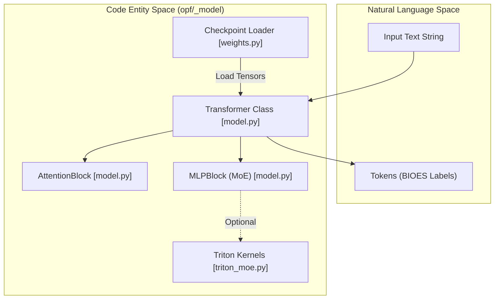
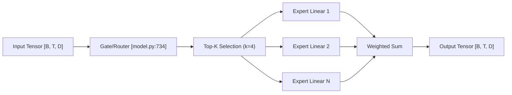

<!-- source: DeepWiki mcp.deepwiki.com · repo openai/privacy-filter · page 2 Model Architecture · fetched 2026-10-26 -->

# Model Architecture

Relevant source files

The following files were used as context for generating this wiki page:

- [README.md](README.md)
- [opf/_model/__init__.py](opf/_model/__init__.py)
- [opf/_model/model.py](opf/_model/model.py)

The OpenAI Privacy Filter (OPF) is a bidirectional token-classification model designed for high-throughput PII detection. Unlike standard autoregressive models that generate text token-by-token, the Privacy Filter processes sequences in a single forward pass to produce a probability distribution over privacy labels for every token [README.md:3-5]().

The model is a pre-norm transformer encoder-style stack [README.md:111]() characterized by three primary architectural features:
1.  **Bidirectional Banded Attention**: A sliding-window attention mechanism that allows tokens to attend to both past and future context within a fixed range.
2.  **Sparse Mixture-of-Experts (MoE)**: Feed-forward blocks where only a subset of "experts" are active for any given token, optimizing the parameter count versus compute cost.
3.  **Token-Classification Head**: A linear layer that maps the final residual stream to the privacy label taxonomy (BIOES-tagged categories).

### System Overview and Code Entities

The following diagram maps the logical components of the Privacy Filter to their specific implementation classes and files.

**Model Component Mapping**

Sources: [opf/_model/model.py:209-239](), [opf/_model/triton_moe.py:1-20](), [opf/_model/weights.py:1-20]()

---

### Transformer Implementation
The core architecture is defined in `opf/_model/model.py`. The `Transformer` class coordinates a sequence of `TransformerBlock` instances, each containing an `AttentionBlock` and an `MLPBlock` [opf/_model/model.py:933-952]().

*   **Attention**: Uses Grouped-Query Attention (GQA) with 14 query heads and 2 KV heads [README.md:115](). It implements a bidirectional banded attention with a default band size of 128 (257 total context tokens) [README.md:104]().
*   **Positional Embeddings**: Uses Rotary Positional Embeddings (RoPE) with YaRN scaling [opf/_model/model.py:465-470]().
*   **Normalization**: Employs `RMSNorm` for pre-normalization of the residual stream [opf/_model/model.py:441-445]().

For a deep dive into the layer implementation, see **[Transformer Implementation](#2.1)**.

Sources: [README.md:100-120](), [opf/_model/model.py:441-550]()

---

### Sparse Mixture-of-Experts (MoE)
The feed-forward network (FFN) in each block is a Sparse MoE layer (`MLPBlock`). Instead of a dense linear layer, it contains 128 experts, with only the top 4 experts activated per token via a routing mechanism [README.md:116]().

**MoE Data Flow**

Sources: [README.md:116-117](), [opf/_model/model.py:730-760]()

To optimize performance, the MoE implementation can utilize custom Triton kernels for grouped matrix multiplication. For details on these kernels and their fallback paths, see **[Triton MoE Kernels](#2.2)**.

---

### Checkpoint Loading and Weights
The model weights are stored in the `safetensors` format. The loading process involves mapping on-disk tensor names to the internal class attributes using a `PARAM_NAME_MAP` [opf/_model/weights.py:112-115]().

*   **Dequantization**: The model supports MXFP4 dequantization during the loading phase to handle compressed weights [opf/_model/weights.py:284-288]().
*   **Precision**: Supports `bf16` and `fp32` parameter dtypes [opf/_model/model.py:25-30]().

For details on the serialization format and weight mapping, see **[Checkpoint Loading and Weight Serialization](#2.3)**.

Sources: [opf/_model/weights.py:112-150](), [opf/_model/model.py:25-41]()

---

### Token-Classification Head
The final layer of the model is a linear head that projects the `hidden_size` (640) to the `num_labels` required by the taxonomy [README.md:117](). 

For the standard v7 taxonomy, this results in 33 output logits per token:
*   1 Background class (`O`).
*   8 Privacy categories (e.g., `private_person`, `account_number`).
*   4 BIOES boundary markers per category (Begin, Inside, End, Single).

Total: $1 + (8 \times 4) = 33$ logits [README.md:134]().

Sources: [README.md:123-135](), [opf/_model/model.py:954-958]()

---

