# Page: Overview

# Overview

<details>
<summary>Relevant source files</summary>

The following files were used as context for generating this wiki page:

- [.gitignore](.gitignore)
- [LICENSE](LICENSE)
- [README.md](README.md)
- [SECURITY.md](SECURITY.md)

</details>


The OpenAI Privacy Filter (OPF) is a specialized bidirectional token-classification system designed for high-throughput detection and redaction of personally identifiable information (PII) [README.md:1-5](). Unlike standard autoregressive models that generate text, OPF labels an entire input sequence in a single forward pass and decodes coherent spans using a constrained Viterbi procedure [README.md:5-6]().

The system is built on a 1.5B parameter transformer architecture with a sparse Mixture-of-Experts (MoE) backbone, where only 50M parameters are active per token [README.md:10-11](). It is released under the Apache 2.0 license for on-premises deployment and fine-tuning [README.md:9-12]().

## Key Capabilities

*   **Bidirectional Context:** Uses bidirectional banded attention (window size 128) to consider both preceding and succeeding context for every token [README.md:103-105]().
*   **Privacy Taxonomy:** Detects 8 core categories: `account_number`, `private_address`, `private_email`, `private_person`, `private_phone`, `private_url`, `private_date`, and `secret` [README.md:123-132]().
*   **High Throughput:** Single-pass labeling and sparse MoE layers enable fast inference on both GPU and CPU [README.md:10-12, 119-121]().
*   **Flexible Deployment:** Supports a CLI for file processing, a Python API for integration, and a fine-tuning pipeline for domain adaptation [README.md:29-84]().

## System Architecture at a Glance

The following diagram illustrates how the high-level privacy filtering request flows through the core code entities.

### Text to Redacted Span Flow
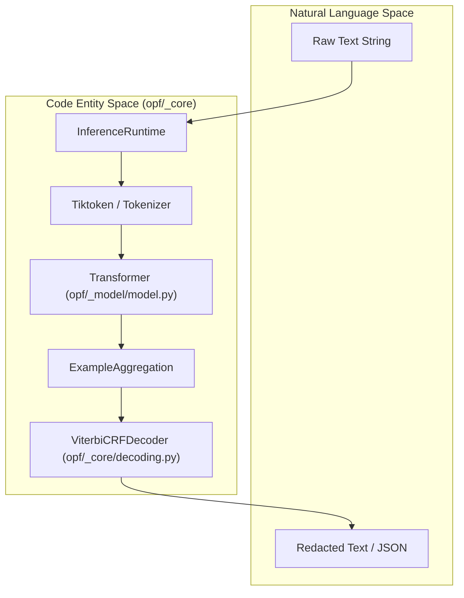
Sources: [README.md:87-93](), [opf/_core/runtime.py:1-50](), [opf/_core/decoding.py:1-20]()

## Core Components

The repository is organized into several functional modules that handle the lifecycle of a privacy model, from weight loading to final span post-processing.

| Module | Responsibility | Key Code Entities |
| :--- | :--- | :--- |
| **Model** | Transformer architecture & MoE | `Transformer`, `MLPBlock`, `AttentionBlock` |
| **Core** | Runtime & Sequence Decoding | `InferenceRuntime`, `ViterbiCRFDecoder`, `predict_text` |
| **CLI** | User interface & Rendering | `opf redact`, `opf eval`, `opf train` |
| **Common** | Shared logic & Taxonomy | `label_space.py`, `BIOES` markers |

### Model & Runtime Relationship
This diagram bridges the system configuration to the specific implementation classes used during inference.

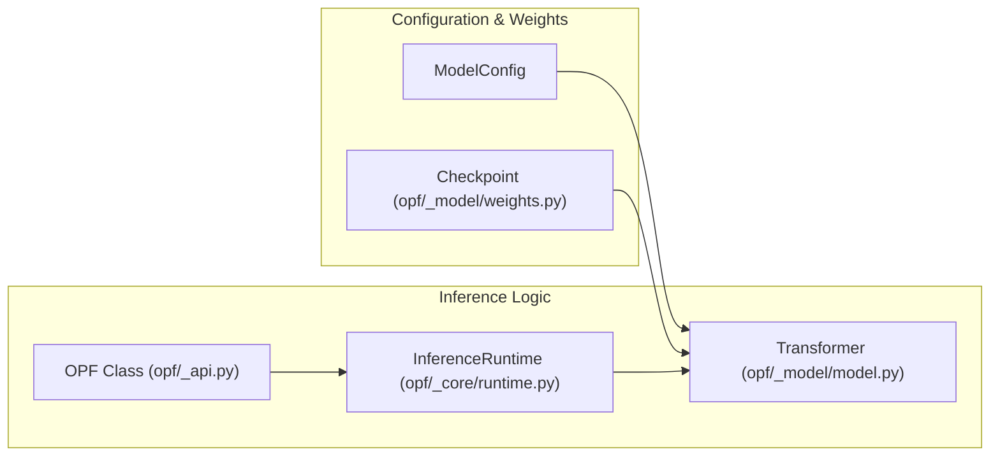
Sources: [README.md:93-94](), [opf/_model/model.py:1-100](), [opf/_api.py:1-30]()

## Navigating the Wiki

This wiki is structured to guide you from basic usage to deep technical customization:

*   **[Getting Started](#1.1)**: Instructions for installing the package via `pip`, managing the `OPF_CHECKPOINT` environment variable, and running your first redaction command [README.md:23-55]().
*   **[Repository Structure](#1.2)**: A detailed map of the directory tree, explaining the purpose of internal modules like `opf/_core` and `opf/_model` [README.md:86-98]().
*   **Model Architecture**: Deep dive into the transformer implementation, including the bidirectional banded attention and the Triton-optimized MoE kernels.
*   **Inference Pipeline**: Detailed walkthrough of how text is windowed, scored, and decoded using Viterbi constraints.
*   **Label Space and Taxonomy**: Explanation of the BIOES (Begin, Inside, Outside, End, Single) labeling scheme and how to define custom categories [README.md:109-110, 134-135]().
*   **CLI and Python API**: Reference for the `opf` command-line tool and the `OPF` Python class for programmatic use [README.md:87-89]().
*   **Evaluation**: How to measure model performance using the `opf eval` suite and synthetic datasets [README.md:67-75]().
*   **Fine-tuning**: Guide to the supervised fine-tuning pipeline for adapting the model to your specific data [README.md:77-84]().

Sources: [README.md:15-100]()

---

# Page: Getting Started

# Getting Started

<details>
<summary>Relevant source files</summary>

The following files were used as context for generating this wiki page:

- [README.md](README.md)
- [opf/__main__.py](opf/__main__.py)
- [opf/_common/checkpoint_download.py](opf/_common/checkpoint_download.py)
- [opf/_common/constants.py](opf/_common/constants.py)
- [opf/_common/env.py](opf/_common/env.py)
- [pyproject.toml](pyproject.toml)

</details>


The OpenAI Privacy Filter (OPF) is a bidirectional token-classification system designed for high-throughput PII detection and masking. This page covers the initial setup, installation, and first-run procedures for both the CLI and Python interfaces.

## Installation and Hardware Requirements

OPF is designed to be lightweight, running efficiently on both consumer laptops and server-grade hardware.

### Hardware Requirements
*   **Memory**: The model contains approximately 1.5B total parameters but uses a Sparse Mixture-of-Experts (MoE) architecture with only 50M active parameters per token [README.md:10-10]().
*   **Compute**: Supports both **CPU** and **GPU** (CUDA) execution [README.md:39-43]().
*   **Python Version**: Requires Python >= 3.10 [pyproject.toml:10-10]().

### Pip Install
Install the package in editable mode to make the `opf` command available in your environment:

```bash
pip install -e .
```

This registers the `opf` entry point [pyproject.toml:21-21]() which maps to the `main` function in `opf/__main__.py` [opf/__main__.py:186-209]().

**Sources:** [README.md:10-43](), [pyproject.toml:10-21](), [opf/__main__.py:186-209]()

---

## Checkpoint Management

OPF requires a model checkpoint directory containing `config.json` and `.safetensors` weight files [opf/_common/checkpoint_download.py:27-38]().

### Environment Variables and Paths
The system resolves the model location using the following priority:
1.  The `--checkpoint` CLI flag [README.md:45-49]().
2.  The `OPF_CHECKPOINT` environment variable [opf/_common/constants.py:7-8]().
3.  The default local path: `~/.opf/privacy_filter` [opf/_common/constants.py:10-11]().

### Automatic Download Behavior
If no checkpoint is found at the default path, OPF attempts to download the official weights from HuggingFace (`openai/privacy-filter`) [opf/_common/checkpoint_download.py:11-11]().

**Download Flow:**
1.  **Detection**: `ensure_default_checkpoint()` checks for the existence of the directory [opf/_common/checkpoint_download.py:90-95]().
2.  **Download**: Uses `huggingface_hub.snapshot_download` to fetch the `original/` subtree [opf/_common/checkpoint_download.py:116-121]().
3.  **Promotion**: Moves files from the `original/` subdirectory up to the root checkpoint folder via `_promote_original_subtree()` [opf/_common/checkpoint_download.py:72-87]().

### Checkpoint Resolution Logic
The following diagram illustrates how the `opf` CLI determines which model to load.

**Model Discovery Flow**
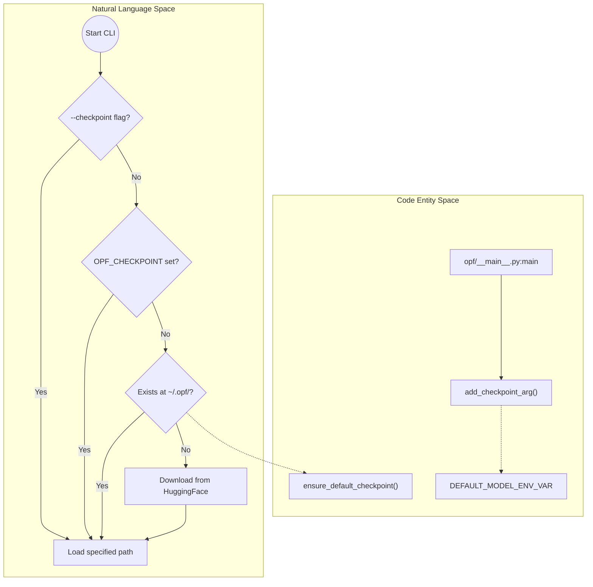

**Sources:** [README.md:31-49](), [opf/_common/checkpoint_download.py:11-133](), [opf/_common/constants.py:7-11](), [opf/__main__.py:55-55]()

---

## First-Run Examples

The `opf` CLI supports three primary subcommands: `redact` (default), `eval`, and `train` [opf/__main__.py:14-25]().

### Basic Redaction
To redact a single string:
```bash
opf "Contact Alice at alice@example.com"
```

### Input Methods
The CLI provides flexible ways to ingest data via `iter_inputs()` [opf/_cli/args.py:10-10]():
*   **Positional Argument**: `opf "text"` [opf/__main__.py:50-54]().
*   **File Input**: `opf -f document.txt` [opf/__main__.py:68-77]().
*   **Standard Input (Pipe)**: `cat file.txt | opf` [README.md:59-61]().
*   **Interactive Mode**: Running `opf` without arguments starts a REPL session [README.md:63-63]().

### Redaction Output Modes
The model supports two primary output formats via the `--format` flag [opf/__main__.py:62-67]():

| Format | Output Type | Use Case |
| :--- | :--- | :--- |
| `text` | Plain String | Quick CLI pipes and human reading. |
| `json` | Structured Object | Programmatic integration; includes `detected_spans` and `latency_ms`. |

**Sources:** [README.md:31-63](), [opf/__main__.py:14-82](), [opf/_common/constants.py:13-14]()

---

## Execution Pipeline

When a redaction command is issued, the system initializes an `OPF` API instance and processes the text through the runtime stack.

**Data Flow: CLI to Model**
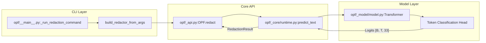

**Sources:** [opf/__main__.py:96-160](), [README.md:100-134](), [opf/_api.py:88-118]()

---

# Page: Repository Structure

# Repository Structure

<details>
<summary>Relevant source files</summary>

The following files were used as context for generating this wiki page:

- [README.md](README.md)
- [examples/data/README.md](examples/data/README.md)
- [examples/scripts/README.md](examples/scripts/README.md)
- [opf/__init__.py](opf/__init__.py)

</details>


This page provides a technical map of the `openai/privacy-filter` repository. It outlines the modular organization of the codebase, detailing how specific directories and modules interact to facilitate inference, evaluation, and fine-tuning of the Privacy Filter model.

## Purpose and Scope

The repository is structured to separate the core transformer implementation from the high-level runtime logic and the CLI interfaces. This separation allows developers to use the Privacy Filter as a standalone library (`opf._api`), a command-line tool (`opf._cli`), or a training framework (`opf._train`). The architecture follows a "core-out" design where `_core` and `_model` contain the fundamental logic, while other modules build upon them.

## Top-Level Structure

The following diagram illustrates the relationship between the major modules and the data flow from input text to redacted output or training artifacts.

**System Architecture and Module Interaction**
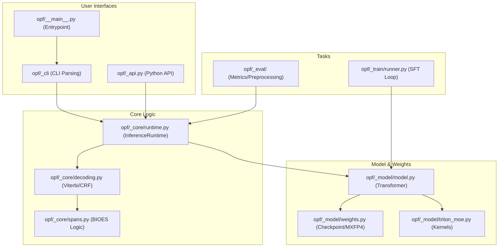
**Sources:** [README.md:86-98](), [opf/__init__.py:1-43]()

---

## Core Modules

### `opf/_model`
This module contains the structural definition of the Privacy Filter transformer. It is a bidirectional token-classification model derived from an autoregressive base.

*   **`model.py`**: Defines the `Transformer` class and its constituent blocks: `AttentionBlock` (supporting bidirectional banded attention) and `MLPBlock` (implementing the Sparse MoE). [opf/_model/model.py:1-10]().
*   **`weights.py`**: Handles the `Checkpoint` class, which manages loading `safetensors` and dequantizing weights from MXFP4 format. [opf/_model/weights.py:1-20]().
*   **`triton_moe.py`**: Contains optimized Triton kernels for the Mixture-of-Experts (MoE) layers, specifically `grouped_matmul` and `grouped_swiglu`. [opf/_model/triton_moe.py:1-15]().

### `opf/_core`
The "glue" layer that manages the inference lifecycle and sequence decoding.

*   **`runtime.py`**: Implements the `InferenceRuntime`. This class is responsible for loading the model and tokenizer, and executing the `predict_text` method which handles windowed inference and score aggregation via `ExampleAggregation`. [opf/_core/runtime.py:1-50]().
*   **`decoding.py`**: Contains the `ViterbiCRFDecoder`. It enforces BIOES constraints on the model's logit outputs to ensure coherent span detection. [opf/_core/decoding.py:1-30]().
*   **`spans.py`**: Provides utilities for converting raw token-level labels into `DetectedSpan` objects, including character offset mapping and overlapping span resolution. [opf/_core/spans.py:1-40]().

**Sources:** [README.md:90-93](), [opf/_core/runtime.py:1-50]()

---

## Task-Specific Modules

### `opf/_eval`
The evaluation suite for measuring model performance on labeled datasets.

*   **`data.py` & `preprocess.py`**: Handle loading JSONL datasets and converting them into `PreparedTokenizedExample` formats suitable for the model. [opf/_eval/preprocess.py:1-25]().
*   **`metrics.py`**: Implements `compute_metrics()`, calculating precision, recall, and F1/F2 scores at both the token and span levels. [opf/_eval/metrics.py:1-35]().

### `opf/_train`
The Supervised Fine-Tuning (SFT) implementation.

*   **`runner.py`**: Contains the main training loop (`_train_one_epoch`). It supports remapping the output head for custom label spaces via `_rebuild_output_head_for_target_labels` and manages AdamW optimization. [opf/_train/runner.py:1-60]().

**Sources:** [README.md:91-92](), [opf/_train/runner.py:1-60]()

---

## User Interfaces and Examples

### `opf/_cli` and `opf/_api.py`
The package provides two primary ways to interact with the model:
1.  **CLI**: Managed by `opf/_cli/` and invoked via `opf/__main__.py`. It supports `redact`, `eval`, and `train` subcommands. [README.md:29-84]().
2.  **Python API**: The `OPF` class in `opf/_api.py` provides a high-level interface for developers to integrate redaction into their own Python applications. [opf/__init__.py:24-42]().

### `examples/` Tree
The `examples/` directory provides resources for testing and demonstrating fine-tuning capabilities.

*   **`examples/data/`**: Contains synthetic `.jsonl` files for evaluation and training demos. [examples/data/README.md:1-12]().
*   **`examples/scripts/finetuning/`**: Includes shell scripts like `finetune_secret_demo.sh` and `finetune_custom_label_demo.sh` which serve as end-to-end templates for adapting the model to new data or taxonomies. [examples/scripts/README.md:1-19]().

**Sources:** [README.md:94-98](), [examples/scripts/README.md:1-19]()

---

## Code Entity Mapping

The following diagram maps the logical operations of the system to specific classes and functions within the repository.

**Inference Logic to Code Entity Map**
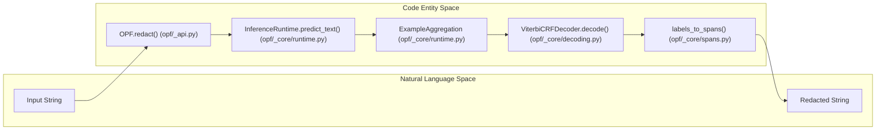

**Sources:** [opf/_api.py:1-50](), [opf/_core/runtime.py:1-100](), [opf/_core/decoding.py:1-50](), [opf/_core/spans.py:1-50]()

---

# Page: Model Architecture

# Model Architecture

<details>
<summary>Relevant source files</summary>

The following files were used as context for generating this wiki page:

- [README.md](README.md)
- [opf/_model/__init__.py](opf/_model/__init__.py)
- [opf/_model/model.py](opf/_model/model.py)

</details>


The OpenAI Privacy Filter (OPF) is a bidirectional token-classification model designed for high-throughput PII detection. Unlike standard autoregressive models that generate text token-by-token, the Privacy Filter processes sequences in a single forward pass to produce a probability distribution over privacy labels for every token [README.md:3-5]().

The model is a pre-norm transformer encoder-style stack [README.md:111]() characterized by three primary architectural features:
1.  **Bidirectional Banded Attention**: A sliding-window attention mechanism that allows tokens to attend to both past and future context within a fixed range.
2.  **Sparse Mixture-of-Experts (MoE)**: Feed-forward blocks where only a subset of "experts" are active for any given token, optimizing the parameter count versus compute cost.
3.  **Token-Classification Head**: A linear layer that maps the final residual stream to the privacy label taxonomy (BIOES-tagged categories).

### System Overview and Code Entities

The following diagram maps the logical components of the Privacy Filter to their specific implementation classes and files.

**Model Component Mapping**
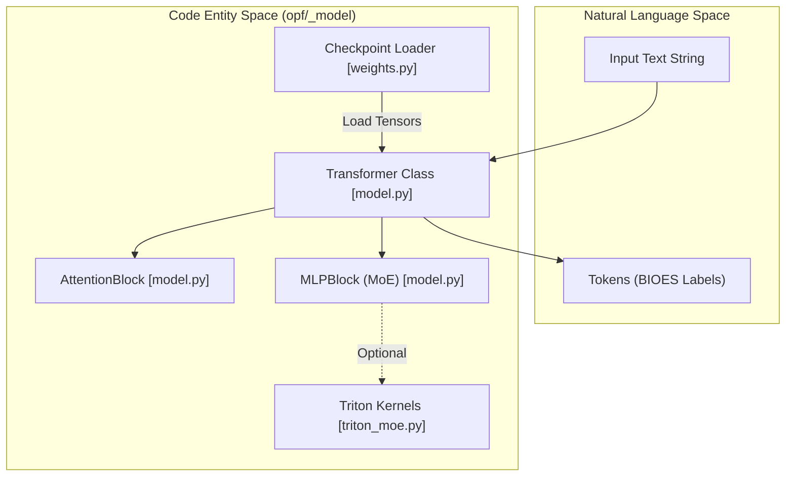
Sources: [opf/_model/model.py:209-239](), [opf/_model/triton_moe.py:1-20](), [opf/_model/weights.py:1-20]()

---

### Transformer Implementation
The core architecture is defined in `opf/_model/model.py`. The `Transformer` class coordinates a sequence of `TransformerBlock` instances, each containing an `AttentionBlock` and an `MLPBlock` [opf/_model/model.py:933-952]().

*   **Attention**: Uses Grouped-Query Attention (GQA) with 14 query heads and 2 KV heads [README.md:115](). It implements a bidirectional banded attention with a default band size of 128 (257 total context tokens) [README.md:104]().
*   **Positional Embeddings**: Uses Rotary Positional Embeddings (RoPE) with YaRN scaling [opf/_model/model.py:465-470]().
*   **Normalization**: Employs `RMSNorm` for pre-normalization of the residual stream [opf/_model/model.py:441-445]().

For a deep dive into the layer implementation, see **[Transformer Implementation](#2.1)**.

Sources: [README.md:100-120](), [opf/_model/model.py:441-550]()

---

### Sparse Mixture-of-Experts (MoE)
The feed-forward network (FFN) in each block is a Sparse MoE layer (`MLPBlock`). Instead of a dense linear layer, it contains 128 experts, with only the top 4 experts activated per token via a routing mechanism [README.md:116]().

**MoE Data Flow**
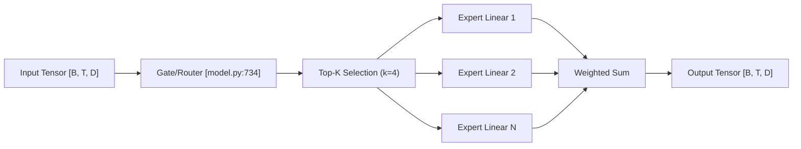
Sources: [README.md:116-117](), [opf/_model/model.py:730-760]()

To optimize performance, the MoE implementation can utilize custom Triton kernels for grouped matrix multiplication. For details on these kernels and their fallback paths, see **[Triton MoE Kernels](#2.2)**.

---

### Checkpoint Loading and Weights
The model weights are stored in the `safetensors` format. The loading process involves mapping on-disk tensor names to the internal class attributes using a `PARAM_NAME_MAP` [opf/_model/weights.py:112-115]().

*   **Dequantization**: The model supports MXFP4 dequantization during the loading phase to handle compressed weights [opf/_model/weights.py:284-288]().
*   **Precision**: Supports `bf16` and `fp32` parameter dtypes [opf/_model/model.py:25-30]().

For details on the serialization format and weight mapping, see **[Checkpoint Loading and Weight Serialization](#2.3)**.

Sources: [opf/_model/weights.py:112-150](), [opf/_model/model.py:25-41]()

---

### Token-Classification Head
The final layer of the model is a linear head that projects the `hidden_size` (640) to the `num_labels` required by the taxonomy [README.md:117](). 

For the standard v7 taxonomy, this results in 33 output logits per token:
*   1 Background class (`O`).
*   8 Privacy categories (e.g., `private_person`, `account_number`).
*   4 BIOES boundary markers per category (Begin, Inside, End, Single).

Total: $1 + (8 \times 4) = 33$ logits [README.md:134]().

Sources: [README.md:123-135](), [opf/_model/model.py:954-958]()

---

# Page: Transformer Implementation

# Transformer Implementation

<details>
<summary>Relevant source files</summary>

The following files were used as context for generating this wiki page:

- [opf/_model/__init__.py](opf/_model/__init__.py)
- [opf/_model/model.py](opf/_model/model.py)

</details>


The OpenAI Privacy Filter (OPF) utilizes a specialized Transformer architecture designed for high-throughput token classification. The implementation in `opf/_model/model.py` features a bidirectional banded attention mechanism and a sparse Mixture of Experts (MoE) feed-forward network.

## Architecture Overview

The model is a transformer-based encoder that processes token sequences to produce logit distributions over privacy labels (e.g., BIOES tags). It deviates from standard causal transformers by employing bidirectional context within a fixed sliding window.

### Code-to-System Mapping

The following diagram maps the high-level transformer components to their specific class implementations within `opf/_model/model.py`.

**Transformer Entity Map**
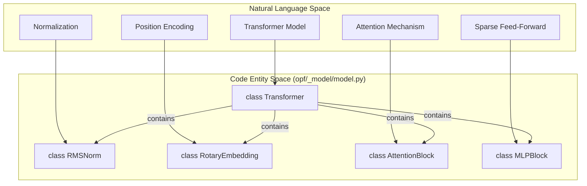
**Sources:** [opf/_model/model.py:209-668]()

---

## Model Configuration

The `ModelConfig` dataclass defines the structural hyperparameters of the model. It includes standard transformer parameters (layers, heads, hidden size) alongside MoE-specific and attention-window settings.

| Parameter | Description |
| :--- | :--- |
| `num_hidden_layers` | Total number of transformer blocks. |
| `num_experts` | Total number of experts in the MoE layers. |
| `experts_per_token` | Number of experts active per token (Top-K routing). |
| `sliding_window` | The total attention bandwidth (left + right + 1). |
| `bidirectional_context` | Must be `True` for OPF checkpoints. |
| `param_dtype` | Resolved via `_resolve_param_dtype` (typically `bf16`). |

**Sources:** [opf/_model/model.py:209-247](), [opf/_model/model.py:33-40]()

---

## Core Components

### RMSNorm
The model uses Root Mean Square Layer Normalization (`RMSNorm`) to stabilize activations. It applies a learnable weight `self.weight` to the normalized input.
**Sources:** [opf/_model/model.py:284-301]()

### Rotary Embedding (YaRN Scaling)
The `RotaryEmbedding` class implements position information using Rotary Positional Embeddings (RoPE). It supports **YaRN (Yet another RoPE extensioN)** scaling to handle long context lengths by interpolating frequencies based on `rope_scaling_factor`, `rope_ntk_alpha`, and `rope_ntk_beta`.
**Sources:** [opf/_model/model.py:304-368]()

### AttentionBlock (GQA & Banded Attention)
The `AttentionBlock` implements Grouped-Query Attention (GQA) and a bidirectional sliding window.

*   **GQA:** Uses `num_attention_heads` for queries and a smaller `num_key_value_heads` for keys/values to reduce memory overhead.
*   **Banded Attention:** Instead of a full $N \times N$ matrix, it computes attention within a window defined by `bidirectional_left_context` and `bidirectional_right_context`.
*   **Sink Logits:** A unique feature where a "sink" logit is prepended to the attention scores, allowing tokens to "attend to nothing" if the context is irrelevant.

**Sources:** [opf/_model/model.py:371-512]()

### MLPBlock (Sparse MoE)
The `MLPBlock` provides the sparse feed-forward capacity.

1.  **Routing:** A `gate` linear layer projects the input to expert logits. `torch.topk` selects the top `experts_per_token`.
2.  **Activation:** Uses **SwiGLU** (or GeGLU if configured).
3.  **Kernels:** If `OPF_MOE_TRITON` is enabled, it uses `grouped_matmul` and `grouped_swiglu_w2` for high-performance execution. Otherwise, it falls back to a pure PyTorch `_batched_linear_with_parity` implementation.

**Sources:** [opf/_model/model.py:515-603](), [opf/_model/model.py:53-67]()

---

## Transformer Forward Pass

The `Transformer` class coordinates the data flow from raw token IDs to label logits.

**Data Flow Diagram**
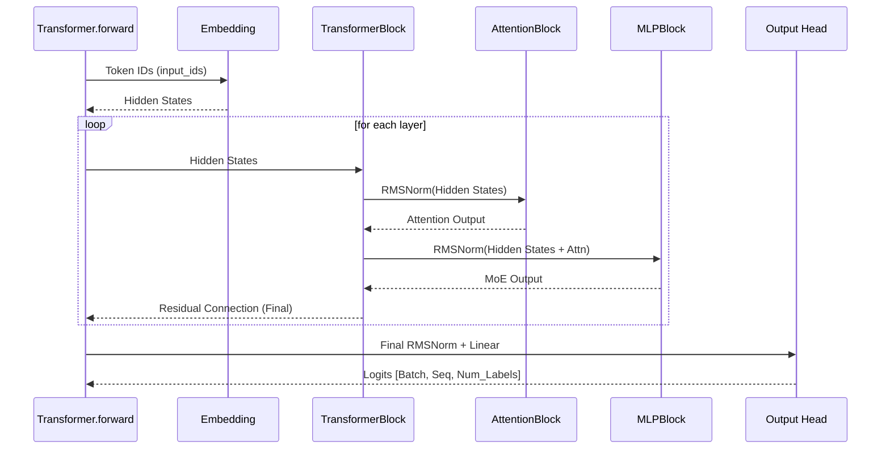

### Implementation Details
*   **Embedding:** Token IDs are mapped via `self.tok_embeddings` [opf/_model/model.py:648]().
*   **Layer Loop:** The model iterates through `self.layers`, where each `TransformerBlock` encapsulates one `AttentionBlock` and one `MLPBlock` [opf/_model/model.py:651-654]().
*   **Output Head:** The final hidden state is normalized and projected to the label space using `self.output` [opf/_model/model.py:663-668]().

**Sources:** [opf/_model/model.py:606-668]()

---

## Checkpoint Loading
The `Transformer.from_checkpoint` method facilitates model instantiation. It:
1.  Loads the `config.json` and validates it against the `REQUIRED_ENCODER_CONFIG_KEYS`.
2.  Initializes the `Transformer` on the `meta` device to save memory.
3.  Uses the `Checkpoint` class to load and dequantize (if necessary) weights into the model.

**Sources:** [opf/_model/model.py:612-642](), [opf/_model/model.py:106-161]()

---

# Page: Triton MoE Kernels

# Triton MoE Kernels

<details>
<summary>Relevant source files</summary>

The following files were used as context for generating this wiki page:

- [opf/_model/model.py](opf/_model/model.py)
- [opf/_model/triton_moe.py](opf/_model/triton_moe.py)

</details>


The OpenAI Privacy Filter (OPF) uses a Sparse Mixture of Experts (MoE) architecture. To optimize the performance of these MoE layers on NVIDIA GPUs, the codebase provides optional high-performance kernels written in Triton. These kernels specifically target the bottleneck of MoE inference: performing many small, expert-specific matrix multiplications on non-contiguous token assignments.

## Overview and Activation

The Triton kernels are defined in `opf/_model/triton_moe.py` and are used within the `MLPBlock` of the transformer. They are activated only when the environment variable `OPF_MOE_TRITON` is set to `true` [opf/_model/model.py:284-285]().

If Triton is unavailable (e.g., the `triton` package is not installed or the environment variable is not set), the model transparently falls back to a pure-PyTorch implementation using `torch.bmm` [opf/_model/model.py:53-67]().

### Data Flow: Natural Language to Kernel Space

The following diagram illustrates how input tokens are routed through the MoE system into the specialized Triton kernels.

**MoE Kernel Execution Path**
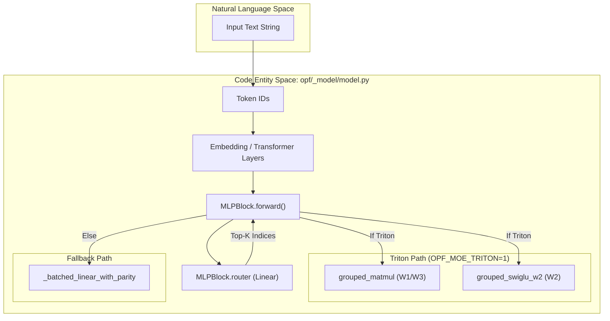
**Sources:** [opf/_model/model.py:247-320](), [opf/_model/triton_moe.py:1-9]()

---

## Grouped Matrix Multiplication (`grouped_matmul`)

The `grouped_matmul` kernel handles the first stage of the MoE projection (weights $W_1$ and $W_3$). In a standard transformer, this would be a single large GEMM. In MoE, tokens are scattered across different experts. This kernel avoids the memory overhead of padding or the latency of launching hundreds of individual CUDA kernels by processing all experts in a single "grouped" launch.

### Implementation Details
- **Function:** `grouped_matmul(a_packed, weights, offsets, lengths, ...)` [opf/_model/triton_moe.py:82-89]()
- **Input `a_packed`**: A 2D tensor `[M, K]` containing the tokens assigned to all experts, sorted/packed by expert ID [opf/_model/triton_moe.py:91]().
- **Weights**: A 3D tensor `[E, K, N]` where $E$ is the number of experts [opf/_model/triton_moe.py:97]().
- **Tiling**: The kernel uses a 3D grid `(BLOCK_M, BLOCK_N, E)` where the third dimension corresponds to the expert ID [opf/_model/triton_moe.py:119]().

**Sources:** [opf/_model/triton_moe.py:11-80](), [opf/_model/triton_moe.py:82-142]()

---

## Fused SwiGLU Kernel (`grouped_swiglu_w2`)

The `grouped_swiglu_w2` kernel is a specialized fusion. In the Privacy Filter architecture, the MoE block uses a SwiGLU activation. This kernel performs three operations in one:
1. **SwiGLU Activation**: Applies $x \cdot \text{sigmoid}(\alpha \cdot x) \cdot (y + 1)$ to the intermediate expert outputs [opf/_model/triton_moe.py:221]().
2. **Clamping**: Limits activation values based on `swiglu_limit` to maintain numerical stability [opf/_model/triton_moe.py:215-217]().
3. **Output Projection ($W_2$)**: Multiplies the activated values by the expert's $W_2$ weight matrix [opf/_model/triton_moe.py:235]().

### Kernel Logic Association
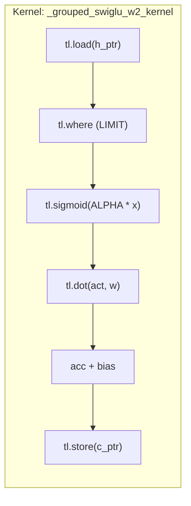
**Sources:** [opf/_model/triton_moe.py:146-246]()

---

## Integration in `MLPBlock`

The `MLPBlock` class in `opf/_model/model.py` manages the transition between PyTorch tensors and these Triton kernels.

### Execution Logic
1. **Routing**: The router determines which tokens go to which experts [opf/_model/model.py:269-270]().
2. **Packing**: Tokens are grouped by expert.
3. **Kernel Dispatch**:
    - If `use_triton` is true, it calls `grouped_matmul` for the up-projection and `grouped_swiglu_w2` for the combined activation and down-projection [opf/_model/model.py:287-302]().
    - It uses `alpha=1.702` (standard for GeGLU/SwiGLU variants in this model) and a `swiglu_limit` (default `7.0`) [opf/_model/model.py:220](), [opf/_model/triton_moe.py:256]().

| Feature | Triton Path | Fallback Path |
| :--- | :--- | :--- |
| **Activation** | Fused in `grouped_swiglu_w2` | Manual `F.silu` or `F.gelu` [opf/_model/model.py:311]() |
| **MatMul** | Grouped Kernel [opf/_model/triton_moe.py:82]() | `torch.bmm` [opf/_model/model.py:64]() |
| **Memory** | Efficient (Packed) | Requires expert-dimension expansion [opf/_model/model.py:62-63]() |

**Sources:** [opf/_model/model.py:247-320](), [opf/_model/triton_moe.py:248-260]()

---

# Page: Checkpoint Loading and Weight Serialization

# Checkpoint Loading and Weight Serialization

<details>
<summary>Relevant source files</summary>

The following files were used as context for generating this wiki page:

- [opf/_model/model.py](opf/_model/model.py)
- [opf/_model/weights.py](opf/_model/weights.py)

</details>


The OpenAI Privacy Filter (OPF) uses the `safetensors` format for high-performance, memory-mapped weight loading and serialization. The system supports both standard `bfloat16`/`float32` tensors and a specialized **MXFP4** dequantization path for compressed model weights.

## The Checkpoint Class

The `Checkpoint` class in `opf/_model/weights.py` serves as the primary interface for accessing model parameters from disk. It abstracts away the physical sharding of `.safetensors` files and handles the translation between logical model parameter names and their serialized counterparts [opf/_model/weights.py:97-101]().

### Initialization and Indexing
Upon initialization, the class scans the provided directory for all files with the `.safetensors` extension [opf/_model/weights.py:110-114](). It builds a global mapping of tensor names to their respective file paths to support efficient retrieval [opf/_model/weights.py:116-128]().

### Parameter Resolution Logic
When `get(name)` is called, the class follows a specific resolution hierarchy:
1. **Name Mapping**: It checks `PARAM_NAME_MAP` to see if the logical name requires translation [opf/_model/weights.py:132]().
2. **Hybrid Loading**: If a parameter is mapped to a tuple (indicating a potential MXFP4 quantized pair), it first looks for a fused `bf16` version on disk. If absent, it triggers the `_get_mxfp4_tensor` dequantization routine [opf/_model/weights.py:133-140]().
3. **Direct Loading**: If no mapping exists or it is a simple string mapping, it loads the raw tensor via `safe_open` [opf/_model/weights.py:155-163]().

**Sources:** [opf/_model/weights.py:97-163]()

## Weight Translation (PARAM_NAME_MAP)

The OPF model implementation uses a standardized naming convention (e.g., `block.N.mlp.mlp1_weight`), but the on-disk checkpoints often use different keys, particularly for Mixture-of-Experts (MoE) layers and quantized formats.

`PARAM_NAME_MAP` defines these translations:
* **MLP Biases**: Logical `mlp1_bias` maps to `swiglu.bias` and `mlp2_bias` maps to `out.bias` [opf/_model/weights.py:33-41]().
* **Quantized Weights**: Logical weights like `mlp1_weight` are mapped to a tuple containing `.blocks` and `.scales` keys [opf/_model/weights.py:35-48]().

### Logical to Physical Name Mapping
Title: Weight Name Translation Flow
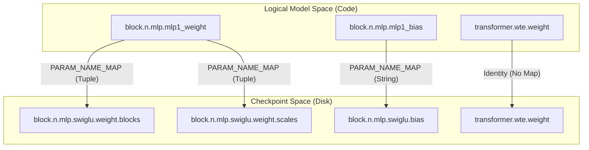
**Sources:** [opf/_model/weights.py:32-49](), [opf/_model/weights.py:52-59]()

## MXFP4 Dequantization

OPF supports loading weights compressed using Microscaling Formats (MX). Specifically, it implements dequantization for 4-bit floating point values (FP4) with shared exponents.

### Dequantization Process
The `_get_mxfp4_tensor` method reconstructs dense tensors from two components:
1. **Blocks**: The 4-bit nibbles packed into bytes.
2. **Scales**: Exponents used to scale the blocks [opf/_model/weights.py:181-182]().

The implementation uses a Look-Up Table (LUT) defined in `FP4_VALUES` to map 4-bit indices to their floating-point representatives [opf/_model/weights.py:12-29](). The process involves:
* Bit-shifting to extract high and low nibbles [opf/_model/weights.py:206-207]().
* Applying the formula: `value = LUT[nibble] * 2^scale` [opf/_model/weights.py:209-210]().
* Chunked processing to manage memory overhead during reconstruction [opf/_model/weights.py:198-212]().

**Sources:** [opf/_model/weights.py:12-29](), [opf/_model/weights.py:165-212]()

## Serialization and Saving

The serialization path is used primarily during fine-tuning to save updated model weights. This is handled by `save_named_tensors`.

### Data Flow for Saving
1. **Collection**: `_collect_checkpoint_tensors` iterates through the model's `named_parameters()` [opf/_model/weights.py:68-69]().
2. **Name Translation**: It uses `_checkpoint_tensor_name` to revert logical names back to the expected on-disk keys [opf/_model/weights.py:70]().
3. **Normalization**: Tensors are detached, converted to the target `dtype` (usually `bf16`), made contiguous, and moved to CPU [opf/_model/weights.py:71-74]().
4. **Validation**: It ensures no two logical tensors collide on the same checkpoint key [opf/_model/weights.py:75-81]().
5. **Persistence**: The resulting dictionary is written to a single `.safetensors` file using `safetensors.torch.save_file` [opf/_model/weights.py:94]().

### Serialization Entity Mapping
Title: Serialization Data Flow
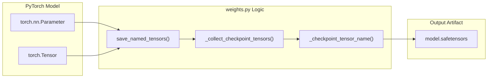
**Sources:** [opf/_model/weights.py:52-60](), [opf/_model/weights.py:62-82](), [opf/_model/weights.py:85-94]()

## Integration with Model Loading

The `Transformer` class in `opf/_model/model.py` utilizes the `Checkpoint` class during its `from_checkpoint` factory method.

1. **Config Validation**: The `config.json` is first validated against the `REQUIRED_ENCODER_CONFIG_KEYS` [opf/_model/model.py:106-162]().
2. **Weight Assignment**: For every module in the transformer (Attention, MLP, MoE), the model calls `checkpoint.get(name)` to retrieve the tensor and loads it into the allocated PyTorch parameters [opf/_model/model.py:1255-1280]().
3. **Dtype Handling**: The `param_dtype` specified in the config determines whether weights are loaded as `bfloat16` or `float32` [opf/_model/model.py:25-40]().

**Sources:** [opf/_model/model.py:25-40](), [opf/_model/model.py:71-94](), [opf/_model/model.py:1255-1280]()

---

# Page: Inference Pipeline

# Inference Pipeline

<details>
<summary>Relevant source files</summary>

The following files were used as context for generating this wiki page:

- [opf/_core/__init__.py](opf/_core/__init__.py)
- [opf/_core/runtime.py](opf/_core/runtime.py)

</details>


The inference pipeline in the OpenAI Privacy Filter (OPF) transforms raw text strings into structured redaction results. This process involves a windowed transformer forward pass, logit aggregation across overlapping segments, and a decoding stage that converts token-level predictions back into character-level spans.

### Pipeline Overview

The pipeline is managed by the `InferenceRuntime` class, which orchestrates the transition from "Natural Language Space" (raw text) to "Code Entity Space" (tensor operations and span objects).

#### High-Level Flow
1.  **Tokenization**: The input text is converted into a sequence of token IDs using `tiktoken`.
2.  **Windowing**: The sequence is sliced into overlapping windows to fit the model's context length (`n_ctx`).
3.  **Forward Pass**: The `Transformer` model generates logits for each token in each window.
4.  **Aggregation**: Logits from overlapping windows are merged back into a single sequence using `ExampleAggregation`.
5.  **Decoding**: A decoder (typically `ViterbiCRFDecoder`) converts logits into a sequence of BIOES labels.
6.  **Span Reconstruction**: Labels are mapped back to character offsets in the original text to produce `DetectedSpan` objects.

### System Architecture: Text to Spans

The following diagram illustrates how internal code entities interact to process a single text input.

**Diagram: Inference Execution Flow**
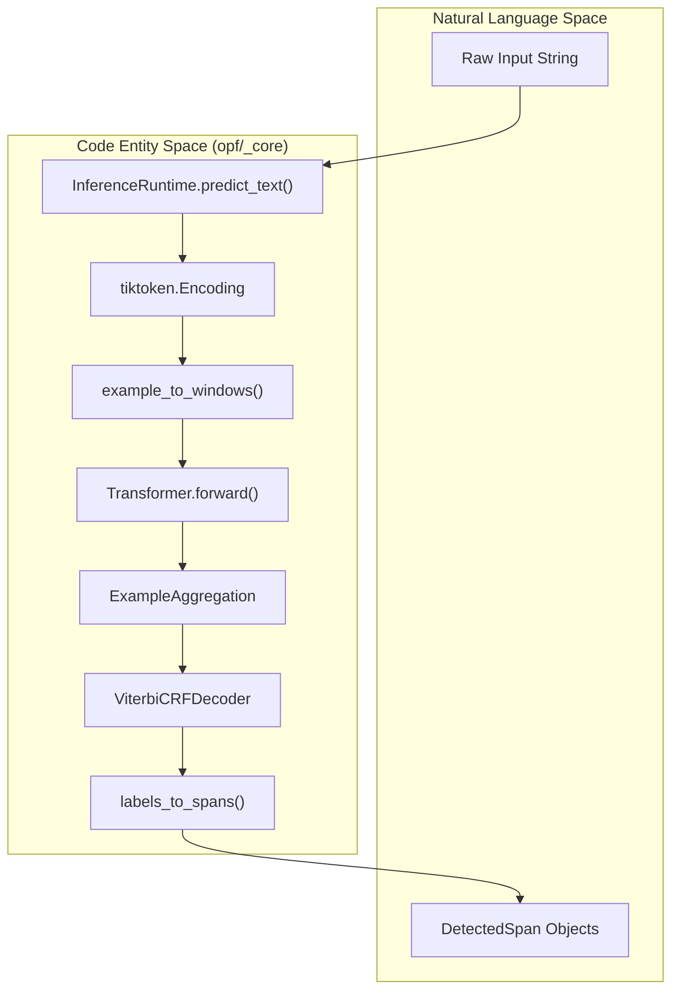
Sources: [opf/_core/runtime.py:43-59](), [opf/_core/runtime.py:236-258](), [opf/_core/sequence_labeling.py:33-38]()

### Runtime and Prediction
The `InferenceRuntime` dataclass serves as the primary entry point for inference. It encapsulates the loaded `Transformer` model, the `tiktoken` encoding, and the `LabelInfo` which defines the target taxonomy (e.g., v4, v7).

When `predict_text` is called, the system performs a windowed inference loop. Because the model uses bidirectional context, windows are typically overlapped to ensure that tokens at the edges of a window benefit from surrounding context. The `ExampleAggregation` class manages these overlapping predictions, ensuring that logits are correctly averaged or selected before decoding begins.

For details, see [Runtime and Prediction](#3.1).

Sources: [opf/_core/runtime.py:43-59](), [opf/_core/runtime.py:236-285](), [opf/_core/sequence_labeling.py:165-192]()

### Sequence Decoding
Once aggregated logits are produced, they must be converted into a discrete sequence of labels (e.g., `B-PERSON`, `I-PERSON`, `O`). The pipeline supports two main decoding modes:
*   **Argmax**: A simple per-token maximum likelihood selection.
*   **Viterbi CRF**: A more robust method that uses transition scores to enforce BIOES constraints (e.g., an `I-` tag cannot follow an `O` tag).

The `ViterbiCRFDecoder` utilizes a `viterbi_calibration.json` file to apply specific biases to start, end, and transition probabilities, allowing the model to be tuned for specific precision/recall operating points.

For details, see [Sequence Decoding](#3.2).

Sources: [opf/_core/decoding.py:100-140](), [opf/_core/runtime.py:261-275]()

### Span Utilities and Offsets
The final stage of the pipeline translates token-level labels back into character-level offsets. This is a non-trivial task due to the way `tiktoken` handles byte-level UTF-8 sequences. 

The `labels_to_spans` function implements a state machine to group BIOES tokens into coherent entities. These are then passed through `token_spans_to_char_spans`, which uses byte-to-character mapping to ensure the redaction spans align perfectly with the original user input, even in the presence of multi-byte characters or whitespace trimming requirements.

For details, see [Span Utilities and Character Offsets](#3.3).

**Diagram: Span Reconstruction Logic**
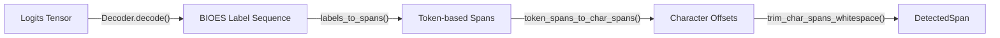
Sources: [opf/_core/spans.py:48-60](), [opf/_core/spans.py:134-150](), [opf/_core/runtime.py:287-305]()

### Inference Configuration Summary

| Component | Responsibility | Key Class/Function |
| :--- | :--- | :--- |
| **Runtime** | Model loading & loop orchestration | `InferenceRuntime` |
| **Windowing** | Splitting long text into chunks | `example_to_windows` |
| **Aggregation** | Merging logits from overlaps | `ExampleAggregation` |
| **Decoding** | Constrained sequence prediction | `ViterbiCRFDecoder` |
| **Alignment** | Mapping tokens to UTF-8 characters | `decode_text_with_offsets` |

Sources: [opf/_core/runtime.py:205-234](), [opf/_core/sequence_labeling.py:132-150](), [opf/_core/spans.py:236-250]()

---

# Page: Runtime and Prediction

# Runtime and Prediction

<details>
<summary>Relevant source files</summary>

The following files were used as context for generating this wiki page:

- [opf/_core/runtime.py](opf/_core/runtime.py)
- [opf/_core/sequence_labeling.py](opf/_core/sequence_labeling.py)

</details>


The Runtime and Prediction module provides the core execution engine for the OpenAI Privacy Filter. It manages the lifecycle of the model, from loading checkpoints and resolving label spaces to performing windowed inference on arbitrary text strings.

## Overview

The primary entry point for inference is `predict_text`, which coordinates tokenization, windowed model passes, and result aggregation. The runtime state is encapsulated in the `InferenceRuntime` dataclass, which ensures that model configurations, tokenizers, and label taxonomies remain synchronized during the prediction process.

### Key Data Structures

| Class | Description | File |
| :--- | :--- | :--- |
| `InferenceRuntime` | A frozen dataclass containing the loaded `Transformer` model, `tiktoken` encoding, and `LabelInfo` metadata. | [opf/_core/runtime.py:43-59]() |
| `DetectedSpan` | Represents a single identified entity with character offsets, label, and a display placeholder. | [opf/_core/runtime.py:62-70]() |
| `PredictionResult` | The final output of a prediction call, containing the original text and a tuple of `DetectedSpan` objects. | [opf/_core/runtime.py:73-79]() |
| `ExampleAggregation` | A helper class used to accumulate log-probabilities and token metadata across overlapping inference windows. | [opf/_core/sequence_labeling.py:51-58]() |

**Sources:** [opf/_core/runtime.py:42-80](), [opf/_core/sequence_labeling.py:50-59]()

---

## Runtime Initialization

Loading the runtime involves validating the checkpoint directory, resolving the transformer configuration, and setting up the label space.

### Checkpoint Validation and Loading
The `load_inference_runtime` function performs the following steps:
1. **Directory Validation**: Ensures `config.json` and at least one `.safetensors` file exist [opf/_core/runtime.py:166-179]().
2. **Context Resolution**: Determines `n_ctx` by checking the override, then the checkpoint config fields (`default_n_ctx`, `initial_context_length`, or `max_position_embeddings`), defaulting to 4096 [opf/_core/runtime.py:133-163]().
3. **Label Space Resolution**: Calls `resolve_label_space_from_config` to map the model's output head to BIOES categories [opf/_core/runtime.py:230-234]().
4. **Model Instantiation**: Initializes the `Transformer` architecture and loads weights using the `Checkpoint` utility [opf/_core/runtime.py:237-250]().

### Label Space Resolution
The `LabelInfo` object is constructed via `build_label_info`. This function parses the list of class names (e.g., `B-person`, `I-person`, `O`) and builds lookup tables for boundary tags and span classifications [opf/_core/sequence_labeling.py:81-127](). It strictly enforces that the background label `O` is present and that all BIOES prefixes are accounted for [opf/_core/sequence_labeling.py:107-116]().

**Sources:** [opf/_core/runtime.py:121-267](), [opf/_core/sequence_labeling.py:81-127]()

---

## Prediction Pipeline

The prediction flow transforms raw text into structured spans through a multi-stage pipeline.

### Inference Data Flow
The following diagram illustrates the transition from Natural Language Space (text) to Code Entity Space (tensors and spans).

**Text to Span Data Flow**
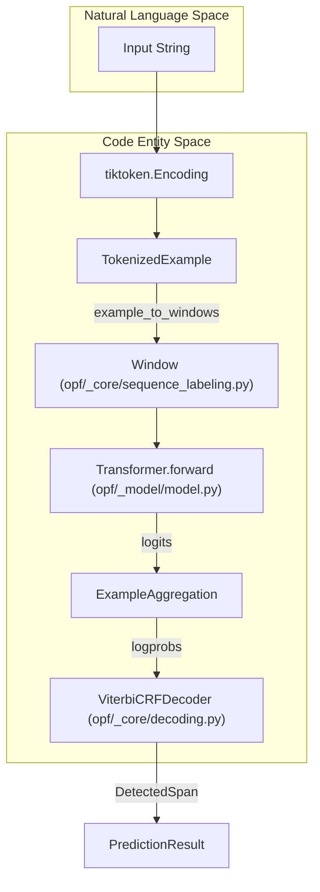
**Sources:** [opf/_core/runtime.py:270-366](), [opf/_core/sequence_labeling.py:130-169]()

### Windowed Inference
Since input text can exceed the model's context window (`n_ctx`), the runtime employs a windowing strategy:
1. **Tokenization**: Text is converted to tokens, and a `TokenizedExample` is created [opf/_core/runtime.py:302-308]().
2. **Windowing**: `example_to_windows` splits the sequence into chunks of size `n_ctx` [opf/_core/sequence_labeling.py:130-169]().
3. **Forward Pass**: Each window is processed by `Transformer.forward`. Log-probabilities are extracted using `F.log_softmax` [opf/_core/runtime.py:330-335]().
4. **Aggregation**: `ExampleAggregation` stores the log-probabilities for every token position. If windows overlap, scores are combined via `torch.logsumexp` [opf/_core/runtime.py:336-342]().

### Decoding and Post-processing
Once all windows are aggregated, the sequence of log-probabilities is decoded:
1. **Viterbi Decoding**: The `ViterbiCRFDecoder` (or a simple argmax fallback) determines the most likely sequence of BIOES tags [opf/_core/runtime.py:349-355]().
2. **Span Extraction**: `labels_to_spans` converts the tag sequence into token-level spans, which are then mapped to character offsets via `token_spans_to_char_spans` [opf/_core/runtime.py:358-361]().
3. **Refinement**: Spans are optionally trimmed of whitespace and overlapping predictions are discarded using a left-to-right greedy selection in `_select_non_overlapping_spans` [opf/_core/runtime.py:188-202]().
4. **Output Mode**: If `output_mode` is set to `"redacted"`, all specific labels (e.g., `EMAIL_ADDRESS`) are replaced with a generic `REDACTED` label and placeholder [opf/_core/runtime.py:99-118]().

### Implementation Class Diagram
This diagram maps the logical components of the prediction loop to their implementation classes.

**Prediction Logic Class Map**
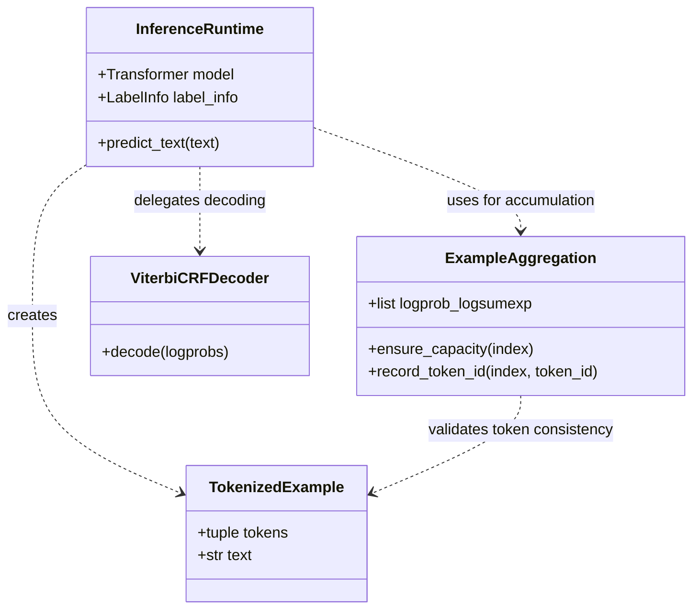
**Sources:** [opf/_core/runtime.py:43-59](), [opf/_core/sequence_labeling.py:29-36](), [opf/_core/sequence_labeling.py:51-58](), [opf/_core/decoding.py:126-138]()

**Sources:** [opf/_core/runtime.py:188-202](), [opf/_core/runtime.py:270-366](), [opf/_core/sequence_labeling.py:130-169]()

---

# Page: Sequence Decoding

# Sequence Decoding

<details>
<summary>Relevant source files</summary>

The following files were used as context for generating this wiki page:

- [opf/_core/decoding.py](opf/_core/decoding.py)
- [opf/_core/sequence_labeling.py](opf/_core/sequence_labeling.py)

</details>


The sequence decoding stage converts raw token-level log-probabilities into a coherent sequence of BIOES (Begin, Inside, Outside, End, Single) labels. This process ensures that the output spans adhere to logical boundary constraints (e.g., an "Inside" tag cannot follow an "Outside" tag) and allows for the adjustment of precision/recall trade-offs via transition biases.

## ViterbiCRFDecoder

The `ViterbiCRFDecoder` class is the primary engine for sequence decoding in OPF. It implements a Viterbi algorithm that combines model emission scores with a transition matrix to find the most likely valid sequence of labels [[opf/_core/decoding.py:132-134]]().

### Transition Constraints and BIOES Enforcement

During initialization, the decoder precomputes transition, start, and end score tables based on the provided `LabelInfo` [[opf/_core/decoding.py:144-150]](). It enforces strict BIOES logic by assigning a large negative penalty (`_NEG_INF`) to impossible transitions [[opf/_core/decoding.py:15-15, 172-180]]().

The following table summarizes the transition logic implemented in `_is_valid_transition` [[opf/_core/decoding.py:221-255]]():

| Current Tag | Valid Next Tag(s) | Description |
| :--- | :--- | :--- |
| **O** (Background) | O, B, S | Can stay background, start a multi-token span, or emit a single-token span. |
| **B** (Begin) | I, E | Must be followed by an Inside or End tag of the same category. |
| **I** (Inside) | I, E | Must continue the span or end it. |
| **E** (End) | O, B, S | Must return to background or immediately start a new span. |
| **S** (Single) | O, B, S | Must return to background or start a new span. |

### Transition Bias Parameters

The decoder supports six parameters to bias the transitions, allowing fine-grained control over the model's behavior [[opf/_core/decoding.py:18-25, 136-141]]():

1.  `transition_bias_background_stay`: Bias for staying in the 'O' state.
2.  `transition_bias_background_to_start`: Bias for moving from 'O' to 'B' or 'S'.
3.  `transition_bias_inside_to_continue`: Bias for staying in 'I' or moving from 'B' to 'I'.
4.  `transition_bias_inside_to_end`: Bias for moving to 'E' or 'S'.
5.  `transition_bias_end_to_background`: Bias for moving from 'E' or 'S' to 'O'.
6.  `transition_bias_end_to_start`: Bias for moving from 'E' or 'S' to a new 'B' or 'S'.

Sources: `[opf/_core/decoding.py:15-25](), [opf/_core/decoding.py:132-190](), [opf/_core/decoding.py:221-255]()`

## Calibration and Operating Points

The decoder can be configured using a `viterbi_calibration.json` file. This artifact defines "operating points" that contain pre-tuned bias values for specific performance targets.

### Viterbi Calibration Format

The artifact follows a nested structure where the `default` operating point is used to resolve biases [[opf/_core/decoding.py:95-128]]().

```json
{
  "operating_points": {
    "default": {
      "biases": {
        "transition_bias_background_stay": 0.0,
        "transition_bias_background_to_start": -1.5,
        "transition_bias_inside_to_continue": 0.5,
        "transition_bias_inside_to_end": 0.0,
        "transition_bias_end_to_background": 0.0,
        "transition_bias_end_to_start": -2.0
      }
    }
  }
}
```

### Bias Resolution Flow

The `resolve_viterbi_biases_from_calibration_path` function parses this JSON and validates that all required keys are present before returning a dictionary of floats to the `ViterbiCRFDecoder` [[opf/_core/decoding.py:84-128]]().

Sources: `[opf/_core/decoding.py:26-26](), [opf/_core/decoding.py:84-128]()`

## Decoding Implementation

### Viterbi Algorithm (Batched CUDA)

The `decode` method performs the Viterbi pass. It is optimized for PyTorch and can run on CUDA devices. It processes a batch of log-probabilities (shape `[batch, seq_len, num_labels]`) and returns the most likely sequence of token indices [[opf/_core/decoding.py:314-368]]().

**Natural Language to Code Space: Viterbi Logic**
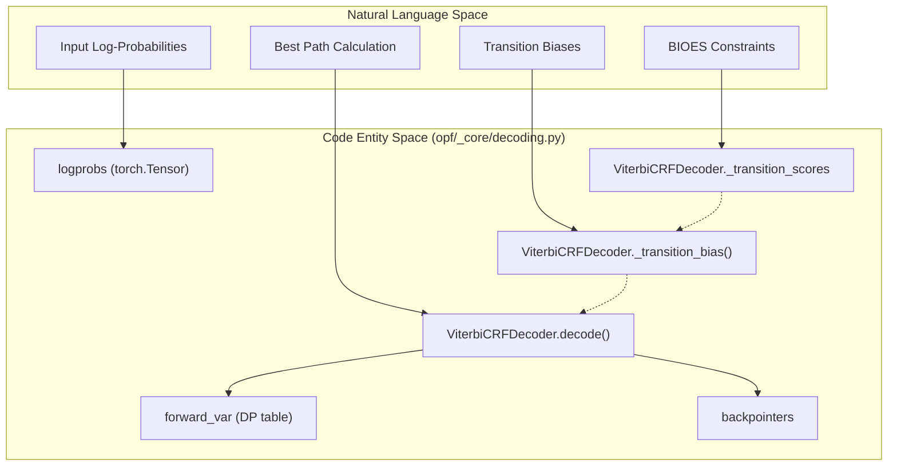

### Argmax Fallback

If no Viterbi calibration is provided and a simple decoding is requested, the system can fallback to a standard `argmax` operation over the token log-probabilities, though this does not guarantee BIOES consistency [[opf/_core/decoding.py:371-378]]().

Sources: `[opf/_core/decoding.py:314-368](), [opf/_core/decoding.py:371-378]()`

## Data Flow: From Scores to Spans

The decoding process is a bridge between the model's raw output and the high-level span detection.

**System Data Flow**
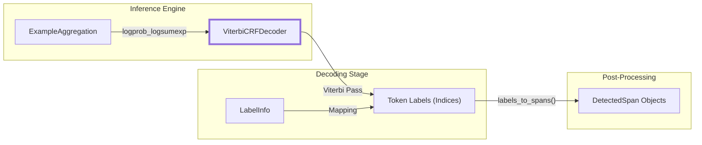

1.  **Aggregation**: `ExampleAggregation` provides the averaged log-probabilities from overlapping inference windows [[opf/_core/sequence_labeling.py:51-58]]().
2.  **Decoding**: `ViterbiCRFDecoder.decode` processes these scores using the transition matrix to produce a sequence of label indices [[opf/_core/decoding.py:314-320]]().
3.  **Mapping**: The `LabelInfo` object provides the metadata necessary to interpret these indices (e.g., which index corresponds to `B-PER`) [[opf/_core/sequence_labeling.py:16-25]]().
4.  **Span Extraction**: The resulting labels are passed to utilities (described in Page 3.3) to form discrete character-level spans.

Sources: `[opf/_core/decoding.py:132-141](), [opf/_core/sequence_labeling.py:16-25](), [opf/_core/sequence_labeling.py:51-58]()`

---

# Page: Span Utilities and Character Offsets

# Span Utilities and Character Offsets

<details>
<summary>Relevant source files</summary>

The following files were used as context for generating this wiki page:

- [opf/_core/sequence_labeling.py](opf/_core/sequence_labeling.py)
- [opf/_core/spans.py](opf/_core/spans.py)

</details>


This page details the utilities in `opf/_core/spans.py` responsible for converting raw model predictions (token-level labels) into human-readable character offsets and spans. It covers the BIOES state machine, whitespace normalization, and the byte-level UTF-8 mapping required to align `tiktoken` outputs with source text.

## Token-to-Character Alignment

Because the OPF uses `tiktoken` (BPE), a single token may represent a fragment of a character or multiple characters. To ensure redaction occurs at precise character boundaries, the system performs byte-level offset mapping.

### Offset Mapping Logic
The core function `_decode_text_and_token_char_ranges` maps token IDs to character offsets within the resulting string [opf/_core/spans.py:10-43]().

1.  **Byte Decoding**: Each token is decoded into its raw bytes using `encoding.decode_single_token_bytes` [opf/_core/spans.py:14-16]().
2.  **UTF-8 Reconstruction**: The bytes are joined and decoded as UTF-8. The system tracks the byte-length of each character in the final string to build a `char_byte_starts` index [opf/_core/spans.py:17-27]().
3.  **Binary Search Alignment**: Using `bisect_right` and `bisect_left`, the system finds which character indices correspond to the start and end byte positions of each token [opf/_core/spans.py:31-41]().

### Data Flow: Text Reconstruction
The following diagram illustrates how raw token IDs from the model are mapped back to the "Natural Language Space" of character offsets.

**Token to Character Offset Mapping**
```mermaid
graph TD
    subgraph "Code Entity Space (opf/_core/spans.py)"
        A["token_ids (Sequence[int])"] --> B["encoding.decode_single_token_bytes"]
        B --> C["token_bytes (list[bytes])"]
        C --> D["b''.join(token_bytes).decode('utf-8')"]
        D --> E["decoded_text (str)"]
        
        E --> F["char_byte_starts / ends"]
        C --> G["token_byte_cursor"]
        
        F & G --> H["bisect_left / bisect_right"]
        H --> I["char_starts / char_ends (list[int])"]
    end

    subgraph "Natural Language Space"
        E -- "Represents" --> J["Source Text String"]
        I -- "Defines" --> K["Character Spans (e.g. 0-5)"]
    end
```
Sources: [opf/_core/spans.py:10-43](), [opf/_core/spans.py:49-80]()

## Span Reconstruction (BIOES State Machine)

The model predicts labels in BIOES format (Begin, Inside, Outside, End, Single). The `labels_to_spans` function implements a state machine to group these contiguous token labels into discrete entity spans [opf/_core/spans.py:124-210]().

### Transition Logic
The state machine iterates through sorted token indices and evaluates the `boundary_tag` (B, I, O, E, S) provided by the `LabelInfo` [opf/_core/spans.py:134-137]().

| Tag | Action |
| :--- | :--- |
| **S (Single)** | Immediately closes any open span and creates a new 1-token span [opf/_core/spans.py:158-167](). |
| **B (Begin)** | Closes any open span and starts a new `current_label` tracking [opf/_core/spans.py:168-176](). |
| **I (Inside)** | Continues the current span if the label matches; otherwise, it treats it as a new start [opf/_core/spans.py:177-186](). |
| **E (End)** | Closes the current span at the current token index [opf/_core/spans.py:187-205](). |
| **O (Outside)** | Closes the current span and resets the state [opf/_core/spans.py:149-156](). |

### Discontinuity Handling
If there is a gap in the token indices (e.g., due to windowing or filtering), the state machine automatically closes the active span before proceeding [opf/_core/spans.py:139-144]().

Sources: [opf/_core/spans.py:124-210](), [opf/_core/sequence_labeling.py:81-127]()

## Span Post-processing

Once spans are identified, they undergo several refinement steps to ensure high-quality redaction.

### Whitespace Trimming
`trim_char_spans_whitespace` adjusts character offsets to exclude leading or trailing whitespace [opf/_core/spans.py:228-245](). This prevents redaction marks (like `[NAME]`) from "eating" the spaces between words, which maintains the original document's formatting.

### Overlap Resolution
The system handles overlapping predictions via `discard_overlapping_spans_by_label` [opf/_core/spans.py:83-110]().
1.  Spans are grouped by their label ID [opf/_core/spans.py:89-91]().
2.  Within each label, spans are sorted by start position (ascending) and length (descending) [opf/_core/spans.py:95-97]().
3.  The algorithm performs a greedy selection: if a span overlaps with a previously "kept" span of the same label, it is discarded [opf/_core/spans.py:99-106]().

**Span Processing Pipeline**
```mermaid
graph LR
    subgraph "Inference Logic"
        A["labels_by_index (dict)"] --> B["labels_to_spans"]
        B --> C["token_spans (list[tuple])"]
    end

    subgraph "Post-processing (opf/_core/spans.py)"
        C --> D["token_spans_to_char_spans"]
        D --> E["trim_char_spans_whitespace"]
        E --> F["discard_overlapping_spans_by_label"]
    end

    subgraph "Output Space"
        F --> G["DetectedSpan Objects"]
    end
```
Sources: [opf/_core/spans.py:83-110](), [opf/_core/spans.py:213-225](), [opf/_core/spans.py:228-245]()

## Key Functions Reference

| Function | Description |
| :--- | :--- |
| `decode_text_with_offsets` | Decodes token IDs and returns both the text and the character range for every token [opf/_core/spans.py:248-255](). |
| `token_char_ranges_for_text` | Maps token IDs to offsets within a *pre-existing* source string, validating that the tokens match the text prefix [opf/_core/spans.py:49-80](). |
| `token_spans_to_char_spans` | Converts `(label, token_start, token_end)` to `(label, char_start, char_end)` using pre-calculated ranges [opf/_core/spans.py:213-225](). |

Sources: [opf/_core/spans.py:49-80](), [opf/_core/spans.py:213-225](), [opf/_core/spans.py:248-255]()

---

# Page: Label Space and Taxonomy

# Label Space and Taxonomy

<details>
<summary>Relevant source files</summary>

The following files were used as context for generating this wiki page:

- [opf/_common/constants.py](opf/_common/constants.py)
- [opf/_common/label_space.py](opf/_common/label_space.py)

</details>


The OpenAI Privacy Filter (OPF) uses a structured taxonomy to categorize sensitive information. This system maps high-level privacy concepts (e.g., "Personal Name") to specific token-level labels used by the transformer model for classification. The label space is versioned to support evolving privacy policies and can be extended with custom ontologies for specific use cases.

## Overview of Taxonomy Resolution

At runtime, the `InferenceRuntime` must determine which label space a checkpoint uses to correctly interpret the model's output logits. This resolution follows a specific hierarchy:
1.  **Explicit Configuration**: If `config.json` contains `span_class_names` or `ner_class_names`, a custom label space is used.
2.  **Version Field**: If `category_version` is present in the config, it selects a built-in taxonomy (e.g., `v2`, `v4`, `v7`).
3.  **Inference by Shape**: If no version is specified, the system infers the version based on the number of output labels in the model's head.

### Label Space Entity Mapping

The following diagram illustrates how natural language privacy categories are transformed into the code entities used for inference and training.

**Diagram: From Policy to Token Labels**
```mermaid
graph TD
    subgraph "Natural Language Space"
        A["Privacy Category (e.g., 'Secret')"]
    end

    subgraph "Code Entity Space (opf/_common/label_space.py)"
        B["span_class_names"]
        C["_expand_with_boundary_markers()"]
        D["ner_class_names (BIESO)"]
    end

    subgraph "Model Space (opf/_model/model.py)"
        E["Transformer.output_head"]
        F["Logits [Batch, Seq, Num_Labels]"]
    end

    A --> B
    B --> C
    C --> D
    D --> E
    E --> F
```
Sources: [opf/_common/label_space.py:16-73](), [opf/_common/label_space.py:77-85](), [opf/_model/model.py:270-285]()

---

## Built-in Category Versions

OPF provides several "built-in" taxonomies that have evolved over time. These are defined in `opf/_common/label_space.py`.

*   **v2**: The legacy baseline including categories like `account_number`, `private_person`, and `secret`.
*   **v4**: An expanded set that introduces the distinction between "personal" and "other" entities (e.g., `personal_email` vs `other_email`).
*   **v7**: The current standard, providing highly granular PII categories such as `personal_gov_id`, `personal_health_id`, and `personal_vehicle_id`.

Each version defines a set of `SPAN_CLASS_NAMES`. These are then expanded into `NER_CLASS_NAMES` using the **BIOES** (Begin, Inside, Outside, End, Single) boundary format. For example, the span class `secret` becomes `B-secret`, `I-secret`, `E-secret`, and `S-secret` at the token level.

For details on specific class names and the expansion logic, see **[Built-in Category Versions (#4.1)]**.

Sources: [opf/_common/label_space.py:16-73](), [opf/_common/label_space.py:88-92](), [opf/_common/label_space.py:10-11]()

---

## Custom Label Spaces

Users can define their own ontologies without modifying the OPF source code. This is primarily used during fine-tuning to adapt the model to domain-specific PII or internal data policies.

Custom label spaces are defined in a `label_space.json` file or directly within the checkpoint's `config.json`. The system enforces strict validation rules:
*   The **Background Label** (`O`) must always be the first element (index 0).
*   All token labels must follow the `<Boundary>-<Label>` format.
*   A complete set of BIOES boundaries must exist for every span class.

**Diagram: Custom Label Resolution Logic**
```mermaid
graph TD
    node_cfg["config.json"]
    node_res["resolve_label_space_from_config()"]
    node_custom["Custom Taxonomy"]
    node_builtin["Built-in Taxonomy"]
    node_infer["_CATEGORY_VERSION_BY_NUM_LABELS"]

    node_cfg --> node_res
    node_res -- "Has 'span_class_names'?" --> node_custom
    node_res -- "Has 'category_version'?" --> node_builtin
    node_res -- "Otherwise" --> node_infer
```
Sources: [opf/_common/label_space.py:195-215](), [opf/_common/label_space.py:143-157](), [opf/_common/label_space.py:160-192]()

For instructions on implementing custom ontologies, see **[Custom Label Spaces (#4.2)]**.

---

## Taxonomy Resolution Summary

| Component | Role | File Reference |
| :--- | :--- | :--- |
| `SPAN_CLASS_NAMES_BY_CATEGORY_VERSION` | Maps version string (v2/v4/v7) to span labels. | [opf/_common/label_space.py:16-73]() |
| `NER_CLASS_NAMES_BY_CATEGORY_VERSION` | Maps version string to token-level BIESO labels. | [opf/_common/label_space.py:88-92]() |
| `_expand_with_boundary_markers` | Function that converts span labels to BIESO labels. | [opf/_common/label_space.py:77-85]() |
| `resolve_label_space_from_config` | Logic for determining label space at runtime. | [opf/_common/label_space.py:227-258]() |
| `REDACTED_OUTPUT_LABEL` | Fallback label used when collapsing categories. | [opf/_common/constants.py:19-20]() |

Sources: [opf/_common/label_space.py:1-258](), [opf/_common/constants.py:1-24]()

---

# Page: Built-in Category Versions

# Built-in Category Versions

<details>
<summary>Relevant source files</summary>

The following files were used as context for generating this wiki page:

- [opf/_common/constants.py](opf/_common/constants.py)
- [opf/_common/label_space.py](opf/_common/label_space.py)

</details>


The OpenAI Privacy Filter (OPF) uses a versioned taxonomy system to define privacy categories. These taxonomies, referred to as "Category Versions," dictate the specific types of sensitive information the model is trained to detect (e.g., names, email addresses, or secrets). This page documents the implementation of these versions, the expansion logic from span-level categories to token-level labels, and the resolution mechanism used during model loading.

## Taxonomy Definitions

The system maintains three primary built-in taxonomies: **v2**, **v4**, and **v7**. Each version represents a different level of granularity and classification scope.

### Span Class Names
The `SPAN_CLASS_NAMES_BY_CATEGORY_VERSION` mapping defines the high-level categories for each version [opf/_common/label_space.py:16-73]().

| Version | Description | Key Categories |
| :--- | :--- | :--- |
| **v2** | Legacy/Standard | `account_number`, `private_address`, `private_email`, `private_person`, `secret` |
| **v4** | Split-Ownership | Distinguishes between `personal_*` and `other_*` (e.g., `personal_email` vs `other_email`) |
| **v7** | Granular ID | Extensive list of specific ID types: `personal_gov_id`, `personal_fin_id`, `personal_health_id`, etc. |

All versions include a background label `O` (defined as `BACKGROUND_CLASS_LABEL`) to represent non-sensitive tokens [opf/_common/label_space.py:7-8]().

### Sources:
- [opf/_common/label_space.py:7-73]()

---

## BIOES Expansion Logic

While users and evaluation scripts often interact with span-level labels (e.g., `private_person`), the transformer model performs token-level classification. OPF uses the **BIOES** (Begin, Inside, End, Single) tagging scheme to represent span boundaries.

### Boundary Markers
The system uses four boundary prefixes [opf/_common/label_space.py:10-11]():
- **B**: Beginning of a multi-token span.
- **I**: Inside a multi-token span.
- **E**: End of a multi-token span.
- **S**: A single-token span.

### The `_expand_with_boundary_markers` Function
This function transforms a list of span classes into a full NER (Named Entity Recognition) label space [opf/_common/label_space.py:77-85](). 
1. The background label `O` remains a single entry at index 0 [opf/_common/label_space.py:79-82]().
2. For every other category, four token-level labels are generated by prepending the boundary markers (e.g., `B-secret`, `I-secret`, `E-secret`, `S-secret`) [opf/_common/label_space.py:83-84]().

**Entity Space Mapping Diagram**
The following diagram illustrates how natural language categories are transformed into the code-level label space used by the model head.

```mermaid
graph TD
    subgraph "Natural Language Space"
        A["Category: 'secret'"]
    end

    subgraph "Code Entity Space (label_space.py)"
        B["_expand_with_boundary_markers()"]
        C["B-secret"]
        D["I-secret"]
        E["E-secret"]
        F["S-secret"]
        G["O (Background)"]
    end

    A --> B
    B --> C
    B --> D
    B --> E
    B --> F
    B --> G
```

### Sources:
- [opf/_common/label_space.py:10-11]()
- [opf/_common/label_space.py:77-85]()

---

## Label Space Resolution

When an OPF model is loaded via `load_inference_runtime`, the system must determine which category version the model's weights correspond to. This is handled by `resolve_label_space_from_config` [opf/_common/label_space.py:228-261]().

### Resolution Priority
The system resolves the label space using the following logic:

1.  **Explicit Custom Definition**: If `span_class_names` or `ner_class_names` are present in the `config.json`, the model uses a custom label space [opf/_common/label_space.py:201-205]().
2.  **Explicit Version Field**: If a `category_version` string (e.g., "v7") is present in the config, that version is used [opf/_common/label_space.py:243-247]().
3.  **Inference by Label Count**: If no version is specified, the system calculates the version based on the number of labels in the model's output head (`num_labels`) [opf/_common/label_space.py:252-257]().

### Inference Mapping
The mapping `_CATEGORY_VERSION_BY_NUM_LABELS` associates the length of the expanded NER list with the version name [opf/_common/label_space.py:94-97]():
- **33 labels** $\rightarrow$ v2
- **57 labels** $\rightarrow$ v4
- **105 labels** $\rightarrow$ v7

**Data Flow: Config to Label Space**
This diagram shows how `resolve_label_space_from_config` processes the `config.json` file from a checkpoint.

```mermaid
graph LR
    subgraph "Checkpoint Filesystem"
        CFG["config.json"]
    end

    subgraph "label_space.py Logic"
        RES["resolve_label_space_from_config()"]
        VBYN["_CATEGORY_VERSION_BY_NUM_LABELS"]
        NER["NER_CLASS_NAMES_BY_CATEGORY_VERSION"]
    end

    subgraph "Inference Runtime"
        LS["Label Space (Resolved)"]
    end

    CFG -- "num_labels / category_version" --> RES
    RES -- "Lookup" --> VBYN
    VBYN -- "Match" --> NER
    NER --> LS
```

### Sources:
- [opf/_common/label_space.py:94-97]()
- [opf/_common/label_space.py:228-261]()
- [opf/_core/runtime.py:49-62]() (Context: usage in `load_inference_runtime`)

---

## Validation and Normalization

To ensure consistency, several internal utilities validate label spaces during both training and inference:

-   **`_ensure_unique`**: Checks for duplicate labels in the taxonomy [opf/_common/label_space.py:124-142]().
-   **`_normalize_span_class_names`**: Ensures that the background label `O` is always at index 0 [opf/_common/label_space.py:143-157]().
-   **`_parse_ner_class_names`**: Validates that if a custom NER space is provided, it contains all four BIOES boundaries for every base label [opf/_common/label_space.py:160-192]().

### Sources:
- [opf/_common/label_space.py:124-192]()

---

# Page: Custom Label Spaces

# Custom Label Spaces

<details>
<summary>Relevant source files</summary>

The following files were used as context for generating this wiki page:

- [examples/data/finetuning_custom_label_demo/README.md](examples/data/finetuning_custom_label_demo/README.md)
- [examples/data/finetuning_custom_label_demo/label_space.json](examples/data/finetuning_custom_label_demo/label_space.json)
- [opf/_common/label_space.py](opf/_common/label_space.py)

</details>


The OpenAI Privacy Filter (OPF) allows users to extend or replace the default privacy taxonomies with custom ontologies. This is primarily achieved through a `label_space.json` file or by embedding label definitions within a checkpoint's `config.json`. Custom label spaces enable the model to be fine-tuned for domain-specific entities (e.g., "internal_project_code" or "custom_secret") while maintaining the structural integrity required by the BIOES sequence decoding logic.

### Label Space Resolution Logic

When the system loads a model, it must determine the mapping between the output logits of the transformer head and the human-readable labels. This resolution is handled by `resolve_label_space_from_config` [opf/_common/label_space.py:246-278]().

The resolution follows a strict hierarchy:
1.  **Explicit Custom Payload**: If `span_class_names` or `ner_class_names` are present in the configuration, the system validates and uses these custom definitions [opf/_common/label_space.py:195-231]().
2.  **Explicit Version**: If a `category_version` (e.g., "v7") is specified, it loads the corresponding built-in taxonomy [opf/_common/label_space.py:254-257]().
3.  **Inference by Dimension**: If neither is present, the system attempts to infer the version based on the `num_labels` in the model's output head [opf/_common/label_space.py:259-272]().

#### Data Flow: From Config to Label Space
The following diagram illustrates how `resolve_label_space_from_config` processes different inputs to produce the final label sets.

**Label Space Resolution Flow**
```mermaid
graph TD
    subgraph "Input Config"
        A["checkpoint_config (Mapping)"]
    end

    subgraph "opf/_common/label_space.py"
        B{"Has custom fields?"}
        C["_resolve_custom_label_space_from_config"]
        D{"Has category_version?"}
        E["Lookup SPAN_CLASS_NAMES_BY_CATEGORY_VERSION"]
        F{"Has num_labels?"}
        G["Lookup _CATEGORY_VERSION_BY_NUM_LABELS"]
        H["Return (category_version, span_names, ner_names)"]
    end

    A --> B
    B -- "Yes" --> C
    C --> H
    B -- "No" --> D
    D -- "Yes" --> E
    E --> H
    D -- "No" --> F
    F -- "Yes" --> G
    G --> H
    F -- "No" --> I["Fallback to DEFAULT_CATEGORY_VERSION"]
    I --> H
```
Sources: [opf/_common/label_space.py:195-278]()

### Defining a Custom Ontology

Users define custom ontologies via a `label_space.json` file, typically placed in the dataset directory for fine-tuning [examples/data/finetuning_custom_label_demo/README.md:19-19]().

#### Schema of label_space.json
A standard custom label space file contains:
*   **`category_version`**: A unique string identifier for the custom taxonomy (e.g., `"custom_v1"`) [examples/data/finetuning_custom_label_demo/label_space.json:2-2]().
*   **`span_class_names`**: A list of high-level entity names. The background label `"O"` must be included [examples/data/finetuning_custom_label_demo/label_space.json:3-7]().

#### Validation Rules
The system enforces several constraints during parsing in `opf/_common/label_space.py`:
1.  **The "O" Rule**: The background label `O` (defined as `BACKGROUND_CLASS_LABEL`) must be present. If it is not at index 0, the system will force it to the first position during normalization [opf/_common/label_space.py:143-157]().
2.  **BIOES Completeness**: If providing raw `ner_class_names`, every span class (except `O`) must have all four boundary markers: `B-`, `I-`, `E-`, and `S-` [opf/_common/label_space.py:185-192]().
3.  **Expansion**: If only `span_class_names` are provided, the system automatically generates the token-level BIOES labels using `_expand_with_boundary_markers` [opf/_common/label_space.py:77-85]().

| Feature | Requirement | Code Reference |
| :--- | :--- | :--- |
| **Background Label** | Must be `"O"` | [opf/_common/label_space.py:7-7]() |
| **Boundary Markers** | `B`, `I`, `E`, `S` | [opf/_common/label_space.py:10-10]() |
| **Uniqueness** | No duplicate names allowed | [opf/_common/label_space.py:124-141]() |

Sources: [opf/_common/label_space.py:7-192](), [examples/data/finetuning_custom_label_demo/label_space.json:1-8]()

### Integration in Fine-tuning

During fine-tuning, the `TrainingRunner` uses the resolved label space to configure the model's output head. If the custom label space differs from the base checkpoint's label space, the system performs an "Output Head Rebuild."

#### Output Head Remapping
The function `_rebuild_output_head_for_target_labels` in `opf/_train/runner.py` manages this transition:
1.  It identifies overlapping labels between the base model and the custom space.
2.  It copies the weights for shared labels to preserve existing knowledge.
3.  It initializes new weights for novel labels (like `custom_secret`) [examples/data/finetuning_custom_label_demo/README.md:7-7]().

**Entity Mapping during Fine-tuning**
```mermaid
graph LR
    subgraph "Natural Language Space (User Labels)"
        L1["O (Background)"]
        L2["custom_secret"]
    end

    subgraph "Code Entity Space (opf/_train/runner.py)"
        R1["_rebuild_output_head_for_target_labels"]
        M1["model.output.weight"]
        M2["model.output.bias"]
    end

    L1 --> R1
    L2 --> R1
    R1 --> M1
    R1 --> M2
```
Sources: [opf/_train/runner.py:382-427](), [examples/data/finetuning_custom_label_demo/label_space.json:1-8]()

### Example: Custom Secret Demo
The `finetuning_custom_label_demo` provides a concrete implementation of a custom label space.

1.  **Label Definition**: The `label_space.json` defines `custom_v1` with labels `["O", "custom_secret"]` [examples/data/finetuning_custom_label_demo/label_space.json:1-8]().
2.  **Token-level Expansion**: The system expands this into: `["O", "B-custom_secret", "I-custom_secret", "E-custom_secret", "S-custom_secret"]` via `_expand_with_boundary_markers` [opf/_common/label_space.py:77-85]().
3.  **Result**: The model is trained to recognize `custom_secret` spans, and the `ViterbiCRFDecoder` uses these custom labels to enforce valid BIOES transitions during inference [opf/_core/decoding.py:14-25]().

Sources: [examples/data/finetuning_custom_label_demo/README.md:1-20](), [opf/_common/label_space.py:77-85]()

---

# Page: CLI and Python API

# CLI and Python API

<details>
<summary>Relevant source files</summary>

The following files were used as context for generating this wiki page:

- [opf/__main__.py](opf/__main__.py)
- [opf/_api.py](opf/_api.py)
- [opf/_cli/__init__.py](opf/_cli/__init__.py)

</details>


The OpenAI Privacy Filter (OPF) provides three primary interfaces for interacting with the redaction engine: a unified command-line tool (`opf`), a high-level Python class (`OPF`), and a functional convenience wrapper (`redact()`). These interfaces abstract the complexities of tokenization, windowed inference, and Viterbi decoding into simple "text-in, redacted-text-out" workflows.

### Interface Overview

The following diagram maps the user-facing interfaces to their underlying implementation entities in the codebase.

**Interface to Code Mapping**

```mermaid
graph TD
    subgraph "Natural Language Space (User Input)"
        USER_CMD["CLI Command: 'opf redact'"]
        USER_CODE["Python: opf.redact(text)"]
    end

    subgraph "Code Entity Space (opf/_api.py & opf/_cli)"
        CLI_MAIN["opf.__main__:main()"]
        OPF_CLASS["opf._api:OPF"]
        REDACT_FN["opf._api:redact()"]
        
        CLI_REDACT["opf.__main__:_run_redaction_command()"]
        RUNTIME["opf._core.runtime:InferenceRuntime"]
    end

    USER_CMD --> CLI_MAIN
    CLI_MAIN --> CLI_REDACT
    CLI_REDACT --> OPF_CLASS
    
    USER_CODE --> OPF_CLASS
    USER_CODE --> REDACT_FN
    REDACT_FN --> OPF_CLASS
    
    OPF_CLASS --> RUNTIME
```
**Sources:** [opf/__main__.py:186-200](), [opf/_api.py:184-215](), [opf/_api.py:440-455]()

---

### 1. The `opf` CLI
The command-line interface is the primary tool for local redaction, evaluation, and fine-tuning. It uses a subcommand pattern similar to `git` or `docker`.

*   **`redact`**: The default mode. Used for processing text strings or files. It supports interactive mode, JSON output, and ANSI color-coded terminal rendering of detected PII.
*   **`eval`**: Used to benchmark model performance against ground-truth datasets, producing metrics like F1 and Precision.
*   **`train`**: The entry point for supervised fine-tuning on custom datasets or new label taxonomies.

For detailed argument references and usage examples, see **[CLI: Redact Mode](#5.1)**.

**Sources:** [opf/__main__.py:14-25](), [opf/__main__.py:162-184]()

---

### 2. Python API: The `OPF` Class
The `OPF` class in `opf._api.py` is the recommended way to integrate privacy filtering into Python applications. It manages the lifecycle of the `InferenceRuntime`, including model loading and device management.

**Key Features:**
*   **State Management**: Loads the transformer model once and keeps it in memory for repeated calls.
*   **Fluent Interface**: Provides setter methods like `.set_device()` or `.set_output_mode()` to update settings without re-initializing the model.
*   **Structured Results**: Returns `RedactionResult` objects containing the redacted text, a list of `DetectedSpan` objects (with character offsets), and a summary of the operation.

For class documentation and method signatures, see **[Python API: OPF Class](#5.2)**.

**Sources:** [opf/_api.py:184-215](), [opf/_api.py:334-342](), [opf/_api.py:378-400]()

---

### 3. Functional API: `redact()`
For simple scripts or one-off tasks, the module-level `redact()` function provides a stateless interface. It internally manages a cached `OPF` instance to avoid the overhead of reloading weights on every call when used within the same process.

```python
from opf import redact

# Simple functional call
result = redact("Contact me at 555-0199", output_mode="redacted")
print(result.redacted_text)
```

**Sources:** [opf/_api.py:440-465]()

---

### Data Flow and Schemas
All interfaces eventually converge on a standardized output schema. Whether you are using the CLI with `--format json` or the Python API's `.to_dict()` method, the structure remains consistent to ensure interoperability between the CLI and downstream automated systems.

**Standardized Output Flow**

```mermaid
graph LR
    subgraph "Input"
        TXT["Raw Text"]
    end

    subgraph "Processing (opf/_core)"
        RUN["InferenceRuntime"]
        DEC["ViterbiCRFDecoder"]
    end

    subgraph "Output (opf/_api.py)"
        RES["RedactionResult"]
        DICT["JSON Dictionary"]
    end

    TXT --> RUN
    RUN --> DEC
    DEC --> RES
    RES --> DICT
```

| Interface | Primary Return Type | Serialization |
| :--- | :--- | :--- |
| **CLI** | Stdout (Text/JSON) | `json.dumps()` |
| **OPF Class** | `RedactionResult` | `.to_json()` / `.to_dict()` |
| **Functional** | `RedactionResult` | `.to_json()` / `.to_dict()` |

For details on the specific fields (e.g., `detected_spans`, `schema_version`), see **[Output Schemas](#5.3)**.

**Sources:** [opf/_api.py:34-42](), [opf/_api.py:44-69](), [opf/__main__.py:143-150]()

---

# Page: CLI: Redact Mode

# CLI: Redact Mode

<details>
<summary>Relevant source files</summary>

The following files were used as context for generating this wiki page:

- [opf/__main__.py](opf/__main__.py)
- [opf/_cli/args.py](opf/_cli/args.py)
- [opf/_cli/common.py](opf/_cli/common.py)
- [opf/_cli/render.py](opf/_cli/render.py)
- [opf/_common/terminal_colors.py](opf/_common/terminal_colors.py)

</details>


The `opf redact` command (often invoked simply as `opf`) is the primary interface for local text anonymization. It supports processing single strings, multiple files, piped stdin, and an interactive REPL mode. The CLI handles model initialization, inference orchestration, and formatting of results into either plain text or structured JSON.

## Implementation Overview

The redaction CLI is managed by `opf/__main__.py`, which dispatches commands to `_run_redaction_command`. It utilizes `argparse` groups to organize the extensive configuration surface area.

### Data Flow Diagram: CLI Execution
The following diagram illustrates how a user command flows from the shell through the argument parser into the core `OPF` API and finally to the terminal output.

**CLI to API Bridge**
```mermaid
graph TD
    subgraph "CLI Entry (opf/__main__.py)"
        START["main()"] --> REDACT_CMD["_run_redaction_command()"]
        REDACT_CMD --> BUILD_RED["build_redactor_from_args()"]
        REDACT_CMD --> ITER_IN["iter_inputs()"]
    end

    subgraph "API Layer (opf/_api.py)"
        BUILD_RED --> OPF_CLASS["OPF Class Instance"]
        OPF_CLASS --> REDACT_CALL["OPF.redact(text)"]
    end

    subgraph "Output Rendering (opf/_cli/render.py)"
        REDACT_CALL --> RESULT["RedactionResult"]
        RESULT --> TEXT_OUT["print(str(result))"]
        RESULT --> JSON_OUT["json.dumps(result.to_dict())"]
        RESULT --> COLOR_OUT["render_color_coded_text()"]
    end

    ITER_IN --> REDACT_CALL
```
**Sources:** [opf/__main__.py:186-215](), [opf/_cli/render.py:109-129]()

---

## Argument Groups

The CLI categorizes flags into four functional groups to manage the inference pipeline:

### 1. Input / Source
Determines where the text to be redacted originates.
*   **Positional Text**: `opf redact "Hello world"` treats the first positional argument as input [opf/__main__.py:50-54]().
*   **Text File (`-f`, `--text-file`)**: Reads one or more files as individual examples [opf/__main__.py:68-77]().
*   **Stdin**: If no text or files are provided and stdin is not a TTY, the CLI reads lines from stdin [opf/_cli/args.py:101-107]().
*   **Interactive Mode**: Triggered when no input is provided and the session is a TTY [opf/_cli/args.py:125-127]().

### 2. Model / Runtime
Configures the underlying transformer and hardware.
*   **`--checkpoint`**: Path to the model directory. Defaults to the `OPF_CHECKPOINT` environment variable or a standard local path [opf/_cli/common.py:43-51]().
*   **`--device`**: Target hardware (e.g., `cuda`, `cpu`, `mps`). Defaults to `cuda` [opf/_cli/common.py:53-60]().
*   **`--n-ctx`**: Overrides the context window length (e.g., 2048) [opf/_cli/common.py:63-70]().

### 3. Decode
Controls how token-level probabilities are converted into spans.
*   **`--decode-mode`**: Chooses between `viterbi` (default) and `argmax` [opf/_cli/common.py:73-80]().
*   **`--viterbi-calibration-path`**: Path to a `viterbi_calibration.json` file for fine-tuning transition biases [opf/_cli/common.py:122-133]().
*   **`--trim-whitespace`**: Ensures character spans do not start or end with spaces (default: True) [opf/_cli/common.py:92-109]().

### 4. Output
Controls the format and verbosity of the results.
*   **`--output-mode`**: `typed` (keep PII categories) vs `redacted` (collapse all to a generic label) [opf/_cli/common.py:112-119]().
*   **`--format`**: `text` (returns only the string) vs `json` (returns the full schema) [opf/__main__.py:62-67]().
*   **`--json-indent`**: Sets the indentation level for JSON output (default: 2) [opf/_cli/args.py:63-68]().

**Sources:** [opf/__main__.py:46-61](), [opf/_cli/args.py:43-76](), [opf/_cli/common.py:43-134]()

---

## Interactive Mode

When `opf redact` is run without input arguments in a terminal, it enters an interactive REPL.

*   **Implementation**: Uses `input()` in a loop within `iter_inputs` [opf/_cli/args.py:111-123]().
*   **Line Editing**: Attempts to import the `readline` module to enable history and advanced line editing. If unavailable, it falls back to plain input with a stderr warning [opf/_cli/args.py:35-42]().
*   **Commands**: Users can exit using `/exit`, `quit`, or `Ctrl+D` [opf/_cli/args.py:118-119]().

**Sources:** [opf/_cli/args.py:84-127]()

---

## Output Formats and Rendering

The CLI supports two primary output formats, determined by the `--format` flag.

### Text vs. JSON
| Format | Logic | Behavior |
| :--- | :--- | :--- |
| **Text** | `print(str(result))` | Outputs only the redacted string. |
| **JSON** | `result.to_dict()` | Outputs a structured object containing `detected_spans`, `redacted_text`, and a `summary`. |

**Sources:** [opf/__main__.py:138-150]()

### ANSI Color-Coded Output
When `--format json` is used, the CLI can also print a color-coded version of the source text to the terminal to visualize detected spans.
*   **Label Mapping**: `build_label_color_map` assigns colors from a 10-color palette (`COLOR_PALETTE`) to unique labels [opf/_common/terminal_colors.py:12-40]().
*   **Rendering**: `render_color_coded_text` iterates through `DetectedSpan` objects and wraps the corresponding text slices in ANSI escape codes [opf/_cli/render.py:15-46]().
*   **Legend**: A color legend is printed above the text using `render_color_legend` [opf/_cli/render.py:69-82]().

**Sources:** [opf/_cli/render.py:15-46](), [opf/_common/terminal_colors.py:1-57]()

### Summary Line (stderr)
For every inference, a summary line is printed to `stderr` via `run_summary_line`. This ensures that if the output is redirected to a file, the performance and metadata are still visible to the user.

**Format:**
`summary: output_mode=<mode> spans=<count> by_label=<counts> latency_ms=<ms> decoded_mismatch=<yes/no>`

**Sources:** [opf/_cli/render.py:85-107](), [opf/__main__.py:143-149]()

---

## Internal Components

### Runtime Session View
The CLI uses a `SimpleNamespace` called the "session runtime view" to store metadata about the active model and hardware for the duration of the process.

**CLI Component Association**
```mermaid
classDiagram
    class OPF {
        +redact(text)
        +get_runtime()
    }
    class RedactorBuilder {
        +build_redactor_from_args(args)
    }
    class SessionRuntimeView {
        +checkpoint: str
        +device: str
        +active_encoding_name: str
        +n_ctx: int
        +output_mode: str
    }
    
    RedactorBuilder ..> OPF : "instantiates"
    OPF ..> SessionRuntimeView : "provides data for"
    SessionRuntimeView ..> CLI_Renderer : "informs headers/colors"
```
**Sources:** [opf/_cli/render.py:109-143]()

---

# Page: Python API: OPF Class

# Python API: OPF Class

<details>
<summary>Relevant source files</summary>

The following files were used as context for generating this wiki page:

- [opf/_api.py](opf/_api.py)
- [opf/_common/constants.py](opf/_common/constants.py)

</details>


The `OPF` class serves as the primary high-level entry point for programmatic interaction with the OpenAI Privacy Filter. It encapsulates the loading of model weights, tokenizer configuration, and inference runtime, providing a fluent interface for text redaction and span detection.

## The OPF Class

The `OPF` class manages the lifecycle of an inference session. It handles checkpoint resolution (including automatic downloads), device management, and decoding strategy configuration.

### Constructor and Initialization
The constructor initializes the underlying `InferenceRuntime` and sets default behaviors for redaction.

| Parameter | Type | Description |
| :--- | :--- | :--- |
| `model` | `str | Path | None` | Path to checkpoint. Defaults to `OPF_CHECKPOINT` env var or `~/.opf/privacy_filter` [[opf/_api.py:190-203]](). |
| `device` | `"cpu" | "cuda"` | Target hardware for inference [[opf/_api.py:193-193]](). |
| `output_mode` | `"typed" | "redacted"` | Whether to use specific labels (e.g., `PHONE_NUMBER`) or generic `<REDACTED>` [[opf/_api.py:194-194]](). |
| `decode_mode` | `"viterbi" | "argmax"` | Sequence decoding strategy [[opf/_api.py:195-195]](). |
| `trim_whitespace` | `bool` | If `True`, removes leading/trailing whitespace from detected spans [[opf/_api.py:192-192]](). |

### Fluent Setter Methods
The class provides several "setter" methods that return `self`, allowing for a fluent configuration style:
* `set_device(device)` [[opf/_api.py:255-263]]()
* `set_output_mode(mode)` [[opf/_api.py:265-274]]()
* `set_decode_mode(mode)` [[opf/_api.py:276-285]]()
* `set_viterbi_decoder(calibration_path)` [[opf/_api.py:287-302]]()

### The redact() Method
The core functionality is exposed via `redact(text, decode=None)`. This method performs the following flow:
1. Resolves `DecodeOptions` by merging per-call overrides with instance defaults [[opf/_api.py:321-321]]().
2. Retrieves or builds a cached `ViterbiCRFDecoder` or argmax decoder [[opf/_api.py:322-322]]().
3. Executes `predict_text` via the internal `InferenceRuntime` [[opf/_api.py:324-333]]().
4. Constructs a `RedactionResult` containing the original text, detected spans, and the processed string [[opf/_api.py:335-343]]().

**Sources:**
* `OPF` Class Definition: [opf/_api.py:184-184]()
* Constructor: [opf/_api.py:187-234]()
* `redact` Method: [opf/_api.py:307-344]()

---

## Data Flow: Text to RedactionResult

The following diagram illustrates how the `OPF` class bridges the "Natural Language Space" (raw text) to the "Code Entity Space" (structured results).

**Text Processing Pipeline**
```mermaid
graph TD
    subgraph "Natural Language Space"
        InputText["Raw Input String"]
        OutputText["Redacted String"]
    end

    subgraph "Code Entity Space (opf/_api.py)"
        OPFClass["class OPF"]
        RedactMethod["OPF.redact()"]
        RedResult["class RedactionResult"]
    end

    subgraph "Inference Logic (opf/_core/runtime.py)"
        InfRuntime["load_inference_runtime()"]
        PredText["predict_text()"]
    end

    InputText --> OPFClass
    OPFClass --> RedactMethod
    RedactMethod --> PredText
    PredText --> InfRuntime
    PredText --> RedResult
    RedResult --> OutputText
```
**Sources:**
* `RedactionResult` Definition: [opf/_api.py:34-42]()
* `predict_text` call: [opf/_api.py:324-333]()
* `_redact_text` implementation: [opf/_api.py:117-128]()

---

## Decoding and Overrides

The API uses a specific pattern for handling per-call configuration without mutating the global state of the `OPF` instance.

### DecodeOptions and INHERIT
The `DecodeOptions` dataclass allows users to override the decoding strategy for a single `redact()` call [[opf/_api.py:88-97]]().
* **`INHERIT` Sentinel**: A special object `INHERIT` is used to signify that the call should use the value currently configured on the `OPF` instance [[opf/_api.py:29-29]]().
* **`_merge_decoder_config`**: An internal utility that resolves the final settings by checking if a field is `INHERIT` or a concrete value [[opf/_api.py:141-167]]().

### Decoder Caching
To avoid the overhead of rebuilding the `ViterbiCRFDecoder` (which involves loading calibration JSON files), the `OPF` class maintains an internal cache [[opf/_api.py:233-233]](). The `_get_decoder` method uses a `_DecoderConfig` key to retrieve existing decoders [[opf/_api.py:346-357]]().

**Sources:**
* `DecodeOptions`: [opf/_api.py:88-97]()
* `INHERIT` sentinel: [opf/_api.py:22-29]()
* `_merge_decoder_config`: [opf/_api.py:141-167]()
* `_get_decoder`: [opf/_api.py:346-357]()

---

## Output Structures

### RedactionResult
The result of a redaction operation is encapsulated in the `RedactionResult` dataclass.

| Method | Description |
| :--- | :--- |
| `to_dict()` | Converts the result into a JSON-serializable dictionary including `schema_version`, `summary`, `text`, `detected_spans`, and `redacted_text` [[opf/_api.py:44-69]](). |
| `to_json(indent=2)` | Serializes the dictionary to a JSON string [[opf/_api.py:71-84]](). |

### Component Association

The following diagram maps the high-level API components to the underlying runtime and common constants.

**API Component Mapping**
```mermaid
classDiagram
    class OPF {
        +redact(text, decode) RedactionResult
        +set_device(device) OPF
        -runtime InferenceRuntime
        -decoder_cache dict
    }
    class RedactionResult {
        +schema_version int
        +summary dict
        +text str
        +detected_spans tuple
        +to_dict() dict
        +to_json() str
    }
    class DecodeOptions {
        +decode_mode Literal
        +viterbi_calibration_path Path
    }
    class Constants {
        <<enumeration>>
        DEFAULT_MODEL_ENV_VAR
        SCHEMA_VERSION
        REDACTED_OUTPUT_PLACEHOLDER
    }

    OPF ..> RedactionResult : creates
    OPF ..> DecodeOptions : consumes
    RedactionResult ..> Constants : uses SCHEMA_VERSION
```

**Sources:**
* `RedactionResult`: [opf/_api.py:34-42]()
* `SCHEMA_VERSION`: [opf/_common/constants.py:16-17]()
* `REDACTED_OUTPUT_PLACEHOLDER`: [opf/_common/constants.py:22-23]()

---

## Module-Level Shortcut

For simple use cases where a persistent `OPF` instance is not required, the module provides a top-level `redact()` function.

```python
def redact(
    text: str,
    *,
    model: str | os.PathLike[str] | None = None,
    device: Literal["cpu", "cuda"] = "cuda",
    # ... other params
) -> RedactionResult:
```
This function instantiates a temporary `OPF` object and immediately calls its `redact()` method [[opf/_api.py:374-419]](). It is recommended for one-off scripts but is less efficient than reusing an `OPF` instance for multiple calls due to the overhead of loading the model weights.

**Sources:**
* Module-level `redact`: [opf/_api.py:374-419]()
* Checkpoint resolution: [opf/_api.py:107-114]()

---

# Page: Output Schemas

# Output Schemas

<details>
<summary>Relevant source files</summary>

The following files were used as context for generating this wiki page:

- [EVAL_AND_OUTPUT_MODES.md](EVAL_AND_OUTPUT_MODES.md)
- [OUTPUT_SCHEMAS.md](OUTPUT_SCHEMAS.md)
- [opf/_api.py](opf/_api.py)

</details>


This page provides a detailed technical reference for the structured data formats produced by the OpenAI Privacy Filter (OPF). It covers the primary JSON output used for redaction tasks and the JSONL format used for model evaluation and error analysis.

## 1. Redaction Output Schema (`opf redact`)

When running the CLI with `opf redact` or using the `OPF.redact()` Python API, the system produces a structured JSON object. This schema is designed to provide both the transformed text and the metadata necessary to audit or programmatically process the redaction decisions.

### Schema Structure
The output is governed by a `schema_version` to ensure forward compatibility.

| Field | Type | Description |
| :--- | :--- | :--- |
| `schema_version` | `int` | Current version of the JSON schema (e.g., `1`). |
| `summary` | `dict` | Aggregated statistics about the redaction pass. |
| `text` | `string` | The original input text. |
| `detected_spans` | `list[dict]` | Array of objects describing each identified sensitive entity. |
| `redacted_text` | `string` | The final text with sensitive spans replaced by placeholders. |
| `warning` | `string?` | Optional field present if a tokenizer round-trip mismatch occurred. |

### Implementation Detail: RedactionResult
In the Python API, this schema is represented by the `RedactionResult` dataclass. The `to_dict()` method handles the conversion of internal `DetectedSpan` objects into the final JSON-serializable format.

```mermaid
classDiagram
    class RedactionResult {
        +int schema_version
        +dict summary
        +str text
        +tuple detected_spans
        +str redacted_text
        +str warning
        +to_dict() dict
        +to_json() str
    }
    class DetectedSpan {
        +str label
        +int start
        +int end
        +str text
        +str placeholder
    }
    RedactionResult *-- DetectedSpan : contains
```
Sources: [opf/_api.py:34-84](), [opf/_core/runtime.py:46-53]()

### Output Modes: Typed vs. Redacted
The content of the `detected_spans` and `redacted_text` fields changes based on the `--output-mode` (CLI) or `output_mode` (API) setting.

1.  **`typed`**: Preserves the specific subcategories predicted by the model (e.g., `private_person`, `private_phone_number`). Placeholders reflect these types (e.g., `<PRIVATE_PERSON>`).
2.  **`redacted`**: Collapses all labels into a single generic `redacted` category. All placeholders become `<REDACTED>`.

Sources: [EVAL_AND_OUTPUT_MODES.md:64-70](), [opf/_api.py:211-213]()

### Summary Object
The `summary` field is generated by `build_detection_summary` and contains:
*   `output_mode`: The mode used for the pass.
*   `span_count`: Total number of spans found.
*   `by_label`: A frequency map of detected categories.
*   `decoded_mismatch`: A boolean indicating if the tokenizer's decoded output differs from the raw input string.

Sources: [opf/_core/runtime.py:245-263](), [OUTPUT_SCHEMAS.md:10-18]()

---

## 2. Evaluation Predictions Schema (`opf eval`)

When evaluating model performance using `opf eval`, users can export raw predictions using the `--predictions-out` flag. This produces a **JSONL** (JSON Lines) file where each line is a standalone JSON object representing one example from the evaluation set.

### Prediction Entry Fields
| Field | Type | Description |
| :--- | :--- | :--- |
| `example_id` | `string` | The unique identifier from the source dataset. |
| `text` | `string` | The input text evaluated. |
| `predicted_spans` | `dict` | A map where keys are `label: text` and values are lists of `[start, end]` offsets. |
| `token_logprobs_topk` | `list?` | Optional: Per-token log-probabilities for the top-k candidates. |

### Data Flow: Inference to JSONL
The evaluation pipeline processes windows of text, aggregates scores, and then decodes them into spans. The `predicted_spans` field uses a compact representation to facilitate manual inspection of which specific text segments triggered which labels.

```mermaid
graph LR
    subgraph "Code Entity Space"
        A["predict_text() in runtime.py"] --> B["ViterbiCRFDecoder in decoding.py"]
        B --> C["labels_to_spans() in spans.py"]
        C --> D["Evaluation Loop in eval/metrics.py"]
    end
    subgraph "Output Space"
        D --> E["JSONL Prediction Record"]
    end
    
    style A fill:none
    style B fill:none
    style C fill:none
    style D fill:none
    style E fill:none
```
Sources: [OUTPUT_SCHEMAS.md:38-55](), [opf/_core/runtime.py:165-242](), [opf/_core/spans.py:16-52]()

---

## 3. Comparison of Evaluation and Output Modes

The system distinguishes between how labels are handled for *display* (output) versus how they are handled for *measurement* (evaluation).

### Mode Matrix
| Situation | Command | Mode | Outcome |
| :--- | :--- | :--- | :--- |
| Prediction (Display Detail) | `opf redact` | `--output-mode typed` | Specific labels (e.g., `private_address`) |
| Prediction (Anonymize) | `opf redact` | `--output-mode redacted` | All labels become `redacted` |
| Evaluation (Standard) | `opf eval` | `--eval-mode typed` | Category-level F1/Precision/Recall |
| Evaluation (Cross-Taxonomy) | `opf eval` | `--eval-mode untyped` | Span-level detection metrics only |

### The `untyped` Mode and `ground_truth_label_recall`
In `untyped` evaluation mode, the model's specific category labels are ignored. This is useful when the ground truth labels (e.g., `Given Name`) do not align with the model's taxonomy (e.g., `private_person`). 

The output schema for evaluation in this mode includes `ground_truth_label_recall`, which measures how much of the original ground truth span was covered by *any* predicted span, regardless of label name.

Sources: [EVAL_AND_OUTPUT_MODES.md:21-27](), [EVAL_AND_OUTPUT_MODES.md:86-99]()

---

## 4. Error and Warning Handling

### Tokenizer Round-trip Warnings
The OPF performs byte-level offset tracking to ensure that redaction placeholders are placed exactly where the sensitive text was located. However, certain tokenizers may not perfectly round-trip text (e.g., normalizing whitespace or Unicode characters).

If `decoded_mismatch` is detected in `PredictionResult`, a `warning` field is added to the JSON output. This alerts the user that the character offsets provided in `detected_spans` refer to the *tokenizer's decoded version* of the text, which may differ slightly from the original input string.

```mermaid
flowchart TD
    Input["Input Text"] --> Tokenize["Tokenizer.encode"]
    Tokenize --> Decode["Tokenizer.decode"]
    Input -- Compare --> Match{"Exact Match?"}
    Match -- No --> SetWarning["Add warning to RedactionResult"]
    Match -- Yes --> NoWarning["No warning field"]
```
Sources: [opf/_api.py:131-139](), [opf/_core/runtime.py:51-53]()

---

# Page: Evaluation

# Evaluation

<details>
<summary>Relevant source files</summary>

The following files were used as context for generating this wiki page:

- [EVAL_AND_OUTPUT_MODES.md](EVAL_AND_OUTPUT_MODES.md)
- [opf/_eval/__init__.py](opf/_eval/__init__.py)
- [opf/_eval/runner.py](opf/_eval/runner.py)

</details>


The OpenAI Privacy Filter (OPF) evaluation pipeline provides a comprehensive framework for measuring model performance against ground truth datasets. It handles the end-to-end lifecycle of an evaluation run: loading raw data, tokenizing and labeling, performing windowed inference, and computing both token-level and span-level metrics.

The evaluation logic is primarily contained within the `opf._eval` module [[opf/_eval/__init__.py:1-2]]().

### Evaluation Workflow

The evaluation process follows a structured pipeline managed by the runner in `opf/_eval/runner.py`.

```mermaid
graph TD
    subgraph "Data Ingestion"
        A["JSONL Dataset"] --> B["iter_json_records()"]
        B --> C["parse_record()"]
    end

    subgraph "Preprocessing (Parallelized)"
        C --> D["_prepare_tokenized_example()"]
        D --> E["labels_from_entities()"]
        E --> F["PreparedTokenizedExample"]
    end

    subgraph "Inference Engine"
        F --> G["example_to_windows()"]
        G --> H["Model Forward Pass"]
        H --> I["ViterbiCRFDecoder"]
    end

    subgraph "Metric Aggregation"
        I --> J["EvalExampleAggregation"]
        J --> K["compute_metrics()"]
        K --> L["Summary Report"]
    end

    style A stroke-dasharray: 5 5
    style L stroke-width:4px
```
**Sources:** [opf/_eval/runner.py:79-115](), [opf/_eval/preprocess.py:36-42](), [opf/_eval/metrics.py:25-26]()

### Data Loading and Preprocessing
The pipeline supports standard JSONL formats and a specific message-variant format for conversational data [[opf/_eval/data.py:21-24]](). Preprocessing is often the bottleneck, so OPF uses a `ProcessPoolExecutor` to parallelize tokenization and label alignment across multiple CPU cores [[opf/_eval/runner.py:10-11](), [opf/_eval/runner.py:57-66]]().

Key entities in this stage:
*   **`parse_record`**: Extracts text and entity spans from raw JSON [[opf/_eval/preprocess.py:40-40]]().
*   **`labels_from_entities`**: Maps character-level ground truth spans to token-level BIOES labels [[opf/_eval/preprocess.py:39-39]]().
*   **`PreparedTokenizedExample`**: A container holding the tokenized text, ground truth labels, and original span metadata [[opf/_eval/preprocess.py:38-38]]().

For details on dataset schemas and alignment logic, see [Eval Dataset Format and Preprocessing](#6.1).

### Inference and Windowing
Because the Privacy Filter uses a fixed-window bidirectional transformer, long documents are split into overlapping segments using `example_to_windows` [[opf/_core/sequence_labeling.py:34-34]](). During evaluation, the model generates log-probabilities for every token. These are then aggregated back into the original document context via `EvalExampleAggregation` [[opf/_eval/preprocess.py:37-37]]().

The final sequence of labels is determined by the `ViterbiCRFDecoder`, which enforces legal BIOES transitions to ensure valid span boundaries [[opf/_core/sequence_labeling.py:29-33]]().

### Metrics and Modes
OPF distinguishes between different evaluation "modes" based on whether the ground truth taxonomy matches the model's internal labels [[EVAL_AND_OUTPUT_MODES.md:5-17]]().

| Mode | Purpose | Key Metrics |
| :--- | :--- | :--- |
| **Typed** | Standard eval where labels match exactly. | Token Accuracy, Loss, Class-specific F1. |
| **Untyped** | Cross-taxonomy eval (e.g., "Person" vs "private_person"). | Span Detection P/R/F1, `ground_truth_label_recall`. |

**Sources:** [EVAL_AND_OUTPUT_MODES.md:74-85](), [opf/_eval/metrics.py:25-26]()

The `compute_metrics` function generates a detailed report including:
1.  **Detection Metrics**: How well the model found *any* sensitive span, regardless of type [[EVAL_AND_OUTPUT_MODES.md:83-83]]().
2.  **Ground Truth Label Recall**: For untyped evaluation, this measures what percentage of each original ground truth label was covered by model predictions [[EVAL_AND_OUTPUT_MODES.md:90-93]]().
3.  **Throughput**: Processing speed measured in tokens per second [[opf/_eval/runner.py:181-187]]().

For details on specific metric formulas and configuring eval modes, see [Metrics and Eval Modes](#6.2).

### Evaluation to Code Mapping

The following diagram maps high-level evaluation concepts to the specific classes and functions in the `opf._eval` package.

```mermaid
classDiagram
    class EvalRunner {
        +_prepare_tokenized_example()
        +_print_progress_line()
    }
    class Preprocess {
        +parse_record()
        +labels_from_entities()
        +token_char_ranges()
    }
    class Metrics {
        +compute_metrics()
        +write_predictions()
    }
    class DataStructures {
        +PreparedTokenizedExample
        +EvalExampleAggregation
    }

    EvalRunner ..> Preprocess : uses
    EvalRunner ..> DataStructures : orchestrates
    EvalRunner ..> Metrics : finalizes
```
**Sources:** [opf/_eval/runner.py:1-42](), [opf/_eval/preprocess.py:36-42](), [opf/_eval/metrics.py:25-26]()

---

# Page: Eval Dataset Format and Preprocessing

# Eval Dataset Format and Preprocessing

<details>
<summary>Relevant source files</summary>

The following files were used as context for generating this wiki page:

- [examples/data/README.md](examples/data/README.md)
- [examples/data/sample_eval_five_examples.jsonl](examples/data/sample_eval_five_examples.jsonl)
- [examples/data/sample_eval_five_examples_alt_labels.jsonl](examples/data/sample_eval_five_examples_alt_labels.jsonl)
- [opf/_eval/args.py](opf/_eval/args.py)
- [opf/_eval/data.py](opf/_eval/data.py)
- [opf/_eval/preprocess.py](opf/_eval/preprocess.py)

</details>


This page documents the evaluation data pipeline for the OpenAI Privacy Filter (OPF). It covers the JSONL schema requirements, the extraction of message-level variants, and the transformation of raw text and character-level spans into token-level label sequences used for model evaluation and fine-tuning.

## Overview of Data Flow

The preprocessing pipeline bridges the gap between human-readable text annotations ("Natural Language Space") and the tensor-based requirements of the transformer model ("Code Entity Space").

### Data Transformation Pipeline

The following diagram illustrates how a raw JSONL record is processed into a `PreparedTokenizedExample` ready for inference or training.

**Preprocessing Data Flow**
```mermaid
graph TD
    subgraph "Natural Language Space"
        A["JSONL Record (text, spans)"]
    end

    subgraph "opf/_eval/preprocess.py"
        B["parse_record()"]
        C["token_char_ranges()"]
        D["labels_from_entities()"]
    end

    subgraph "Code Entity Space"
        E["TokenizedExample"]
        F["PreparedTokenizedExample"]
    end

    A --> B
    B -- "NamedEntity list" --> D
    B -- "text" --> C
    C -- "char_starts, char_ends" --> D
    D -- "BIOES labels" --> E
    E --> F
```
Sources: `[opf/_eval/preprocess.py:74-157]()`, `[opf/_eval/preprocess.py:28-36]()`, `[opf/_eval/preprocess.py:183-195]()`

## Eval Dataset Schema

The OPF evaluation suite supports JSONL (JSON Lines) files, optionally compressed with GZIP. Each line must represent a single record mapping.

### 1. Spans Format (Standard)
The primary format uses a `spans` dictionary where keys are category names and values are lists of `[start, end]` character offsets.
*   **Key Structure**: Labels can be simple strings (e.g., `private_person`) or include the text snippet for readability (e.g., `private_person: Quindle Testwick`). The parser splits on `: ` to extract the category [opf/_eval/preprocess.py:91-91]().
*   **Offsets**: Must be integer character indices [opf/_eval/preprocess.py:62-71]().

**Example:**
```json
{
  "text": "Contact Edgar Alanpoe at e.alanpoe@openai.com",
  "spans": {
    "private_person: Edgar Alanpoe": [[8, 21]],
    "private_email": [[25, 45]]
  },
  "info": {"id": "example_01"}
}
```
Sources: `[examples/data/sample_eval_five_examples.jsonl:1-5]()`, `[opf/_eval/preprocess.py:84-127]()`

### 2. Labels Format (Alternative)
A secondary format uses a `label` field containing a list of objects with `category`, `start`, and `end` fields.

**Example:**
```json
{
  "text": "Contact Edgar Alanpoe",
  "label": [
    {"category": "private_person", "start": 8, "end": 21}
  ]
}
```
Sources: `[opf/_eval/preprocess.py:129-157]()`

## Dataset Variants and Message Extraction

The CLI supports a `--dataset-variant` flag [opf/_eval/args.py:173-178]().

### Message Variant
When `message` variant is selected, the pipeline uses `iter_message_variant_records` to split long chat transcripts into individual message records.
*   **Splitting**: It identifies `user:` and `assistant:` prefixes using `MESSAGE_PREFIX_RE` [opf/_eval/data.py:10-23]().
*   **Span Adjustment**: Character offsets for ground-truth spans are automatically recalculated relative to the start of the specific message [opf/_eval/data.py:54-57]().
*   **Metadata**: Adds a `message_index` to the `info` field of each resulting record [opf/_eval/data.py:61-67]().

Sources: `[opf/_eval/data.py:26-69]()`

## Preprocessing Implementation

### Record Parsing
The `parse_record` function acts as the entry point, normalizing various JSONL formats into a unified `(example_id, text, list[NamedEntity])` tuple [opf/_eval/preprocess.py:74-77](). It also generates a stable `example_id` by hashing the record content if one is not provided [opf/_eval/preprocess.py:48-59]().

### Token-to-Character Mapping
To align labels with tokens, the system must know exactly which character range each token covers.
*   **`token_char_ranges`**: Calls `token_char_ranges_for_text` to generate `char_starts` and `char_ends` arrays for the entire token sequence [opf/_eval/preprocess.py:173-181]().
*   **Validation**: It ensures every token in the sequence is successfully mapped to a range [opf/_eval/preprocess.py:178-179]().

### Label Projection (`labels_from_entities`)
This function projects character-level `NamedEntity` spans onto the token sequence:
1.  **Initialization**: All tokens start with the `background_token_label` (usually `O`) [opf/_eval/preprocess.py:194-194]().
2.  **Overlap Handling**: It resolves overlapping ground-truth spans by prioritizing the earliest and longest spans [opf/_eval/preprocess.py:160-170]().
3.  **BIOES Assignment**: It identifies which tokens fall within a span and assigns the appropriate `B-`, `I-`, `E-`, or `S-` prefix based on the token's position within the character range [opf/_core/spans.py]().

**Data Structure: PreparedTokenizedExample**
This dataclass caches all necessary information for evaluation:
*   `tokenized`: The `TokenizedExample` (tokens and label IDs) [opf/_eval/preprocess.py:31-31]().
*   `char_starts`/`char_ends`: Token boundary offsets [opf/_eval/preprocess.py:32-33]().
*   `original_gold_char_spans`: The raw spans before tokenization for final metric comparison [opf/_eval/preprocess.py:34-34]().

Sources: `[opf/_eval/preprocess.py:28-36]()`, `[opf/_eval/preprocess.py:183-195]()`

## Preprocessing Architecture

The following diagram shows the interaction between the data iteration logic and the preprocessing workers.

**Eval Data Ingestion Architecture**
```mermaid
graph LR
    subgraph "Input Layer"
        G["iter_json_records()"]
        M["iter_message_variant_records()"]
    end

    subgraph "Processing Layer (Parallel)"
        P["parse_record()"]
        T["token_char_ranges()"]
        L["labels_from_entities()"]
    end

    subgraph "Output"
        EX["PreparedTokenizedExample"]
    end

    G --> M
    M -- "Raw Record" --> P
    P -- "NamedEntity" --> L
    P -- "Text" --> T
    T -- "Offsets" --> L
    L --> EX
```
Sources: `[opf/_eval/data.py:71-108]()`, `[opf/_eval/preprocess.py:74-77]()`, `[opf/_eval/preprocess.py:183-195]()`

---

# Page: Metrics and Eval Modes

# Metrics and Eval Modes

<details>
<summary>Relevant source files</summary>

The following files were used as context for generating this wiki page:

- [EVAL_AND_OUTPUT_MODES.md](EVAL_AND_OUTPUT_MODES.md)
- [opf/_eval/metrics.py](opf/_eval/metrics.py)
- [opf/_eval/render.py](opf/_eval/render.py)

</details>


The OpenAI Privacy Filter (OPF) evaluation pipeline provides a framework for measuring model performance across different taxonomies and use cases. Evaluation is primarily handled by `opf eval`, which supports multiple modes to accommodate datasets that may or may not align with the model's native label space.

### Core Evaluation Concepts

OPF distinguishes between three primary modes for handling labels and predictions:

| Mode | Context | Purpose | Outcome |
| :--- | :--- | :--- | :--- |
| `typed` | `opf eval` | Compare predictions against gold labels using the same taxonomy. | Category-level metrics (e.g., `private_person`). |
| `untyped` | `opf eval` | Compare predictions against gold labels using a *different* taxonomy. | Span-level detection metrics + `ground_truth_label_recall`. |
| `redacted` | `opf` | Presentation only; not used for evaluation. | Collapses all categories into a generic `redacted` label. |

Sources: [EVAL_AND_OUTPUT_MODES.md:5-18](), [EVAL_AND_OUTPUT_MODES.md:21-27]()

---

### Evaluation Data Flow

The evaluation process involves aggregating windowed model scores, decoding them into spans, and comparing those spans against ground truth data.

#### System to Code Entity Map: Evaluation Pipeline
```mermaid
graph TD
    subgraph "Natural Language Space"
        Input["JSONL Dataset (Text + Spans)"]
        Metrics["Performance Metrics (F1, Recall, etc.)"]
    end

    subgraph "Code Entity Space"
        PR["opf/_eval/preprocess.py"]
        RT["opf/_core/runtime.py"]
        MTR["opf/_eval/metrics.py"]
        RND["opf/_eval/render.py"]
        
        PR -- "PreparedTokenizedExample" --> RT
        RT -- "Aggregated Logits" --> MTR
        MTR -- "compute_metrics()" --> RND
    end

    Input --> PR
    RND --> Metrics
```
Sources: [opf/_eval/metrics.py:187-215](), [opf/_eval/render.py:9-19]()

---

### Metrics Computation (`compute_metrics`)

The core logic for evaluation resides in `compute_metrics()` within `opf/_eval/metrics.py`. This function calculates several tiers of performance data:

#### 1. Token-Level Metrics
When in `typed` mode, the system computes:
*   **Loss**: The cross-entropy loss over the sequence [opf/_eval/metrics.py:81-81]().
*   **Token Accuracy**: Percentage of tokens where the predicted BIOES tag matches the ground truth [opf/_eval/metrics.py:81-81]().

#### 2. Detection Metrics (Span-Level)
Detection metrics evaluate the model's ability to find sensitive spans, regardless of whether the category label matches perfectly (depending on `eval-mode`).
*   **Precision/Recall/F1/F2**: Calculated based on true positives, false positives, and false negatives at the span level [opf/_eval/metrics.py:75-77]().
*   **Span Matching Logic**: Spans are matched using containment logic (`pred_in_gold` or `gold_in_pred`) via `_match_spans_containment()` [opf/_eval/metrics.py:44-66]().

#### 3. Per-Class Breakdowns
For `typed` evaluation, metrics are broken down by each category defined in the taxonomy (e.g., `address`, `email_address`, `phone_number`) [opf/_eval/metrics.py:76-77]().

#### 4. Ground Truth Label Recall
In `untyped` mode, where the dataset taxonomy differs from the model's taxonomy, OPF uses `ground_truth_label_recall`. This answers: "For each original ground truth label, how much of the text was covered by *any* predicted span?" [EVAL_AND_OUTPUT_MODES.md:86-93]().

Sources: [opf/_eval/metrics.py:44-94](), [EVAL_AND_OUTPUT_MODES.md:78-85]()

---

### Evaluation Modes in Detail

#### Typed Mode
Used when ground truth labels match the OPF taxonomy. It provides the most granular feedback, including category-specific errors (e.g., confusing a `person` name for an `organization`).
*   **Command**: `opf eval DATASET --eval-mode typed` [EVAL_AND_OUTPUT_MODES.md:54-57]()

#### Untyped Mode
Used for cross-taxonomy evaluation. It treats all sensitive categories as a single "sensitive" class for matching purposes but preserves the original labels for recall reporting.
*   **Command**: `opf eval DATASET --eval-mode untyped` [EVAL_AND_OUTPUT_MODES.md:58-60]()
*   **Key Benefit**: Allows evaluating the model against legacy datasets or third-party benchmarks without re-labeling [EVAL_AND_OUTPUT_MODES.md:94-98]().

---

### Predictions Output Format

When running evaluation with the `--predictions-out` flag, the system generates a JSONL file containing detailed inference results for every example.

#### JSONL Schema
Each line in the output file contains:
*   `example_id`: Unique identifier for the text record.
*   `predicted_spans`: A list of spans in `[label_id, token_start, token_end]` format.
*   `token_logprobs_topk`: (Optional) Detailed log-probability distribution for the top-K labels at each token position.

#### Diagnostic Collection
The `_collect_token_logprobs_topk` function facilitates deep-dive analysis by recording the model's confidence and alternative label rankings for specific tokens [opf/_eval/metrics.py:125-184](). This is particularly useful for debugging Viterbi decoding transitions or "near-miss" detections.

#### Prediction Logic and Entity Map
```mermaid
sequenceDiagram
    participant CLI as opf eval
    participant MTR as metrics.py
    participant DEC as decoding.py
    participant OUT as --predictions-out (JSONL)

    CLI->>MTR: compute_metrics()
    MTR->>DEC: ViterbiCRFDecoder.decode()
    DEC-->>MTR: Predicted BIOES Labels
    MTR->>MTR: labels_to_spans()
    MTR->>OUT: Write ExamplePrediction
```
Sources: [opf/_eval/metrics.py:24-31](), [opf/_eval/metrics.py:125-137](), [opf/_core/spans.py:15-21]()

---

### Visualization and Rendering

The `opf/_eval/render.py` module provides the `build_prediction_preview` function, which generates the ANSI-colored terminal output seen during `opf eval --preview`.

This includes:
1.  **Text Preview**: The source text with highlighted predicted spans [opf/_eval/render.py:52-57]().
2.  **Span Table**: A list of detected entities with their token and character offsets [opf/_eval/render.py:68-84]().
3.  **Token Tags**: A detailed view of every token, its ID, its character range, and the specific BIOES tag assigned by the decoder [opf/_eval/render.py:88-107]().

Sources: [opf/_eval/render.py:9-111]()

---

# Page: Fine-tuning

# Fine-tuning

<details>
<summary>Relevant source files</summary>

The following files were used as context for generating this wiki page:

- [FINETUNING.md](FINETUNING.md)
- [opf/_train/__init__.py](opf/_train/__init__.py)
- [opf/_train/args.py](opf/_train/args.py)
- [opf/_train/runner.py](opf/_train/runner.py)

</details>


The `opf train` command provides a supervised fine-tuning (SFT) pipeline designed to adapt the Privacy Filter model to specific organizational policies or entirely new label taxonomies. The pipeline consumes labeled JSONL datasets, handles output head remapping for custom label spaces, and executes a standard AdamW training loop with validation and checkpoint serialization.

## Training Pipeline Overview

The fine-tuning process follows a structured sequence from data ingestion to the production of a reusable checkpoint. The system is optimized for token classification (NER) tasks using the BIOES tagging scheme.

### Data Ingestion and Preprocessing
The pipeline supports the same JSONL schema used for evaluation, accepting either character-level spans or token-level labels.
- **Data Loading**: `_prepare_tokenized_examples` uses `tiktoken` to process text and aligns labels to token boundaries [opf/_train/runner.py:95-136]().
- **Windowing**: Since the model has a fixed context window (defined by `n_ctx`), long documents are chunked into overlapping windows via `example_to_windows` [opf/_train/runner.py:162-172]().
- **Dataset Variants**: Supports "full" record processing or "message" variants for conversation-style datasets [opf/_train/runner.py:84-93]().

### Training Workflow

```mermaid
graph TD
    subgraph "Data Preparation"
        A["JSONL Dataset"] --> B["_prepare_tokenized_examples"]
        B --> C["_split_train_validation"]
        C --> D["_build_windows"]
    end

    subgraph "Model Adaptation"
        E["Base Checkpoint"] --> F["_rebuild_output_head_for_target_labels"]
        F --> G["Transformer Model"]
    end

    subgraph "Training Loop"
        D --> H["_train_one_epoch"]
        G --> H
        H --> I["AdamW Optimizer Update"]
        I --> J["_evaluate_windows (Validation)"]
    end

    subgraph "Output"
        J --> K["save_named_tensors"]
        K --> L["model.safetensors + config.json"]
    end

    style G stroke-width:2px
    style H stroke-width:2px
```
**Sources:** [opf/_train/runner.py:95-136](), [opf/_train/runner.py:162-172](), [opf/_train/runner.py:348-403](), [opf/_train/runner.py:438-518]().

## Output Head Remapping

A core feature of the fine-tuning pipeline is the ability to change the label space (e.g., adding a new category like `SECRET` or moving from `v2` to `v4` taxonomy). When the target label space differs from the base checkpoint, the model's output head is surgically modified:

1.  **Exact Match**: Weights for labels present in both the old and new space are copied directly [opf/_train/runner.py:461-464]().
2.  **Fallback**: New labels are initialized using the weights of their corresponding base classes (e.g., `B-custom_id` might inherit from the base `B-ID` weights) to provide a better starting point than random initialization [opf/_train/runner.py:471-477]().

For details on implementation, see [Training Runner](#7.1).

## Training Runner

The `opf train` execution is managed by the logic in `opf/_train/runner.py`. It implements a robust training loop including:
- **Gradient Accumulation**: Allows for effectively larger batch sizes on memory-constrained hardware [opf/_train/runner.py:382-385]().
- **Optimization**: Uses `torch.optim.AdamW` with configurable learning rates and weight decay [opf/_train/runner.py:596-601]().
- **Validation**: Periodic evaluation on a held-out split to track `token_accuracy` and `loss` [opf/_train/runner.py:406-435]().

For details on the training loop and artifact layout, see [Training Runner](#7.1).

## Custom Label Spaces

Users can define a `label_space.json` to override the built-in taxonomies. This allows the model to be trained on niche categories not covered by the standard PII/PHI sets.

| Feature | Description |
| :--- | :--- |
| **Ontology Definition** | Defined via `span_class_names` in a JSON file [FINETUNING.md:37-44](). |
| **BIOES Expansion** | The system automatically expands categories into BIOES tokens (e.g., `O`, `B-CAT`, `I-CAT`, etc.) [opf/_common/label_space.py:100-112](). |
| **Validation** | The background class `O` must always be the first entry [FINETUNING.md:48](). |

For details and examples, see [Fine-tuning Demo Examples](#7.2).

## Entity Association Map

The following diagram maps the logical fine-tuning components to the specific classes and files in the codebase.

```mermaid
graph LR
    subgraph "Code Entity Space"
        R["runner.py"]
        M["model.py"]
        A["args.py"]
        LS["label_space.py"]
    end

    subgraph "Fine-tuning System"
        TRAIN["opf train CLI"] -- "parses" --> A
        A -- "configures" --> R
        R -- "instantiates" --> M
        R -- "resolves labels" --> LS
        M -- "defines" --> TR["Transformer class"]
    end

    R -- "calls" --> TR
    LS -- "provides" --> LINFO["LabelInfo"]
```
**Sources:** [opf/_train/args.py:14-33](), [opf/_train/runner.py:530-550](), [opf/_model/model.py:410-425](), [opf/_common/label_space.py:165-180]().

## Demo Examples

The repository includes two canonical demo scripts in `examples/scripts/finetuning/` to illustrate common workflows:
1.  **Policy Adaptation**: Relabeling existing categories (e.g., `account_number` to `secret`) [FINETUNING.md:62-63]().
2.  **New Taxonomy**: Training a model from scratch on a completely custom set of labels [FINETUNING.md:64-65]().

For walkthroughs of these scripts, see [Fine-tuning Demo Examples](#7.2).

**Sources:**
- [FINETUNING.md:1-78]()
- [opf/_train/args.py:1-177]()
- [opf/_train/runner.py:1-518]()
- [opf/_common/label_space.py:100-112]()

---

# Page: Training Runner

# Training Runner

<details>
<summary>Relevant source files</summary>

The following files were used as context for generating this wiki page:

- [opf/_train/args.py](opf/_train/args.py)
- [opf/_train/runner.py](opf/_train/runner.py)

</details>


The Training Runner is the core engine for supervised fine-tuning (SFT) within the OpenAI Privacy Filter (OPF) framework. It handles the end-to-end process of transforming labeled datasets into optimized model weights, including data preparation, windowing, gradient-based optimization, and artifact serialization.

## Data Preparation and Windowing

The training pipeline begins by converting raw JSONL records into tokenized sequences aligned with label IDs. Because the transformer has a fixed context length (`n_ctx`), long sequences are decomposed into overlapping windows to ensure full coverage of the input text.

### Tokenization Flow
The function `_prepare_tokenized_examples` [opf/_train/runner.py:95-136]() orchestrates the conversion of dataset records:
1.  **Parsing**: Records are read via `_iter_dataset_records` [opf/_train/runner.py:84-93](), which supports both standard and message-variant formats.
2.  **Encoding**: Text is converted to tokens using `tiktoken`.
3.  **Label Mapping**: Entities (spans) are mapped to BIOES label IDs using `labels_from_entities` [opf/_eval/preprocess.py:112-120](). This ensures that character-level offsets in the training data correctly align with token boundaries.

### Window Construction
The `_build_windows` [opf/_train/runner.py:162-172]() function transforms `TokenizedExample` objects into a list of `Window` objects. This process uses `example_to_windows` [opf/_core/sequence_labeling.py:29]() to handle sequences exceeding the model's context window. Each window includes:
*   **Tokens**: The integer IDs for the sub-sequence.
*   **Labels**: Corresponding BIOES target IDs.
*   **Mask**: A binary mask indicating which tokens should contribute to the loss (avoiding padding or overlapping segments where appropriate).

### Training Data Flow: Record to Tensors

```mermaid
graph TD
    subgraph "Data Preparation"
        A["JSONL Record"] --> B["parse_record()"]
        B --> C["Tokenization (tiktoken)"]
        C --> D["labels_from_entities()"]
        D --> E["TokenizedExample"]
    end

    subgraph "Windowing"
        E --> F["_build_windows()"]
        F --> G["example_to_windows()"]
        G --> H["Window Objects"]
    end

    subgraph "Batching"
        H --> I["_build_epoch_batches()"]
        I --> J["_batch_to_tensors()"]
        J --> K["(Tokens, Labels, Masks)"]
    end
```
**Sources:** [opf/_train/runner.py:95-136](), [opf/_train/runner.py:162-172](), [opf/_train/runner.py:191-224]()

---

## Training Loop Implementation

The primary training logic resides in `_train_one_epoch` [opf/_train/runner.py:260-333](). It implements a standard SFT loop with several critical features for stability and performance.

### Key Optimization Components
*   **Gradient Accumulation**: To simulate larger batch sizes on memory-constrained hardware, gradients are accumulated over `grad_accum_steps` before an optimizer update is performed [opf/_train/runner.py:311-316]().
*   **AdamW Optimizer**: The runner uses `torch.optim.AdamW` with configurable learning rate and weight decay [opf/_train/runner.py:441-447]().
*   **Gradient Clipping**: To prevent exploding gradients, `torch.nn.utils.clip_grad_norm_` is applied using the `--max-grad-norm` parameter [opf/_train/runner.py:312]().
*   **Progress Logging**: Real-time stats including loss, token accuracy, and estimated time remaining (ETA) are logged to stderr [opf/_train/runner.py:321-331]().

### Loss Calculation
Loss is calculated using `_masked_token_loss_and_accuracy` [opf/_train/runner.py:227-258](). It applies `F.cross_entropy` only to non-masked tokens. The mask ensures that padding tokens (used to align windows in a batch) do not influence the gradient updates.

| Feature | Implementation Detail |
| :--- | :--- |
| **Optimizer** | `AdamW` [opf/_train/runner.py:441]() |
| **Loss Function** | Cross Entropy with Masking [opf/_train/runner.py:241]() |
| **Batching** | Shuffled windows via `_build_epoch_batches` [opf/_train/runner.py:175]() |
| **Metrics** | Loss and Token-level Accuracy [opf/_train/runner.py:249-251]() |

**Sources:** [opf/_train/runner.py:260-333](), [opf/_train/runner.py:227-258]()

---

## Output Head Reconfiguration

When fine-tuning on a custom label space (e.g., adding a new category or changing taxonomies), the model's output head (`output.weight`) must be resized and re-initialized. This is handled by `_rebuild_output_head_for_target_labels` [opf/_train/runner.py:355-408]().

### Remapping Logic
The function attempts to preserve knowledge from the base model by copying rows for labels that exist in both the source and target spaces:
1.  **Exact Copying**: If a label name (e.g., `B-PERSON`) exists in both the checkpoint and the target label space, the corresponding row in the weight matrix is copied exactly [opf/_train/runner.py:388-392]().
2.  **Fallback Copying**: If a target label is new but shares a boundary type (e.g., a new `B-SECRET` label), it can optionally be initialized from a similar boundary type in the source (e.g., `B-MISC`) [opf/_train/runner.py:393-398]().
3.  **Stats Tracking**: The `OutputHeadRemapStats` dataclass tracks how many rows were initialized via each method [opf/_train/runner.py:49-58]().

**Sources:** [opf/_train/runner.py:355-408](), [opf/_train/runner.py:49-58]()

---

## Output Artifact Layout

Upon completion, the training runner serializes the fine-tuned model and metadata into the directory specified by `--output-dir`.

### Generated Files
1.  **`config.json`**: The model configuration, updated with the new `num_labels` and the target `label_space` (if custom) [opf/_train/runner.py:560-573]().
2.  **`model.safetensors`**: The trained weights saved in `safetensors` format. The runner uses `save_named_tensors` to ensure compatibility with the OPF runtime [opf/_train/runner.py:575-580]().
3.  **`finetune_summary.json`**: A detailed report of the training run, including:
    *   Final training and validation metrics (loss, accuracy).
    *   Hyperparameters used (learning rate, batch size, epochs).
    *   Output head remapping statistics.
    *   Environment details (device, timestamp) [opf/_train/runner.py:582-598]().

### Runner Execution Logic

```mermaid
graph TD
    subgraph "runner.run() Entry Point"
        Start["Load Checkpoint Config"] --> Head["_rebuild_output_head_for_target_labels()"]
        Head --> Load["_prepare_tokenized_examples()"]
        Load --> Split["_split_train_validation()"]
    end

    subgraph "Training Loop"
        Split --> Epoch{"For Epoch in Epochs"}
        Epoch --> Train["_train_one_epoch()"]
        Train --> Eval["_evaluate_windows()"]
        Eval --> Epoch
    end

    subgraph "Artifact Serialization"
        Epoch --> SaveW["save_named_tensors(model.safetensors)"]
        SaveW --> SaveC["Save config.json"]
        SaveC --> SaveS["Save finetune_summary.json"]
    end
```
**Sources:** [opf/_train/runner.py:411-602](), [opf/_train/runner.py:560-598]()

---

# Page: Fine-tuning Demo Examples

# Fine-tuning Demo Examples

<details>
<summary>Relevant source files</summary>

The following files were used as context for generating this wiki page:

- [FINETUNING.md](FINETUNING.md)
- [examples/data/finetuning_custom_label_demo/README.md](examples/data/finetuning_custom_label_demo/README.md)
- [examples/data/finetuning_custom_label_demo/test.jsonl](examples/data/finetuning_custom_label_demo/test.jsonl)
- [examples/data/finetuning_custom_label_demo/train.jsonl](examples/data/finetuning_custom_label_demo/train.jsonl)
- [examples/data/finetuning_custom_label_demo/validation.jsonl](examples/data/finetuning_custom_label_demo/validation.jsonl)
- [examples/data/finetuning_secret_demo/README.md](examples/data/finetuning_secret_demo/README.md)
- [examples/data/finetuning_secret_demo/test.jsonl](examples/data/finetuning_secret_demo/test.jsonl)
- [examples/data/finetuning_secret_demo/train.jsonl](examples/data/finetuning_secret_demo/train.jsonl)
- [examples/data/finetuning_secret_demo/validation.jsonl](examples/data/finetuning_secret_demo/validation.jsonl)
- [examples/scripts/finetuning/finetune_custom_label_demo.sh](examples/scripts/finetuning/finetune_custom_label_demo.sh)
- [examples/scripts/finetuning/finetune_secret_demo.sh](examples/scripts/finetuning/finetune_secret_demo.sh)

</details>


The OpenAI Privacy Filter (OPF) includes reproducible demo workflows to illustrate how the model can be adapted to new policies or entirely new label spaces. These demos are implemented as shell harness scripts that wrap the `opf train` and `opf eval` CLI commands, providing automated validation and quality gates.

## Demo 1: Policy Adaptation (`finetune_secret_demo`)

The `finetune_secret_demo` demonstrates **policy adaptation**. In this scenario, the baseline model may already recognize a specific pattern (e.g., an account number) but labels it under a standard category like `account_number`. The demo illustrates retraining the model so that these same spans are instead labeled as `secret` [FINETUNING.md:62-63]().

### Dataset Structure
The demo uses a synthetic dataset located in `examples/data/finetuning_secret_demo/` [examples/scripts/finetuning/finetune_secret_demo.sh:6](). It consists of three disjoint splits to prevent data leakage [examples/data/finetuning_secret_demo/README.md:31]():
*   `train.jsonl`: 1 example used for optimization.
*   `validation.jsonl`: 1 example used for model selection.
*   `test.jsonl`: 1 example used for final before/after comparison.

Each record follows the standard schema with `text` and `label` fields [examples/data/finetuning_secret_demo/README.md:15-18]().

### Workflow Data Flow
The harness script executes a sequence of evaluations and training steps to prove the effectiveness of the fine-tuning.

**Data Flow for Policy Adaptation Demo**
```mermaid
graph TD
    subgraph "Phase 1: Baseline"
        A["test.jsonl"] --> B["opf eval --eval-mode typed"]
        B --> C["baseline_metrics.json"]
    end

    subgraph "Phase 2: Training"
        D["train.jsonl"] --> E["opf train"]
        F["validation.jsonl"] --> E
        G["Base Checkpoint"] --> E
        E --> H["Finetuned Checkpoint"]
    end

    subgraph "Phase 3: Validation"
        A --> I["opf eval --checkpoint Finetuned"]
        I --> J["post_metrics.json"]
        C & J --> K["Quality Gate Script"]
    end
```
**Sources:** [examples/scripts/finetuning/finetune_secret_demo.sh:164-241]()

### Quality Gates
The script enforces specific metric improvements on the `test.jsonl` split [examples/scripts/finetuning/finetune_secret_demo.sh:38-41]():
*   `--min-delta`: Minimum required improvement in the F1 score for the `secret` category (default: 0.50) [examples/scripts/finetuning/finetune_secret_demo.sh:33]().
*   `--min-post-f1`: Minimum absolute F1 score required after training (default: 0.90) [examples/scripts/finetuning/finetune_secret_demo.sh:34]().

---

## Demo 2: Custom Label Space (`finetune_custom_label_demo`)

The `finetune_custom_label_demo` illustrates how to define a completely new ontology. It transitions the model from its default taxonomy to a minimal space containing only the background class (`O`) and a new `custom_secret` category [FINETUNING.md:64-65]().

### The `label_space.json` Configuration
To define a new label space, a JSON configuration file is provided to the `--label-space-json` argument [FINETUNING.md:28-33]().

**Example Ontology Definition**
```json
{
  "category_version": "custom_v1",
  "span_class_names": ["O", "custom_account_id", "custom_secret"]
}
```
**Sources:** [FINETUNING.md:40-44]()

### Implementation Details
When a custom label space is detected, the training runner (`opf/_train/runner.py`) performs the following:
1.  **Label Resolution**: Parses the `label_space.json` to create a new BIOES-expanded label map [FINETUNING.md:47-48]().
2.  **Head Re-initialization**: If the number of labels or the taxonomy changes, the model's output head is rebuilt. The runner attempts to map existing weights for shared classes (like `O`) and randomly initializes weights for new classes like `custom_secret` [opf/_train/runner.py:300-350]().

### Code Entity Bridge: Custom Training
The following diagram maps the CLI execution to the internal Python classes and data structures involved in custom label adaptation.

**Custom Label Space Execution Bridge**
```mermaid
graph LR
    subgraph "CLI Layer"
        CLI["opf train --label-space-json"]
    end

    subgraph "Core Entity Space"
        LS["label_space.json"] -->|parsed by| LSC["resolve_label_space_from_config"]
        LSC -->|returns| LSO["LabelSpace Object"]
        LSO -->|passed to| TR["opf._train.runner.TrainingRunner"]
        TR -->|calls| MH["_rebuild_output_head_for_target_labels"]
        MH -->|modifies| TM["opf._model.model.Transformer"]
    end
```
**Sources:** [FINETUNING.md:28-35](), [opf/_train/runner.py:100-150](), [opf/_train/runner.py:300-310]()

---

## Harness Script Reference

Both demos utilize a shell harness that manages environment variables, logging, and progress visualization.

### Key Harness Features
| Feature | Description |
| :--- | :--- |
| **Reproducibility** | Sets `PYTHONHASHSEED=0` and `OMP_NUM_THREADS=1` to ensure deterministic behavior [examples/scripts/finetuning/finetune_secret_demo.sh:124-125](). |
| **Progress Tracking** | Uses a Python one-liner to parse the `opf train` stderr and render a progress bar in the terminal [examples/scripts/finetuning/finetune_secret_demo.sh:192-224](). |
| **Artifact Management** | Creates a timestamped work directory containing `train.log`, `metrics.json`, and the final `model.safetensors` [examples/scripts/finetuning/finetune_secret_demo.sh:113-122](). |

### Usage
To run the demos, a base checkpoint must be provided. The scripts default to CPU training for accessibility, but `--device cuda` can be passed for acceleration.

```bash
# Run Demo 1 (Policy Adaptation)
./examples/scripts/finetuning/finetune_secret_demo.sh --checkpoint /path/to/base_model

# Run Demo 2 (Custom Labels)
./examples/scripts/finetuning/finetune_custom_label_demo.sh --checkpoint /path/to/base_model
```
**Sources:** [examples/scripts/finetuning/finetune_secret_demo.sh:23-32](), [examples/scripts/finetuning/finetune_custom_label_demo.sh:24-34]()

---

# Page: Glossary

# Glossary

<details>
<summary>Relevant source files</summary>

The following files were used as context for generating this wiki page:

- [EVAL_AND_OUTPUT_MODES.md](EVAL_AND_OUTPUT_MODES.md)
- [FINETUNING.md](FINETUNING.md)
- [OUTPUT_SCHEMAS.md](OUTPUT_SCHEMAS.md)
- [README.md](README.md)
- [opf/_common/constants.py](opf/_common/constants.py)
- [opf/_common/label_space.py](opf/_common/label_space.py)
- [opf/_core/decoding.py](opf/_core/decoding.py)
- [opf/_core/sequence_labeling.py](opf/_core/sequence_labeling.py)
- [opf/_core/spans.py](opf/_core/spans.py)
- [opf/_model/model.py](opf/_model/model.py)

</details>


This page provides definitions for codebase-specific terms, abbreviations, and domain concepts used within the OpenAI Privacy Filter (OPF). It serves as a technical reference for engineers to map conceptual logic to specific implementation details in the code.

## Core Concepts

### BIOES Tagging
A labeling convention used for token-level classification to represent spans. 
*   **B (Begin)**: The first token of a multi-token span.
*   **I (Inside)**: Any intermediate token of a multi-token span.
*   **E (End)**: The final token of a multi-token span.
*   **S (Single)**: A span consisting of exactly one token.
*   **O (Outside)**: Background tokens that do not belong to any privacy category.

The model expands every privacy category (e.g., `private_person`) into these four boundary markers (e.g., `B-private_person`, `I-private_person`, etc.) plus the global `O` class [opf/_common/label_space.py:77-85]().

### Banded Attention
A variation of the attention mechanism where each token only attends to a fixed-size local neighborhood (a "band") rather than the entire sequence. In OPF, this is implemented as a bidirectional banded attention with a default band size of 128, resulting in an effective context window of 257 tokens (128 left + 1 self + 128 right) [README.md:104-105]().

### Sparse Mixture of Experts (MoE)
The feed-forward component of the transformer blocks. Instead of a single dense MLP, the model contains 128 experts. For every token, a router selects the top-4 experts to process the hidden state [README.md:113-117]().

---

## Technical Terms & Components

### Label Space
The set of privacy categories and their corresponding token-level classes. The system supports versioned taxonomies (v2, v4, v7) and custom user-defined ontologies [opf/_common/label_space.py:16-73]().

### Viterbi Decoding
A constrained decoding procedure used to ensure that the predicted token-level labels form valid BIOES sequences (e.g., an `I-` tag cannot follow an `O` tag). The `ViterbiCRFDecoder` uses transition bias parameters to calibrate the model's sensitivity [opf/_core/decoding.py:132-142]().

### Example Aggregation
Because long texts are processed in overlapping windows, a single token may receive multiple logit predictions. The `ExampleAggregation` class accumulates these scores using `logsumexp` to produce a final consensus prediction for each token [opf/_core/sequence_labeling.py:51-58]().

### Operating Point
A set of transition biases (e.g., `transition_bias_background_to_start`) that tune the precision/recall tradeoff of the model. These are typically stored in a `viterbi_calibration.json` file [opf/_core/decoding.py:18-26]().

---

## Data Flow: Text to Redacted Spans

The following diagram bridges the natural language concepts to the specific code entities responsible for the transformation.

**Text Processing Pipeline**
```mermaid
graph TD
    subgraph "Input Space"
        Input["Raw Text String"]
    end

    subgraph "Code Entity Space (opf/_core)"
        RT["runtime.py: predict_text"]
        SP["spans.py: token_char_ranges_for_text"]
        AG["sequence_labeling.py: ExampleAggregation"]
        VT["decoding.py: ViterbiCRFDecoder"]
        LS["spans.py: labels_to_spans"]
    end

    Input --> RT
    RT -->|Tokenization| SP
    RT -->|Forward Pass| AG
    AG -->|Logits| VT
    VT -->|Token Labels| LS
    LS -->|DetectedSpan| Output["Redacted Output"]
```
Sources: [opf/_core/runtime.py:1-50](), [opf/_core/spans.py:49-52](), [opf/_core/sequence_labeling.py:51-58](), [opf/_core/decoding.py:132-142](), [opf/_core/spans.py:124-130]()

---

## Model Architecture Mapping

This diagram maps the high-level transformer components to the implementation classes and configuration parameters.

**Transformer Component Map**
```mermaid
graph LR
    subgraph "Model Implementation (opf/_model/model.py)"
        T["class Transformer"]
        AB["class AttentionBlock"]
        MB["class MLPBlock"]
        MC["class ModelConfig"]
    end

    subgraph "MoE Kernels (opf/_model/triton_moe.py)"
        TK["grouped_matmul / grouped_swiglu_w2"]
    end

    MC -->|num_hidden_layers| T
    T -->|8 blocks| AB
    T -->|top-k routing| MB
    MB -.->|If OPF_MOE_TRITON=1| TK
```
Sources: [opf/_model/model.py:209-220](), [opf/_model/model.py:1005-1010](), [opf/_model/model.py:770-775](), [opf/_model/model.py:900-910](), [opf/_model/triton_moe.py:1-20]()

---

## Glossary Table

| Term | Definition | Code Pointer |
| :--- | :--- | :--- |
| `OPF_CHECKPOINT` | Env var defining the directory for model weights and config. | [opf/_common/constants.py:7-8]() |
| `O` Class | The "Outside" or background class for non-sensitive tokens. | [opf/_common/label_space.py:7-8]() |
| `typed` Mode | Output mode that preserves specific category names (e.g., `private_person`). | [EVAL_AND_OUTPUT_MODES.md:7-9]() |
| `redacted` Mode | Output mode that collapses all categories into a single `<REDACTED>` tag. | [EVAL_AND_OUTPUT_MODES.md:15-17]() |
| `LabelInfo` | Dataclass holding resolved mappings between tokens and span labels. | [opf/_core/sequence_labeling.py:16-26]() |
| `Window` | A fixed-size segment of tokens (default 2048) sent to the model. | [opf/_core/sequence_labeling.py:39-48]() |
| `MXFP4` | Microscaling 4-bit floating point format used for weight quantization. | [opf/_model/weights.py:1-20]() |
| `YaRN` | Positional embedding scaling used to extend context length. | [opf/_model/model.py:209-230]() |
| `SwiGLU` | The activation function used within the MLP/MoE blocks. | [opf/_model/model.py:900-905]() |

Sources: [opf/_common/constants.py:1-25](), [opf/_common/label_space.py:1-15](), [EVAL_AND_OUTPUT_MODES.md:1-20](), [opf/_core/sequence_labeling.py:1-60](), [opf/_model/weights.py:1-50](), [opf/_model/model.py:200-950]()