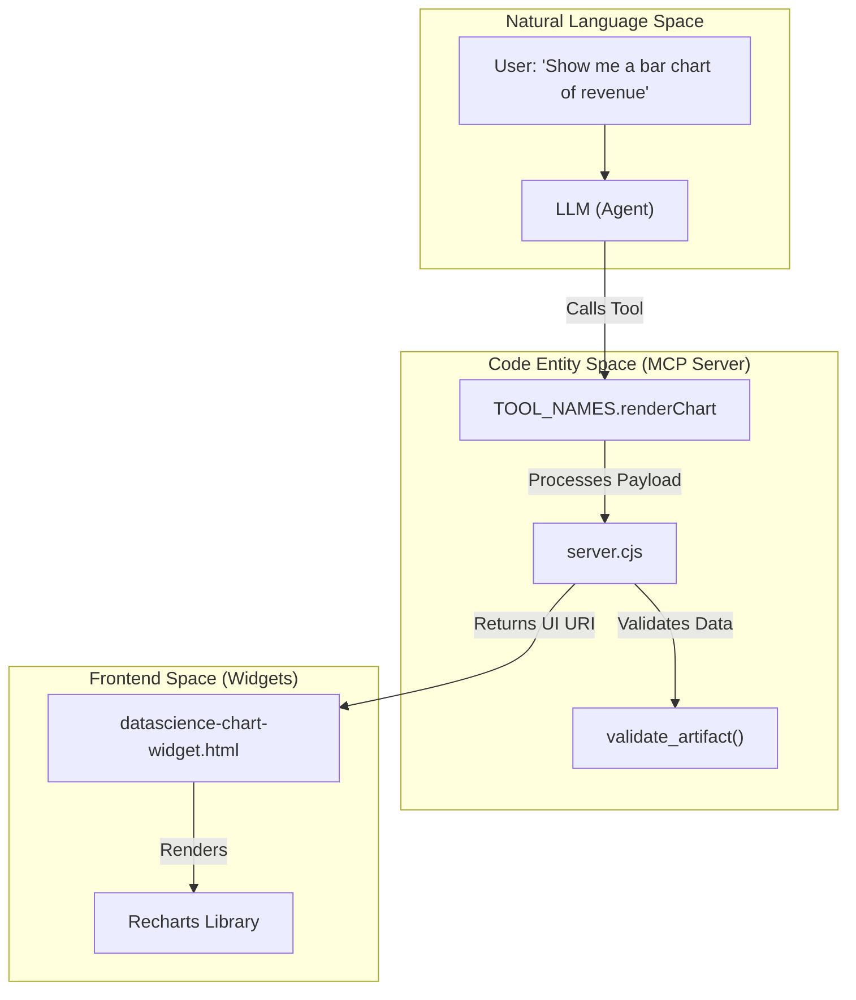
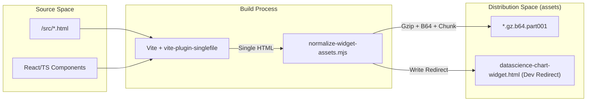

<!-- source: DeepWiki mcp.deepwiki.com · repo openai/role-specific-plugins · page 3.2 MCP Server & Widget Architecture · fetched 2026-10-26 -->

# MCP Server & Widget Architecture

Relevant source files

The following files were used as context for generating this wiki page:

- [plugins/data-analytics/.mcp.json](plugins/data-analytics/.mcp.json)
- [plugins/data-analytics/AGENTS.md](plugins/data-analytics/AGENTS.md)
- [plugins/data-analytics/assets/datascience-artifact-widget.html](plugins/data-analytics/assets/datascience-artifact-widget.html)
- [plugins/data-analytics/assets/datascience-chart-widget.html](plugins/data-analytics/assets/datascience-chart-widget.html)
- [plugins/data-analytics/assets/datascience-table-widget.html](plugins/data-analytics/assets/datascience-table-widget.html)
- [plugins/data-analytics/mcp/server.cjs](plugins/data-analytics/mcp/server.cjs)
- [plugins/data-analytics/package-lock.json](plugins/data-analytics/package-lock.json)
- [plugins/data-analytics/package.json](plugins/data-analytics/package.json)
- [plugins/data-analytics/scripts/normalize-widget-assets.mjs](plugins/data-analytics/scripts/normalize-widget-assets.mjs)

The Data Analytics plugin utilizes a Model Context Protocol (MCP) server to provide high-fidelity, interactive UI components directly within the Codex environment. This architecture separates data processing and validation (the MCP server) from visual presentation (React-based widgets).

## MCP Server Implementation

The `datascienceWidgets` MCP server is the backbone of the plugin's UI capabilities. It is implemented in `plugins/data-analytics/mcp/server.cjs` and communicates via the `stdio` transport [plugins/data-analytics/.mcp.json:24-27]().

### Server Configuration
The server is registered in the `.mcp.json` manifest with specific execution arguments:
*   **Command**: `node` [plugins/data-analytics/.mcp.json:23]()
*   **Entry Point**: `./mcp/server.cjs` [plugins/data-analytics/.mcp.json:25]()
*   **Transport**: `--stdio` [plugins/data-analytics/.mcp.json:26]()

### Core Tools
The server exposes several tools to the LLM for managing widget lifecycles:

| Tool Name | Purpose | Implementation Reference |
| :--- | :--- | :--- |
| `validate_artifact` | Pre-flight check for dashboard/report manifests and snapshots. | [plugins/data-analytics/mcp/server.cjs:35]() |
| `render_artifact` | Hosts a full-screen dashboard or report manifest. | [plugins/data-analytics/mcp/server.cjs:36]() |
| `render_chart` | Renders a compact, declarative chart using Recharts. | [plugins/data-analytics/mcp/server.cjs:38]() |
| `render_table` | Renders a sortable, paginated data table. | [plugins/data-analytics/mcp/server.cjs:39]() |
| `export_artifact_package` | Produces a deployable package for Site Creator. | [plugins/data-analytics/mcp/server.cjs:37]() |

### Resource URIs
Widgets are served via custom `ui://` URIs which the Codex host resolves to the bundled HTML assets:
*   **Table**: `ui://widget/datascience-table.html` [plugins/data-analytics/mcp/server.cjs:28]()
*   **Chart**: `ui://widget/datascience-chart.html` [plugins/data-analytics/mcp/server.cjs:29]()
*   **Artifact**: `ui://widget/datascience-artifact.html` [plugins/data-analytics/mcp/server.cjs:30]()

### Data Flow: From Tool Call to UI
The following diagram illustrates how a natural language request for a visualization transitions into a rendered code entity.

**Visualization Data Flow**

Sources: [plugins/data-analytics/mcp/server.cjs:34-40](), [plugins/data-analytics/mcp/server.cjs:106-110](), [plugins/data-analytics/package.json:33]()

## Widget Types

The architecture supports three distinct widget types, each optimized for different data density and user interaction patterns [plugins/data-analytics/AGENTS.md:5]().

### 1. Chart Widget
A compact visualization card that accepts a declarative chart spec.
*   **Stack**: React + Recharts [plugins/data-analytics/package.json:31-33]().
*   **Capabilities**: Supports line, area, bar, pie, scatter, and funnel charts [plugins/data-analytics/mcp/server.cjs:52-66]().
*   **Expansion**: Expands into a full chart explorer with field wells for re-encoding data [plugins/data-analytics/mcp/server.cjs:141-143]().

### 2. Table Widget
A high-performance grid for reviewing query results.
*   **Limits**: Capped at 500 rows and 80 columns for performance [plugins/data-analytics/mcp/server.cjs:41-42]().
*   **Features**: Sortable columns and lookup row support [plugins/data-analytics/mcp/server.cjs:138]().

### 3. Artifact (Dashboard/Report)
A complex, full-screen workspace for multi-component analysis.
*   **Components**: Combines KPI cards, multiple charts, and markdown blocks [plugins/data-analytics/mcp/server.cjs:163-165]().
*   **Snapshots**: Uses bounded snapshots (max 50 datasets, 2,000 rows/dataset) to ensure stability [plugins/data-analytics/mcp/server.cjs:48-50]().

## Build Pipeline & Asset Normalization

Because MCP plugins must be portable and often face size constraints for inline assets, the Data Analytics plugin uses a specialized build and compression pipeline.

### Vite Pipeline
The frontend is built using Vite with the `vite-plugin-singlefile` to ensure each widget is a self-contained HTML file [plugins/data-analytics/package.json:41]().
*   `npm run build:chart`: Compiles the React chart source into a single HTML file [plugins/data-analytics/package.json:9]().
*   `npm run build:table`: Compiles the table source [plugins/data-analytics/package.json:10]().
*   `npm run build:artifact`: Compiles the dashboard/artifact source [plugins/data-analytics/package.json:8]().

### Asset Normalization
The `normalize-widget-assets.mjs` script processes the built HTML files to prepare them for the MCP server [plugins/data-analytics/scripts/normalize-widget-assets.mjs:1-13]().

1.  **Sanitization**: Replaces internal error strings with user-friendly "Widget error" messages [plugins/data-analytics/scripts/normalize-widget-assets.mjs:44-50]().
2.  **Compression**: Compresses the HTML using Gzip (level 9) and encodes it in Base64 [plugins/data-analytics/scripts/normalize-widget-assets.mjs:20]().
3.  **Chunking**: Splits the resulting string into parts of 120,000 characters to stay within file system or memory limits [plugins/data-analytics/scripts/normalize-widget-assets.mjs:8, 27-31]().
4.  **Part Files**: Saves these as `.gz.b64.partNNN` files in the `assets/` directory [plugins/data-analytics/scripts/normalize-widget-assets.mjs:29-30]().
5.  **Dev Redirects**: Overwrites the original asset files with a small script that redirects to the local development source, allowing for rapid iteration during `npm run dev` [plugins/data-analytics/scripts/normalize-widget-assets.mjs:33, 52-74]().

**Build and Asset Pipeline**

Sources: [plugins/data-analytics/package.json:7-16](), [plugins/data-analytics/scripts/normalize-widget-assets.mjs:15-34]()

## Security and Constraints

The MCP server enforces strict data safety and payload limits to protect user privacy and ensure performance:

*   **PII Protection**: A regex `UNSAFE_FIELD_NAME_PATTERN` blocks fields containing sensitive keywords like `password`, `secret`, `ssn`, or `api_key` [plugins/data-analytics/mcp/server.cjs:74-104]().
*   **Payload Hard Caps**:
    *   Widget payloads: 750 KB [plugins/data-analytics/mcp/server.cjs:47]().
    *   Artifact payloads: 3 MB [plugins/data-analytics/mcp/server.cjs:50]().
    *   Cell strings: 4,000 characters [plugins/data-analytics/mcp/server.cjs:46]().
*   **Visual Warning Thresholds**: Triggers warnings if a chart has too many categories (e.g., >24 bar categories or >8 pie segments) to prevent unreadable visualizations [plugins/data-analytics/mcp/server.cjs:72-73]().

Sources: [plugins/data-analytics/mcp/server.cjs:41-104]()

---

