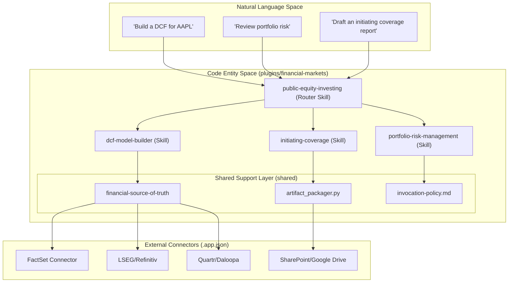
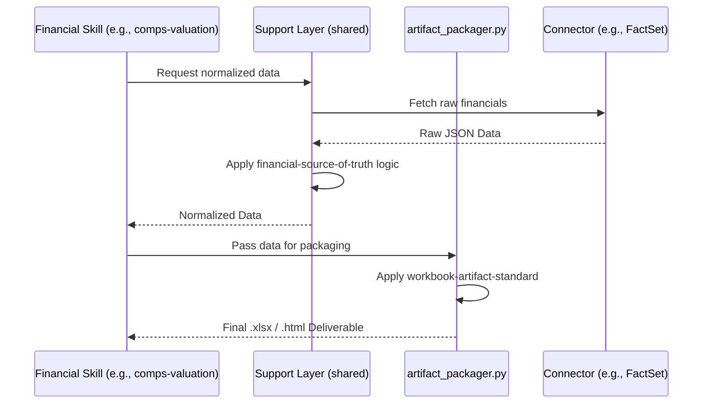

<!-- source: DeepWiki mcp.deepwiki.com · repo openai/role-specific-plugins · page 4 Financial Markets Plugin · fetched 2026-10-26 -->

# Financial Markets Plugin

Relevant source files

The following files were used as context for generating this wiki page:

- [.agents/plugins/marketplace.json](.agents/plugins/marketplace.json)
- [README.md](README.md)

The **Financial Markets Plugin** is a comprehensive toolset designed for public equity investing professionals, including long-only fund managers, long/short hedge fund analysts, sell-side researchers, and ETF/Index strategists. It automates complex financial workflows ranging from earnings analysis and valuation modeling to portfolio risk management and investment memo generation.

The plugin is located in the `plugins/financial-markets/` directory [[.agents/plugins/marketplace.json:47-47]()] and follows the standard plugin structure including a manifest, connector bindings, and a rich library of specialized skills [[README.md:39-46]()].

### Purpose and Target Users
The plugin aims to bridge the gap between raw financial data providers and the final investment deliverables required by investment committees and portfolio managers. It supports:
*   **Buy-Side (Long-Only & Long/Short):** Generating pitches, tracking theses, and managing portfolio risk.
*   **Sell-Side Research:** Initiating coverage, previewing earnings, and maintaining comps sheets.
*   **ETF & Index Teams:** Analyzing economic impacts and event-driven triggers.

### System Architecture Overview

The following diagram illustrates how the Financial Markets Plugin maps natural language investment tasks to specific code entities and external data connectors.

**Financial Markets Entity Mapping**

Sources: [[README.md:22-22](), [plugins/financial-markets/.app.json:1-100]()]

### Invocation Policy & Preflight
The plugin implements a strict **Invocation Policy** defined in the `shared/` directory. Before executing any financial analysis, the system performs a `user-context` preflight check to resolve the user's investment style, coverage universe, and preferred benchmarks. This ensures that deliverables like "Price Targets" or "Risk Sizing" align with the specific mandate of the investment firm.

For details on the 23 specialized skills and the preflight gate, see [Financial Markets Skills & Workflows](#4.1).

### Connector Integrations
The plugin integrates with a wide array of financial data providers and productivity suites via the `.app.json` configuration [[README.md:22-22]()].

| Category | Supported Connectors |
| :--- | :--- |
| **Market Data** | FactSet, LSEG (Refinitiv), Morningstar, S&P Global, PitchBook |
| **Fundamental Data** | Daloopa, Quartr |
| **Collaboration** | Slack, Microsoft Teams |
| **Document Storage** | SharePoint, Google Drive, Gmail |

Sources: [[README.md:22-22]()]

### Shared Standards and Artifacts
To maintain institutional-grade quality, the plugin utilizes a "Support Layer" that standardizes how financial data is processed and presented. This includes Python utilities for generating Excel workbooks and HTML artifacts that follow strict formatting rules.

**Artifact Generation Pipeline**

Sources: [[README.md:39-46]()]

For details on the internal support sub-skills and Python artifact utilities, see [Financial Markets Shared Standards & Support Layer](#4.2).

### Testing and Quality Control
The plugin includes a robust test suite consisting of 37 files to validate everything from DCF formula accuracy to the "PM Judgment" heuristics used in pitch generation.

For details on the test suite and contract validation, see [Financial Markets Tests](#4.3).

---
**Child Pages:**
*   [Financial Markets Skills & Workflows](#4.1)
*   [Financial Markets Shared Standards & Support Layer](#4.2)
*   [Financial Markets Tests](#4.3)

---

