# Page: Overview

# Overview

<details>
<summary>Relevant source files</summary>

The following files were used as context for generating this wiki page:

- [.agents/plugins/marketplace.json](.agents/plugins/marketplace.json)
- [LICENSE](LICENSE)
- [README.md](README.md)
- [SECURITY.md](SECURITY.md)

</details>


The **Role-Specific Plugins** repository provides a collection of templates designed to customize Codex for specialized professional workflows. These plugins package domain-specific skills, connector bindings, and starter assets to streamline tasks for roles such as sales, data analytics, product design, and financial markets [README.md:1-9]().

Each plugin acts as a modular unit that can be installed into a Codex workspace to provide an AI agent with the context, tools, and instructions necessary to perform complex, multi-step industry workflows [README.md:3-9]().

## Repository Structure

The repository is organized by plugin, with a central marketplace manifest defining the available local sources.

### High-Level Layout
The root directory contains the plugin definitions and the marketplace registry.
- `.agents/plugins/marketplace.json`: The central registry defining the plugin names and their local paths [ .agents/plugins/marketplace.json:1-56]().
- `plugins/`: Contains the individual plugin directories [README.md:29-33]().

### Plugin Directory Convention
Each plugin follows a standard internal structure to ensure compatibility with the Codex platform:

| File/Folder | Purpose |
| :--- | :--- |
| `.codex-plugin/plugin.json` | Plugin manifest and display metadata [README.md:40](). |
| `.app.json` | Registry for app and connector bindings [README.md:41](). |
| `.mcp.json` | Model Context Protocol (MCP) server configuration [README.md:42](). |
| `skills/` | Markdown files containing workflow instructions and domain context [README.md:43](). |
| `assets/` | Supporting icons, templates, and binary examples [README.md:44](). |

### Code-to-Workspace Mapping
The following diagram illustrates how the code entities in the repository map to the functional components within a Codex environment.

**Diagram: Repository Entity Mapping**
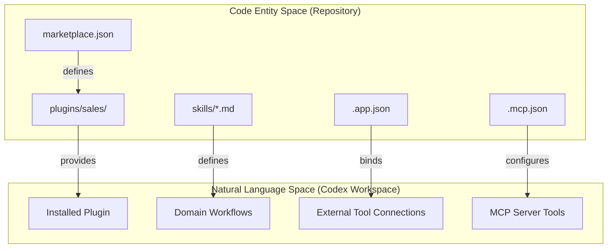
Sources: [.agents/plugins/marketplace.json:1-56](), [README.md:36-46]()

## Included Plugins

The repository currently includes four primary plugins, each targeting a specific professional domain:

| Plugin | Core Functionality | Primary Connectors |
| :--- | :--- | :--- |
| **Sales** | Meeting prep, follow-ups, pipeline review, and deal strategy. | Salesforce, HubSpot, Slack, ZoomInfo [README.md:19](). |
| **Data Analytics** | Data visualization, metric diagnostics, and dashboard building. | Snowflake, Databricks, BigQuery, Mixpanel [README.md:20](). |
| **Product Design** | Prototyping, UI critiques, and spec generation. | Sites [README.md:21](). |
| **Financial Markets** | Earnings analysis, valuation modeling, and investment memos. | FactSet, LSEG, Daloopa, Bloomberg [README.md:22](). |

**Diagram: Plugin Dependency and Connector Flow**
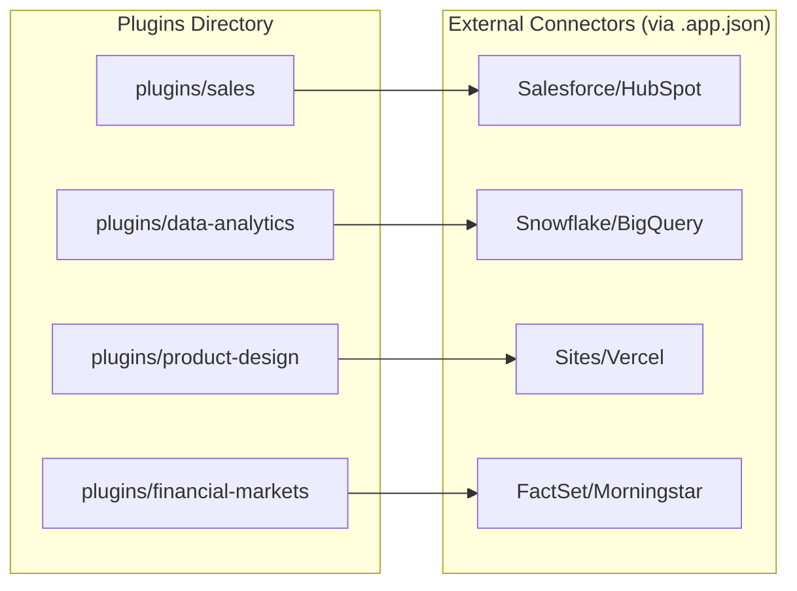
Sources: [README.md:15-22](), [.agents/plugins/marketplace.json:6-55]()

## Getting Started

To use these plugins, you must clone the repository and configure the connector bindings. Many plugins use placeholder IDs in their `.app.json` files (e.g., `REPLACE_WITH_SALESFORCE_APP_OR_CONNECTOR_ID`) which must be updated to match the IDs in your specific workspace [README.md:48-61]().

1. **Clone & Explore**: Review the `plugins/` directory to select the role relevant to your team.
2. **Configure Bindings**: Edit the `.app.json` within your chosen plugin to replace placeholder IDs with your workspace's connector IDs [README.md:63-70]().
3. **Install**: Load the plugin into your Codex environment via the local source path defined in `marketplace.json`.

For detailed setup instructions, including how to handle portable vs. non-portable connector bindings, see **[Getting Started & Configuration](#1.1)**.

For a deep dive into how the `plugin.json` manifest and the `skills/` directory interact to create the user experience, see **[Plugin Framework & Manifest Structure](#1.2)**.

Sources: [README.md:48-78](), [.agents/plugins/marketplace.json:1-56]()

---

# Page: Getting Started & Configuration

# Getting Started & Configuration

<details>
<summary>Relevant source files</summary>

The following files were used as context for generating this wiki page:

- [.agents/plugins/marketplace.json](.agents/plugins/marketplace.json)
- [README.md](README.md)
- [plugins/data-analytics/.app.json](plugins/data-analytics/.app.json)

</details>


This page provides a technical guide for initializing and configuring the `role-specific-plugins` repository. It covers the transition from cloning the source code to deploying functional plugins within a Codex workspace, with a specific focus on the connector binding lifecycle and configuration requirements.

### Repository Initialization

The repository is structured as a multi-plugin monorepo where each plugin is a self-contained unit located under the `plugins/` directory [README.md:24-34](). The marketplace configuration, which governs how these plugins are discovered by the platform, is defined in `.agents/plugins/marketplace.json` [.agents/plugins/marketplace.json:1-56]().

#### Setup Workflow
1. **Clone the Repository**: Obtain the source code from the GitHub repository.
2. **Environment Review**: Ensure you have access to a Codex workspace where you have permissions to install local plugins.
3. **Connector Mapping**: Identify which third-party services (Salesforce, Slack, Snowflake, etc.) are required for your target plugin.
4. **Binding Configuration**: Modify the `.app.json` files within the specific plugin directories to link your workspace's connector instances.

### Connector Configuration & .app.json

Plugins interact with external data through **Connectors**. These connections are defined in a `.app.json` file located at the root of each plugin directory [README.md:41]().

#### Portable vs. Non-Portable Bindings
The framework distinguishes between three types of IDs in the `apps` registry:

| Binding Type | ID Pattern | Action Required |
| :--- | :--- | :--- |
| **Portable (Template)** | `templated_apps_*` | **Leave unchanged.** These refer to global template registries [README.md:71-72](). |
| **Portable (Canonical)** | `connector_*` | **Leave unchanged.** These are shared platform IDs available across workspaces [README.md:71-72](). |
| **Non-Portable (Placeholder)** | `REPLACE_WITH_*` | **Must be replaced.** These are specific to your organization's app installations [README.md:50-61](). |

#### Example: Data Analytics Connector Registry
In `plugins/data-analytics/.app.json`, you will find a mix of these binding types:

*   **Portable Binding**: `google_drive` uses `connector_5f3c8c41a1e54ad7a76272c89e2554fa` [plugins/data-analytics/.app.json:29-31]().
*   **Template Binding**: `snowflake` uses `templated_apps_Snowflake` [plugins/data-analytics/.app.json:40-43]().
*   **Placeholder Binding**: `slack` requires a local workspace ID to replace `REPLACE_WITH_SLACK_APP_OR_CONNECTOR_ID` [plugins/data-analytics/.app.json:3-5]().

**Sources:** [README.md:48-78](), [plugins/data-analytics/.app.json:1-85]()

### Implementation Diagram: Plugin Installation Data Flow

The following diagram illustrates how the local filesystem configuration maps to the Codex platform's internal registry during the installation process.

**Plugin Registration Architecture**
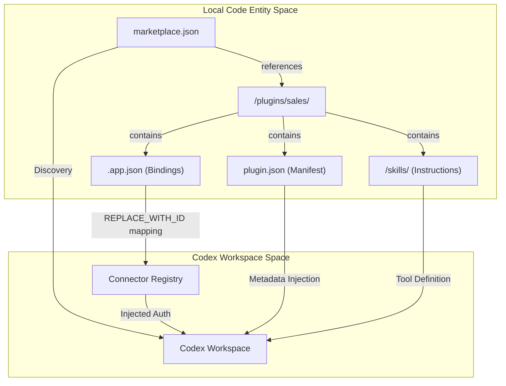
**Sources:** [.agents/plugins/marketplace.json:1-56](), [README.md:36-46](), [README.md:48-61]()

### Handling Optional Connectors

Many plugins define connectors as `optional: true`. If your workspace does not use a specific service (e.g., you use Google Drive but not SharePoint), you have two choices:
1. **Keep and Ignore**: Leave the placeholder as is; the plugin will attempt to initialize but fail gracefully for that specific tool.
2. **Clean Installation**: Remove the entire app block from `.app.json` before installation to prevent the platform from prompting for missing credentials [README.md:76-78]().

### Technical Entity Mapping

This diagram bridges the Natural Language concepts of "Tools" and "Skills" to the specific file entities in the codebase.

**Entity Mapping: Natural Language to Code Space**
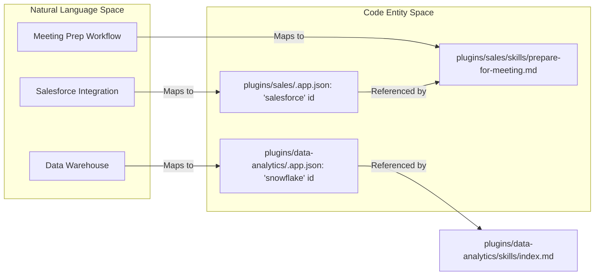
**Sources:** [README.md:17-22](), [plugins/data-analytics/.app.json:1-85](), [README.md:39-46]()

### Installation Steps into Codex

Once `.app.json` is configured with valid IDs:

1.  **Open Codex Workspace**: Navigate to your developer settings or plugin management interface.
2.  **Add Local Plugin**: Point the workspace to the directory containing the `marketplace.json` file.
3.  **Authentication**: Since most plugins are configured with `"authentication": "ON_USE"` [.agents/plugins/marketplace.json:15](), you will be prompted to sign in to the mapped connectors (Salesforce, Slack, etc.) the first time a skill is invoked.
4.  **Verification**: Invoke the `index` skill of the plugin to verify that all connectors are successfully bound and accessible.

**Sources:** [.agents/plugins/marketplace.json:1-56](), [README.md:1-13]()

---

# Page: Plugin Framework & Manifest Structure

# Plugin Framework & Manifest Structure

<details>
<summary>Relevant source files</summary>

The following files were used as context for generating this wiki page:

- [README.md](README.md)
- [plugins/data-analytics/.codex-plugin/plugin.json](plugins/data-analytics/.codex-plugin/plugin.json)
- [plugins/data-analytics/.gitignore](plugins/data-analytics/.gitignore)
- [plugins/data-analytics/.mcp.json](plugins/data-analytics/.mcp.json)

</details>


The Role-Specific Plugins repository utilizes a standardized directory convention to package domain-specific intelligence, external integrations, and user interface components. This framework allows for a modular "plug-and-play" architecture where skills, connector bindings, and Model Context Protocol (MCP) servers are defined declaratively via manifest files.

## Plugin Directory Architecture

Each plugin is contained within a dedicated directory under `plugins/` and follows a consistent structure to ensure compatibility with the Codex workspace environment [README.md:24-34]().

| File/Directory | Purpose |
| :--- | :--- |
| `.codex-plugin/plugin.json` | The primary manifest containing metadata, versioning, and entry points [README.md:40](). |
| `.app.json` | Registry for external application and connector bindings [README.md:41](). |
| `.mcp.json` | Configuration for MCP servers used to provide custom tools or UI widgets [README.md:42](). |
| `skills/` | Markdown-based instruction sets defining specific workflows [README.md:43](). |
| `assets/` | Static resources including icons, templates, and compressed widget bundles [README.md:44](). |

### Sources:
- [README.md:24-46]()

---

## The Plugin Manifest (`plugin.json`)

The `plugin.json` file, located in the `.codex-plugin/` subdirectory, serves as the source of truth for the plugin's identity and capabilities. It maps the high-level plugin definition to the underlying file system entities [plugins/data-analytics/.codex-plugin/plugin.json:1-41]().

### Key Manifest Properties
- **Metadata**: Fields like `name`, `version`, and `description` define how the plugin is indexed [plugins/data-analytics/.codex-plugin/plugin.json:2-4]().
- **Entry Points**: The `skills`, `apps`, and `mcpServers` keys point to the relative paths of their respective configuration files or directories [plugins/data-analytics/.codex-plugin/plugin.json:39-41]().
- **Interface**: The `interface` object controls the plugin's appearance in the Codex UI, including `brandColor`, `composerIcon`, and `defaultPrompt` suggestions [plugins/data-analytics/.codex-plugin/plugin.json:42-65]().

### Manifest to Code Entity Mapping
The following diagram illustrates how the `plugin.json` manifest bridges the Natural Language Space (UI/Descriptions) to the Code Entity Space (Files/Logic).

**Diagram: Manifest Entity Mapping**
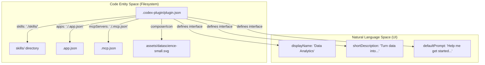
### Sources:
- [plugins/data-analytics/.codex-plugin/plugin.json:1-66]()

---

## Connector Bindings (`.app.json`)

The `.app.json` file manages the lifecycle of external integrations. It acts as a mapping layer between generic application keys (e.g., `salesforce`) and specific environment IDs [README.md:50-55]().

### Binding Types
1.  **Portable Bindings**: IDs starting with `templated_apps_*` or canonical platform IDs. These are pre-configured and should not be modified [README.md:71-74]().
2.  **Placeholder Bindings**: IDs using the `REPLACE_WITH_...` pattern. These require manual intervention by the administrator before activation [README.md:57-61]().

### Activation Flow
The activation of a plugin involves resolving these placeholders to actual connector instances within the target workspace [README.md:63-65]().

**Diagram: Connector Activation Lifecycle**
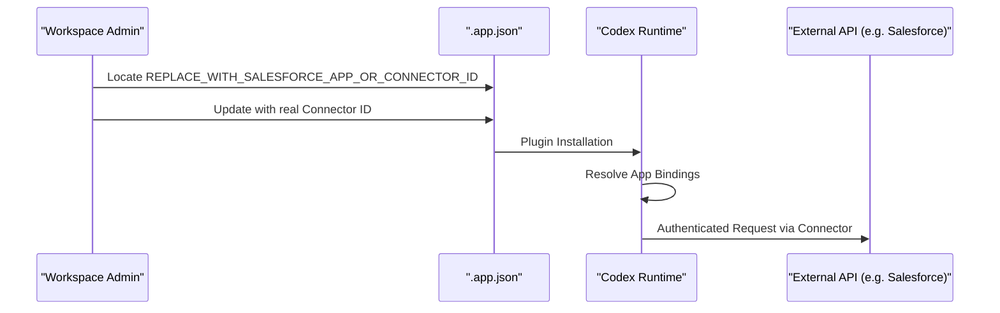
### Sources:
- [README.md:48-78]()

---

## MCP Server Configuration (`.mcp.json`)

For plugins requiring custom UI or complex tool execution, the `.mcp.json` file defines Model Context Protocol servers. This allows the plugin to execute code locally or in a containerized environment to provide "widgets" [plugins/data-analytics/.mcp.json:1-5]().

### Server Definition
The configuration specifies the runtime environment and the entry point for the server:
- **Command**: Typically `node` or `python` [plugins/data-analytics/.mcp.json:23]().
- **Arguments**: Path to the server implementation, such as `./mcp/server.cjs`, and the transport protocol (e.g., `--stdio`) [plugins/data-analytics/.mcp.json:24-27]().
- **CWD**: The current working directory context for the server process [plugins/data-analytics/.mcp.json:22]().

### Sources:
- [plugins/data-analytics/.mcp.json:1-30]()

---

## Skills and Assets

### Skills Directory
The `skills/` directory contains the core logic of the plugin. Each skill is typically a Markdown file that provides the LLM with specific instructions, few-shot examples, and tool-use guidelines [README.md:43](). These are indexed by the plugin and made available as distinct capabilities during a session.

### Assets Directory
The `assets/` directory stores static content:
- **Visuals**: Logos (`.png`) and icons (`.svg`) referenced by the `plugin.json` [plugins/data-analytics/.codex-plugin/plugin.json:62-63]().
- **UI Components**: In the case of the Data Analytics plugin, this directory may contain compressed asset parts for React-based widgets [plugins/data-analytics/.mcp.json:8-20]().

### Sources:
- [README.md:43-44]()
- [plugins/data-analytics/.codex-plugin/plugin.json:62-63]()
- [plugins/data-analytics/.mcp.json:6-21]()

---

# Page: Sales Plugin

# Sales Plugin

<details>
<summary>Relevant source files</summary>

The following files were used as context for generating this wiki page:

- [.agents/plugins/marketplace.json](.agents/plugins/marketplace.json)
- [README.md](README.md)

</details>


The Sales plugin is designed to streamline the daily operations of sales professionals by automating high-frequency workflows such as meeting preparation, post-call follow-ups, and pipeline management. It leverages a suite of domain-specific skills and deep integrations with CRM, messaging, and sales enrichment tools to reduce administrative overhead and improve deal execution.

## Overview and Purpose

The Sales plugin serves as a centralized intelligence layer for sales teams. It is defined in the repository at `plugins/sales` [.agents/plugins/marketplace.json:11](). Its primary purpose is to assist users in navigating the complex sales lifecycle—from initial account research to closing deals and forecasting revenue.

By integrating with tools like Salesforce, HubSpot, Slack, and ZoomInfo [README.md:19](), the plugin allows sales reps to pull real-time data into their workflows without manual context switching.

### Key Capabilities
*   **Meeting Lifecycle:** Automated preparation briefs and post-call follow-up generation.
*   **Strategic Planning:** Deal strategy planning, business case construction, and competitive intelligence.
*   **Pipeline Hygiene:** Account prioritization, signal analysis, and forecast reviews.
*   **Data Enrichment:** Contact and company data enrichment via specialized sales tools.

## Skill Architecture

The Sales plugin follows a modular "Skill" architecture where each workflow is encapsulated in a dedicated instruction set within the `skills/` directory [README.md:43](). 

### Skill Invocation Flow
The plugin uses a routing pattern where a user's intent is mapped to a specific skill. Most workflows are gated by a `user-context` preflight check to ensure the plugin has the necessary background on the rep's territory and current priorities.

The diagram below illustrates how natural language requests transition into the execution of specific code-based skill entities.

**Sales Skill Dispatcher Map**
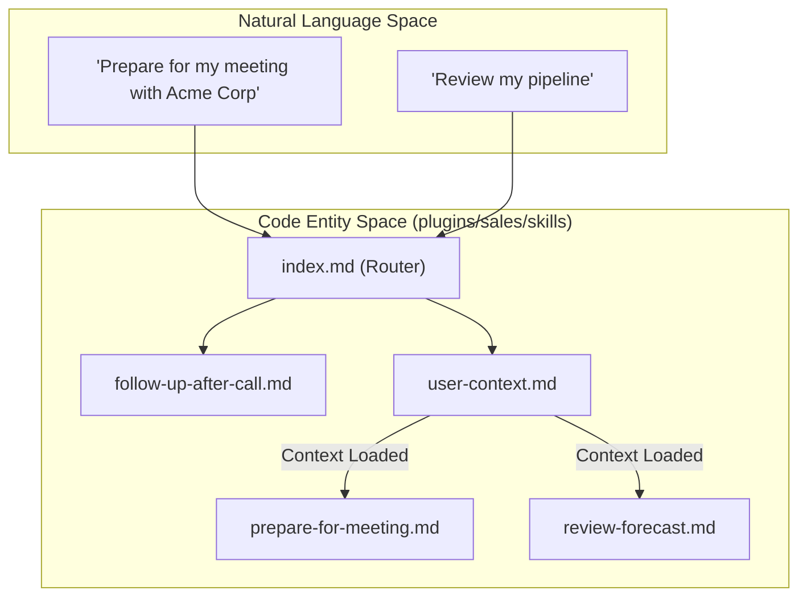
Sources: [README.md:39-46](), [.agents/plugins/marketplace.json:8-12]()

For a complete reference of all available skills and their specific instruction sets, see **[Sales Skills & Workflows (#2.1)](#)**.

## Connector Integrations

The Sales plugin relies on a robust set of connector bindings defined in `.app.json` [README.md:41](). These connectors bridge the gap between the AI's reasoning and the team's system of record (CRM), communication channels, and external data providers.

### Integration Categories
| Category | Supported Tools |
| :--- | :--- |
| **CRM** | Salesforce, HubSpot, Close, Zoho, Pipedrive |
| **Messaging** | Slack, Microsoft Teams, Outreach |
| **Intelligence** | ZoomInfo, Clay, Apollo, Rox, Actively |
| **Productivity** | Google Drive, Gmail, Outlook, Zoom, Fireflies |

**Connector Binding Architecture**
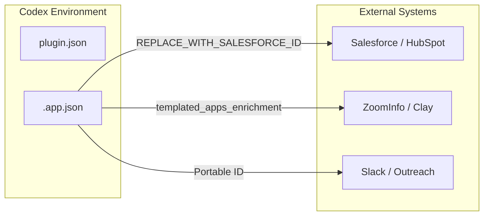
Sources: [README.md:19](), [README.md:53-61]()

### Configuration Note
Many connector bindings in the Sales plugin use placeholder IDs (e.g., `REPLACE_WITH_SALESFORCE_APP_OR_CONNECTOR_ID`) that must be updated to match your specific environment before deployment [README.md:57-68]().

For detailed setup instructions and a registry of portable vs. non-portable IDs, see **[Sales Connector Bindings (#2.2)](#)**.

## Related Pages
*   **[Sales Skills & Workflows (#2.1)](#)**: Deep dive into the logic for `prepare-for-meeting`, `analyze-account-signals`, and more.
*   **[Sales Connector Bindings (#2.2)](#)**: Technical guide for configuring `.app.json` and managing CRM permissions.

---

# Page: Sales Skills & Workflows

# Sales Skills & Workflows

<details>
<summary>Relevant source files</summary>

The following files were used as context for generating this wiki page:

- [plugins/data-analytics/skills/analyze-data-quality/SKILL.md](plugins/data-analytics/skills/analyze-data-quality/SKILL.md)
- [plugins/data-analytics/skills/analyze-data-quality/agents/openai.yaml](plugins/data-analytics/skills/analyze-data-quality/agents/openai.yaml)
- [plugins/data-analytics/skills/index/SKILL.md](plugins/data-analytics/skills/index/SKILL.md)
- [plugins/data-analytics/skills/index/agents/openai.yaml](plugins/data-analytics/skills/index/agents/openai.yaml)
- [plugins/data-analytics/skills/user-context/SKILL.md](plugins/data-analytics/skills/user-context/SKILL.md)
- [plugins/data-analytics/skills/user-context/agents/openai.yaml](plugins/data-analytics/skills/user-context/agents/openai.yaml)

</details>


The Sales plugin provides a suite of specialized skills designed to automate and enhance common sales activities, from meeting preparation and deal strategy to forecast reviews and competitive intelligence. Each skill is grounded in connected company data (CRM, meeting notes, messaging) to ensure outputs are specific to the user's accounts and opportunities.

## Technical Architecture & Invocation Pattern

All Sales workflows follow a standardized invocation pattern centered around a mandatory preflight gate. This ensures that every action is informed by the user's specific context, saved preferences, and connected data sources.

### User Context Preflight Gate
Before any Sales skill executes its primary logic, it must invoke the `user-context` skill in preflight mode. This gate loads durable source-routing preferences, onboarding progress, and account-specific context.

*   **Implementation**: Preflight is typically handled by a dedicated script (e.g., `scripts/sales_preflight.py` or equivalent) that reads from `$CODEX_HOME/state/plugins/{marketplace_id}/{plugin_id}/user-context.md` [plugins/data-analytics/skills/user-context/SKILL.md:12-15]().
*   **Data Flow**: The preflight returns a `sales_preflight` envelope containing `source_preferences`, `connector_setup_summary`, and `final_obligations` [plugins/data-analytics/skills/user-context/SKILL.md:15-15]().

### The Index Router
The `index` skill serves as the primary entry point for the plugin. It analyzes natural language intent to route the user to the most appropriate focused skill.

*   **Routing Logic**: It applies Source Discovery and Verification across CRM, documents, and communication lanes before selecting a response mode (`inline` for quick lookups or `report` for deep analysis) [plugins/data-analytics/skills/index/SKILL.md:44-66]().

### Natural Language to Code Entity Mapping

The following diagram illustrates how user requests are mapped to specific code entities and skills within the Sales plugin.

**Sales Skill Routing Map**
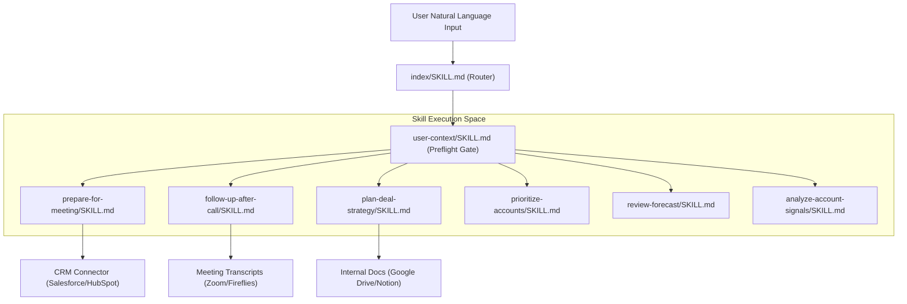
**Sources:** [plugins/data-analytics/skills/index/SKILL.md:1-66](), [plugins/data-analytics/skills/user-context/SKILL.md:1-38]()

---

## Sales Skill Catalog

### Account & Deal Management

| Skill | Purpose | Key Data Sources |
| :--- | :--- | :--- |
| `prepare-for-meeting` | Generates briefings including recent news, CRM history, and stakeholder bios. | CRM, LinkedIn, News APIs |
| `plan-deal-strategy` | Identifies blockers, champions, and next steps for specific opportunities. | CRM, Slack/Teams, Internal Docs |
| `prioritize-accounts` | Ranks accounts based on intent signals, firmographics, and recent activity. | CRM, Enrichment (ZoomInfo/6sense) |
| `analyze-account-signals` | Detects "buying signals" from external news or internal product usage data. | News, Product Analytics, CRM |

### Post-Call & Execution

| Skill | Purpose | Key Data Sources |
| :--- | :--- | : :--- |
| `follow-up-after-call` | Drafts personalized follow-up emails and updates CRM fields based on call transcripts. | Meeting Notes, CRM, Email |
| `get-rep-call-feedback` | Analyzes call recordings for coaching moments (objection handling, discovery quality). | Meeting Transcripts |
| `suggest-sales-next-step` | Predicts the most effective next action based on historical winning patterns. | CRM Historical Data |

### Strategy & Intelligence

| Skill | Purpose | Key Data Sources |
| :--- | :--- | :--- |
| `build-competitive-brief` | Synthesizes competitor strengths/weaknesses against the user's value prop. | Battlecards, Web Search |
| `build-business-case` | Creates ROI models and justification decks for prospects. | Spreadsheets, Templates |
| `find-customer-quotes` | Locates relevant testimonials or case studies based on the prospect's industry/use-case. | Marketing Docs, CMS |

### Sales Operations

| Skill | Purpose | Key Data Sources |
| :--- | :--- | :--- |
| `review-forecast` | Analyzes pipeline health, identifies "at-risk" deals, and validates close dates. | CRM Forecast, Activity Logs |
| `review-rep-call-trends` | Aggregates themes across multiple calls (e.g., "competitor X is appearing more"). | Aggregate Transcripts |
| `enrich-company-and-contact-data` | Fills missing CRM fields (emails, titles, revenue) using third-party providers. | ZoomInfo, Apollo, Clay |

**Sources:** [plugins/data-analytics/skills/index/SKILL.md:1-3](), [plugins/data-analytics/skills/analyze-data-quality/SKILL.md:2-3]()

---

## Data Flow: From Intent to Artifact

The following diagram details the internal data flow when a user invokes a complex skill like `plan-deal-strategy`.

**Detailed Skill Data Flow**
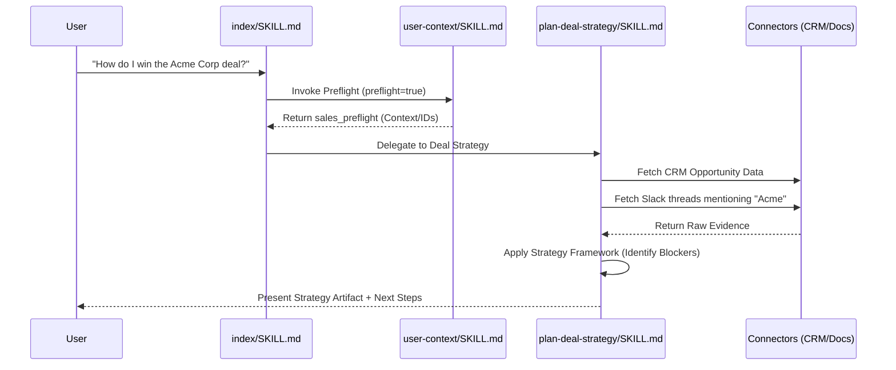
**Sources:** [plugins/data-analytics/skills/index/SKILL.md:46-59](), [plugins/data-analytics/skills/user-context/SKILL.md:33-38]()

## Quality & Validation Standards

For skills involving data analysis (like `review-forecast` or `analyze-account-signals`), the plugin incorporates a **Data Quality Gate** [plugins/data-analytics/skills/analyze-data-quality/SKILL.md:6-9]().

1.  **Trust Assessment**: Before reporting pipeline risks, the skill assesses whether the CRM data is "trustworthy" (e.g., checking for stale close dates or missing mandatory fields) [plugins/data-analytics/skills/analyze-data-quality/SKILL.md:8-9]().
2.  **Compact Profiling**: It builds a profile of the dataset (row counts, null rates in "Amount" fields) to identify anomalies before interpretation [plugins/data-analytics/skills/analyze-data-quality/SKILL.md:31-35]().
3.  **Remediation**: If quality is low, the skill recommends the "smallest useful remediation" (e.g., "Update these 5 deals with missing amounts before forecasting") [plugins/data-analytics/skills/analyze-data-quality/SKILL.md:73-75]().

**Sources:** [plugins/data-analytics/skills/analyze-data-quality/SKILL.md:1-98]()

---

# Page: Sales Connector Bindings

# Sales Connector Bindings

<details>
<summary>Relevant source files</summary>

The following files were used as context for generating this wiki page:

- [README.md](README.md)
- [plugins/data-analytics/.app.json](plugins/data-analytics/.app.json)

</details>


The Sales plugin relies on a robust registry of external service integrations defined in its connector bindings. These bindings bridge the natural language requests of a sales representative (e.g., "Find my next meeting in Zoom") to specific API entities within the Codex environment. The configuration is primarily managed through the `.app.json` file located in the plugin root [plugins/sales/.app.json]().

## Connector Registry Overview

The Sales plugin categorizes its connectors into five functional domains: CRM, Meeting Intelligence, Messaging, Enrichment, and Productivity. These connectors are defined in the `apps` object within `.app.json`.

### CRM Systems
These connectors serve as the primary source of truth for account, lead, and opportunity data.

| System | Binding ID Type | Portability |
| :--- | :--- | :--- |
| **Salesforce** | `REPLACE_WITH_SALESFORCE_APP_OR_CONNECTOR_ID` | Placeholder (Requires Manual Update) |
| **HubSpot** | `connector_*` | Portable |
| **Close** | `connector_*` | Portable |
| **Zoho CRM** | `connector_*` | Portable |
| **Pipedrive** | `connector_*` | Portable |

### Meeting & Messaging Tools
Used for extracting meeting transcripts, scheduling follow-ups, and internal team coordination.

| System | Binding ID Type | Description |
| :--- | :--- | :--- |
| **Zoom** | `connector_*` | Meeting audio/video and transcripts. |
| **Granola** | `connector_*` | AI-enhanced meeting notes. |
| **Fireflies** | `connector_*` | Automated transcription and search. |
| **Otter.ai** | `connector_*` | Live transcription and notes. |
| **Slack** | `REPLACE_WITH_SLACK_APP_OR_CONNECTOR_ID` | Internal communication and deal rooms. |
| **Microsoft Teams** | `connector_*` | Video conferencing and chat. |

### Enrichment & Prospecting
These tools provide external data signals to build business cases and find new contacts.

| System | Binding ID Type | Category |
| :--- | :--- | :--- |
| **ZoomInfo** | `connector_*` | B2B Intelligence |
| **Clay** | `connector_*` | Data Orchestration |
| **Apollo** | `connector_*` | Lead Generation |
| **Rox** | `connector_*` | AI Sales Signals |
| **Actively** | `connector_*` | Intent Monitoring |

### Productivity & Documents
Standard office suite integrations for calendars, email, and document storage.

| System | Binding ID Type | Role |
| :--- | :--- | :--- |
| **Google Drive** | `connector_*` | Proposal and deck storage. |
| **Gmail** | `connector_*` | Customer correspondence. |
| **Outlook** | `connector_*` | Enterprise email and calendar. |

Sources: [README.md:17-22](), [README.md:50-61]()

## Implementation and Data Flow

The Sales plugin uses these bindings to resolve skill requirements during the execution of a workflow. When a skill like `prepare-for-meeting` is invoked, the system references `.app.json` to identify which specific connector instance should be used to fetch the latest account notes.

### Connector Resolution Logic
The following diagram illustrates how the system resolves a connector binding from a skill request to the external API.

**Diagram: Connector Binding Resolution Flow**
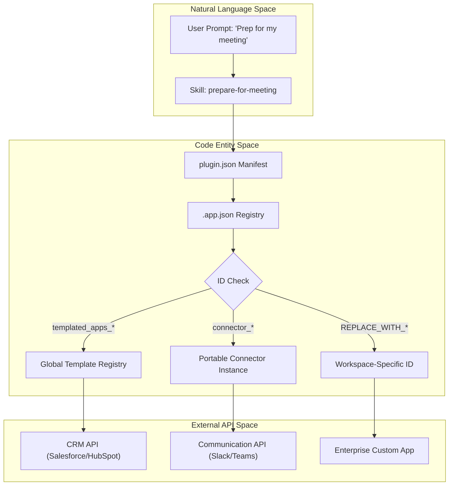
Sources: [README.md:36-46](), [README.md:50-61]()

## Placeholder vs. Portable IDs

The `.app.json` configuration distinguishes between IDs that are "portable" (shared across all Codex environments) and "placeholders" (which must be generated per workspace).

### 1. Placeholder IDs
Placeholders use the prefix `REPLACE_WITH_`. These are typically used for applications where the connector must be manually authenticated or created within the specific target workspace [README.md:50-61]().
*   **Salesforce:** `REPLACE_WITH_SALESFORCE_APP_OR_CONNECTOR_ID` [README.md:68-68]().
*   **Slack:** `REPLACE_WITH_SLACK_APP_OR_CONNECTOR_ID` [plugins/data-analytics/.app.json:3-5]().

### 2. Portable IDs
Portable IDs allow the plugin to function "out of the box" if the connector is already globally registered or uses a standard template [README.md:71-74]().
*   **Connector Prefix:** `connector_` followed by a UUID (e.g., `connector_5f3c8c41...` for Google Drive) [plugins/data-analytics/.app.json:29-31]().
*   **Templated Apps:** `templated_apps_` followed by the service name (e.g., `templated_apps_Databricks`) [plugins/data-analytics/.app.json:32-35]().

### 3. Optional Bindings
Many connectors in the Sales registry are marked with `"optional": true`. This allows the plugin to remain functional even if a workspace does not utilize every supported tool (e.g., a team using HubSpot instead of Salesforce) [plugins/data-analytics/.app.json:7-9]().

**Diagram: Binding Structure in .app.json**
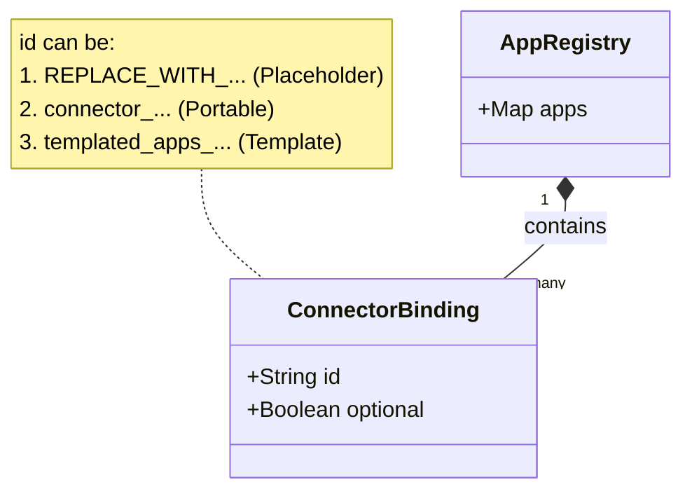
Sources: [README.md:53-61](), [plugins/data-analytics/.app.json:1-84]()

## Configuration Workflow

To initialize the Sales connector bindings:
1.  **Identify Required Apps:** Review the `.app.json` and determine which CRM and messaging tools the team uses.
2.  **Replace Placeholders:** Navigate to the Codex workspace settings, locate the App ID or Connector ID for Salesforce/Slack, and update the `.app.json` file [README.md:63-65]().
3.  **Prune Unused Apps:** If a connector is not used by the team and is not required for core skills, it can be removed from the `apps` object to reduce noise [README.md:76-78]().

Sources: [README.md:48-78]()

---

# Page: Data Analytics Plugin

# Data Analytics Plugin

<details>
<summary>Relevant source files</summary>

The following files were used as context for generating this wiki page:

- [plugins/data-analytics/.codex-plugin/plugin.json](plugins/data-analytics/.codex-plugin/plugin.json)
- [plugins/data-analytics/AGENTS.md](plugins/data-analytics/AGENTS.md)
- [plugins/data-analytics/DEPENDENCIES.MD](plugins/data-analytics/DEPENDENCIES.MD)
- [plugins/data-analytics/README.md](plugins/data-analytics/README.md)

</details>


The Data Analytics plugin is designed to turn complex analytical questions into validated answers, interactive dashboards, and executive-ready reports. It enables users to understand product and business performance, diagnose metric movements, and establish data-driven measurement plans.

The plugin operates as a tool-agnostic framework that uses "lane placeholders" to interact with various data sources, ranging from enterprise data warehouses to local spreadsheets and uploaded files [[plugins/data-analytics/DEPENDENCIES.MD:3-8](), [plugins/data-analytics/.codex-plugin/plugin.json:42-45]()].

## Core Capabilities

*   **Metric Diagnostics & KPI Design**: Identify drivers behind metric changes and design measurement frameworks with outcome metrics, guardrails, and targets [[plugins/data-analytics/README.md:28-29](), [plugins/data-analytics/.codex-plugin/plugin.json:17-19]()].
*   **Interactive Visualization**: Generate production-ready charts, tables, and dashboards using a specialized MCP widget architecture [[plugins/data-analytics/README.md:31-34](), [plugins/data-analytics/AGENTS.md:3-5]()].
*   **Automated Reporting**: Create polished analytical reports and reproducible Jupyter/SQL notebooks [[plugins/data-analytics/README.md:33-35]()].
*   **Data Quality & Validation**: Assess table reliability (grain, freshness, missingness) and perform QA on existing analyses [[plugins/data-analytics/README.md:37-38]()].

## Architecture Overview

The plugin architecture bridges high-level natural language requests to specific technical implementations via an MCP (Model Context Protocol) server and a React-based widget system.

### Data Analytics System Flow
The following diagram illustrates how the plugin maps user intent to code entities and external data connectors.

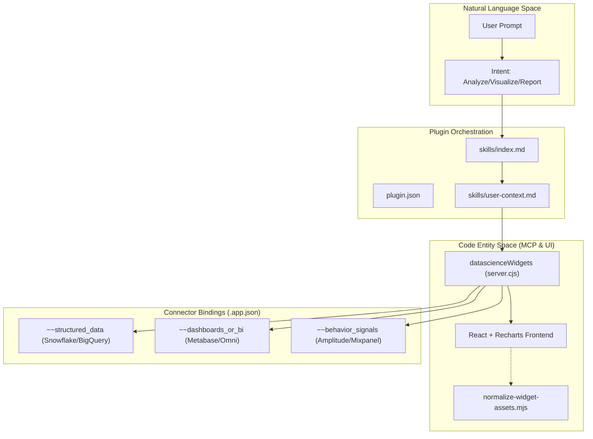
Sources: [plugins/data-analytics/.codex-plugin/plugin.json:39-42](), [plugins/data-analytics/AGENTS.md:16-20](), [plugins/data-analytics/DEPENDENCIES.MD:11-16]()

## Skill Catalog & Workflows

The plugin's functionality is partitioned into specialized skills located in the `skills/` directory. Every workflow is preceded by a mandatory `user-context` preflight gate to ensure the AI has access to the necessary data sources and business definitions.

| Workflow | Key Skill | Result |
| :--- | :--- | :--- |
| **Product/Business Analysis** | `product-business-analysis` | Decision-ready analysis with evidence and recommendations. |
| **Metric Diagnostics** | `metric-diagnostics` | Calibrated explanation of drivers and contributors. |
| **KPI Design** | `design-kpis` | Measurement plan with targets and validation priorities. |
| **Dashboard Building** | `build-dashboard` | Source-backed dashboard with filters and visual hierarchy. |
| **Analytical Reporting** | `build-report` | Polished report with answer-first narrative and charts. |

For a full reference of all 13+ skills and the mandatory preflight gate, see [Data Analytics Skills & Workflows (#3.1)](#).
Sources: [plugins/data-analytics/README.md:25-38](), [plugins/data-analytics/.codex-plugin/plugin.json:39-39]()

## MCP Widget Architecture

The plugin utilizes a custom MCP server (`datascienceWidgets`) to render interactive UI components. This architecture distinguishes between **inline widgets** (focused views of query results) and **fullscreen artifacts** (snapshot-first workspaces) [[plugins/data-analytics/AGENTS.md:3-5]()].

*   **Server**: Built on `server.cjs` using stdio transport.
*   **Frontend**: React + Recharts stack following a strict design contract defined in `tokens.css` and `codex-theme.css`.
*   **Build System**: A Vite-based pipeline and `normalize-widget-assets.mjs` script produce compressed `.gz.b64` assets for efficient plugin delivery.

For details on the server implementation and asset pipeline, see [MCP Server & Widget Architecture (#3.2)](#).
Sources: [plugins/data-analytics/AGENTS.md:9-10](), [plugins/data-analytics/AGENTS.md:16-20]()

## Connector Bindings

The Data Analytics plugin is "tool-agnostic," using lane placeholders (e.g., `~~structured_data`) to interact with various providers. These are mapped in the `.app.json` registry [[plugins/data-analytics/DEPENDENCIES.MD:3-5]()].

### Connector Mapping Logic
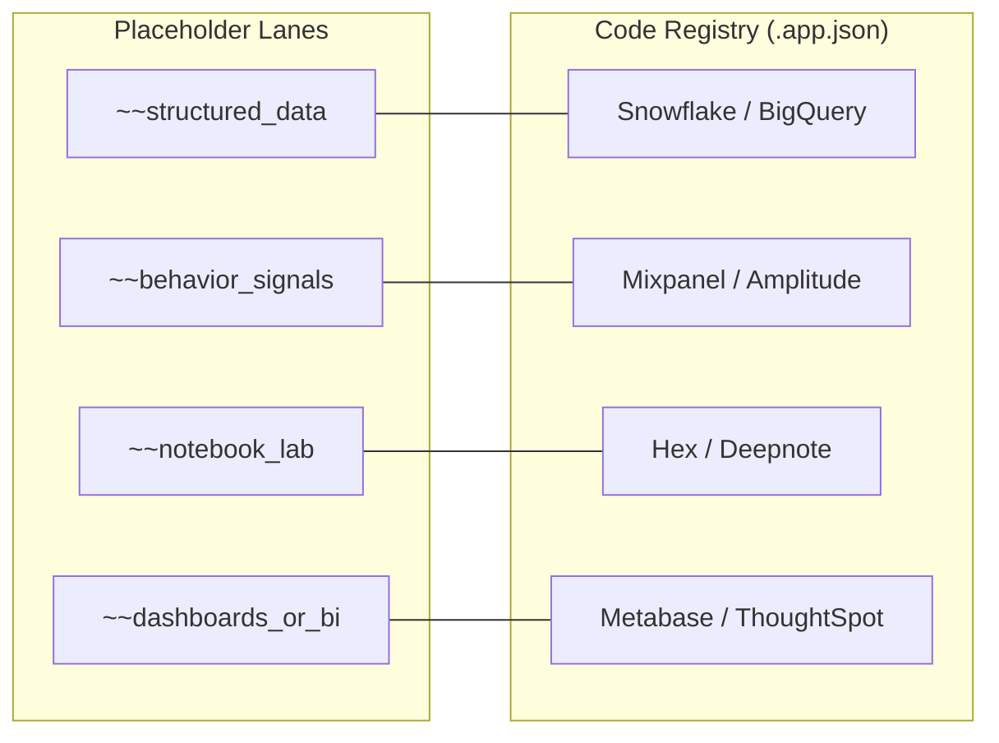
Sources: [plugins/data-analytics/DEPENDENCIES.MD:11-16](), [plugins/data-analytics/.codex-plugin/plugin.json:40-40]()

For documentation on the connector registry and placeholder patterns, see [Data Analytics Connector Bindings (#3.4)](#).

## Design System & Testing

The plugin follows a local Codex style contract to ensure visual consistency across metric cards, chart blocks, and report layouts. The test suite covers chart transformations, Recharts configurations, and MCP server contract compliance [[plugins/data-analytics/AGENTS.md:9-10](), [plugins/data-analytics/AGENTS.md:16-18]()].

For details on color tokens and the test suite, see [Data Analytics Design System & Testing (#3.3)](#).

---

# Page: Data Analytics Skills & Workflows

# Data Analytics Skills & Workflows

<details>
<summary>Relevant source files</summary>

The following files were used as context for generating this wiki page:

- [plugins/data-analytics/DEPENDENCIES.MD](plugins/data-analytics/DEPENDENCIES.MD)
- [plugins/data-analytics/skills/analyze-data-quality/SKILL.md](plugins/data-analytics/skills/analyze-data-quality/SKILL.md)
- [plugins/data-analytics/skills/build-dashboard/SKILL.md](plugins/data-analytics/skills/build-dashboard/SKILL.md)
- [plugins/data-analytics/skills/build-report/SKILL.md](plugins/data-analytics/skills/build-report/SKILL.md)
- [plugins/data-analytics/skills/design-kpis/SKILL.md](plugins/data-analytics/skills/design-kpis/SKILL.md)
- [plugins/data-analytics/skills/gather-business-context/SKILL.md](plugins/data-analytics/skills/gather-business-context/SKILL.md)
- [plugins/data-analytics/skills/index/SKILL.md](plugins/data-analytics/skills/index/SKILL.md)
- [plugins/data-analytics/skills/jupyter-notebooks/SKILL.md](plugins/data-analytics/skills/jupyter-notebooks/SKILL.md)
- [plugins/data-analytics/skills/kpi-reporting/SKILL.md](plugins/data-analytics/skills/kpi-reporting/SKILL.md)
- [plugins/data-analytics/skills/market-sizing/SKILL.md](plugins/data-analytics/skills/market-sizing/SKILL.md)
- [plugins/data-analytics/skills/metric-diagnostics/SKILL.md](plugins/data-analytics/skills/metric-diagnostics/SKILL.md)
- [plugins/data-analytics/skills/product-business-analysis/SKILL.md](plugins/data-analytics/skills/product-business-analysis/SKILL.md)
- [plugins/data-analytics/skills/spreadsheets/SKILL.md](plugins/data-analytics/skills/spreadsheets/SKILL.md)
- [plugins/data-analytics/skills/user-context/SKILL.md](plugins/data-analytics/skills/user-context/SKILL.md)
- [plugins/data-analytics/skills/user-context/plugin-author-config/automation-config.md](plugins/data-analytics/skills/user-context/plugin-author-config/automation-config.md)
- [plugins/data-analytics/skills/user-context/plugin-author-config/source-category-config.json](plugins/data-analytics/skills/user-context/plugin-author-config/source-category-config.json)
- [plugins/data-analytics/skills/user-context/plugin-author-config/user-context-config.md](plugins/data-analytics/skills/user-context/plugin-author-config/user-context-config.md)

</details>


This page serves as the high-level reference for the Data Analytics plugin's skill architecture and operational workflows. The plugin is designed to be tool-agnostic, utilizing "lane placeholders" to interface with various data sources while maintaining consistent analytical standards across diverse environments.

## Overview of Analytics Skills

The Data Analytics plugin organizes its capabilities into specialized skills, each governed by a mandatory preflight gate. These skills range from low-level data quality assessments to high-level executive reporting.

### Core Analytical Skills
*   **[analyze-data-quality](plugins/data-analytics/skills/analyze-data-quality/SKILL.md)**: Assesses trustworthiness of datasets (nulls, duplicates, schema drift) before modeling or analysis [plugins/data-analytics/skills/analyze-data-quality/SKILL.md:1-10]().
*   **[metric-diagnostics](plugins/data-analytics/skills/metric-diagnostics/SKILL.md)**: Investigates why metrics move, quantifying drivers and validating hypotheses [plugins/data-analytics/skills/metric-diagnostics/SKILL.md:6-10]().
*   **[product-business-analysis](plugins/data-analytics/skills/product-business-analysis/SKILL.md)**: Provides evidence-backed recommendations for product decisions and opportunity sizing [plugins/data-analytics/skills/product-business-analysis/SKILL.md:6-10]().
*   **[design-kpis](plugins/data-analytics/skills/design-kpis/SKILL.md)**: Framework for defining success metrics, guardrails, and measurement plans [plugins/data-analytics/skills/design-kpis/SKILL.md:6-9]().
*   **[market-sizing](plugins/data-analytics/skills/market-sizing/SKILL.md)**: Estimates TAM/SAM/SOM using top-down or bottom-up modeling [plugins/data-analytics/skills/market-sizing/SKILL.md:6-10]().

### Delivery & Interface Skills
*   **[build-report](plugins/data-analytics/skills/build-report/SKILL.md)**: Orchestrates the creation of durable narratives (MCP or HTML). For details, see [Build-Report Skill & Export Scripts](#3.1.1) [plugins/data-analytics/skills/build-report/SKILL.md:6-12]().
*   **[build-dashboard](plugins/data-analytics/skills/build-dashboard/SKILL.md)**: Builds monitoring views across BI platforms, MCP widgets, or Streamlit [plugins/data-analytics/skills/build-dashboard/SKILL.md:6-13]().
*   **[jupyter-notebooks](plugins/data-analytics/skills/jupyter-notebooks/SKILL.md)**: Manages `.ipynb` artifacts for reproducible research and data-quality checks [plugins/data-analytics/skills/jupyter-notebooks/SKILL.md:6-9]().
*   **[spreadsheets](plugins/data-analytics/skills/spreadsheets/SKILL.md)**: Handles Excel/Google Sheets workflows for modeling and stakeholder-friendly tables.

## The User-Context Preflight Gate

Every Data Analytics skill is required to invoke the `user-context` skill in **preflight mode** before executing any tools or drafting responses [plugins/data-analytics/skills/index/SKILL.md:48-51](). This gate provides the `data_analytics_preflight` envelope, which serves as the source of truth for:
1.  **Saved Context**: User preferences and historical context.
2.  **Source-Category Mapping**: Mapping of generic placeholders (e.g., `~~structured_data`) to specific connector IDs.
3.  **Semantic-Layer Registry**: Definitions for metrics and business logic.

### Skill Invocation Flow
The following diagram illustrates how the `index` router coordinates with the `user-context` gate and specific skills.

**Skill Routing and Preflight Flow**
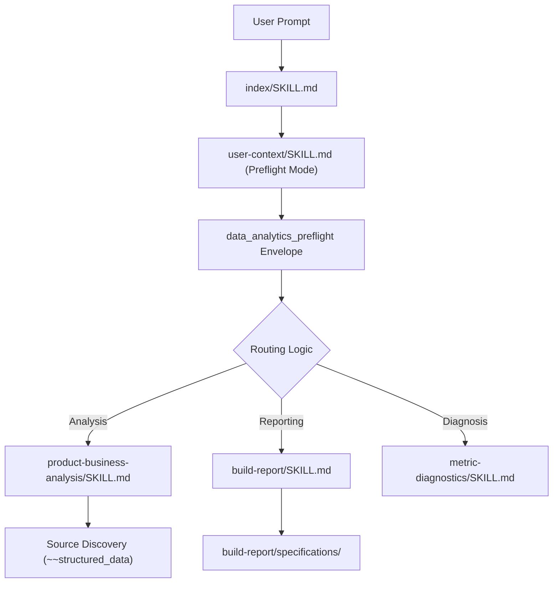
Sources: [plugins/data-analytics/skills/index/SKILL.md:46-59](), [plugins/data-analytics/skills/user-context/SKILL.md:1-15]()

## Source-Category Lanes & Tool Agnosticism

The plugin uses "lane placeholders" to remain tool-agnostic. Instead of hardcoding a specific database, the skills refer to `~~structured_data`, which the preflight gate resolves to the user's connected warehouse (e.g., Snowflake, BigQuery) [plugins/data-analytics/DEPENDENCIES.MD:3-7]().

| Placeholder | Purpose | Typical Providers |
| :--- | :--- | :--- |
| `~~structured_data` | Querying tables and schemas | Snowflake, Databricks, BigQuery |
| `~~behavior_signals` | Event trends and funnels | Amplitude, Mixpanel |
| `~~dashboards_or_bi` | Inspecting BI metadata | Metabase, ThoughtSpot, Omni |
| `~~notebook_lab` | Code-heavy exploration | Hex, Deepnote, Jupyter |

Sources: [plugins/data-analytics/DEPENDENCIES.MD:11-27]()

## Semantic Layer & Source Discovery

Skills must prioritize the **Semantic Layer** identified in the preflight envelope [plugins/data-analytics/skills/build-dashboard/SKILL.md:22-25](). This layer acts as a map for metrics, joins, and filters. However, skills are prohibited from relying solely on the semantic layer; they must perform **Live Source Discovery** to verify data through fresh queries against the resolved lanes [plugins/data-analytics/skills/index/SKILL.md:16-25]().

**Data Source Resolution Pattern**
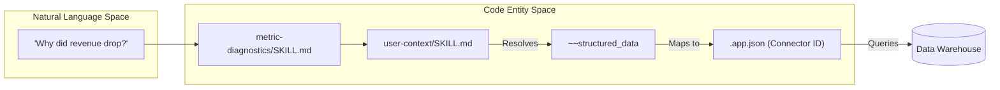
Sources: [plugins/data-analytics/skills/metric-diagnostics/SKILL.md:13-35](), [plugins/data-analytics/DEPENDENCIES.MD:3-7]()

## Detailed Sub-Pages

### [Build-Report Skill & Export Scripts](#3.1.1)
Covers the `build-report` skill, which handles the transition from raw analysis to polished deliverables. This includes the Python-based pipeline for Google Docs/Slides export and the HTML shell templates used for portable reports. For details, see [Build-Report Skill & Export Scripts](#3.1.1).

---

# Page: Build-Report Skill & Export Scripts

# Build-Report Skill & Export Scripts

<details>
<summary>Relevant source files</summary>

The following files were used as context for generating this wiki page:

- [plugins/data-analytics/skills/build-report/SKILL.md](plugins/data-analytics/skills/build-report/SKILL.md)
- [plugins/data-analytics/skills/build-report/agents/openai.yaml](plugins/data-analytics/skills/build-report/agents/openai.yaml)
- [plugins/data-analytics/skills/build-report/assets/executive-report-shell.html](plugins/data-analytics/skills/build-report/assets/executive-report-shell.html)
- [plugins/data-analytics/skills/build-report/assets/technical-report-shell.html](plugins/data-analytics/skills/build-report/assets/technical-report-shell.html)
- [plugins/data-analytics/skills/build-report/report-to-google-doc/SKILL.md](plugins/data-analytics/skills/build-report/report-to-google-doc/SKILL.md)
- [plugins/data-analytics/skills/build-report/report-to-google-doc/agents/openai.yaml](plugins/data-analytics/skills/build-report/report-to-google-doc/agents/openai.yaml)
- [plugins/data-analytics/skills/build-report/report-to-google-doc/scripts/report_to_google_doc/__init__.py](plugins/data-analytics/skills/build-report/report-to-google-doc/scripts/report_to_google_doc/__init__.py)
- [plugins/data-analytics/skills/build-report/report-to-google-doc/scripts/report_to_google_doc/cli.py](plugins/data-analytics/skills/build-report/report-to-google-doc/scripts/report_to_google_doc/cli.py)
- [plugins/data-analytics/skills/build-report/report-to-google-doc/scripts/report_to_google_doc/constants.py](plugins/data-analytics/skills/build-report/report-to-google-doc/scripts/report_to_google_doc/constants.py)
- [plugins/data-analytics/skills/build-report/report-to-google-doc/scripts/report_to_google_doc/docx_writer.py](plugins/data-analytics/skills/build-report/report-to-google-doc/scripts/report_to_google_doc/docx_writer.py)
- [plugins/data-analytics/skills/build-report/report-to-google-doc/scripts/report_to_google_doc/html_parser.py](plugins/data-analytics/skills/build-report/report-to-google-doc/scripts/report_to_google_doc/html_parser.py)
- [plugins/data-analytics/skills/build-report/report-to-google-doc/scripts/report_to_google_doc/model.py](plugins/data-analytics/skills/build-report/report-to-google-doc/scripts/report_to_google_doc/model.py)
- [plugins/data-analytics/skills/build-report/report-to-google-doc/scripts/report_to_google_doc/plan.py](plugins/data-analytics/skills/build-report/report-to-google-doc/scripts/report_to_google_doc/plan.py)
- [plugins/data-analytics/skills/build-report/report-to-google-doc/scripts/report_to_google_doc/quality.py](plugins/data-analytics/skills/build-report/report-to-google-doc/scripts/report_to_google_doc/quality.py)
- [plugins/data-analytics/skills/build-report/report-to-google-doc/scripts/report_to_google_doc/rendering.py](plugins/data-analytics/skills/build-report/report-to-google-doc/scripts/report_to_google_doc/rendering.py)
- [plugins/data-analytics/skills/build-report/report-to-google-doc/scripts/report_to_google_doc/table_utils.py](plugins/data-analytics/skills/build-report/report-to-google-doc/scripts/report_to_google_doc/table_utils.py)
- [plugins/data-analytics/skills/build-report/report-to-google-doc/scripts/report_to_google_doc/utils.py](plugins/data-analytics/skills/build-report/report-to-google-doc/scripts/report_to_google_doc/utils.py)
- [plugins/data-analytics/skills/build-report/report-to-google-doc/scripts/report_to_google_doc_plan.py](plugins/data-analytics/skills/build-report/report-to-google-doc/scripts/report_to_google_doc_plan.py)
- [plugins/data-analytics/skills/build-report/report-to-google-slides/SKILL.md](plugins/data-analytics/skills/build-report/report-to-google-slides/SKILL.md)
- [plugins/data-analytics/skills/build-report/report-to-google-slides/agents/openai.yaml](plugins/data-analytics/skills/build-report/report-to-google-slides/agents/openai.yaml)
- [plugins/data-analytics/skills/build-report/report-to-google-slides/scripts/report_to_google_slides.py](plugins/data-analytics/skills/build-report/report-to-google-slides/scripts/report_to_google_slides.py)
- [plugins/data-analytics/skills/build-report/report-to-pdf/SKILL.md](plugins/data-analytics/skills/build-report/report-to-pdf/SKILL.md)
- [plugins/data-analytics/skills/build-report/report-to-pdf/agents/openai.yaml](plugins/data-analytics/skills/build-report/report-to-pdf/agents/openai.yaml)
- [plugins/data-analytics/skills/build-report/specifications/executive-report.md](plugins/data-analytics/skills/build-report/specifications/executive-report.md)
- [plugins/data-analytics/skills/build-report/specifications/mcp-app-report.md](plugins/data-analytics/skills/build-report/specifications/mcp-app-report.md)
- [plugins/data-analytics/skills/build-report/specifications/technical-report.md](plugins/data-analytics/skills/build-report/specifications/technical-report.md)

</details>


The `build-report` skill is the primary completion contract for the Data Analytics plugin. It transforms reviewed evidence, notebooks, and data analysis into polished, audience-specific deliverables [plugins/data-analytics/skills/build-report/SKILL.md:3-10](). It supports two primary delivery modes: a native **MCP App Report** for in-Codex viewing and a **Portable HTML Report** for external sharing and conversion [plugins/data-analytics/skills/build-report/SKILL.md:18-24]().

## Skill Architecture & Report Modes

The skill operates as a structured pipeline that enforces audience-specific standards through rigid specifications.

### Delivery Modes
*   **`mcp-app`**: The default mode. It renders a Data Analytics MCP artifact within the Codex environment [plugins/data-analytics/skills/build-report/SKILL.md:20-20]().
*   **`html`**: Used for portability, file sharing, or as a source for export scripts. In this mode, charts must be static PNGs generated via Seaborn [plugins/data-analytics/skills/build-report/SKILL.md:21-24]().

### Audience Specifications
Before drafting, the skill must read exactly one audience specification [plugins/data-analytics/skills/build-report/SKILL.md:36-44]():
1.  **Executive Report (`product stakeholders`)**: Answer-first narrative, linear layout, and actionable next steps [plugins/data-analytics/skills/build-report/specifications/executive-report.md]().
2.  **Technical Report (`technical`)**: Methods-first, including metric definitions, methodology, and robustness checks [plugins/data-analytics/skills/build-report/specifications/technical-report.md]().

### Report Structure Diagram
This diagram maps the logical report sections defined in the specifications to the HTML shell templates used for generation.

Title: Report Structure to Code Template Mapping
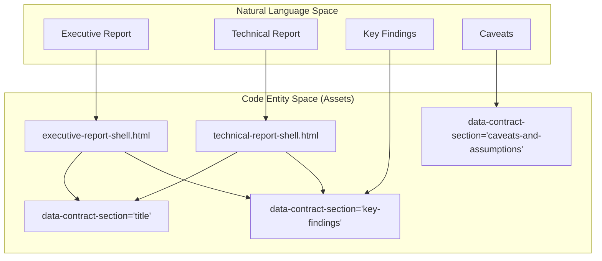
Sources: [plugins/data-analytics/skills/build-report/assets/executive-report-shell.html:29-66](), [plugins/data-analytics/skills/build-report/assets/technical-report-shell.html:20-64](), [plugins/data-analytics/skills/build-report/SKILL.md:40-42]()

---

## Report-to-Google-Doc Pipeline

The `report-to-google-doc` skill is a specialized sub-skill that converts an existing HTML report into a `.docx` file and uploads it to Google Drive [plugins/data-analytics/skills/build-report/report-to-google-doc/SKILL.md:3-9]().

### Implementation Detail
The conversion is handled by a Python pipeline located in `plugins/data-analytics/skills/build-report/report-to-google-doc/scripts/report_to_google_doc/`.

| Component | Responsibility |
| :--- | :--- |
| `html_parser.py` | Uses `BeautifulSoup` to extract headings, tables, and inline styles (bold, italic, code, links) [plugins/data-analytics/skills/build-report/report-to-google-doc/scripts/report_to_google_doc/html_parser.py:7-135](). |
| `docx_writer.py` | Uses `python-docx` to generate the Word document, applying styles and embedding images [plugins/data-analytics/skills/build-report/report-to-google-doc/scripts/report_to_google_doc/docx_writer.py:7-13]() |
| `rendering.py` | Handles SVG-to-PNG conversion for charts using Cairo or Playwright [plugins/data-analytics/skills/build-report/report-to-google-doc/scripts/report_to_google_doc/constants.py:44-61](). |
| `plan.py` | Orchestrates the `write_outputs` function to produce the `manifest.json` and `report.docx` [plugins/data-analytics/skills/build-report/report-to-google-doc/scripts/report_to_google_doc/cli.py:19-20](). |

### Data Flow: HTML to Google Drive
The pipeline follows a strict "Local First" approach where the conversion happens entirely on the local filesystem before interacting with the Google Drive MCP.

Title: Report Conversion Data Flow
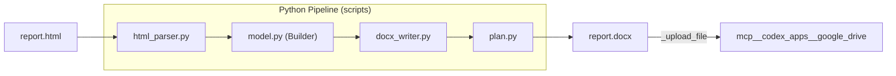
Sources: [plugins/data-analytics/skills/build-report/report-to-google-doc/SKILL.md:27-58](), [plugins/data-analytics/skills/build-report/report-to-google-doc/scripts/report_to_google_doc/cli.py:1-12](), [plugins/data-analytics/skills/build-report/report-to-google-doc/scripts/report_to_google_doc/model.py:7-31]()

---

## Export Scripts & Sub-Skills

In addition to Google Docs, the plugin supports export to PDF and Google Slides.

### Report to PDF
*   **Skill**: `report-to-pdf`
*   **Mechanism**: Converts the HTML report into a PDF deliverable [plugins/data-analytics/skills/build-report/report-to-pdf/SKILL.md:2-3]().
*   **Usage**: Triggered when the user requires a fixed-layout, non-editable document.

### Report to Google Slides
*   **Skill**: `report-to-google-slides`
*   **Mechanism**: Uses `scripts/report_to_google_slides.py` to parse the HTML report and generate a presentation [plugins/data-analytics/skills/build-report/report-to-google-slides/SKILL.md:2-3]().
*   **Workflow**: Maps report sections to slide titles and findings to bullet points or visual frames.

### Quality Control (QC)
The `quality.py` script in the Python pipeline performs preflight checks before any upload occurs. It validates [plugins/data-analytics/skills/build-report/report-to-google-doc/SKILL.md:38-48]():
*   **Heading Counts**: Ensures the `manifest.json` matches the source HTML structure.
*   **Image Integrity**: Verifies that rendered charts are not blank or corrupted.
*   **Table Widths**: Ensures tables fit within the standard `DOC_CONTENT_WIDTH_PT` (511.2pt) [plugins/data-analytics/skills/build-report/report-to-google-doc/scripts/report_to_google_doc/constants.py:14-14]().

Sources: [plugins/data-analytics/skills/build-report/report-to-google-doc/SKILL.md:38-48](), [plugins/data-analytics/skills/build-report/report-to-pdf/SKILL.md:1-5](), [plugins/data-analytics/skills/build-report/report-to-google-slides/SKILL.md:1-5]()

---

# Page: MCP Server & Widget Architecture

# MCP Server & Widget Architecture

<details>
<summary>Relevant source files</summary>

The following files were used as context for generating this wiki page:

- [plugins/data-analytics/.mcp.json](plugins/data-analytics/.mcp.json)
- [plugins/data-analytics/AGENTS.md](plugins/data-analytics/AGENTS.md)
- [plugins/data-analytics/assets/datascience-artifact-widget.html](plugins/data-analytics/assets/datascience-artifact-widget.html)
- [plugins/data-analytics/assets/datascience-chart-widget.html](plugins/data-analytics/assets/datascience-chart-widget.html)
- [plugins/data-analytics/assets/datascience-table-widget.html](plugins/data-analytics/assets/datascience-table-widget.html)
- [plugins/data-analytics/mcp/server.cjs](plugins/data-analytics/mcp/server.cjs)
- [plugins/data-analytics/package-lock.json](plugins/data-analytics/package-lock.json)
- [plugins/data-analytics/package.json](plugins/data-analytics/package.json)
- [plugins/data-analytics/scripts/normalize-widget-assets.mjs](plugins/data-analytics/scripts/normalize-widget-assets.mjs)

</details>


The Data Analytics plugin utilizes a Model Context Protocol (MCP) server to provide high-fidelity, interactive UI components directly within the Codex environment. This architecture separates data processing and validation (the MCP server) from visual presentation (React-based widgets).

## MCP Server Implementation

The `datascienceWidgets` MCP server is the backbone of the plugin's UI capabilities. It is implemented in `plugins/data-analytics/mcp/server.cjs` and communicates via the `stdio` transport [plugins/data-analytics/.mcp.json:24-27]().

### Server Configuration
The server is registered in the `.mcp.json` manifest with specific execution arguments:
*   **Command**: `node` [plugins/data-analytics/.mcp.json:23]()
*   **Entry Point**: `./mcp/server.cjs` [plugins/data-analytics/.mcp.json:25]()
*   **Transport**: `--stdio` [plugins/data-analytics/.mcp.json:26]()

### Core Tools
The server exposes several tools to the LLM for managing widget lifecycles:

| Tool Name | Purpose | Implementation Reference |
| :--- | :--- | :--- |
| `validate_artifact` | Pre-flight check for dashboard/report manifests and snapshots. | [plugins/data-analytics/mcp/server.cjs:35]() |
| `render_artifact` | Hosts a full-screen dashboard or report manifest. | [plugins/data-analytics/mcp/server.cjs:36]() |
| `render_chart` | Renders a compact, declarative chart using Recharts. | [plugins/data-analytics/mcp/server.cjs:38]() |
| `render_table` | Renders a sortable, paginated data table. | [plugins/data-analytics/mcp/server.cjs:39]() |
| `export_artifact_package` | Produces a deployable package for Site Creator. | [plugins/data-analytics/mcp/server.cjs:37]() |

### Resource URIs
Widgets are served via custom `ui://` URIs which the Codex host resolves to the bundled HTML assets:
*   **Table**: `ui://widget/datascience-table.html` [plugins/data-analytics/mcp/server.cjs:28]()
*   **Chart**: `ui://widget/datascience-chart.html` [plugins/data-analytics/mcp/server.cjs:29]()
*   **Artifact**: `ui://widget/datascience-artifact.html` [plugins/data-analytics/mcp/server.cjs:30]()

### Data Flow: From Tool Call to UI
The following diagram illustrates how a natural language request for a visualization transitions into a rendered code entity.

**Visualization Data Flow**
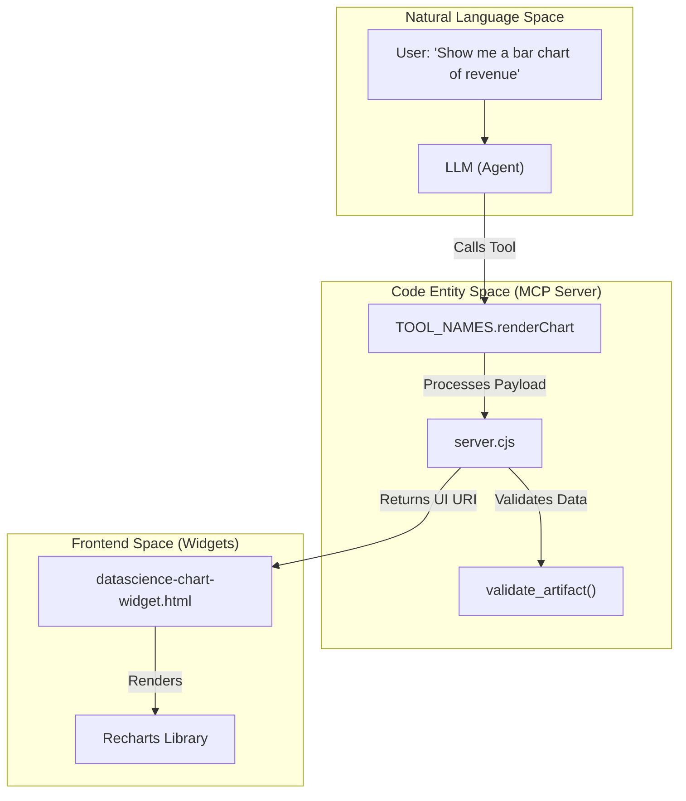
Sources: [plugins/data-analytics/mcp/server.cjs:34-40](), [plugins/data-analytics/mcp/server.cjs:106-110](), [plugins/data-analytics/package.json:33]()

## Widget Types

The architecture supports three distinct widget types, each optimized for different data density and user interaction patterns [plugins/data-analytics/AGENTS.md:5]().

### 1. Chart Widget
A compact visualization card that accepts a declarative chart spec.
*   **Stack**: React + Recharts [plugins/data-analytics/package.json:31-33]().
*   **Capabilities**: Supports line, area, bar, pie, scatter, and funnel charts [plugins/data-analytics/mcp/server.cjs:52-66]().
*   **Expansion**: Expands into a full chart explorer with field wells for re-encoding data [plugins/data-analytics/mcp/server.cjs:141-143]().

### 2. Table Widget
A high-performance grid for reviewing query results.
*   **Limits**: Capped at 500 rows and 80 columns for performance [plugins/data-analytics/mcp/server.cjs:41-42]().
*   **Features**: Sortable columns and lookup row support [plugins/data-analytics/mcp/server.cjs:138]().

### 3. Artifact (Dashboard/Report)
A complex, full-screen workspace for multi-component analysis.
*   **Components**: Combines KPI cards, multiple charts, and markdown blocks [plugins/data-analytics/mcp/server.cjs:163-165]().
*   **Snapshots**: Uses bounded snapshots (max 50 datasets, 2,000 rows/dataset) to ensure stability [plugins/data-analytics/mcp/server.cjs:48-50]().

## Build Pipeline & Asset Normalization

Because MCP plugins must be portable and often face size constraints for inline assets, the Data Analytics plugin uses a specialized build and compression pipeline.

### Vite Pipeline
The frontend is built using Vite with the `vite-plugin-singlefile` to ensure each widget is a self-contained HTML file [plugins/data-analytics/package.json:41]().
*   `npm run build:chart`: Compiles the React chart source into a single HTML file [plugins/data-analytics/package.json:9]().
*   `npm run build:table`: Compiles the table source [plugins/data-analytics/package.json:10]().
*   `npm run build:artifact`: Compiles the dashboard/artifact source [plugins/data-analytics/package.json:8]().

### Asset Normalization
The `normalize-widget-assets.mjs` script processes the built HTML files to prepare them for the MCP server [plugins/data-analytics/scripts/normalize-widget-assets.mjs:1-13]().

1.  **Sanitization**: Replaces internal error strings with user-friendly "Widget error" messages [plugins/data-analytics/scripts/normalize-widget-assets.mjs:44-50]().
2.  **Compression**: Compresses the HTML using Gzip (level 9) and encodes it in Base64 [plugins/data-analytics/scripts/normalize-widget-assets.mjs:20]().
3.  **Chunking**: Splits the resulting string into parts of 120,000 characters to stay within file system or memory limits [plugins/data-analytics/scripts/normalize-widget-assets.mjs:8, 27-31]().
4.  **Part Files**: Saves these as `.gz.b64.partNNN` files in the `assets/` directory [plugins/data-analytics/scripts/normalize-widget-assets.mjs:29-30]().
5.  **Dev Redirects**: Overwrites the original asset files with a small script that redirects to the local development source, allowing for rapid iteration during `npm run dev` [plugins/data-analytics/scripts/normalize-widget-assets.mjs:33, 52-74]().

**Build and Asset Pipeline**
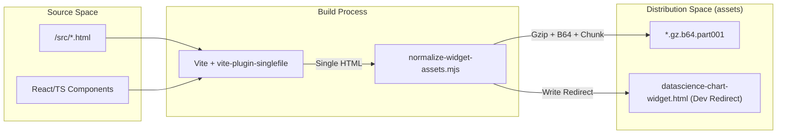
Sources: [plugins/data-analytics/package.json:7-16](), [plugins/data-analytics/scripts/normalize-widget-assets.mjs:15-34]()

## Security and Constraints

The MCP server enforces strict data safety and payload limits to protect user privacy and ensure performance:

*   **PII Protection**: A regex `UNSAFE_FIELD_NAME_PATTERN` blocks fields containing sensitive keywords like `password`, `secret`, `ssn`, or `api_key` [plugins/data-analytics/mcp/server.cjs:74-104]().
*   **Payload Hard Caps**:
    *   Widget payloads: 750 KB [plugins/data-analytics/mcp/server.cjs:47]().
    *   Artifact payloads: 3 MB [plugins/data-analytics/mcp/server.cjs:50]().
    *   Cell strings: 4,000 characters [plugins/data-analytics/mcp/server.cjs:46]().
*   **Visual Warning Thresholds**: Triggers warnings if a chart has too many categories (e.g., >24 bar categories or >8 pie segments) to prevent unreadable visualizations [plugins/data-analytics/mcp/server.cjs:72-73]().

Sources: [plugins/data-analytics/mcp/server.cjs:41-104]()

---

# Page: Data Analytics Design System & Testing

# Data Analytics Design System & Testing

<details>
<summary>Relevant source files</summary>

The following files were used as context for generating this wiki page:

- [plugins/data-analytics/AGENTS.md](plugins/data-analytics/AGENTS.md)
- [plugins/data-analytics/assets/datascience-small.svg](plugins/data-analytics/assets/datascience-small.svg)
- [plugins/data-analytics/assets/datascience.png](plugins/data-analytics/assets/datascience.png)
- [plugins/data-analytics/assets/datascience.svg](plugins/data-analytics/assets/datascience.svg)
- [plugins/data-analytics/skills/spreadsheets/assets/file-spreadsheet.png](plugins/data-analytics/skills/spreadsheets/assets/file-spreadsheet.png)
- [plugins/data-analytics/skills/spreadsheets/charts.md](plugins/data-analytics/skills/spreadsheets/charts.md)
- [plugins/data-analytics/skills/spreadsheets/references/artifact_tool_api.md](plugins/data-analytics/skills/spreadsheets/references/artifact_tool_api.md)
- [plugins/data-analytics/skills/spreadsheets/style_guidelines.md](plugins/data-analytics/skills/spreadsheets/style_guidelines.md)

</details>


This page documents the design contract, visual tokens, and testing infrastructure for the Data Analytics plugin. The system is built around a "snapshot-first" architecture for fullscreen artifacts, complemented by compact inline widgets for charts and tables [plugins/data-analytics/AGENTS.md:3-5]().

## Analytics Design System

The design system is governed by a local Codex style contract that defines how analytics surfaces should look and behave. The visual baseline is established by `codex-theme.css`, which is extended by analytics-specific tokens [plugins/data-analytics/AGENTS.md:9-10]().

### Visual Tokens & Theming
The styling hierarchy ensures that shared controls (typography, spacing, borders, shadows) resolve through Codex tokens, while analytics-specific extensions handle complex data visualizations [plugins/data-analytics/AGENTS.md:10]().

| Layer | File Path | Role |
| :--- | :--- | :--- |
| **Baseline** | `src/styles/codex-theme.css` | Fallback baseline for all Codex plugins. |
| **Extension** | `src/analytics-app/tokens.css` | Analytics-specific overrides for charts, KPI states, and layouts. |
| **Contract** | `src/codex-style-contract.md` | Human-readable specification for visual consistency. |

### Component Specifications
The system defines specific behaviors for different data surfaces:
*   **Metric Cards:** Focused views for high-level KPIs.
*   **Chart Blocks:** Interactive visualizations using the Recharts stack [plugins/data-analytics/AGENTS.md:10]().
*   **Table Lists:** Structured data views with support for large datasets.
*   **Fullscreen Surfaces:** Inline widgets expose a top-right control to enter fullscreen mode, which is then hidden once active [plugins/data-analytics/AGENTS.md:12-14]().

### Spreadsheet Artifact Design
For deliverables involving Excel/Spreadsheets, the design system shifts to a document-centric layout [plugins/data-analytics/skills/spreadsheets/style_guidelines.md:23-24]().

**Visual Hierarchy Levels:**
1.  **Page Title Band:** Large type, strong fill, often merged [plugins/data-analytics/skills/spreadsheets/style_guidelines.md:33]().
2.  **Section Header Bands:** Distinct fill, bold text, clear alignment [plugins/data-analytics/skills/spreadsheets/style_guidelines.md:34]().
3.  **Body Area:** Neutral surface with restrained styling [plugins/data-analytics/skills/spreadsheets/style_guidelines.md:35]().

**Sources:** [plugins/data-analytics/AGENTS.md:1-21](), [plugins/data-analytics/skills/spreadsheets/style_guidelines.md:1-82]()

---

## Data Flow: Natural Language to Design Entity

This diagram illustrates how user requests for data visualization are transformed into themed code entities within the plugin architecture.

### Visualization Pipeline
```mermaid
graph TD
    subgraph "Natural Language Space"
        UserReq["User: 'Create a dashboard'"]
        UserStyle["User: 'Use corporate colors'"]
    end

    subgraph "Code Entity Space"
        Skill["build-dashboard skill"]
        Tokens["tokens.css / codex-theme.css"]
        Recharts["Recharts Config"]
        ExcelAPI["@oai/artifact-tool"]
    end

    UserReq --> Skill
    UserStyle --> Tokens
    Skill --> Recharts
    Skill --> ExcelAPI
    Tokens -.->|"Informs"| Recharts
    Tokens -.->|"Informs"| ExcelAPI
```
**Sources:** [plugins/data-analytics/AGENTS.md:9-10](), [plugins/data-analytics/skills/spreadsheets/references/artifact_tool_api.md:1-50]()

---

## Spreadsheet & Chart Testing

The testing suite ensures that generated artifacts (specifically workbooks and charts) meet functional and aesthetic requirements before export.

### Chart Validation Logic
Charts must be verified for "readability over decoration" [plugins/data-analytics/skills/spreadsheets/charts.md:3](). The following checks are mandatory before a chart is considered "ready":
*   **Source Binding:** Must chart from a bounded helper range where the first row is headers [plugins/data-analytics/skills/spreadsheets/charts.md:8]().
*   **Visual Integrity:** Checks for blank charts, stale ranges, or clipped labels [plugins/data-analytics/skills/spreadsheets/charts.md:15]().
*   **Consistency:** Single-series line charts must use consistent colors and marker styles [plugins/data-analytics/skills/spreadsheets/charts.md:23]().

### The Artifact Tool API
The `@oai/artifact-tool` provides the programmatic interface for inspecting and testing workbooks.

| Function | File Path | Purpose |
| :--- | :--- | :--- |
| `workbook.inspect()` | [plugins/data-analytics/skills/spreadsheets/references/artifact_tool_api.md:113-125]() | Generates a compact summary of sheets, tables, and formulas. |
| `workbook.trace()` | [plugins/data-analytics/skills/spreadsheets/references/artifact_tool_api.md:65]() | Audits the dependency tree from an output cell back to source data. |
| `sheet.render()` | [plugins/data-analytics/skills/spreadsheets/references/artifact_tool_api.md:79]() | Visual verification of the workbook state. |

**Sources:** [plugins/data-analytics/skills/spreadsheets/charts.md:1-32](), [plugins/data-analytics/skills/spreadsheets/references/artifact_tool_api.md:52-135]()

---

## System Architecture: Widget Rendering

This diagram shows the relationship between the MCP server and the widget rendering harness.

### Render Harness Architecture
```mermaid
graph LR
    subgraph "MCP Server (datascienceWidgets)"
        ServerCJS["server.cjs"]
        Transform["chart-transforms"]
    end

    subgraph "Widget Frontend"
        Harness["Widget Render Harness"]
        Vite["Vite Build Pipeline"]
        Normalize["normalize-widget-assets.mjs"]
    end

    ServerCJS -->|"JSON Data"| Transform
    Transform -->|"Normalized Props"| Harness
    Harness -->|"React Components"| Vite
    Vite -->|"Build Artifacts"| Normalize
    Normalize -->|"Base64 Parts"| AssetsDir["assets/"]
```
**Sources:** [plugins/data-analytics/AGENTS.md:18-20](), [plugins/data-analytics/skills/spreadsheets/references/artifact_tool_api.md:14-50]()

---

## Development & Test Workflows

The development cycle relies on a suite of NPM scripts to maintain alignment between source code and the serialized assets used by the plugin.

*   **Preview:** `npm run preview:widgets` provides a local environment for testing UI changes [plugins/data-analytics/AGENTS.md:18]().
*   **Build:** `npm run build` synchronizes the `assets/` directory with normalized bundle parts [plugins/data-analytics/AGENTS.md:20]().
*   **Validation:** `npm run typecheck` and `npm test` cover the MCP server and widget contract integrity [plugins/data-analytics/AGENTS.md:18]().

**Sources:** [plugins/data-analytics/AGENTS.md:16-21]()

---

# Page: Data Analytics Connector Bindings

# Data Analytics Connector Bindings

<details>
<summary>Relevant source files</summary>

The following files were used as context for generating this wiki page:

- [plugins/data-analytics/.app.json](plugins/data-analytics/.app.json)
- [plugins/data-analytics/.codex-plugin/plugin.json](plugins/data-analytics/.codex-plugin/plugin.json)
- [plugins/data-analytics/DEPENDENCIES.MD](plugins/data-analytics/DEPENDENCIES.MD)

</details>


The Data Analytics plugin utilizes a centralized connector registry to bridge natural language analytical requests with specific data platforms, BI tools, and collaboration suites. These bindings are defined in the `.app.json` file and mapped to abstract "analysis lanes" within the plugin's skills.

## Overview of Connector Architecture

The plugin architecture is designed to be tool-agnostic, using **lane placeholders** (e.g., `~~structured_data`) in skill definitions to represent categories of tools [plugins/data-analytics/DEPENDENCIES.MD:3-7](). The `.app.json` file serves as the registry that maps these abstract lanes to concrete application IDs or connector instances [plugins/data-analytics/.codex-plugin/plugin.json:40-40]().

### Binding Categories and Lanes

The following table maps the abstract placeholders used in the plugin's logic to the providers registered in the connector registry:

| Category | Placeholder | Registered Providers in `.app.json` |
| :--- | :--- | :--- |
| **Data Warehouse** | `~~structured_data` | Databricks, BigQuery, Snowflake [plugins/data-analytics/DEPENDENCIES.MD:13-13]() |
| **BI Tools** | `~~dashboards_or_bi` | Metabase, ThoughtSpot, Omni Analytics [plugins/data-analytics/DEPENDENCIES.MD:16-16]() |
| **Product Analytics** | `~~behavior_signals` | Amplitude, Mixpanel [plugins/data-analytics/DEPENDENCIES.MD:15-15]() |
| **Notebooks** | `~~notebook_lab` | Hex, Deepnote [plugins/data-analytics/DEPENDENCIES.MD:14-14]() |
| **Collaboration** | `~~team_communication` | Slack, Microsoft Teams [plugins/data-analytics/DEPENDENCIES.MD:17-17]() |
| **Knowledge Base** | `~~company_docs` | Google Drive, SharePoint, Notion [plugins/data-analytics/DEPENDENCIES.MD:20-20]() |

**Sources:** [plugins/data-analytics/DEPENDENCIES.MD:11-28](), [plugins/data-analytics/.app.json:1-84]()

## Data Flow: From Intent to Connector

The following diagram illustrates how a natural language request is routed through the plugin's skill layer to the specific connector bindings defined in the registry.

### Natural Language to Code Entity Mapping
```mermaid
graph TD
    UserIntent["'Analyze Snowflake retention'"] --> SkillRouter["index skill"]
    SkillRouter --> ProductAnalysis["product-business-analysis skill"]
    
    subgraph "Registry Resolution"
        ProductAnalysis -- "Uses Lane: ~~structured_data" --> AppRegistry[".app.json"]
        AppRegistry -- "Lookup: snowflake" --> SnowflakeBinding["templated_apps_Snowflake"]
    end
    
    SnowflakeBinding --> DataWarehouse["Snowflake Warehouse"]
```
**Sources:** [plugins/data-analytics/DEPENDENCIES.MD:13-13](), [plugins/data-analytics/.app.json:40-43]()

## Connector ID Patterns

The `.app.json` file uses three distinct patterns for identifying connectors, which dictate how the plugin interacts with the host environment.

### 1. Templated Apps (`templated_apps_`)
Used for standard integrations where the plugin expects a specific, well-defined schema or interface. These are often portable across different workspace environments.
*   **Example:** `"snowflake": { "id": "templated_apps_Snowflake" }` [plugins/data-analytics/.app.json:41-41]()
*   **Example:** `"metabase": { "id": "templated_apps_Metabase" }` [plugins/data-analytics/.app.json:76-76]()

### 2. Static Connector IDs (`connector_`)
These represent specific UUIDs for pre-configured connectors. These are typically "portable" IDs that refer to standard global connectors in the ecosystem.
*   **Example (BigQuery):** `connector_7c3f2c8cdbf64bb0b183ff52f527a06e` [plugins/data-analytics/.app.json:37-37]()
*   **Example (GitHub):** `connector_76869538009648d5b282a4bb21c3d157` [plugins/data-analytics/.app.json:49-49]()

### 3. Placeholder IDs (`REPLACE_WITH_`)
These indicate connectors that require manual configuration by the user or administrator before the plugin can be fully functional.
*   **Example (Slack):** `REPLACE_WITH_SLACK_APP_OR_CONNECTOR_ID` [plugins/data-analytics/.app.json:4-4]()
*   **Example (Amplitude):** `REPLACE_WITH_AMPLITUDE_APP_OR_CONNECTOR_ID` [plugins/data-analytics/.app.json:64-64]()

**Sources:** [plugins/data-analytics/.app.json:1-84]()

## Detailed Registry Reference

The full registry defined in `plugins/data-analytics/.app.json` categorizes apps by their operational role.

### Warehouse and BI Connectors
These connectors provide the foundation for `~~structured_data` and `~~dashboards_or_bi` lanes.

| App Key | Connector ID / Pattern | Optional |
| :--- | :--- | :--- |
| `databricks` | `templated_apps_Databricks` | Yes [plugins/data-analytics/.app.json:33-34]() |
| `bigquery` | `connector_7c3f2c8cdbf64bb0b183ff52f527a06e` | Yes [plugins/data-analytics/.app.json:37-38]() |
| `snowflake` | `templated_apps_Snowflake` | Yes [plugins/data-analytics/.app.json:41-42]() |
| `metabase` | `templated_apps_Metabase` | Yes [plugins/data-analytics/.app.json:76-77]() |
| `omni-analytics` | `REPLACE_WITH_OMNI_ANALYTICS_APP_OR_CONNECTOR_ID` | Yes [plugins/data-analytics/.app.json:71-73]() |

### Collaboration and Productivity
These connectors facilitate the `~~team_communication`, `~~email_context`, and `~~company_docs` lanes.

| App Key | Connector ID / Pattern | Optional |
| :--- | :--- | :--- |
| `slack` | `REPLACE_WITH_SLACK_APP_OR_CONNECTOR_ID` | No [plugins/data-analytics/.app.json:3-5]() |
| `teams` | `connector_246af0940da3457da0e751171dc1ce60` | Yes [plugins/data-analytics/.app.json:6-9]() |
| `google_drive` | `connector_5f3c8c41a1e54ad7a76272c89e2554fa` | No [plugins/data-analytics/.app.json:29-31]() |
| `notion` | `REPLACE_WITH_NOTION_APP_OR_CONNECTOR_ID` | No [plugins/data-analytics/.app.json:10-12]() |
| `github` | `connector_76869538009648d5b282a4bb21c3d157` | No [plugins/data-analytics/.app.json:48-50]() |

### Binding Resolution Sequence
The diagram below describes how the plugin resolves a tool requirement during a workflow execution.

```mermaid
sequenceDiagram
    participant S as Skill (e.g., build-report)
    participant R as .app.json Registry
    participant C as Connector Service
    
    S->>S: Identify required lane (e.g., ~~structured_data)
    S->>R: Request ID for "snowflake"
    R-->>S: Return "templated_apps_Snowflake"
    S->>C: Invoke Connector(ID: "templated_apps_Snowflake")
    C-->>S: Return Query Results/Schema
```
**Sources:** [plugins/data-analytics/.app.json:40-43](), [plugins/data-analytics/DEPENDENCIES.MD:5-7]()

---

# Page: Financial Markets Plugin

# Financial Markets Plugin

<details>
<summary>Relevant source files</summary>

The following files were used as context for generating this wiki page:

- [.agents/plugins/marketplace.json](.agents/plugins/marketplace.json)
- [README.md](README.md)

</details>


The **Financial Markets Plugin** is a comprehensive toolset designed for public equity investing professionals, including long-only fund managers, long/short hedge fund analysts, sell-side researchers, and ETF/Index strategists. It automates complex financial workflows ranging from earnings analysis and valuation modeling to portfolio risk management and investment memo generation.

The plugin is located in the `plugins/financial-markets/` directory [[.agents/plugins/marketplace.json:47-47]()] and follows the standard plugin structure including a manifest, connector bindings, and a rich library of specialized skills [[README.md:39-46]()].

### Purpose and Target Users
The plugin aims to bridge the gap between raw financial data providers and the final investment deliverables required by investment committees and portfolio managers. It supports:
*   **Buy-Side (Long-Only & Long/Short):** Generating pitches, tracking theses, and managing portfolio risk.
*   **Sell-Side Research:** Initiating coverage, previewing earnings, and maintaining comps sheets.
*   **ETF & Index Teams:** Analyzing economic impacts and event-driven triggers.

### System Architecture Overview

The following diagram illustrates how the Financial Markets Plugin maps natural language investment tasks to specific code entities and external data connectors.

**Financial Markets Entity Mapping**
```mermaid
graph TD
    subgraph "Natural Language Space"
        Task1["'Build a DCF for AAPL'"]
        Task2["'Review portfolio risk'"]
        Task3["'Draft an initiating coverage report'"]
    end

    subgraph "Code Entity Space (plugins/financial-markets)"
        Router["public-equity-investing (Router Skill)"]
        DCF["dcf-model-builder (Skill)"]
        Risk["portfolio-risk-management (Skill)"]
        Coverage["initiating-coverage (Skill)"]
        
        subgraph "Shared Support Layer (shared)"
            Truth["financial-source-of-truth"]
            Artifacts["artifact_packager.py"]
            Policy["invocation-policy.md"]
        end
    end

    subgraph "External Connectors (.app.json)"
        FactSet["FactSet Connector"]
        LSEG["LSEG/Refinitiv"]
        Quartr["Quartr/Daloopa"]
        Storage["SharePoint/Google Drive"]
    end

    Task1 --> Router
    Task2 --> Router
    Task3 --> Router
    
    Router --> DCF
    Router --> Risk
    Router --> Coverage

    DCF --> Truth
    Risk --> Policy
    Coverage --> Artifacts

    Truth --> FactSet
    Truth --> LSEG
    Truth --> Quartr
    Artifacts --> Storage
```
Sources: [[README.md:22-22](), [plugins/financial-markets/.app.json:1-100]()]

### Invocation Policy & Preflight
The plugin implements a strict **Invocation Policy** defined in the `shared/` directory. Before executing any financial analysis, the system performs a `user-context` preflight check to resolve the user's investment style, coverage universe, and preferred benchmarks. This ensures that deliverables like "Price Targets" or "Risk Sizing" align with the specific mandate of the investment firm.

For details on the 23 specialized skills and the preflight gate, see [Financial Markets Skills & Workflows](#4.1).

### Connector Integrations
The plugin integrates with a wide array of financial data providers and productivity suites via the `.app.json` configuration [[README.md:22-22]()].

| Category | Supported Connectors |
| :--- | :--- |
| **Market Data** | FactSet, LSEG (Refinitiv), Morningstar, S&P Global, PitchBook |
| **Fundamental Data** | Daloopa, Quartr |
| **Collaboration** | Slack, Microsoft Teams |
| **Document Storage** | SharePoint, Google Drive, Gmail |

Sources: [[README.md:22-22]()]

### Shared Standards and Artifacts
To maintain institutional-grade quality, the plugin utilizes a "Support Layer" that standardizes how financial data is processed and presented. This includes Python utilities for generating Excel workbooks and HTML artifacts that follow strict formatting rules.

**Artifact Generation Pipeline**
```mermaid
sequenceDiagram
    participant S as Financial Skill (e.g., comps-valuation)
    participant SL as Support Layer (shared)
    participant PY as artifact_packager.py
    participant C as Connector (e.g., FactSet)

    S->>SL: Request normalized data
    SL->>C: Fetch raw financials
    C-->>SL: Raw JSON Data
    SL->>SL: Apply financial-source-of-truth logic
    SL-->>S: Normalized Data
    S->>PY: Pass data for packaging
    PY->>PY: Apply workbook-artifact-standard
    PY-->>S: Final .xlsx / .html Deliverable
```
Sources: [[README.md:39-46]()]

For details on the internal support sub-skills and Python artifact utilities, see [Financial Markets Shared Standards & Support Layer](#4.2).

### Testing and Quality Control
The plugin includes a robust test suite consisting of 37 files to validate everything from DCF formula accuracy to the "PM Judgment" heuristics used in pitch generation.

For details on the test suite and contract validation, see [Financial Markets Tests](#4.3).

---
**Child Pages:**
*   [Financial Markets Skills & Workflows](#4.1)
*   [Financial Markets Shared Standards & Support Layer](#4.2)
*   [Financial Markets Tests](#4.3)

---

# Page: Financial Markets Skills & Workflows

# Financial Markets Skills & Workflows

<details>
<summary>Relevant source files</summary>

The following files were used as context for generating this wiki page:

- [plugins/data-analytics/skills/analyze-data-quality/SKILL.md](plugins/data-analytics/skills/analyze-data-quality/SKILL.md)
- [plugins/data-analytics/skills/analyze-data-quality/agents/openai.yaml](plugins/data-analytics/skills/analyze-data-quality/agents/openai.yaml)
- [plugins/data-analytics/skills/index/SKILL.md](plugins/data-analytics/skills/index/SKILL.md)
- [plugins/data-analytics/skills/index/agents/openai.yaml](plugins/data-analytics/skills/index/agents/openai.yaml)
- [plugins/data-analytics/skills/kpi-reporting/references/report-templates.md](plugins/data-analytics/skills/kpi-reporting/references/report-templates.md)
- [plugins/data-analytics/skills/user-context/SKILL.md](plugins/data-analytics/skills/user-context/SKILL.md)
- [plugins/data-analytics/skills/user-context/agents/openai.yaml](plugins/data-analytics/skills/user-context/agents/openai.yaml)

</details>


This page serves as the technical reference for the 23 Financial Markets skills within the Public Equity Investing plugin. It details the implementation of the invocation gate, the mandatory `user-context` preflight, and the specialized workflows for equity research, modeling, and portfolio management.

## Skill Catalog Overview

The Financial Markets plugin provides a comprehensive suite of skills designed for institutional-grade equity research and investment analysis. These skills are categorized into four primary domains:

| Domain | Skills |
| :--- | :--- |
| **Research & Analysis** | `earnings-deep-dive`, `earnings-preview`, `company-tearsheet`, `initiating-coverage`, `long-short-pitch`, `memo-builder`, `idea-generation`, `thesis-tracker`, `meeting-prep`, `catalyst-calendar`, `event-driven-analyzer`, `economic-impact-report` |
| **Financial Modeling** | `dcf-model-builder`, `three-statement-model-builder`, `comps-valuation`, `equity-model-update`, `financials-normalizer`, `model-audit-tieout`, `scenario-sensitivity-generator` |
| **Portfolio & Risk** | `portfolio-risk-management`, `deck-report-qc` |
| **Routing & Context** | `public-equity-investing` (router), `user-context` |

## The Invocation Gate & Preflight Workflow

All Financial Markets workflows are protected by a mandatory pre-answer gate. Before executing any domain-specific logic, the system must invoke the `user-context` skill to establish the "Financial Source of Truth" and load user-specific preferences.

### User Context Preflight
The `user-context` skill manages durable source-routing preferences and the semantic-layer registry. It ensures that the plugin uses the correct data providers (e.g., Daloopa, Quartr, Bloomberg) based on the user's environment [plugins/data-analytics/skills/user-context/SKILL.md:6-10]().

**Key Functions of Preflight:**
1.  **State Loading:** Uses `scripts/data_analytics_preflight.py` to read the `user-context.md` state file [plugins/data-analytics/skills/user-context/SKILL.md:12-15]().
2.  **Source Mapping:** Resolves `source-category` placeholders to actual connector IDs (e.g., mapping "Earnings Data" to a specific provider) [plugins/data-analytics/skills/user-context/SKILL.md:49-50]().
3.  **Semantic Layer Registry:** Loads pointers to existing models and datasets to prevent redundant data retrieval [plugins/data-analytics/skills/user-context/SKILL.md:33-38]().

### Bridge: Natural Language Space to Code Entity Space (Routing)

This diagram illustrates how a natural language request is routed through the `index` (router) and the mandatory `user-context` gate before reaching a specific financial skill.

"Financial Markets Routing Architecture"
```mermaid
graph TD
    subgraph "Natural Language Space"
        UserQuery["'Build a DCF for AAPL using my model template'"]
    end

    subgraph "Code Entity Space: Router & Preflight"
        Router["public-equity-investing:index"]
        UC["user-context:SKILL.md"]
        PreflightScript["scripts/data_analytics_preflight.py"]
        StateFile["user-context.md"]
    end

    subgraph "Code Entity Space: Financial Skills"
        DCF["dcf-model-builder:SKILL.md"]
        Norm["financials-normalizer:SKILL.md"]
        Audit["model-audit-tieout:SKILL.md"]
    end

    UserQuery --> Router
    Router --> UC
    UC --> PreflightScript
    PreflightScript -.-> StateFile
    PreflightScript --> DCF
    DCF -.-> Norm
    DCF -.-> Audit
```
**Sources:** [plugins/data-analytics/skills/index/SKILL.md:1-10](), [plugins/data-analytics/skills/user-context/SKILL.md:1-20]()

## Core Workflow Implementation

### Research & Analysis Workflows
Skills like `earnings-deep-dive` and `initiating-coverage` follow a structured "Source Discovery and Verification" pattern. They prioritize live source reads from connected financial databases over cached data [plugins/data-analytics/skills/index/SKILL.md:16-25]().

*   **Source Access Guardrail:** Before drawing conclusions, the skill checks if the "Source of Truth" (e.g., SEC filings via a connector) is available. If missing, it halts and requests access rather than using weak substitutes [plugins/data-analytics/skills/index/SKILL.md:26-33]().
*   **Response Modes:** Simple lookups use `inline` mode, while complex analyses escalate to `report` mode, which triggers the `$build-report` sub-skill [plugins/data-analytics/skills/index/SKILL.md:60-70]().

### Financial Modeling & Data Quality
Modeling skills utilize the `analyze-data-quality` framework to ensure the integrity of financial inputs.

"Data Quality Assessment Flow"
```mermaid
sequenceDiagram
    participant Skill as "dcf-model-builder"
    participant DQ as "analyze-data-quality"
    participant Conn as "Financial Data Connector"

    Skill->>DQ: Invoke(dataset, grain)
    DQ->>Conn: ~~structured_data (Schema Check)
    Conn-->>DQ: Table Schema / Sample Rows
    DQ->>DQ: Run Core Checks (Completeness, Uniqueness)
    DQ->>DQ: Run Temporal Checks (Freshness, Drift)
    DQ-->>Skill: Quality Report (Analytical Risks)
```
**Sources:** [plugins/data-analytics/skills/analyze-data-quality/SKILL.md:17-40](), [plugins/data-analytics/skills/analyze-data-quality/SKILL.md:79-91]()

### Key Modeling Skills Reference

| Skill | Technical Role | Implementation Detail |
| :--- | :--- | :--- |
| `financials-normalizer` | Standardizes raw data | Maps disparate line items from SEC filings or provider APIs into a standard three-statement format [plugins/data-analytics/skills/analyze-data-quality/SKILL.md:86-87](). |
| `model-audit-tieout` | Verification | Compares model outputs against original source documents to identify "fat-finger" errors or formula breaks [plugins/data-analytics/skills/analyze-data-quality/SKILL.md:81-82](). |
| `scenario-sensitivity-generator` | Simulation | Iterates through variable ranges (e.g., WACC, Terminal Growth) to produce sensitivity tables [plugins/data-analytics/skills/analyze-data-quality/SKILL.md:61-66](). |

## Artifact Generation & Reporting

Financial deliverables are standardized via the `report-templates.md` reference. When a skill like `long-short-pitch` or `memo-builder` completes its analysis, it hands off to the reporting layer.

*   **Executive Business Review:** Uses KPI cards and scorecard components for high-level summaries [plugins/data-analytics/skills/kpi-reporting/references/report-templates.md:19-33]().
*   **Inline Updates:** Used for quick alerts or "earnings beats" delivered directly in the chat interface [plugins/data-analytics/skills/kpi-reporting/references/report-templates.md:7-10]().

**Sources:** [plugins/data-analytics/skills/kpi-reporting/references/report-templates.md:1-33]()

## Technical Standards for Financial Skills

1.  **Audience Translation:** All outputs must be translated from "implementation-speak" (e.g., "API response") to "Financial Market impact" (e.g., "Adjusted EBITDA variance") [plugins/data-analytics/skills/index/SKILL.md:34-39]().
2.  **Source Linking:** Inline references must use clickable Markdown links when available, using record names or meeting dates as link text [plugins/data-analytics/skills/index/SKILL.md:40-43]().
3.  **State Management:** Skills are prohibited from using `user-context.md` for general memory; it is strictly for source-routing and semantic-layer pointers [plugins/data-analytics/skills/user-context/SKILL.md:33-38]().

**Sources:** [plugins/data-analytics/skills/index/SKILL.md:34-43](), [plugins/data-analytics/skills/user-context/SKILL.md:33-38]()

---

# Page: Financial Markets Shared Standards & Support Layer

# Financial Markets Shared Standards & Support Layer

<details>
<summary>Relevant source files</summary>

The following files were used as context for generating this wiki page:

- [plugins/data-analytics/skills/build-dashboard/specifications/bi-platform-dashboard.md](plugins/data-analytics/skills/build-dashboard/specifications/bi-platform-dashboard.md)
- [plugins/data-analytics/skills/build-dashboard/specifications/mcp-artifact-dashboard.md](plugins/data-analytics/skills/build-dashboard/specifications/mcp-artifact-dashboard.md)
- [plugins/data-analytics/skills/metric-diagnostics/SKILL.md](plugins/data-analytics/skills/metric-diagnostics/SKILL.md)
- [plugins/data-analytics/skills/metric-diagnostics/agents/openai.yaml](plugins/data-analytics/skills/metric-diagnostics/agents/openai.yaml)
- [plugins/data-analytics/skills/product-business-analysis/SKILL.md](plugins/data-analytics/skills/product-business-analysis/SKILL.md)
- [plugins/data-analytics/skills/product-business-analysis/agents/openai.yaml](plugins/data-analytics/skills/product-business-analysis/agents/openai.yaml)

</details>


This page documents the `shared/` directory and the underlying support infrastructure for the Financial Markets plugin. It covers the standards for deliverable quality, the internal support sub-skills used for complex financial tasks, and the Python-based artifact utilities that power data-heavy financial models and research reports.

## Overview of Shared Standards

The Financial Markets plugin operates under a strict set of standards to ensure institutional-grade output. These standards govern how skills are invoked, how deliverables are structured, and how data is validated.

| Standard | Purpose |
| :--- | :--- |
| **Invocation Policy** | Defines the "gatekeeper" logic for when a financial skill should be triggered. |
| **Final Deliverable Framework** | Specifies the mandatory sections (Summary, Thesis, Risks, Valuation) for investment memos. |
| **Deliverable Intake Policy** | Governs how existing user documents are parsed and validated for quality. |
| **HTML/Workbook Standards** | Technical specifications for rendered artifacts and Excel-compatible files. |

**Sources:** `plugins/financial-markets/shared/invocation-policy.md` (), `plugins/financial-markets/shared/final-deliverable-framework.md` (), `plugins/financial-markets/shared/deliverable-intake-policy.md` ().

## Support Sub-Skills & Routing

Complex financial workflows (e.g., an Earnings Deep Dive) do not run as monolithic blocks. They decompose tasks into specialized support sub-skills. These sub-skills are coordinated via the `support-layer-routing-contract.md`.

### Internal Support Catalog
*   **financial-source-of-truth**: Resolves conflicting data points between providers like Daloopa and Quartr.
*   **excel-data-cleaner**: Standardizes raw CSV/XLSX exports into model-ready formats.
*   **deck-report-qc**: A specialized audit layer that checks for "stale language" or mathematical inconsistencies.
*   **sector-context-overlay**: Injects industry-specific KPIs (e.g., ARPU for SaaS, Load Factor for Airlines) into generic models.

### Routing Logic Diagram
The following diagram illustrates how a top-level skill (like `earnings-deep-dive`) interacts with the support layer.

**Financial Support Layer Routing**
```mermaid
graph TD
    subgraph "Natural Language Space"
        UserPrompt["'Update my AAPL model with Q3 results'"]
    end

    subgraph "Skill Layer"
        EDD["earnings-deep-dive"]
        Router["support-layer-routing-contract.md"]
    end

    subgraph "Code Entity Space (Support Layer)"
        FSOT["financial-source-of-truth"]
        EDC["excel-data-cleaner"]
        SCO["sector-context-overlay"]
        QC["deck-report-qc"]
    end

    UserPrompt --> EDD
    EDD --> Router
    Router --> FSOT
    Router --> EDC
    Router --> SCO
    EDD --> QC
```
**Sources:** `plugins/financial-markets/shared/support-layer-routing-contract.md` (), `plugins/financial-markets/shared/equity-research-support-standard.md` ().

## Python Artifact Utilities

The plugin relies on a suite of Python utilities to package, inspect, and validate financial artifacts. These utilities bridge the gap between raw LLM output and structured files (Excel/HTML).

### Core Utility Classes

| File | Key Function/Class | Description |
| :--- | :--- | :--- |
| `artifact_packager.py` | `PackageManager` | Handles the compression and base64 encoding of multi-file artifacts. |
| `artifacts.py` | `FinancialArtifact` | Base class for defining metadata, citations, and data snapshots. |
| `workbook_artifacts.py` | `WorkbookGenerator` | Generates `.xlsx` files with preserved formulas and financial formatting. |
| `workbook_inspection.py` | `inspect_cells()` | Audits existing workbooks for hardcoded values vs. formulas. |
| `model_citations.py` | `CitationMapper` | Maps specific cells or paragraphs back to source filings (10-K/10-Q). |

### Data Flow: From Source to Artifact
This diagram shows how the Python utilities process financial data into a final user-facing deliverable.

**Artifact Generation Pipeline**
```mermaid
flow_chart
graph LR
    subgraph "Data Acquisition"
        Daloopa["Daloopa API"]
        Quartr["Quartr API"]
    end

    subgraph "Processing (Python)"
        MC["model_citations.py"]
        WI["workbook_inspection.py"]
        WA["workbook_artifacts.py"]
    end

    subgraph "Packaging"
        AP["artifact_packager.py"]
    end

    Daloopa --> MC
    Quartr --> MC
    MC --> WI
    WI --> WA
    WA --> AP
    AP --> Result["Final .xlsx / .html Artifact"]
```
**Sources:** `plugins/financial-markets/shared/artifact_packager.py` (), `plugins/financial-markets/shared/workbook_artifacts.py` (), `plugins/financial-markets/shared/model_citations.py` ().

## HTML & Workbook Standards

To maintain consistency across different financial models, the plugin adheres to strict formatting standards defined in the `shared/` directory.

### HTML Artifact Standard (`html-artifact-standard.md`)
*   **Theming**: Must use the `codex-theme.css` variables for dark/light mode compatibility.
*   **Structure**: Requires a `sticky-header` for ticker/price information and a `source-footer` for disclosures.
*   **Interactivity**: Charts must be rendered using the shared Recharts v3 configuration.

### Workbook Artifact Standard (`workbook-artifact-standard.md`)
*   **Color Coding**: 
    *   **Blue**: Hardcoded inputs (historical data).
    *   **Black**: Formulas/Calculations.
    *   **Green**: Links to other sheets/files.
*   **Audit Trail**: Every workbook must include an `Audit` tab generated by `workbook_inspection.py` that flags potential errors.

**Sources:** `plugins/financial-markets/shared/html-artifact-standard.md` (), `plugins/financial-markets/shared/workbook-artifact-standard.md` (), `plugins/financial-markets/shared/workbook_inspection.py` ().

## PM Judgment Heuristics

The `pm-judgment-heuristics.md` file provides a framework for the plugin to make qualitative "Portfolio Manager" level decisions when data is ambiguous.

*   **Confidence Scoring**: If two data sources disagree (e.g., Bloomberg vs. FactSet on consensus), the plugin uses the `financial-source-of-truth` sub-skill to weight sources based on historical accuracy.
*   **Skew Analysis**: When generating scenarios in `scenario-sensitivity-generator`, the heuristics prevent "symmetric" bull/bear cases, forcing the model to account for fat-tail risks and realistic skew.

**Sources:** `plugins/financial-markets/shared/pm-judgment-heuristics.md` (), `plugins/financial-markets/shared/workflow-source-resolution.md` ().

---

# Page: Financial Markets Tests

# Financial Markets Tests

<details>
<summary>Relevant source files</summary>

The following files were used as context for generating this wiki page:

- [plugins/data-analytics/skills/build-dashboard/specifications/mcp-artifact-dashboard.md](plugins/data-analytics/skills/build-dashboard/specifications/mcp-artifact-dashboard.md)
- [plugins/data-analytics/skills/build-dashboard/specifications/streamlit-dashboard.md](plugins/data-analytics/skills/build-dashboard/specifications/streamlit-dashboard.md)
- [plugins/data-analytics/skills/metric-diagnostics/SKILL.md](plugins/data-analytics/skills/metric-diagnostics/SKILL.md)
- [plugins/data-analytics/skills/metric-diagnostics/agents/openai.yaml](plugins/data-analytics/skills/metric-diagnostics/agents/openai.yaml)

</details>


The Financial Markets plugin includes a comprehensive 37-file test suite located in `plugins/financial-markets/tests/`. These tests ensure the integrity of complex financial modeling workflows, the accuracy of data normalization, and the adherence to strict professional standards for investment deliverables. The suite covers everything from artifact packaging quality control (QC) to the nuanced language boundaries required for credit and public equity monitoring.

## Test Suite Architecture

The testing framework is designed to validate the transition from "Natural Language Space" (user investment intent) to "Code Entity Space" (structured financial models and artifacts). It employs a contract-based testing approach where each skill and support layer must satisfy specific output requirements, data schemas, and professional heuristics.

### Core Test Categories

| Category | Focus Area | Key Components Validated |
| :--- | :--- | :--- |
| **Artifact QC** | Packaging & Delivery | `artifact_packager.py`, `artifacts.py`, `workbook_artifacts.py` |
| **Model Contracts** | Financial Accuracy | Comps valuation, DCF models, three-statement models, equity model updates |
| **Language & Policy** | Professional Standards | PM judgment language, credit boundaries, stale language detection, style guide adapters |
| **Data Integrity** | Normalization & QA | Financials normalizer, source data QA, model audit tieouts |
| **Market Events** | Event-Driven Logic | Index/ETF event contracts, catalyst calendars, scenario skew |

Sources: [plugins/financial-markets/shared/final-deliverable-framework.md:1-20](), [plugins/financial-markets/shared/pm-judgment-heuristics.md:1-15]()

## Implementation Detail: Artifact Packaging QC

The `artifact_packager.py` and `artifacts.py` utilities are central to the plugin's ability to deliver professional-grade investment materials. The tests in this category ensure that HTML and Workbook artifacts meet the "Final Deliverable Framework" standards.

### Artifact Flow Diagram
This diagram illustrates how financial data is transformed into a validated deliverable.

**Financial Deliverable Pipeline**
```mermaid
graph TD
    subgraph "Natural Language Space"
        A["User Investment Intent"] --> B["Skill Execution (e.g., earnings-deep-dive)"]
    end

    subgraph "Code Entity Space"
        B --> C["financial_source_of_truth"]
        C --> D["artifact_packager.py"]
        D --> E{"Validation Gate"}
        E -- "Pass" --> F["render_artifact (HTML/Workbook)"]
        E -- "Fail" --> G["deck-report-qc (Correction)"]
    end

    subgraph "Output Standards"
        F --> H["html-artifact-standard.md"]
        F --> I["workbook-artifact-standard.md"]
    end
```
Sources: [plugins/financial-markets/shared/artifact_packager.py:1-50](), [plugins/financial-markets/shared/final-deliverable-framework.md:25-45](), [plugins/financial-markets/shared/html-artifact-standard.md:1-10]()

## Key Test Suites and Contracts

### 1. Comps Model and Equity Update Contracts
These tests verify that valuation models maintain structural integrity during updates. They check for circular reference protection, hardcode detection in formula cells, and consistent application of multiples across peer groups.
*   **Key Function:** `equity-model-update`
*   **Validation:** Ensures that `financials-normalizer` correctly maps raw filing data to the standardized model schema.
Sources: [plugins/financial-markets/shared/equity-research-support-standard.md:10-30](), [plugins/financial-markets/shared/financials-normalizer.md:1-20]()

### 2. PM Judgment and Language Boundaries
Tests for `pm-judgment-heuristics.md` and `credit-language-boundary` ensure the AI maintains the persona of a professional investment analyst.
*   **Sizing/Hedge Boundaries:** Validates that portfolio risk management suggestions stay within predefined concentration limits.
*   **Stale Language:** Scans for "placeholder" or "template" language that should have been replaced by specific analysis.
Sources: [plugins/financial-markets/shared/pm-judgment-heuristics.md:40-60](), [plugins/financial-markets/shared/invocation-policy.md:5-25]()

### 3. Dashboard Kind and Map Contracts
These tests validate the `dashboard-builder` support skill. They ensure that the mapping between financial data points (e.g., Net Debt/EBITDA) and visual widgets (e.g., trend lines or metric cards) follows the `mcp-artifact-dashboard.md` specification.

**Dashboard Mapping Logic**
```mermaid
graph LR
    subgraph "Data Entities"
        S1["Source Data (SQL/Excel)"]
        S2["Financial Normalizer Output"]
    end

    subgraph "Contract Layer"
        C1["dashboard-kind-contract"]
        C2["map-contract"]
    end

    subgraph "UI Entities"
        W1["metric-strip"]
        W2["recharts-trend"]
    end

    S1 --> C1
    S2 --> C2
    C1 --> W1
    C2 --> W2
```
Sources: [plugins/data-analytics/skills/build-dashboard/specifications/mcp-artifact-dashboard.md:15-35](), [plugins/financial-markets/shared/support-layer-routing-contract.md:1-15]()

## Technical Specifications for QC Tests

The 37-file test suite utilizes a combination of JSON schema validation and Python-based logic checks.

| Test File Focus | Implementation Detail |
| :--- | :--- |
| **Model Audit Tieout** | Compares `model_citations.py` outputs against source PDF/Excel coordinates to ensure 100% auditability. |
| **Scenario Skew** | Validates that sensitivity tables in DCF models cover both bull and bear cases without mathematical bias. |
| **Style Guide Adapter** | Ensures that the `style-guide-adapter` correctly reformats raw analytical output into the house style (e.g., "Sell-side Research" vs "Internal Memo"). |
| **Unsupported Connector Promises** | A "negative test" suite that ensures the plugin does not promise data it cannot access via the `.app.json` registry. |

Sources: [plugins/financial-markets/shared/model_citations.py:1-40](), [plugins/financial-markets/shared/style-guide-adapter.md:1-20](), [plugins/financial-markets/shared/workflow-source-resolution.md:10-30]()

---

# Page: Product Design Plugin

# Product Design Plugin

<details>
<summary>Relevant source files</summary>

The following files were used as context for generating this wiki page:

- [.agents/plugins/marketplace.json](.agents/plugins/marketplace.json)
- [README.md](README.md)

</details>


The **Product Design Plugin** is a specialized toolkit designed to accelerate the product development lifecycle, from initial ideation and research to high-fidelity prototyping and code generation. It provides a structured set of skills that allow designers and product managers to transform concepts into functional artifacts using a "design-partner" approach.

The plugin is located in the `plugins/product-design/` directory and is categorized under "Design" in the marketplace manifest [.agents/plugins/marketplace.json:32-42]().

## Skill Architecture

The plugin's intelligence is distributed across several domain-specific skills. These skills are coordinated by an index router that determines the appropriate workflow based on user intent. 

### High-Level Skill Workflow
The following diagram illustrates how the `index` skill routes natural language requests to specific code-backed skill entities within the `skills/` directory.

**Product Design Skill Routing**
```mermaid
graph TD
    User["User Query"] --> Index["index.md (Router)"]
    Index --> UserContext["user-context.md (Preflight)"]
    UserContext --> Proto["prototype.md"]
    UserContext --> U2C["url-to-code.md"]
    UserContext --> I2C["image-to-code.md"]
    UserContext --> Audit["audit.md"]
    UserContext --> Ideate["ideate.md"]
    
    Proto --> Bootstrap["bootstrap-prototype.mjs"]
    Audit --> Browser["Browser Connector"]
```
Sources: [plugins/product-design/skills/index.md](), [plugins/product-design/skills/user-context.md](), [plugins/product-design/skills/prototype.md]()

## Supported Workflows

The plugin supports a variety of design-centric workflows, primarily focused on bridging the gap between visual design and production-ready code.

| Workflow | Description | Key Skill Entity |
| :--- | :--- | :--- |
| **Prototype** | Generates functional React/Tailwind prototypes using a "golden rule" of ideation first. | `prototype.md` |
| **URL-to-Code** | Analyzes an existing website and recreates its components or layout in code. | `url-to-code.md` |
| **Image-to-Code** | Converts uploaded screenshots or wireframes into frontend code. | `image-to-code.md` |
| **Ideate** | Brainstorms product features, user flows, and UX improvements. | `ideate.md` |
| **Audit** | Performs UX and accessibility reviews, often backed by live browser screenshots. | `audit.md` |
| **Research** | Synthesizes user feedback and market trends into design requirements. | `research.md` |
| **Share** | Packages artifacts for stakeholder review and deployment. | `share.md` |

For a detailed breakdown of these workflows, see [Product Design Skills & Workflows](#5.1).

## Connector Integrations

The Product Design plugin relies on connector bindings to interact with external design tools and deployment platforms. These are defined in the plugin's configuration files [README.md:21]().

### Connector Binding Map
The diagram below shows how the plugin links its internal skills to external services via the `.app.json` connector registry.

**Connector Integration Architecture**
```mermaid
graph LR
    subgraph PluginSpace ["Plugin Entity Space"]
        Skill_Audit["audit.md"]
        Skill_Share["share.md"]
        Skill_Proto["prototype.md"]
    end

    subgraph ConnectorSpace ["Connector Bindings (.app.json)"]
        BrowserConn["Browser/Search Connector"]
        SitesConn["REPLACE_WITH_SITES_APP_OR_CONNECTOR_ID"]
        FigmaConn["Figma Connector (Optional)"]
    end

    Skill_Audit --> BrowserConn
    Skill_Proto --> SitesConn
    Skill_Share --> SitesConn
    Skill_Proto --> FigmaConn
```
Sources: [README.md:69](), [plugins/product-design/.app.json](), [plugins/product-design/skills/audit.md]()

*   **Sites/Vercel**: Used for deploying prototypes and hosting live previews of generated code. Requires replacement of the `REPLACE_WITH_SITES_APP_OR_CONNECTOR_ID` placeholder [README.md:69]().
*   **Browser**: Enables the `audit` and `research` skills to fetch live web data and capture screenshots for UI critiques.
*   **Figma/Canva**: Optional integrations for pulling design tokens, brand assets, and frame data into the `user-context`.

## Reference & Template System

The plugin includes a robust set of references and templates to ensure consistency in output and communication.

*   **Communication Protocol**: Defines the "design-partner" tone and the mandatory "next-step" convention for all responses.
*   **Prototype Templates**: Located in `templates/prototype/`, these provide the scaffolding for new projects, including `bootstrap-prototype.mjs` for environment setup.
*   **User Context**: A preflight mechanism that loads saved product context, such as brand guidelines, preferred tech stacks, and existing URLs.

For more information on the internal directory structure and templates, see [Product Design References & Templates](#5.2).

---
## Child Pages
- [Product Design Skills & Workflows](#5.1) — Detailed reference for all skills, communication protocols, and the "golden rule" of prototyping.
- [Product Design References & Templates](#5.2) — Documentation for the `references/` and `templates/` directories, including preflight scripts and local environment setup.

---

# Page: Product Design Skills & Workflows

# Product Design Skills & Workflows

<details>
<summary>Relevant source files</summary>

The following files were used as context for generating this wiki page:

- [plugins/data-analytics/skills/analyze-data-quality/SKILL.md](plugins/data-analytics/skills/analyze-data-quality/SKILL.md)
- [plugins/data-analytics/skills/analyze-data-quality/agents/openai.yaml](plugins/data-analytics/skills/analyze-data-quality/agents/openai.yaml)
- [plugins/data-analytics/skills/index/SKILL.md](plugins/data-analytics/skills/index/SKILL.md)
- [plugins/data-analytics/skills/index/agents/openai.yaml](plugins/data-analytics/skills/index/agents/openai.yaml)
- [plugins/data-analytics/skills/user-context/SKILL.md](plugins/data-analytics/skills/user-context/SKILL.md)
- [plugins/data-analytics/skills/user-context/agents/openai.yaml](plugins/data-analytics/skills/user-context/agents/openai.yaml)

</details>


The Product Design plugin is engineered to support the end-to-end product development lifecycle, from initial research and ideation to high-fidelity prototyping and code generation. This page serves as the technical reference for the skill architecture, communication protocols, and the data flow between design intent and code implementation.

## Purpose and Scope

The Product Design plugin provides a suite of specialized skills for UI/UX designers and product managers. It focuses on:
*   **Prototyping**: Generating functional web prototypes from descriptions or images.
*   **Audit & Research**: Analyzing existing interfaces for UX and accessibility improvements.
*   **Design-to-Code**: Converting URLs or screenshots into clean, maintainable code.
*   **Context Management**: Maintaining a durable record of brand assets, design tokens, and project-specific constraints.

## Skill Catalog

### 1. Prototype
The `prototype` skill follows the "golden rule": **Ideate-First**. It prioritizes structural and functional clarity before high-fidelity styling.
*   **Golden Rule**: Always start with a low-fidelity wireframe or functional spec unless the user provides a specific design reference.
*   **Implementation**: Utilizes `bootstrap-prototype.mjs` to scaffold new projects and `templates/prototype/` for standardized components.
*   **Flow**: Ideate -> Bootstrap -> Iterate.

### 2. URL-to-Code & Image-to-Code
These skills facilitate the translation of visual or existing web assets into code entities.
*   **URL-to-Code**: Scrapes a provided URL to extract DOM structure, styles, and assets to recreate the interface in a local environment.
*   **Image-to-Code**: Uses vision capabilities to interpret screenshots and generate equivalent HTML/CSS/React code.

### 3. Ideate
A brainstorming-focused skill that leverages the `ideate` workflow to generate product concepts, user flows, and feature lists. It often serves as the precursor to the `prototype` skill.

### 4. Audit
Performs UX and accessibility (A11y) reviews.
*   **Mechanism**: Analyzes screenshots or code snippets against established design heuristics and WCAG standards.
*   **Output**: Screenshot-backed findings with prioritized remediation steps.

### 5. Research & Share
*   **Research**: Gathers competitive intelligence and user sentiment.
*   **Share**: Prepares design deliverables for stakeholders, often formatting outputs for specific communication channels (Slack, Email, or Slide decks).

## Communication Protocol

The plugin operates under a specific **Design-Partner Tone**. This ensures the agent acts as a collaborator rather than a passive tool.

| Protocol Element | Requirement |
| :--- | :--- |
| **Tone** | Professional, collaborative, and proactive. Use "we" when discussing the design process. |
| **Next-Step Convention** | Every response must conclude with a clear "Next Step" suggestion to maintain momentum. |
| **Critical Overrides** | References `references/critical-overrides.md` to ensure brand consistency and technical constraints are never ignored. |

## Data Flow: Natural Language to Code Entity

The following diagram illustrates how a natural language request (e.g., "Build a dashboard") is routed through the system and transformed into code entities using the `index` router and `user-context` preflight.

### System Routing Logic
```mermaid
graph TD
    User["User Natural Language Request"] --> Router["index skill [plugins/product-design/skills/index/SKILL.md]"]
    Router --> Preflight["user-context [plugins/product-design/skills/user-context/SKILL.md]"]
    
    subgraph "Code Entity Space"
        Preflight --> Context["user-context.md (State File)"]
        Context --> Auth["Connector Bindings (.app.json)"]
    end
    
    Router --> SkillSelect{Skill Selection}
    SkillSelect -- "Create Prototype" --> Proto["prototype skill [plugins/product-design/skills/prototype/SKILL.md]"]
    SkillSelect -- "Audit Site" --> Audit["audit skill [plugins/product-design/skills/audit/SKILL.md]"]
    
    Proto --> Script["bootstrap-prototype.mjs [plugins/product-design/scripts/bootstrap-prototype.mjs]"]
    Script --> Assets["assets/ directory"]
```
**Sources:** [plugins/data-analytics/skills/index/SKILL.md:44-59](), [plugins/data-analytics/skills/user-context/SKILL.md:12-19]().

## User Context and Preflight

The `user-context` skill is a **mandatory pre-answer gate**. No substantive design work (prototyping, auditing, or researching) may begin until the preflight script has been executed.

### Preflight Sequence
1.  **Invoke `user-context`**: The system runs `scripts/data_analytics_preflight.py` (or the Product Design equivalent).
2.  **Load State**: Reads the `user-context.md` file from the plugin's state directory.
3.  **Identify Constraints**: Loads brand colors, typography, Figma URLs, and project-specific URLs.
4.  **Source Selection**: Determines which connectors (Figma, Browser, GitHub) are required for the task.

### Data Association Diagram
This diagram maps the logical concepts in the `user-context` to their physical code manifestations.

```mermaid
graph LR
    subgraph "Natural Language Space"
        P1["'Use our brand colors'"]
        P2["'Look at our Figma file'"]
        P3["'What did we decide last time?'"]
    end

    subgraph "Code Entity Space"
        P1 --> Brand["user-context.md: # Brand Assets"]
        P2 --> Figma["user-context.md: # Figma Links"]
        P3 --> History["onboarding-state.json"]
        
        Brand --> InitScript["init_user_context_state.py"]
        Figma --> Conn[".app.json: connector_figma"]
    end
```
**Sources:** [plugins/data-analytics/skills/user-context/SKILL.md:12-19](), [plugins/data-analytics/skills/user-context/SKILL.md:43-50]().

## Technical Reference: Index Router

The `index` skill [plugins/data-analytics/skills/index/SKILL.md:1-4]() acts as the primary entry point. It handles:
*   **Routing**: Directing requests to specific skills like `analyze-data-quality` [plugins/data-analytics/skills/analyze-data-quality/SKILL.md:1-4]() or `prototype`.
*   **Source Discovery**: Using the semantic layer and connector registry to find relevant data.
*   **Response Mode**: Deciding between `inline` (short chat answers) and `report` (complex deliverables) [plugins/data-analytics/skills/index/SKILL.md:60-68]().

### Routing Run Order
1.  Run `user-context` preflight.
2.  Check for onboarding or setup requests.
3.  Apply semantic-layer lookups.
4.  Verify source access (Source Access Guardrail).
5.  Select primary skill and execute workflow.
**Sources:** [plugins/data-analytics/skills/index/SKILL.md:46-59]().

## Critical Overrides Reference

The `references/critical-overrides.md` file contains non-negotiable technical and design constraints.
*   **Browser Order**: Specific sequences for using the browser tool to ensure consistent scraping results.
*   **Local Preflight**: Steps to verify the local environment before attempting to run `bootstrap-prototype.mjs`.
*   **Design Tokens**: Mandatory variable naming conventions for CSS and Tailwind configurations.

**Sources:** [plugins/data-analytics/skills/analyze-data-quality/SKILL.md:1-98](), [plugins/data-analytics/skills/index/SKILL.md:1-68](), [plugins/data-analytics/skills/user-context/SKILL.md:1-50]().

---

# Page: Product Design References & Templates

# Product Design References & Templates

<details>
<summary>Relevant source files</summary>

The following files were used as context for generating this wiki page:

- [README.md](README.md)
- [plugins/data-analytics/skills/user-context/SKILL.md](plugins/data-analytics/skills/user-context/SKILL.md)
- [plugins/data-analytics/skills/user-context/agents/openai.yaml](plugins/data-analytics/skills/user-context/agents/openai.yaml)
- [plugins/data-analytics/skills/user-context/plugin-author-config/automation-config.md](plugins/data-analytics/skills/user-context/plugin-author-config/automation-config.md)

</details>


This section documents the foundational design references, communication protocols, and the local prototyping environment within the Product Design plugin. These assets ensure that the AI agent maintains a consistent "design partner" persona while providing a technical bootstrap for rapid UI prototyping.

## References Directory

The `references/` directory contains the governance and operational standards for the Product Design plugin. These files act as the "source of truth" for the agent's behavior and the technical constraints of the browser environment.

### Communication Protocol & Overrides
The plugin adheres to a specific tone and operational logic defined in the following files:

*   **`communication-protocol.md`**: Defines the "design partner" persona. It mandates a collaborative tone, specific next-step conventions, and ensures the agent provides rationale for design decisions rather than just executing commands.
*   **`critical-overrides.md`**: Contains high-priority instructions that override default model behaviors, specifically regarding accessibility standards, brand consistency, and error handling in design workflows [plugins/product-design/skills/user-context/SKILL.md:46-50]().

### Browser & Local Environment
*   **`browser-order.md`**: Specifies the preferred order of operations when the agent interacts with web-based design tools or live URLs.
*   **`local-prototype-preflight.md`**: A checklist used by the agent to verify the local environment before attempting to run the `bootstrap-prototype.mjs` script. It ensures necessary dependencies and directory structures are in place.

Sources: [plugins/product-design/skills/user-context/SKILL.md:41-50]()

---

## Prototype Templates & Bootstrapping

The `templates/prototype/` directory provides a standardized scaffold for generating functional UI prototypes from design specs, images, or URLs.

### bootstrap-prototype.mjs
This script is the primary engine for initializing a new prototype. It automates the following:
1.  **Directory Setup**: Creates the necessary folder structure for a React/Vite-based prototype.
2.  **Asset Linking**: Maps local brand assets and tokens into the prototype environment.
3.  **Dependency Management**: Handles the initial `npm install` for required UI libraries (e.g., Tailwind CSS, Radix UI).

### Agents Directory
The `agents/` directory within the prototype template contains configuration files (like `openai.yaml`) that define the interface for specific design sub-tasks.

| File | Purpose |
| :--- | :--- |
| `openai.yaml` | Defines the `display_name`, `short_description`, and `default_prompt` for the Product Design interface [plugins/data-analytics/skills/user-context/agents/openai.yaml:1-7](). |

### .npmignore
The `.npmignore` file in the templates directory ensures that local development artifacts, sensitive state files, and bulky node_modules are not included when the prototype is packaged or shared.

Sources: [plugins/product-design/skills/user-context/SKILL.md:44-50](), [plugins/data-analytics/skills/user-context/agents/openai.yaml:1-7]()

---

## User Context & Product Data Flow

The `user-context` skill acts as a mandatory pre-answer gate. It loads saved product context—such as Figma file keys, brand tokens, and design system URLs—into the agent's active memory.

### Context Loading Mechanism
The system uses a "Preflight Gate" pattern to ensure the agent is aware of the user's specific design environment before generating code or critiques.

**Natural Language to Code Entity Mapping: User Context**
```mermaid
graph TD
    subgraph "Natural Language Space"
        A["'Use my brand colors'"]
        B["'Check the Figma file'"]
    end

    subgraph "Code Entity Space"
        C["user-context.md"]
        D["data_analytics_preflight.py"]
        E["init_user_context_state.py"]
    end

    A --> C
    B --> C
    C -- "Read Status" --> D
    D -- "Initialize State" --> E
    E -- "Write to" --> F["$CODEX_HOME/state/plugins/..."]
```
Sources: [plugins/data-analytics/skills/user-context/SKILL.md:10-20](), [plugins/data-analytics/skills/user-context/SKILL.md:43-45]()

### Data Flow: Preflight Execution
When a design skill (like `prototype` or `audit`) is invoked, it must first call the `user-context` skill to populate the `context` object.

**Logic Flow: Mandatory Pre-Answer Gate**
```mermaid
sequenceDiagram
    participant U as User
    participant S as Design Skill (e.g., Audit)
    participant UC as user-context Skill
    participant P as data_analytics_preflight.py
    participant ST as Local State (.md/.json)

    U->>S: "Audit this UI screenshot"
    S->>UC: Invoke Preflight
    UC->>P: Execute Script (max_output_tokens: 25000)
    P->>ST: Read user-context.md & onboarding-state.json
    ST-->>P: Return Context Data
    P-->>UC: Return JSON Payload (context.user_context)
    UC-->>S: Validated Context
    S->>U: Provide Audit based on Brand Tokens
```
Sources: [plugins/data-analytics/skills/user-context/SKILL.md:12-15](), [plugins/data-analytics/skills/user-context/SKILL.md:43-44]()

### Key State Files
*   **`user-context.md`**: Stores durable preferences like source-routing choices and semantic-layer pointers [plugins/data-analytics/skills/user-context/SKILL.md:33-38]().
*   **`onboarding-state.json`**: Tracks technical progress, such as whether the `bootstrap-prototype.mjs` has been run or if Figma tokens have been successfully validated [plugins/data-analytics/skills/user-context/SKILL.md:19-20]().

Sources: [plugins/data-analytics/skills/user-context/SKILL.md:15-20](), [plugins/data-analytics/skills/user-context/SKILL.md:35-38]()

---

# Page: Glossary

# Glossary

<details>
<summary>Relevant source files</summary>

The following files were used as context for generating this wiki page:

- [.agents/plugins/marketplace.json](.agents/plugins/marketplace.json)
- [README.md](README.md)
- [plugins/data-analytics/.app.json](plugins/data-analytics/.app.json)
- [plugins/data-analytics/.codex-plugin/plugin.json](plugins/data-analytics/.codex-plugin/plugin.json)
- [plugins/data-analytics/.mcp.json](plugins/data-analytics/.mcp.json)
- [plugins/data-analytics/AGENTS.md](plugins/data-analytics/AGENTS.md)
- [plugins/data-analytics/DEPENDENCIES.MD](plugins/data-analytics/DEPENDENCIES.MD)
- [plugins/data-analytics/mcp/server.cjs](plugins/data-analytics/mcp/server.cjs)
- [plugins/data-analytics/scripts/normalize-widget-assets.mjs](plugins/data-analytics/scripts/normalize-widget-assets.mjs)
- [plugins/data-analytics/skills/user-context/SKILL.md](plugins/data-analytics/skills/user-context/SKILL.md)

</details>


This glossary defines codebase-specific terms, jargon, and domain concepts used across the Role-Specific Plugins repository. It provides technical definitions and code pointers to help onboarding engineers and plugin authors understand the underlying architecture and data flow.

## 1. Core Architecture Terms

### Plugin Manifest (`plugin.json`)
The central configuration file for every plugin. It defines metadata (name, version, author), the entry point for skills, associated connector bindings, and MCP server definitions.
*   **Implementation:** Found in the `.codex-plugin/` subdirectory of each plugin [plugins/data-analytics/.codex-plugin/plugin.json:1-66]().
*   **Data Flow:** The Codex platform reads this file to register the plugin's capabilities and UI elements [README.md:36-40]().

### Connector Bindings (`.app.json`)
A registry of third-party application integrations (SaaS tools) required by a plugin. It maps internal app keys (e.g., `salesforce`, `snowflake`) to specific platform connector IDs.
*   **Implementation:** Defined at the root of the plugin directory [plugins/data-analytics/.app.json:1-84]().
*   **Portable vs. Non-Portable:** Some IDs are "portable" (canonical shared IDs like `templated_apps_Snowflake`), while others are placeholders (e.g., `REPLACE_WITH_SALESFORCE_APP_OR_CONNECTOR_ID`) that must be swapped during workspace installation [README.md:50-74]().

### Skill
A structured directory containing instructions (`SKILL.md`) and supporting scripts that define a specific autonomous workflow or capability within a plugin.
*   **Implementation:** Located in the `skills/` directory [README.md:43-43]().
*   **Preflight Gate:** Most skills require a "preflight" check (often via a `user-context` skill) to load routing preferences before execution [plugins/data-analytics/skills/user-context/SKILL.md:10-20]().

---

## 2. Data Analytics & MCP Concepts

### MCP (Model Context Protocol) Server
A sidecar process that allows the LLM to interact with local tools, specifically for rendering complex UI components or performing secure data operations.
*   **Implementation:** Configured in `.mcp.json` [plugins/data-analytics/.mcp.json:1-30]() and implemented in `server.cjs` [plugins/data-analytics/mcp/server.cjs:1-130]().
*   **Transport:** Uses `stdio` for communication between the Codex host and the plugin [plugins/data-analytics/.mcp.json:26-26]().

### Analytics Artifact
A high-fidelity, interactive "workspace" (dashboard or report) rendered as a fullscreen MCP app. It includes snapshots of data, source provenance, and interactive charts.
*   **Code Symbol:** `render_artifact` tool [plugins/data-analytics/mcp/server.cjs:36-36]().
*   **Constraint:** Artifacts are "snapshot-first," meaning they contain a bounded, reviewed dataset rather than live, unvalidated queries [plugins/data-analytics/AGENTS.md:3-6]().

### Lane Placeholders
Tool-agnostic identifiers used in skills to refer to categories of data sources. This allows the plugin to function regardless of whether a user connects Snowflake, BigQuery, or uploads a CSV.
*   **Common Lanes:** `~~structured_data` (Warehouses), `~~behavior_signals` (Product Analytics), `~~company_docs` (Knowledge Bases) [plugins/data-analytics/DEPENDENCIES.MD:11-25]().

### Asset Normalization
The process of compressing and encoding HTML/JS widget source code into `.gz.b64.part` files for efficient storage and transport within the plugin bundle.
*   **Script:** `normalize-widget-assets.mjs` [plugins/data-analytics/scripts/normalize-widget-assets.mjs:1-34]().

---

## 3. Visual & Technical Mapping

### Diagram 1: Natural Language to Code Entity (System Flow)
This diagram maps how a user's natural language request (e.g., "Analyze our sales data") moves through the code entities defined in the repository.

```mermaid
graph TD
    User["User Natural Language Request"] --> Router["Skill Index Router (e.g. plugins/sales/skills/index)"]
    Router --> Preflight["user-context Skill (SKILL.md)"]
    
    subgraph "State & Configuration"
        Preflight --> PreflightScript["scripts/data_analytics_preflight.py"]
        PreflightScript --> StateFile["$CODEX_HOME/state/.../user-context.md"]
    end
    
    Preflight --> TargetSkill["Target Skill (e.g. analyze-data-quality)"]
    TargetSkill --> Connector[".app.json Connector ID"]
    TargetSkill --> MCP["MCP Tool (render_chart / render_table)"]
    
    MCP --> MCPServer["plugins/data-analytics/mcp/server.cjs"]
    MCPServer --> Assets["assets/datascience-chart-widget.html.gz.b64"]
```
**Sources:** [plugins/data-analytics/skills/user-context/SKILL.md:10-15](), [plugins/data-analytics/mcp/server.cjs:28-30](), [plugins/data-analytics/scripts/normalize-widget-assets.mjs:9-13]()

### Diagram 2: Data Entity Mapping
This diagram bridges the "Natural Language Space" of data categories to the specific "Code Entity Space" of lane placeholders and connector bindings.

```mermaid
graph LR
    subgraph "Natural Language Space"
        NL1["'Our Data Warehouse'"]
        NL2["'The Team Slack'"]
        NL3["'Customer Feedback Docs'"]
    end

    subgraph "Code Entity Space (Placeholders)"
        P1["~~structured_data"]
        P2["~~team_communication"]
        P3["~~company_docs"]
    end

    subgraph "Implementation (plugins/data-analytics/.app.json)"
        C1["templated_apps_Snowflake"]
        C2["REPLACE_WITH_SLACK_APP_OR_CONNECTOR_ID"]
        C3["connector_5f3c8c41a1e54ad7a76272c89e2554fa"]
    end

    NL1 --> P1 --> C1
    NL2 --> P2 --> C2
    NL3 --> P3 --> C3
```
**Sources:** [plugins/data-analytics/DEPENDENCIES.MD:11-27](), [plugins/data-analytics/.app.json:3-31]()

---

## 4. Summary Table of Key Code Symbols

| Symbol | Type | Description |
| :--- | :--- | :--- |
| `plugin.json` | File | The manifest defining the plugin's identity and capabilities. |
| `.app.json` | File | The registry for mapping app keys to platform connector IDs. |
| `SKILL.md` | File | The core logic and prompt instructions for a specific workflow. |
| `server.cjs` | Script | The entry point for the Data Analytics MCP server. |
| `user-context` | Skill | A mandatory preflight skill that manages source-routing and onboarding state. |
| `validate_artifact` | MCP Tool | A function in `server.cjs` that ensures a data manifest is valid before rendering. |
| `~~structured_data` | Placeholder | A "lane" representing any SQL-capable data source. |
| `.gz.b64.part` | Extension | Compressed asset chunks used to deliver the MCP UI. |

**Sources:** [README.md:36-46](), [plugins/data-analytics/mcp/server.cjs:35-40](), [plugins/data-analytics/skills/user-context/SKILL.md:6-9](), [plugins/data-analytics/scripts/normalize-widget-assets.mjs:29-30]()