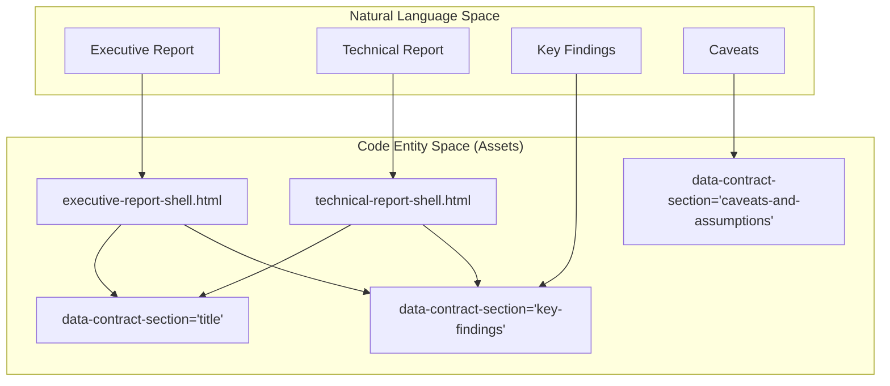
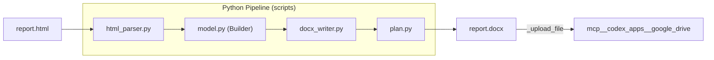

<!-- source: DeepWiki mcp.deepwiki.com · repo openai/role-specific-plugins · extra page Build-Report Skill & Export Scripts · fetched 2026-10-26 -->

# Build-Report Skill & Export Scripts

Relevant source files

The following files were used as context for generating this wiki page:

- [plugins/data-analytics/skills/build-report/SKILL.md](plugins/data-analytics/skills/build-report/SKILL.md)
- [plugins/data-analytics/skills/build-report/agents/openai.yaml](plugins/data-analytics/skills/build-report/agents/openai.yaml)
- [plugins/data-analytics/skills/build-report/assets/executive-report-shell.html](plugins/data-analytics/skills/build-report/assets/executive-report-shell.html)
- [plugins/data-analytics/skills/build-report/assets/technical-report-shell.html](plugins/data-analytics/skills/build-report/assets/technical-report-shell.html)
- [plugins/data-analytics/skills/build-report/report-to-google-doc/SKILL.md](plugins/data-analytics/skills/build-report/report-to-google-doc/SKILL.md)
- [plugins/data-analytics/skills/build-report/report-to-google-doc/agents/openai.yaml](plugins/data-analytics/skills/build-report/report-to-google-doc/agents/openai.yaml)
- [plugins/data-analytics/skills/build-report/report-to-google-doc/scripts/report_to_google_doc/__init__.py](plugins/data-analytics/skills/build-report/report-to-google-doc/scripts/report_to_google_doc/__init__.py)
- [plugins/data-analytics/skills/build-report/report-to-google-doc/scripts/report_to_google_doc/cli.py](plugins/data-analytics/skills/build-report/report-to-google-doc/scripts/report_to_google_doc/cli.py)
- [plugins/data-analytics/skills/build-report/report-to-google-doc/scripts/report_to_google_doc/constants.py](plugins/data-analytics/skills/build-report/report-to-google-doc/scripts/report_to_google_doc/constants.py)
- [plugins/data-analytics/skills/build-report/report-to-google-doc/scripts/report_to_google_doc/docx_writer.py](plugins/data-analytics/skills/build-report/report-to-google-doc/scripts/report_to_google_doc/docx_writer.py)
- [plugins/data-analytics/skills/build-report/report-to-google-doc/scripts/report_to_google_doc/html_parser.py](plugins/data-analytics/skills/build-report/report-to-google-doc/scripts/report_to_google_doc/html_parser.py)
- [plugins/data-analytics/skills/build-report/report-to-google-doc/scripts/report_to_google_doc/model.py](plugins/data-analytics/skills/build-report/report-to-google-doc/scripts/report_to_google_doc/model.py)
- [plugins/data-analytics/skills/build-report/report-to-google-doc/scripts/report_to_google_doc/plan.py](plugins/data-analytics/skills/build-report/report-to-google-doc/scripts/report_to_google_doc/plan.py)
- [plugins/data-analytics/skills/build-report/report-to-google-doc/scripts/report_to_google_doc/quality.py](plugins/data-analytics/skills/build-report/report-to-google-doc/scripts/report_to_google_doc/quality.py)
- [plugins/data-analytics/skills/build-report/report-to-google-doc/scripts/report_to_google_doc/rendering.py](plugins/data-analytics/skills/build-report/report-to-google-doc/scripts/report_to_google_doc/rendering.py)
- [plugins/data-analytics/skills/build-report/report-to-google-doc/scripts/report_to_google_doc/table_utils.py](plugins/data-analytics/skills/build-report/report-to-google-doc/scripts/report_to_google_doc/table_utils.py)
- [plugins/data-analytics/skills/build-report/report-to-google-doc/scripts/report_to_google_doc/utils.py](plugins/data-analytics/skills/build-report/report-to-google-doc/scripts/report_to_google_doc/utils.py)
- [plugins/data-analytics/skills/build-report/report-to-google-doc/scripts/report_to_google_doc_plan.py](plugins/data-analytics/skills/build-report/report-to-google-doc/scripts/report_to_google_doc_plan.py)
- [plugins/data-analytics/skills/build-report/report-to-google-slides/SKILL.md](plugins/data-analytics/skills/build-report/report-to-google-slides/SKILL.md)
- [plugins/data-analytics/skills/build-report/report-to-google-slides/agents/openai.yaml](plugins/data-analytics/skills/build-report/report-to-google-slides/agents/openai.yaml)
- [plugins/data-analytics/skills/build-report/report-to-google-slides/scripts/report_to_google_slides.py](plugins/data-analytics/skills/build-report/report-to-google-slides/scripts/report_to_google_slides.py)
- [plugins/data-analytics/skills/build-report/report-to-pdf/SKILL.md](plugins/data-analytics/skills/build-report/report-to-pdf/SKILL.md)
- [plugins/data-analytics/skills/build-report/report-to-pdf/agents/openai.yaml](plugins/data-analytics/skills/build-report/report-to-pdf/agents/openai.yaml)
- [plugins/data-analytics/skills/build-report/specifications/executive-report.md](plugins/data-analytics/skills/build-report/specifications/executive-report.md)
- [plugins/data-analytics/skills/build-report/specifications/mcp-app-report.md](plugins/data-analytics/skills/build-report/specifications/mcp-app-report.md)
- [plugins/data-analytics/skills/build-report/specifications/technical-report.md](plugins/data-analytics/skills/build-report/specifications/technical-report.md)

The `build-report` skill is the primary completion contract for the Data Analytics plugin. It transforms reviewed evidence, notebooks, and data analysis into polished, audience-specific deliverables [plugins/data-analytics/skills/build-report/SKILL.md:3-10](). It supports two primary delivery modes: a native **MCP App Report** for in-Codex viewing and a **Portable HTML Report** for external sharing and conversion [plugins/data-analytics/skills/build-report/SKILL.md:18-24]().

## Skill Architecture & Report Modes

The skill operates as a structured pipeline that enforces audience-specific standards through rigid specifications.

### Delivery Modes
*   **`mcp-app`**: The default mode. It renders a Data Analytics MCP artifact within the Codex environment [plugins/data-analytics/skills/build-report/SKILL.md:20-20]().
*   **`html`**: Used for portability, file sharing, or as a source for export scripts. In this mode, charts must be static PNGs generated via Seaborn [plugins/data-analytics/skills/build-report/SKILL.md:21-24]().

### Audience Specifications
Before drafting, the skill must read exactly one audience specification [plugins/data-analytics/skills/build-report/SKILL.md:36-44]():
1.  **Executive Report (`product stakeholders`)**: Answer-first narrative, linear layout, and actionable next steps [plugins/data-analytics/skills/build-report/specifications/executive-report.md]().
2.  **Technical Report (`technical`)**: Methods-first, including metric definitions, methodology, and robustness checks [plugins/data-analytics/skills/build-report/specifications/technical-report.md]().

### Report Structure Diagram
This diagram maps the logical report sections defined in the specifications to the HTML shell templates used for generation.

Title: Report Structure to Code Template Mapping

Sources: [plugins/data-analytics/skills/build-report/assets/executive-report-shell.html:29-66](), [plugins/data-analytics/skills/build-report/assets/technical-report-shell.html:20-64](), [plugins/data-analytics/skills/build-report/SKILL.md:40-42]()

---

## Report-to-Google-Doc Pipeline

The `report-to-google-doc` skill is a specialized sub-skill that converts an existing HTML report into a `.docx` file and uploads it to Google Drive [plugins/data-analytics/skills/build-report/report-to-google-doc/SKILL.md:3-9]().

### Implementation Detail
The conversion is handled by a Python pipeline located in `plugins/data-analytics/skills/build-report/report-to-google-doc/scripts/report_to_google_doc/`.

| Component | Responsibility |
| :--- | :--- |
| `html_parser.py` | Uses `BeautifulSoup` to extract headings, tables, and inline styles (bold, italic, code, links) [plugins/data-analytics/skills/build-report/report-to-google-doc/scripts/report_to_google_doc/html_parser.py:7-135](). |
| `docx_writer.py` | Uses `python-docx` to generate the Word document, applying styles and embedding images [plugins/data-analytics/skills/build-report/report-to-google-doc/scripts/report_to_google_doc/docx_writer.py:7-13]() |
| `rendering.py` | Handles SVG-to-PNG conversion for charts using Cairo or Playwright [plugins/data-analytics/skills/build-report/report-to-google-doc/scripts/report_to_google_doc/constants.py:44-61](). |
| `plan.py` | Orchestrates the `write_outputs` function to produce the `manifest.json` and `report.docx` [plugins/data-analytics/skills/build-report/report-to-google-doc/scripts/report_to_google_doc/cli.py:19-20](). |

### Data Flow: HTML to Google Drive
The pipeline follows a strict "Local First" approach where the conversion happens entirely on the local filesystem before interacting with the Google Drive MCP.

Title: Report Conversion Data Flow

Sources: [plugins/data-analytics/skills/build-report/report-to-google-doc/SKILL.md:27-58](), [plugins/data-analytics/skills/build-report/report-to-google-doc/scripts/report_to_google_doc/cli.py:1-12](), [plugins/data-analytics/skills/build-report/report-to-google-doc/scripts/report_to_google_doc/model.py:7-31]()

---

## Export Scripts & Sub-Skills

In addition to Google Docs, the plugin supports export to PDF and Google Slides.

### Report to PDF
*   **Skill**: `report-to-pdf`
*   **Mechanism**: Converts the HTML report into a PDF deliverable [plugins/data-analytics/skills/build-report/report-to-pdf/SKILL.md:2-3]().
*   **Usage**: Triggered when the user requires a fixed-layout, non-editable document.

### Report to Google Slides
*   **Skill**: `report-to-google-slides`
*   **Mechanism**: Uses `scripts/report_to_google_slides.py` to parse the HTML report and generate a presentation [plugins/data-analytics/skills/build-report/report-to-google-slides/SKILL.md:2-3]().
*   **Workflow**: Maps report sections to slide titles and findings to bullet points or visual frames.

### Quality Control (QC)
The `quality.py` script in the Python pipeline performs preflight checks before any upload occurs. It validates [plugins/data-analytics/skills/build-report/report-to-google-doc/SKILL.md:38-48]():
*   **Heading Counts**: Ensures the `manifest.json` matches the source HTML structure.
*   **Image Integrity**: Verifies that rendered charts are not blank or corrupted.
*   **Table Widths**: Ensures tables fit within the standard `DOC_CONTENT_WIDTH_PT` (511.2pt) [plugins/data-analytics/skills/build-report/report-to-google-doc/scripts/report_to_google_doc/constants.py:14-14]().

Sources: [plugins/data-analytics/skills/build-report/report-to-google-doc/SKILL.md:38-48](), [plugins/data-analytics/skills/build-report/report-to-pdf/SKILL.md:1-5](), [plugins/data-analytics/skills/build-report/report-to-google-slides/SKILL.md:1-5]()

---

