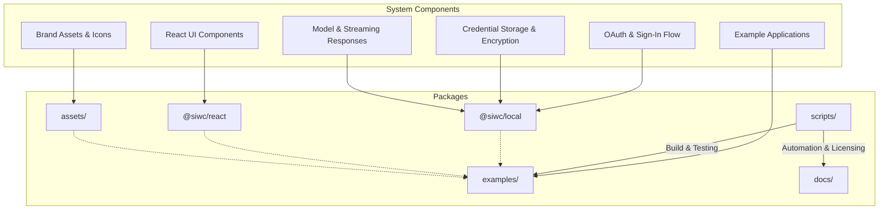
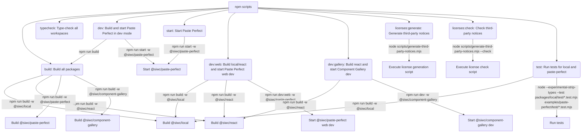
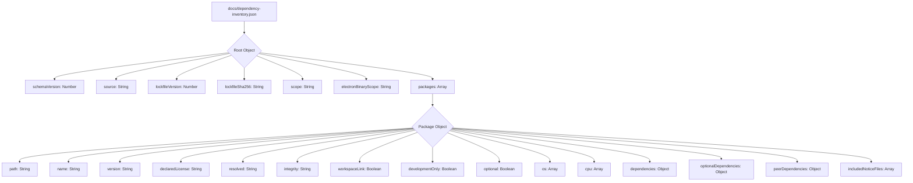
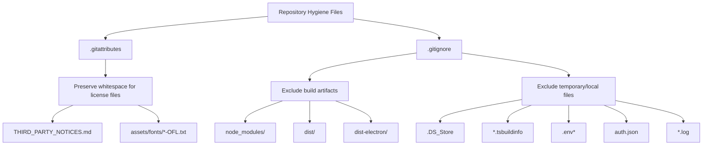
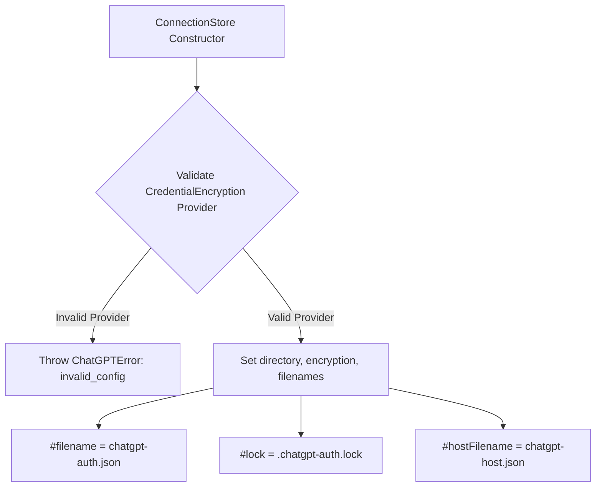
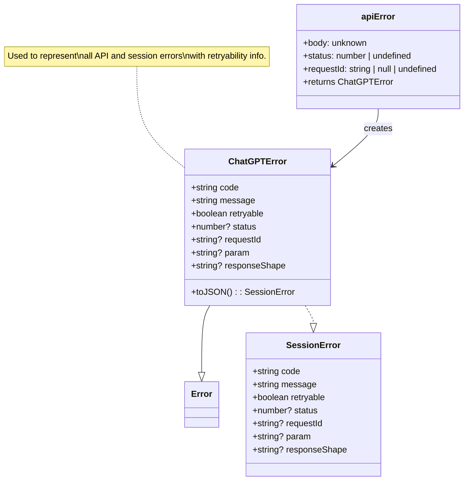

# Page: Overview

# Overview

<details>
<summary>Relevant source files</summary>

The following files were used as context for generating this wiki page:

- [LICENSE](LICENSE)
- [README.md](README.md)
- [examples/component-gallery/LICENSE](examples/component-gallery/LICENSE)
- [examples/paste-perfect/LICENSE](examples/paste-perfect/LICENSE)
- [package.json](package.json)

</details>


The **Sign in with ChatGPT DevKit** is a comprehensive development toolkit that enables developers to integrate ChatGPT account-based sign-in functionality into their applications. This integration allows users to authenticate using their existing ChatGPT account and opt to utilize their ChatGPT subscription plan to power AI features within the app, without requiring a separate API key. The DevKit targets open-source desktop applications running on the user's local machine, providing a seamless blend of authentication, usage monitoring, and UI components consistent with the ChatGPT ecosystem.

## Purpose and Scope

This DevKit is designed to simplify the development of apps that leverage Sign in with ChatGPT. It supplies:

- A local Node.js SDK for OAuth handling, session management, and ChatGPT API interactions.
- A React component library for UI elements such as sign-in buttons, connection cards, and usage indicators.
- Design assets including icons, branded buttons, and fonts to ensure branding consistency.
- Example applications to demonstrate common usage patterns and working integrations.
- Security-focused features and repo-wide tooling to streamline development and compliance.

This page provides a high-level overview of the monorepo structure, key components, and how they interoperate. For more detailed instructions and development practices, see the child pages such as [Getting Started](#1.1) and [Licensing and Contributing](#1.2).

---

## Monorepo Topology

The DevKit repository is organized as a monorepo using npm workspaces. It contains multiple logically separated packages and example applications along with shared assets and scripts. The main folders and their contents include:

| Folder                       | Contents                                                                                         |
|------------------------------|-------------------------------------------------------------------------------------------------|
| `packages/local`             | Local Node.js SDK with OAuth flows, credential storage, profile management, and response streaming. |
| `packages/react`             | React UI component library providing ready-to-use sign-in and usage components, plus styling.    |
| `assets`                    | Branded ChatGPT marks, icons, sign-in buttons, and font files for integration and UI theming.    |
| `examples/component-gallery` | A gallery app showcasing the React components with various design examples and usage scenarios.  |
| `examples/paste-perfect`     | A native macOS reference app combining a Swift helper, Electron main process, and React dashboard that demonstrates clipboard transformation with ChatGPT sign-in integration. |
| `scripts`                   | Automation scripts for license generation, dependency inventories, and other repo maintenance tasks. |
| `docs`                      | Developer documentation, including security, dependency inventory, and contributing guides.      |

This monorepo layout allows for independent versioning, building, and testing of each package while enabling coordinated releases and shared code between parts.

---

## How the Pieces Fit Together

At a high level, the DevKit packages and examples work together to provide a complete sign-in and AI usage experience:

### 1. Authentication and API Client (`@siwc/local`)

The `@siwc/local` package implements the OAuth 2.0 flow with PKCE, manages user sessions and profiles, handles token refresh and revocation, and wraps ChatGPT API calls. This Node.js SDK runs locally within your application's backend or electron main process to securely manage sign-in state and provide authenticated API requests.

### 2. React UI Components (`@siwc/react`)

The `@siwc/react` package exports React components such as `ContinueWithChatGPTButton`, `ChatGPTConnectionCard`, and usage indicators (`ChatGPTUsageIndicator`) that simplify embedding sign-in UI and plan usage controls in your application's renderer process. It includes styling files (`styles.css` and `tokens.css`) and supports theming aligned with ChatGPT branding.

### 3. Design Assets (`assets`)

Branding and design assets like SVG icons, sign-in button artwork, and fonts (e.g. Inter and Open Sans) are centrally maintained in the `assets` folder for consistent UI implementation. These assets adhere to the ChatGPT UI/UX guidelines ensuring a familiar user experience.

### 4. Example Applications (`examples`)

Two core example apps showcase the use of the SDK and components:

- **Paste Perfect** (`examples/paste-perfect`): A macOS native app that demonstrates clipboard text transformation based on user recipes with ChatGPT API calls, combining native Swift code, Electron main process orchestration, and React-based UI.

- **Component Gallery** (`examples/component-gallery`): An interactive React app displaying all UI components and design variants in a gallery format for rapid prototyping and visual testing.

### 5. Security and Tooling (`docs`, `scripts`)

Documentation provides deep dives into security topics like credential encryption and OAuth hardening. The `scripts` folder contains automation for third-party license generation and verification, ensuring compliance and repo hygiene.

---

## Diagram: Mapping System Names to Code Entities



**Sources:** `README.md:3-50`, `package.json:1-29`

---

## Diagram: Monorepo Folder Hierarchy and Role

```mermaid
graph TD
  Root["Root: sign-in-with-chatgpt-devkit/"]
  Packages["packages/"]
  Local["local/"]
  React["react/"]
  Examples["examples/"]
  Assets["assets/"]
  Scripts["scripts/"]
  Docs["docs/"]

  Root --> Packages
  Packages --> Local
  Packages --> React
  Root --> Examples
  Root --> Assets
  Root --> Scripts
  Root --> Docs

  Local[label="OAuth, credential storage,\nsession/profile model, streaming\n(@siwc/local)"]
  React[label="React components, styling, packaging\n(@siwc/react)"]
  Examples[label="Paste Perfect native macOS app\nComponent Gallery React app"]
  Assets[label="Brand assets: icons, buttons, fonts"]
  Scripts[label="License scripts,\nbuild and test automation"]
  Docs[label="Developer docs:\nsecurity, licensing, dependency inventory"]

  %% Packages content
  Local -->|Node.js SDK| "OAuth & Identity"
  React -->|UI Library| "React Sign-In + Usage Components"
  Examples -->|Demo Apps| "Paste Perfect & Component Gallery"
```

**Sources:** `README.md:22-48`, `package.json:6-9`

---

## Relationship Overview

- The **local Node.js SDK** (`@siwc/local`) is the core engine that manages authentication flows, token handling, and API interaction. It is intended for usage in the backend parts of your app or native hosts (e.g., Electron main process).

- The **React components** (`@siwc/react`) consume the SDK to render sign-in buttons, connection states, and usage indicators in the UI layer, typical in renderer processes or web fronts.

- The **example apps** demonstrate how to wire the SDK and components together effectively to achieve end-to-end solutions: authentication, usage display, and invoking ChatGPT-powered features.

- **Assets** and **docs** provide support for branding adherence, developer guidance, and security best practices.

- **Scripts** automate building, license compliance, and testing workflows across the monorepo.

Together, these parts enable a streamlined developer experience for embedding ChatGPT sign-in and usage monitoring within native and web applications.

---

## Links to Child Pages for More Details

- For developer setup instructions, environment requirements, and workspace commands, see [Getting Started](#1.1).

- For licensing terms, contribution workflows, third-party notices, and repo hygiene, see [Licensing and Contributing](#1.2).

---

**Sources:**  
`README.md:1-70`  
`package.json:1-29`

---

# Page: Getting Started

# 1.1. Getting Started

<details>
<summary>Relevant source files</summary>

The following files were used as context for generating this wiki page:

- [README.md](README.md)
- [package-lock.json](package-lock.json)
- [package.json](package.json)

</details>


This page provides instructions for setting up and running the Sign in with ChatGPT DevKit. It covers prerequisites, installation, build, and execution commands for the example applications, along with an overview of the workspace layout and available npm scripts.

## Prerequisites

To run the DevKit, ensure your system meets the following requirements:

*   **macOS 14 or later**: The `Paste Perfect` example application is a native macOS app [README.md:28]().
*   **Node.js 22.12 or later**: The project specifies `node: ">=22.12.0"` in its `package.json` [package.json:25-27]() and `package-lock.json` [package-lock.json:67-69]().
*   **Xcode Command Line Tools**: Required for building native components of the `Paste Perfect` example.

## Installation and Running the DevKit

Follow these steps to get the DevKit up and running:

1.  **Clone the repository**:
    ```sh
    git clone https://github.com/openai/sign-in-with-chatgpt-devkit.git
    cd sign-in-with-chatgpt-devkit
    ```
2.  **Install dependencies**: This command installs all project dependencies defined in `package.json` and `package-lock.json` across all workspaces.
    ```sh
    npm ci
    ```
3.  **Build the project**: This command builds all necessary packages, including `@siwc/local`, `@siwc/react`, `@siwc/paste-perfect`, and `@siwc/component-gallery` [package.json:11]().
    ```sh
    npm run build
    ```
4.  **Start the Paste Perfect example app**: This command launches the `Paste Perfect` application [package.json:14]().
    ```sh
    npm start
    ```

Once `Paste Perfect` is running, you can:
1.  Sign in with ChatGPT from its dashboard.
2.  Enable native paste and grant Accessibility access to the native helper.
3.  Copy text, focus an editable field in another app, press **⌘⇧Space**, then right-click within eight seconds.
4.  Choose a transformation option (e.g., Spreadsheet, Message, Translate, Checklist, Clean up, or a saved recipe).
The transformed text will be pasted into the destination app [README.md:42-47]().

Sources:
*   [README.md:32-47]()
*   [package.json:11]()
*   [package.json:14]()
*   [package.json:25-27]()
*   [package-lock.json:67-69]()

## Component Gallery

The DevKit includes a component gallery for previewing and testing the `@siwc/react` components.

To run the component gallery:

1.  Ensure dependencies are installed (`npm ci`) and the `@siwc/react` package is built (`npm run build -w @siwc/react`).
2.  Execute the following command:
    ```sh
    npm run dev:gallery
    ```
    This command builds the `@siwc/react` package and then starts the development server for the `@siwc/component-gallery` example [package.json:16]().
3.  Open the local URL printed in your terminal to view the gallery [README.md:59]().

The gallery allows you to try out designs with your app's name and layout, check connection states, and place usage indicators [README.md:51-52]().

Sources:
*   [README.md:51-52]()
*   [README.md:59]()
*   [package.json:16]()

## Workspace Layout

The DevKit is structured as a monorepo using npm workspaces [package.json:6-9](). This organizes the codebase into several distinct packages and examples:

```mermaid
graph TD
    A[sign-in-with-chatgpt-devkit] --> B(packages)
    A --> C(examples)
    A --> D(assets)
    A --> E(scripts)
    A --> F(docs)

    B --> B1(@siwc/local)
    B --> B2(@siwc/react)

    C --> C1(component-gallery)
    C --> C2(paste-perfect)

    subgraph packages
        B1["packages/local: Node.js SDK"]
        B2["packages/react: React components"]
    end

    subgraph examples
        C1["examples/component-gallery: UI preview"]
        C2["examples/paste-perfect: macOS example app"]
    end

    D["assets/: Brand assets, icons, fonts"]
    E["scripts/: Automation scripts"]
    F["docs/: Documentation"]
```
**Diagram 1: DevKit Monorepo Structure**

*   `packages/local`: Contains the local Node.js SDK for OAuth, credential storage, account profiles, model discovery, and streaming responses [README.md:24]().
*   `packages/react`: Provides React components for sign-in, connection status, and ChatGPT plan usage [README.md:25]().
*   `assets`: Stores ChatGPT marks, icons, sign-in buttons, and fonts [README.md:26]().
*   `examples/component-gallery`: A design example application for sign-in, account connections, and ChatGPT plan usage controls [README.md:27]().
*   `examples/paste-perfect`: An example native macOS app demonstrating Sign in with ChatGPT integration, featuring an Electron settings dashboard [README.md:28]().

Sources:
*   [README.md:24-28]()
*   [package.json:6-9]()

## npm Scripts

The root `package.json` defines several npm scripts to streamline development and build processes:


**Diagram 2: Root npm Scripts and Their Actions**

*   `build`: Executes the `build` script for `@siwc/local`, `@siwc/react`, `@siwc/paste-perfect`, and `@siwc/component-gallery` workspaces [package.json:11]().
*   `typecheck`: Runs `typecheck` in all workspaces where it's defined [package.json:12]().
*   `dev`: First runs the `build` script, then starts the `@siwc/paste-perfect` application in development mode [package.json:13]().
*   `start`: Starts the `@siwc/paste-perfect` application [package.json:14]().
*   `dev:web`: Builds `@siwc/local` and `@siwc/react`, then starts the web development server for `@siwc/paste-perfect` [package.json:15]().
*   `dev:gallery`: Builds `@siwc/react` and then starts the development server for the `@siwc/component-gallery` [package.json:16]().
*   `licenses:generate`: Executes the `generate-third-party-notices.mjs` script to generate license information [package.json:17]().
*   `licenses:check`: Executes the `generate-third-party-notices.mjs` script with the `--check` flag to verify license information [package.json:18]().
*   `test`: Builds `@siwc/local` and then runs tests for `packages/local` and `examples/paste-perfect` [package.json:19]().

Sources:
*   [package.json:10-20]()

---

# Page: Licensing and Contributing

# Licensing and Contributing

<details>
<summary>Relevant source files</summary>

The following files were used as context for generating this wiki page:

- [.gitattributes](.gitattributes)
- [.gitignore](.gitignore)
- [CONTRIBUTING.md](CONTRIBUTING.md)
- [LICENSE](LICENSE)
- [THIRD_PARTY_NOTICES.md](THIRD_PARTY_NOTICES.md)
- [docs/dependency-inventory.json](docs/dependency-inventory.json)
- [examples/component-gallery/LICENSE](examples/component-gallery/LICENSE)
- [examples/paste-perfect/LICENSE](examples/paste-perfect/LICENSE)

</details>


This page details the licensing terms for the Sign-in with ChatGPT DevKit, including its noncommercial use restrictions, third-party notices, and a comprehensive dependency inventory. It also outlines the contribution workflow and the purpose of repository hygiene files.

## Noncommercial License Terms

The Sign-in with ChatGPT DevKit is distributed under a specific Noncommercial License, Version 1.0 [LICENSE:1-54](). This license explicitly defines "Noncommercial Purpose" as personal learning, experimentation, or development without an intended or reasonably anticipated commercial application [LICENSE:16-17](). It strictly excludes development, testing, distribution, or operation of a product or service by or for a business, employer, or client for commercial advantage [LICENSE:16-17]().

Under this license, contributors grant a perpetual, worldwide, nonexclusive, no-charge, royalty-free license to use, reproduce, modify, publicly display, publicly perform, and distribute their contributions, including in Modified Works, solely for Noncommercial Purposes [LICENSE:19-22](). The license explicitly states that it grants no commercial-use rights in any contribution, and commercial use of OpenAI's contribution requires a separate written agreement [LICENSE:22-23]().

Redistribution of the Work or Modified Work is permitted only for a Noncommercial Purpose, provided recipients receive a copy of the license, changed files are marked, applicable notices are preserved, and all modifications are licensed under the same terms [LICENSE:33-43](). The license also clarifies that it grants no rights to OpenAI names, trademarks, logos, or branded visual assets, nor does it grant access to ChatGPT, the OpenAI API, or any other OpenAI service [LICENSE:46-49]().

Sources:
- [LICENSE:1-54]()
- [examples/component-gallery/LICENSE:1-54]()
- [examples/paste-perfect/LICENSE:1-54]()

## Third-Party Notices

Third-party notices are compiled into `THIRD_PARTY_NOTICES.md` [THIRD_PARTY_NOTICES.md:1-2926](). This file is generated by the `scripts/generate-third-party-notices.mjs` script [THIRD_PARTY_NOTICES.md:3](). It includes full top-level license and notice text for the runtime npm dependency closure, Vite, the Electron npm package, and bundled fonts [THIRD_PARTY_NOTICES.md:5]().

The `THIRD_PARTY_NOTICES.md` file also contains specific details regarding the Electron distribution scope. It clarifies that the MIT license of the Electron npm package does not cover all code in an Electron/Chromium binary, and advises retaining the license files shipped with the exact Electron distribution (e.g., `LICENSE` and `LICENSES.chromium.html`) before distributing a desktop binary [THIRD_PARTY_NOTICES.md:11-14]().

The `THIRD_PARTY_NOTICES.md` file also notes that the Inter and Open Sans fonts remain under SIL OFL 1.1, and their provenance (SHA-256 hashes, download dates, internal versions, and license sources) is pinned to a Google Fonts Git commit [THIRD_PARTY_NOTICES.md:6-8]().

Sources:
- [THIRD_PARTY_NOTICES.md:1-2926]()

## Dependency Inventory

A comprehensive dependency inventory is maintained in `docs/dependency-inventory.json` [docs/dependency-inventory.json:1-3097](). This JSON file provides a detailed record of all lockfile entries, including development tools and platform-specific optional dependencies [docs/dependency-inventory.json:6]().

The inventory includes:
*   `schemaVersion`: The version of the schema used [docs/dependency-inventory.json:2]().
*   `source`: Indicates that the data is sourced from `package-lock.json` [docs/dependency-inventory.json:3]().
*   `lockfileVersion`: The version of the lockfile [docs/dependency-inventory.json:4]().
*   `lockfileSha256`: A SHA-256 hash of the lockfile [docs/dependency-inventory.json:5]().
*   `scope`: A description of the inventory's coverage [docs/dependency-inventory.json:6]().
*   `electronBinaryScope`: Specific notes regarding the Electron npm package license and its limitations for binary distributions [docs/dependency-inventory.json:7]().
*   `packages`: An array of objects, each representing a package. Each package entry includes:
    *   `path`: The path to the package within the monorepo or `node_modules` [docs/dependency-inventory.json:10]().
    *   `name`: The package name [docs/dependency-inventory.json:11]().
    *   `version`: The package version [docs/dependency-inventory.json:12]().
    *   `declaredLicense`: The license declared by the package [docs/dependency-inventory.json:13]().
    *   `resolved`: The URL from which the package was resolved [docs/dependency-inventory.json:14]().
    *   `integrity`: The integrity hash of the package [docs/dependency-inventory.json:15]().
    *   `workspaceLink`: Indicates if it's a workspace link [docs/dependency-inventory.json:16]().
    *   `developmentOnly`: Indicates if the package is for development only [docs/dependency-inventory.json:17]().
    *   `optional`: Indicates if the package is optional [docs/dependency-inventory.json:18]().
    *   `os`: Supported operating systems [docs/dependency-inventory.json:19]().
    *   `cpu`: Supported CPU architectures [docs/dependency-inventory.json:20]().
    *   `dependencies`: A list of direct dependencies [docs/dependency-inventory.json:21]().
    *   `optionalDependencies`: A list of optional dependencies [docs/dependency-inventory.json:22]().
    *   `peerDependencies`: A list of peer dependencies [docs/dependency-inventory.json:23]().
    *   `includedNoticeFiles`: A list of included notice files [docs/dependency-inventory.json:24]().

### Dependency Inventory Structure

Sources:
- [docs/dependency-inventory.json:1-3097]()

## Contribution Workflow

The repository explicitly states that it does not accept external pull requests or code contributions [CONTRIBUTING.md:3]().

Sources:
- [CONTRIBUTING.md:1-3]()

## Repository Hygiene Files

Several files are maintained in the repository for hygiene and consistency:

*   `.gitattributes`: This file is used to define attributes for paths in the repository. Specifically, it ensures that the `THIRD_PARTY_NOTICES.md` file and font license files (`assets/fonts/*-OFL.txt`) preserve their whitespace [.gitattributes:2-3](). This is crucial for maintaining the integrity of license texts.
*   `.gitignore`: This file specifies intentionally untracked files that Git should ignore. It includes common build artifacts (`node_modules/`, `dist/`, `dist-electron/`), macOS-specific files (`.DS_Store`), TypeScript build info (`*.tsbuildinfo`), environment files (`.env`, `.env.*`, `!.env.example`), authentication-related files (`auth.json`, `chatgpt-auth*.json`, `chatgpt-host*.json`, `.chatgpt-auth*`), preferences (`preferences.json`), log files (`*.log`), and specific build outputs for examples (`examples/component-gallery/public/references/`) [.gitignore:1-16]().

### Repository Hygiene File Purpose

Sources:
- [.gitattributes:1-3]()
- [.gitignore:1-16]()

---

# Page: @siwc/local — Local Node SDK

# @siwc/local — Local Node SDK

<details>
<summary>Relevant source files</summary>

The following files were used as context for generating this wiki page:

- [packages/local/package.json](packages/local/package.json)
- [packages/local/src/index.ts](packages/local/src/index.ts)
- [packages/local/src/types.ts](packages/local/src/types.ts)

</details>


The `@siwc/local` package provides a Node.js SDK for integrating Sign in with ChatGPT functionality into local applications. It manages the entire lifecycle of ChatGPT connections, including authentication, credential storage, session management, and interaction with the ChatGPT API. This package is designed to be run in a trusted local process, such as an Electron main process, and exposes a safe API for application-level interactions.

The core of this SDK is the `createChatGPT` function, which initializes a `ChatGPTClient` instance. This client handles secure credential management, OAuth flows, and communication with the ChatGPT services. It abstracts away the complexities of token refresh, identity verification, and error handling, providing a streamlined interface for developers.

Sources:
- [packages/local/package.json:2-32]()
- [packages/local/src/index.ts:66-72]()
- [packages/local/src/types.ts:93-104]()

## Core Components

The `@siwc/local` SDK is structured around several key components and concepts:

### `ChatGPTClient`

The `ChatGPTClient` is the primary interface for interacting with the SDK. It is created using the `createChatGPT` function and provides methods for signing in, managing profiles, listing models, and streaming responses. The client maintains the session state and ensures secure handling of credentials.

Sources:
- [packages/local/src/index.ts:66-72]()
- [packages/local/src/types.ts:93-104]()

### Session and Profile Management

The SDK manages user sessions and profiles, allowing applications to support multiple ChatGPT connections. A `SessionState` object represents the current status of the active connection, while `LoginProfile` objects provide details about all available connections. The SDK handles the selection, disconnection, and reauthentication of profiles.

Sources:
- [packages/local/src/index.ts:19-42]()
- [packages/local/src/types.ts:17-36]()

### Credential Storage and Encryption

Secure storage of credentials is a critical aspect of the SDK. It uses a `ConnectionStore` to persist connection data and requires a `CredentialEncryption` provider to encrypt and decrypt sensitive information. This ensures that access tokens and refresh tokens are never stored in plaintext. For details, see [Credential Storage and Encryption](#2.2).

Sources:
- [packages/local/src/index.ts:72-72]()
- [packages/local/src/types.ts:43-50]()

### OAuth and Sign-In Flow

The SDK implements the OAuth 2.0 authorization code flow with PKCE and OIDC nonce for secure authentication. It handles the entire sign-in process, including opening the browser for user authorization, receiving callbacks, and exchanging authorization codes for tokens. It also manages token refresh, identity verification, and revocation. For details, see [OAuth and Sign-In Flow](#2.1).

Sources:
- [packages/local/src/index.ts:6-6]()
- [packages/local/src/types.ts:83-91]()

### Model Discovery and Streaming Responses

The SDK provides functionality to discover available ChatGPT models and to stream responses from the ChatGPT API. It abstracts the API interaction, allowing applications to easily integrate conversational AI capabilities. For details, see [Models and Streaming Responses](#2.3).

Sources:
- [packages/local/src/index.ts:5-5]()
- [packages/local/src/index.ts:7-7]()
- [packages/local/src/types.ts:38-41]()
- [packages/local/src/types.ts:75-81]()

### Error Handling

The SDK defines a comprehensive error model using `ChatGPTError` to provide detailed information about issues that may arise during operation. Errors are categorized and include properties like `code`, `message`, and `retryable`, helping applications to implement robust error handling strategies. For details, see [Error Model and Types](#2.4).

Sources:
- [packages/local/src/index.ts:4-4]()
- [packages/local/src/types.ts:6-14]()

## Architecture Diagram: `ChatGPTClient` and its Dependencies

```mermaid
graph TD
    subgraph "Application Process (e.g., Electron Main)"
        A["Your Application Code"] --> B(createChatGPT(config))
        B --> C(ChatGPTClient)
    end

    subgraph "@siwc/local SDK"
        C -- "Manages Session State" --> D(SessionState)
        C -- "Manages Login Profiles" --> E(LoginProfile)
        C -- "Handles OAuth Flow" --> F(oauth.ts)
        C -- "Stores Credentials" --> G(ConnectionStore)
        C -- "Encrypts/Decrypts Credentials" --> H(CredentialEncryption)
        C -- "Interacts with ChatGPT API" --> I(models.ts)
        C -- "Interacts with ChatGPT API" --> J(responses.ts)
        C -- "Provides Error Model" --> K(errors.ts)
    end

    subgraph "External Services"
        F -- "Browser for User Auth" --> L(ChatGPT Auth Server)
        I -- "API Calls" --> M(ChatGPT API)
        J -- "API Calls" --> M
    end

    style A fill:#ace,stroke:#333,stroke-width:2px
    style B fill:#bcf,stroke:#333,stroke-width:2px
    style C fill:#bcf,stroke:#333,stroke-width:2px
    style D fill:#def,stroke:#333,stroke-width:1px
    style E fill:#def,stroke:#333,stroke-width:1px
    style F fill:#def,stroke:#333,stroke-width:1px
    style G fill:#def,stroke:#333,stroke-width:1px
    style H fill:#def,stroke:#333,stroke-width:1px
    style I fill:#def,stroke:#333,stroke-width:1px
    style J fill:#def,stroke:#333,stroke-width:1px
    style K fill:#def,stroke:#333,stroke-width:1px
    style L fill:#fcc,stroke:#333,stroke-width:1px
    style M fill:#fcc,stroke:#333,stroke-width:1px
```
Title: "ChatGPTClient" and its Dependencies
Sources:
- [packages/local/src/index.ts:66-72]()
- [packages/local/src/types.ts:93-104]()
- [packages/local/src/index.ts:4-8]()

## Data Flow: Session State and Profile Management

```mermaid
graph TD
    subgraph "Application Lifecycle"
        A[App Startup] --> B{createChatGPT(config)}
        B --> C[ChatGPTClient Instance]
    end

    subgraph "User Interaction"
        D[User Action: Sign In] --> C
        D[User Action: Select Profile] --> C
        D[User Action: Disconnect] --> C
    end

    subgraph "Internal SDK Logic"
        C -- "Calls signIn()" --> E(oauth.authorize)
        C -- "Calls selectProfile()" --> F(ConnectionStore.withLock)
        C -- "Calls disconnect()" --> G(revokeConnection)
        F -- "Reads/Writes" --> H(StoredState)
        H -- "Contains" --> I(StoredProfile[])
        H -- "Contains" --> J(PendingRegistration[])
        I -- "Maps to" --> K(LoginProfile[])
        H -- "Derives" --> L(SessionState)
    end

    subgraph "External Interactions"
        E -- "Redirects to" --> M(ChatGPT Auth Server)
        G -- "Revokes Token at" --> M
    end

    C -- "Publishes Updates" --> N[SessionState Subscribers]

    style A fill:#ace,stroke:#333,stroke-width:2px
    style B fill:#bcf,stroke:#333,stroke-width:2px
    style C fill:#bcf,stroke:#333,stroke-width:2px
    style D fill:#ace,stroke:#333,stroke-width:2px
    style E fill:#def,stroke:#333,stroke-width:1px
    style F fill:#def,stroke:#333,stroke-width:1px
    style G fill:#def,stroke:#333,stroke-width:1px
    style H fill:#def,stroke:#333,stroke-width:1px
    style I fill:#def,stroke:#333,stroke-width:1px
    style J fill:#def,stroke:#333,stroke-width:1px
    style K fill:#def,stroke:#333,stroke-width:1px
    style L fill:#def,stroke:#333,stroke-width:1px
    style M fill:#fcc,stroke:#333,stroke-width:1px
    style N fill:#ace,stroke:#333,stroke-width:2px
```
Title: Session State and Profile Management Data Flow
Sources:
- [packages/local/src/index.ts:19-42]()
- [packages/local/src/index.ts:73-86]()
- [packages/local/src/index.ts:108-110]()
- [packages/local/src/types.ts:17-36]()
- [packages/local/src/types.ts:149-154]()

## Child Pages

This parent page provides a high-level overview. For detailed information on specific aspects of the `@siwc/local` SDK, please refer to the following child pages:

*   **[OAuth and Sign-In Flow](#2.1)**: Delves into the specifics of the loopback OAuth implementation, PKCE, OIDC nonce, token refresh mechanisms, identity verification, and how to handle revocation, disconnection, reconsent, and profile selection.
*   **[Credential Storage and Encryption](#2.2)**: Explains the `ConnectionStore` for persistent data, the `CredentialEncryption` provider contract, atomic write operations, handling of pending refresh states, and the migration path for legacy plaintext credentials.
*   **[Models and Streaming Responses](#2.3)**: Covers how to discover available ChatGPT models using `listModels` and the `streamResponse` pipeline for interacting with the Responses API, including how usage and limit metadata are surfaced to the UI.
*   **[Error Model and Types](#2.4)**: Details the `ChatGPTError` codes, distinguishes between retryable and reauthentication errors, and outlines the exported TypeScript types and build configurations for robust error handling.

---

# Page: OAuth and Sign-In Flow

# OAuth and Sign-In Flow

<details>
<summary>Relevant source files</summary>

The following files were used as context for generating this wiki page:

- [packages/local/src/oauth.ts](packages/local/src/oauth.ts)
- [packages/local/test/authorization.test.mjs](packages/local/test/authorization.test.mjs)
- [packages/local/test/refresh.test.mjs](packages/local/test/refresh.test.mjs)

</details>


This page details the OAuth and sign-in flow implemented in the `@siwc/local` Node.js SDK. It covers the loopback OAuth authorization code grant with PKCE, OIDC nonce verification, token refresh mechanisms, identity verification, and how to handle revocation, disconnection, reconsent, and profile selection.

## Overview of the OAuth Flow

The sign-in process leverages a loopback OAuth flow, where the application acts as a local web server to receive the authorization code callback. This is combined with Proof Key for Code Exchange (PKCE) for enhanced security and OpenID Connect (OIDC) for identity verification.

The core steps involve:
1.  **Discovery**: The client first discovers the OAuth endpoints from the identity provider's well-known configuration.
2.  **Authorization Request**: The client constructs an authorization URL with PKCE parameters and an OIDC nonce, then opens it in the user's browser.
3.  **Authorization Code Grant**: The user authenticates and consents in their browser. The identity provider redirects back to the local web server with an authorization code.
4.  **Token Exchange**: The client exchanges the authorization code for access, refresh, and ID tokens.
5.  **Identity Verification**: The ID token is verified to confirm the user's identity.
6.  **Token Refresh**: Access tokens have a short lifespan. Refresh tokens are used to obtain new access tokens without user re-authentication.
7.  **Revocation/Disconnect**: Users can revoke access from within the application.
8.  **Reconsent and Profile Selection**: Mechanisms are in place to handle re-prompting for consent and allowing users to select different profiles.

### Key Components and Data Flow

The `oauth.ts` module [packages/local/src/oauth.ts:1-392]() is central to managing the OAuth and OIDC interactions.

#### Discovery

The `discovery()` function [packages/local/src/oauth.ts:26-46]() is responsible for fetching the OpenID Connect configuration from the `ISSUER` (`https://auth.openai.com` [packages/local/src/oauth.ts:9]()). This configuration includes critical endpoints like `authorization_endpoint`, `token_endpoint`, `jwks_uri`, and `revocation_endpoint`. The discovery result is cached to avoid repeated network requests.

```mermaid
graph TD
    A[Client Application] -->|1. Call discovery()| B{Is discoveryPromise cached?};
    B -- No --> C[Fetch .well-known/openid-configuration from ISSUER];
    C --> D{Validate response};
    D -- Invalid --> E[Throw ChatGPTError "discovery_failed"];
    D -- Valid --> F[Cache Discovery object];
    B -- Yes --> F;
    F --> G[Return Discovery object];
Sources: packages/local/src/oauth.ts
```
**Diagram: OAuth Discovery Flow**

#### Authorization Request and Code Exchange

The `authorize()` function [packages/local/src/oauth.ts:150-269]() orchestrates the authorization flow. It generates PKCE `code_verifier` and `code_challenge`, an OIDC `nonce`, and a `state` parameter. It then constructs the authorization URL and opens it in the user's default browser. A local HTTP server is started to listen for the redirect callback. Upon receiving the authorization code, it exchanges it for tokens using `tokenRequest()` [packages/local/src/oauth.ts:110-123]().

```mermaid
sequenceDiagram
    participant C as "Client Application"
    participant B as "User Browser"
    participant IdP as "Identity Provider (auth.openai.com)"
    participant LS as "Local HTTP Server"

    C->>C: Generate PKCE code_verifier, code_challenge, nonce, state
    C->>IdP: 1. Call discovery()
    IdP-->>C: Discovery Configuration
    C->>C: Construct Authorization URL
    C->>LS: 2. Start local HTTP server (redirect_uri)
    C->>B: 3. Open Authorization URL in browser
    B->>IdP: 4. User authenticates & consents
    IdP-->>B: 5. Redirect to redirect_uri with code & state
    B->>LS: 6. Callback to local HTTP server
    LS->>C: 7. Authorization code received
    C->>IdP: 8. Exchange code for tokens (tokenRequest)
    IdP-->>C: 9. Access, Refresh, ID Tokens
    C->>C: 10. Verify ID Token (verifyIdentity)
    C->>C: 11. Store Connection
    LS->>C: 12. Close local HTTP server
Sources: packages/local/src/oauth.ts
```
**Diagram: Authorization Code Grant Flow with PKCE and OIDC**

The `authorize` function [packages/local/src/oauth.ts:150-269]() handles the following:
*   **PKCE**: `code_verifier` and `code_challenge` are generated using `randomValue()` [packages/local/src/oauth.ts:13]() and `createHash()` [packages/local/src/oauth.ts:1](). The `code_challenge_method` is "S256".
*   **OIDC Nonce**: A `nonce` is generated and included in the authorization request to mitigate replay attacks.
*   **Local Server**: A `createServer()` [packages/local/src/oauth.ts:2]() is used to handle the `CALLBACK_PATH` [packages/local/src/oauth.ts:12]().
*   **Browser Launch**: The `spawn()` function [packages/local/src/oauth.ts:3]() is used to open the authorization URL in the user's default browser. A custom `openBrowser` function can also be provided in the `ChatGPTConfig` [packages/local/src/oauth.ts:152]().
*   **Token Request**: The `tokenRequest()` function [packages/local/src/oauth.ts:110-123]() sends a POST request to the `token_endpoint` to exchange the authorization code for tokens.

#### Identity Verification

The `verifyIdentity()` function [packages/local/src/oauth.ts:50-107]() is crucial for validating the ID token received during the token exchange. It performs the following checks:
*   **JWKS Retrieval**: It fetches the JSON Web Key Set (JWKS) from the `jwks_uri` using `createRemoteJWKSet()` [packages/local/src/oauth.ts:5](). This set contains the public keys used by the identity provider to sign ID tokens.
*   **JWT Verification**: It uses `jwtVerify()` [packages/local/src/oauth.ts:5]() to verify the ID token's signature and claims.
    *   **Issuer and Audience**: Verifies that the `iss` (issuer) matches the configured `ISSUER` and `aud` (audience) matches the `clientId`.
    *   **Algorithms**: Ensures the token is signed with "RS256".
    *   **Nonce**: Compares the `nonce` in the ID token with the one sent in the authorization request.
    *   **Subject**: Extracts the `sub` (subject) which uniquely identifies the user.
    *   **Clock Tolerance**: Allows for a small time difference (`clockTolerance: 5` seconds) to account for clock skew.
*   **Error Handling**: Catches various errors during verification and translates them into `ChatGPTError` instances, such as `identity_verification_unavailable` or `invalid_id_token`.

```mermaid
graph TD
    A[ID Token] --> B{jwtVerify(idToken, JWKS, options)};
    B -- Signature Invalid --> C[Throw "invalid_id_token"];
    B -- Claims Invalid (iss, aud, exp, iat, sub) --> C;
    B -- Nonce Mismatch --> C;
    B -- azp Mismatch --> C;
    B -- JWKS Unavailable --> D[Throw "identity_verification_unavailable"];
    B -- Valid --> E{Extract subject, name, email};
    E --> F[Return {subject, identity}];
Sources: packages/local/src/oauth.ts
```
**Diagram: ID Token Verification Flow**

#### Token Refresh

Access tokens have a limited lifespan. The `refresh()` function [packages/local/src/oauth.ts:271-320]() uses the `refreshToken` to obtain a new `accessToken` and `idToken` without requiring user interaction.
*   It sends a `grant_type=refresh_token` request to the `token_endpoint`.
*   The new `idToken` is verified using `verifyIdentity()` [packages/local/src/oauth.ts:50-107]() to ensure the identity has not changed.
*   If the refresh token is successfully used, the new credentials are saved.
*   If the refresh fails, the connection status is updated to `expired`.

The `refresh.test.mjs` [packages/local/test/refresh.test.mjs:1-282]() file contains comprehensive tests for token refresh scenarios, including JWKS outages and various error conditions.

```mermaid
sequenceDiagram
    participant C as "Client Application"
    participant IdP as "Identity Provider"

    C->>C: Access Token expires soon
    C->>IdP: 1. POST /oauth/token (grant_type=refresh_token, refresh_token)
    IdP-->>C: 2. New Access, Refresh, ID Tokens
    C->>C: 3. Verify new ID Token (verifyIdentity)
    C->>C: 4. Update StoredCredentials
    C-->>C: Access Token refreshed
    alt Refresh Fails
        IdP--x C: Error (e.g., invalid_grant)
        C->>C: 5. Mark connection as expired
    end
Sources: packages/local/src/oauth.ts, packages/local/test/refresh.test.mjs
```
**Diagram: Token Refresh Flow**

#### Revocation and Disconnect

The `revoke()` function [packages/local/src/oauth.ts:322-340]() allows the application to revoke a `refreshToken` with the identity provider. This effectively disconnects the user's session from the application.
*   It sends a POST request to the `revocation_endpoint` with the `refreshToken`.
*   The `disconnect()` function [packages/local/src/oauth.ts:342-354]() removes the connection from the local storage and optionally revokes the token.

#### Reconsent and Profile Selection

The `authorize()` function [packages/local/src/oauth.ts:150-269]() supports a `reconsent` option. When `reconsent` is true, the authorization request includes `prompt=consent` [packages/local/test/authorization.test.mjs:55](), forcing the user to re-authorize the application and potentially select a different profile or grant additional scopes. The `login_hint` parameter [packages/local/test/authorization.test.mjs:54]() can be used to pre-fill the user's email if a previous session exists.

The `authorization.test.mjs` [packages/local/test/authorization.test.mjs:1-120]() file includes tests for reauthorization scenarios, ensuring that sensitive tokens are not exposed in the browser launch URL and that identity mismatches are correctly handled.

Sources: packages/local/src/oauth.ts, packages/local/test/authorization.test.mjs, packages/local/test/refresh.test.mjs

---

# Page: Credential Storage and Encryption

# Credential Storage and Encryption

<details>
<summary>Relevant source files</summary>

The following files were used as context for generating this wiki page:

- [docs/security.md](docs/security.md)
- [packages/local/src/storage.ts](packages/local/src/storage.ts)
- [packages/local/test/storage.test.mjs](packages/local/test/storage.test.mjs)

</details>


This page details the mechanisms for secure credential storage within the `@siwc/local` Node.js SDK. It covers the `ConnectionStore` class, the `CredentialEncryption` provider contract, atomic file operations, handling of pending refresh states, and the migration process for legacy plaintext credentials. The primary goal is to ensure that sensitive user data, such as access tokens and ID tokens, is stored securely and protected against unauthorized access.

## ConnectionStore

The `ConnectionStore` class [packages/local/src/storage.ts:77-77]() is responsible for managing the persistent storage of ChatGPT connection profiles and related state. It ensures that credentials are encrypted at rest and that file operations are atomic and secure.

### Core Responsibilities

*   **Secure Directory Management**: The `ConnectionStore` ensures that its storage directory is created with appropriate permissions (`0o700` on Unix-like systems) and verifies that it is not a symbolic link and belongs to the current user [packages/local/src/storage.ts:97-106](). This prevents unauthorized access or manipulation of the stored data.
*   **Interprocess Locking**: All read and write operations on the credential store are protected by an interprocess lock [packages/local/src/storage.ts:109-110](). This prevents race conditions and data corruption when multiple processes or threads attempt to access the store simultaneously. The lock file is located at `.chatgpt-auth.lock` within the storage directory [packages/local/src/storage.ts:93-93]().
*   **Atomic File Operations**: When writing encrypted data, the `ConnectionStore` uses atomic file replacement [docs/security.md:9-9](). This involves writing to a temporary file and then renaming it, ensuring that the main credential file is always in a consistent state, even if a write operation is interrupted.
*   **Credential Encryption**: The store relies on an application-supplied `CredentialEncryption` provider to encrypt and decrypt sensitive data. There is no plaintext fallback [docs/security.md:5-5]().
*   **Host Identifier Storage**: A separate file, `chatgpt-host.json`, stores a non-secret runtime identifier [docs/security.md:9-9](). This file is not encrypted.

### Data Structure

The `ConnectionStore` manages two primary types of data:

*   **`StoredConnection`**: Represents a single ChatGPT connection profile, including its status, scopes, saved timestamp, identity information, and credentials (access token, refresh token, expiry) [packages/local/src/storage.ts:17-50]().
*   **`StoredState`**: Represents the overall state of the stored profiles, including a list of `StoredConnection` objects, pending registrations, and the active profile ID [packages/local/src/storage.ts:54-74]().

### ConnectionStore Initialization


**Diagram: ConnectionStore Initialization Flow**

The `ConnectionStore` constructor takes a `directory` path and a `CredentialEncryption` instance [packages/local/src/storage.ts:85-85](). It performs strict validation on the provided `CredentialEncryption` object, ensuring it has a valid `id`, `isAvailable`, `encrypt`, and `decrypt` methods [packages/local/src/storage.ts:86-89](). If the provider is invalid, it throws a `ChatGPTError` with code `invalid_config` [packages/local/src/storage.ts:88-89]().

Sources:
* [packages/local/src/storage.ts:77-95]()
* [docs/security.md:5-5]()

## CredentialEncryption Provider Contract

The `CredentialEncryption` interface defines the contract for an application-supplied encryption provider [docs/security.md:7-7](). This provider is crucial for securing sensitive credentials at rest.

### Interface Definition

```typescript
interface CredentialEncryption {
  id: string;
  isAvailable: () => boolean;
  encrypt: (plaintext: string) => Buffer | Promise<Buffer>;
  decrypt: (ciphertext: Buffer) => string | Promise<string>;
}
```

*   **`id`**: A unique string identifier for the encryption provider [packages/local/src/storage.ts:86-86](). This ID is stored alongside the encrypted data to identify which provider was used for encryption [packages/local/src/storage.ts:86-86]().
*   **`isAvailable()`**: A method that returns `true` if the encryption provider is currently available and ready to perform encryption/decryption operations [packages/local/src/storage.ts:87-87](). If `false`, operations requiring encryption will fail [packages/local/src/storage.ts:111-117]().
*   **`encrypt(plaintext: string)`**: Takes a plaintext string and returns a `Buffer` containing the encrypted data [packages/local/src/storage.ts:87-87]().
*   **`decrypt(ciphertext: Buffer)`**: Takes a `Buffer` containing ciphertext and returns the original plaintext string [packages/local/src/storage.ts:87-87]().

### Example Implementation (Test)

The test suite provides a basic `encryption` function that implements the `CredentialEncryption` interface using AES-256-GCM for ephemeral, authenticated encryption [packages/local/test/storage.test.mjs:11-30](). This is for testing purposes and not intended for production use.

```mermaid
graph TD
    A[Application] --> B{createChatGPT(config)};
    B --> C{config.credentialEncryption};
    C -- "Must implement" --> D[CredentialEncryption Interface];
    D --> D1{id: string};
    D --> D2{isAvailable(): boolean};
    D --> D3{encrypt(plaintext): Buffer};
    D --> D4{decrypt(ciphertext): string};
    D1 -- "Example: 'test-aes-gcm'" --> E[Test Encryption Provider];
    D2 -- "Example: () => true" --> E;
    D3 -- "Example: AES-256-GCM" --> E;
    D4 -- "Example: AES-256-GCM" --> E;
```
**Diagram: CredentialEncryption Provider Contract**

Sources:
* [docs/security.md:7-7]()
* [packages/local/src/storage.ts:86-87]()
* [packages/local/test/storage.test.mjs:11-30]()

## Locking and Atomic Writes

The `ConnectionStore` employs robust mechanisms to ensure data integrity and prevent corruption, especially in environments where multiple processes might try to access the credential file.

### Interprocess Locking

The `withLock` method [packages/local/src/storage.ts:109-110]() is the primary entry point for any operation that reads or modifies the stored state. It acquires an interprocess lock using the `proper-lockfile` library [packages/local/src/storage.ts:6-6](). This lock prevents concurrent access to the `chatgpt-auth.json` file, ensuring that only one process can operate on it at a time.

```mermaid
graph TD
    A[Application Call] --> B{ConnectionStore.withLock(operation)};
    B --> C[Acquire Interprocess Lock];
    C -- "Lock Acquired" --> D[Execute operation()];
    D -- "Operation Complete" --> E[Release Lock];
    C -- "Lock Unavailable" --> F[Wait or Throw Error];
```
**Diagram: Interprocess Locking with `withLock`**

### Atomic File Replacement

When writing data to `chatgpt-auth.json`, the `ConnectionStore` uses an atomic write strategy [docs/security.md:9-9](). This involves:

1.  Writing the new, encrypted content to a temporary file.
2.  Ensuring the temporary file has the correct permissions.
3.  Atomically renaming the temporary file to replace the original `chatgpt-auth.json`.

This approach guarantees that the credential file is never in a partially written or corrupted state. If the write operation fails at any point before the rename, the original file remains intact [packages/local/test/storage.test.mjs:129-135]().

Sources:
* [packages/local/src/storage.ts:6-6]()
* [packages/local/src/storage.ts:109-110]()
* [packages/local/test/storage.test.mjs:129-135]()
* [docs/security.md:9-9]()

## Pending Refresh State

The SDK handles token refreshes carefully to maintain security and resilience, especially in scenarios where the identity verification service might be temporarily unavailable.

When a refresh operation returns new credentials (access token, refresh token, ID token), the SDK does not immediately make them active. Instead, it saves these new credentials in an encrypted "pending refresh" state [docs/security.md:11-11](). This state includes the new ID token, received timestamp, scopes, and credentials [packages/local/src/storage.ts:38-47]().

The `pendingRefresh` state is validated to ensure its integrity [packages/local/src/storage.ts:38-50](). These pending credentials become usable only after the new ID token has been successfully verified [docs/security.md:11-11](). If verification fails or the signing-key service is unavailable, the SDK continues to use the old, still-valid credentials (if any) or returns a retryable error [docs/security.md:11-11](). This prevents the use of unverified or potentially compromised credentials.

This mechanism also allows for recovery across application restarts. If the application restarts while credentials are in a pending refresh state, the SDK can resume verification from this saved state without reusing the consumed refresh token [docs/security.md:11-11]().

Sources:
* [packages/local/src/storage.ts:38-50]()
* [docs/security.md:11-11]()

## Legacy Plaintext Migration

The `ConnectionStore` supports in-place migration of older plaintext credential files to the current encrypted format [docs/security.md:13-13](). This ensures backward compatibility while enforcing modern security standards.

### Migration Process

1.  **Detection**: When the `ConnectionStore` attempts to read the `chatgpt-auth.json` file, it first checks if the file is in a legacy plaintext format (versions 1 or 2) [packages/local/test/storage.test.mjs:87-101]().
2.  **Decryption (Implicit)**: If the file is plaintext, it's parsed directly.
3.  **Encryption and Atomic Write**: The parsed plaintext data is then encrypted using the configured `CredentialEncryption` provider and written back to `chatgpt-auth.json` using the atomic file replacement mechanism [packages/local/test/storage.test.mjs:93-94](). This overwrites the plaintext file with its encrypted equivalent.
4.  **No Plaintext Backup**: The migration process does not create a plaintext backup [docs/security.md:13-13]().
5.  **Error Handling**: If encryption is unavailable, the provider does not match, or the saved state cannot be decrypted or validated during migration, the SDK preserves the original file and returns an error [docs/security.md:13-13](). This prevents data loss in case of encryption failures.

```mermaid
graph TD
    A[Read chatgpt-auth.json] --> B{Is file encrypted (version 3)?};
    B -- "Yes" --> C[Decrypt with CredentialEncryption];
    B -- "No (Legacy v1/v2)" --> D[Parse Plaintext];
    D --> E[Encrypt with CredentialEncryption];
    E --> F[Atomic Write to chatgpt-auth.json];
    F -- "Success" --> G[Return Decrypted State];
    F -- "Failure (e.g., encryption unavailable)" --> H[Preserve Original File, Return Error];
```
**Diagram: Legacy Plaintext Migration Flow**

Sources:
* [docs/security.md:13-13]()
* [packages/local/test/storage.test.mjs:87-101]()

---

# Page: Models and Streaming Responses

# Models and Streaming Responses

<details>
<summary>Relevant source files</summary>

The following files were used as context for generating this wiki page:

- [packages/local/src/models.ts](packages/local/src/models.ts)
- [packages/local/src/responses.ts](packages/local/src/responses.ts)

</details>


This page details the mechanisms for discovering available ChatGPT models and for streaming responses from the ChatGPT Responses API. It covers the `listModels` function for model discovery and the `streamResponse` pipeline, including how usage and limit metadata are surfaced to the UI.

## Model Discovery

The `listModels` function in `@siwc/local` is responsible for fetching the list of available ChatGPT models from the OpenAI API. It makes a `GET` request to the `/v1/models` endpoint and processes the response to extract relevant model information.

The `listModels` function performs the following steps:
1.  **API Request**: It sends an authenticated `GET` request to `https://api.openai.com/v1/models` using the provided `accessToken` [packages/local/src/models.ts:4-8]().
2.  **Response Parsing**: The raw JSON response is parsed [packages/local/src/models.ts:9]().
3.  **Error Handling**: If the API response indicates an error (`response.ok` is false), an `apiError` is thrown [packages/local/src/models.ts:10]().
4.  **Schema Validation**: The function validates the structure of the returned model catalog, ensuring it's an object with an array of `models` [packages/local/src/models.ts:11-13]().
5.  **Model Filtering and Transformation**: It iterates through the `models` array, filtering for models with `visibility: "list"` and validating the `slug` and `display_name` properties [packages/local/src/models.ts:15-21]().
6.  **Result**: Returns an array of `ChatGPTModel` objects, each containing a `slug` and `displayName` [packages/local/src/models.ts:23]().

```mermaid
graph TD
    A[listModels(accessToken, signal)] --> B{fetchRemote("https://api.openai.com/v1/models")}
    B --> C{jsonResponse(response)}
    C -- "response.ok is false" --> D[apiError]
    C -- "response.ok is true" --> E{Validate body structure}
    E -- "Invalid structure" --> F[ChatGPTError("invalid_model_catalog")]
    E -- "Valid structure" --> G{Iterate body.models}
    G --> H{Filter: visibility === "list"}
    H --> I{Validate slug and display_name}
    I -- "Invalid model" --> F
    I -- "Valid model" --> J[Add {slug, displayName} to result]
    J --> G
    G --> K[Return ChatGPTModel[]]
```
**Figure 1: `listModels` Data Flow**

Sources:
* [packages/local/src/models.ts:1-24]()

## Streaming Responses

The `streamResponse` function handles sending user input to the ChatGPT Responses API and processing the streamed server-sent events (SSE) for real-time response generation. This function is crucial for interactive experiences where responses are built incrementally.

The `streamResponse` function performs the following key actions:
1.  **Input Preparation**: It normalizes the `options.input` into an array of message objects, each with a `role` and `content`. It also validates the message structure [packages/local/src/responses.ts:9-14]().
2.  **API Request**: A `POST` request is made to `https://api.openai.com/v1/responses` with the model, input, and optional instructions. The `accept` header is set to `text/event-stream` to indicate SSE streaming [packages/local/src/responses.ts:15-30]().
3.  **Error Handling**: Similar to `listModels`, it checks `response.ok` and throws an `apiError` if the initial response is not successful [packages/local/src/responses.ts:32](). It also validates the `Content-Type` header to ensure it's `text/event-stream` [packages/local/src/responses.ts:33-39]().
4.  **Stream Processing Loop**:
    *   It obtains a `ReadableStreamDefaultReader` from the response body [packages/local/src/responses.ts:40]().
    *   It continuously reads chunks from the stream [packages/local/src/responses.ts:82-84]().
    *   **Line Parsing**: Chunks are decoded and processed line by line, handling various line endings (`\n`, `\r`, `\r\n`) [packages/local/src/responses.ts:85-96]().
    *   **Event Dispatching (`dispatch`)**: When an empty line is encountered (signifying the end of an SSE event), the `dispatch` function is called [packages/local/src/responses.ts:71]().
        *   `dispatch` parses the accumulated `data` lines as JSON [packages/local/src/responses.ts:53-55]().
        *   It handles different event types:
            *   `response.output_text.delta`: Appends the `delta` to the `text` accumulator and calls `options.onDelta` if provided [packages/local/src/responses.ts:57-60]().
            *   `response.failed` or `error`: Throws an `apiError` [packages/local/src/responses.ts:61-63]().
            *   `response.incomplete`: Throws a `ChatGPTError` indicating an incomplete response [packages/local/src/responses.ts:64-65]().
            *   `response.completed`: Sets a `completed` flag to true, signaling the successful end of the stream [packages/local/src/responses.ts:66-67]().
    *   **Stream Termination**: The loop continues until `chunk.done` is true and `completed` is also true, or an error occurs [packages/local/src/responses.ts:98-104]().
5.  **Final Result**: If the stream completes successfully, it returns an object containing the full `text` of the response [packages/local/src/responses.ts:105]().
6.  **Cancellation and Error Handling**: The function includes robust error handling for stream interruptions, cancellation via `AbortSignal`, and oversized stream events [packages/local/src/responses.ts:59, 76, 97, 107-111]().

```mermaid
graph TD
    A[streamResponse(accessToken, options, signal)] --> B{Validate options.input}
    B --> C{fetchRemote("https://api.openai.com/v1/responses", POST, SSE headers)}
    C -- "response.ok is false" --> D[apiError]
    C -- "Invalid Content-Type" --> E[ChatGPTError("invalid_stream")]
    C -- "Valid response" --> F[Get ReadableStreamDefaultReader]
    F --> G{Loop: Read chunk from stream}
    G -- "signal.aborted" --> H[ChatGPTError("cancelled")]
    G --> I[Decode chunk, append to pending]
    I --> J{Process pending line by line}
    J -- "Empty line" --> K[dispatch()]
    K --> L{Parse JSON from dataLines}
    L -- "event.type = response.output_text.delta" --> M[Append delta to text, call options.onDelta]
    L -- "event.type = response.failed / error" --> N[apiError]
    L -- "event.type = response.incomplete" --> O[ChatGPTError("response_incomplete")]
    L -- "event.type = response.completed" --> P[Set completed = true]
    J --> G
    G -- "chunk.done and completed" --> Q[Return { text }]
    G -- "Error during stream" --> R[ChatGPTError("stream_interrupted")]
```
**Figure 2: `streamResponse` Pipeline**

Sources:
* [packages/local/src/responses.ts:4-115]()

## Usage and Limit Metadata

While the `streamResponse` function primarily focuses on the textual output, the underlying Responses API can provide usage and limit metadata. In the current implementation, this metadata is not explicitly extracted and surfaced as separate properties in the `streamResponse` return value. However, the `apiError` function [packages/local/src/errors.ts]() is designed to capture details from API responses, which could include rate limit information if returned in the error body.

The `ChatGPTUsageIndicator` and `ChatGPTUsageCallout` components in `@siwc/react` [packages/react/src/usage.tsx]() are designed to display usage information to the user. This information would typically be derived from a `LoginProfile`'s `usage` property, which is updated through other mechanisms (e.g., after a successful API call that returns usage headers or a dedicated usage API endpoint). The `streamResponse` function itself does not directly update this `usage` property, but the overall application flow would ensure that usage data is eventually reflected in the UI.

Sources:
* [packages/local/src/responses.ts:1-115]()
* [packages/local/src/errors.ts]()
* [packages/react/src/usage.tsx]()

---

# Page: Error Model and Types

# Error Model and Types

<details>
<summary>Relevant source files</summary>

The following files were used as context for generating this wiki page:

- [packages/local/src/errors.ts](packages/local/src/errors.ts)
- [packages/local/src/types.ts](packages/local/src/types.ts)
- [packages/local/test/errors.test.mjs](packages/local/test/errors.test.mjs)
- [packages/local/tsconfig.json](packages/local/tsconfig.json)

</details>


This section documents the error handling model, core error types, retry and reauthentication semantics, and TypeScript types related to errors in the `@siwc/local` Node.js SDK package of the Sign in with ChatGPT DevKit. It also covers the build configuration aspects and the tests ensuring robust error behavior.

---

## 1. Overview

The error model in the DevKit centers around the `ChatGPTError` class, which implements the `SessionError` interface. Errors surfaced during session operations, API calls, or authentication flows are represented as `ChatGPTError` instances. The error model distinguishes between retryable errors (transient, safe to retry) and those requiring reauthentication (such as token expiration or invalid credentials).

Key points:
- `ChatGPTError` encapsulates an error code, human-readable message, retryability flag, and optional diagnostic metadata such as HTTP status, request ID, related parameter, and error response shape.
- There is a defined set of known API error codes (e.g., token sharing errors, invalid grants, expired refresh tokens) each with default messages and retry semantics.
- Legacy error codes are mapped internally to current ones to preserve backward compatibility.
- Request validation errors are processed to show context-sensitive messages based on the failing request parameter.
- The TypeScript types, defined in `types.ts`, export session error and state types to describe and enforce error handling contracts.
- Tests simulate error scenarios including cancellation, malformed API responses, and HTTP failures, validating error codes, diagnostics, and retry behavior.

Sources: `packages/local/src/errors.ts:1-126`(), `packages/local/src/types.ts:6-14`(), `packages/local/test/errors.test.mjs:1-61`()

---

## 2. The `ChatGPTError` Class

The `ChatGPTError` is a specialized error extending the native `Error` class and implements the `SessionError` interface. It enriches the error information with:

- `code: string` — a machine-readable error identifier.
- `retryable: boolean` — signals whether the error is transient and safe to retry.
- `status?: number` — optional HTTP status code from the API response.
- `requestId?: string` — opaque request tracing ID from API headers.
- `param?: string` — related request parameter involved in the error.
- `responseShape?: string` — a summary string describing the shape of the error response body for diagnostics.

### Constructor and Properties

```typescript
constructor(
  code: string,
  message: string,
  retryable = false,
  status?: number,
  diagnostics: ErrorDiagnostics = {}
)
```

- `retryable` defaults to `false` unless explicitly stated.
- Diagnostic fields (`requestId`, `param`, `responseShape`) are optional but helpful for debugging.

### Method: `toJSON()`

Returns a plain object adhering to `SessionError`, stripping sensitive data and allowing safe serialization for UI or IPC:

```typescript
toJSON(): SessionError {
  return {
    code: this.code,
    message: this.message,
    retryable: this.retryable,
    ...(this.status !== undefined ? { status: this.status } : {}),
    ...(this.requestId !== undefined ? { requestId: this.requestId } : {}),
    ...(this.param !== undefined ? { param: this.param } : {}),
    ...(this.responseShape !== undefined ? { responseShape: this.responseShape } : {}),
  };
}
```

Sources: `packages/local/src/errors.ts:9-38`()

---

## 3. Known API Error Codes and Semantics

The error codes recognized by the SDK include those related to subscription sharing, token validity, OAuth grant and client errors, permission denials, and specific ChatGPT model availability. Each code maps to a default error message and a retry flag, for example:

| Error Code                            | Message                                                                                 | Retryable |
|-------------------------------------|-----------------------------------------------------------------------------------------|-----------|
| `subscription_sharing_user_not_eligible`  | Token sharing is not available for this ChatGPT account or workspace.                   | false     |
| `subscription_sharing_usage_limit_exceeded` | ChatGPT sharing limit reached. Check usage and app limits.                            | false     |
| `subscription_sharing_usage_unavailable`   | ChatGPT usage could not be checked. Try again shortly.                                | true      |
| `invalid_refresh_token`               | Your ChatGPT connection can no longer be renewed. Sign in again.                      | false     |
| `token_expired`                      | Your ChatGPT connection can no longer be renewed. Sign in again.                      | false     |
| `chatpass_v2_scope_not_authorized`  | ChatGPT permissions do not authorize this request. Check app and grant configuration.  | false     |
| `model_not_found`                    | The requested model is not available. Choose a supported model.                        | false     |

This mapping supports consistent UI feedback and guides decision making on whether to retry a request or prompt user reauthentication.

Legacy error codes are normalized to their newer counterparts internally to maintain compatibility.

Sources: `packages/local/src/errors.ts:41-62`(), `packages/local/src/errors.ts:65-70`()

---

## 4. Request Validation and Error Response Shape

To provide detailed error messages from ChatGPT API validation failures, the SDK analyzes error details to identify which request field caused rejection. Recognized fields include `input`, `model`, `instructions`, `store`, `stream`, `tools`, `background`, and `conversation`.

A helper function, `invalidRequest`, examines reported error locations and types, returning user-friendly messages:

- If the `input` parameter fails with a list type error, it signals that input must be a list of messages.
- Otherwise, it identifies the particular field and indicates to check the request format and supported values.
- Generic fallback: "ChatGPT rejected this request."

The helper function `shapeOf` produces a diagnostic string representing the shape of the error response JSON, useful for debugging unexpected error payloads.

Sources: `packages/local/src/errors.ts:72-116`()

---

## 5. Error Processing Workflow

The main error construction occurs in `apiError(body, status?, requestId?)`, which:

1. Extracts the nested error or detail object from responses (unwrapping multiple levels).
2. Resolves the error code string or falls back to a generic `api_error`.
3. Checks against a known error list to assign default messages and retry flags.
4. Detects legacy codes and maps them to current equivalents.
5. Generates a `ChatGPTError` including diagnostic info like status and request ID.
6. If error code is unrecognized and response is malformed, marks as retryable to allow transient failure recovery.

This workflow allows robust handling of a variety of API errors and malformed responses.

### Mermaid Diagram: Error Model Entity Mapping



Sources: `packages/local/src/errors.ts:103-126`()

---

## 6. Exported TypeScript Types Related to Errors

The error model integrates deeply with TypeScript types that define session and error behavior in the SDK. Key types include:

- `SessionError`: Interface defining error data passed throughout the SDK and exposed for UI/IPC. Matches the `toJSON()` output of `ChatGPTError`.
- `SessionState`: Represents the sign-in session state, including a possible `error` property of type `SessionError`.
- `LoginProfile`: Represents an OAuth login profile with status and error-induced states like `"reauth_required"`.
- `ChatGPTClient`: Exposes methods like `signIn()`, `getSession()`, and `listProfiles()` which surface `SessionState` with error info.

These types are declared in `packages/local/src/types.ts` and provide strict contracts for error propagation.

### Selected TypeScript Type Example

```typescript
export interface SessionError {
  code: string;
  message: string;
  retryable: boolean;
  status?: number;
  requestId?: string;
  param?: string;
  responseShape?: string;
}

export interface SessionState {
  status: "disconnected" | "connecting" | "connected" | "reauth_required";
  sharing: boolean;
  profileId?: string;
  profileLabel?: string;
  identity?: SessionIdentity;
  error?: SessionError;
}
```

Sources: `packages/local/src/types.ts:6-24`()

---

## 7. Build Configuration for TypeScript and Testing

The `@siwc/local` package uses a dedicated TypeScript configuration (`tsconfig.json`) specifying:

- Extends from the workspace base config.
- Root directory set to `src`.
- Output directory `dist`.
- Included types: `node`.
- Enables declaration files, declaration maps, and source maps for rich IDE support.

### `tsconfig.json` Highlights

```json
{
  "extends": "../../tsconfig.base.json",
  "compilerOptions": {
    "types": ["node"],
    "rootDir": "src",
    "outDir": "dist",
    "declaration": true,
    "declarationMap": true,
    "sourceMap": true
  },
  "include": ["src/**/*.ts"]
}
```

### Tests for Error Handling

The test suite (`errors.test.mjs`) includes:

- Simulated cancellations (`AbortError`, `TimeoutError`) during JSON responses, ensuring these remain cancellation errors rather than turning into API errors.
- Testing malformed JSON responses produce `invalid_response` errors with retryable flags.
- Verification that HTTP failure codes and malformed bodies yield `api_error` with correct diagnostics.
- Confirmations that well-formed JSON responses pass through without throwing.

These tests are critical for robust error behavior especially in network-bound scenarios.

Sources: `packages/local/tsconfig.json`(), `packages/local/test/errors.test.mjs:1-61`()

---

## 8. Diagram: From Natural Language Concepts to Code Entities

```mermaid
flowchart TB
  subgraph "Natural Language"
    NL1["Retryable Error"]
    NL2["Reauth Required Error"]
    NL3["API Response Error Code"]
    NL4["Error Message for User"]
    NL5["Session State Error Property"]
  end

  subgraph "Code Entities"
    CE1["ChatGPTError class"]
    CE2["apiError() factory"]
    CE3["SessionError interface"]
    CE4["SessionState.type with error?: SessionError"]
    CE5["Known API error code map (API_ERRORS)"]
  end

  NL1 --> CE1
  NL2 --> CE1
  NL3 --> CE2
  NL4 --> CE1
  NL5 --> CE4
  CE2 --> CE1
  CE1 ..> CE3
  CE4 ..> CE3
  CE2 -- looks up --> CE5
```

This diagram maps how user-facing notions of errors correspond to code artifacts: errors from API responses are decoded by `apiError()`, instantiated as `ChatGPTError`s carrying retry and reauth flags, linked with `SessionError` type properties surfaced on session state.

---

# Summary

The error model in the Sign in with ChatGPT DevKit’s local SDK provides a structured, extensible way to capture and relay errors with rich metadata, guiding application flow control around retries or user reauthentication. The TypeScript typing ensures consistency and safe transmission of error data, and the comprehensive test coverage secures reliability in API and network error conditions.

This detailed error modeling enables higher-level components and UIs to respond appropriately, showing meaningful messages and acting according to error semantics, thus enhancing user and developer experience.

---

# References

- `packages/local/src/errors.ts:1-126`()
- `packages/local/src/types.ts:6-24`()
- `packages/local/test/errors.test.mjs:1-61`()
- `packages/local/tsconfig.json`()

---

# Page: @siwc/react — Component Library

# @siwc/react — Component Library

<details>
<summary>Relevant source files</summary>

The following files were used as context for generating this wiki page:

- [packages/react/package.json](packages/react/package.json)
- [packages/react/src/index.ts](packages/react/src/index.ts)

</details>


The `@siwc/react` package provides a set of React components designed to integrate "Sign in with ChatGPT" functionality into web applications. This page offers a high-level overview of the package's structure, its exported components, styling strategy, and packaging. Detailed information on specific component families, styling, and distribution can be found in the linked child pages.

Sources:
- [packages/react/package.json:1-22]()
- [packages/react/src/index.ts:1-11]()

## Exported Components

The `@siwc/react` package exports a collection of React components and their associated TypeScript types, facilitating the integration of ChatGPT sign-in, connection management, and usage display within a React application. These components are categorized into sign-in/connection and usage-related functionalities.

The primary entry point for consuming these components is `packages/react/src/index.ts` [packages/react/src/index.ts:1-11]().

### Diagram: `@siwc/react` Component Exports

```mermaid
graph TD
    subgraph "packages/react"
        A["index.ts"] --> B(ContinueWithChatGPTButton)
        A --> C(ChatGPTUsageIndicator)
        A --> D(ChatGPTRecoveryNotice)
        A --> E(ChatGPTRecoveryDialog)
        A --> F(ChatGPTConnectionCard)
        A --> G(ChatGPTManageUsageButton)
        A --> H(ChatGPTUsageCallout)
        A --> I(ChatGPTBrandProps)
        A --> J(ChatGPTUsageIndicatorProps)
        A --> K(ChatGPTUsageSource)
        A --> L(ChatGPTLimitWindow)
        A --> M(ChatGPTRecoveryNoticeProps)
        A --> N(ChatGPTRecoveryDialogProps)
        A --> O(ChatGPTRecoveryKind)
        A --> P(ChatGPTConnectionCardProps)
        A --> Q(ChatGPTConnectionStatus)
        A --> R(ChatGPTManageUsageButtonProps)
        A --> S(ChatGPTUsageCalloutProps)
    end
```
Sources:
- [packages/react/src/index.ts:1-11]()

### Sign-In and Connection Components

This category includes components for initiating the sign-in process and displaying the current connection status. These components handle various states, including successful connections and recovery scenarios.

For details, see [Sign-In and Connection Components](#3.1).

Sources:
- [packages/react/src/index.ts:1-2]()
- [packages/react/src/index.ts:5-8]()

### Usage Components

These components are designed to display information about ChatGPT usage, such as current limits and consumption. They also provide mechanisms for users to manage their usage settings.

For details, see [Usage Components](#3.2).

Sources:
- [packages/react/src/index.ts:3-4]()
- [packages/react/src/index.ts:10-11]()

## Styling Strategy and Packaging

The `@siwc/react` package employs a specific strategy for styling its components, utilizing CSS files for both core styles and design tokens. The build process ensures these styles are correctly packaged and made available for consumption by applications.

The `package.json` [packages/react/package.json:10-14]() defines the main entry points for JavaScript and TypeScript types, as well as explicit exports for `styles.css` and `tokens.css`. The `build` script [packages/react/package.json:17]() compiles TypeScript and then copies the necessary style files.

For details, see [Styling, Tokens and Packaging](#3.3).

Sources:
- [packages/react/package.json:10-14]()
- [packages/react/package.json:17]()

### Diagram: `@siwc/react` Build and Packaging

```mermaid
graph TD
    subgraph "Development"
        A[".ts files"] --> B(TypeScript Compiler)
        C[".css files"] --> D(scripts/copy-styles.mjs)
    end

    subgraph "Build Process (npm run build)"
        B --> E(dist/index.js)
        B --> F(dist/index.d.ts)
        D --> G(dist/styles.css)
        D --> H(dist/tokens.css)
    end

    subgraph "Distribution (@siwc/react)"
        E --> I("package.json: main, types")
        F --> I
        G --> J("package.json: exports['./styles.css']")
        H --> K("package.json: exports['./tokens.css']")
    end

    I --> L(Consumer Application)
    J --> L
    K --> L
```
Sources:
- [packages/react/package.json:7-14]()
- [packages/react/package.json:17]()

---

# Page: Sign-In and Connection Components

# Sign-In and Connection Components

<details>
<summary>Relevant source files</summary>

The following files were used as context for generating this wiki page:

- [packages/react/src/connection-card.tsx](packages/react/src/connection-card.tsx)
- [packages/react/src/continue-button.tsx](packages/react/src/continue-button.tsx)
- [packages/react/src/recovery.tsx](packages/react/src/recovery.tsx)
- [packages/react/src/shared.tsx](packages/react/src/shared.tsx)

</details>


This page details the core React components within the `@siwc/react` package responsible for managing user sign-in, displaying connection status, and handling recovery states. These components provide a consistent UI for interacting with the Sign-In with ChatGPT DevKit.

## ContinueWithChatGPTButton

The `ContinueWithChatGPTButton` component provides a standardized button for initiating the Sign-In with ChatGPT flow. It handles visual states like loading and different appearances.

```tsx
export const ContinueWithChatGPTButton = forwardRef<HTMLButtonElement, ContinueWithChatGPTButtonProps>(
  function ContinueWithChatGPTButton({ logoSrc, loading = false, appearance, label = 'continue', variant, className, disabled, type = 'button', ...props }, ref) {
    const color = appearance ?? (variant === 'outline' ? 'white' : 'black');
    return (
      <button {...props} ref={ref} type={type} className={classes('siwc', 'siwc-continue', `siwc-continue--${color}`, className)} disabled={disabled || loading} aria-busy={loading || undefined}>
        <ChatGPTMark src={logoSrc} kind={color === 'black' ? 'button-white' : 'button-black'} />
        <span>{loading ? 'Opening ChatGPT…' : label === 'sign-in' ? 'Sign-in with ChatGPT' : 'Continue with ChatGPT'}</span>
      </button>
    );
  },
);
```
[packages/react/src/continue-button.tsx:14-24]()

### Props

The `ContinueWithChatGPTButtonProps` interface defines the available properties for the component:
- `loading`: A boolean indicating if the button should display a loading state.
- `appearance`: Specifies the button's color theme, either `'black'` or `'white'`.
- `label`: Determines the text displayed on the button, either `'continue'` or `'sign-in'`.
- `variant`: A compatibility alias for `appearance`, with `'solid'` mapping to `'black'` and `'outline'` to `'white'`.
- `logoSrc`: An optional URL to override the default ChatGPT logo.
- `className`: Additional CSS classes to apply to the button.
- `disabled`: Standard HTML button disabled attribute.
- `type`: Standard HTML button type attribute, defaults to `'button'`.

### Implementation Details

The component uses `forwardRef` to allow parent components to get a ref to the underlying HTML button element [packages/react/src/continue-button.tsx:14-24](). It dynamically sets the button's class names based on `appearance` or `variant` to apply the correct styling [packages/react/src/continue-button.tsx:17-18](). The `ChatGPTMark` component is used to display the ChatGPT logo, with its `kind` prop adjusted based on the button's color [packages/react/src/continue-button.tsx:19](). The button's text changes based on the `loading` and `label` props [packages/react/src/continue-button.tsx:20]().

### Diagram: `ContinueWithChatGPTButton` Data Flow

```mermaid
graph TD
    subgraph "ContinueWithChatGPTButton Component"
        A[ContinueWithChatGPTButtonProps] --> B{Determine Color: appearance ?? variant};
        B -- "color = 'black'" --> C[ChatGPTMark kind="button-white"];
        B -- "color = 'white'" --> D[ChatGPTMark kind="button-black"];
        A -- "loading" --> E{Display Text: "Opening ChatGPT..."};
        A -- "label='sign-in'" --> F{Display Text: "Sign-in with ChatGPT"};
        A -- "label='continue'" --> G{Display Text: "Continue with ChatGPT"};
        A -- "disabled" --> H[HTML Button disabled attribute];
        A -- "className" --> I[HTML Button className];
        C & D & E & F & G & H & I --> J[Render HTML <button>];
    end
```
Sources:
- [packages/react/src/continue-button.tsx:6-12]()
- [packages/react/src/continue-button.tsx:14-24]()
- [packages/react/src/shared.tsx:22-25]()

## ChatGPTConnectionCard

The `ChatGPTConnectionCard` component displays the current connection status to ChatGPT and provides actions based on that status. It can show states like disconnected, connecting, connected, or reauthentication required.

```tsx
export function ChatGPTConnectionCard({ logoSrc, status, sharing, identity, onConnect, onDisconnect, onManageUsage, appName = 'this app', onConnectCodex, context = 'default', className }: ChatGPTConnectionCardProps) {
  const connected = status === 'connected';
  if (!connected) {
    // ... disconnected/connecting/reauth UI ...
  }
  return (
    // ... connected UI ...
  );
}
```
[packages/react/src/connection-card.tsx:20-64]()

### Props

The `ChatGPTConnectionCardProps` interface defines the properties:
- `status`: A `ChatGPTConnectionStatus` enum (`'disconnected'`, `'connecting'`, `'connected'`, `'reauth_required'`) indicating the current state [packages/react/src/connection-card.tsx:6-9]().
- `sharing`: A boolean indicating if usage sharing is enabled [packages/react/src/connection-card.tsx:10]().
- `identity`: An optional object `{ name?: string; email?: string }` for displaying user information when connected [packages/react/src/connection-card.tsx:11]().
- `onConnect`: Callback function to initiate the connection process [packages/react/src/connection-card.tsx:12]().
- `onDisconnect`: Optional callback to handle disconnection [packages/react/src/connection-card.tsx:13]().
- `onManageUsage`: Optional callback to navigate to usage management [packages/react/src/connection-card.tsx:14]().
- `appName`: The name of the application, defaults to `'this app'` [packages/react/src/connection-card.tsx:15]().
- `onConnectCodex`: Optional callback for connecting via Codex [packages/react/src/connection-card.tsx:16]().
- `context`: Determines the display context, either `'default'` or `'setup'` [packages/react/src/connection-card.tsx:17]().
- `logoSrc`: Optional URL to override the default ChatGPT logo.
- `className`: Additional CSS classes.

### Implementation Details

The component renders different UI based on the `status` prop [packages/react/src/connection-card.tsx:21]().

#### Disconnected/Connecting/Reauth States

When not connected, it displays a title and description relevant to the `status` and `context` [packages/react/src/connection-card.tsx:22-30](). It uses the `ContinueWithChatGPTButton` to initiate connection, passing the `loading` state if `status` is `'connecting'` [packages/react/src/connection-card.tsx:38](). An optional "Connect through Codex" button is also available [packages/react/src/connection-card.tsx:40]().

#### Connected State

When `status` is `'connected'`, it shows the ChatGPT logo, the user's identity (name and email), and a "Connected" status label [packages/react/src/connection-card.tsx:45-53](). It also informs the user about usage sharing status [packages/react/src/connection-card.tsx:55-56](). Action buttons are provided for enabling usage sharing (if off), managing usage (via `ChatGPTManageUsageButton`), and disconnecting [packages/react/src/connection-card.tsx:57-60]().

### Diagram: `ChatGPTConnectionCard` State Machine

```mermaid
stateDiagram-v2
    disconnected: "Disconnected"
    connecting: "Connecting"
    connected: "Connected"
    reauth_required: "Reauth Required"

    disconnected --> connecting: onConnect()
    reauth_required --> connecting: onConnect()
    connecting --> connected: Connection Success
    connecting --> disconnected: Connection Failure
    connected --> disconnected: onDisconnect()
    connected --> reauth_required: Token Expired / Invalid
    disconnected --> reauth_required: Token Expired / Invalid
```
Sources:
- [packages/react/src/connection-card.tsx:6-9]()
- [packages/react/src/connection-card.tsx:20-64]()

## Recovery States

The DevKit provides components to inform users about various recovery scenarios, such as usage limits, declined sharing, reauthentication needs, or connection errors. These are handled by `ChatGPTRecoveryNotice` (inline display) and `ChatGPTRecoveryDialog` (modal display).

### `ChatGPTRecoveryKind`

The `ChatGPTRecoveryKind` type defines the possible recovery scenarios:
- `'usage_limit'`: User has hit a usage limit.
- `'sharing_declined'`: User declined usage sharing.
- `'reauth_required'`: Reauthentication is needed.
- `'connection_error'`: A general connection error occurred.
[packages/react/src/recovery.tsx:7]()

### `recoveryCopy` Function

The `recoveryCopy` function generates appropriate titles, descriptions, and primary action labels based on the `ChatGPTRecoveryKind`, application name, and `limitWindow` (for usage limits) [packages/react/src/recovery.tsx:26-53]().

### `RecoveryContent` Component

This internal component renders the common content for both `ChatGPTRecoveryNotice` and `ChatGPTRecoveryDialog`. It displays a title, description, and action buttons [packages/react/src/recovery.tsx:55-75](). It uses `ChatGPTMark` for branding and `ActionButton` for interactive elements.

### `ChatGPTRecoveryNotice`

This component displays recovery information inline within the application UI.

```tsx
export function ChatGPTRecoveryNotice({ className, ...props }: ChatGPTRecoveryNoticeProps) {
  const id = useId();
  return (
    <section className={classes('siwc', 'siwc-recovery', 'siwc-recovery--inline', props.kind !== 'usage_limit' && 'siwc-recovery--integration', className)} aria-labelledby={`${id}-title`} aria-describedby={`${id}-description`} aria-busy={props.busy || undefined}>
      <RecoveryContent {...props} titleId={`${id}-title`} descriptionId={`${id}-description`} />
    </section>
  );
}
```
[packages/react/src/recovery.tsx:77-84]()

It renders a `<section>` element with specific CSS classes for inline display [packages/react/src/recovery.tsx:80-81](). It uses `useId` for accessibility attributes [packages/react/src/recovery.tsx:78]().

### `ChatGPTRecoveryDialog`

This component displays recovery information in a modal dialog.

```tsx
export function ChatGPTRecoveryDialog({ open, onDismiss, className, ...props }: ChatGPTRecoveryDialogProps) {
  const ref = useRef<HTMLDialogElement>(null);
  const id = useId();

  useEffect(() => {
    const dialog = ref.current;
    if (!dialog) return;
    if (!open) {
      if (dialog.open) dialog.close();
      return;
    }
    const previousFocus = document.activeElement;
    if (!dialog.open) dialog.showModal();
    return () => {
      if (dialog.open) dialog.close();
      if (previousFocus instanceof HTMLElement && previousFocus.isConnected && (document.activeElement === document.body || dialog.contains(document.activeElement))) {
        previousFocus.focus();
      }
    };
  }, [open]);

  return (
    <dialog ref={ref} className={classes('siwc', 'siwc-recovery', 'siwc-recovery--dialog', props.kind !== 'usage_limit' && 'siwc-recovery--integration', className)} aria-labelledby={`${id}-title`} aria-describedby={`${id}-description`} aria-busy={props.busy || undefined} onCancel={(event) => { event.preventDefault(); onDismiss(); }} onClose={() => { if (open && !ref.current?.open) onDismiss(); }} onClick={(event) => {
      if (event.target !== event.currentTarget) return;
      const rect = event.currentTarget.getBoundingClientRect();
      if (event.clientX < rect.left || event.clientX > rect.right || event.clientY < rect.top || event.clientY > rect.bottom) onDismiss();
    }}>
      <RecoveryContent {...props} onDismiss={onDismiss} titleId={`${id}-title`} descriptionId={`${id}-description`} modal />
    </dialog>
  );
}
```
[packages/react/src/recovery.tsx:86-116]()

It uses a `<dialog>` HTML element and manages its open/close state with `useEffect` and `showModal()` [packages/react/src/recovery.tsx:90-105](). It also handles focus management when the dialog opens and closes [packages/react/src/recovery.tsx:97-104](). The `onCancel` and `onClose` handlers ensure `onDismiss` is called appropriately [packages/react/src/recovery.tsx:108]().

### Diagram: Recovery Component Flow

```mermaid
graph TD
    A[User Action / System Event] --> B{Recovery Kind?};

    subgraph "Recovery Kind Determination"
        B -- "Usage Limit" --> R1[ChatGPTRecoveryKind: 'usage_limit'];
        B -- "Sharing Declined" --> R2[ChatGPTRecoveryKind: 'sharing_declined'];
        B -- "Reauth Required" --> R3[ChatGPTRecoveryKind: 'reauth_required'];
        B -- "Connection Error" --> R4[ChatGPTRecoveryKind: 'connection_error'];
    end

    R1 --> C{recoveryCopy(kind, appName, limitWindow)};
    R2 --> C;
    R3 --> C;
    R4 --> C;

    C --> D[RecoveryContent Props: title, description, action];

    subgraph "Recovery Display"
        D -- "Inline Display" --> E[ChatGPTRecoveryNotice];
        D -- "Modal Display" --> F[ChatGPTRecoveryDialog];
    end

    E --> G[Render <section> with RecoveryContent];
    F --> H[Render <dialog> with RecoveryContent];

    G -- "onPrimaryAction" --> I[Execute Primary Action];
    G -- "onSecondaryAction" --> J[Execute Secondary Action];
    G -- "onDismiss" --> K[Dismiss Notice];

    H -- "onPrimaryAction" --> I;
    H -- "onSecondaryAction" --> J;
    H -- "onDismiss" --> K;

    style R1 fill:#fff,stroke:#333,stroke-width:2px
    style R2 fill:#fff,stroke:#333,stroke-width:2px
    style R3 fill:#fff,stroke:#333,stroke-width:2px
    style R4 fill:#fff,stroke:#333,stroke-width:2px
```
Sources:
- [packages/react/src/recovery.tsx:7]()
- [packages/react/src/recovery.tsx:26-53]()
- [packages/react/src/recovery.tsx:55-75]()
- [packages/react/src/recovery.tsx:77-84]()
- [packages/react/src/recovery.tsx:86-116]()

## Shared Primitives

Several utility components and functions are shared across the `@siwc/react` package to maintain consistency.

### `ChatGPTBrandProps`

An interface defining common branding properties, primarily `logoSrc` for overriding the default ChatGPT logo and `className` for additional styling [packages/react/src/shared.tsx:3-6]().

### `classes` Function

A utility function that takes an array of strings (or falsy values) and returns a space-separated string of truthy values. This is used for conditionally applying CSS classes [packages/react/src/shared.tsx:9-11]().

### `ChatGPTMark` Component

This component renders the ChatGPT logo in various sizes and contexts (e.g., button, card, dialog).

```tsx
export function ChatGPTMark({ src, kind = 'card' }: { src?: string; kind?: keyof typeof marks }) {
  const [bundled, size] = marks[kind];
  return ;
}
```
[packages/react/src/shared.tsx:22-25]()

It uses a `marks` object to map `kind` values to bundled SVG assets and their dimensions [packages/react/src/shared.tsx:13-20](). The `src` prop can override the bundled asset [packages/react/src/shared.tsx:24]().

### `ExternalLinkIcon` Component

Renders an external link icon, with different variants for black/white and sizes [packages/react/src/shared.tsx:38](). Similar to `ChatGPTMark`, it uses a `externalIcons` object to manage bundled SVG assets [packages/react/src/shared.tsx:27-31]().

### `ActionButton` Component

A generic button component used for various actions, supporting primary and secondary styles, disabled states, and an optional external link icon.

```tsx
export function ActionButton({ children, onClick, secondary = false, disabled = false, external = false }: {
  children: ReactNode;
  onClick: () => void;
  secondary?: boolean;
  disabled?: boolean;
  external?: boolean;
}) {
  return (
    <button className={classes('siwc-action', secondary && 'siwc-action--secondary')} type="button" onClick={onClick} disabled={disabled}>
      <span>{children}</span>
      {external && <ExternalLinkIcon kind="white-20" />}
    </button>
  );
}
```
[packages/react/src/shared.tsx:38-51]()

It uses the `classes` utility for styling and conditionally renders an `ExternalLinkIcon` [packages/react/src/shared.tsx:46-48]().

Sources:
- [packages/react/src/shared.tsx:3-6]()
- [packages/react/src/shared.tsx:9-11]()
- [packages/react/src/shared.tsx:13-20]()
- [packages/react/src/shared.tsx:22-25]()
- [packages/react/src/shared.tsx:27-31]()
- [packages/react/src/shared.tsx:33-36]()
- [packages/react/src/shared.tsx:38-51]()

---

# Page: Usage Components

# Usage Components

<details>
<summary>Relevant source files</summary>

The following files were used as context for generating this wiki page:

- [packages/react/src/manage-usage.tsx](packages/react/src/manage-usage.tsx)
- [packages/react/src/usage-indicator.tsx](packages/react/src/usage-indicator.tsx)

</details>


This page details the React components provided by the `@siwc/react` package for displaying and managing ChatGPT usage information. These components include `ChatGPTUsageIndicator`, `ChatGPTUsageCallout`, and `ChatGPTManageUsageButton`. They are designed to inform users about their current usage status, indicate when limits are reached, and provide a clear path to manage their usage. The components also handle different "limit windows" and "usage sources" as defined by the ChatGPT API.

Sources:
- [packages/react/src/manage-usage.tsx:1-36]()
- [packages/react/src/usage-indicator.tsx:1-35]()

## ChatGPTUsageIndicator

The `ChatGPTUsageIndicator` component displays the user's current connection status and, optionally, whether a usage limit has been reached. It is designed to be a persistent visual cue within an application.

The component accepts the following props:
*   `logoSrc`: (Optional) Source for the ChatGPT logo.
*   `source`: A `ChatGPTUsageSource` indicating how the user is consuming ChatGPT (e.g., 'plan', 'credits', 'unknown'). This should only be passed if confirmed by the runtime.
*   `onManageUsage`: A callback function triggered when the "Manage usage" button is clicked.
*   `limitReached`: A boolean indicating if a usage limit has been reached. Defaults to `false`.
*   `limitWindow`: A `ChatGPTLimitWindow` specifying the type of limit reached (e.g., 'five_hour', 'weekly', 'unknown').
*   `disabled`: A boolean to disable the "Manage usage" button. Defaults to `false`.
*   `className`: Additional CSS classes for styling.

When `limitReached` is `true`, the indicator displays a detailed message using the `usageLimitLabel` helper function, which provides context based on the `limitWindow` prop [packages/react/src/usage-indicator.tsx:17-21]().

```typescript
export type ChatGPTUsageSource = 'plan' | 'credits' | 'unknown';
export type ChatGPTLimitWindow = 'five_hour' | 'weekly' | 'unknown';

export function ChatGPTUsageIndicator({ logoSrc, source, onManageUsage, limitReached = false, limitWindow, disabled = false, className }: ChatGPTUsageIndicatorProps) {
  const label = source === 'unknown' ? 'Connected with ChatGPT' : `Using ChatGPT ${source}`;
  return (
    <div className={classes('siwc', 'siwc-usage', limitReached && 'siwc-usage--with-detail', source === 'unknown' && 'siwc-usage--unknown', className)}>
      <ChatGPTMark src={logoSrc} kind="usage" />
      <div className="siwc-usage__copy" aria-live="polite" aria-atomic="true">
        <span>{label}</span>
        {limitReached && <span className="siwc-usage__detail">{usageLimitLabel(limitWindow)}</span>}
      </div>
      <ChatGPTManageUsageButton onClick={onManageUsage} disabled={disabled} />
    </div>
  );
}
```
Sources:
- [packages/react/src/usage-indicator.tsx:5-35]()

### ChatGPTUsageIndicator Data Flow

The following diagram illustrates the data flow and component interactions within the `ChatGPTUsageIndicator`.

```mermaid
graph TD
    subgraph "Application Context"
        A[Parent Component] -->|`source`, `limitReached`, `limitWindow`, `onManageUsage`| B(ChatGPTUsageIndicator);
    end

    subgraph "ChatGPTUsageIndicator Component"
        B --> C{`source` === 'unknown'};
        C -- Yes --> D["label = 'Connected with ChatGPT'"];
        C -- No --> E["label = `Using ChatGPT ${source}`"];
        D --> F(Display Label);
        E --> F;
        B --> G{`limitReached`};
        G -- Yes --> H(usageLimitLabel);
        H --> I(Display Limit Detail);
        G -- No --> J(No Limit Detail);
        F --> K(Render `div.siwc-usage__copy`);
        I --> K;
        J --> K;
        B --> L(ChatGPTManageUsageButton);
        L -->|`onClick`| M(onManageUsage Callback);
    end

    style A fill:#ace,stroke:#333,stroke-width:2px
    style B fill:#f9f,stroke:#333,stroke-width:2px
    style L fill:#f9f,stroke:#333,stroke-width:2px
    style M fill:#ace,stroke:#333,stroke-width:2px
```
**Diagram: ChatGPTUsageIndicator Data Flow**

Sources:
- [packages/react/src/usage-indicator.tsx:23-35]()

## ChatGPTUsageCallout

The `ChatGPTUsageCallout` component is a more prominent display, typically used to draw attention to usage information or prompt the user to manage their usage. It includes a message and a primary "Manage usage" button.

The component accepts the following props:
*   `logoSrc`: (Optional) Source for the ChatGPT logo.
*   `onManageUsage`: A callback function triggered when the "Manage usage" button is clicked.
*   `disabled`: A boolean to disable the "Manage usage" button.
*   `className`: Additional CSS classes for styling.

```typescript
export function ChatGPTUsageCallout({ logoSrc, onManageUsage, disabled, className }: ChatGPTUsageCalloutProps) {
  return (
    <div className={classes('siwc', 'siwc-usage-callout', className)}>
      <div className="siwc-usage-callout__message">
        <ChatGPTMark src={logoSrc} kind="callout" />
        <span>View and manage your ChatGPT usage</span>
      </div>
      <ChatGPTManageUsageButton appearance="primary" onClick={onManageUsage} disabled={disabled} />
    </div>
  );
}
```
Sources:
- [packages/react/src/manage-usage.tsx:21-36]()

## ChatGPTManageUsageButton

The `ChatGPTManageUsageButton` is a standalone button component that, when clicked, is intended to navigate the user to a page or external link where they can manage their ChatGPT usage. It includes an external link icon to signify that it typically leads outside the current application context.

The component accepts standard HTML button attributes, with an additional `appearance` prop:
*   `appearance`: Can be `'primary'` or `'secondary'`, affecting its visual styling. Defaults to `'secondary'`.

```typescript
export const ChatGPTManageUsageButton = forwardRef<HTMLButtonElement, ChatGPTManageUsageButtonProps>(
  function ChatGPTManageUsageButton({ appearance = 'secondary', type = 'button', className, ...props }, ref) {
    return (
      <button aria-label="Manage ChatGPT usage (opens in browser)" {...props} ref={ref} type={type} className={classes('siwc', 'siwc-manage', `siwc-manage--${appearance}`, className)}>
        <span>Manage usage</span>
        <ExternalLinkIcon kind={appearance === 'primary' ? 'white-16' : 'black-16'} />
      </button>
    );
  },
);
```
Sources:
- [packages/react/src/manage-usage.tsx:6-19]()

### Component Relationships

The following diagram illustrates how the usage components relate to each other and their primary functions.

```mermaid
graph TD
    A[ChatGPTUsageIndicator] --> B(ChatGPTManageUsageButton);
    C[ChatGPTUsageCallout] --> D(ChatGPTManageUsageButton);

    subgraph "ChatGPTUsageIndicator"
        A_label[("Displays usage status and limits")]
        A_input[("Props: source, limitReached, limitWindow, onManageUsage")]
        A_label --- A_input
    end

    subgraph "ChatGPTUsageCallout"
        C_label[("Prompts user to manage usage")]
        C_input[("Props: onManageUsage")]
        C_label --- C_input
    end

    subgraph "ChatGPTManageUsageButton"
        B_label[("Triggers `onManageUsage` callback")]
        B_input[("Props: appearance, onClick")]
        B_label --- B_input
    end

    style A fill:#f9f,stroke:#333,stroke-width:2px
    style C fill:#f9f,stroke:#333,stroke-width:2px
    style B fill:#f9f,stroke:#333,stroke-width:2px
    style D fill:#f9f,stroke:#333,stroke-width:2px
```
**Diagram: Usage Component Relationships**

Sources:
- [packages/react/src/manage-usage.tsx:10-19]()
- [packages/react/src/manage-usage.tsx:33-33]()
- [packages/react/src/usage-indicator.tsx:32-32]()

## Limit Windows and Usage Sources

The DevKit defines specific types for `ChatGPTUsageSource` and `ChatGPTLimitWindow` to standardize how usage information is communicated.

### `ChatGPTUsageSource`

This type indicates the mechanism through which a user is consuming ChatGPT.
*   `'plan'`: Usage is tied to a subscription plan.
*   `'credits'`: Usage is consumed from purchased credits.
*   `'unknown'`: The source of usage cannot be determined.

Sources:
- [packages/react/src/usage-indicator.tsx:5-5]()

### `ChatGPTLimitWindow`

This type specifies the time frame over which a usage limit applies.
*   `'five_hour'`: A limit that resets every five hours.
*   `'weekly'`: A limit that resets weekly.
*   `'unknown'`: The limit window is not specified or known.

The `usageLimitLabel` function [packages/react/src/usage-indicator.tsx:17-21]() provides user-friendly strings for these limit windows.

Sources:
- [packages/react/src/usage-indicator.tsx:6-6]()
- [packages/react/src/usage-indicator.tsx:17-21]()

---

# Page: Styling, Tokens and Packaging

# Styling, Tokens and Packaging

<details>
<summary>Relevant source files</summary>

The following files were used as context for generating this wiki page:

- [packages/react/scripts/copy-styles.mjs](packages/react/scripts/copy-styles.mjs)
- [packages/react/src/styles.css](packages/react/src/styles.css)
- [packages/react/src/tokens.css](packages/react/src/tokens.css)
- [packages/react/tsconfig.json](packages/react/tsconfig.json)

</details>


This page details the styling strategy, token management, and packaging process for the `@siwc/react` component library. It covers the roles of `styles.css` and `tokens.css`, the `copy-styles` build step, typography choices, `tsconfig.json` configuration, and the distribution of the compiled `styles.css`.

## Styling Strategy: `styles.css` and `tokens.css`

The `@siwc/react` package employs a CSS-based styling approach, leveraging CSS custom properties (variables) for design tokens. This allows for a clear separation of design values from component-specific styles.

### `styles.css`

The `styles.css` file [packages/react/src/styles.css:1-128]() is the primary stylesheet for the React components. It imports `tokens.css` [packages/react/src/styles.css:1]() to gain access to the defined design tokens.

The core styling is encapsulated within the `.siwc` class [packages/react/src/styles.css:3-10](), which acts as a global scope for all Sign in with ChatGPT components. This ensures that the styles are applied only to elements within this scope, preventing unintended style leakage.

Key styling patterns include:
*   **Box Sizing**: All elements within `.siwc` use `border-box` [packages/react/src/styles.css:4, 11]() for consistent layout calculations.
*   **Typography**: Base font family, size, weight, and line height are set on the `.siwc` class [packages/react/src/styles.css:6-9]() using CSS variables defined in `tokens.css`.
*   **Component-Specific Styles**: Styles for individual components like `ContinueWithChatGPTButton` (`.siwc-continue` [packages/react/src/styles.css:17-40]()), `ChatGPTManageUsageButton` (`.siwc-manage` [packages/react/src/styles.css:42-64]()), `ChatGPTUsageIndicator` (`.siwc-usage` [packages/react/src/styles.css:66-79]()), `ChatGPTUsageCallout` (`.siwc-usage-callout` [packages/react/src/styles.css:81-82]()), and `ChatGPTConnectionCard` (`.siwc-connection` [packages/react/src/styles.css:84-98]()) are defined using BEM-like naming conventions.
*   **Interaction States**: Common interaction states like `:hover`, `:active`, and `:disabled` are defined for buttons and actions [packages/react/src/styles.css:39-40, 63-64, 100-101]().
*   **Focus States**: A consistent focus outline is provided for accessibility [packages/react/src/styles.css:14]().

### `tokens.css`

The `tokens.css` file [packages/react/src/tokens.css:1-92]() defines the design tokens as CSS custom properties within the `:root` selector [packages/react/src/tokens.css:15](). These tokens cover various aspects of the UI:

*   **Typography**:
    *   `--siwc-font-ui`: Primary UI font, defaulting to "SIWC Inter" [packages/react/src/tokens.css:16]().
    *   `--siwc-font-heading`: Font for headings, defaulting to "SIWC Open Sans" [packages/react/src/tokens.css:17]().
    *   `--siwc-font-system`: System font fallback [packages/react/src/tokens.css:18]().
    *   Specific font sizes, weights, line heights, and letter spacing for headings, body text, and usage details [packages/react/src/tokens.css:45-50, 58-63]().
*   **Colors**: Defines a palette including text, primary, surface, muted, border, subtle, and focus colors [packages/react/src/tokens.css:19-25]().
*   **Sizing and Spacing**: Variables for button dimensions, padding, gaps, card widths, and other layout-related values [packages/react/src/tokens.css:26-44, 51-57, 64-74, 75-91]().
*   **Borders and Radii**: Defines border widths and corner radii for various components [packages/react/src/tokens.css:28, 40, 54, 66, 72, 83, 88]().

### Typography and Font Loading

The `tokens.css` file also handles the loading of custom fonts using `@font-face` rules [packages/react/src/tokens.css:1-14]().
*   "SIWC Inter" is loaded from `assets/fonts/inter-latin.woff2` [packages/react/src/tokens.css:1-7]().
*   "SIWC Open Sans" is loaded from `assets/fonts/open-sans-latin.woff2` [packages/react/src/tokens.css:8-14]().
These fonts are then referenced by the `--siwc-font-ui` and `--siwc-font-heading` variables, respectively [packages/react/src/tokens.css:16-17]().

Sources:
*   [packages/react/src/styles.css:1-128]()
*   [packages/react/src/tokens.css:1-92]()

## Build Step: `copy-styles.mjs`

The `copy-styles.mjs` script [packages/react/scripts/copy-styles.mjs:1-10]() is a crucial part of the `@siwc/react` build process. Its primary responsibility is to prepare the necessary static assets and stylesheets for distribution.

### Script Workflow

The script performs the following actions:

1.  **Output Directory Creation**: It creates the `dist/` directory within the `@siwc/react` package if it doesn't already exist [packages/react/scripts/copy-styles.mjs:4-5]().
2.  **Stylesheet Copying**:
    *   `src/styles.css` is copied to `dist/styles.css` [packages/react/scripts/copy-styles.mjs:6]().
    *   `src/tokens.css` is copied to `dist/tokens.css` [packages/react/scripts/copy-styles.mjs:7]().
3.  **Package Notices**: It calls `copyPackageNotices` [packages/react/scripts/copy-styles.mjs:8]() to copy license and third-party notices into the output directory.
4.  **Asset Copying**:
    *   It first removes any existing `assets/` directory in `dist/` to ensure a clean copy [packages/react/scripts/copy-styles.mjs:9]().
    *   Then, it recursively copies the entire `assets/` directory from the monorepo root (`../../../assets/`) into `dist/assets/` [packages/react/scripts/copy-styles.mjs:10](). This includes fonts and other static resources.

### Diagram: `copy-styles.mjs` Workflow

```mermaid
graph TD
    A["Start copy-styles.mjs"] --> B["Create dist/ directory"]
    B --> C["Copy src/styles.css to dist/styles.css"]
    C --> D["Copy src/tokens.css to dist/tokens.css"]
    D --> E["Call copyPackageNotices(output)"]
    E --> F["Remove dist/assets/ (if exists)"]
    F --> G["Recursively copy ../../../assets/ to dist/assets/"]
    G --> H["End copy-styles.mjs"]

    style A fill:#ace,stroke:#333,stroke-width:2px
    style H fill:#ace,stroke:#333,stroke-width:2px
```
Sources:
*   [packages/react/scripts/copy-styles.mjs:1-10]()

## TypeScript Configuration (`tsconfig.json`)

The `tsconfig.json` file [packages/react/tsconfig.json:1-5]() for the `@siwc/react` package extends the base TypeScript configuration (`../../tsconfig.base.json`). It specifies the following key options:

*   `rootDir`: Set to `src` [packages/react/tsconfig.json:3](), indicating that all source files are located in the `src` directory.
*   `outDir`: Set to `dist` [packages/react/tsconfig.json:3](), specifying that compiled JavaScript and declaration files should be output to the `dist` directory.
*   `jsx`: Set to `react-jsx` [packages/react/tsconfig.json:3](), enabling the new JSX transform for React.
*   `declarationMap`: Set to `true` [packages/react/tsconfig.json:3](), which generates source maps for declaration files, aiding in debugging.
*   `include`: Specifies that all `.ts` and `.tsx` files within the `src` directory should be included in the compilation [packages/react/tsconfig.json:4]().

This configuration ensures that the React components are correctly compiled into JavaScript, and corresponding TypeScript declaration files (`.d.ts`) are generated, which are essential for consumers of the `@siwc/react` package.

Sources:
*   [packages/react/tsconfig.json:1-5]()

## Distribution of `@siwc/react/styles.css`

The `styles.css` file, along with `tokens.css` and the `assets` directory (containing fonts), are copied into the `dist/` directory by the `copy-styles.mjs` script. This makes them available for consumption by applications that use the `@siwc/react` package.

When an application installs `@siwc/react`, these distributed files will be located within the `node_modules/@siwc/react/dist/` directory. Applications can then import or link to `node_modules/@siwc/react/dist/styles.css` to apply the base styling and design tokens provided by the DevKit.

The `.siwc` class [packages/react/src/styles.css:3-10]() acts as the root styling context. To correctly apply the styles, the consuming application should wrap the `@siwc/react` components within an element that has the `siwc` class.

### Diagram: Styling Distribution and Application

```mermaid
graph TD
    A["@siwc/react package"] --> B["src/styles.css"]
    A --> C["src/tokens.css"]
    A --> D["assets/fonts/"]

    B -- "@import" --> C

    subgraph Build Process
        E["copy-styles.mjs script"]
        E --> F["dist/styles.css"]
        E --> G["dist/tokens.css"]
        E --> H["dist/assets/fonts/"]
    end

    B & C & D --> E

    subgraph Consuming Application
        I["Application Code"]
        J["HTML Structure"]
        K["CSS Import"]
    end

    F & G & H --> K["node_modules/@siwc/react/dist/styles.css"]

    K --> I
    I --> J["<div class='siwc'>...</div>"]
    J --> L["Rendered @siwc/react Components"]

    style A fill:#ace,stroke:#333,stroke-width:2px
    style L fill:#ace,stroke:#333,stroke-width:2px
```
Sources:
*   [packages/react/scripts/copy-styles.mjs:1-10]()
*   [packages/react/src/styles.css:1-128]()
*   [packages/react/src/tokens.css:1-92]()

---

# Page: Paste Perfect Example App

# Paste Perfect Example App

<details>
<summary>Relevant source files</summary>

The following files were used as context for generating this wiki page:

- [README.md](README.md)
- [examples/paste-perfect/package.json](examples/paste-perfect/package.json)
- [examples/paste-perfect/shared.ts](examples/paste-perfect/shared.ts)

</details>


The Paste Perfect application is a reference macOS application that demonstrates how to integrate Sign in with ChatGPT into a desktop environment. It showcases a common architecture for native desktop applications, combining a native helper, an Electron main process, and a React-based dashboard UI. The core functionality revolves around transforming copied text using ChatGPT recipes and pasting the result into other applications.

This page provides a high-level overview of the Paste Perfect application's architecture and its clipboard transformation flow. For detailed information on specific components, please refer to the linked child pages.

## Architecture Overview

Paste Perfect is a hybrid application designed for macOS, leveraging different technologies for optimal performance and user experience.

```mermaid
graph TD
    subgraph "Paste Perfect Application"
        A["Native macOS Helper (Swift)"] --> B["Electron Main Process (Node.js)"]
        B --> C["Settings Dashboard UI (React)"]
        B --> D["@siwc/local SDK"]
        C --> B
    end

    D --> E["ChatGPT API"]

    style A fill:#ace,stroke:#333,stroke-width:2px
    style B fill:#ace,stroke:#333,stroke-width:2px
    style C fill:#ace,stroke:#333,stroke-width:2px
    style D fill:#ace,stroke:#333,stroke-width:2px
    style E fill:#ace,stroke:#333,stroke-width:2px
```
Sources: [README.md:28]()

The application consists of three main parts:

*   **Native macOS Helper**: A Swift-based helper application responsible for macOS-specific functionalities like accessibility permissions, arming the paste menu, and handling subprocess communication. For details, see [Native macOS Helper](#4.2).
*   **Electron Main Process**: The central Node.js process that manages the application's lifecycle, handles inter-process communication (IPC), integrates with the `@siwc/local` SDK for ChatGPT interactions, and manages application state, preferences, and credential encryption. For details, see [Electron Main Process](#4.1).
*   **Settings Dashboard UI**: A React-based user interface rendered within Electron, providing a dashboard for managing ChatGPT connections, recipes, application settings, and activity. For details, see [Settings Dashboard UI](#4.3).

The application also utilizes the `@siwc/local` SDK for OAuth, credential storage, model discovery, and streaming responses from the ChatGPT API, and `@siwc/react` for UI components.
Sources: [README.md:18-19](), [examples/paste-perfect/package.json:14-15]()

## Clipboard Transformation Flow

The core functionality of Paste Perfect involves transforming copied text using a selected recipe and then pasting the result. This process is initiated by a global keyboard shortcut and involves coordination between the native helper, the Electron main process, and the ChatGPT API.

```mermaid
sequenceDiagram
    actor User
    participant NativeHelper as "Native macOS Helper"
    participant ElectronMain as "Electron Main Process"
    participant ChatGPTClient as "@siwc/local SDK"
    participant ChatGPTAPI as "ChatGPT API"

    User->>NativeHelper: Copies text (e.g., ⌘C)
    User->>NativeHelper: Presses global shortcut (⌘⇧Space)
    NativeHelper->>NativeHelper: "Arms" paste menu
    NativeHelper->>ElectronMain: IPC: "armPasteMenu"
    ElectronMain->>ElectronMain: Updates AppState.native.armed = true
    User->>User: Right-clicks in target app (within 8s)
    User->>NativeHelper: Selects recipe from paste menu
    NativeHelper->>ElectronMain: IPC: "transform" (recipeId, copiedText)
    ElectronMain->>ElectronMain: Creates ActivityEntry (status: "running")
    ElectronMain->>ChatGPTClient: createChatGPTClient().streamResponse()
    ChatGPTClient->>ChatGPTAPI: API Request (instruction, text, model)
    ChatGPTAPI-->>ChatGPTClient: Streaming response
    ChatGPTClient-->>ElectronMain: Streamed chunks
    ElectronMain->>ElectronMain: Aggregates response, updates ActivityEntry
    ElectronMain->>NativeHelper: IPC: "pasteResult" (transformedText)
    NativeHelper->>NativeHelper: Pastes transformedText into target app
    ElectronMain->>ElectronMain: Updates ActivityEntry (status: "pasted")
```
Sources: [README.md:43-46](), [examples/paste-perfect/shared.ts:21-22](), [examples/paste-perfect/shared.ts:61-65](), [examples/paste-perfect/shared.ts:67-68]()

The flow can be summarized as follows:

1.  **Copy Text**: The user copies text from any application.
2.  **Activate Paste Menu**: The user presses the global shortcut (⌘⇧Space) [README.md:44](). This triggers the native helper to "arm" the paste menu, making the Paste Perfect recipes available in the context menu of the target application.
3.  **Select Recipe**: The user right-clicks in the target application and selects a desired recipe (e.g., "Spreadsheet", "Message", "Translate", "Checklist", "Clean up", or a custom recipe) from the paste menu [README.md:45-46]().
4.  **Transform Text**: The native helper sends the copied text and the selected `recipeId` to the Electron main process via IPC. The Electron main process then uses the `@siwc/local` SDK to send the text and the recipe's `instruction` to the ChatGPT API for transformation.
5.  **Paste Result**: Once the transformed text is received from the ChatGPT API, the Electron main process sends it back to the native helper via IPC. The native helper then pastes the transformed text into the currently focused application.

The application maintains an `AppState` [examples/paste-perfect/shared.ts:39-53]() that includes `ActivityEntry` [examples/paste-perfect/shared.ts:26-37]() objects to track the status of transformations.

## Build, Packaging and Tests

The Paste Perfect application includes a comprehensive build and packaging process, along with a test suite to ensure functionality and security. This involves native build scripts, Electron-specific packaging, and various testing methodologies. For details, see [Build, Packaging and Tests](#4.4).
Sources: [examples/paste-perfect/package.json:8]()

---

# Page: Electron Main Process

# Electron Main Process

<details>
<summary>Relevant source files</summary>

The following files were used as context for generating this wiki page:

- [examples/paste-perfect/electron/credential-encryption.ts](examples/paste-perfect/electron/credential-encryption.ts)
- [examples/paste-perfect/electron/main.ts](examples/paste-perfect/electron/main.ts)
- [examples/paste-perfect/electron/preferences.ts](examples/paste-perfect/electron/preferences.ts)
- [examples/paste-perfect/electron/preload.ts](examples/paste-perfect/electron/preload.ts)

</details>


This page documents the implementation and architecture of the Electron main process for the **Paste Perfect** example app included in the Sign in with ChatGPT DevKit. The main process is responsible for managing the application lifecycle, maintaining the app state, handling IPC (Inter-Process Communication) with renderer processes, orchestrating the ChatGPT client interactions, configuring the native macOS helper integration, managing the system tray and global shortcuts, and securely storing user preferences with encrypted credentials.

---

## Overview

The main process implementation is contained primarily in the file:
- `examples/paste-perfect/electron/main.ts`

Key responsibilities covered include:

- Application lifecycle and window management
- Maintaining a comprehensive application state (`AppState`), including session, user profiles, model catalog, settings, and native integration status
- IPC handlers exposing functions asynchronously to the renderer via `ipcMain`
- Wiring and wrapping the ChatGPT client SDK from `@siwc/local` to communicate with OpenAI services
- Configuring the macOS native helper integration for accessibility and paste menu arming
- System tray icon and global shortcut for quick "arm paste menu" operation
- PreferenceStore for loading/saving app preferences and recipes with atomic, concurrent-safe file writes
- Secure encryption of saved credentials through Electron's `safeStorage` API adapter

---

## Application State and Lifecycle

The app state (`AppState` interface) maintained in-memory tracks:

- `session` — current ChatGPT session connection status and sharing mode
- `profiles` — list of user profiles associated with the session
- `accountBusy` — flag to prevent concurrent account-changing operations
- `modelCatalog` — currently available ChatGPT models and currently selected model
- `recipes` — transformation recipes loaded from preferences (merges built-in and user-defined)
- `settings` — user settings including model choice and shortcut key
- `native` — state and permissions for the native helper integration
- `activity` — recent user or system activities (e.g., transformations performed)

The state is initially constructed by merging stored preferences with default values, along with the native integration's initial state from the `NativePaste` class.

```ts
let state: AppState = {
  session: { status: 'disconnected', sharing: false },
  profiles: [],
  accountBusy: false,
  modelCatalog: { status: 'idle', models: [] },
  recipes: preferences.recipes,
  settings: preferences.settings,
  native: NativePaste.initialState(),
  activity: [],
};
```

`state` is updated reactively, with every modification triggering a `publish()` call that sends the new state snapshot to the renderer via IPC.

Lifecycle events include:

- `app.setName`, `app.setPath` for custom data directory initialization
- Registering the custom protocol "paste-perfect" for app URL routing
- Creating and managing the single main BrowserWindow renderer instance
- Graceful quitting handling with `quitting` flag and prompt dialogs
- Global shortcut registration and tray menu provisioning

Sources: `examples/paste-perfect/electron/main.ts:13-56, 143-149`()

---

## ChatGPT Client Wiring

The main process initializes the ChatGPT client from the `@siwc/local` package:

```ts
const chatgpt = createChatGPT({
  appName: 'Paste Perfect',
  appId: 'paste-perfect',
  redirectPort: Number(process.env.PASTE_PERFECT_REDIRECT_PORT ?? 8787),
  storageDir: join(app.getPath('userData'), 'chatgpt'),
  credentialEncryption: createElectronCredentialEncryption(safeStorage, () => app.isReady()),
  openBrowser: async (url: string) => {
    const target = new URL(url);
    if (target.origin !== 'https://auth.openai.com') throw new Error('Unexpected sign-in destination.');
    await shell.openExternal(target.href);
  },
});
```

This client supports OAuth flows, session management, and model discovery. It uses a custom `credentialEncryption` adapter built on Electron's `safeStorage` API to securely persist tokens and credentials locally.

Operations performed:

- Listing user profiles with `chatgpt.listProfiles()`
- Fetching and updating session information `chatgpt.getSession()`
- Listing available model catalog with `chatgpt.listModels()`
  
Account state changes are wrapped in `changeAccount()` which manages concurrency guards and consistent UI states.

Sources: `examples/paste-perfect/electron/main.ts:8,31-42,79-140`  
Credential encryption: `examples/paste-perfect/electron/credential-encryption.ts`()

---

## IPC Handlers

The main process exposes a set of asynchronous IPC handlers via `ipcMain.handle` responding to renderer requests for:

- Getting current application state snapshot
- Starting / resuming sign-in
- Profile selection
- Model refresh
- Adding or disconnecting accounts
- Canceling ongoing transformations
- Arming the native paste menu
- Updating preferences (recipes, settings)
- Opening usage dashboards

A helper `validateSender(event)` is called in most handlers to strictly verify the sender's identity against the main window's web contents, ensuring IPC calls only come from the loaded renderer page.

Example snippet:

```ts
ipcMain.handle('paste-perfect:get-state', () => state);

ipcMain.handle('paste-perfect:arm-menu', () => {
  armPasteMenu();
});
```

These handlers call into the appropriate local functions managing state transitions, ChatGPT client calls, and native integration.

Sources: `examples/paste-perfect/electron/main.ts:175-445` (not fully shown)  
IPC bridge definitions: `examples/paste-perfect/electron/preload.ts:1-29`()

---

## Tray and Global Shortcut

The app installs a system tray icon and menu to allow quick user access, including:

- Opening the dashboard window
- Exiting the app gracefully
- Status indicators reflecting connection state

It registers a global shortcut based on user settings (default: `CommandOrControl+Shift+Space`) that triggers the `armPasteMenu()` action. This shortcut can be changed safely at runtime, unregistering the previous one.

Shortcut registration handles exceptions and prevents duplicate registrations. The current shortcut string is tracked in `registeredShortcut`.

On shortcut or tray activation, the system attempts to arm the native paste menu integration, handling permission errors gracefully by showing user notifications and the dashboard.

```ts
function registerShortcut(shortcut: string): boolean {
  if (shortcut === registeredShortcut) return true;
  let registered = false;
  try { registered = globalShortcut.register(shortcut, armPasteMenu); } catch { return false; }
  if (!registered) return false;
  if (registeredShortcut) globalShortcut.unregister(registeredShortcut);
  registeredShortcut = shortcut;
  return true;
}
```

Sources: `examples/paste-perfect/electron/main.ts:24-30, 155-173`()

---

## Preferences Storage and Credential Encryption

### Preferences

User preferences — including application settings and user-defined transformation recipes — are persisted atomically to disk using a `PreferenceStore`:

- Uses structured JSON files, backed by file system atomic rename and temporary files to prevent corruption
- Enforces data schema, field length limits, and restrictions on built-in recipes
- Supports adding, updating, and deleting recipes with validation

Preference updates use a promise chain `writes` to serialize concurrent write operations safely.

Calls from the main process to update preferences are proxied to the `PreferenceStore` instance which lives in the main process context.

```ts
const preferences = new PreferenceStore(app.getPath('userData'));
```

### Credential Encryption

Credential encryption is implemented using the Electron `safeStorage` API to access OS-level encryption mechanisms:

- Adapter `createElectronCredentialEncryption()` implements the `CredentialEncryption` interface required by `@siwc/local`
- Performs encryption and decryption of stored tokens with OS-level keys, respecting Linux restrictions
- Ensures that encryption availability is checked only after the app is ready

This mechanism prevents key material from ever being exposed over IPC or to renderer processes, securing user credentials locally.

Sources:  
- Preferences: `examples/paste-perfect/electron/preferences.ts`  
- Credential encryption: `examples/paste-perfect/electron/credential-encryption.ts`  
- Main setup: `examples/paste-perfect/electron/main.ts:30-42`()

---

## Native macOS Helper Integration

The process manages integration with a Swift-based native macOS helper that handles:

- Accessibility permissions and paste-menu arming
- Command authenticator and subprocess pipe communication
- Coordinating native events forwarded to Electron main for state synchronization

The main process initializes `NativePaste` with callbacks for event handling and readiness signaling.

```ts
const native = new NativePaste(receiveNativeEvent, () => app.quit(), reportReadiness);
```

The native helper is configured with the current recipes and session sharing status, which controls whether the paste menu is armed.

If native paste is unsupported or permissions are missing, suitable notices are displayed and dashboard UI shown.

Sources: `examples/paste-perfect/electron/main.ts:10, 57, 151-163`()

---

## Data Flow Diagram: High-Level Main Process Components

```mermaid
graph TB
  subgraph ElectronMain [Electron Main Process]
    direction TB
    PreferencesStore["PreferenceStore (preferences.ts)"]
    ChatGPTClient["createChatGPT() (main.ts)"]
    IPCHandlers["ipcMain handlers (main.ts)"]
    NativeHelper["NativePaste (native.ts)"]
    TrayShortcut["Tray & GlobalShortcut (main.ts)"]
    AppState["AppState (main.ts)"]

    PreferencesStore -->|Settings & Recipes| AppState
    ChatGPTClient -->|Session, Profiles, Models| AppState
    AppState -->|Updated state| IPCHandlers
    IPCHandlers -->|Renderer Requests| AppState
    IPCHandlers -->|Invoke| ChatGPTClient
    IPCHandlers -->|Invoke| PreferencesStore
    TrayShortcut -->|armPasteMenu| NativeHelper
    NativeHelper -->|Native Events| AppState
    IPCHandlers -->|Arm paste menu| NativeHelper
  end
```

Sources: `examples/paste-perfect/electron/main.ts:1-175`, `preferences.ts:31-123`, `credential-encryption.ts:7-32`()

---

## Data Flow Diagram: IPC Communication Bridge and Renderer Interaction

```mermaid
graph LR
  Renderer["Renderer Process (React UI)"]
  IPCMain["Electron Main (ipcMain handlers)"]
  ChatGPT["ChatGPT Client (@siwc/local)"]
  Preferences["PreferenceStore"]
  Native["NativePaste Integration"]

  Renderer -->|invoke 'paste-perfect:get-state'| IPCMain
  IPCMain -->|send 'paste-perfect:state' updates| Renderer
  Renderer -->|invoke sign-in, add-account, refresh-models, etc| IPCMain
  IPCMain -->|calls| ChatGPT
  IPCMain -->|reads/writes| Preferences
  IPCMain -->|commands| Native
  Native -->|events| IPCMain
```

Sources: `examples/paste-perfect/electron/preload.ts`, `examples/paste-perfect/electron/main.ts`()

---

## Key Functions and Classes

| Symbol/Function                         | Role and Description                                                                                       | Location                    |
|---------------------------------------|-----------------------------------------------------------------------------------------------------------|-----------------------------|
| `PreferenceStore`                     | Manages loading, validating, persisting app settings and recipes atomically with concurrency safety        | `preferences.ts:31-123`      |
| `createElectronCredentialEncryption` | Provides encryption adapter over Electron's native `safeStorage` API for secure credential storage        | `credential-encryption.ts:7-32` |
| `createChatGPT`                       | Constructs ChatGPT client object exposing session/profile/model management and OAuth                        | `main.ts:31-42`              |
| `publish()`                          | Pushes app state updates asynchronously to renderer process                                                | `main.ts:65-69`              |
| `changeAccount()`                     | Wrapper for safely performing account-related actions with concurrency lock, error handling               | `main.ts:128-141`            |
| `registerShortcut()`                  | Dynamically registers/unregisters global shortcut for "arm paste menu"                                   | `main.ts:165-173`            |
| `armPasteMenu()`                     | Commands native helper to arm the custom paste menu, verifying prerequisites                              | `main.ts:155-163`            |
| `NativePaste`                        | Class wrapping macOS native helper's integration including event delivery and readiness callbacks          | `native.ts` (implied)        |

---

## Summary

The Electron main process serves as the backbone of the Paste Perfect app, bridging native OS capabilities, secure credential management, ChatGPT authentication and interaction, and the React renderer UI. By managing the comprehensive app state, wiring IPC handlers, and handling global system features like trays and shortcuts, it enables seamless and secure user experiences of Sign in with ChatGPT flows combined with native clipboard transformation actions.

---

# References

- `examples/paste-perfect/electron/main.ts:1-175`  
- `examples/paste-perfect/electron/main.ts:31-140`  
- `examples/paste-perfect/electron/credential-encryption.ts:7-32`  
- `examples/paste-perfect/electron/preferences.ts:31-123`  
- `examples/paste-perfect/electron/preload.ts:1-29`

---

# Page: Native macOS Helper

# Native macOS Helper

<details>
<summary>Relevant source files</summary>

The following files were used as context for generating this wiki page:

- [examples/paste-perfect/electron/native.ts](examples/paste-perfect/electron/native.ts)
- [examples/paste-perfect/native/Info.plist](examples/paste-perfect/native/Info.plist)
- [examples/paste-perfect/native/PastePerfectNative.swift](examples/paste-perfect/native/PastePerfectNative.swift)
- [examples/paste-perfect/native/README.md](examples/paste-perfect/native/README.md)
- [examples/paste-perfect/native/desktop.entitlements.plist](examples/paste-perfect/native/desktop.entitlements.plist)

</details>


The Native macOS Helper is a Swift application that provides core macOS integration for the Paste Perfect example app. Its primary responsibilities include managing accessibility permissions, arming the paste menu for contextual ChatGPT interactions, facilitating secure inter-process communication with the Electron main process, and handling command authentication. This helper is crucial for enabling a seamless and secure native user experience on macOS.

## Architecture and Communication

The Native macOS Helper (`PastePerfectNative.swift`) runs as a separate process from the Electron main process. Communication between the two is established through anonymous pipes, ensuring a secure and controlled channel. The native helper initiates these pipes and generates a unique command authenticator for each launch, which is then shared with the Electron main process. This authenticator is essential for validating commands sent from Electron to the native helper.

### Diagram: Native Helper Communication Flow

```mermaid
graph TD
    subgraph "macOS Environment"
        A[Native macOS Helper] -->|Spawns and manages pipes| B(Electron Main Process)
        B -->|Sends authenticated commands| A
        A -->|Emits events (status, invocation, results)| B
    end

    subgraph "Native macOS Helper"
        A_init[Initialization] --> A_auth[Generate Command Authenticator]
        A_auth --> A_pipe[Establish Anonymous Pipes]
        A_pipe --> A_send_auth[Send Authenticator to Electron]
        A_send_auth --> A_listen[Listen for Authenticated Commands]
        A_listen --> A_process[Process Commands]
        A_process --> A_emit[Emit Events]
    end

    subgraph "Electron Main Process"
        B_start[Start Electron] --> B_spawn[Spawn Native Helper]
        B_spawn --> B_receive_auth[Receive Authenticator]
        B_receive_auth --> B_send_config[Send Configuration (authenticated)]
        B_send_config --> B_handle_events[Handle Native Events]
        B_handle_events --> B_invoke[Invoke Native Actions]
    end

    A_send_auth -- "transport-auth event with token" --> B_receive_auth
    B_send_config -- "configure command with token" --> A_listen
    A_emit -- "status, invoke, result_ready events" --> B_handle_events
```
Sources:
- [examples/paste-perfect/electron/native.ts:38-95]()
- [examples/paste-perfect/native/PastePerfectNative.swift:18-27]()
- [examples/paste-perfect/native/README.md:4-7]()

### Command Authenticator

A critical security feature is the command authenticator. The native app generates a random 256-bit token at startup [examples/paste-perfect/native/README.md:7](). This token is sent to the Electron main process via a private event pipe [examples/paste-perfect/electron/native.ts:75-85](). All subsequent commands from Electron to the native helper must include this token for validation. This prevents unauthorized processes from interacting with the native helper. The token is kept out of renderer state, environment variables, and other insecure locations [examples/paste-perfect/native/README.md:7]().

The `NativePaste` class in the Electron main process manages this authentication. Upon receiving a `transport-auth` event with a token, it stores the `commandToken` [examples/paste-perfect/electron/native.ts:75-85](). Any commands sent to the native helper are then augmented with this token [examples/paste-perfect/electron/native.ts:104-106]().

Sources:
- [examples/paste-perfect/electron/native.ts:75-85]()
- [examples/paste-perfect/electron/native.ts:104-106]()
- [examples/paste-perfect/native/README.md:7]()

## Accessibility Permissions

The native helper requires macOS Accessibility permissions to interact with other applications, specifically to read selected text and paste transformed content. The `AXIsProcessTrusted()` function is used to check if these permissions have been granted [examples/paste-perfect/native/PastePerfectNative.swift:119](). A `permissionTimer` periodically checks the accessibility status and updates the Electron main process if there's a change [examples/paste-perfect/native/PastePerfectNative.swift:121-131](). If permissions are revoked, the native helper disarms itself and cancels any active menus [examples/paste-perfect/native/PastePerfectNative.swift:128]().

The `status()` function emits an event to the Electron process, indicating whether the native integration is `available`, if `accessibilityGranted`, and if the paste menu is `armed` [examples/paste-perfect/native/PastePerfectNative.swift:133-138]().

Sources:
- [examples/paste-perfect/native/PastePerfectNative.swift:119]()
- [examples/paste-perfect/native/PastePerfectNative.swift:121-131]()
- [examples/paste-perfect/native/PastePerfectNative.swift:133-138]()

## Paste Menu Arming

The core functionality of the native helper involves "arming" the paste menu. This means intercepting mouse events to detect a right-click (or control-click) and then presenting a custom menu with ChatGPT recipes.

### Event Tapping

The `arm(timeout:)` function sets up an `eventTap` to monitor mouse events [examples/paste-perfect/native/PastePerfectNative.swift:155-156, 200-201](). Specifically, it listens for `kCGEventLeftMouseDown`, `kCGEventRightMouseDown`, and `kCGEventOtherMouseDown` events. When a mouse down event occurs, the `eventTapCallback` is invoked [examples/paste-perfect/native/PastePerfectNative.swift:200-201]().

The `eventTapCallback` determines if the click is a right-click and captures the click location and the process ID (`pid`) of the application under the cursor [examples/paste-perfect/native/PastePerfectNative.swift:209-217](). If a right-click is detected, it attempts to identify the focused UI element and extract any selected text [examples/paste-perfect/native/PastePerfectNative.swift:220-239](). This information is then used to construct a `Target` object [examples/paste-perfect/native/PastePerfectNative.swift:80-86]().

### Menu Presentation

If a valid `Target` is identified, the `presentMenu(point:expectedPid:)` function is called [examples/paste-perfect/native/PastePerfectNative.swift:240](). This function creates an `NSMenu` and populates it with the available ChatGPT recipes [examples/paste-perfect/native/PastePerfectNative.swift:300-320](). The menu is then displayed at the click location. When a menu item is selected, the `menuAction(_:)` method is triggered [examples/paste-perfect/native/PastePerfectNative.swift:322-337]().

### Diagram: Paste Menu Arming Flow

```mermaid
graph TD
    A[Electron Main Process] -->|`arm` command| B(Native macOS Helper)
    B --> C{Accessibility Granted?}
    C -- No --> D[Emit Status: Not Available]
    C -- Yes --> E[Set up Event Tap]
    E --> F{Mouse Down Event Detected?}
    F -- No --> E
    F -- Yes --> G[Identify Click Location & Target App]
    G --> H[Get Focused UI Element & Selected Text]
    H --> I{Valid Target & Selected Text?}
    I -- No --> J[Ignore Event]
    I -- Yes --> K[Create NSMenu with Recipes]
    K --> L[Display Menu at Click Location]
    L --> M{Menu Item Selected?}
    M -- No --> N[Menu Dismissed]
    M -- Yes --> O[Invoke Recipe Action]
    O --> P[Emit `invoke` Event to Electron]
    P --> Q[Electron Processes Recipe]
    Q --> R[Electron Sends `result` Command]
    R --> S[Native Helper Pastes Result]
    S --> T[Emit `result_ready` Event]
```
Sources:
- [examples/paste-perfect/native/PastePerfectNative.swift:155-156]()
- [examples/paste-perfect/native/PastePerfectNative.swift:200-201]()
- [examples/paste-perfect/native/PastePerfectNative.swift:209-217]()
- [examples/paste-perfect/native/PastePerfectNative.swift:220-239]()
- [examples/paste-perfect/native/PastePerfectNative.swift:240]()
- [examples/paste-perfect/native/PastePerfectNative.swift:300-320]()
- [examples/paste-perfect/native/PastePerfectNative.swift:322-337]()
- [examples/paste-perfect/native/PastePerfectNative.swift:80-86]()

## Subprocess Pipes

The `NativePaste` class in `electron/native.ts` is responsible for managing the communication pipes from the Electron side. It reads data from `process.stdin` and writes to `process.stdout` [examples/paste-perfect/electron/native.ts:66-95, 104-106](). The native helper, on the other hand, uses `FileHandle.standardOutput` (for tests) or a private `desktopInput` file handle to write events, and reads from its own `stdin` (which is the `stdout` of the Electron process) [examples/paste-perfect/native/PastePerfectNative.swift:18-27](). This setup ensures that the Electron process is the parent and controls the communication channels.

Sources:
- [examples/paste-perfect/electron/native.ts:66-95]()
- [examples/paste-perfect/electron/native.ts:104-106]()
- [examples/paste-perfect/native/PastePerfectNative.swift:18-27]()

## Info.plist and Entitlements

The `Info.plist` file [examples/paste-perfect/native/Info.plist]() defines metadata for the native helper application. Key entries include:
- `CFBundleIdentifier`: `com.openai.siwc.paste-perfect.native` [examples/paste-perfect/native/Info.plist:5]()
- `CFBundleName`: `Paste Perfect Native` [examples/paste-perfect/native/Info.plist:6]()
- `CFBundleExecutable`: `PastePerfectNative` [examples/paste-perfect/native/Info.plist:8]()
- `LSMinimumSystemVersion`: `14.0` (requiring macOS 14 or later) [examples/paste-perfect/native/Info.plist:12]()
- `LSUIElement`: `<true/>` which makes the application a background agent, not appearing in the Dock or Force Quit window [examples/paste-perfect/native/Info.plist:13]()

The `desktop.entitlements.plist` file [examples/paste-perfect/native/desktop.entitlements.plist]() specifies entitlements for the Electron processes launched by the native helper.
- `com.apple.security.cs.allow-jit`: `<true/>` allows Just-In-Time compilation, necessary for Electron's JavaScript engine [examples/paste-perfect/native/desktop.entitlements.plist:4]().
- `com.apple.security.cs.disable-library-validation`: `<true/>` is used to allow Electron to load its bundled libraries. This is replaced by a more specific CDHash library constraint during the build process for enhanced security [examples/paste-perfect/native/desktop.entitlements.plist:6]().

Sources:
- [examples/paste-perfect/native/Info.plist:5]()
- [examples/paste-perfect/native/Info.plist:6]()
- [examples/paste-perfect/native/Info.plist:8]()
- [examples/paste-perfect/native/Info.plist:12]()
- [examples/paste-perfect/native/Info.plist:13]()
- [examples/paste-perfect/native/desktop.entitlements.plist:4]()
- [examples/paste-perfect/native/desktop.entitlements.plist:6]()
- [examples/paste-perfect/native/README.md:11]()

---

# Page: Settings Dashboard UI

# Settings Dashboard UI

<details>
<summary>Relevant source files</summary>

The following files were used as context for generating this wiki page:

- [examples/paste-perfect/src/App.tsx](examples/paste-perfect/src/App.tsx)
- [examples/paste-perfect/src/Dashboard.tsx](examples/paste-perfect/src/Dashboard.tsx)
- [examples/paste-perfect/src/Modal.tsx](examples/paste-perfect/src/Modal.tsx)
- [examples/paste-perfect/src/RecipeEditor.tsx](examples/paste-perfect/src/RecipeEditor.tsx)
- [examples/paste-perfect/src/SettingsModal.tsx](examples/paste-perfect/src/SettingsModal.tsx)
- [examples/paste-perfect/src/bridge.ts](examples/paste-perfect/src/bridge.ts)
- [examples/paste-perfect/src/main.tsx](examples/paste-perfect/src/main.tsx)
- [examples/paste-perfect/src/styles.css](examples/paste-perfect/src/styles.css)

</details>


This page details the React renderer components that form the user interface of the Paste Perfect example application. It covers the main application shell (`App`), the dashboard views (`Dashboard`), the recipe editing interface (`RecipeEditor`), and the settings and generic modal components (`SettingsModal`, `Modal`). It also explains the `bridge` mechanism for communication between the renderer and the Electron main process, and how styles are applied.

Sources:
- [examples/paste-perfect/src/App.tsx:1-169]()
- [examples/paste-perfect/src/Dashboard.tsx:1-62]()
- [examples/paste-perfect/src/Modal.tsx:1-17]()
- [examples/paste-perfect/src/RecipeEditor.tsx:1-47]()
- [examples/paste-perfect/src/SettingsModal.tsx:1-39]()
- [examples/paste-perfect/src/bridge.ts:1-63]()
- [examples/paste-perfect/src/main.tsx:1-7]()
- [examples/paste-perfect/src/styles.css:1-79]()

## Application Structure (`App.tsx`)
The `App` component [examples/paste-perfect/src/App.tsx:41-169]() is the root of the Paste Perfect renderer process. It manages the overall application state, navigation between different dashboard pages, and the display of modals for editing recipes and settings.

### State Management
The `App` component uses React's `useState` hook to manage several pieces of local UI state:
- `state`: Holds the global application state, typed as `AppState`, which is synchronized with the Electron main process via the `bridge`. [examples/paste-perfect/src/App.tsx:42]()
- `page`: Controls the currently displayed dashboard page (`'home'`, `'recipes'`, `'activity'`, `'account'`). [examples/paste-perfect/src/App.tsx:43]()
- `editor`: Manages the state of the `RecipeEditor` modal, indicating if a recipe is being edited or a new one created. [examples/paste-perfect/src/App.tsx:44]()
- `settingsOpen`: A boolean indicating whether the `SettingsModal` is open. [examples/paste-perfect/src/App.tsx:45]()
- `dismissedUsageLimits`: A `Set` to track usage limit warnings that have been dismissed by the user. [examples/paste-perfect/src/App.tsx:46]()
- `actionError`: Stores any error messages resulting from user actions. [examples/paste-perfect/src/App.tsx:47]()
- `enabling`: A boolean indicating if the native integration enabling process is active. [examples/paste-perfect/src/App.tsx:48]()

### Data Flow and Bridge Communication
The `App` component establishes a one-way data flow from the Electron main process to the renderer via the `bridge` object [examples/paste-perfect/src/bridge.ts:63]().
- **Initialization**: On mount, `useEffect` [examples/paste-perfect/src/App.tsx:50-58]() sets up a listener for state changes from the main process using `bridge.onState()` [examples/paste-perfect/src/App.tsx:53](). It also fetches the initial state using `bridge.getState()` [examples/paste-perfect/src/App.tsx:54]().
- **Actions**: User interactions that require communication with the main process (e.g., saving settings, enabling native integration, signing in) are handled by asynchronous functions like `perform()` [examples/paste-perfect/src/App.tsx:61-64](), `enableNative()` [examples/paste-perfect/src/App.tsx:65-69](), `connectAccount()` [examples/paste-perfect/src/App.tsx:95-97](), which call corresponding methods on the `bridge` object.

### Recovery and Usage Limits
The `recoveryKind()` [examples/paste-perfect/src/App.tsx:18-26]() and `usageLimitKey()` [examples/paste-perfect/src/App.tsx:28-39]() functions determine the type of recovery needed (e.g., reauthentication, sharing declined, usage limit exceeded) and generate a unique key for usage limit messages, respectively. These are used to display appropriate UI elements like `ChatGPTRecoveryDialog` and `ChatGPTUsageCallout` from `@siwc/react`.

### UI Layout
The `App` component renders a two-column layout: a `sidebar` for navigation and account information, and a `dashboard` for the main content.
- **Sidebar**: Contains navigation buttons for different pages, a brand display, a tip section, and an account status display. [examples/paste-perfect/src/App.tsx:100-109]()
- **Dashboard**: Displays the content of the selected page (`Overview`, `RecipeLibrary`, `ActivityList`, `Account`) and includes a top bar with the current page title and status indicators. [examples/paste-perfect/src/App.tsx:112-113]()

```mermaid
graph TD
    A[App.tsx] --> B{useState<AppState>}
    A --> C{useEffect: bridge.onState, bridge.getState}
    A --> D[Sidebar Navigation]
    A --> E[Dashboard Content]
    E --> F{page === 'home' ? Overview : ...}
    E --> G{page === 'recipes' ? RecipeLibrary : ...}
    E --> H{page === 'activity' ? ActivityList : ...}
    E --> I{page === 'account' ? Account : ...}
    A --> J{SettingsModal (if settingsOpen)}
    A --> K{RecipeEditor (if editor)}
    C -- "Updates state" --> B
    B -- "Renders UI" --> D
    B -- "Renders UI" --> E
    B -- "Renders UI" --> J
    B -- "Renders UI" --> K
    J -- "Calls bridge.updateSettings" --> L[bridge.ts]
    K -- "Calls bridge.saveRecipe/deleteRecipe" --> L
    D -- "Calls bridge.signIn/reconnectSharing/addAccount" --> L
    F -- "Calls bridge.enableNativeIntegration" --> L
    L -- "Sends state updates" --> C
```
**Figure 1: App Component Data Flow**

Sources:
- [examples/paste-perfect/src/App.tsx:1-169]()
- [examples/paste-perfect/src/bridge.ts:63]()

## Dashboard Views (`Dashboard.tsx`)
The `Dashboard.tsx` file [examples/paste-perfect/src/Dashboard.tsx:1-62]() exports several components used within the `App`'s dashboard content area: `Overview`, `NativeSetup`, `ActivityList`, and `RecipeLibrary`.

### `Overview`
The `Overview` component [examples/paste-perfect/src/Dashboard.tsx:12-34]() provides a high-level summary of Paste Perfect's functionality and recent activity.
- It displays a "How to use Paste Perfect" section with a visual workflow of copying, focusing, pressing a shortcut, right-clicking, and choosing a recipe.
- It shows summary cards for "Pastes sent this session", "Recipes", and "Native Integration" status.
- It uses `shortcutLabel()` [examples/paste-perfect/src/Dashboard.tsx:8-10]() to format keyboard shortcuts for display.

### `NativeSetup`
The `NativeSetup` component [examples/paste-perfect/src/Dashboard.tsx:37-42]() guides the user through enabling native integration.
- It checks `native.available` and `native.accessibilityGranted` from the `AppState` to determine if native paste is ready.
- If not ready, it displays instructions and a button to `onEnable()` native paste, which calls `bridge.enableNativeIntegration()` [examples/paste-perfect/src/App.tsx:67]().
- It handles cases where native paste is unavailable (e.g., in browser preview or non-macOS).

### `ActivityList`
The `ActivityList` component [examples/paste-perfect/src/Dashboard.tsx:44-49]() displays a chronological list of paste activities.
- It iterates through the `activity` array from `AppState` [examples/paste-perfect/src/Dashboard.tsx:46]().
- Each activity entry shows the recipe name, target application, status (e.g., "Transforming", "Paste sent", "Failed"), and timestamp.

### `RecipeLibrary`
The `RecipeLibrary` component [examples/paste-perfect/src/Dashboard.tsx:52-62]() lists available recipes.
- It separates built-in recipes from user-created ones.
- It provides buttons to `onEdit()` existing recipes and `onCreate()` new ones, which trigger the `RecipeEditor` modal in `App.tsx`.

Sources:
- [examples/paste-perfect/src/Dashboard.tsx:1-62]()
- [examples/paste-perfect/src/App.tsx:67]()

## Recipe Editor (`RecipeEditor.tsx`)
The `RecipeEditor` component [examples/paste-perfect/src/RecipeEditor.tsx:1-47]() is a modal form for creating or modifying recipes.

### Functionality
- It takes an optional `recipe` prop; if provided, it's in "edit" mode, otherwise "new" mode.
- Users can input a `name` and `instruction` for the recipe.
- It includes validation for required fields and displays inline errors.
- It provides "Save recipe", "Cancel", and "Delete recipe" actions. The "Delete recipe" button includes a confirmation step.

### Interaction with `bridge`
- `onSave()`: Calls `bridge.saveRecipe()` [examples/paste-perfect/src/RecipeEditor.tsx:19]() with the recipe data.
- `onDelete()`: Calls `bridge.deleteRecipe()` [examples/paste-perfect/src/RecipeEditor.tsx:26]() with the recipe ID.
- After a successful save or delete, it calls `onClose()` to dismiss the modal.

Sources:
- [examples/paste-perfect/src/RecipeEditor.tsx:1-47]()
- [examples/paste-perfect/src/RecipeEditor.tsx:19]()
- [examples/paste-perfect/src/RecipeEditor.tsx:26]()

## Settings Modal (`SettingsModal.tsx`)
The `SettingsModal` component [examples/paste-perfect/src/SettingsModal.tsx:1-39]() allows users to configure application settings.

### Functionality
- It displays the current `model` and `shortcut` settings from `AppState`.
- Users can change the global keyboard shortcut for arming the paste menu.
- Users can select a ChatGPT model from the `modelCatalog` provided by the `AppState`.
- It handles loading states and errors for the model catalog.
- A "Refresh models" button allows users to re-fetch available models from ChatGPT. [examples/paste-perfect/src/SettingsModal.tsx:35]()

### Interaction with `bridge`
- `save()`: Calls `bridge.updateSettings()` [examples/paste-perfect/src/SettingsModal.tsx:16]() with the updated settings.
- `reloadModels()`: Calls `bridge.refreshModels()` [examples/paste-perfect/src/SettingsModal.tsx:22]() to update the model catalog.
- It uses `isBrowserPreview` [examples/paste-perfect/src/bridge.ts:8]() to display a note about desktop app requirements for certain features.

Sources:
- [examples/paste-perfect/src/SettingsModal.tsx:1-39]()
- [examples/paste-perfect/src/SettingsModal.tsx:16]()
- [examples/paste-perfect/src/SettingsModal.tsx:22]()
- [examples/paste-perfect/src/bridge.ts:8]()

## Generic Modal Component (`Modal.tsx`)
The `Modal` component [examples/paste-perfect/src/Modal.tsx:1-17]() is a reusable React component for displaying dialogs.

### Implementation
- It uses a native `<dialog>` HTML element [examples/paste-perfect/src/Modal.tsx:11]().
- `useEffect` [examples/paste-perfect/src/Modal.tsx:6-10]() ensures the dialog is shown when the component mounts and closed when it unmounts.
- It handles `onCancel` events (e.g., pressing Escape) and clicks outside the modal content to trigger the `onClose` callback. [examples/paste-perfect/src/Modal.tsx:11]()
- It accepts `title`, `children`, `onClose`, and `wide` props for customization.

Sources:
- [examples/paste-perfect/src/Modal.tsx:1-17]()

## Preload Bridge (`bridge.ts`)
The `bridge.ts` file [examples/paste-perfect/src/bridge.ts:1-63]() defines the interface for communication between the Electron renderer process and the main process.

### `PastePerfectBridge` Interface
This interface defines all the methods that the renderer can call on the main process, such as `getState()`, `signIn()`, `saveRecipe()`, `updateSettings()`, and `onState()` for listening to state changes. [examples/paste-perfect/src/bridge.ts:2]()

### `isBrowserPreview`
A boolean `isBrowserPreview` [examples/paste-perfect/src/bridge.ts:8]() is exported, which is `true` if `window.pastePerfect` is undefined. This allows the UI to adapt its behavior when running outside the Electron environment (e.g., in a Storybook or browser preview).

### `previewBridge()`
When `isBrowserPreview` is true, a mock `previewBridge()` [examples/paste-perfect/src/bridge.ts:10-61]() is used.
- This mock implementation stores recipes in `localStorage` [examples/paste-perfect/src/bridge.ts:13-16]() and simulates state updates.
- Methods that require Electron's native capabilities (e.g., `signIn`, `enableNativeIntegration`) throw an error indicating they are "desktop app only". [examples/paste-perfect/src/bridge.ts:35]()

### `bridge` Export
The `bridge` constant [examples/paste-perfect/src/bridge.ts:63]() is exported, which is either `window.pastePerfect` (provided by the Electron preload script) or the `previewBridge()` mock.

```mermaid
graph TD
    subgraph Renderer Process
        A[App.tsx]
        B[RecipeEditor.tsx]
        C[SettingsModal.tsx]
    end

    subgraph Preload Script
        D[window.pastePerfect]
    end

    subgraph Main Process
        E[IPC Handlers]
        F[ChatGPT Client]
        G[Native Helper]
    end

    A -- "Calls bridge.getState(), bridge.onState()" --> D
    A -- "Calls bridge.signIn(), bridge.reconnectSharing(), bridge.addAccount()" --> D
    A -- "Calls bridge.enableNativeIntegration()" --> D
    B -- "Calls bridge.saveRecipe(), bridge.deleteRecipe()" --> D
    C -- "Calls bridge.updateSettings(), bridge.refreshModels()" --> D

    D -- "IPC Communication" --> E
    E -- "Interacts with" --> F
    E -- "Interacts with" --> G

    F -- "Updates AppState" --> E
    G -- "Updates AppState" --> E
    E -- "Sends AppState updates via IPC" --> D
    D -- "Dispatches to bridge.onState() listeners" --> A
```
**Figure 2: Renderer-Main Process Communication via Bridge**

Sources:
- [examples/paste-perfect/src/bridge.ts:1-63]()

## Styles
The Paste Perfect UI uses a combination of global styles and component-specific styling.

### Global Styles
- `examples/paste-perfect/src/main.tsx` [examples/paste-perfect/src/main.tsx:4-5]() imports two CSS files:
    - `@siwc/react/styles.css`: Provides base styles and design tokens for the `@siwc/react` component library.
    - `./styles.css`: Contains application-specific styles for Paste Perfect. [examples/paste-perfect/src/styles.css:1-79]()

### `styles.css`
This file defines the visual appearance of the Paste Perfect application, including:
- **Root variables**: Font family, base colors, and text rendering properties. [examples/paste-perfect/src/styles.css:1-8]()
- **Global resets**: `box-sizing`, `margin` for body, font inheritance for form elements. [examples/paste-perfect/src/styles.css:9-11]()
- **Electron-specific styles**: `-webkit-app-region` for drag regions and disabling tap highlights. [examples/paste-perfect/src/styles.css:13]()
- **Layout**: Styles for the `.app-shell` (grid layout), `.sidebar`, and `.dashboard`. [examples/paste-perfect/src/styles.css:17-18]()
- **Component styling**: Detailed styles for navigation buttons, brand elements, summary cards, workflow steps, and various dashboard sections. [examples/paste-perfect/src/styles.css:19-79]()

Sources:
- [examples/paste-perfect/src/main.tsx:4-5]()
- [examples/paste-perfect/src/styles.css:1-79]()

---

# Page: Build, Packaging and Tests

# Build, Packaging and Tests

<details>
<summary>Relevant source files</summary>

The following files were used as context for generating this wiki page:

- [examples/paste-perfect/native/asar-integrity.mjs](examples/paste-perfect/native/asar-integrity.mjs)
- [examples/paste-perfect/native/build-desktop.mjs](examples/paste-perfect/native/build-desktop.mjs)
- [examples/paste-perfect/native/build.mjs](examples/paste-perfect/native/build.mjs)
- [examples/paste-perfect/native/start.mjs](examples/paste-perfect/native/start.mjs)
- [examples/paste-perfect/test/asar-integrity.test.mjs](examples/paste-perfect/test/asar-integrity.test.mjs)
- [examples/paste-perfect/test/credential-encryption.test.mjs](examples/paste-perfect/test/credential-encryption.test.mjs)
- [examples/paste-perfect/test/credential-storage-runtime.mjs](examples/paste-perfect/test/credential-storage-runtime.mjs)
- [examples/paste-perfect/test/native-bundle.test.mjs](examples/paste-perfect/test/native-bundle.test.mjs)
- [examples/paste-perfect/test/native-command-auth.test.mjs](examples/paste-perfect/test/native-command-auth.test.mjs)
- [examples/paste-perfect/test/native-library-constraints.test.mjs](examples/paste-perfect/test/native-library-constraints.test.mjs)
- [examples/paste-perfect/test/native-regressions.swift](examples/paste-perfect/test/native-regressions.swift)
- [examples/paste-perfect/test/native-regressions.test.mjs](examples/paste-perfect/test/native-regressions.test.mjs)
- [examples/paste-perfect/tsconfig.json](examples/paste-perfect/tsconfig.json)
- [examples/paste-perfect/vite.config.ts](examples/paste-perfect/vite.config.ts)

</details>


This page details the build, packaging, and testing processes for the Paste Perfect example application. It covers the native macOS helper build, Electron desktop application packaging, ASAR integrity mechanisms, Vite configuration for the renderer process, and the comprehensive test suite including native regressions, command authentication, and credential storage runtime tests.

## Native macOS Helper Build

The native macOS helper application, `PastePerfectNative`, is built using Swift. The build process is orchestrated by `native/build.mjs` [examples/paste-perfect/native/build.mjs:1-180](). This script handles compilation, code signing, and embedding the Electron desktop application.

### Build Process Overview

The `build.mjs` script performs the following steps:
1.  **Platform and OS Version Check**: Ensures the build is running on macOS 14 or later [examples/paste-perfect/native/build.mjs:11-18]().
2.  **Architecture Detection**: Determines the target architecture (arm64 or x86_64) [examples/paste-perfect/native/build.mjs:19]().
3.  **Change Detection**: Calculates a SHA256 hash of relevant source files and build artifacts. If the hash matches a previous build and `--force` is not specified, the build is skipped to preserve ad-hoc identity and Accessibility consent [examples/paste-perfect/native/build.mjs:31-49]().
4.  **Cleanup**: Removes previous build artifacts [examples/paste-perfect/native/build.mjs:50]().
5.  **Directory Setup**: Creates necessary directories for the `.app` bundle [examples/paste-perfect/native/build.mjs:51]().
6.  **Info.plist and Third-Party Notices**: Copies `Info.plist` and third-party license notices into the app bundle [examples/paste-perfect/native/build.mjs:52-56]().
7.  **Swift Compilation**: Compiles `PastePerfectNative.swift` using `xcrun swiftc` targeting macOS 14.0, linking necessary frameworks like AppKit, ApplicationServices, CoreGraphics, and Security [examples/paste-perfect/native/build.mjs:57-59]().
8.  **Electron Desktop Application Embedding**:
    *   Copies the Electron application into the native app bundle [examples/paste-perfect/native/build.mjs:61-63]().
    *   Removes the `Squirrel.framework` installer tool [examples/paste-perfect/native/build.mjs:64-65]().
    *   Removes `default_app.asar` [examples/paste-perfect/native/build.mjs:68]().
    *   Stages the Electron app's `dist` and `dist-electron` directories [examples/paste-perfect/native/build.mjs:69-73]().
    *   Creates `app.asar` from the staged files [examples/paste-perfect/native/build.mjs:75-76]().
    *   Updates the Electron app's `Info.plist` with a unique bundle identifier and product name [examples/paste-perfect/native/build.mjs:78-80]().
    *   Embeds ASAR integrity information into the Electron app's `Info.plist` [examples/paste-perfect/native/build.mjs:81-82]().
    *   Flips Electron Fuses to harden the runtime environment, disabling features like `RunAsNode` and enabling `EmbeddedAsarIntegrityValidation` [examples/paste-perfect/native/build.mjs:83-95]().
    *   Patches the Electron Framework binary with ASAR integrity information [examples/paste-perfect/native/build.mjs:96]().
9.  **Code Signing and Library Constraints**: Applies ad-hoc code signing and enforces library constraints using `codesign` and `plutil` [examples/paste-perfect/native/build.mjs:100-180](). This ensures that only explicitly allowed libraries can be loaded by the application, enhancing security.

### Starting the Native App

The `native/start.mjs` script [examples/paste-perfect/native/start.mjs:1-18]() is used to launch the built native macOS application. It performs platform and OS version checks, then spawns the `PastePerfectNative.app` executable. It also handles signals to gracefully terminate the child process.

```mermaid
graph TD
    A[start.mjs] --> B{Platform Check}
    B -- macOS --> C{OS Version Check}
    C -- macOS 14+ --> D[Spawn PastePerfectNative.app]
    D --> E[Handle Signals]
    B -- Not macOS --> F[Exit with Error]
    C -- Not macOS 14+ --> F[Exit with Error]
```
**Diagram: Native App Startup Flow**

Sources:
- [examples/paste-perfect/native/build.mjs:1-180]()
- [examples/paste-perfect/native/start.mjs:1-18]()

## Electron Desktop Application Build

The Electron desktop application's main and preload scripts are bundled using `esbuild`. This process is defined in `native/build-desktop.mjs` [examples/paste-perfect/native/build-desktop.mjs:1-9]().

### Bundling Process

1.  **Main Process**: `electron/main.ts` is bundled into `dist-electron/main.js`. It targets Node.js, uses ESM format, and externalizes `electron`. A `createRequire` banner is added to support CommonJS dependencies [examples/paste-perfect/native/build-desktop.mjs:5-7]().
2.  **Preload Script**: `electron/preload.ts` is bundled into `dist-electron/preload.cjs`. It also targets Node.js but uses CommonJS format and externalizes `electron` [examples/paste-perfect/native/build-desktop.mjs:8-9]().

Sources:
- [examples/paste-perfect/native/build-desktop.mjs:1-9]()

## ASAR Integrity

ASAR integrity is a critical security feature that ensures the Electron application's resources have not been tampered with. The `native/asar-integrity.mjs` script [examples/paste-perfect/native/asar-integrity.mjs:1-78]() handles embedding a cryptographic hash of the `app.asar` archive into the Electron Framework binary.

### Integrity Mechanism

1.  **`integrityDigest(integrity)`**: This function calculates a SHA256 hash of the ASAR integrity metadata. It validates the format of the integrity object, ensuring paths are relative to `Resources/` and hashes are valid SHA256 strings [examples/paste-perfect/native/asar-integrity.mjs:12-30]().
2.  **`asarIntegrityPatch(binary, integrity)`**: This function finds a specific sentinel (`AGbevlPCksUGKNL8TSn7wGmJEuJsXb2A`) within the Electron Framework binary. It then calculates a payload containing the integrity digest and returns the offset and payload for patching. It includes checks to ensure the binary is a valid Mach-O framework and that the integrity slot is not already occupied by a different digest [examples/paste-perfect/native/asar-integrity.mjs:33-53]().
3.  **`embedAsarIntegrity(appPath, integrity)`**: This function orchestrates the patching process. It opens the Electron Framework binary within the application bundle, calls `asarIntegrityPatch` to get the patch details, and then writes the payload into the binary. It also verifies that the write operation was successful [examples/paste-perfect/native/asar-integrity.mjs:56-78]().

```mermaid
graph TD
    A[ASAR Integrity Metadata] --> B{integrityDigest(integrity)}
    B -- SHA256 Digest --> C[Electron Framework Binary]
    C --> D{asarIntegrityPatch(binary, integrity)}
    D -- Offset + Payload --> E[embedAsarIntegrity(appPath, integrity)]
    E -- Writes Payload --> F[Patched Electron Framework Binary]
```
**Diagram: ASAR Integrity Embedding Flow**

Sources:
- [examples/paste-perfect/native/asar-integrity.mjs:1-78]()

## Vite Configuration

The Paste Perfect example application uses Vite for its renderer process. The configuration is defined in `vite.config.ts` [examples/paste-perfect/vite.config.ts]().

### Key Configuration Aspects

*   **Plugins**: Uses the React plugin for React support.
*   **Build Output**: Configures the build output directory to `dist`.
*   **Base Path**: Sets the base path to `./` for relative asset paths.
*   **Server**: Configures the development server to listen on `localhost:3000`.
*   **`THIRD_PARTY_NOTICES.md`**: The `vite-plugin-copy-third-party-notices` plugin is used to copy `THIRD_PARTY_NOTICES.md` to the build output.

Sources:
- [examples/paste-perfect/vite.config.ts]()

## Test Suite

The Paste Perfect example application includes a comprehensive test suite to ensure correctness and security.

### Native Regressions

The `native-regressions.test.mjs` [examples/paste-perfect/test/native-regressions.test.mjs:1-49]() script tests various regression cases for the native macOS helper. It compiles a modified version of `PastePerfectNative.swift` that includes test harnesses from `native-regressions.swift` [examples/paste-perfect/test/native-regressions.swift:1-101]().

**Key Regression Cases**:
*   **Launcher Environment**: Verifies that the native helper rejects untrusted launcher environment variables like `DYLD_INSERT_LIBRARIES` or `NODE_OPTIONS` [examples/paste-perfect/test/native-regressions.swift:8-18]().
*   **Data Directory Validation**: Tests validation of the `PASTE_PERFECT_DATA_DIR` environment variable, ensuring it's a valid, non-symlinked directory [examples/paste-perfect/test/native-regressions.swift:19-38]().
*   **Redirect Port Validation**: Ensures `PASTE_PERFECT_REDIRECT_PORT` is a valid port number [examples/paste-perfect/test/native-regressions.swift:39-43]().
*   **Recipe Filtering**: Verifies that the native controller correctly filters and limits custom recipes, rejecting invalid or duplicate entries [examples/paste-perfect/test/native-regressions.swift:44-56]().
*   **Cancellation Logic**: Tests various scenarios for cancelling pending operations, including running requests, ready results, stale cancellations, and late results [examples/paste-perfect/test/native-regressions.swift:58-87]().

Sources:
- [examples/paste-perfect/test/native-regressions.test.mjs:1-49]()
- [examples/paste-perfect/test/native-regressions.swift:1-101]()

### Command Authentication

The `native-command-auth.test.mjs` [examples/paste-perfect/test/native-command-auth.test.mjs:1-132]() script verifies the secure command authentication mechanism between the Electron main process and the native macOS helper.

**Authentication Flow**:
1.  **`transport()` function**: Sets up a mock IPC transport using `EventEmitter` for stdin/stdout. It loads the `electron/native.ts` module [examples/paste-perfect/test/native-command-auth.test.mjs:15-33]() and initializes `NativePaste`.
2.  **Token Exchange**: Commands cannot be sent until a private `transport-auth` message with a valid token is received via stdin [examples/paste-perfect/test/native-command-auth.test.mjs:41-44]().
3.  **Token Persistence**: Once authenticated, all subsequent commands automatically carry the established token, and callers cannot override it [examples/paste-perfect/test/native-command-auth.test.mjs:66-73]().
4.  **Invalid Tokens**: Malformed or incorrect authentication messages are rejected [examples/paste-perfect/test/native-command-auth.test.mjs:75-81]().
5.  **Token Rotation Prevention**: A second authentication message cannot replace an already established credential [examples/paste-perfect/test/native-command-auth.test.mjs:85-91]().
6.  **Channel Closure**: Native channel closure prevents further authenticated commands from being sent [examples/paste-perfect/test/native-command-auth.test.mjs:93-100]().
7.  **Compiled Native Guard**: A Swift-level test ensures that the native helper itself rejects commands with missing, malformed, or cross-launch credentials [examples/paste-perfect/test/native-command-auth.test.mjs:102-132]().

```mermaid
graph TD
    A[Electron Main Process] --> B{NativePaste.send(command)}
    B -- No Token Yet --> C[Command Blocked]
    A -- "transport-auth" + Token --> D[NativePaste.start()]
    D --> E{Command Authenticated?}
    E -- Yes --> F[Command Sent to Native Helper]
    E -- No (Invalid Token/Channel Closed) --> C
    F --> G[Native Helper]
    G -- Validates Token --> H[Execute Command]
```
**Diagram: Command Authentication Flow**

Sources:
- [examples/paste-perfect/test/native-command-auth.test.mjs:1-132]()

### Credential Storage Runtime

The `credential-storage-runtime.mjs` [examples/paste-perfect/test/credential-storage-runtime.mjs:1-76]() script performs a smoke test of the credential encryption provider at runtime using Electron's `safeStorage` API. This test is designed to be run with an actual Electron executable.

**Test Phases**:
The test runs through several phases to simulate real-world usage:
1.  **`prepare`**: Initializes the credential store.
2.  **`restart-and-failures`**: Tests persistence across restarts and handles potential failures.
3.  **`sign-out`**: Simulates a sign-out event.
4.  **`restart-after-sign-out`**: Verifies the state after a sign-out and restart.

The test uses a worker script (`credential-storage-runtime-worker.mjs`) bundled by `esbuild` [examples/paste-perfect/test/credential-storage-runtime.mjs:60-63]() to interact with Electron's `safeStorage`. It captures results and logs them, ensuring that the OS credential store functions as expected without user interaction for approval.

The `credential-encryption.test.mjs` [examples/paste-perfect/test/credential-encryption.test.mjs:1-43]() provides unit tests for the `createElectronCredentialEncryption` adapter. It verifies:
*   Availability checks for Electron readiness and OS encryption [examples/paste-perfect/test/credential-encryption.test.mjs:14-20]().
*   Linux-specific backend requirements, ensuring only recognized OS secret stores are allowed [examples/paste-perfect/test/credential-encryption.test.mjs:22-30]().
*   Delegation to `safeStorage` and re-checking availability on each operation [examples/paste-perfect/test/credential-encryption.test.mjs:32-43]().

Sources:
- [examples/paste-perfect/test/credential-storage-runtime.mjs:1-76]()
- [examples/paste-perfect/test/credential-encryption.test.mjs:1-43]()

### Native Bundle Tests

The `native-bundle.test.mjs` [examples/paste-perfect/test/native-bundle.test.mjs:1-111]() script performs end-to-end tests on the sealed native app package. It verifies the integrity of the bundled application and the security hardening applied during the build process.

**Key Tests**:
*   **Resource Seal and Native Code Identity**: Verifies that the app's resources and native code identity are valid and untampered [examples/paste-perfect/test/native-bundle.test.mjs:27-30]().
*   **Electron Fuse Wire**: Asserts that Electron Fuses are correctly set to disable potentially insecure features (e.g., `RunAsNode`, `EnableNodeOptionsEnvironmentVariable`) and enable security features (e.g., `EnableEmbeddedAsarIntegrityValidation`, `OnlyLoadAppFromAsar`) [examples/paste-perfect/test/native-bundle.test.mjs:31-40]().
*   **Tampering Detection**: Tests that tampering with critical files like `app.asar`, `Info.plist`, or the Electron executable itself causes the application to fail before startup [examples/paste-perfect/test/native-bundle.test.mjs:41-54]().
*   **Child Process Management**: Verifies that the native parent app correctly launches and manages the Electron child process, and that the child process terminates when the parent exits [examples/paste-perfect/test/native-bundle.test.mjs:55-111](). It also confirms that untrusted environment variables or command-line arguments are not forwarded to the privileged Electron process.

Sources:
- [examples/paste-perfect/test/native-bundle.test.mjs:1-111]()

### Native Library Constraints

The `native-library-constraints.test.mjs` [examples/paste-perfect/test/native-library-constraints.test.mjs:1-98]() script specifically tests macOS library constraints. This ensures that the application only loads explicitly allowed dynamic libraries, preventing injection of malicious code.

**Test Procedure**:
1.  **Dynamic Library Creation**: Creates several dynamic libraries (`allowed.dylib`, `different.dylib`, `resigned.dylib`) with distinct content and code signatures [examples/paste-perfect/test/native-library-constraints.test.mjs:31-42]().
2.  **Code Directory Hashes**: Extracts the `CDHash` for each library [examples/paste-perfect/test/native-library-constraints.test.mjs:24-28]().
3.  **Loader Creation**: Compiles a C loader program that attempts to `dlopen` these libraries [examples/paste-perfect/test/native-library-constraints.test.mjs:50-62]().
4.  **Constraint Application**: Signs the loader with specific entitlements (`com.apple.security.cs.disable-library-validation`) and a `library-constraint` that explicitly lists the `CDHash` of `allowed.dylib` [examples/paste-perfect/test/native-library-constraints.test.mjs:64-72]().
5.  **Runtime Verification**:
    *   Confirms the loader has the hardened runtime and the explicit validation exception [examples/paste-perfect/test/native-library-constraints.test.mjs:74-81]().
    *   Verifies that `allowed.dylib` loads successfully [examples/paste-perfect/test/native-library-constraints.test.mjs:82-85]().
    *   Asserts that `different.dylib` and `resigned.dylib` are rejected by the library constraint, even though they are validly signed, because their `CDHash` does not match the allowed list [examples/paste-perfect/test/native-library-constraints.test.mjs:86-97]().

Sources:
- [examples/paste-perfect/test/native-library-constraints.test.mjs:1-98]()

---

# Page: Component Gallery and Design Assets

# Component Gallery and Design Assets

<details>
<summary>Relevant source files</summary>

The following files were used as context for generating this wiki page:

- [assets/README.md](assets/README.md)
- [examples/component-gallery/package.json](examples/component-gallery/package.json)

</details>


This page provides a high-level overview of the design and preview tooling available in the DevKit, along with the shared asset library. It introduces the component gallery application, the brand assets and icons used across the project, and the bundled fonts and their provenance. Each section links to a child page for more detailed information.

The DevKit includes a dedicated component gallery application that serves as a living style guide and testing ground for the `@siwc/react` components. This gallery allows developers to preview components in various states and configurations, ensuring consistency and facilitating design iteration. Alongside the gallery, a centralized `assets/` directory [assets/README.md:3-3]() houses all shared design resources, including brand-specific SVGs, general icons, and fonts. These assets are crucial for maintaining the visual identity and user experience across all DevKit components and example applications.

## Gallery Application

The component gallery is a standalone application built with Vite [examples/component-gallery/package.json:21]() that showcases all the UI components from the `@siwc/react` package. It provides an interactive environment to inspect component behavior, styling, and responsiveness. Developers can use it to quickly iterate on UI changes without needing to integrate them into a full application. The gallery is structured to display different "specimen kinds" and allows for toggling viewports and reference states.

For details on the gallery's structure, component families, specimen kinds, viewport/reference toggles, activity bar, and Vite setup, see [Gallery Application](#5.1).

Sources:
* [examples/component-gallery/package.json:21]()

## Brand Assets and Icons

The `assets/` directory [assets/README.md:3-3]() is the central repository for all design assets used throughout the DevKit. This includes various SVG variants for the "Sign in with ChatGPT" buttons, connection cards, callouts, and other UI elements, all adhering to OpenAI's brand guidelines [assets/README.md:7-7](). Additionally, it contains general icons, such as external link indicators [assets/README.md:8-8](), and specific assets used in the repository's README, like black and white Sign in with ChatGPT SVG buttons and composer design examples [assets/README.md:9-9](). These assets are critical for maintaining a consistent and branded user experience.

For details on the `assets/brand` SVG variants, icons, README screenshots, sign-in button artwork, and brand guideline constraints, see [Brand Assets and Icons](#5.2).

Sources:
* [assets/README.md:3-3]()
* [assets/README.md:7-7]()
* [assets/README.md:8-8]()
* [assets/README.md:9-9]()

## Fonts and Provenance

The DevKit bundles specific fonts, namely Inter and Open Sans, in WOFF2 format [assets/README.md:10-10](). These fonts are distributed under the SIL Open Font License (OFL) [assets/README.md:10-10](). To ensure transparency and compliance, the project maintains a detailed `provenance.json` record [assets/README.md:16-16]() that includes exact download URLs, SHA-256 hashes, internal font versions, and download dates. A `google-fonts-latin.css` file [assets/README.md:16-16]() records the corresponding font-face rules. The repository also includes a workflow to verify and generate license information, ensuring that all bundled fonts and their licenses are correctly accounted for.

For details on the bundled Inter/Open Sans WOFF2 files, OFL licenses, `provenance.json` hashes, `google-fonts-latin.css`, and the `licenses:check`/`generate` workflow, see [Fonts and Provenance](#5.3).

Sources:
* [assets/README.md:10-10]()
* [assets/README.md:16-16]()

### Design Assets Overview

The following diagram illustrates the relationship between the component gallery, the `@siwc/react` package, and the shared design assets.

```mermaid
graph TD
    subgraph "Component Gallery Application"
        GalleryApp["examples/component-gallery"]
        GalleryApp -- "Previews" --> ReactComponents["@siwc/react Components"]
        GalleryApp -- "Uses" --> DesignAssets["assets/ Design Assets"]
    end

    subgraph "Design Assets"
        DesignAssets
        DesignAssets -- "Contains" --> BrandSVGs["assets/brand/*.svg"]
        DesignAssets -- "Contains" --> IconsSVGs["assets/icons/*.svg"]
        DesignAssets -- "Contains" --> Fonts["assets/fonts/ (Inter, Open Sans)"]
        Fonts -- "Documented by" --> ProvenanceJSON["assets/fonts/provenance.json"]
        Fonts -- "Licensed by" --> OFLLicenses["assets/fonts/*.OFL.txt"]
    end

    subgraph "@siwc/react Package"
        ReactComponents
        ReactComponents -- "Uses" --> BrandSVGs
        ReactComponents -- "Uses" --> IconsSVGs
        ReactComponents -- "Uses" --> Fonts
    end

    GalleryApp -- "Built with" --> Vite[Vite]
    GalleryApp -- "Depends on" --> React[React]
    ReactComponents -- "Depends on" --> React

    style GalleryApp fill:#f9f,stroke:#333,stroke-width:2px
    style ReactComponents fill:#bbf,stroke:#333,stroke-width:2px
    style DesignAssets fill:#cfc,stroke:#333,stroke-width:2px
    style BrandSVGs fill:#eee,stroke:#333,stroke-width:1px
    style IconsSVGs fill:#eee,stroke:#333,stroke-width:1px
    style Fonts fill:#eee,stroke:#333,stroke-width:1px
    style ProvenanceJSON fill:#eee,stroke:#333,stroke-width:1px
    style OFLLicenses fill:#eee,stroke:#333,stroke-width:1px
    style Vite fill:#fcc,stroke:#333,stroke-width:1px
    style React fill:#fcc,stroke:#333,stroke-width:1px
```
Sources:
* [examples/component-gallery/package.json:21]()
* [assets/README.md:3-3]()
* [assets/README.md:7-7]()
* [assets/README.md:8-8]()
* [assets/README.md:10-10]()
* [assets/README.md:16-16]()

---

# Page: Gallery Application

# Gallery Application

<details>
<summary>Relevant source files</summary>

The following files were used as context for generating this wiki page:

- [examples/component-gallery/index.html](examples/component-gallery/index.html)
- [examples/component-gallery/src/Gallery.tsx](examples/component-gallery/src/Gallery.tsx)
- [examples/component-gallery/src/gallery.css](examples/component-gallery/src/gallery.css)
- [examples/component-gallery/src/main.tsx](examples/component-gallery/src/main.tsx)
- [examples/component-gallery/tsconfig.json](examples/component-gallery/tsconfig.json)
- [examples/component-gallery/vite.config.ts](examples/component-gallery/vite.config.ts)

</details>


The Gallery application, located at `examples/component-gallery/`(), serves as a comprehensive showcase and testing ground for the `@siwc/react` component library. Its primary purpose is to visualize and interact with all UI components in various states and configurations, facilitating design review, development, and quality assurance. This page details its structure, component organization, interactive features, and underlying Vite setup.

## Application Structure and Entry Point

The Gallery application is a single-page React application. The entry point is `index.html` [examples/component-gallery/index.html:1-13](), which loads the `main.tsx` script [examples/component-gallery/index.html:11](). `main.tsx` [examples/component-gallery/src/main.tsx:1-10]() initializes the React application, rendering the root `Gallery` component within a `StrictMode` wrapper.

```mermaid
graph TD
    A[index.html] --> B[main.tsx];
    B --> C{React.StrictMode};
    C --> D[Gallery Component];
    D -- Imports --> E[@siwc/react components];
    D -- Imports --> F[gallery.css];
    B -- Imports --> G[@siwc/react/styles.css];
```
**Diagram 5.1.1: Gallery Application Flow**
Sources: [examples/component-gallery/index.html:1-13](), [examples/component-gallery/src/main.tsx:1-10]()

The `Gallery` component [examples/component-gallery/src/Gallery.tsx:1-235]() is the main container for all component specimens and interactive controls. It manages the state for various display options, such as the currently selected component family, viewport size, and reference image visibility.

## Component Families and Specimen Kinds

The Gallery organizes components into distinct "families" [examples/component-gallery/src/Gallery.tsx:16-21](), each representing a logical grouping of related UI elements. These families are:

*   **Buttons**: Sign-in buttons.
*   **Connection**: Connection cards.
*   **Composer**: Composer indicators.
*   **Usage**: Usage access components.

Each component within a family is presented as a "specimen" [examples/component-gallery/src/Gallery.tsx:32-52](). A specimen can be of three kinds, indicated by a status label:

*   `source`: Represents the original design.
*   `adapted`: Shows how the design is adapted for integration.
*   `implementation`: Demonstrates the actual implementation state of the component.

The `Specimen` React component [examples/component-gallery/src/Gallery.tsx:32-52]() is a reusable wrapper that renders the component, its title, detail, and status. It also provides a canvas for displaying the component and a viewport for controlling its size.

```mermaid
graph TD
    GalleryComponent[Gallery Component] --> FamilyList[families array];
    FamilyList --> FamilyA[buttons];
    FamilyList --> FamilyB[connection];
    FamilyList --> FamilyC[composer];
    FamilyList --> FamilyD[usage];

    FamilyA --> SpecimenA1[Specimen: Sign-in button (source)];
    FamilyA --> SpecimenA2[Specimen: Sign-in button (implementation)];

    SpecimenA1 -- Renders --> ContinueWithChatGPTButton[ContinueWithChatGPTButton];
    SpecimenA2 -- Renders --> ContinueWithChatGPTButton;

    SpecimenComponent[Specimen Component] -- Props --> Title[title];
    SpecimenComponent -- Props --> Detail[detail];
    SpecimenComponent -- Props --> Kind[kind: "source", "adapted", "implementation"];
    SpecimenComponent -- Props --> Children[children (ReactNode)];
    SpecimenComponent -- Props --> Surface[surface: "neutral", "white"];

    SpecimenComponent --> Header[specimen__heading];
    SpecimenComponent --> Status[specimen__status];
    SpecimenComponent --> Canvas[specimen__canvas];
    SpecimenComponent --> Viewport[specimen__viewport];
```
**Diagram 5.1.2: Component Families and Specimen Structure**
Sources: [examples/component-gallery/src/Gallery.tsx:16-21](), [examples/component-gallery/src/Gallery.tsx:32-52]()

## Viewport and Reference Toggles

The Gallery provides interactive controls to simulate different display environments:

*   **Viewport Toggle**: The "Compact viewport" checkbox [examples/component-gallery/src/Gallery.tsx:190-193]() allows switching between a wide viewport and a compact 320px width, simulating mobile or narrow column layouts. This is controlled by the `compact` state variable [examples/component-gallery/src/Gallery.tsx:169]() and applies the `.gallery--compact` CSS class [examples/component-gallery/src/gallery.css:66]().
*   **Reference Toggle**: The "Show references" checkbox [examples/component-gallery/src/Gallery.tsx:194-197]() enables or disables the display of design reference images. These images are loaded from the `public/references/` directory and are rendered by the `ReferenceImage` [examples/component-gallery/src/Gallery.tsx:54-63]() and `References` [examples/component-gallery/src/Gallery.tsx:65-68]() components.

These toggles are part of the `Toolbar` section [examples/component-gallery/src/gallery.css:41]() in the `Gallery` component's render method [examples/component-gallery/src/Gallery.tsx:188-197]().

## Activity Bar and Navigation

A fixed sidebar [examples/component-gallery/src/gallery.css:21]() on the left provides navigation between component families. Each family is listed with its title and a numerical identifier [examples/component-gallery/src/Gallery.tsx:200-210](). Clicking a family link updates the URL hash and the `currentFamily` state [examples/component-gallery/src/Gallery.tsx:168](), causing the main content area to display the selected family's specimens.

An "activity bar" at the bottom of the main content area [examples/component-gallery/src/Gallery.tsx:220-224]() logs user interactions with the displayed components, such as button clicks or state changes. This is implemented using the `action` state variable [examples/component-gallery/src/Gallery.tsx:170]() and the `Activity` component [examples/component-gallery/src/Gallery.tsx:150-159]().

## Vite Setup

The Gallery application uses Vite as its build tool. The `vite.config.ts` file [examples/component-gallery/vite.config.ts:1-11]() configures Vite with:

*   **React Plugin**: `react()` plugin for React support [examples/component-gallery/vite.config.ts:6]().
*   **Third-Party Notices**: `includeThirdPartyNotices()` plugin [examples/component-gallery/vite.config.ts:6]() to generate and include third-party license notices.
*   **Base URL**: `base: './'` [examples/component-gallery/vite.config.ts:7]() ensures relative paths for assets.
*   **Public Directory**: `publicDir: command === 'serve' ? 'public' : false` [examples/component-gallery/vite.config.ts:8]() configures the public assets directory.
*   **Development Server**: `server` options [examples/component-gallery/vite.config.ts:9]() specify the host, port, and strict port enforcement.
*   **Build Target**: `build: { target: 'es2022' }` [examples/component-gallery/vite.config.ts:10]() sets the ECMAScript target for the build output.

The `tsconfig.json` [examples/component-gallery/tsconfig.json:1-11]() extends the base TypeScript configuration and specifies `moduleResolution: "Bundler"` and `jsx: "react-jsx"`.

```mermaid
graph TD
    A[Vite Configuration] --> B[vite.config.ts];
    B -- Uses Plugin --> C[react()];
    B -- Uses Plugin --> D[includeThirdPartyNotices()];
    B -- Sets Base URL --> E[./];
    B -- Configures Server --> F[host: 127.0.0.1, port: 5174];
    B -- Sets Build Target --> G[es2022];

    H[TypeScript Configuration] --> I[tsconfig.json];
    I -- Extends --> J[../../tsconfig.base.json];
    I -- Sets Module Resolution --> K[Bundler];
    I -- Sets JSX Factory --> L[react-jsx];
```
**Diagram 5.1.3: Vite and TypeScript Configuration**
Sources: [examples/component-gallery/vite.config.ts:1-11](), [examples/component-gallery/tsconfig.json:1-11]()

The Gallery also imports global styles from `@siwc/react/styles.css` [examples/component-gallery/src/main.tsx:3]() and its own specific styles from `gallery.css` [examples/component-gallery/src/main.tsx:4](). The `gallery.css` file [examples/component-gallery/src/gallery.css:1-82]() defines custom properties for colors and borders, as well as layout and styling for the sidebar, workspace, toolbar, and specimen elements.

Sources: [examples/component-gallery/src/gallery.css:1-82](), [examples/component-gallery/src/Gallery.tsx:1-235](), [examples/component-gallery/index.html:1-13](), [examples/component-gallery/src/main.tsx:1-10](), [examples/component-gallery/tsconfig.json:1-11](), [examples/component-gallery/vite.config.ts:1-11]()

---

# Page: Brand Assets and Icons

# 5.2. Brand Assets and Icons

<details>
<summary>Relevant source files</summary>

The following files were used as context for generating this wiki page:

- [assets/brand/chatgpt-button-black-21.svg](assets/brand/chatgpt-button-black-21.svg)
- [assets/brand/chatgpt-card-24.svg](assets/brand/chatgpt-card-24.svg)
- [assets/icons/external-black-16.svg](assets/icons/external-black-16.svg)
- [assets/readme/branding-and-design-guidelines.jpg](assets/readme/branding-and-design-guidelines.jpg)
- [assets/readme/composer-plan-usage.jpg](assets/readme/composer-plan-usage.jpg)
- [assets/readme/sign-in-with-chatgpt-black.svg](assets/readme/sign-in-with-chatgpt-black.svg)
- [assets/readme/sign-in-with-chatgpt-white.svg](assets/readme/sign-in-with-chatgpt-white.svg)

</details>


This page details the brand assets and icons used within the Sign in with ChatGPT DevKit, covering SVG variants for the "Sign in with ChatGPT" button, general icons, and the brand guidelines that inform their design. The assets are primarily located in the `assets/` directory.

## Sign-in Button Artwork

The "Sign in with ChatGPT" button is provided in two primary color variants: black and white. These are SVG files designed for scalability and consistent rendering across different platforms and resolutions.

### Black Variant
The black variant of the button features a black background with white text and a white ChatGPT logo.
The SVG structure includes a `rect` element for the button's background and `path` elements for the ChatGPT logo and text.

```xml
<svg xmlns="http://www.w3.org/2000/svg" width="726" height="135" viewBox="0 0 242 45" fill="none" role="img" aria-label="Sign in with ChatGPT">
  <title>Sign in with ChatGPT</title>
  <g id="ChatGPT sign-in buttons">
    <g id="Sign in with ChatGPT">
      <g id="Sign in with ChatGPT / Black">
        <rect width="242" height="45" rx="12" fill="black" />
        <g id="ChatGPT logo - original vector" transform="translate(1.75 0)">
          <path id="Vector" d="..." fill="white" />
        </g>
        <g id="Button label" transform="translate(1.75 0)">
          <!-- Text elements for "Sign in with ChatGPT" -->
        </g>
      </g>
    </g>
  </g>
</svg>
```
[assets/readme/sign-in-with-chatgpt-black.svg:1-10]()

### White Variant
The white variant of the button features a white background with black text and a black ChatGPT logo.
Similar to the black variant, it uses a `rect` for the background and `path` elements for the logo and text.

```xml
<svg xmlns="http://www.w3.org/2000/svg" width="726" height="135" viewBox="0 0 242 45" fill="none" role="img" aria-label="Sign in with ChatGPT">
  <title>Sign in with ChatGPT</title>
  <g id="ChatGPT sign-in buttons">
    <g id="Sign in with ChatGPT">
      <g id="Sign in with ChatGPT / White">
        <rect width="242" height="45" rx="12" fill="white" />
        <g id="ChatGPT logo - original vector" transform="translate(1.75 0)">
          <path id="Vector" d="..." fill="black" />
        </g>
        <g id="Button label" transform="translate(1.75 0)">
          <!-- Text elements for "Sign in with ChatGPT" -->
        </g>
      </g>
    </g>
  </g>
</svg>
```
[assets/readme/sign-in-with-chatgpt-white.svg:1-10]()

These SVG files are intended for direct use in applications or for generating raster images at various sizes.

## General Icons

The DevKit includes a set of general-purpose icons, also provided as SVG files. These icons are designed to complement the overall UI and brand aesthetic.

### ChatGPT Logo Icon
A standalone ChatGPT logo icon is available in various sizes and colors for use in different contexts, such as application cards or smaller UI elements. For example, a black variant at 21x21 pixels is provided:

```xml
<svg preserveAspectRatio="none" overflow="visible" style="display: block;" width="21" height="21" viewBox="0 0 21 21" fill="none" xmlns="http://www.w3.org/2000/svg">
<g id="ChatGPT logo &#226;&#128;&#148; original vector">
<path id="Vector" d="..." fill="black"/>
</g>
</svg>
```
[assets/brand/chatgpt-button-black-21.svg:1-5]()

Another variant, `chatgpt-card-24.svg`, is a 24x24 pixel icon, also filled with `#0D0D0D` (a dark grey, almost black) [assets/brand/chatgpt-card-24.svg:1-3](). This icon is suitable for displaying on connection cards or similar UI components.

### External Link Icon
An icon for indicating external links is also included, such as `external-black-16.svg`. This icon is a 16x16 pixel SVG with a black fill (`#0D0D0D`) [assets/icons/external-black-16.svg:1-3]().

## Brand Guideline Constraints

The design of these assets adheres to specific brand guidelines to ensure consistency and proper representation of the ChatGPT brand. These guidelines dictate aspects such as:

*   **Color Palette**: Specific colors for backgrounds, text, and logo elements. For instance, the black button uses `black` for the background and `white` for the logo and text, while the white button reverses these.
*   **Typography**: The font used for the "Sign in with ChatGPT" text is part of the brand guidelines, although the text itself is rendered as paths within the SVG for consistent display without font dependencies.
*   **Spacing and Proportions**: The `viewBox` and `width`/`height` attributes in the SVG files define the intrinsic size and aspect ratio, ensuring correct scaling. The `transform` attributes on the logo and label groups (`translate(1.75 0)`) indicate precise positioning within the button's canvas [assets/readme/sign-in-with-chatgpt-black.svg:7, 10]().
*   **Logo Integrity**: The ChatGPT logo is used in its original vector form, ensuring clarity and sharpness at any scale. The `path` data (`d="..."`) defines the exact geometry of the logo [assets/readme/sign-in-with-chatgpt-black.svg:8]().

These guidelines are implicitly enforced by the provided SVG assets, which are pre-designed to meet these requirements. Developers should use these assets as provided to maintain brand consistency.

## README Screenshots

The `assets/readme/` directory also contains various JPEG images used for documentation and promotional purposes, such as screenshots for the project's README. These images visually demonstrate the application's features and UI, including how the brand assets are integrated. Examples include `branding-and-design-guidelines.jpg` [assets/readme/branding-and-design-guidelines.jpg:1-21]() and `composer-plan-usage.jpg` [assets/readme/composer-plan-usage.jpg:1-25](). While these are raster images and not directly used in the application's UI, they serve to illustrate the intended usage and appearance of the DevKit.

## Asset Structure

The following diagram illustrates the organization of brand assets and icons within the repository:

```mermaid
graph TD
    A[assets/] --> B[brand/]
    A --> C[icons/]
    A --> D[readme/]

    B --> B1[chatgpt-button-black-21.svg]
    B --> B2[chatgpt-card-24.svg]
    B --> B3[...]

    C --> C1[external-black-16.svg]
    C --> C2[...]

    D --> D1[sign-in-with-chatgpt-black.svg]
    D --> D2[sign-in-with-chatgpt-white.svg]
    D --> D3[branding-and-design-guidelines.jpg]
    D --> D4[composer-plan-usage.jpg]
    D --> D5[...]
```
**Diagram: Asset Directory Structure**

Sources:
- [assets/readme/branding-and-design-guidelines.jpg:1-21]()
- [assets/readme/composer-plan-usage.jpg:1-25]()
- [assets/readme/sign-in-with-chatgpt-white.svg:1-10]()
- [assets/readme/sign-in-with-chatgpt-black.svg:1-10]()
- [assets/brand/chatgpt-button-black-21.svg:1-5]()
- [assets/brand/chatgpt-card-24.svg:1-3]()
- [assets/icons/external-black-16.svg:1-3]()

---

# Page: Fonts and Provenance

# Fonts and Provenance

<details>
<summary>Relevant source files</summary>

The following files were used as context for generating this wiki page:

- [assets/README.md](assets/README.md)
- [assets/fonts/google-fonts-latin.css](assets/fonts/google-fonts-latin.css)
- [assets/fonts/inter-OFL.txt](assets/fonts/inter-OFL.txt)
- [assets/fonts/open-sans-OFL.txt](assets/fonts/open-sans-OFL.txt)
- [assets/fonts/provenance.json](assets/fonts/provenance.json)

</details>


This page details the bundled fonts used in the Sign in with ChatGPT DevKit, their licensing, and the provenance tracking system. It covers the inclusion of Inter and Open Sans WOFF2 fonts, their Open Font License (OFL) files, the `provenance.json` record, the `google-fonts-latin.css` file, and the `licenses:check`/`licenses:generate` workflow for verification and updates.

## Bundled Fonts and Licensing

The DevKit bundles two WOFF2 font families: Inter and Open Sans [assets/README.md:10-10](). These fonts are located in the `assets/fonts/` directory [assets/README.md:10-10]().

*   **Inter**: Version 4.001 (`git-66647c0bb`), covering weights 100–900 [assets/README.md:14-14](). The bundled file is `inter-latin.woff2` [assets/fonts/provenance.json:11-11]().
*   **Open Sans**: Version 3.003, covering weights 300–800 [assets/README.md:14-14](). The bundled file is `open-sans-latin.woff2` [assets/fonts/provenance.json:45-45]().

Both fonts are licensed under the SIL Open Font License, Version 1.1 (OFL) [assets/fonts/inter-OFL.txt:3-3](), [assets/fonts/open-sans-OFL.txt:3-3](). The corresponding OFL license files (`inter-OFL.txt` and `open-sans-OFL.txt`) are included alongside the font files [assets/README.md:10-10](). When distributing these fonts, the corresponding OFL files must be preserved [assets/README.md:10-10]().

The OFL permits the use, study, modification, and redistribution of the licensed fonts, including bundling and embedding with other software, provided they are not sold by themselves and remain under the OFL [assets/fonts/inter-OFL.txt:19-26](), [assets/fonts/open-sans-OFL.txt:19-26]().

Sources:
* [assets/README.md:10-10]()
* [assets/README.md:14-14]()
* [assets/fonts/inter-OFL.txt:3-3]()
* [assets/fonts/inter-OFL.txt:19-26]()
* [assets/fonts/open-sans-OFL.txt:3-3]()
* [assets/fonts/open-sans-OFL.txt:19-26]()
* [assets/fonts/provenance.json:11-11]()
* [assets/fonts/provenance.json:45-45]()

## Font Provenance Record

The `assets/fonts/provenance.json` file serves as a detailed record of the bundled fonts' origin and integrity [assets/README.md:16-16](). This JSON file contains critical information for each font, ensuring traceability and verification.

### Provenance.json Structure

The `provenance.json` file [assets/fonts/provenance.json:1-77]() includes:
*   `schemaVersion`: The version of the provenance schema [assets/fonts/provenance.json:2-2]().
*   `source`: Indicates the origin of the fonts, in this case, "Google Fonts CSS API and Google Fonts versioned CDN" [assets/fonts/provenance.json:3-3]().
*   `cssRequestUrl`: The URL used to request the CSS from Google Fonts [assets/fonts/provenance.json:4-4]().
*   `cssRequestUserAgent`: The user agent string used during the CSS request [assets/fonts/provenance.json:5-5]().
*   `cssSelectionSnapshot`: A reference to the local file `assets/fonts/google-fonts-latin.css`, which contains the exact CSS rules selected [assets/fonts/provenance.json:6-6]().
*   `verification`: A descriptive string outlining the verification process and requirements for future updates [assets/fonts/provenance.json:7-7]().
*   `fonts`: An array of objects, each describing a bundled font [assets/fonts/provenance.json:8-74]().
    *   `name`: The font family name (e.g., "Inter", "Open Sans") [assets/fonts/provenance.json:10-10]().
    *   `path`: The local path to the WOFF2 font file [assets/fonts/provenance.json:11-11]().
    *   `sha256`: The SHA-256 hash of the font file, used for integrity verification [assets/fonts/provenance.json:12-12]().
    *   `bytes`: The size of the font file in bytes [assets/fonts/provenance.json:13-13]().
    *   `downloadUrl`: The exact URL from which the font was downloaded [assets/fonts/provenance.json:14-14]().
    *   `distributionVersion`: The version number from the Google Fonts CDN (e.g., "v20", "v44") [assets/fonts/provenance.json:15-15]().
    *   `fontVersion`: The internal version string of the font [assets/fonts/provenance.json:16-16]().
    *   `postScriptName`: The PostScript name of the font [assets/fonts/provenance.json:17-17]().
    *   `copyrightFromFont`: The copyright statement embedded within the font file [assets/fonts/provenance.json:18-18]().
    *   `subset`: The Unicode subset included (e.g., "latin") [assets/fonts/provenance.json:19-19]().
    *   `unicodeRangeFromCss`: The Unicode range specified in the CSS [assets/fonts/provenance.json:20-20]().
    *   `unicodeCodepointCount`: The number of Unicode codepoints covered [assets/fonts/provenance.json:21-21]().
    *   `style`: The font style (e.g., "normal") [assets/fonts/provenance.json:22-22]().
    *   `axes`: An array describing font variation axes (e.g., `wght` for weight) [assets/fonts/provenance.json:23-30]().
    *   `declaredLicense`: The declared license of the font (e.g., "OFL-1.1") [assets/fonts/provenance.json:31-31]().
    *   `licensePath`: The local path to the font's license file [assets/fonts/provenance.json:32-32]().
    *   `licenseSha256`: The SHA-256 hash of the license file [assets/fonts/provenance.json:33-33]().
    *   `licenseUrl`: The URL to the license file in the Google Fonts GitHub repository [assets/fonts/provenance.json:34-34]().
    *   `googleFontsRevision`: The specific Git commit hash of the Google Fonts repository from which the license and metadata were sourced [assets/fonts/provenance.json:35-35]().
    *   `googleFontsMetadataUrl`: The URL to the font's metadata file in the Google Fonts GitHub repository [assets/fonts/provenance.json:36-36]().
    *   `upstreamRepositoryFromGoogleFontsMetadata`: The upstream repository URL for the font [assets/fonts/provenance.json:37-37]().
    *   `upstreamCommitFromGoogleFontsMetadata`: The upstream Git commit hash for the font [assets/fonts/provenance.json:38-38]().
    *   `modifications`: A description of any modifications made to the font files (currently "None") [assets/fonts/provenance.json:39-39]().
    *   `downloadedOn`: The date the font was downloaded [assets/fonts/provenance.json:40-40]().
*   `cssSelectionSha256`: The SHA-256 hash of the `google-fonts-latin.css` file [assets/fonts/provenance.json:76-76]().

The `google-fonts-latin.css` file [assets/fonts/google-fonts-latin.css:1-22]() contains the `@font-face` rules for Inter and Open Sans, specifically for the Latin subset, as recorded from the Google Fonts API [assets/README.md:16-16](). These rules specify the `font-family`, `font-style`, `font-weight`, `font-display`, `src` URL, and `unicode-range` for each font [assets/fonts/google-fonts-latin.css:4-11](), [assets/fonts/google-fonts-latin.css:14-21]().

Sources:
* [assets/README.md:16-16]()
* [assets/fonts/google-fonts-latin.css:1-22]()
* [assets/fonts/google-fonts-latin.css:4-11]()
* [assets/fonts/google-fonts-latin.css:14-21]()
* [assets/fonts/provenance.json:1-77]()
* [assets/fonts/provenance.json:2-2]()
* [assets/fonts/provenance.json:3-3]()
* [assets/fonts/provenance.json:4-4]()
* [assets/fonts/provenance.json:5-5]()
* [assets/fonts/provenance.json:6-6]()
* [assets/fonts/provenance.json:7-7]()
* [assets/fonts/provenance.json:8-74]()
* [assets/fonts/provenance.json:10-10]()
* [assets/fonts/provenance.json:11-11]()
* [assets/fonts/provenance.json:12-12]()
* [assets/fonts/provenance.json:13-13]()
* [assets/fonts/provenance.json:14-14]()
* [assets/fonts/provenance.json:15-15]()
* [assets/fonts/provenance.json:16-16]()
* [assets/fonts/provenance.json:17-17]()
* [assets/fonts/provenance.json:18-18]()
* [assets/fonts/provenance.json:19-19]()
* [assets/fonts/provenance.json:20-20]()
* [assets/fonts/provenance.json:21-21]()
* [assets/fonts/provenance.json:22-22]()
* [assets/fonts/provenance.json:23-30]()
* [assets/fonts/provenance.json:31-31]()
* [assets/fonts/provenance.json:32-32]()
* [assets/fonts/provenance.json:33-33]()
* [assets/fonts/provenance.json:34-34]()
* [assets/fonts/provenance.json:35-35]()
* [assets/fonts/provenance.json:36-36]()
* [assets/fonts/provenance.json:37-37]()
* [assets/fonts/provenance.json:38-38]()
* [assets/fonts/provenance.json:39-39]()
* [assets/fonts/provenance.json:40-40]()
* [assets/fonts/provenance.json:76-76]()

## Verification and Update Workflow

The DevKit includes a workflow to verify the integrity of the bundled fonts and their associated license files against the `provenance.json` record.

### `licenses:check`

The `npm run licenses:check` command is used to verify the committed fonts, license files, CSS selection, and generated notices against the recorded hashes in `provenance.json` [assets/README.md:18-18](). This command ensures that the local files match their recorded provenance, preventing accidental modifications or corruption.

### `licenses:generate`

If a font needs to be replaced or updated, the following steps should be taken:
1.  Verify the new upstream bytes of the font.
2.  Update the `provenance.json` record with the new details, including SHA-256 hashes and any other relevant information [assets/README.md:18-18]().
3.  Run `npm run licenses:generate` [assets/README.md:18-18](). This command will update the generated dependency inventory and third-party notices, retaining the source URLs and hashes in builds [assets/README.md:18-18]().

This process establishes the source of the bundled files and maintains a clear audit trail for all font assets [assets/README.md:18-18]().

### Font Provenance Workflow
```mermaid
graph TD
    A[Start] --> B{Font Update Needed?};
    B -- Yes --> C[Download New Font Files];
    C --> D[Update provenance.json with New Hashes and Metadata];
    D --> E["Run `npm run licenses:generate`"];
    E --> F[Generated Dependency Inventory and Third-Party Notices Updated];
    F --> G[End];
    B -- No --> H["Run `npm run licenses:check`"];
    H --> I{Verification Successful?};
    I -- Yes --> G;
    I -- No --> J[Review Discrepancies and Update provenance.json];
    J --> D;

    classDef default fill:#fff,stroke:#333,stroke-width:2px;
    classDef command fill:#e0e0e0,stroke:#333,stroke-width:1px;
    class E,H command;
```
**Figure 1: Font Provenance Workflow**

Sources:
* [assets/README.md:18-18]()

---

# Page: Security and Repo Tooling

# Security and Repo Tooling

<details>
<summary>Relevant source files</summary>

The following files were used as context for generating this wiki page:

- [docs/security.md](docs/security.md)
- [scripts/generate-third-party-notices.mjs](scripts/generate-third-party-notices.mjs)

</details>


This page provides a high-level overview of the security model implemented in the Sign in with ChatGPT DevKit and the automated tooling used for repository maintenance, particularly concerning licensing and third-party notices. It serves as a parent page, linking to more detailed child pages for in-depth information on each topic.

The security model focuses on protecting user credentials, ensuring application integrity, and handling sensitive data like clipboard contents securely. This involves careful consideration of application boundaries, robust OAuth flows, and verification mechanisms for code and assets. The repository tooling, on the other hand, automates the generation of crucial legal and compliance documents, such as third-party notices and dependency inventories, ensuring that the project adheres to licensing requirements.

## Security Model

The DevKit's security model is designed to safeguard user data and maintain the integrity of the application across various components, including the local SDK, Electron application, and native macOS helper. A core aspect is the requirement for application-supplied credential encryption, with no plaintext fallback for sensitive information. This ensures that access and refresh tokens, ID tokens, and other registration data are always encrypted at rest. Application boundaries are strictly enforced, separating sensitive operations and data from less trusted components like renderer processes. OAuth flows are hardened with PKCE and OIDC nonces, and identity tokens are verified before credentials can be used. For details, see [Security Model](#6.1).

Sources: [docs/security.md:1-45]()

## License and Notice Automation

The repository includes a pipeline of scripts designed to automate the generation and verification of license and third-party notices. This automation is critical for maintaining compliance with the licenses of all included dependencies and bundled assets. The primary script, `generate-third-party-notices.mjs`, scans the `package-lock.json` file and bundled fonts to compile a comprehensive list of third-party components and their associated licenses. This process ensures that all required notices are present and up-to-date, and it also generates a detailed dependency inventory. For details, see [License and Notice Automation](#6.2).

### Third-Party Notice Generation Flow

```mermaid
graph TD
    A["`scripts/generate-third-party-notices.mjs`"] --> B["`package-lock.json`"]
    A --> C["`assets/fonts/provenance.json`"]
    B --> D["Read `lock.packages` entries"]
    C --> E["Read `fontInputs` and `fontSource`"]
    D --> F{Is entry a runtime dependency or Vite/Electron?}
    F -- Yes --> G["Read `package.json` for metadata"]
    F -- Yes --> H["Scan directory for `licen[cs]e|notice|copying` files"]
    H --> I["Collect `noticeFiles` and `noticeSections`"]
    E --> J["Verify font hashes and license hashes"]
    J --> K["Collect font `noticeSections`"]
    I --> L["`inventory.packages`"]
    K --> L
    L --> M["Generate `docs/third-party-notices.md`"]
    L --> N["Generate `docs/dependency-inventory.json`"]
    M & N -- Check mode --> O{Compare with existing files?}
    O -- Mismatch --> P["Throw error"]
```
Sources: [scripts/generate-third-party-notices.mjs:1-102]()

---

# Page: Security Model

# Security Model

<details>
<summary>Relevant source files</summary>

The following files were used as context for generating this wiki page:

- [docs/security.md](docs/security.md)
- [examples/paste-perfect/test/credential-storage-runtime-worker.mjs](examples/paste-perfect/test/credential-storage-runtime-worker.mjs)

</details>


This page details the security model implemented in the Sign in with ChatGPT DevKit, focusing on credential encryption, application boundaries, OAuth hardening, clipboard handling, code-signature and ASAR verification, and the associated smoke tests. The goal is to provide a secure environment for handling sensitive user data and interactions.

## Credential Encryption Requirements

The local SDK mandates an application-supplied credential encryption provider; there is no plaintext fallback for sensitive data. The Paste Perfect example application integrates Electron's main-process `safeStorage` for this purpose [docs/security.md:5-6](). On macOS, `safeStorage` leverages the Keychain to protect its encryption key, while the encrypted connection state resides in the application's local data directory [docs/security.md:5-6]().

To enable encryption, the `createChatGPT` function requires a `credentialEncryption` provider [docs/security.md:7](). This provider must implement the `CredentialEncryption` interface, which includes a stable provider ID, an availability check, and methods for encryption and decryption [docs/security.md:7](). Other local runtimes must supply their own OS-backed implementations [docs/security.md:8]().

The encrypted payload encompasses access and refresh tokens, the saved ID token, registration data, and account labels [docs/security.md:9](). The storage mechanism employs an interprocess lock, atomic file replacement, and owner-only file and directory permissions on Unix-like systems [docs/security.md:9](). A separate `chatgpt-host.json` file stores the runtime's non-secret identifier and is not encrypted [docs/security.md:9]().

When a refresh operation yields a new ID token, the SDK encrypts and saves these rotated credentials in a pending state before identity verification [docs/security.md:10](). If the signing-key service is temporarily unavailable, authenticated requests will fail with a retryable error [docs/security.md:10-11](). Subsequent requests, even after an application restart, will attempt verification from this saved state without reusing the consumed refresh token [docs/security.md:11-12](). Pending credentials become usable only after successful verification [docs/security.md:12]().

Existing valid plaintext connection files are migrated in place upon their first read [docs/security.md:13](). This migration involves atomically writing the encrypted replacement without creating a plaintext backup [docs/security.md:13](). If encryption is unavailable, the provider does not match, or decryption/validation fails, the original file is preserved, and an error is returned [docs/security.md:13-14](). Initiating sign-in does not automatically discard such files [docs/security.md:14](). To restore access, the original OS encryption provider must be made available, or a known-good backup must be restored before retrying [docs/security.md:14-15]().

Migration does not affect pre-existing backups, filesystem snapshots, or files quarantined by older versions [docs/security.md:16](). While OS encryption protects data at rest, it does not safeguard against code already executing within the trusted application process [docs/security.md:16](). Integrators must ensure that the encryption provider and decrypted credentials are kept out of renderer processes, logs, and telemetry [docs/security.md:16-17]().

Disconnecting removes the selected profile's tokens and ID token from the encrypted state, while retaining its registration and account label [docs/security.md:18](). The SDK attempts remote revocation separately and reports if revocation cannot be confirmed [docs/security.md:18]().

```mermaid
graph TD
    A[Application] --> B{createChatGPT(credentialEncryption)};
    B --> C{CredentialEncryption Interface};
    C -- "isAvailable()" --> D{OS Encryption Provider};
    C -- "encrypt(data)" --> D;
    C -- "decrypt(data)" --> D;
    D -- "macOS: Keychain" --> E[Encrypted Connection State];
    D -- "Other OS: OS-backed storage" --> E;
    E -- "Local Data Directory" --> F[chatgpt-auth.json];
    F -- "Interprocess Lock, Atomic Writes, Owner-only Permissions" --> G[Secure Storage];
    G -- "Access Token, Refresh Token, ID Token, Registration, Account Labels" --> H[Encrypted Payload];
    H -- "New ID Token" --> I{Pending State};
    I -- "Verification Success" --> J[Usable Credentials];
    J -- "Disconnect" --> K[Tokens Removed, Registration/Label Retained];
    K -- "Remote Revocation Attempt" --> L[Revocation Status];

    subgraph "Credential Encryption Flow"
        B
        C
        D
        E
        F
        G
        H
        I
        J
        K
        L
    end
```
**Diagram: Credential Encryption Flow**

Sources:
- [docs/security.md:5-6]()
- [docs/security.md:7]()
- [docs/security.md:8]()
- [docs/security.md:9]()
- [docs/security.md:10-11]()
- [docs/security.md:11-12]()
- [docs/security.md:12]()
- [docs/security.md:13]()
- [docs/security.md:13-14]()
- [docs/security.md:14]()
- [docs/security.md:14-15]()
- [docs/security.md:16]()
- [docs/security.md:16-17]()
- [docs/security.md:18]()

## Application Boundaries

The DevKit enforces strict application boundaries to minimize the attack surface and protect sensitive data.

### OAuth Hardening

OAuth operations are confined to the local Node process, which initiates the system browser for user interaction [docs/security.md:21](). The loopback callback mechanism binds to `127.0.0.1`, rigorously checking the callback host and path, and validating the OAuth state parameter [docs/security.md:21](). Authorization employs Proof Key for Code Exchange (PKCE) and an OpenID Connect (OIDC) nonce [docs/security.md:21-22](). Returned identity tokens are verified before their associated credentials can be utilized [docs/security.md:22]().

### Renderer/Preload/IPC

The Electron renderer process operates with context isolation and sandboxing enabled, and Node integration disabled [docs/security.md:22-23](). Main-process IPC handlers validate the sender, main frame, and application URL to prevent unauthorized access [docs/security.md:23](). The renderer receives account state and safe operations exclusively through the preload bridge, never directly handling OAuth credentials [docs/security.md:23-24]().

### Native macOS Helper and Electron Dashboard

The native macOS application launches its bundled Electron dashboard and establishes private subprocess pipes [docs/security.md:24-25](). It does not read commands from its own stdin or forward launcher arguments [docs/security.md:25](). Before accepting commands, it verifies its complete signed bundle and binds both the running native process and its child to the validated code hashes [docs/security.md:25-26]().

The dashboard and its dependencies are stored within an integrity-checked ASAR archive [docs/security.md:26](). Electron fuses are enabled to disable alternative app loading, Node environment options, and inspector entry points, further securing the environment [docs/security.md:26-27](). The child process receives an explicit environment allowlist [docs/security.md:27]().

A random, per-launch command authenticator is delivered solely to the validated main process via its stdin [docs/security.md:27-28](). Inherited helper stdout alone cannot authorize commands [docs/security.md:28](). This authenticator exists only in memory and the private pipe, never persisting in repository files, logs, renderer state, environment variables, arguments, or URLs [docs/security.md:28-29]().

macOS 14 or later enforces an exact library code-hash allowlist for the ad-hoc Electron runtime, while the native executable maintains full default library validation [docs/security.md:29-30](). Native IPC channels transmit recipe names, transformation results, and the per-launch transport authenticator, but no account credentials [docs/security.md:30-31](). A fixed readiness diagnostic contains no user data or authenticator [docs/security.md:31](). Local builds use ad-hoc signatures tied to the exact bundle, meaning a rebuild might necessitate renewed Accessibility consent [docs/security.md:31-32](). Distribution requires a separately reviewed signing and notarization configuration [docs/security.md:32-33]().

```mermaid
graph TD
    A[Local Node Process] --> B{OAuth Flow};
    B -- "System Browser" --> C[User Interaction];
    C -- "Loopback Callback (127.0.0.1)" --> B;
    B -- "PKCE, OIDC Nonce, State Validation" --> D[Identity Token Verification];
    D --> E[Secure Credentials];

    F[Electron Main Process] --> G{IPC Handlers};
    G -- "Validate Sender, Frame, URL" --> H[Preload Bridge];
    H --> I[Electron Renderer Process];
    I -- "Context Isolation, Sandboxing, Node Integration Disabled" --> J[Account State & Safe Operations];
    J -- "No OAuth Credentials" --> I;

    K[Native macOS App] --> L{Launch Electron Dashboard};
    K -- "Private Subprocess Pipes" --> M[Electron Main Process (Dashboard)];
    K -- "Verify Signed Bundle, Bind Code Hashes" --> M;
    M -- "Integrity-Checked ASAR Archive" --> N[Dashboard Dependencies];
    N -- "Electron Fuses: Disable Loading, Env, Inspector" --> M;
    M -- "Explicit Environment Allowlist" --> O[Child Process];
    K -- "Per-Launch Command Authenticator (stdin)" --> M;
    M -- "No Authenticator in Files, Logs, Env, URL" --> P[Secure Command Execution];
    K -- "Native IPC: Recipe Names, Transform Results, Transport Authenticator" --> M;
    M -- "No Account Credentials via IPC" --> P;
    Q[macOS 14+] --> R{Library Code-Hash Allowlist};
    K -- "Ad-hoc Signatures" --> S[Accessibility Consent];
    T[Distribution] --> U[Signing & Notarization];

    subgraph "Application Boundaries"
        A
        B
        C
        D
        E
        F
        G
        H
        I
        J
        K
        L
        M
        N
        O
        P
        Q
        R
        S
        T
        U
    end
```
**Diagram: Application Boundary Enforcement**

Sources:
- [docs/security.md:21]()
- [docs/security.md:21-22]()
- [docs/security.md:22]()
- [docs/security.md:22-23]()
- [docs/security.md:23]()
- [docs/security.md:23-24]()
- [docs/security.md:24-25]()
- [docs/security.md:25]()
- [docs/security.md:25-26]()
- [docs/security.md:26]()
- [docs/security.md:26-27]()
- [docs/security.md:27]()
- [docs/security.md:27-28]()
- [docs/security.md:28]()
- [docs/security.md:28-29]()
- [docs/security.md:29-30]()
- [docs/security.md:30-31]()
- [docs/security.md:31]()
- [docs/security.md:31-32]()
- [docs/security.md:32-33]()

## Clipboard Handling

Clipboard capture is initiated only through an explicit shortcut and paste-menu interaction [docs/security.md:34](). The native helper checks the destination and clipboard state before pasting, rejecting secure text fields [docs/security.md:34-35](). Accessibility permission is required for this interaction, but the application does not automatically request it during tests [docs/security.md:35-36]().

A selected transformation sends the copied text and recipe instructions to the Responses API with `store: false` [docs/security.md:36-37](). The response must complete before native paste occurs [docs/security.md:37](). Clipboard contents and transformed text are explicitly prevented from entering the Electron dashboard's activity list [docs/security.md:37-38](). Saved custom recipes and application preferences remain local JSON files and are not covered by credential encryption [docs/security.md:38-39]().

Sources:
- [docs/security.md:34]()
- [docs/security.md:34-35]()
- [docs/security.md:35-36]()
- [docs/security.md:36-37]()
- [docs/security.md:37]()
- [docs/security.md:37-38]()
- [docs/security.md:38-39]()

## Code-Signature and ASAR Verification

The native macOS application performs comprehensive verification of its code signature and ASAR archives. Before accepting commands, it verifies its complete signed bundle and binds both the running native process and its child to the validated code hashes [docs/security.md:25-26](). The Electron dashboard and its dependencies reside within an integrity-checked ASAR archive [docs/security.md:26](). Electron fuses are configured to disable alternative app loading, Node environment options, and inspector entry points, ensuring that only trusted code is executed [docs/security.md:26-27]().

Sources:
- [docs/security.md:25-26]()
- [docs/security.md:26]()
- [docs/security.md:26-27]()

## Smoke Tests

The DevKit includes various tests to verify security-critical components.

### Credential Storage Regression Tests

The storage regression tests utilize synthetic credentials and an in-memory test encryption key [docs/security.md:29-30](). These tests cover encryption, legacy migration, failure handling, and local credential removal without requiring an actual account sign-in [docs/security.md:30](). They do not, however, confirm model entitlement for a specific account or verify native paste functionality in all destination applications [docs/security.md:30-31]().

### Refresh Tests

Refresh tests employ synthetic signed tokens and mocked network responses to validate recovery mechanisms during signing-key outages [docs/security.md:31]().

### Native Regression Tests (macOS)

On macOS, native regression tests compile and exercise the helper's recipe filtering and cancellation logic without starting its app loop or performing clipboard actions [docs/security.md:31-32]().

### Electron Credential Storage Runtime Smoke Test

An opt-in Electron smoke test verifies the actual OS encryption provider using synthetic credentials in a temporary data directory [docs/security.md:33-34](). This test can be executed via:

```sh
npm run build -w @siwc/local
node examples/paste-perfect/test/credential-storage-runtime.mjs
```
[docs/security.md:36-39]()

The runner can use the installed Electron executable or accept a path via `--electron /path/to/Electron` [docs/security.md:40](). It tests fresh encrypted storage, v1/v2 plaintext migration, decryption across separate Electron processes, rejection of damaged ciphertext, and token removal across restarts [docs/security.md:40-41](). It also injects provider unavailability, decryption errors, and provider mismatch to confirm that failures preserve the original file; these injected checks do not simulate an actual locked or denied Keychain [docs/security.md:41-42](). No OAuth requests, browser windows, clipboard operations, or Accessibility permissions are used [docs/security.md:42-43]().

Temporary files are removed upon exit [docs/security.md:44](). The test uses a unique application name and may leave its test encryption key in the OS credential store, but it does not delete or lock Keychain entries [docs/security.md:44-45](). Each Electron process has a 15-second timeout, and the test does not respond to OS permission prompts [docs/security.md:45]().

A successful run confirms the integrity of the tested Electron executable and OS credential store [docs/security.md:46](). Release validation must separately cover the packaged application's signing identity, Keychain access after upgrades, locked or denied Keychain access, and the OAuth and native clipboard flows [docs/security.md:46]().

The `credential-storage-runtime-worker.mjs` script is central to this smoke test. It sets up the Electron environment, disables network access, and defines synthetic state for testing [examples/paste-perfect/test/credential-storage-runtime-worker.mjs:1-28](). It then performs various checks, including:
- Real OS encryption and decryption [examples/paste-perfect/test/credential-storage-runtime-worker.mjs:69]()
- Fresh encrypted writes [examples/paste-perfect/test/credential-storage-runtime-worker.mjs:69]()
- Legacy v1 and v2 migration without extra files [examples/paste-perfect/test/credential-storage-runtime-worker.mjs:69]()
- Absence of token sentinels in encrypted files [examples/paste-perfect/test/credential-storage-runtime-worker.mjs:69]()
- Owner-only credential file permissions [examples/paste-perfect/test/credential-storage-runtime-worker.mjs:69]()
- Decryption of all three files after a process restart [examples/paste-perfect/test/credential-storage-runtime-worker.mjs:79]()
- Preservation of encrypted bytes and profile IDs during reads [examples/paste-perfect/test/credential-storage-runtime-worker.mjs:79]()
- Sign-in and sign-out operations preserving original ciphertext under injected failure conditions (e.g., `isAvailable=false`, decrypt throw, provider mismatch) [examples/paste-perfect/test/credential-storage-runtime-worker.mjs:81-90]()
- Rejection of damaged ciphertext without resetting the file [examples/paste-perfect/test/credential-storage-runtime-worker.mjs:92-101]()
- Correct credential removal during sign-out [examples/paste-perfect/test/credential-storage-runtime-worker.mjs:102-109]()

```mermaid
graph TD
    A[Storage Regression Tests] --> B{Synthetic Credentials, In-Memory Key};
    B -- "Encrypt, Migrate, Handle Failures, Remove Credentials" --> C[Local Credential Security];
    C -- "No Account Sign-in" --> D[Isolated Testing];

    E[Refresh Tests] --> F{Synthetic Signed Tokens, Mocked Network};
    F -- "Check Recovery from Signing-Key Outages" --> G[Token Refresh Resilience];

    H[Native Regression Tests (macOS)] --> I{Compile & Exercise Helper Logic};
    I -- "Recipe Filtering, Cancellation" --> J[Native Helper Functionality];
    J -- "No App Loop, No Clipboard Actions" --> D;

    K[Electron Credential Storage Runtime Smoke Test] --> L{npm run build -w @siwc/local};
    L --> M{node examples/paste-perfect/test/credential-storage-runtime.mjs};
    M -- "Uses installed Electron or --electron path" --> N[Electron Executable];
    N -- "Temporary Data Directory" --> O[OS Encryption Provider];
    O -- "Tests: Fresh Encrypted Storage, Migration, Decryption, Damaged Ciphertext, Token Removal" --> P[Runtime Credential Security];
    P -- "Injected Failures: Provider Unavailability, Decrypt Errors, Provider Mismatch" --> Q[Failure Handling];
    Q -- "Preserves Original File" --> P;
    P -- "No OAuth, Browser, Clipboard, Accessibility" --> D;
    R[Temporary Files Removed on Exit] --> K;
    S[Unique App Name, Test Key in OS Store] --> K;
    T[15s Timeout per Electron Process] --> K;
    U[No OS Permission Prompts] --> K;
    V[Successful Run] --> W[Validates Electron Executable & OS Credential Store];
    X[Release Validation] --> Y[Packaged App Signing, Keychain Access, OAuth, Native Clipboard Flows];

    subgraph "Security Verification"
        A
        B
        C
        D
        E
        F
        G
        H
        I
        J
        K
        L
        M
        N
        O
        P
        Q
        R
        S
        T
        U
        V
        W
        X
        Y
    end
```
**Diagram: Security Test Suite Overview**

Sources:
- [docs/security.md:29-30]()
- [docs/security.md:30]()
- [docs/security.md:30-31]()
- [docs/security.md:31]()
- [docs/security.md:31-32]()
- [docs/security.md:33-34]()
- [docs/security.md:36-39]()
- [docs/security.md:40]()
- [docs/security.md:40-41]()
- [docs/security.md:41-42]()
- [docs/security.md:42-43]()
- [docs/security.md:44]()
- [docs/security.md:44-45]()
- [docs/security.md:45]()
- [docs/security.md:46]()
- [docs/security.md:46]()
- [examples/paste-perfect/test/credential-storage-runtime-worker.mjs:1-28]()
- [examples/paste-perfect/test/credential-storage-runtime-worker.mjs:69]()
- [examples/paste-perfect/test/credential-storage-runtime-worker.mjs:79]()
- [examples/paste-perfect/test/credential-storage-runtime-worker.mjs:81-90]()
- [examples/paste-perfect/test/credential-storage-runtime-worker.mjs:92-101]()
- [examples/paste-perfect/test/credential-storage-runtime-worker.mjs:102-109]()

---

# Page: License and Notice Automation

# License and Notice Automation

<details>
<summary>Relevant source files</summary>

The following files were used as context for generating this wiki page:

- [docs/dependency-inventory.json](docs/dependency-inventory.json)
- [scripts/copy-package-notices.mjs](scripts/copy-package-notices.mjs)
- [scripts/generate-third-party-notices.mjs](scripts/generate-third-party-notices.mjs)
- [scripts/vite-notices.mjs](scripts/vite-notices.mjs)

</details>


This page details the automated processes and scripts used to manage and generate license and third-party notices within the Sign in with ChatGPT DevKit. The primary goal is to ensure compliance by accurately identifying and documenting the licenses of all dependencies, including npm packages and bundled fonts. This involves generating a comprehensive `THIRD_PARTY_NOTICES.md` file, a `docs/dependency-inventory.json` file, and integrating these notices into build artifacts.

## Dependency Inventory Generation

The `scripts/generate-third-party-notices.mjs` script is responsible for creating the `THIRD_PARTY_NOTICES.md` and `docs/dependency-inventory.json` files. It analyzes the `package-lock.json` to identify all dependencies and their declared licenses. It also incorporates information about bundled fonts from `assets/fonts/provenance.json`.

The script performs the following key steps:
1.  **Read `package-lock.json`**: It reads and parses the `package-lock.json` file to get a list of all installed packages and their metadata [scripts/generate-third-party-notices.mjs:8-9]().
2.  **Filter Dependencies**: It iterates through the lockfile entries, focusing on packages within `node_modules/` that are not workspace links. It includes runtime dependencies, `vite`, and `electron` even if they are marked as development dependencies, as they can emit runtime helpers or have specific licensing requirements [scripts/generate-third-party-notices.mjs:18-20]().
3.  **Extract Package Information**: For each relevant package, it reads its `package.json` to verify the version and extracts repository information [scripts/generate-third-party-notices.mjs:23-44]().
4.  **Locate License Files**: It searches for common license and notice filenames (e.g., `LICENSE`, `NOTICE`, `COPYING`) within each package's directory [scripts/generate-third-party-notices.mjs:33-34](). If no such files are found, it throws an error, requiring manual review [scripts/generate-third-party-notices.mjs:35]().
5.  **Generate Notice Sections**: The content of identified license files is read, hashed (SHA-256), and formatted into Markdown sections for `THIRD_PARTY_NOTICES.md` [scripts/generate-third-party-notices.mjs:38-44]().
6.  **Process Fonts**: It reads `assets/fonts/provenance.json` to get details about bundled fonts. It verifies the SHA-256 hashes of the font files and their associated license files against the recorded provenance data [scripts/generate-third-party-notices.mjs:50-62](). Any mismatch results in an error, ensuring font provenance integrity [scripts/generate-third-party-notices.mjs:51-53, scripts/generate-third-party-notices.mjs:57-59, scripts/generate-third-party-notices.mjs:60-62]().
7.  **Construct Inventory**: It builds a `dependency-inventory.json` object containing detailed information for each package and font, including paths, names, versions, declared licenses, resolved URLs, integrity hashes, and included notice files [scripts/generate-third-party-notices.mjs:67-93]().
8.  **Write Output Files**: Finally, it writes the generated `THIRD_PARTY_NOTICES.md` and `docs/dependency-inventory.json` files to disk [scripts/generate-third-party-notices.mjs:104-105]().

```mermaid
graph TD
    A[Start] --> B{Read package-lock.json};
    B --> C{Iterate through lockfile entries};
    C --> D{Is entry a relevant npm package?};
    D -- Yes --> E{Read package.json};
    E --> F{Find license/notice files};
    F --> G{Read & hash license content};
    G --> H{Add to noticeSections};
    D -- No --> C;
    C --> I{Read assets/fonts/provenance.json};
    I --> J{Verify font & license hashes};
    J -- Mismatch --> K[Error: Font provenance mismatch];
    J -- Match --> L{Add font notices to noticeSections};
    L --> M{Construct dependency-inventory.json};
    M --> N{Write THIRD_PARTY_NOTICES.md};
    N --> O{Write docs/dependency-inventory.json};
    O --> P[End];

    style A fill:#ace,stroke:#333,stroke-width:2px;
    style P fill:#ace,stroke:#333,stroke-width:2px;
```
**Figure 1: `generate-third-party-notices.mjs` Data Flow**
Sources: [scripts/generate-third-party-notices.mjs:1-124]()

The `docs/dependency-inventory.json` file provides a machine-readable record of all dependencies. It includes:
*   `schemaVersion`: Version of the inventory schema [docs/dependency-inventory.json:2]().
*   `source`: Origin of the dependency data, e.g., `package-lock.json` [docs/dependency-inventory.json:3]().
*   `lockfileVersion`: Version of the `package-lock.json` [docs/dependency-inventory.json:4]().
*   `lockfileSha256`: SHA-256 hash of the `package-lock.json` [docs/dependency-inventory.json:5]().
*   `scope`: A description of what the inventory covers [docs/dependency-inventory.json:6]().
*   `electronBinaryScope`: Specific notes regarding Electron's binary licenses [docs/dependency-inventory.json:7]().
*   `packages`: An array of objects, each representing a package dependency. Each package entry contains:
    *   `path`: The path to the package in `node_modules` or workspace [docs/dependency-inventory.json:10]().
    *   `name`: Package name [docs/dependency-inventory.json:11]().
    *   `version`: Package version [docs/dependency-inventory.json:12]().
    *   `declaredLicense`: The license declared in `package.json` [docs/dependency-inventory.json:13]().
    *   `resolved`: The resolved URL for the package [docs/dependency-inventory.json:14]().
    *   `integrity`: Subresource Integrity hash [docs/dependency-inventory.json:15]().
    *   `workspaceLink`: Boolean indicating if it's a workspace link [docs/dependency-inventory.json:16]().
    *   `developmentOnly`: Boolean indicating if it's a dev dependency [docs/dependency-inventory.json:17]().
    *   `optional`: Boolean indicating if it's an optional dependency [docs/dependency-inventory.json:18]().
    *   `os`, `cpu`: Platform-specific constraints [docs/dependency-inventory.json:19-20]().
    *   `dependencies`, `optionalDependencies`, `peerDependencies`: Lists of dependencies [docs/dependency-inventory.json:21-23]().
    *   `includedNoticeFiles`: An array of objects, each detailing a found license file (path and SHA-256 hash) [docs/dependency-inventory.json:24]().
*   `fontSource`: Metadata about the font source [scripts/generate-third-party-notices.mjs:91]().
*   `fonts`: An array of objects, each describing a bundled font, including its path, SHA-256 hash, license path, and other provenance details [scripts/generate-third-party-notices.mjs:92]().

Sources: [docs/dependency-inventory.json:1-197](), [scripts/generate-third-party-notices.mjs:67-93]()

## Copying Package Notices

The `scripts/copy-package-notices.mjs` script is a utility to copy essential license and notice files to a specified output directory. This is crucial for ensuring that distributed packages or applications include the necessary legal documentation.

The `copyPackageNotices` function takes an `output` URL as an argument [scripts/copy-package-notices.mjs:5](). It then iterates through a predefined list of filenames: `LICENSE`, `THIRD_PARTY_NOTICES.md`, and `docs/dependency-inventory.json` [scripts/copy-package-notices.mjs:6](). For each file, it constructs the destination path, creates the necessary directories if they don't exist [scripts/copy-package-notices.mjs:8](), and copies the file from its source location relative to the script to the destination [scripts/copy-package-notices.mjs:9]().

```mermaid
graph TD
    A[Call copyPackageNotices(outputDir)] --> B{For each file in ['LICENSE', 'THIRD_PARTY_NOTICES.md', 'docs/dependency-inventory.json']};
    B --> C{Construct destination path};
    C --> D{Create output directory if not exists};
    D --> E{Copy file from source to destination};
    E --> B;
    B --> F[End];
```
**Figure 2: `copy-package-notices.mjs` Workflow**
Sources: [scripts/copy-package-notices.mjs:1-16]()

## Vite Notices Plugin

The `scripts/vite-notices.mjs` script provides a Vite plugin, `includeThirdPartyNotices`, designed to embed critical license and notice files directly into the build output of Vite-powered applications. This ensures that web-based components or applications, such as the Component Gallery or the Paste Perfect dashboard, include their legal documentation.

The `includeThirdPartyNotices` function returns a Vite plugin object [scripts/vite-notices.mjs:5-6](). The plugin's `generateBundle` hook is executed during the build process [scripts/vite-notices.mjs:9](). Inside this hook, it iterates over a list of filenames: `LICENSE`, `THIRD_PARTY_NOTICES.md`, `docs/dependency-inventory.json`, and the OFL license files for Inter and Open Sans fonts [scripts/vite-notices.mjs:10-15](). For each file, it reads its content [scripts/vite-notices.mjs:17]() and then uses `this.emitFile` to add it as an asset to the generated bundle [scripts/vite-notices.mjs:18-22]().

```mermaid
graph TD
    A[Vite Build Process] --> B{includeThirdPartyNotices plugin activated};
    B --> C{generateBundle hook triggered};
    C --> D{For each file in predefined list};
    D --> E{Read file content};
    E --> F{Emit file as asset into bundle};
    F --> D;
    D --> G[Build output contains notice files];
```
**Figure 3: `vite-notices.mjs` Plugin Integration**
Sources: [scripts/vite-notices.mjs:1-26]()

---

# Page: Glossary

# Glossary

<details>
<summary>Relevant source files</summary>

The following files were used as context for generating this wiki page:

- [README.md](README.md)
- [docs/security.md](docs/security.md)
- [examples/component-gallery/src/Gallery.tsx](examples/component-gallery/src/Gallery.tsx)
- [examples/component-gallery/src/gallery.css](examples/component-gallery/src/gallery.css)
- [examples/paste-perfect/electron/main.ts](examples/paste-perfect/electron/main.ts)
- [packages/local/src/types.ts](packages/local/src/types.ts)

</details>


This page provides definitions for terms specific to the Sign in with ChatGPT DevKit, including code pointers to their implementation, data flow, and key functions or classes.

## SIWC

**SIWC** is an acronym for "Sign in with ChatGPT". It refers to the authentication and authorization system that allows users to sign in to applications using their ChatGPT account. The DevKit provides tools and components to integrate SIWC into local Node.js applications and React UIs.

Sources: [README.md:1-3]()

## @siwc/local

`@siwc/local` is the local Node.js SDK package within the DevKit monorepo. It handles core functionalities like OAuth, credential storage, account profiles, model discovery, and streaming responses from the ChatGPT API. It is designed to run in the trusted local Node.js process of an application.

Sources: [README.md:18](), [README.md:24]()

## @siwc/react

`@siwc/react` is the React component library package within the DevKit monorepo. It provides UI components for integrating Sign in with ChatGPT features into a React application, such as sign-in buttons, connection status cards, and usage indicators.

Sources: [README.md:18](), [README.md:25]()

## LoginProfile

A `LoginProfile` represents a user's saved ChatGPT account connection within the application. It includes information like a unique ID, a user-defined label, the connection status, whether plan sharing is enabled, and optional identity details (name, email). It does not contain sensitive credentials directly.

```typescript
export interface LoginProfile {
  id: string;
  label: string;
  status: SessionState["status"];
  sharing: boolean;
  identity?: SessionIdentity;
  /** A pre-migration localhost registration cannot change its registered callback host. */
  requiresNewRegistration?: boolean;
  /** Registration returned a client ID but identity validation has not completed yet. */
  pending?: boolean;
}
```

Sources: [packages/local/src/types.ts:26-36]()

## StoredState

`StoredState` is an internal persistence type used by the `@siwc/local` SDK to manage all saved connection information. It includes the currently active profile ID, a list of `StoredProfile` objects, and any `PendingRegistration` objects. This state is encrypted at rest using the `CredentialEncryption` provider.

```typescript
export interface StoredState {
  version: 2;
  activeProfileId?: string;
  profiles: StoredProfile[];
  pendingRegistrations: PendingRegistration[];
}
```

Sources: [packages/local/src/types.ts:149-154]()

## Sharing Scope

"Sharing scope" refers to whether a user has granted permission for their ChatGPT plan to be used by the application. When `sharing` is `true` in a `SessionState` or `LoginProfile`, it indicates that the user has consented to share their plan. This enables the application to make API requests using the user's plan.

Sources: [packages/local/src/types.ts:19](), [packages/local/src/types.ts:30]()

## PendingRefresh

`PendingRefresh` is an internal state within a `StoredConnection` that holds newly rotated credentials (access token, refresh token, ID token) after a token refresh operation. These credentials are encrypted and stored in a pending state until their associated ID token can be successfully verified. This mechanism ensures that credentials are not used before identity validation is complete, even across app restarts or temporary network outages.

```typescript
export interface PendingRefresh {
  credentials: StoredCredentials;
  scopes: string[];
  idToken: string;
  /** Trusted local receipt time; retries validate the ID token as received, not after an outage. */
  receivedAt: number;
}
```

Sources: [packages/local/src/types.ts:114-120](), [docs/security.md:10-11]()

## CredentialEncryption

`CredentialEncryption` is an interface that defines the contract for an application-supplied provider responsible for encrypting and decrypting sensitive credentials. The `@siwc/local` SDK requires an implementation of this interface to ensure that access tokens, refresh tokens, and ID tokens are never stored in plaintext. The Paste Perfect example uses Electron's `safeStorage` for this purpose.

```typescript
export interface CredentialEncryption {
  /** Stable format identifier. Keep this unchanged while existing files use this provider. */
  id: string;
  isAvailable(): boolean | Promise<boolean>;
  encrypt(plaintext: string): Uint8Array | Promise<Uint8Array>;
  decrypt(ciphertext: Uint8Array): string | Promise<string>;
}
```

Sources: [packages/local/src/types.ts:44-50](), [docs/security.md:5-7]()

## safeStorage

`safeStorage` is an Electron API that provides an OS-backed mechanism for encrypting and decrypting data. In the Paste Perfect example, `safeStorage` is used to implement the `CredentialEncryption` interface, leveraging macOS Keychain to protect the encryption key. This ensures that sensitive user credentials are securely stored at rest.

Sources: [docs/security.md:5](), [examples/paste-perfect/electron/main.ts:36]()

## PKCE

**PKCE** (Proof Key for Code Exchange) is an extension to the OAuth 2.0 authorization code flow designed to prevent authorization code interception attacks. The DevKit's OAuth implementation uses PKCE to secure the sign-in process, ensuring that the authorization code can only be exchanged for tokens by the legitimate client.

Sources: [docs/security.md:21]()

## OIDC nonce

An **OIDC nonce** is a cryptographically secure random string used in OpenID Connect (OIDC) flows to mitigate replay attacks. The DevKit's OAuth implementation includes an OIDC nonce during the authorization request, and this nonce is then validated against the `id_token` received from the identity provider to ensure the token's freshness and prevent its reuse.

Sources: [docs/security.md:21]()

## Responses API

The **Responses API** is the backend service that the `@siwc/local` SDK interacts with to stream responses from ChatGPT models. The `streamResponse` function in the `ChatGPTClient` interface is used to send input and receive streaming output from this API.

Sources: [packages/local/src/types.ts:103]()

## Recipe

In the context of the Paste Perfect example app, a **recipe** is a predefined set of instructions or a prompt that is sent to the ChatGPT model to transform copied text. Users can select from various recipes (e.g., Spreadsheet, Message, Translate) to apply different transformations to their clipboard content. Recipes are stored locally as JSON and are not covered by credential encryption.

Sources: [examples/paste-perfect/electron/main.ts:49](), [docs/security.md:25]()

## Arm Paste Menu

"Arm paste menu" refers to the action of preparing the native macOS helper application to display a context menu with ChatGPT transformation options. When the user triggers the global shortcut (e.g., ⌘⇧Space), the application "arms" the paste menu, making the transformation options available for a limited time when the user right-clicks in a compatible text field.

Sources: [examples/paste-perfect/electron/main.ts:155]()

## Command Authenticator

The **command authenticator** is a security mechanism used in the Paste Perfect app to ensure that commands sent from the Electron main process to the native macOS helper are legitimate. It's a random, per-launch token delivered only to the validated main process via stdin. This prevents unauthorized processes from sending commands to the native helper.

Sources: [docs/security.md:23]()

## ASAR Integrity

**ASAR integrity** refers to the verification process for the ASAR (Atom Shell Archive) archive used by Electron applications. In the Paste Perfect app, the Electron dashboard and its dependencies are packaged into an ASAR archive, and its integrity is checked to prevent tampering and ensure that only trusted code is executed.

Sources: [docs/security.md:23]()

## Specimen Kind

In the Component Gallery, `SpecimenKind` is a type that categorizes how a UI component example is presented. It can be `'source'` (representing the original design), `'adapted'` (showing how the design is adapted for integration), or `'implementation'` (demonstrating the actual code implementation state). This helps developers understand the design lineage and implementation status of each component.

```typescript
type SpecimenKind = 'source' | 'adapted' | 'implementation';
```

Sources: [examples/component-gallery/src/Gallery.tsx:25](), [examples/component-gallery/src/Gallery.tsx:40-45]()

## Limit Window

A **limit window** refers to a specific time period or usage boundary within which a user's ChatGPT plan usage is measured. The `ChatGPTUsageIndicator` and `ChatGPTUsageCallout` components can display information related to these limit windows, helping users understand their current usage against their plan limits.

Sources: [packages/react/src/types.ts:12]()

## Usage Source

A **usage source** indicates where the ChatGPT plan usage originates from. In the context of the DevKit, it helps to clarify which application or feature is consuming the user's ChatGPT plan. The `ChatGPTUsageIndicator` component can display this information.

Sources: [packages/react/src/types.ts:13]()

## Provenance

**Provenance** refers to the origin and history of assets, particularly fonts, within the DevKit. The `provenance.json` file contains hashes and other metadata to verify the integrity and licensing of bundled fonts like Inter and Open Sans.

Sources: [README.md:67]()

## OFL

**OFL** stands for the Open Font License. This is a free and open-source license under which fonts like Inter and Open Sans are distributed within the DevKit. The license terms are included with the bundled fonts.

Sources: [README.md:67]()

## Noncommercial License

The **Noncommercial License** refers to the specific license under which the OpenAI-authored code and documentation of the Sign in with ChatGPT DevKit are distributed. It is the "Sign-in with ChatGPT DevKit Noncommercial License v1.0", which restricts commercial use of the DevKit.

Sources: [README.md:65]()