# Page: Overview

# Overview

<details>
<summary>Relevant source files</summary>

The following files were used as context for generating this wiki page:

- [README.md](README.md)

</details>


This document provides an introduction to the simple-evals repository, a lightweight framework for evaluating large language models (LLMs). It covers the system's purpose, deprecation status, architecture, and the three actively maintained reference implementations.

For detailed installation and usage instructions, see [Getting Started](#2). For architectural details about samplers, evaluations, and result aggregation, see [Architecture](#3). For comprehensive documentation of individual benchmarks, see [Evaluation Benchmarks](#4).

---

## ⚠️ Deprecation Status

**As of July 2025, simple-evals is frozen and will no longer receive updates for new models or benchmark results.** The main evaluation runner [`simple_evals.py`](simple-evals/simple_evals.py:1-400)() and most benchmark implementations are in maintenance mode only.

The repository continues to serve as the **canonical reference implementation** for three actively maintained evaluation benchmarks:

| Benchmark | Purpose | Documentation |
|-----------|---------|---------------|
| **SimpleQA** | Short-form factuality evaluation | [SimpleQA: Factuality Evaluation](#4.1.1) |
| **BrowseComp** | Browsing agent capability assessment | [BrowseComp: Browsing Agent Evaluation](#4.1.2) |
| **HealthBench** | Medical domain language understanding | [HealthBench: Medical Domain Evaluation](#4.1.3) |

The core infrastructure (`common.py`, `types.py`, sampler implementations) remains available for reuse in derivative work.

**Sources:** [README.md:1-6]()

---

## What is simple-evals?

simple-evals is a lightweight library for evaluating language models across multiple benchmarks. It was open-sourced to provide transparency about the accuracy numbers published alongside OpenAI's latest models.

### Purpose

The framework serves three primary purposes:

1. **Transparent Benchmarking**: Publish reproducible evaluation methodologies for OpenAI model releases
2. **Reference Implementations**: Maintain canonical implementations of key evaluation benchmarks (SimpleQA, BrowseComp, HealthBench)
3. **Reusable Infrastructure**: Provide modular components (samplers, utilities, type definitions) for building custom evaluations

### Design Philosophy

simple-evals emphasizes **zero-shot, chain-of-thought evaluation** with simple instructions like "Solve the following multiple choice problem" [README.md:64](). This contrasts with approaches that use few-shot prompts or role-playing prompts, which were designed for base models rather than instruction-tuned models.

The framework is intentionally lightweight and focused, not designed as a comprehensive collection of evaluations (for that, see [openai/evals](https://github.com/openai/evals)).

**Sources:** [README.md:7-72]()

---

## System Architecture

simple-evals follows a modular three-tier architecture that separates model APIs, evaluation logic, and result aggregation:

### High-Level Component Organization

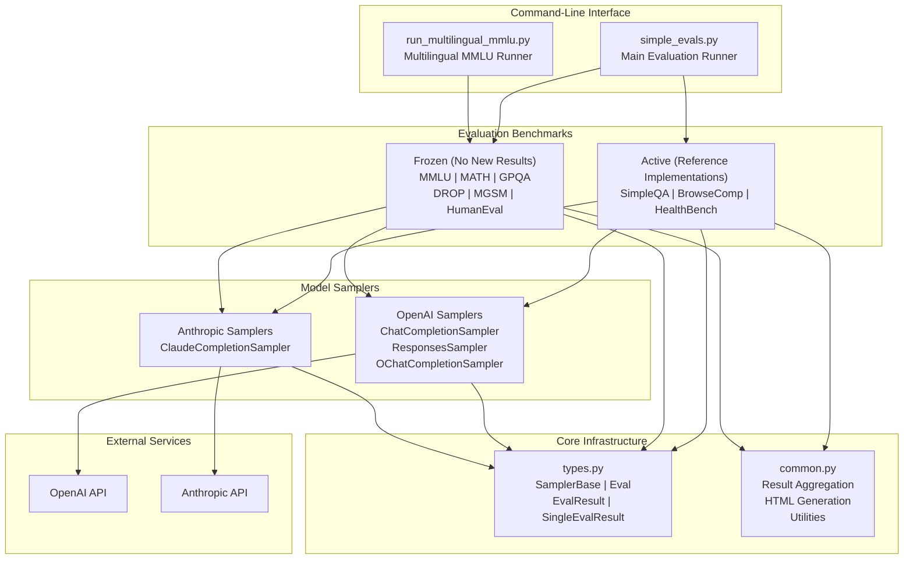

### Key Architectural Components

| Component | File(s) | Purpose |
|-----------|---------|---------|
| **CLI Runners** | `simple_evals.py`, `run_multilingual_mmlu.py` | Orchestrate evaluation execution, handle command-line arguments |
| **Evaluation Benchmarks** | `*_eval.py` files | Implement specific evaluation tasks (MMLU, MATH, etc.) |
| **Model Samplers** | `sampler/*.py` | Abstract API differences for OpenAI and Anthropic models |
| **Type System** | `types.py` | Define core interfaces (`SamplerBase`, `Eval`) |
| **Common Utilities** | `common.py` | Shared result aggregation, HTML rendering, normalization |

The architecture enables **any benchmark to work with any model** through the `SamplerBase` interface. For details on the type system and interfaces, see [Type System and Interfaces](#3.1). For sampler implementations, see [Model Samplers](#3.2).

**Sources:** [README.md:87-95](), Diagram 1 from provided high-level architecture

---

## Evaluation Benchmark Portfolio

simple-evals includes nine evaluation benchmarks covering language understanding, mathematical reasoning, code generation, and domain-specific tasks:

### Benchmark Categories and Grading Strategies

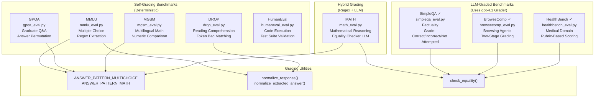

### Benchmark Summary

| Benchmark | Status | Task Type | Grading Method | Docs |
|-----------|--------|-----------|----------------|------|
| **SimpleQA** | ✓ Active | Factuality | LLM (gpt-4.1) | [#4.1.1](#4.1.1) |
| **BrowseComp** | ✓ Active | Browsing agents | LLM (gpt-4.1) | [#4.1.2](#4.1.2) |
| **HealthBench** | ✓ Active | Medical domain | LLM (gpt-4.1) rubric | [#4.1.3](#4.1.3) |
| MMLU | Frozen | Multiple choice | Regex + normalization | [#4.2.1](#4.2.1) |
| GPQA | Frozen | Graduate Q&A | Regex + normalization | [#4.2.2](#4.2.2) |
| MATH | Frozen | Math problems | Regex + LLM equality | [#4.3.1](#4.3.1) |
| MGSM | Frozen | Multilingual math | Regex + normalization | [#4.3.2](#4.3.2) |
| DROP | Frozen | Reading comp. | Token bag matching | [#4.4.1](#4.4.1) |
| HumanEval | Frozen | Code generation | Test execution | [#4.4.2](#4.4.2) |

**Grading Strategy Implications:**
- **Self-grading**: Fast, deterministic, but may miss semantically correct variations
- **LLM-graded**: Handles nuance and open-ended responses, but introduces grader model dependencies
- **Hybrid**: Combines extraction reliability with semantic equivalence checking

For comprehensive documentation of each benchmark, see [Evaluation Benchmarks](#4).

**Sources:** [README.md:75-85](), Diagram 4 from provided high-level architecture

---

## Model Support

simple-evals supports multiple model families through specialized sampler implementations:

### Sampler Implementations and Model Coverage

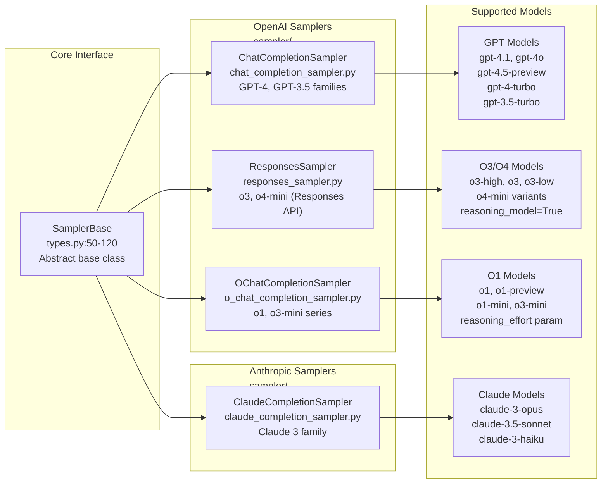

### Key Differences Between Samplers

| Sampler | API | System Prompt Support | Special Parameters |
|---------|-----|----------------------|-------------------|
| `ChatCompletionSampler` | OpenAI Chat Completions | ✓ Yes (role: "assistant") | Standard temperature, max_tokens |
| `ResponsesSampler` | OpenAI Responses | ✗ No | `reasoning_model=True` for o3/o4-mini |
| `OChatCompletionSampler` | OpenAI Chat Completions | ✗ No | `reasoning_effort` for o1 series |
| `ClaudeCompletionSampler` | Anthropic Messages | ✓ Configurable | Empty or LMSYS system messages |

The sampler abstraction enables evaluations to remain agnostic to model API differences. For detailed documentation, see [Model Samplers](#3.2).

**Sources:** [README.md:87-94](), [README.md:130-139](), Diagram 3 from provided high-level architecture

---

## Evaluation Workflow

The evaluation pipeline transforms user inputs through prompt construction, model sampling, grading, and result aggregation:

### End-to-End Evaluation Pipeline

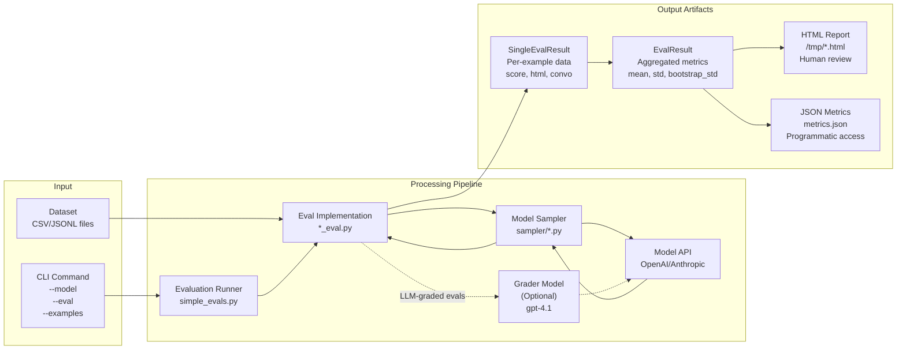

### Result Structure

The framework produces a two-level result hierarchy:

1. **`SingleEvalResult`** ([types.py:23-32]()): Per-example results containing:
   - `score`: Numeric score (0.0 or 1.0 for binary grading)
   - `html`: Human-readable HTML snippet for debugging
   - `convo`: Full conversation history (prompts + responses)
   - `metrics`: Optional task-specific metrics dictionary

2. **`EvalResult`** ([types.py:35-44]()): Aggregated results containing:
   - `score`: Mean score across all examples
   - `metrics`: Statistical summaries (mean, std, bootstrap_std) and categorical breakdowns
   - `htmls`: List of all SingleEvalResult HTML snippets
   - `convos`: List of all conversation histories

For details on result aggregation and output formats, see [Common Utilities and Result Aggregation](#3.4) and [Output Files and Reports](#6.2).

**Sources:** Diagram 2 from provided high-level architecture, Diagram 5 from provided high-level architecture

---

## Key Features

### Zero-Shot Chain-of-Thought Prompting

All evaluations use simple, direct instructions without few-shot examples or role-playing prompts. This reflects realistic usage patterns for instruction-tuned models [README.md:64]().

### Model-Agnostic Design

The `SamplerBase` interface ([types.py:50-120]()) enables any evaluation to work with any supported model API without modification. Evaluations call `sampler(messages)` without knowing the underlying model family.

### Flexible Grading Strategies

The framework supports three grading approaches:
- **Deterministic**: Regex patterns and normalization functions for exact matching
- **LLM-based**: Separate grader model evaluates response quality
- **Hybrid**: Combines extraction with semantic equivalence checking

See [Benchmark Specializations and Grading Strategies](#4) for details.

### Comprehensive Result Artifacts

Each evaluation produces:
- **HTML reports**: Visual review of model responses with correct/incorrect annotations
- **JSON metrics**: Machine-readable performance statistics
- **Full conversation logs**: Complete prompt/response traces for debugging

For output format details, see [Output Files and Reports](#6.2).

### Multilingual Support

The framework includes multilingual evaluation capabilities:
- **Multilingual MMLU**: Human-translated MMLU questions in 14 languages
- **MGSM**: Grade school math problems in 11 languages

See [Multilingual Evaluation](#5) for comprehensive documentation.

**Sources:** [README.md:60-72](), Diagram 2 and Diagram 5 from provided high-level architecture

---

## Relationship to Other Frameworks

simple-evals is **not** a replacement for [openai/evals](https://github.com/openai/evals), which provides a comprehensive collection of evaluation benchmarks. Instead, simple-evals focuses on:

1. **Transparency**: Publishing exact evaluation methodologies used for OpenAI model releases
2. **Simplicity**: Lightweight implementation emphasizing zero-shot prompting
3. **Reference Implementations**: Canonical versions of key benchmarks (SimpleQA, BrowseComp, HealthBench)

The framework accepts contributions for:
- Bug fixes
- New model adapters (implementing `SamplerBase` for additional APIs)
- New result rows with eval results for existing benchmarks

The framework **does not accept** new evaluation benchmarks [README.md:66-69]().

**Sources:** [README.md:66-72]()

---

## Getting Started

To begin using simple-evals:

1. **Installation**: See [Getting Started](#2) for dependency installation instructions
2. **List Available Models**: Run `python -m simple-evals.simple_evals --list-models`
3. **Run Evaluations**: Execute `python -m simple-evals.simple_evals --model <model_name> --examples <num>`
4. **Review Results**: Check `/tmp/` directory for HTML reports and JSON metrics files

For comprehensive usage documentation, see [Running Evaluations](#6).

**Sources:** [README.md:96-127]()

---

# Page: Getting Started

# Getting Started

<details>
<summary>Relevant source files</summary>

The following files were used as context for generating this wiki page:

- [README.md](README.md)
- [run_multilingual_mmlu.py](run_multilingual_mmlu.py)
- [simple_evals.py](simple_evals.py)

</details>


This guide covers the basic setup and usage of simple-evals, including installation, running your first evaluation, and understanding the output.

**Note**: As of July 2025, simple-evals is no longer actively maintained. New models and benchmark results will not be added. The repository continues to host reference implementations for HealthBench, BrowseComp, and SimpleQA.

## Prerequisites

Before using simple-evals, you need:

- Python 3.10 or higher
- API keys for the model providers you want to evaluate:
  - OpenAI API key (for GPT models and o-series models)
  - Anthropic API key (for Claude models)

## Installation

Simple-evals does not provide a unified setup mechanism due to optional dependencies. Install only the components you need:

### OpenAI API

For evaluating OpenAI models (GPT-4, GPT-4o, o1, o3-mini, etc.):

```bash
pip install openai
export OPENAI_API_KEY='your-api-key-here'
```

### Anthropic API

For evaluating Claude models:

```bash
pip install anthropic
export ANTHROPIC_API_KEY='your-api-key-here'
```

### HumanEval (Code Generation)

For running the HumanEval code generation benchmark:

```bash
git clone https://github.com/openai/human-eval
pip install -e human-eval
```

Sources: [README.md:96-114]()

## Quick Start

The simplest way to get started is to run an evaluation with debug mode, which uses fewer examples and completes quickly:

```bash
python -m simple-evals.simple_evals --model gpt-4o --debug
```

This command will:
1. Use the `gpt-4o` model
2. Run all available evaluations (MMLU, MATH, GPQA, etc.)
3. Use only 5-10 examples per evaluation (debug mode)
4. Generate HTML and JSON reports in `/tmp/`

Sources: [simple_evals.py:29-63](), [simple_evals.py:262-265]()

## Listing Available Models

To see all available models:

```bash
python -m simple-evals.simple_evals --list-models
```

This displays all configured models, including:
- GPT-4.1 family: `gpt-4.1`, `gpt-4.1-mini`, `gpt-4.1-nano`
- GPT-4o family: `gpt-4o`, `gpt-4o-mini`
- o-series models: `o1`, `o1-preview`, `o1-mini`, `o3-mini`, `o3`, `o4-mini`
- Claude models: `claude-3-opus-20240229_empty`, `claude-3-7-sonnet-20250219`

**Model Name Diagram**

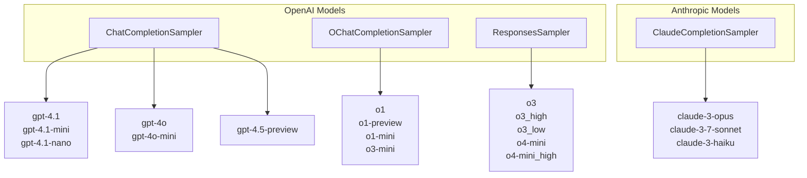

Sources: [simple_evals.py:34-42](), [simple_evals.py:65-236](), [simple_evals.py:238-242]()

## Command Line Options

The CLI supports the following arguments:

| Argument | Type | Default | Description |
|----------|------|---------|-------------|
| `--list-models` | Flag | - | Lists all available models and exits |
| `--model` | String | All models | Model name(s) to evaluate. Accepts comma-separated list |
| `--eval` | String | All evals | Evaluation(s) to run. Accepts comma-separated list |
| `--examples` | Integer | Varies by eval | Number of examples to use (overrides default) |
| `--n-repeats` | Integer | Varies by eval | Number of times to repeat each evaluation |
| `--n-threads` | Integer | 120 | Number of threads (for HealthBench only) |
| `--debug` | Flag | False | Runs in debug mode with minimal examples |

Sources: [simple_evals.py:29-63]()

## Running Evaluations

### Running All Evaluations with Default Settings

To run all evaluations for a specific model with full datasets:

```bash
python -m simple-evals.simple_evals --model gpt-4o
```

This will run all benchmarks (MMLU, MATH, GPQA, DROP, MGSM, HumanEval, SimpleQA, BrowseComp, HealthBench) with their default number of examples.

### Selecting Specific Evaluations

To run only specific evaluations:

```bash
python -m simple-evals.simple_evals --model gpt-4o --eval mmlu,math
```

Available evaluations:
- `mmlu` - Massive Multitask Language Understanding
- `math` - Mathematical problem solving
- `gpqa` - Graduate-level Q&A
- `drop` - Reading comprehension
- `mgsm` - Multilingual grade school math
- `humaneval` - Code generation
- `simpleqa` - Factuality (active reference implementation)
- `browsecomp` - Browsing agents (active reference implementation)
- `healthbench` - Medical domain (active reference implementation)

Sources: [simple_evals.py:267-362]()

### Evaluating Multiple Models

Evaluate multiple models in one run using comma-separated model names:

```bash
python -m simple-evals.simple_evals --model gpt-4o,gpt-4.1,o3-mini --eval mmlu
```

### Controlling Number of Examples

Override the default number of examples:

```bash
python -m simple-evals.simple_evals --model gpt-4o --examples 100
```

This is useful for:
- Quick testing (use small number like 10)
- Reproducibility (use same number across runs)
- Budget control (fewer examples = lower API costs)

### Debug Mode

For rapid testing and development:

```bash
python -m simple-evals.simple_evals --model gpt-4o --debug
```

Debug mode:
- Uses 5-10 examples per evaluation
- Completes in minutes instead of hours
- Useful for verifying setup and code changes

Sources: [simple_evals.py:59-61](), [simple_evals.py:262-265]()

## Evaluation Execution Flow

**Execution Sequence Diagram**

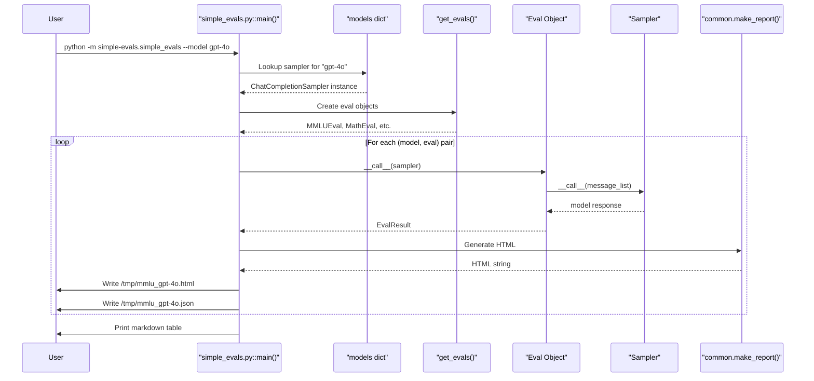

Sources: [simple_evals.py:373-424]()

## Understanding Output Files

Each evaluation run generates three types of output files in the `/tmp/` directory:

### File Naming Convention

Files follow this pattern:
```
/tmp/{eval_name}_{model_name}_{timestamp}[_DEBUG].{extension}
```

For example:
```
/tmp/mmlu_gpt-4o_20250115_143022.html
/tmp/mmlu_gpt-4o_20250115_143022.json
/tmp/mmlu_gpt-4o_20250115_143022_allresults.json
```

### HTML Reports

**Location**: `/tmp/{eval_name}_{model_name}_{timestamp}.html`

HTML reports provide human-readable evaluation results with:
- Overall score and metrics
- Per-example results showing:
  - Original question
  - Model response
  - Expected answer
  - Whether the response was correct
  - Full conversation history

These reports are useful for:
- Debugging model failures
- Understanding error patterns
- Manual inspection of results

**Output Generation Diagram**

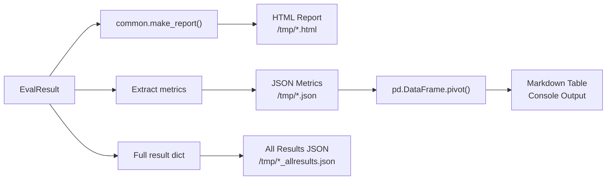

Sources: [simple_evals.py:376-404]()

### JSON Metrics

**Location**: `/tmp/{eval_name}_{model_name}_{timestamp}.json`

Compact JSON file containing aggregated metrics:

```json
{
  "score": 0.873,
  "accuracy": 0.873,
  "num_examples": 100,
  "bootstrap_std": 0.033
}
```

Metrics vary by evaluation type:
- MMLU: `score` (accuracy)
- MATH: `score` (accuracy), `num_samples`
- DROP: `score` (F1), `exact_match`
- SimpleQA: `accuracy_given_attempted`, `f1_score`, `correct`, `incorrect`, `not_attempted`

Sources: [simple_evals.py:384-392]()

### Full Results JSON

**Location**: `/tmp/{eval_name}_{model_name}_{timestamp}_allresults.json`

Complete evaluation results including per-example data:

```json
{
  "score": 0.873,
  "metrics": { ... },
  "htmls": ["<per-example HTML>", ...],
  "convos": [[{"role": "user", "content": "..."}, ...], ...],
  "metadata": { ... }
}
```

This file contains:
- `score`: Overall score
- `metrics`: All computed metrics
- `htmls`: HTML snippets for each example
- `convos`: Full conversation history for each example
- `metadata`: Additional evaluation metadata

Use this for:
- Detailed analysis
- Reproducing specific examples
- Custom metric computation

Sources: [simple_evals.py:394-404]()

### Console Output

After all evaluations complete, a markdown table is printed to the console showing results across all model-evaluation pairs:

```
|                       |   ('metric', 'mmlu') |   ('metric', 'math') |
|:----------------------|---------------------:|---------------------:|
| ('model_name', '')    |                      |                      |
| gpt-4o_20250115_143022|                0.873 |                0.685 |
```

Sources: [simple_evals.py:407-424]()

## Usage Examples

### Listing Available Models

To see all available models that can be evaluated:

```bash
python -m simple-evals.simple_evals --list-models
```

This will display a list of all models configured in the system.

### Running Evaluations with a Specific Model

To run evaluations using a specific model:

```bash
python -m simple-evals.simple_evals --model gpt-4o
```

This will run all evaluations using the gpt-4o model.

### Running in Debug Mode

For testing or development purposes, you can run in debug mode to use fewer examples:

```bash
python -m simple-evals.simple_evals --model gpt-4o --debug
```

### Specifying Number of Examples

To override the default number of examples for each evaluation:

```bash
python -m simple-evals.simple_evals --model gpt-4o --examples 10
```

This will run all evaluations with 10 examples each (where applicable).

Sources: [README.md:101-110](), [simple_evals.py:115-126]()

## Implementation Details

The CLI is implemented in the `simple_evals.py` file, which serves as the main entry point for the evaluation framework. The file defines:

1. The argument parser for processing command line arguments
2. The available models and their corresponding samplers
3. The evaluation factory function that creates evaluation objects
4. The main execution loop that runs evaluations and generates reports

The actual evaluation logic is implemented in separate modules, each focused on a specific benchmark. The CLI orchestrates the evaluation process by selecting models and evaluations based on user input, running the evaluations, and aggregating the results.

Sources: [simple_evals.py:1-12](), [simple_evals.py:22-213]()

## Integration with Model Samplers

The CLI integrates with different model samplers to support various language model APIs:

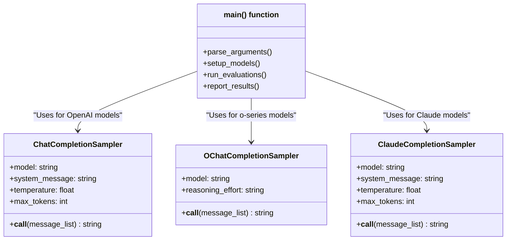

Sources: [simple_evals.py:13-19](), [simple_evals.py:37-113]()

## Summary

The Command Line Interface provides a flexible and straightforward way to evaluate language models across multiple benchmarks. By providing command line arguments, users can customize the evaluation process to meet their specific needs. The CLI handles the complexity of model selection, evaluation execution, and result reporting, providing a unified interface to the simple-evals framework.

---

# Page: Architecture

# Architecture

<details>
<summary>Relevant source files</summary>

The following files were used as context for generating this wiki page:

- [README.md](README.md)
- [common.py](common.py)
- [types.py](types.py)

</details>


## Purpose and Scope

This document describes the high-level architecture of the simple-evals framework, a lightweight system for evaluating language models across diverse benchmarks. The framework follows a three-tier architecture: command-line interface entrypoints that orchestrate evaluation runs, specialized benchmark implementations that encode evaluation logic, and model samplers that abstract different API interfaces.

**Deprecation Status**: As of July 2025, simple-evals is frozen for new models and results. Only three benchmarks (SimpleQA, BrowseComp, HealthBench) remain actively maintained as reference implementations. However, the core infrastructure (types, samplers, utilities) remains available for reuse.

For detailed information about type definitions and interfaces, see page 3.1. For model samplers, see page 3.2. For the evaluation framework, see page 3.3. For common utilities and result aggregation, see page 3.4.

## High-Level Architecture Overview

The framework is organized into three primary layers:

1. **Entry Points**: Command-line interfaces that orchestrate evaluation runs
2. **Benchmarks**: Specialized evaluation implementations that encode task-specific logic
3. **Samplers**: Model interface abstractions that handle different API patterns

### Three-Tier Architecture Diagram

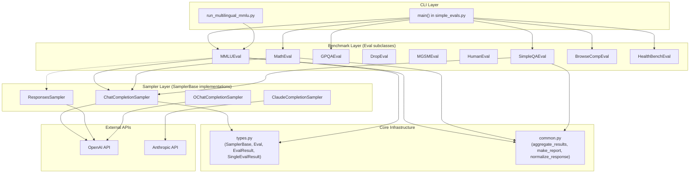

**Sources**: [types.py:1-67](), [common.py:183-216](), [README.md:1-143]()

The system is centered around the `main()` function in `simple_evals.py`, which orchestrates evaluation runs. Benchmarks implement the `Eval` interface from `types.py` and use `SamplerBase` implementations to query models. All benchmarks can work with any sampler through this common interface, enabling flexible model-benchmark combinations.

## Core Execution Flow

The evaluation pipeline processes data from user commands through model APIs to aggregated results:

### Evaluation Pipeline Data Flow

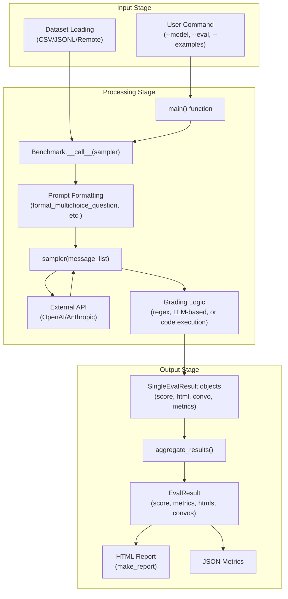

**Sources**: [simple_evals.py:22-213](), [common.py:183-216](), [types.py:31-66]()

The `main()` function orchestrates the following steps:
1. Parse command-line arguments (model selection, eval selection, parameters)
2. Initialize `SamplerBase` implementations for specified models
3. Instantiate `Eval` subclasses for benchmarks with configuration
4. For each model-benchmark pair, call `eval_object(sampler)` which returns `EvalResult`
5. Use `make_report()` to generate HTML reports from `EvalResult.htmls`
6. Write metrics to JSON files
7. Aggregate all results into combined output table

## Model Sampler Architecture

The sampler layer provides a uniform interface (`SamplerBase`) to diverse language model APIs, enabling any benchmark to work with any model.

### Sampler Class Hierarchy

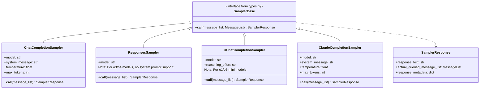

**Sources**: [types.py:4-28](), [README.md:87-94]()

### Sampler Implementations

| Sampler Class | Purpose | Key Characteristics | Location |
|---------------|---------|---------------------|----------|
| `ChatCompletionSampler` | GPT-4 family, GPT-3.5 | Supports system messages, standard chat API | sampler/chat_completion_sampler.py |
| `ResponsesSampler` | o3, o4-mini models | Uses Responses API, no system prompt support, `reasoning_model=True` | sampler/responses_sampler.py |
| `OChatCompletionSampler` | o1 series, o3-mini | No system prompt, supports `reasoning_effort` parameter | sampler/o_chat_completion_sampler.py |
| `ClaudeCompletionSampler` | Claude models | Configurable system messages (empty or LMSYS template) | sampler/claude_completion_sampler.py |

All samplers implement `SamplerBase.__call__(message_list: MessageList) -> SamplerResponse` where `MessageList = list[Message]` and `Message = dict[str, Any]` (with keys `role`, `content`).

For detailed sampler documentation, see page 3.2 (Model Samplers), with subsections 3.2.1 (OpenAI Samplers) and 3.2.2 (Claude Sampler).

## Evaluation Framework

Benchmarks implement the `Eval` interface and follow a standardized execution pattern:

### Evaluation Interface Contract

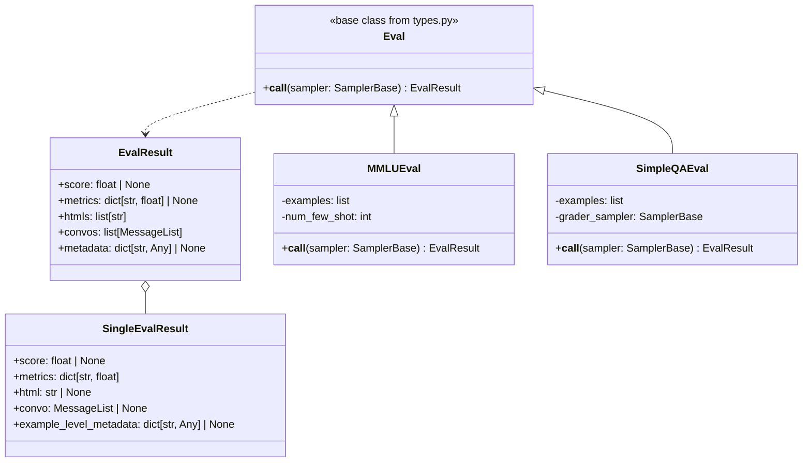

**Sources**: [types.py:59-66](), [types.py:31-56]()

### Standard Evaluation Process

All `Eval` implementations follow this pattern:

1. **Dataset Loading**: Load examples from CSV, JSONL, or remote sources
2. **Prompt Construction**: Format prompts using templates (e.g., `QUERY_TEMPLATE_MULTICHOICE`)
3. **Model Sampling**: Call `sampler(message_list)` which returns `SamplerResponse`
4. **Answer Extraction**: Parse responses using regex patterns (e.g., `ANSWER_PATTERN_MULTICHOICE`)
5. **Grading**: Score responses via:
   - **Self-grading**: Direct comparison to ground truth (MMLU, GPQA, MATH)
   - **LLM-grading**: Use grader model to assess quality (SimpleQA, BrowseComp, HealthBench)
   - **Code execution**: Run test suites (HumanEval)
6. **Result Creation**: Build `SingleEvalResult` for each example
7. **Aggregation**: Combine via `aggregate_results()` into final `EvalResult`

See page 3.3 (Evaluation Framework) for detailed implementation patterns. See page 4 for specific benchmark implementations.

## Results Aggregation and Reporting

The result aggregation pipeline transforms per-example results into comprehensive evaluation reports:

### Aggregation Pipeline

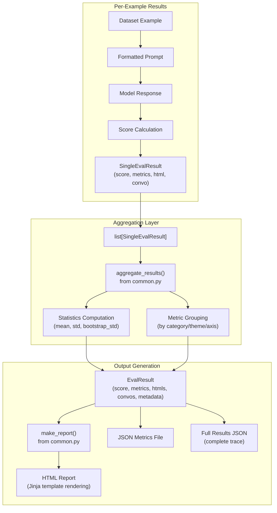

**Sources**: [common.py:183-216](), [common.py:335-343](), [types.py:31-56]()

### Aggregation Functions

The `aggregate_results()` function in `common.py` performs the following:

1. **Metric Collection**: Extract all metrics from each `SingleEvalResult.metrics` dict
2. **Score Aggregation**: Collect `SingleEvalResult.score` values
3. **Statistical Computation**: Calculate statistics via `_compute_stat()`:
   - `mean`: Average score across examples
   - `std`: Standard deviation
   - `bootstrap_std`: Bootstrap confidence intervals
   - `min`, `max`: Range statistics
   - `n_samples`: Number of examples
4. **HTML Consolidation**: Combine `SingleEvalResult.html` snippets
5. **Conversation Logging**: Preserve all `SingleEvalResult.convo` message lists

### Output Formats

| Format | Function | Purpose | File Location |
|--------|----------|---------|---------------|
| HTML Report | `make_report()` | Human-readable results with example-level detail | `/tmp/<model>_<eval>_report.html` |
| JSON Metrics | Direct serialization | Lightweight metrics for programmatic access | `/tmp/<model>_<eval>.json` |
| Full Results JSON | Complete `EvalResult` | Reproducibility, includes all conversations | `/tmp/<model>_<eval>_full.json` |

See page 3.4 (Common Utilities and Result Aggregation) for detailed utility documentation. See page 6.2 (Output Files and Reports) for output file specifications.

## Type System and Data Structures

The framework is built around a core set of type definitions that ensure modularity:

### Core Type Definitions

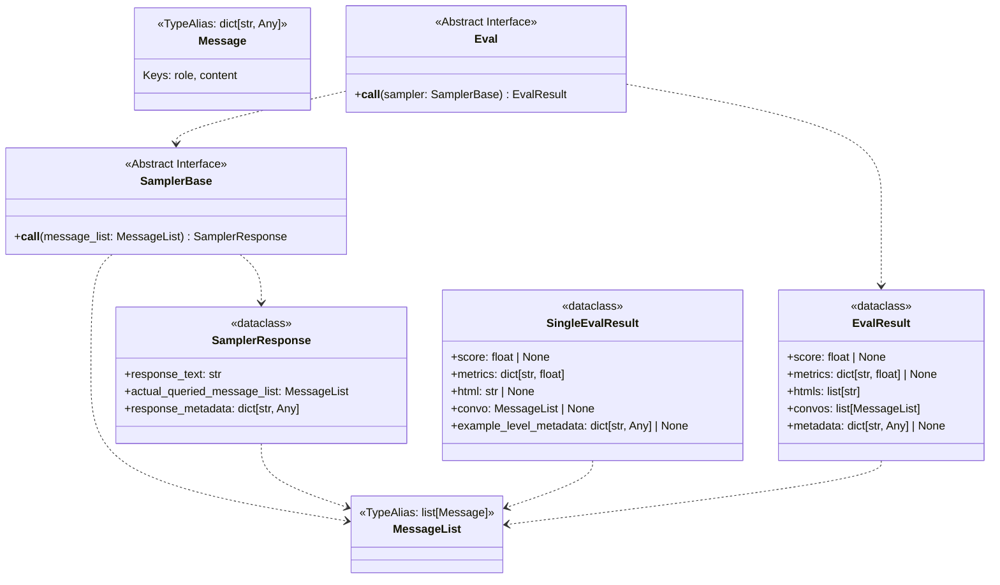

**Sources**: [types.py:1-67]()

All types are defined in `types.py`. The key abstractions are:

- **`Message`**: Dictionary with `role` and `content` keys, representing a single message
- **`MessageList`**: List of messages forming a conversation
- **`SamplerBase`**: Abstract interface for model APIs
- **`SamplerResponse`**: Model output wrapper with response text and metadata
- **`SingleEvalResult`**: Per-example evaluation results
- **`EvalResult`**: Aggregated results across all examples
- **`Eval`**: Abstract interface for benchmark implementations

This type system enables any benchmark (`Eval`) to work with any model (`SamplerBase`) through a uniform interface.

See page 3.1 (Type System and Interfaces) for comprehensive type documentation.

## Common Utilities

The `common.py` module provides shared utilities used across all benchmarks:

### Utility Functions

| Function | Signature | Purpose | Location |
|----------|-----------|---------|----------|
| `format_multichoice_question()` | `(row: dict) -> str` | Format multiple choice questions using template | [common.py:153-154]() |
| `check_equality()` | `(sampler, expr1, expr2) -> bool` | Compare mathematical expressions via LLM | [common.py:157-161]() |
| `aggregate_results()` | `(list[SingleEvalResult], ...) -> EvalResult` | Aggregate per-example results with statistics | [common.py:183-216]() |
| `map_with_progress()` | `(f, xs, num_threads, pbar) -> list` | Parallel processing with progress bar | [common.py:219-234]() |
| `make_report()` | `(eval_result: EvalResult) -> str` | Generate HTML report using Jinja templates | [common.py:335-343]() |
| `normalize_response()` | `(response: str) -> str` | Strip markdown/LaTeX formatting | [common.py:355-374]() |
| `normalize_extracted_answer()` | `(extracted_answer: str) -> str` | Normalize multilingual answer characters | [common.py:377-395]() |

### Prompt Templates

- **`QUERY_TEMPLATE_MULTICHOICE`**: Standard multiple choice question format [common.py:15-24]()
- **`EQUALITY_TEMPLATE`**: Template for mathematical expression comparison [common.py:78-136]()

### Answer Extraction Patterns

- **`ANSWER_PATTERN_MULTICHOICE`**: Regex for "Answer: $LETTER" format [common.py:26]()
- **`ANSWER_PATTERN`**: General answer extraction regex [common.py:27]()
- **`MULTILINGUAL_ANSWER_REGEXES`**: Answer patterns in 15+ languages [common.py:32-75]()

See page 3.4 (Common Utilities and Result Aggregation) for detailed utility documentation.

## Summary

The Simple-Evals architecture provides a modular, extensible framework for evaluating language model performance across diverse tasks. Its key strengths include:

1. A unified interface for interacting with different language models
2. Standardized evaluation processes across tasks
3. Flexible result aggregation and reporting
4. Support for parallel processing of evaluations
5. Easy extension to new models and evaluation tasks

To learn more about specific evaluation tasks, see [Evaluation Tasks](#3), and for details on adding new models, see [Adding New Models](#6.1).

---

# Page: Type System and Interfaces

# Type System and Interfaces

<details>
<summary>Relevant source files</summary>

The following files were used as context for generating this wiki page:

- [common.py](common.py)
- [types.py](types.py)

</details>


## Purpose and Scope

This document describes the core type system and abstract interfaces that form the foundation of simple-evals. These abstractions define the contracts between samplers (model wrappers), evaluations (benchmark implementations), and result types, enabling the modular architecture where any sampler can work with any evaluation.

For details on concrete sampler implementations, see [Model Samplers](#3.2). For evaluation implementation patterns, see [Evaluation Framework](#3.3).

---

## Overview of the Type System

The type system consists of five core abstractions defined in [types.py:1-67]():

| Type | Category | Purpose |
|------|----------|---------|
| `Message` | Type Alias | Represents a single message in a conversation |
| `MessageList` | Type Alias | Represents a conversation as a list of messages |
| `SamplerBase` | Abstract Class | Interface for model samplers |
| `SamplerResponse` | Dataclass | Response returned by samplers |
| `Eval` | Abstract Class | Interface for evaluation implementations |
| `SingleEvalResult` | Dataclass | Result for a single evaluation example |
| `EvalResult` | Dataclass | Aggregated results for an entire evaluation |

**Architecture Diagram: Type System Relationships**

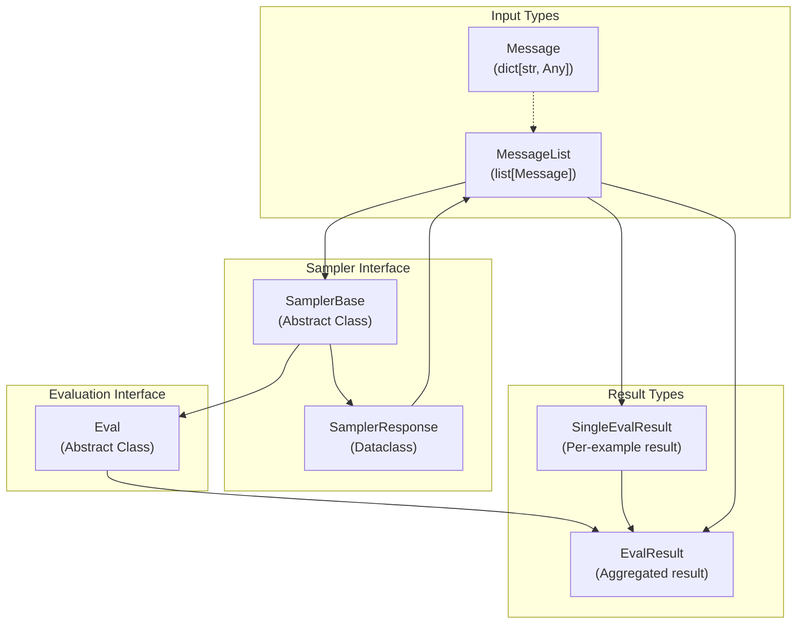

**Sources:** [types.py:1-67]()

---

## Message Types

### Message Dictionary

A `Message` represents a single message in a conversation and is defined as a type alias [types.py:4]():

```python
Message = dict[str, Any]  # keys role, content
```

**Required Fields:**
| Field | Type | Description |
|-------|------|-------------|
| `role` | `str` | Message role: `"user"`, `"assistant"`, or `"system"` |
| `content` | `str` | Text content of the message |

**Optional Fields:**
| Field | Type | Description |
|-------|------|-------------|
| `variant` | `str` | Model-specific variant identifier (e.g., for tool calls) |

The message structure is validated by [common.py:404-408](), which checks for user-assistant-only conversations in certain contexts.

### MessageList

A `MessageList` represents an entire conversation [types.py:5]():

```python
MessageList = list[Message]
```

This type is used throughout the system:
- As input to samplers to generate responses
- As output from samplers showing the actual queried messages
- To store sampled conversations in results

**Sources:** [types.py:4-5](), [common.py:404-408]()

---

## Sampler Interface

### SamplerBase Abstract Class

`SamplerBase` defines the interface that all model samplers must implement [types.py:18-28]():

**Class Definition:**

```python
class SamplerBase:
    """
    Base class for defining a sampling model, which can be evaluated,
    or used as part of the grading process.
    """

    def __call__(
        self, 
        message_list: MessageList,
    ) -> SamplerResponse:
        raise NotImplementedError
```

**Contract:**
- Implement the `__call__` method to accept a `MessageList` and return a `SamplerResponse`
- Must handle message history formatting according to the model's API requirements
- Should handle errors gracefully and include metadata in the response

**Usage Example from common.py:**

The equality checker demonstrates sampler usage [common.py:157-161]():

```python
def check_equality(sampler: SamplerBase, expr1: str, expr2: str):
    prompt = EQUALITY_TEMPLATE % {"expression1": expr1, "expression2": expr2}
    sampler_response = sampler([dict(content=prompt, role="user")])
    response_text = sampler_response.response_text
    return response_text.lower().strip() == "yes"
```

### SamplerResponse Dataclass

The `SamplerResponse` encapsulates the output from a sampler [types.py:9-16]():

**Field Definitions:**

| Field | Type | Description |
|-------|------|-------------|
| `response_text` | `str` | The actual text response from the model |
| `actual_queried_message_list` | `MessageList` | The message list that was actually sent to the API (may differ from input due to system prompt handling) |
| `response_metadata` | `dict[str, Any]` | Additional metadata (e.g., token counts, model version, reasoning tokens) |

**Data Flow Diagram: Sampler Invocation**

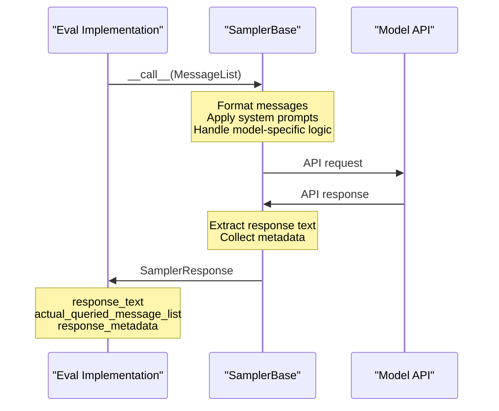

**Sources:** [types.py:9-28](), [common.py:157-161]()

---

## Evaluation Interface

### Eval Abstract Class

`Eval` defines the interface that all benchmark implementations must implement [types.py:59-65]():

**Class Definition:**

```python
class Eval:
    """
    Base class for defining an evaluation.
    """

    def __call__(self, sampler: SamplerBase) -> EvalResult:
        raise NotImplementedError
```

**Contract:**
- Implement the `__call__` method to accept a `SamplerBase` and return an `EvalResult`
- Must load or generate evaluation examples
- Must format prompts for the sampler
- Must grade responses and produce results

**Typical Implementation Pattern:**

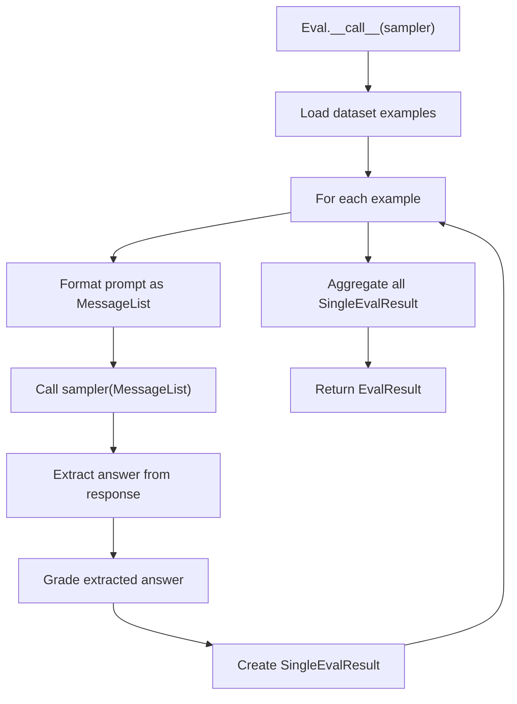

**Sources:** [types.py:59-65]()

---

## Result Types

### SingleEvalResult

`SingleEvalResult` represents the outcome of evaluating a single example [types.py:44-56]():

**Field Definitions:**

| Field | Type | Default | Description |
|-------|------|---------|-------------|
| `score` | `float \| None` | Required | Binary or continuous score for this example (e.g., 0.0 or 1.0 for correct/incorrect) |
| `metrics` | `dict[str, float]` | `{}` | Additional per-example metrics (e.g., F1 score, token counts) |
| `html` | `str \| None` | `None` | HTML snippet showing prompt, response, and grading details |
| `convo` | `MessageList \| None` | `None` | The sampled conversation for this example |
| `example_level_metadata` | `dict[str, Any] \| None` | `None` | Arbitrary metadata (e.g., rubric scores, question ID) |

**HTML Generation Example:**

The `common.py` module provides a Jinja template for generating HTML [common.py:139-150]():

```python
HTML_JINJA = """
<h3>Prompt conversation</h3>

{{ message_to_html(message) | safe }}

<h3>Sampled message</h3>
{{ message_to_html(next_message) | safe }}
<h3>Results</h3>
<p>Correct Answer: {{ correct_answer }}</p>
<p>Extracted Answer: {{ extracted_answer }}</p>
<p>Score: {{ score }}</p>
"""
```

### EvalResult

`EvalResult` represents aggregated results from an entire evaluation run [types.py:31-42]():

**Field Definitions:**

| Field | Type | Description |
|-------|------|-------------|
| `score` | `float \| None` | Top-line metric (e.g., overall accuracy) |
| `metrics` | `dict[str, float] \| None` | Aggregated metrics (mean, std, etc.) |
| `htmls` | `list[str]` | List of HTML snippets, one per example |
| `convos` | `list[MessageList]` | List of sampled conversations |
| `metadata` | `dict[str, Any] \| None` | Global metadata (e.g., list of per-example metadata) |

**Aggregation Process:**

The `aggregate_results` function transforms multiple `SingleEvalResult` objects into an `EvalResult` [common.py:183-216]():

**Aggregation Flow Diagram:**

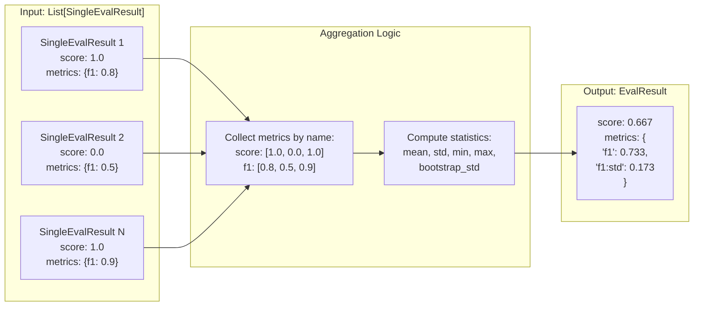

**Supported Statistics:**

The `_compute_stat` function [common.py:164-180]() supports:

| Statistic | Description |
|-----------|-------------|
| `mean` | Average value |
| `std` | Standard deviation |
| `min` | Minimum value |
| `max` | Maximum value |
| `n_samples` | Number of samples |
| `bootstrap_std` | Bootstrap standard error (1000 resamples) |

**Sources:** [types.py:31-56](), [common.py:139-216]()

---

## Type System Usage Patterns

### Pattern 1: Self-Grading Evaluation

Self-grading evaluations directly compare model outputs to ground truth:

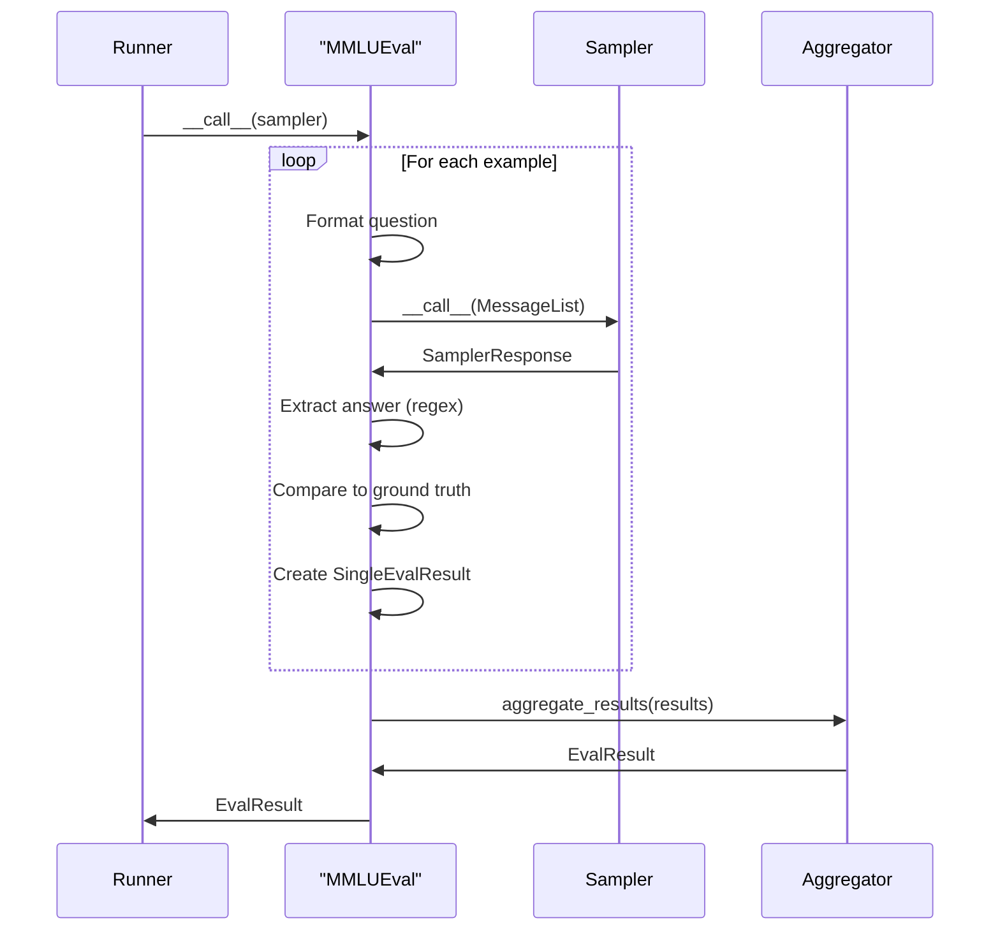

### Pattern 2: LLM-Graded Evaluation

LLM-graded evaluations use a grader model to assess quality:

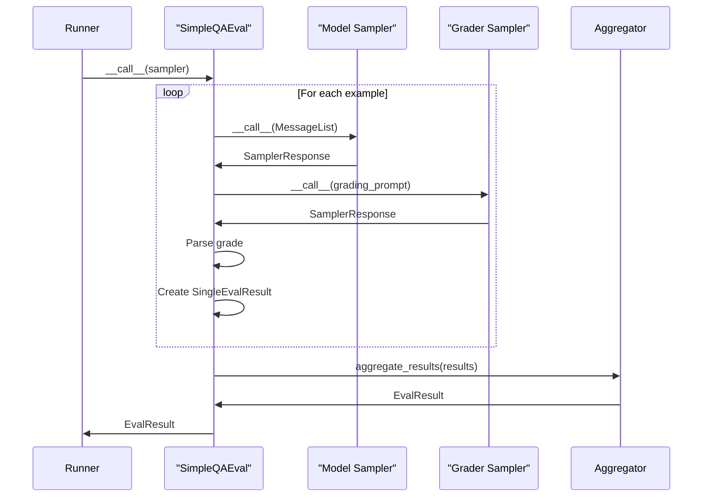

**Sources:** Overall system patterns observed across multiple evaluation implementations

---

## Type Safety and Validation

### Message Validation

The `has_only_user_assistant_messages` function validates message lists [common.py:404-408]():

```python
def has_only_user_assistant_messages(messages: list[Message]) -> bool:
    """
    Check if the messages only contain user and assistant messages.
    """
    return all(m["role"] in ("user", "assistant") for m in messages)
```

This is used by samplers that don't support system messages (e.g., O-series models).

### Result Type Guarantees

The type system provides the following guarantees:

| Guarantee | Enforced By | Description |
|-----------|-------------|-------------|
| Score range | Convention | Scores are typically 0.0-1.0 for binary correctness |
| Metrics are numeric | Type annotation | All metrics must be `float` values |
| HTML validity | Jinja templates | HTML is generated from safe templates [common.py:237-266]() |
| Conversation structure | Type definition | Conversations are always `MessageList` |

**Sources:** [types.py:1-67](), [common.py:404-408](), [common.py:237-266]()

---

## Summary

The type system provides three key contracts:

1. **`SamplerBase`**: Any class implementing `__call__(MessageList) -> SamplerResponse` can serve as a model
2. **`Eval`**: Any class implementing `__call__(SamplerBase) -> EvalResult` can serve as a benchmark
3. **Result types**: Standardized structures (`SingleEvalResult`, `EvalResult`) enable consistent aggregation and reporting

This modular design enables:
- Adding new models without modifying evaluations
- Adding new evaluations without modifying samplers
- Consistent result aggregation across all benchmarks
- Uniform HTML and JSON output formats

**Complete Type Dependency Graph:**

```mermaid
graph TB
    Message["Message"]
    MessageList["MessageList"]
    SamplerBase["SamplerBase"]
    SamplerResponse["SamplerResponse"]
    Eval["Eval"]
    SingleEvalResult["SingleEvalResult"]
    EvalResult["EvalResult"]
    
    Message --> MessageList
    MessageList --> SamplerBase
    MessageList --> SamplerResponse
    MessageList --> SingleEvalResult
    MessageList --> EvalResult
    
    SamplerBase --> SamplerResponse
    SamplerBase --> Eval
    
    SamplerResponse --> MessageList
    
    SingleEvalResult --> EvalResult
    
    Eval --> EvalResult
    
    style SamplerBase fill:#e1f5ff
    style Eval fill:#ffe1e1
    style EvalResult fill:#e1ffe1
```

**Sources:** [types.py:1-67](), [common.py:1-409]()

---

# Page: Model Samplers

# Model Samplers

<details>
<summary>Relevant source files</summary>

The following files were used as context for generating this wiki page:

- [sampler/chat_completion_sampler.py](sampler/chat_completion_sampler.py)
- [sampler/responses_sampler.py](sampler/responses_sampler.py)
- [types.py](types.py)

</details>


## Purpose and Scope

This page documents the **sampler abstraction layer** that provides a unified interface for querying different language model APIs. Samplers handle API-specific details like message formatting, authentication, retry logic, and response parsing, allowing benchmark implementations to remain model-agnostic.

For detailed documentation of specific sampler implementations, see:
- OpenAI samplers (ChatCompletionSampler, ResponsesSampler, OChatCompletionSampler): [OpenAI Samplers](#3.2.1)
- Anthropic samplers (ClaudeCompletionSampler): [Claude Sampler](#3.2.2)

For information about how samplers fit into the evaluation pipeline, see [Evaluation Framework](#3.3).

Sources: [types.py:18-28](), [sampler/chat_completion_sampler.py:16-19](), [sampler/responses_sampler.py:11-14]()

---

## Sampler Architecture

The sampler system implements a **strategy pattern** to abstract different LLM API interfaces. All samplers inherit from `SamplerBase` and implement the same calling interface, but internally translate between the universal message format and provider-specific API requirements.

### SamplerBase Interface

The `SamplerBase` abstract class defines the contract all samplers must implement:

```python
class SamplerBase:
    def __call__(
        self, 
        message_list: MessageList,
    ) -> SamplerResponse:
        raise NotImplementedError
```

**Key characteristics:**
- **Input**: `MessageList` (list of message dictionaries with `role` and `content` keys)
- **Output**: `SamplerResponse` dataclass containing response text, metadata, and the actual queried message list
- **Stateless**: Each call is independent; samplers maintain only configuration state

Sources: [types.py:18-28]()

### SamplerResponse Structure

All samplers return a `SamplerResponse` object:

```python
@dataclass
class SamplerResponse:
    response_text: str                          # The model's generated text
    actual_queried_message_list: MessageList   # Messages actually sent to API
    response_metadata: dict[str, Any]          # Usage stats, tokens, etc.
```

The `actual_queried_message_list` field is crucial for debugging and logging, as it captures any modifications the sampler made (e.g., adding system messages) before sending to the API.

Sources: [types.py:9-16]()

---

## Sampler Hierarchy and Model Coverage

```mermaid
graph TB
    subgraph Interface["Sampler Interface (types.py)"]
        SamplerBase["SamplerBase<br/>__call__(MessageList) → SamplerResponse"]
        SamplerResponse["SamplerResponse<br/>response_text: str<br/>actual_queried_message_list<br/>response_metadata: dict"]
    end
    
    subgraph OpenAI["OpenAI Samplers (sampler)"]
        ChatCompletionSampler["ChatCompletionSampler<br/>chat.completions.create()<br/>GPT-4, GPT-3.5"]
        ResponsesSampler["ResponsesSampler<br/>responses.create()<br/>o3, o4-mini"]
        OChatCompletionSampler["OChatCompletionSampler<br/>chat.completions.create()<br/>o1, o3-mini"]
    end
    
    subgraph Anthropic["Anthropic Samplers (sampler)"]
        ClaudeCompletionSampler["ClaudeCompletionSampler<br/>messages.create()<br/>Claude 3/3.5 family"]
    end
    
    SamplerBase --> ChatCompletionSampler
    SamplerBase --> ResponsesSampler
    SamplerBase --> OChatCompletionSampler
    SamplerBase --> ClaudeCompletionSampler
    
    SamplerBase -.-> SamplerResponse
    ChatCompletionSampler -.-> SamplerResponse
    ResponsesSampler -.-> SamplerResponse
    OChatCompletionSampler -.-> SamplerResponse
    ClaudeCompletionSampler -.-> SamplerResponse
```

**Diagram: Sampler Class Hierarchy**

Sources: [types.py:4-28](), [sampler/chat_completion_sampler.py:16-19](), [sampler/responses_sampler.py:11-14]()

---

## Sampler Comparison

| Sampler Class | API Endpoint | Model Families | System Message Role | Key Parameters |
|--------------|--------------|----------------|---------------------|----------------|
| `ChatCompletionSampler` | `chat.completions.create()` | GPT-4, GPT-3.5-turbo | `system` | `temperature`, `max_tokens` |
| `ResponsesSampler` | `responses.create()` | o3, o4-mini | `developer` | `reasoning_model`, `reasoning_effort`, `max_output_tokens` |
| `OChatCompletionSampler` | `chat.completions.create()` | o1, o1-preview, o3-mini | Not supported | `reasoning_effort` (low/medium/high) |
| `ClaudeCompletionSampler` | `messages.create()` | Claude 3/3.5 family | `system` (optional) | `temperature`, `max_tokens` |

**Key Differences:**
- **O-series models** (o1, o3) do not support system messages at the API level
- **ResponsesSampler** uses the newer `responses` API with `input` parameter instead of `messages`
- **Reasoning models** (o3, o4-mini with `reasoning_model=True`) support `reasoning_effort` but not temperature
- **Message content types** differ: OpenAI uses `{"type": "text"}` while ResponsesSampler uses `{"type": "input_text"}`

Sources: [sampler/chat_completion_sampler.py:21-34](), [sampler/responses_sampler.py:16-34]()

---

## Message Formatting

Samplers translate between a universal message format and API-specific requirements. Each sampler implements three helper methods:

### Universal Message Structure

```python
Message = dict[str, Any]        # keys: role, content
MessageList = list[Message]     # conversation history
```

Example message list:
```python
[
    {"role": "user", "content": [{"type": "text", "text": "What is 2+2?"}]},
    {"role": "assistant", "content": [{"type": "text", "text": "4"}]},
    {"role": "user", "content": [{"type": "text", "text": "And 3+3?"}]}
]
```

Sources: [types.py:4-5]()

### Sampler-Specific Formatting Methods

Each sampler implements:

| Method | Purpose | Example (ChatCompletionSampler) | Example (ResponsesSampler) |
|--------|---------|--------------------------------|----------------------------|
| `_handle_text(text: str)` | Format text content | `{"type": "text", "text": "..."}` | `{"type": "input_text", "text": "..."}` |
| `_handle_image(image: str, ...)` | Format image content | `{"type": "image_url", "image_url": {...}}` | `{"type": "input_image", "image_url": "..."}` |
| `_pack_message(role: str, content: Any)` | Create message dict | `{"role": "user", "content": [...]}` | `{"role": "user", "content": [...]}` |

**ChatCompletionSampler formatting:**
```python
def _handle_text(self, text: str):
    return {"type": "text", "text": text}

def _handle_image(self, image: str, encoding: str = "base64", ...):
    return {
        "type": "image_url",
        "image_url": {"url": f"data:image/{format};{encoding},{image}"}
    }
```

**ResponsesSampler formatting:**
```python
def _handle_text(self, text: str) -> dict[str, Any]:
    return {"type": "input_text", "text": text}

def _handle_image(self, image: str, encoding: str = "base64", ...):
    return {
        "type": "input_image",
        "image_url": f"data:image/{format};{encoding},{image}"
    }
```

Sources: [sampler/chat_completion_sampler.py:37-56](), [sampler/responses_sampler.py:36-53]()

---

## System Message Handling

System messages are prepended to the conversation to set model behavior, but different APIs have different requirements:

```mermaid
graph LR
    subgraph Input["Benchmark Code"]
        MessageList["MessageList<br/>[user, assistant, user]"]
        SystemMsg["system_message<br/>(optional string)"]
    end
    
    subgraph ChatCompletion["ChatCompletionSampler"]
        AddSystem1["Prepend:<br/>role='system'<br/>content=system_message"]
        API1["chat.completions.create()<br/>messages=[system, ...]"]
    end
    
    subgraph Responses["ResponsesSampler"]
        AddDev["Prepend:<br/>role='developer'<br/>content=system_message"]
        API2["responses.create()<br/>input=[developer, ...]"]
    end
    
    subgraph OChat["OChatCompletionSampler"]
        NoSystem["System messages<br/>NOT SUPPORTED<br/>silently ignored"]
        API3["chat.completions.create()<br/>messages=[...]"]
    end
    
    MessageList --> AddSystem1
    SystemMsg --> AddSystem1
    AddSystem1 --> API1
    
    MessageList --> AddDev
    SystemMsg --> AddDev
    AddDev --> API2
    
    MessageList --> NoSystem
    SystemMsg -.->|ignored| NoSystem
    NoSystem --> API3
```

**Diagram: System Message Handling Across Samplers**

**Implementation details:**

```python
# ChatCompletionSampler (lines 58-62)
if self.system_message:
    message_list = [
        self._pack_message("system", self.system_message)
    ] + message_list

# ResponsesSampler (lines 56-59)
if self.system_message:
    message_list = [
        self._pack_message("developer", self.system_message)
    ] + message_list

# OChatCompletionSampler (not shown - no system message support)
# System message passed to __init__ but never used in API calls
```

Sources: [sampler/chat_completion_sampler.py:58-62](), [sampler/responses_sampler.py:56-59]()

---

## Error Handling and Retry Logic

All samplers implement **exponential backoff** for rate limiting and transient failures:

```mermaid
graph TD
    Start["__call__(message_list)"] --> TryAPI["Try API Call<br/>trial = 0"]
    TryAPI --> Success{"Success?"}
    Success -->|Yes| Return["Return SamplerResponse"]
    Success -->|No| CheckError{"Error Type?"}
    
    CheckError -->|BadRequestError| ReturnEmpty["Return empty response<br/>response_text=''"]
    CheckError -->|Other Exception| Backoff["Wait 2^trial seconds<br/>Print error message<br/>trial += 1"]
    Backoff --> TryAPI
    
    ReturnEmpty --> End["End"]
    Return --> End
```

**Diagram: Sampler Retry Flow**

**Code implementation:**

```python
trial = 0
while True:
    try:
        response = self.client.chat.completions.create(...)
        return SamplerResponse(...)
    except openai.BadRequestError as e:
        print("Bad Request Error", e)
        return SamplerResponse(
            response_text="", 
            response_metadata={"usage": None},
            ...
        )
    except Exception as e:
        exception_backoff = 2**trial  # exponential back off
        print(f"Rate limit exception so wait and retry {trial} after {exception_backoff} sec", e)
        time.sleep(exception_backoff)
        trial += 1
```

**Key behaviors:**
- **BadRequestError** (e.g., content policy violations): Returns immediately with empty response
- **Rate limiting / transient errors**: Retries indefinitely with exponential backoff (1s, 2s, 4s, 8s, ...)
- **Unknown errors**: Propagate as exceptions to caller

Sources: [sampler/chat_completion_sampler.py:63-96](), [sampler/responses_sampler.py:60-101]()

---

## Sampler Configuration Patterns

### Common Configuration Parameters

All samplers accept these constructor parameters:

| Parameter | Type | Purpose | Default |
|-----------|------|---------|---------|
| `model` | `str` | Model identifier (e.g., "gpt-4.1") | Varies by sampler |
| `system_message` | `str \| None` | System prompt to prepend | `None` |
| `temperature` | `float` | Sampling randomness (not for reasoning models) | `0.5` |
| `max_tokens` | `int` | Maximum output length | `1024` |

### Reasoning Model Parameters

Samplers that support reasoning models have additional parameters:

| Parameter | Sampler | Type | Purpose |
|-----------|---------|------|---------|
| `reasoning_model` | `ResponsesSampler` | `bool` | Enable reasoning model mode (o3, o4-mini) |
| `reasoning_effort` | `ResponsesSampler`, `OChatCompletionSampler` | `str \| None` | Effort level: "low", "medium", "high" |

**Example configurations:**

```python
# Standard GPT-4 sampler
sampler = ChatCompletionSampler(
    model="gpt-4.1",
    system_message="You are a helpful assistant.",
    temperature=0.5,
    max_tokens=1024
)

# O3 reasoning model sampler
sampler = ResponsesSampler(
    model="o3",
    reasoning_model=True,
    reasoning_effort="high"
)

# O1 reasoning model sampler  
sampler = OChatCompletionSampler(
    model="o1-preview",
    reasoning_effort="medium"
)
```

Sources: [sampler/chat_completion_sampler.py:21-34](), [sampler/responses_sampler.py:16-34]()

---

## Usage Metadata

All samplers populate the `response_metadata` field with usage statistics:

```python
return SamplerResponse(
    response_text=content,
    response_metadata={"usage": response.usage},
    actual_queried_message_list=message_list,
)
```

The `usage` object typically contains:
- `prompt_tokens`: Number of tokens in the input
- `completion_tokens`: Number of tokens generated
- `total_tokens`: Sum of prompt and completion tokens

This metadata is used for:
- **Cost tracking**: Token counts enable cost estimation
- **Performance analysis**: Token efficiency across different models
- **Result logging**: Included in evaluation output for reproducibility

**Note:** On API errors, `usage` is set to `None` to indicate no successful API call occurred.

Sources: [sampler/chat_completion_sampler.py:75-78](), [sampler/responses_sampler.py:81-85]()

---

## Integration with Evaluation Framework

Samplers are passed to evaluation implementations via the `Eval.__call__()` method:

```python
class Eval:
    def __call__(self, sampler: SamplerBase) -> EvalResult:
        raise NotImplementedError
```

Benchmarks use samplers without knowledge of the underlying API:

```python
# Example: Benchmark calling a sampler
def eval_example(self, sampler: SamplerBase, example: dict):
    # Construct messages
    message_list = [
        {"role": "user", "content": [{"type": "text", "text": example["prompt"]}]}
    ]
    
    # Query model (sampler handles all API details)
    response = sampler(message_list)
    
    # Process response
    score = grade_response(response.response_text, example["answer"])
    return SingleEvalResult(score=score, convo=response.actual_queried_message_list)
```

This architecture enables:
- **Model-agnostic benchmarks**: Same evaluation code works with any model
- **Easy model comparison**: Swap sampler to test different models
- **Flexible grading**: Graders can also use samplers (e.g., LLM-graded evaluations)

Sources: [types.py:59-65](), [sampler/chat_completion_sampler.py:58-79]()

---

## Authentication

All samplers require API credentials via environment variables:

| Sampler | Environment Variable | Assertion Location |
|---------|---------------------|-------------------|
| `ChatCompletionSampler` | `OPENAI_API_KEY` | [sampler/chat_completion_sampler.py:29]() |
| `ResponsesSampler` | `OPENAI_API_KEY` | [sampler/responses_sampler.py:26]() |
| `OChatCompletionSampler` | `OPENAI_API_KEY` | (inherited pattern) |
| `ClaudeCompletionSampler` | `ANTHROPIC_API_KEY` | (see [Claude Sampler](#3.2.2)) |

The samplers initialize their API clients in `__init__`:

```python
# OpenAI samplers
self.api_key_name = "OPENAI_API_KEY"
assert os.environ.get("OPENAI_API_KEY"), "Please set OPENAI_API_KEY"
self.client = OpenAI()  # Reads OPENAI_API_KEY from environment

# Anthropic samplers  
self.api_key_name = "ANTHROPIC_API_KEY"
assert os.environ.get("ANTHROPIC_API_KEY"), "Please set ANTHROPIC_API_KEY"
self.client = anthropic.Anthropic()  # Reads ANTHROPIC_API_KEY from environment
```

Sources: [sampler/chat_completion_sampler.py:28-29](), [sampler/responses_sampler.py:25-27]()

---

# Page: OpenAI Samplers

# OpenAI Samplers

<details>
<summary>Relevant source files</summary>

The following files were used as context for generating this wiki page:

- [run_multilingual_mmlu.py](run_multilingual_mmlu.py)
- [sampler/chat_completion_sampler.py](sampler/chat_completion_sampler.py)
- [sampler/o_chat_completion_sampler.py](sampler/o_chat_completion_sampler.py)
- [sampler/responses_sampler.py](sampler/responses_sampler.py)
- [simple_evals.py](simple_evals.py)

</details>


This document covers the three OpenAI sampler implementations in the simple-evals framework. These samplers provide unified interfaces to different OpenAI API endpoints and model families, abstracting away the differences in API structure, parameter support, and system message handling. For information about the Claude sampler, see [3.2.2](#3.2.2). For the overall sampler architecture and the `SamplerBase` interface, see [3.2](#3.2).

## Overview

The framework implements three distinct OpenAI sampler classes, each specialized for different API patterns and model characteristics:

| Sampler Class | API Endpoint | Model Families | Key Characteristic |
|--------------|--------------|----------------|-------------------|
| `ChatCompletionSampler` | `chat.completions.create` | GPT-4, GPT-4o, GPT-3.5 | Standard chat models with full parameter support |
| `ResponsesSampler` | `responses.create` | o3, o4-mini, o1-pro | Reasoning models using responses API |
| `OChatCompletionSampler` | `chat.completions.create` | o1, o1-preview, o1-mini, o3-mini | O-series models with reasoning_effort parameter |

The separation exists because these model families require fundamentally different API calls and parameter configurations. Reasoning models (o-series) do not support system messages and require special reasoning control parameters.

**Sources:** [sampler/chat_completion_sampler.py:1-97](), [sampler/responses_sampler.py:1-102](), [sampler/o_chat_completion_sampler.py:1-81](), [simple_evals.py:18-25]()

## Sampler Architecture

```mermaid
graph TB
    subgraph "Base Interface"
        SamplerBase["SamplerBase<br/>(types.py)"]
    end
    
    subgraph "OpenAI Samplers"
        ChatCompletionSampler["ChatCompletionSampler<br/>chat_completion_sampler.py"]
        ResponsesSampler["ResponsesSampler<br/>responses_sampler.py"]
        OChatCompletionSampler["OChatCompletionSampler<br/>o_chat_completion_sampler.py"]
    end
    
    subgraph "OpenAI API Endpoints"
        ChatAPI["client.chat.completions.create()"]
        ResponsesAPI["client.responses.create()"]
    end
    
    subgraph "Model Families"
        GPTModels["GPT-4 Family<br/>gpt-4.1, gpt-4o<br/>gpt-4-turbo<br/>GPT-3.5 Family<br/>gpt-3.5-turbo"]
        O3O4Models["o3, o3-high, o3-low<br/>o4-mini variants<br/>o1-pro"]
        O1Models["o1, o1-preview<br/>o1-mini, o3-mini"]
    end
    
    SamplerBase -.->|"implements"| ChatCompletionSampler
    SamplerBase -.->|"implements"| ResponsesSampler
    SamplerBase -.->|"implements"| OChatCompletionSampler
    
    ChatCompletionSampler -->|"calls"| ChatAPI
    ResponsesSampler -->|"calls"| ResponsesAPI
    OChatCompletionSampler -->|"calls"| ChatAPI
    
    ChatCompletionSampler -.->|"supports"| GPTModels
    ResponsesSampler -.->|"supports"| O3O4Models
    OChatCompletionSampler -.->|"supports"| O1Models
```

**Sources:** [sampler/chat_completion_sampler.py:16-97](), [sampler/responses_sampler.py:11-102](), [sampler/o_chat_completion_sampler.py:10-81]()

## ChatCompletionSampler

The `ChatCompletionSampler` class provides access to standard GPT models through OpenAI's chat completions API. This is the most feature-complete sampler, supporting temperature control, max_tokens limits, and system messages.

### Implementation Details

```mermaid
graph LR
    Input["MessageList"]
    SystemMsg["Prepend System Message<br/>if configured"]
    APICall["client.chat.completions.create()<br/>model, messages,<br/>temperature, max_tokens"]
    Response["SamplerResponse<br/>response_text<br/>response_metadata<br/>actual_queried_message_list"]
    Retry["Exponential Backoff<br/>on rate limit"]
    
    Input --> SystemMsg
    SystemMsg --> APICall
    APICall -->|"success"| Response
    APICall -->|"rate limit"| Retry
    Retry --> APICall
```

The sampler's `__call__` method [sampler/chat_completion_sampler.py:58-79]() implements the following flow:

1. **System Message Injection**: If `system_message` is configured, prepends it to the message list with role `"system"` [sampler/chat_completion_sampler.py:59-62]()
2. **API Call**: Invokes `client.chat.completions.create()` with model name, message list, temperature, and max_tokens [sampler/chat_completion_sampler.py:66-71]()
3. **Response Extraction**: Extracts content from `response.choices[0].message.content` [sampler/chat_completion_sampler.py:72]()
4. **Error Handling**: Implements exponential backoff for rate limits [sampler/chat_completion_sampler.py:88-95]()

### Configuration Parameters

| Parameter | Type | Default | Description |
|-----------|------|---------|-------------|
| `model` | str | `"gpt-3.5-turbo"` | Model identifier |
| `system_message` | str \| None | None | System prompt to prepend |
| `temperature` | float | 0.5 | Sampling temperature |
| `max_tokens` | int | 1024 | Maximum response length |

### System Message Constants

The framework defines two standard system messages [sampler/chat_completion_sampler.py:9-13]():

- **`OPENAI_SYSTEM_MESSAGE_API`**: `"You are a helpful assistant."` - Used for API-style models
- **`OPENAI_SYSTEM_MESSAGE_CHATGPT`**: Includes GPT-4 architecture description and knowledge cutoff date - Used for ChatGPT models

### Model Assignments

The following models in [simple_evals.py:135-223]() use `ChatCompletionSampler`:

**GPT-4.1 Series**:
- `gpt-4.1-2025-04-14`, `gpt-4.1-mini-2025-04-14`, `gpt-4.1-nano-2025-04-14`

**GPT-4o Series**:
- `gpt-4o`, `gpt-4o-2024-11-20`, `gpt-4o-2024-08-06`, `gpt-4o-2024-05-13`, `gpt-4o-mini-2024-07-18`

**GPT-4.5 and GPT-4-turbo**:
- `gpt-4.5-preview-2025-02-27`, `gpt-4-turbo-2024-04-09`, `gpt-4-0613`

**GPT-3.5**:
- `gpt-3.5-turbo-0125`

**ChatGPT Models** (using `OPENAI_SYSTEM_MESSAGE_CHATGPT`):
- `chatgpt-4o-latest`

**Sources:** [sampler/chat_completion_sampler.py:16-97](), [simple_evals.py:135-223]()

## ResponsesSampler

The `ResponsesSampler` class interfaces with OpenAI's responses API, introduced for newer reasoning models (o3, o4-mini, o1-pro). This API uses a different request/response structure and supports reasoning effort control.

### API Differences

```mermaid
graph TB
    subgraph "Responses API Structure"
        Input["input: MessageList<br/>with 'developer' role for system"]
        Reasoning["reasoning: {effort: 'low'|'medium'|'high'}<br/>Only for reasoning_model=True"]
        Temp["temperature: float<br/>Only for reasoning_model=False"]
        MaxTokens["max_output_tokens: int<br/>Only for reasoning_model=False"]
    end
    
    subgraph "Response Structure"
        OutputText["output_text: str<br/>(not choices[0].message.content)"]
        Usage["usage: object"]
    end
    
    Input --> OutputText
    Reasoning --> OutputText
    Temp --> OutputText
    MaxTokens --> OutputText
    OutputText --> Usage
```

Key differences from chat completions API:

1. **System Message Role**: Uses `"developer"` instead of `"system"` [sampler/responses_sampler.py:58]()
2. **Parameter Name**: Uses `input` instead of `messages` [sampler/responses_sampler.py:71]()
3. **Response Field**: Uses `response.output_text` instead of `response.choices[0].message.content` [sampler/responses_sampler.py:82]()
4. **Reasoning Control**: Supports `reasoning: {effort: str}` parameter for reasoning models [sampler/responses_sampler.py:64-72]()
5. **Conditional Parameters**: Temperature and max_output_tokens only available when `reasoning_model=False` [sampler/responses_sampler.py:74-80]()

### Configuration Parameters

| Parameter | Type | Default | Description |
|-----------|------|---------|-------------|
| `model` | str | `"gpt-4.1"` | Model identifier |
| `system_message` | str \| None | None | System prompt (becomes "developer" role) |
| `temperature` | float | 0.5 | Sampling temperature (non-reasoning only) |
| `max_tokens` | int | 1024 | Maximum output tokens (non-reasoning only) |
| `reasoning_model` | bool | False | Enable reasoning model mode |
| `reasoning_effort` | str \| None | None | Reasoning effort level: "low", "medium", "high" |

### Content Type Handling

The sampler uses distinct content type identifiers [sampler/responses_sampler.py:49-50]():
- **Text**: `{"type": "input_text", "text": str}`
- **Image**: `{"type": "input_image", "image_url": str}`

Compare to `ChatCompletionSampler` which uses `"text"` and `"image_url"` type names [sampler/chat_completion_sampler.py:52-53]().

### Model Assignments

The following models in [simple_evals.py:67-104]() use `ResponsesSampler`:

**o3 Series**:
- `o3-2025-04-16` (medium effort by default, also with high/low variants and temp=1.0 variant)

**o4-mini Series**:
- `o4-mini-2025-04-16` (medium effort by default, also with high/low variants)

**o1-pro**:
- `o1-pro`

All are configured with `reasoning_model=True`.

**Sources:** [sampler/responses_sampler.py:11-102](), [simple_evals.py:67-104]()

## OChatCompletionSampler

The `OChatCompletionSampler` class supports o1-series models (o1, o1-preview, o1-mini, o3-mini) using the chat completions API with a `reasoning_effort` parameter. This is a transitional API design between standard chat models and the newer responses API.

### Implementation Characteristics

```mermaid
graph LR
    Input["MessageList<br/>No system message support"]
    APICall["client.chat.completions.create()<br/>model, messages,<br/>reasoning_effort"]
    Response["SamplerResponse"]
    
    Input -->|"No system message prepended"| APICall
    APICall --> Response
```

Key distinguishing features:

1. **No System Message Support**: The constructor does not accept a `system_message` parameter [sampler/o_chat_completion_sampler.py:15-20]()
2. **No Temperature/Max Tokens**: Does not support temperature or max_tokens parameters [sampler/o_chat_completion_sampler.py:15-26]()
3. **Reasoning Effort**: Only custom parameter is `reasoning_effort` which can be `"low"`, `"medium"` (default), or `"high"` [sampler/o_chat_completion_sampler.py:18]()
4. **Uses Chat Completions API**: Despite being for reasoning models, uses `client.chat.completions.create()` [sampler/o_chat_completion_sampler.py:53]()

### Configuration Parameters

| Parameter | Type | Default | Description |
|-----------|------|---------|-------------|
| `model` | str | `"o1-mini"` | Model identifier |
| `reasoning_effort` | str \| None | None | Reasoning effort: "low", "medium", "high" |

Note the absence of `system_message`, `temperature`, and `max_tokens` parameters compared to `ChatCompletionSampler`.

### API Call Structure

[sampler/o_chat_completion_sampler.py:52-57]()
```python
response = self.client.chat.completions.create(
    model=self.model,
    messages=message_list,
    reasoning_effort=self.reasoning_effort,
)
```

The `reasoning_effort` parameter is passed directly to the API call, unlike `ResponsesSampler` which wraps it in a `reasoning` dictionary.

### Model Assignments

The following models in [simple_evals.py:105-133]() use `OChatCompletionSampler`:

**o1 Series**:
- `o1`, `o1-preview`, `o1-mini` (with high/low effort variants for o1)

**o3-mini Series**:
- `o3-mini` (medium effort by default, also with high/low variants)

**Sources:** [sampler/o_chat_completion_sampler.py:10-81](), [simple_evals.py:105-133]()

## Configuration Comparison

### Parameter Support Matrix

| Feature | ChatCompletionSampler | ResponsesSampler | OChatCompletionSampler |
|---------|----------------------|------------------|----------------------|
| System Message | ✓ (role: "system") | ✓ (role: "developer") | ✗ |
| Temperature | ✓ | ✓ (non-reasoning only) | ✗ |
| Max Tokens | ✓ (`max_tokens`) | ✓ (`max_output_tokens`, non-reasoning only) | ✗ |
| Reasoning Effort | ✗ | ✓ (`reasoning: {effort}`) | ✓ (`reasoning_effort`) |
| API Endpoint | `chat.completions` | `responses` | `chat.completions` |

### System Message Handling Across Samplers

```mermaid
graph TD
    subgraph "ChatCompletionSampler"
        ChatInput["MessageList"]
        ChatSys["system_message configured?"]
        ChatPrepend["Prepend with role='system'"]
        ChatAPI["chat.completions.create()"]
        
        ChatInput --> ChatSys
        ChatSys -->|"yes"| ChatPrepend
        ChatSys -->|"no"| ChatAPI
        ChatPrepend --> ChatAPI
    end
    
    subgraph "ResponsesSampler"
        RespInput["MessageList"]
        RespSys["system_message configured?"]
        RespPrepend["Prepend with role='developer'"]
        RespAPI["responses.create()"]
        
        RespInput --> RespSys
        RespSys -->|"yes"| RespPrepend
        RespSys -->|"no"| RespAPI
        RespPrepend --> RespAPI
    end
    
    subgraph "OChatCompletionSampler"
        OInput["MessageList"]
        OAPI["chat.completions.create()<br/>No system message support"]
        
        OInput --> OAPI
    end
```

**Sources:** [sampler/chat_completion_sampler.py:58-62](), [sampler/responses_sampler.py:56-59](), [sampler/o_chat_completion_sampler.py:49-57]()

### Message Content Formatting

Each sampler implements helper methods for formatting message content, but with different type identifiers:

| Content Type | ChatCompletionSampler | ResponsesSampler | OChatCompletionSampler |
|--------------|----------------------|------------------|----------------------|
| Text | `{"type": "text"}` | `{"type": "input_text"}` | `{"type": "text"}` |
| Image | `{"type": "image_url"}` | `{"type": "input_image"}` | `{"type": "image_url"}` |

**Methods:**
- `_handle_text(text: str)` - [sampler/chat_completion_sampler.py:52-53](), [sampler/responses_sampler.py:49-50](), [sampler/o_chat_completion_sampler.py:43-44]()
- `_handle_image(image: str, ...)` - [sampler/chat_completion_sampler.py:37-50](), [sampler/responses_sampler.py:36-47](), [sampler/o_chat_completion_sampler.py:28-41]()

## Error Handling

All three samplers implement identical error handling patterns:

### Rate Limiting Strategy

```mermaid
graph TD
    Start["API Call Attempt"]
    Success["Return SamplerResponse"]
    RateLimit["Rate Limit Exception"]
    BadRequest["BadRequestError"]
    EmptyResponse["Empty Response<br/>(ChatCompletionSampler only)"]
    Backoff["Wait 2^trial seconds"]
    IncrementTrial["trial += 1"]
    
    Start -->|"success"| Success
    Start -->|"rate limit"| RateLimit
    Start -->|"bad request"| BadRequest
    Start -->|"empty content"| EmptyResponse
    
    RateLimit --> Backoff
    Backoff --> IncrementTrial
    IncrementTrial --> Start
    
    EmptyResponse --> RateLimit
    
    BadRequest -->|"return empty response"| Success
```

**Common Pattern** [sampler/chat_completion_sampler.py:88-95](), [sampler/responses_sampler.py:93-100](), [sampler/o_chat_completion_sampler.py:72-79]():

```python
except Exception as e:
    exception_backoff = 2**trial  # exponential back off
    print(f"Rate limit exception so wait and retry {trial} after {exception_backoff} sec", e)
    time.sleep(exception_backoff)
    trial += 1
```

**BadRequestError Handling** [sampler/chat_completion_sampler.py:81-87](), [sampler/responses_sampler.py:86-92](), [sampler/o_chat_completion_sampler.py:65-71]():

All three samplers catch `openai.BadRequestError` and return an empty `SamplerResponse` rather than raising an exception, allowing evaluation to continue.

**Sources:** [sampler/chat_completion_sampler.py:64-96](), [sampler/responses_sampler.py:61-101](), [sampler/o_chat_completion_sampler.py:51-80]()

## Complete Model-to-Sampler Mapping

The following diagram shows all model configurations defined in [simple_evals.py:65-236]():

```mermaid
graph TB
    subgraph "ChatCompletionSampler Models"
        GPT41["gpt-4.1 series<br/>gpt-4.1, gpt-4.1-mini, gpt-4.1-nano<br/>system: OPENAI_SYSTEM_MESSAGE_API<br/>max_tokens: 2048"]
        GPT4o["gpt-4o series<br/>Multiple date variants<br/>system: OPENAI_SYSTEM_MESSAGE_API<br/>max_tokens: 2048"]
        GPT45["gpt-4.5-preview<br/>system: OPENAI_SYSTEM_MESSAGE_API<br/>max_tokens: 2048"]
        GPT4turbo["gpt-4-turbo, gpt-4-0613<br/>system: OPENAI_SYSTEM_MESSAGE_API"]
        GPT35["gpt-3.5-turbo-0125<br/>system: OPENAI_SYSTEM_MESSAGE_API"]
        ChatGPT["chatgpt-4o-latest<br/>system: OPENAI_SYSTEM_MESSAGE_CHATGPT<br/>max_tokens: 2048"]
    end
    
    subgraph "ResponsesSampler Models"
        O3["o3-2025-04-16<br/>reasoning_model: True<br/>effort: medium/high/low variants"]
        O4mini["o4-mini-2025-04-16<br/>reasoning_model: True<br/>effort: medium/high/low variants"]
        O1pro["o1-pro<br/>reasoning_model: True"]
    end
    
    subgraph "OChatCompletionSampler Models"
        O1["o1, o1-preview, o1-mini<br/>reasoning_effort: medium/high/low variants"]
        O3mini["o3-mini<br/>reasoning_effort: medium/high/low variants"]
    end
```

**Sources:** [simple_evals.py:65-236]()

---

# Page: Claude Sampler

# Claude Sampler

<details>
<summary>Relevant source files</summary>

The following files were used as context for generating this wiki page:

- [run_multilingual_mmlu.py](run_multilingual_mmlu.py)
- [sampler/claude_sampler.py](sampler/claude_sampler.py)
- [simple_evals.py](simple_evals.py)

</details>


The Claude Sampler provides integration with Anthropic's Claude models through the `ClaudeCompletionSampler` class. This sampler implements the `SamplerBase` interface to enable Claude models to be used in any evaluation benchmark within the simple-evals framework.

For information about OpenAI model samplers, see [OpenAI Samplers](#3.2.1). For the base sampler interface definition, see [Type System and Interfaces](#3.1).

## Class Overview

The `ClaudeCompletionSampler` class is defined in [sampler/claude_sampler.py:26-103]() and serves as the adapter between the evaluation framework and Anthropic's API.

```mermaid
graph TB
    subgraph "Sampler Interface"
        SamplerBase["SamplerBase<br/>(Abstract Interface)"]
    end
    
    subgraph "Claude Implementation"
        ClaudeSampler["ClaudeCompletionSampler<br/>sampler/claude_sampler.py"]
        SystemMsg["CLAUDE_SYSTEM_MESSAGE_LMSYS<br/>Default System Prompt"]
    end
    
    subgraph "Internal Methods"
        HandleImage["_handle_image()<br/>Image Format Conversion"]
        HandleText["_handle_text()<br/>Text Format Conversion"]
        PackMessage["_pack_message()<br/>Message Packaging"]
    end
    
    subgraph "External API"
        AnthropicClient["anthropic.Anthropic()<br/>Client Instance"]
        MessagesCreate["client.messages.create()<br/>API Call"]
    end
    
    SamplerBase --> ClaudeSampler
    ClaudeSampler --> SystemMsg
    ClaudeSampler --> HandleImage
    ClaudeSampler --> HandleText
    ClaudeSampler --> PackMessage
    ClaudeSampler --> AnthropicClient
    AnthropicClient --> MessagesCreate
```

**Sources**: [sampler/claude_sampler.py:1-104]()

## Initialization Parameters

The `ClaudeCompletionSampler` constructor accepts the following parameters:

| Parameter | Type | Default | Description |
|-----------|------|---------|-------------|
| `model` | `str` | Required | Anthropic model identifier (e.g., "claude-3-opus-20240229") |
| `system_message` | `str \| None` | `None` | System prompt to set context and behavior |
| `temperature` | `float` | `0.0` | Sampling temperature for response generation |
| `max_tokens` | `int` | `4096` | Maximum tokens in the response |

The constructor initializes an Anthropic client instance and stores configuration parameters:

```mermaid
graph LR
    Constructor["__init__()"] --> ClientInit["self.client = anthropic.Anthropic()"]
    Constructor --> APIKey["self.api_key = ANTHROPIC_API_KEY"]
    Constructor --> StoreParams["Store model, system_message,<br/>temperature, max_tokens"]
    Constructor --> ImageFormat["self.image_format = 'base64'"]
```

**Sources**: [sampler/claude_sampler.py:28-41]()

## System Message Configuration

The sampler provides a default system message constant `CLAUDE_SYSTEM_MESSAGE_LMSYS` that mimics the Claude prompt used in the LMSYS FastChat framework. This message is defined at [sampler/claude_sampler.py:9-22]() and includes:

- Identity as Claude by Anthropic
- Knowledge cutoff date (August 2023)
- Current date context (2024-04-01)
- Behavioral guidelines for response style

The system message is optional. When instantiating Claude models in [simple_evals.py:224-236](), different configurations are used:

```mermaid
graph TB
    subgraph "Claude Model Instances"
        Opus["claude-3-opus-20240229_empty<br/>system_message=CLAUDE_SYSTEM_MESSAGE_LMSYS"]
        Sonnet["claude-3-7-sonnet-20250219<br/>system_message=CLAUDE_SYSTEM_MESSAGE_LMSYS"]
        Haiku["claude-3-haiku-20240307<br/>system_message=None"]
    end
    
    subgraph "System Message Handling"
        LMSYSMsg["CLAUDE_SYSTEM_MESSAGE_LMSYS"]
        NoMsg["No System Message"]
    end
    
    Opus --> LMSYSMsg
    Sonnet --> LMSYSMsg
    Haiku --> NoMsg
```

**Sources**: [sampler/claude_sampler.py:9-22](), [simple_evals.py:224-236]()

## Message Processing

The Claude sampler enforces that message lists contain only `user` and `assistant` roles. This constraint is validated in the `__call__` method:

```mermaid
graph TD
    Call["__call__(message_list)"] --> Validate["common.has_only_user_assistant_messages()"]
    Validate -->|Invalid| Error["Raise ValueError"]
    Validate -->|Valid| SystemCheck{{"system_message<br/>configured?"}}
    SystemCheck -->|Yes| WithSystem["messages.create() with system parameter<br/>Prepend system to actual_queried_message_list"]
    SystemCheck -->|No| WithoutSystem["messages.create() without system parameter"]
    WithSystem --> Extract["Extract response_text from response.content[0].text"]
    WithoutSystem --> Extract
    Extract --> Return["Return SamplerResponse"]
```

**Sources**: [sampler/claude_sampler.py:66-94]()

The sampler includes helper methods for message formatting:

- `_handle_image()` [sampler/claude_sampler.py:43-58](): Converts image data to Anthropic's format with base64 encoding
- `_handle_text()` [sampler/claude_sampler.py:60-61](): Wraps text content in proper structure
- `_pack_message()` [sampler/claude_sampler.py:63-64](): Packages role and content into message format

## API Communication

The core API interaction occurs in the `__call__` method, which handles two cases:

### With System Message

When `system_message` is set, the API call includes it as a separate parameter:

```mermaid
sequenceDiagram
    participant Eval as Evaluation
    participant Sampler as ClaudeCompletionSampler
    participant API as Anthropic API
    
    Eval->>Sampler: __call__(message_list)
    Sampler->>Sampler: Validate user/assistant only
    Sampler->>API: client.messages.create(<br/>model, system, max_tokens,<br/>temperature, messages)
    API-->>Sampler: response_message
    Sampler->>Sampler: Extract text from response.content[0]
    Sampler->>Sampler: Build actual_queried_message_list<br/>with system prepended
    Sampler-->>Eval: SamplerResponse
```

**Sources**: [sampler/claude_sampler.py:72-80]()

### Without System Message

When `system_message` is `None`, the system parameter is omitted from the API call:

**Sources**: [sampler/claude_sampler.py:81-88]()

## Error Handling

The sampler implements exponential backoff for rate limit errors:

```mermaid
graph TD
    APICall["API Call Attempt"] --> Success{{"Success?"}}
    Success -->|Yes| ReturnResponse["Return SamplerResponse"]
    Success -->|No| CheckError{{"anthropic.RateLimitError?"}}
    CheckError -->|Yes| Backoff["Sleep 2^trial seconds"]
    CheckError -->|No| Throw["Raise Exception"]
    Backoff --> IncrementTrial["trial += 1"]
    IncrementTrial --> APICall
```

The backoff calculation uses `exception_backoff = 2**trial`, resulting in wait times of 1, 2, 4, 8, 16... seconds on successive failures.

**Sources**: [sampler/claude_sampler.py:67-103]()

## Usage Examples

### Basic Instantiation

From [simple_evals.py:224-236]():

| Model Instance | Model ID | System Message | Configuration |
|----------------|----------|----------------|---------------|
| `claude-3-opus-20240229_empty` | claude-3-opus-20240229 | CLAUDE_SYSTEM_MESSAGE_LMSYS | Standard configuration |
| `claude-3-7-sonnet-20250219` | claude-3-7-sonnet-20250219 | CLAUDE_SYSTEM_MESSAGE_LMSYS | Standard configuration |
| `claude-3-haiku-20240307` | claude-3-haiku-20240307 | None (default) | No system message |

### Integration with Evaluations

The sampler is used like any other `SamplerBase` implementation:

```mermaid
graph LR
    Runner["simple_evals.py"] --> GetModel["models['claude-3-opus-20240229_empty']"]
    GetModel --> Sampler["ClaudeCompletionSampler instance"]
    Runner --> GetEval["get_evals('mmlu')"]
    GetEval --> Eval["MMLUEval instance"]
    Runner --> Execute["result = eval_obj(sampler)"]
    Execute --> Sampler
    Sampler --> API["Anthropic API"]
```

**Sources**: [simple_evals.py:373-376]()

## Model Support

The Claude sampler supports all Anthropic Claude model variants. As configured in the simple-evals runner:

```mermaid
graph TD
    subgraph "Claude Model Family"
        Opus["claude-3-opus-20240229<br/>Most Capable"]
        Sonnet["claude-3-7-sonnet-20250219<br/>Balanced Performance"]
        Haiku["claude-3-haiku-20240307<br/>Fast & Efficient"]
    end
    
    subgraph "Common Configuration"
        DefaultTemp["temperature=0.0"]
        DefaultTokens["max_tokens=4096"]
    end
    
    Opus --> DefaultTemp
    Opus --> DefaultTokens
    Sonnet --> DefaultTemp
    Sonnet --> DefaultTokens
    Haiku --> DefaultTemp
    Haiku --> DefaultTokens
```

**Sources**: [simple_evals.py:224-236]()

## SamplerResponse Structure

The sampler returns a `SamplerResponse` object containing:

| Field | Description |
|-------|-------------|
| `response_text` | Extracted text from `response_message.content[0].text` |
| `response_metadata` | Empty dictionary (no metadata currently stored) |
| `actual_queried_message_list` | Full message list including system message if present |

The `actual_queried_message_list` field is important for debugging and logging, as it captures the exact messages sent to the API, including the system message when configured.

**Sources**: [sampler/claude_sampler.py:90-94]()

## Key Differences from OpenAI Samplers

Unlike OpenAI samplers which support system messages as part of the message list with role "system", Claude handles system messages as a separate API parameter. This architectural difference is handled transparently by the sampler:

- **OpenAI**: System messages are regular messages with role "system"
- **Claude**: System message is a separate `system` parameter in the API call

The validation check at [sampler/claude_sampler.py:70-71]() ensures that message lists only contain "user" and "assistant" roles, enforcing this API constraint.

**Sources**: [sampler/claude_sampler.py:66-94]()

---

# Page: Evaluation Framework

# Evaluation Framework

<details>
<summary>Relevant source files</summary>

The following files were used as context for generating this wiki page:

- [common.py](common.py)
- [run_multilingual_mmlu.py](run_multilingual_mmlu.py)
- [simple_evals.py](simple_evals.py)
- [types.py](types.py)

</details>


This page documents the core evaluation framework that defines how benchmarks are structured, executed, and scored in the simple-evals system. It covers the `Eval` base class contract, the evaluation execution loop, prompt construction patterns, and result generation mechanisms.

For information about specific benchmark implementations, see [Evaluation Benchmarks](#4). For details on the sampler abstraction that evaluations use to query models, see [Model Samplers](#3.2). For utilities that support evaluations (result aggregation, HTML rendering), see [Common Utilities and Result Aggregation](#3.4).

## Eval Base Class Contract

All evaluations in the system implement the `Eval` base class, which defines a minimal interface for executing a benchmark against a model sampler.

```mermaid
classDiagram
    class Eval {
        <<abstract>>
        +__call__(sampler: SamplerBase) EvalResult
    }
    class MMLUEval {
        +num_examples: int
        +language: str
        +__call__(sampler) EvalResult
    }
    class MathEval {
        +equality_checker: SamplerBase
        +num_examples: int
        +n_repeats: int
        +__call__(sampler) EvalResult
    }
    class SimpleQAEval {
        +grader_model: SamplerBase
        +num_examples: int
        +__call__(sampler) EvalResult
    }
    class GPQAEval {
        +n_repeats: int
        +num_examples: int
        +__call__(sampler) EvalResult
    }
    class HumanEval {
        +num_examples: int
        +__call__(sampler) EvalResult
    }
    
    Eval <|-- MMLUEval
    Eval <|-- MathEval
    Eval <|-- SimpleQAEval
    Eval <|-- GPQAEval
    Eval <|-- HumanEval
```

**Sources:** [types.py:59-66]()

The `Eval` interface consists of a single callable method that accepts a `SamplerBase` and returns an `EvalResult`:

| Component | Type | Purpose |
|-----------|------|---------|
| Input | `SamplerBase` | Model sampler that generates responses |
| Output | `EvalResult` | Aggregated evaluation results with metrics |
| Implementation | `__call__` method | Contains all benchmark-specific logic |

**Sources:** [types.py:59-66](), [simple_evals.py:262-335]()

## Evaluation Execution Pattern

Evaluations follow a consistent execution pattern orchestrated by the main runner. The pattern involves instantiating evaluation objects with configuration parameters and executing them against model samplers.

```mermaid
sequenceDiagram
    participant Runner as "simple_evals.main()"
    participant Factory as "get_evals()"
    participant EvalObject as "Eval Instance"
    participant Sampler as "SamplerBase"
    participant Result as "EvalResult"
    
    Runner->>Factory: "get_evals('mmlu', debug=False)"
    Factory->>EvalObject: "MMLUEval(num_examples=None)"
    Runner->>EvalObject: "eval_obj(sampler)"
    EvalObject->>Sampler: "sampler(message_list)"
    Sampler-->>EvalObject: "SamplerResponse"
    EvalObject->>EvalObject: "grade_response()"
    EvalObject->>EvalObject: "aggregate_results()"
    EvalObject-->>Runner: "EvalResult"
    Runner->>Runner: "write HTML/JSON reports"
```

**Sources:** [simple_evals.py:29-426]()

### Evaluation Instantiation

The `get_evals` factory function creates evaluation objects with appropriate configuration:

```mermaid
graph TB
    GetEvals["get_evals(eval_name, debug_mode)"]
    
    MMLU["MMLUEval<br/>num_examples=None"]
    MATH["MathEval<br/>equality_checker=sampler<br/>n_repeats=10"]
    GPQA["GPQAEval<br/>n_repeats=10"]
    SimpleQA["SimpleQAEval<br/>grader_model=sampler"]
    BrowseComp["BrowseCompEval<br/>grader_model=sampler"]
    HealthBench["HealthBenchEval<br/>grader_model=sampler<br/>n_threads=120"]
    
    GetEvals --> MMLU
    GetEvals --> MATH
    GetEvals --> GPQA
    GetEvals --> SimpleQA
    GetEvals --> BrowseComp
    GetEvals --> HealthBench
    
    MMLU -.-> Examples["Examples parameter<br/>None = full dataset<br/>int = limit examples"]
    MATH -.-> Repeats["n_repeats parameter<br/>Run each example N times"]
    SimpleQA -.-> Grader["grader_model parameter<br/>LLM for quality assessment"]
```

**Sources:** [simple_evals.py:262-335]()

Configuration parameters control evaluation behavior:

| Parameter | Purpose | Example Values |
|-----------|---------|----------------|
| `num_examples` | Limit dataset size | `None` (full), `10` (debug), `500` |
| `n_repeats` | Repeat each example | `1` (default), `10` (variance estimation) |
| `grader_model` | LLM grader sampler | `ChatCompletionSampler` with GPT-4.1 |
| `equality_checker` | Semantic equivalence | `ChatCompletionSampler` for MATH eval |
| `n_threads` | Parallel execution | `1` (sequential), `120` (parallel) |

**Sources:** [simple_evals.py:262-335]()

### Execution Loop

The core execution loop is implemented within each evaluation's `__call__` method. While specific implementations vary, they follow a common pattern:

```mermaid
flowchart TD
    Start["Eval.__call__(sampler)"]
    LoadData["Load dataset<br/>(CSV/JSONL/remote)"]
    FilterExamples["Filter to num_examples<br/>if specified"]
    
    LoopStart{"For each<br/>example"}
    ConstructPrompt["Construct prompt<br/>from example"]
    QuerySampler["sampler(message_list)"]
    ExtractAnswer["Extract answer<br/>from response"]
    GradeResponse["Grade response<br/>(compare to ground truth)"]
    CreateSingle["Create SingleEvalResult<br/>(score, html, convo)"]
    
    LoopEnd{"More<br/>examples?"}
    
    Aggregate["aggregate_results()<br/>Compute statistics"]
    ReturnResult["Return EvalResult<br/>(score, metrics, htmls)"]
    
    Start --> LoadData
    LoadData --> FilterExamples
    FilterExamples --> LoopStart
    LoopStart -->|Yes| ConstructPrompt
    ConstructPrompt --> QuerySampler
    QuerySampler --> ExtractAnswer
    ExtractAnswer --> GradeResponse
    GradeResponse --> CreateSingle
    CreateSingle --> LoopEnd
    LoopEnd -->|Yes| LoopStart
    LoopEnd -->|No| Aggregate
    Aggregate --> ReturnResult
```

**Sources:** [common.py:183-217](), [simple_evals.py:374-375]()

## Prompt Construction Patterns

Evaluations construct prompts by formatting examples into message lists that conform to the chat API format. The framework provides standard templates and utilities for common patterns.

### Multiple Choice Format

The most common pattern is multiple choice questions, used by MMLU, GPQA, and MGSM:

```mermaid
graph LR
    Example["Example Data<br/>{Question, A, B, C, D}"]
    Template["QUERY_TEMPLATE_MULTICHOICE"]
    Format["format_multichoice_question()"]
    Message["MessageList<br/>[{role: 'user', content: ...}]"]
    
    Example --> Format
    Template --> Format
    Format --> Message
```

**Sources:** [common.py:15-24](), [common.py:153-154]()

The template instructs the model to provide structured output:

| Template Component | Purpose |
|-------------------|---------|
| Instruction | "Answer the following multiple choice question" |
| Format specification | "The last line of your response should be of the following format: 'Answer: $LETTER'" |
| Reasoning prompt | "Think step by step before answering" |
| Question formatting | Displays question with A/B/C/D options |

**Sources:** [common.py:15-24]()

### Custom Prompt Patterns

Different evaluations implement specialized prompt patterns:

```mermaid
graph TB
    subgraph "Self-Grading Patterns"
        MMLU_Pattern["MMLU<br/>QUERY_TEMPLATE_MULTICHOICE<br/>+ format_multichoice_question()"]
        Math_Pattern["MATH<br/>Custom instruction<br/>+ LaTeX formatting"]
        HumanEval_Pattern["HumanEval<br/>Function signature<br/>+ docstring + tests"]
    end
    
    subgraph "LLM-Graded Patterns"
        SimpleQA_Pattern["SimpleQA<br/>Direct question<br/>+ grading template"]
        BrowseComp_Pattern["BrowseComp<br/>URL + question<br/>+ answer extraction"]
        HealthBench_Pattern["HealthBench<br/>Case description<br/>+ rubric-based grading"]
    end
```

**Sources:** [common.py:15-24](), Various eval implementations

Each evaluation defines its prompt construction logic to match its grading methodology:

| Eval | Prompt Strategy | Key Feature |
|------|----------------|-------------|
| MMLU/GPQA | Template-based | Standardized multiple choice format |
| MATH | Custom formatting | LaTeX math notation handling |
| HumanEval | Code-centric | Function signatures and test cases |
| SimpleQA | Minimal | Direct questions for factuality |
| HealthBench | Rubric-driven | Medical case descriptions |

## Grading Strategies

Evaluations implement one of three grading strategies, each suited to different evaluation types:

```mermaid
graph TD
    Response["Model Response"]
    
    subgraph "Self-Grading"
        Regex["Regex Extraction<br/>ANSWER_PATTERN_MULTICHOICE"]
        Normalize["normalize_response()<br/>normalize_extracted_answer()"]
        Compare["String/Numeric Comparison"]
        Score_Self["Binary Score<br/>(0.0 or 1.0)"]
    end
    
    subgraph "LLM-Grading"
        GraderPrompt["Construct Grading Prompt<br/>(question + response + rubric)"]
        GraderSampler["grader_model(prompt)"]
        ParseGrade["Parse Grader Output<br/>(A/B/C/D or numeric)"]
        Score_LLM["Score from Grade<br/>(0.0 to 1.0)"]
    end
    
    subgraph "Hybrid"
        Extract["Regex Extraction"]
        EqualityCheck["check_equality()<br/>using equality_checker LLM"]
        Score_Hybrid["Semantic Equivalence<br/>(0.0 or 1.0)"]
    end
    
    Response --> Regex
    Response --> GraderPrompt
    Response --> Extract
    
    Regex --> Normalize
    Normalize --> Compare
    Compare --> Score_Self
    
    GraderPrompt --> GraderSampler
    GraderSampler --> ParseGrade
    ParseGrade --> Score_LLM
    
    Extract --> EqualityCheck
    EqualityCheck --> Score_Hybrid
```

**Sources:** [common.py:26-27](), [common.py:157-162](), [common.py:355-396]()

### Answer Extraction and Normalization

Self-grading evaluations rely on regex patterns to extract answers:

| Pattern | Purpose | Example |
|---------|---------|---------|
| `ANSWER_PATTERN_MULTICHOICE` | Extract A/B/C/D choices | `"Answer: $B$"` → `"B"` |
| `ANSWER_PATTERN` | Extract free-form answers | `"Answer: 42"` → `"42"` |
| `MULTILINGUAL_ANSWER_PATTERN_TEMPLATE` | Handle non-Latin scripts | Arabic/Bengali/Japanese letters |

**Sources:** [common.py:26-75]()

The normalization pipeline removes formatting that prevents exact matching:

```mermaid
flowchart LR
    Raw["Raw Response<br/>**Answer: $\\boxed{42}$**"]
    RemoveMarkdown["Remove markdown<br/>Answer: $\\boxed{42}$"]
    RemoveLatex["Remove LaTeX<br/>Answer: 42"]
    RemoveWhitespace["Trim whitespace<br/>42"]
    Normalized["Normalized Answer"]
    
    Raw --> RemoveMarkdown
    RemoveMarkdown --> RemoveLatex
    RemoveLatex --> RemoveWhitespace
    RemoveWhitespace --> Normalized
```

**Sources:** [common.py:355-396]()

### LLM-Based Equality Checking

The MATH evaluation uses an LLM to check semantic equivalence of mathematical expressions:

```mermaid
sequenceDiagram
    participant MathEval as "MathEval"
    participant CheckEquality as "check_equality()"
    participant EqualityChecker as "equality_checker sampler"
    
    MathEval->>CheckEquality: "check_equality(sampler, '2+3', '5')"
    CheckEquality->>CheckEquality: "Format EQUALITY_TEMPLATE"
    CheckEquality->>EqualityChecker: "sampler([{role: 'user', content: prompt}])"
    EqualityChecker-->>CheckEquality: "SamplerResponse(response_text='Yes')"
    CheckEquality->>CheckEquality: "Parse response.lower().strip() == 'yes'"
    CheckEquality-->>MathEval: "True (equivalent)"
```

**Sources:** [common.py:78-136](), [common.py:157-162]()

The equality template provides examples of trivial simplifications that should be accepted and non-trivial ones that should not, instructing the LLM to respond with only "Yes" or "No".

**Sources:** [common.py:78-136]()

## Result Generation

Evaluations produce results in a two-level structure that supports both granular per-example analysis and aggregated metrics.

```mermaid
classDiagram
    class SingleEvalResult {
        +score: float | None
        +metrics: dict[str, float]
        +html: str | None
        +convo: MessageList | None
        +example_level_metadata: dict | None
    }
    
    class EvalResult {
        +score: float | None
        +metrics: dict[str, float] | None
        +htmls: list[str]
        +convos: list[MessageList]
        +metadata: dict[str, Any] | None
    }
    
    class aggregate_results {
        <<function>>
        +input: list[SingleEvalResult]
        +output: EvalResult
        +Computes: mean, std, bootstrap_std
    }
    
    SingleEvalResult "many" --> "1" aggregate_results : aggregated by
    aggregate_results --> EvalResult : produces
```

**Sources:** [types.py:31-56](), [common.py:183-217]()

### SingleEvalResult Structure

Each evaluated example produces a `SingleEvalResult` containing:

| Field | Type | Purpose |
|-------|------|---------|
| `score` | `float \| None` | Binary or numeric score (0.0-1.0) |
| `metrics` | `dict[str, float]` | Additional per-example metrics |
| `html` | `str \| None` | Formatted HTML for human review |
| `convo` | `MessageList \| None` | Full conversation trace |
| `example_level_metadata` | `dict \| None` | Extra data (rubric scores, theme) |

**Sources:** [types.py:44-56]()

### Aggregation Pipeline

The `aggregate_results` function consolidates individual results into overall metrics:

```mermaid
flowchart TD
    Input["list[SingleEvalResult]"]
    
    CollectScores["Collect scores<br/>name2values['score'].append()"]
    CollectMetrics["Collect metrics<br/>name2values['accuracy'].append()"]
    CollectHTML["Collect HTML<br/>htmls.append()"]
    CollectConvos["Collect convos<br/>convos.append()"]
    
    ComputeStats["For each metric:<br/>Compute statistics<br/>(mean, std, bootstrap_std)"]
    
    FormatKeys["Format keys<br/>name → name<br/>name:std → name with std stat"]
    
    Output["EvalResult<br/>(score=mean, metrics={...})"]
    
    Input --> CollectScores
    Input --> CollectMetrics
    Input --> CollectHTML
    Input --> CollectConvos
    
    CollectScores --> ComputeStats
    CollectMetrics --> ComputeStats
    
    ComputeStats --> FormatKeys
    
    FormatKeys --> Output
    CollectHTML --> Output
    CollectConvos --> Output
```

**Sources:** [common.py:183-217]()

Supported statistics for each metric:

| Statistic | Description | Use Case |
|-----------|-------------|----------|
| `mean` | Average value | Default primary metric |
| `std` | Standard deviation | Measure variance |
| `min` / `max` | Range bounds | Identify outliers |
| `bootstrap_std` | Bootstrap standard error | Confidence intervals |
| `n_samples` | Sample count | Verify coverage |

The aggregation function accepts custom statistics per metric via the `name2stats` parameter, allowing evaluations to specify which statistics are meaningful for each metric type.

**Sources:** [common.py:164-181](), [common.py:183-217]()

### EvalResult Structure

The final `EvalResult` provides a complete evaluation summary:

| Field | Type | Purpose |
|-------|------|---------|
| `score` | `float \| None` | Top-line metric (usually mean score) |
| `metrics` | `dict[str, float] \| None` | All computed statistics |
| `htmls` | `list[str]` | Per-example HTML for review |
| `convos` | `list[MessageList]` | All sampled conversations |
| `metadata` | `dict \| None` | Aggregated metadata |

**Sources:** [types.py:31-42]()

This structure enables multiple output formats:
- **HTML reports**: Render `htmls` with `metrics` table via `make_report()`
- **JSON metrics**: Serialize `score` and `metrics` for programmatic access
- **Full results**: Complete serialization including conversations and metadata

**Sources:** [simple_evals.py:380-404]()

## Integration with Main Runner

The evaluation framework integrates with the main runner through a simple calling convention:

```mermaid
sequenceDiagram
    participant Main as "simple_evals.main()"
    participant Factory as "get_evals()"
    participant Eval as "Eval Instance"
    participant Sampler as "SamplerBase"
    participant Common as "common.make_report()"
    
    Main->>Factory: "get_evals('mmlu', debug=False)"
    Factory-->>Main: "MMLUEval instance"
    
    Main->>Eval: "eval_obj(sampler)"
    Note over Eval: Dataset loading<br/>Prompt construction<br/>Sampling<br/>Grading<br/>Aggregation
    Eval->>Sampler: "Multiple sampler() calls"
    Sampler-->>Eval: "SamplerResponse objects"
    Eval-->>Main: "EvalResult"
    
    Main->>Common: "make_report(result)"
    Common-->>Main: "HTML string"
    Main->>Main: "Write HTML to /tmp/eval_model.html"
    Main->>Main: "Write metrics to /tmp/eval_model.json"
    Main->>Main: "Write full results to /tmp/eval_model_allresults.json"
```

**Sources:** [simple_evals.py:373-404]()

This design cleanly separates concerns:
- **Runner**: Orchestrates execution, manages I/O, handles CLI
- **Evaluations**: Implement benchmark-specific logic
- **Samplers**: Abstract model APIs
- **Common utilities**: Provide shared functionality

The minimal interface (`Eval.__call__(sampler) -> EvalResult`) makes it straightforward to add new evaluations or modify existing ones without affecting other system components.

**Sources:** [types.py:59-66](), [simple_evals.py:29-426]()

---

# Page: Common Utilities and Result Aggregation

# Common Utilities and Result Aggregation

<details>
<summary>Relevant source files</summary>

The following files were used as context for generating this wiki page:

- [common.py](common.py)

</details>


## Purpose and Scope

This page documents the shared utilities and result aggregation infrastructure provided by [common.py](). These components are used across all benchmark implementations to standardize prompt formatting, answer extraction, result aggregation, and report generation. The utilities ensure consistency in evaluation methodology while allowing benchmarks to focus on domain-specific logic.

For information about how these utilities integrate with the evaluation framework, see [Evaluation Framework](#3.3). For details about the result types (`SingleEvalResult`, `EvalResult`), see [Type System and Interfaces](#3.1).

---

## Result Aggregation Pipeline

The result aggregation system transforms per-example evaluation results into statistical summaries. This two-stage architecture enables both detailed error analysis (via individual results) and high-level model comparison (via aggregated metrics).

### Aggregation Architecture

```mermaid
flowchart TB
    subgraph "Per-Example Results"
        SE1["SingleEvalResult 1<br/>(score, metrics, html, convo)"]
        SE2["SingleEvalResult 2"]
        SE3["SingleEvalResult N"]
    end
    
    subgraph "aggregate_results Function"
        CollectMetrics["Collect metrics into name2values dict"]
        CollectHTML["Collect htmls list"]
        CollectConvos["Collect convos list"]
        CollectMetadata["Collect metadata list"]
        ComputeStats["For each metric: compute stats<br/>via _compute_stat()"]
    end
    
    subgraph "Statistical Computation"
        StatMean["stat='mean': np.mean()"]
        StatStd["stat='std': np.std()"]
        StatBootstrap["stat='bootstrap_std':<br/>1000 bootstrap samples"]
        StatMinMax["stat='min'/'max':<br/>np.min()/np.max()"]
        StatN["stat='n_samples': len()"]
    end
    
    subgraph "Final Output"
        ER["EvalResult<br/>(score, metrics dict,<br/>htmls, convos, metadata)"]
    end
    
    SE1 --> CollectMetrics
    SE2 --> CollectMetrics
    SE3 --> CollectMetrics
    SE1 --> CollectHTML
    SE2 --> CollectHTML
    SE3 --> CollectHTML
    SE1 --> CollectConvos
    SE2 --> CollectConvos
    SE3 --> CollectConvos
    SE1 --> CollectMetadata
    SE2 --> CollectMetadata
    SE3 --> CollectMetadata
    
    CollectMetrics --> ComputeStats
    ComputeStats --> StatMean
    ComputeStats --> StatStd
    ComputeStats --> StatBootstrap
    ComputeStats --> StatMinMax
    ComputeStats --> StatN
    
    StatMean --> ER
    StatStd --> ER
    StatBootstrap --> ER
    StatMinMax --> ER
    StatN --> ER
    CollectHTML --> ER
    CollectConvos --> ER
    CollectMetadata --> ER
```

**Sources:** [common.py:183-216]()

### aggregate_results Function

The `aggregate_results` function [common.py:183-216]() is the central aggregation entry point. It accepts a list of `SingleEvalResult` objects and produces a consolidated `EvalResult`.

**Function signature:**
```python
def aggregate_results(
    single_eval_results: list[SingleEvalResult],
    default_stats: tuple[str, ...] = ("mean", "std"),
    name2stats: dict[str, tuple[str]] | None = None,
) -> EvalResult
```

**Parameters:**
| Parameter | Type | Description |
|-----------|------|-------------|
| `single_eval_results` | `list[SingleEvalResult]` | Individual evaluation results to aggregate |
| `default_stats` | `tuple[str, ...]` | Default statistics to compute for each metric (default: `("mean", "std")`) |
| `name2stats` | `dict[str, tuple[str]]` | Override statistics for specific metric names |

**Process:**
1. Collects all metric values into `name2values` dictionary [common.py:192-200]()
2. Collects HTML snippets, conversations, and metadata [common.py:193-203]()
3. For each metric, computes requested statistics via `_compute_stat` [common.py:205-209]()
4. Constructs final `EvalResult` with computed metrics [common.py:210-216]()

**Example aggregated metric names:**
- `"score"` (mean is default, stored without suffix)
- `"accuracy:std"` (standard deviation)
- `"f1:bootstrap_std"` (bootstrap standard error)
- `"precision:min"` (minimum value across examples)

**Sources:** [common.py:183-216]()

### Statistical Computation

The `_compute_stat` function [common.py:164-180]() computes various statistical measures:

| Statistic | Implementation | Use Case |
|-----------|----------------|----------|
| `"mean"` | `np.mean(values)` | Primary metric aggregation |
| `"std"` | `np.std(values)` | Simple variance measure |
| `"bootstrap_std"` | Bootstrap resampling (1000 iterations) | Confidence interval estimation |
| `"min"` | `np.min(values)` | Worst-case performance |
| `"max"` | `np.max(values)` | Best-case performance |
| `"n_samples"` | `len(values)` | Sample count verification |

The bootstrap standard deviation [common.py:175-178]() provides a more robust estimate of uncertainty by resampling with replacement:
```python
return np.std(
    [np.mean(np.random.choice(values, len(values))) for _ in range(1000)]
)
```

**Sources:** [common.py:164-180]()

---

## HTML Report Generation

The HTML generation system uses Jinja2 templates to create human-readable evaluation reports. This enables rapid iteration during benchmark development and facilitates qualitative error analysis.

### HTML Generation Pipeline

```mermaid
flowchart LR
    subgraph "Input Data"
        Messages["Message list<br/>(user/assistant/system)"]
        EvalRes["EvalResult<br/>(score, metrics, htmls)"]
    end
    
    subgraph "Jinja2 Templates"
        MsgTemplate["_message_template<br/>(common.py:242-252)"]
        ReportTemplate["_report_template<br/>(common.py:269-332)"]
        HTMLJinja["HTML_JINJA<br/>(common.py:139-150)"]
    end
    
    subgraph "Generation Functions"
        MsgToHTML["message_to_html()<br/>(common.py:255-263)"]
        MakeReport["make_report()<br/>(common.py:335-343)"]
    end
    
    subgraph "Output"
        MsgHTML["Message HTML snippet<br/>(colored by role)"]
        FullReport["Complete HTML report<br/>(metrics table + examples)"]
    end
    
    Messages --> MsgToHTML
    MsgTemplate --> MsgToHTML
    MsgToHTML --> MsgHTML
    
    EvalRes --> MakeReport
    ReportTemplate --> MakeReport
    MsgHTML --> MakeReport
    MakeReport --> FullReport
    
    HTMLJinja -.->|"Used by benchmarks<br/>for example HTML"| MsgToHTML
```

**Sources:** [common.py:139-150](), [common.py:242-263](), [common.py:269-343]()

### Message-Level HTML

The `message_to_html` function [common.py:255-263]() renders individual messages with role-based styling:

```python
def message_to_html(message: Message) -> str:
    """
    Generate HTML snippet (inside a <div>) for a message.
    """
    return jinja_env.from_string(_message_template).render(
        role=message["role"],
        content=message["content"],
        variant=message.get("variant", None),
    )
```

**Message roles and colors** [common.py:273-289]():
| Role | Background Color | Text Color | Use Case |
|------|-----------------|------------|----------|
| `user` | Light teal (#B2DFDB) | Dark teal (#00695C) | Input prompts |
| `assistant` | Light purple (#B39DDB) | Dark purple (#4527A0) | Model responses |
| `system` | Light gray (#EEEEEE) | Dark gray (#212121) | System instructions |

**Sources:** [common.py:242-289]()

### Report-Level HTML

The `make_report` function [common.py:335-343]() generates complete evaluation reports with:

1. **Metrics table** [common.py:306-323](): Overall score and per-metric statistics
2. **Example gallery** [common.py:325-329](): Individual evaluation results with prompts and responses

The template structure [common.py:269-332]() includes:
- CSS styling for messages and tables
- Conditional metrics section (only if metrics exist)
- Horizontal rule separators between examples
- Pre-formatted text with word wrapping

**Sources:** [common.py:269-343]()

---

## Prompt Templates

The module provides standard prompt templates used across multiple benchmarks.

### Multiple Choice Template

The `QUERY_TEMPLATE_MULTICHOICE` [common.py:15-24]() formats multiple-choice questions with standardized instructions:

```
Answer the following multiple choice question. The last line of your response 
should be of the following format: 'Answer: $LETTER' (without quotes) where 
LETTER is one of ABCD. Think step by step before answering.

{Question}

A) {A}
B) {B}
C) {C}
D) {D}
```

The `format_multichoice_question` helper [common.py:153-154]() applies this template to row dictionaries (typically from CSV/JSONL datasets).

**Used by:** MMLU [mmlu_eval.py](), GPQA [gpqa_eval.py](), MGSM [mgsm_eval.py]()

**Sources:** [common.py:15-24](), [common.py:153-154]()

### Mathematical Equality Template

The `EQUALITY_TEMPLATE` [common.py:78-136]() provides a few-shot prompt for LLM-based semantic equivalence checking. This is used when exact string matching is insufficient (e.g., `"3/2"` vs `"1.5"`).

**Key features:**
- 9 example comparisons demonstrating trivial vs. non-trivial simplifications
- Instructions to give benefit of doubt for unit differences
- Binary "Yes"/"No" response format without rationale

The `check_equality` function [common.py:157-161]() wraps this template:
```python
def check_equality(sampler: SamplerBase, expr1: str, expr2: str):
    prompt = EQUALITY_TEMPLATE % {"expression1": expr1, "expression2": expr2}
    sampler_response = sampler([dict(content=prompt, role="user")])
    response_text = sampler_response.response_text
    return response_text.lower().strip() == "yes"
```

**Used by:** MATH benchmark [math_eval.py]() for comparing extracted answers to ground truth

**Sources:** [common.py:78-161]()

---

## Answer Extraction Patterns

The module defines regex patterns for extracting answers from model responses. These patterns are critical for self-grading benchmarks that need deterministic answer verification.

### Answer Extraction Flow

```mermaid
flowchart TB
    subgraph "Input"
        Response["Model response text"]
    end
    
    subgraph "Regex Patterns"
        MC["ANSWER_PATTERN_MULTICHOICE<br/>'Answer: $LETTER' (A-D)"]
        Generic["ANSWER_PATTERN<br/>'Answer: [text]'"]
        Multi["MULTILINGUAL_ANSWER_REGEXES<br/>(75+ patterns for 14 languages)"]
    end
    
    subgraph "Normalization"
        NormResp["normalize_response()<br/>Remove markdown/LaTeX"]
        NormExtract["normalize_extracted_answer()<br/>Convert Arabic/Bengali/Japanese"]
    end
    
    subgraph "Benchmark Usage"
        MMLU["MMLU: Extract A/B/C/D"]
        GPQA["GPQA: Extract A/B/C/D"]
        MGSM["MGSM: Extract numeric answer"]
        MATH["MATH: Extract boxed answer"]
    end
    
    Response --> MC
    Response --> Generic
    Response --> Multi
    
    Response --> NormResp
    MC --> NormExtract
    Generic --> NormExtract
    Multi --> NormExtract
    
    NormExtract --> MMLU
    NormExtract --> GPQA
    NormExtract --> MGSM
    NormResp --> MATH
```

**Sources:** [common.py:26-76](), [common.py:355-395]()

### Standard Patterns

**ANSWER_PATTERN_MULTICHOICE** [common.py:26]():
```python
r"(?i)Answer[ \t]*:[ \t]*\$?([A-D])\$?"
```
- Case-insensitive matching
- Optional dollar signs (LaTeX formatting)
- Captures letters A through D

**ANSWER_PATTERN** [common.py:27]():
```python
r"(?i)Answer\s*:\s*([^\n]+)"
```
- Generic pattern for open-ended answers
- Captures everything after "Answer:" until newline

**Sources:** [common.py:26-27]()

### Multilingual Patterns

The module supports 14 languages for multilingual evaluation:

**MULTILINGUAL_ANSWER_REGEXES** [common.py:32-75](): Array of 75+ regex patterns matching "Answer:" in:
- English, Korean, Bengali, Hindi, German
- Chinese (Simplified/Traditional), Japanese
- Arabic, Spanish, Italian, Indonesian
- French, Portuguese, Swahili, Yoruba

**MULTILINGUAL_ANSWER_PATTERN_TEMPLATE** [common.py:28-30](): Captures both Latin and non-Latin multiple-choice letters:
- Latin: A-D
- Arabic: أ-د
- Bengali: অ, ব, ড, ঢ
- Japanese full-width: Ａ, Ｂ, Ｃ, Ｄ

**Sources:** [common.py:28-75]()

---

## Normalization Utilities

Normalization functions remove formatting artifacts that would prevent correct answer matching while preserving semantic content.

### normalize_response

The `normalize_response` function [common.py:355-374]() removes common markdown and LaTeX formatting:

**Removed patterns:**
| Pattern | Purpose |
|---------|---------|
| `**` | Markdown bold |
| `$\boxed{...}$` | LaTeX boxed answers |
| `\$`, `$` | Dollar signs (LaTeX delimiters) |
| `\text{...}` | LaTeX text mode |
| `\mathrm{...}` | LaTeX roman font |
| `\mathbf{...}` | LaTeX bold font |
| `\{`, `{` | Braces |
| `\(`, `\)` | LaTeX inline math |

**Example:**
```
Input:  "$\\boxed{42}$"
Output: "42"
```

**Sources:** [common.py:355-374]()

### normalize_extracted_answer

The `normalize_extracted_answer` function [common.py:377-395]() converts non-Latin multiple-choice letters to Latin equivalents:

**Conversions** [common.py:380-393]():
| Script | Input Letters | Output |
|--------|---------------|--------|
| Arabic | أ, ب, ج, د | A, B, C, D |
| Bengali | অ, ব, ড, ঢ | A, B, C, D |
| Japanese full-width | Ａ, Ｂ, Ｃ, Ｄ | A, B, C, D |

This enables uniform comparison logic across languages.

**Sources:** [common.py:377-395]()

---

## Parallel Execution Utilities

### map_with_progress

The `map_with_progress` function [common.py:219-234]() provides parallel execution with progress tracking:

```python
def map_with_progress(
    f: Callable,
    xs: list[Any],
    num_threads: int = os.cpu_count() or 10,
    pbar: bool = True,
):
    """
    Apply f to each element of xs, using a ThreadPool, and show progress.
    """
```

**Features:**
- **ThreadPool parallelism**: Uses `multiprocessing.pool.ThreadPool` [common.py:233]()
- **Progress bar**: Integration with `tqdm` [common.py:228]()
- **Debug mode**: Falls back to serial execution when `debug` environment variable is set [common.py:230-231]()
- **Dynamic thread count**: Defaults to CPU count, capped by list length [common.py:233]()

**Usage pattern:**
```python
# Evaluate 100 examples in parallel with progress bar
results = map_with_progress(
    lambda ex: eval_single_example(sampler, ex),
    examples[:100],
    num_threads=20
)
```

**Used by:** All benchmark implementations for parallel model sampling

**Sources:** [common.py:219-234]()

---

## Additional Utilities

### has_only_user_assistant_messages

The `has_only_user_assistant_messages` function [common.py:404-408]() validates message list format:

```python
def has_only_user_assistant_messages(messages: list[Message]) -> bool:
    """
    Check if the messages only contain user and assistant messages.
    """
    return all(m["role"] in ("user", "assistant") for m in messages)
```

This is used by samplers that don't support system messages (e.g., o1-series models).

**Sources:** [common.py:404-408]()

### url_to_fileobj

The `url_to_fileobj` function [common.py:398-401]() fetches remote files into memory:

```python
def url_to_fileobj(url: str, binary=False) -> Any:
    response = requests.get(url)
    response.raise_for_status()
    return io.BytesIO(response.content) if binary else io.StringIO(response.text)
```

**Used by:** Benchmarks that load datasets from remote URLs (e.g., HumanEval [humaneval_eval.py]())

**Sources:** [common.py:398-401]()

---

## Usage Patterns

### Typical Benchmark Integration

Most benchmarks follow this pattern for using common utilities:

```mermaid
flowchart LR
    subgraph "Benchmark Implementation"
        LoadData["Load dataset"]
        Format["Format prompt with template"]
        Sample["Call sampler"]
        Extract["Extract answer with regex"]
        Normalize["Normalize answer"]
        Grade["Compare to ground truth"]
        CreateSingle["Create SingleEvalResult<br/>with HTML"]
    end
    
    subgraph "Common Utilities"
        Template["QUERY_TEMPLATE_MULTICHOICE<br/>or custom template"]
        Pattern["ANSWER_PATTERN_*<br/>regex patterns"]
        NormFunc["normalize_*()<br/>functions"]
        MsgHTML["message_to_html()"]
        AggFunc["aggregate_results()"]
    end
    
    subgraph "Output"
        Singles["List of SingleEvalResult"]
        Final["EvalResult<br/>(aggregated)"]
    end
    
    LoadData --> Format
    Template --> Format
    Format --> Sample
    Sample --> Extract
    Pattern --> Extract
    Extract --> Normalize
    NormFunc --> Normalize
    Normalize --> Grade
    Grade --> CreateSingle
    MsgHTML --> CreateSingle
    CreateSingle --> Singles
    Singles --> AggFunc
    AggFunc --> Final
```

**Sources:** [common.py:1-409]()

### Statistical Reporting Example

Benchmarks can request custom statistics for specific metrics:

```python
# Request bootstrap standard error for accuracy, 
# but keep default (mean, std) for other metrics
result = aggregate_results(
    single_results,
    default_stats=("mean", "std"),
    name2stats={
        "accuracy": ("mean", "bootstrap_std", "n_samples"),
        "f1": ("mean", "std", "min", "max")
    }
)
# Produces metrics like:
# - accuracy (mean)
# - accuracy:bootstrap_std
# - accuracy:n_samples
# - f1 (mean)
# - f1:std
# - f1:min
# - f1:max
```

**Sources:** [common.py:183-216]()

---

# Page: Evaluation Benchmarks

# Evaluation Benchmarks

<details>
<summary>Relevant source files</summary>

The following files were used as context for generating this wiki page:

- [README.md](README.md)
- [common.py](common.py)
- [run_multilingual_mmlu.py](run_multilingual_mmlu.py)
- [simple_evals.py](simple_evals.py)

</details>


This page provides an overview of all evaluation benchmarks implemented in simple-evals, their grading strategies, and how they are organized. For details about the architecture that enables these benchmarks, see [Architecture](#3). For specific implementation details of individual benchmarks, see the subsections under this page.

**Important:** As of July 2025, most benchmarks in this repository are frozen and will not receive updates. Only three benchmarks remain actively maintained as reference implementations: SimpleQA, BrowseComp, and HealthBench (see [Reference Implementations](#4.1)).

## Overview of Available Benchmarks

The simple-evals repository contains nine evaluation benchmarks spanning different capabilities:

| Benchmark | Capability | Dataset Size | Grading Strategy | Active Status |
|-----------|-----------|--------------|------------------|---------------|
| **MMLU** | Language understanding, knowledge | 14,042 questions across 57 subjects | Self-grading (regex) | Frozen |
| **GPQA** | Graduate-level reasoning | 448 questions | Self-grading (regex + permutation) | Frozen |
| **MATH** | Mathematical problem solving | 500 or 12,500 problems | Hybrid (regex + LLM equality) | Frozen |
| **MGSM** | Multilingual grade school math | 250 per language (11 languages) | Self-grading (regex + normalization) | Frozen |
| **DROP** | Reading comprehension | 9,536 paragraphs | Self-grading (token bag F1) | Frozen |
| **HumanEval** | Code generation | 164 problems | Self-grading (test execution) | Frozen |
| **SimpleQA** | Short-form factuality | 4,326 questions | LLM-graded | **Active** |
| **BrowseComp** | Browsing agent capabilities | 274 questions | LLM-graded | **Active** |
| **HealthBench** | Medical domain reasoning | 1,007 questions | LLM-graded (rubric-based) | **Active** |

**Sources:** [README.md:73-85](), [simple_evals.py:262-334]()

## Benchmark Instantiation

All benchmarks are instantiated through the `get_evals()` function in the main evaluation runner. This function maps benchmark names (as specified via the `--eval` CLI argument) to their corresponding evaluation class instances:

```mermaid
graph TB
    CLI["CLI Argument<br/>--eval benchmark_name"]
    GetEvals["get_evals() function<br/>simple_evals.py:262"]
    
    subgraph "Benchmark Classes"
        MMLU["MMLUEval<br/>mmlu_eval.py"]
        MATH["MathEval<br/>math_eval.py"]
        GPQA["GPQAEval<br/>gpqa_eval.py"]
        MGSM["MGSMEval<br/>mgsm_eval.py"]
        DROP["DropEval<br/>drop_eval.py"]
        HumanEval["HumanEval<br/>humaneval_eval.py"]
        SimpleQA["SimpleQAEval<br/>simpleqa_eval.py"]
        BrowseComp["BrowseCompEval<br/>browsecomp_eval.py"]
        HealthBench["HealthBenchEval<br/>healthbench_eval.py"]
    end
    
    CLI --> GetEvals
    
    GetEvals -->|"'mmlu'"| MMLU
    GetEvals -->|"'math'"| MATH
    GetEvals -->|"'gpqa'"| GPQA
    GetEvals -->|"'mgsm'"| MGSM
    GetEvals -->|"'drop'"| DROP
    GetEvals -->|"'humaneval'"| HumanEval
    GetEvals -->|"'simpleqa'"| SimpleQA
    GetEvals -->|"'browsecomp'"| BrowseComp
    GetEvals -->|"'healthbench'"| HealthBench
```

**Diagram: Benchmark Name to Class Mapping**

Each benchmark is configured with specific parameters during instantiation. For example:
- `MMLUEval(num_examples=None)` for full evaluation
- `MathEval(equality_checker=equality_checker, num_examples=None, n_repeats=10)`
- `SimpleQAEval(grader_model=grading_sampler, num_examples=None)`

**Sources:** [simple_evals.py:262-334]()

## Grading Strategy Taxonomy

Benchmarks are categorized into three grading strategies based on how they determine correctness:

```mermaid
graph TB
    Root["Evaluation Benchmarks"]
    
    subgraph SelfGrading["Self-Grading<br/>Deterministic Methods"]
        MMLU_S["MMLU<br/>ANSWER_PATTERN_MULTICHOICE<br/>regex extraction"]
        GPQA_S["GPQA<br/>Answer permutation<br/>+ regex"]
        MGSM_S["MGSM<br/>MULTILINGUAL_ANSWER_REGEXES<br/>+ numeric normalization"]
        DROP_S["DROP<br/>token_bag_score()<br/>Hungarian algorithm F1"]
        HumanEval_S["HumanEval<br/>check_correctness()<br/>test suite execution"]
    end
    
    subgraph LLMGraded["LLM-Graded<br/>Model-as-Judge"]
        SimpleQA_L["SimpleQA<br/>gpt-4.1 grader<br/>factuality template"]
        BrowseComp_L["BrowseComp<br/>gpt-4.1 grader<br/>two-stage grading"]
        HealthBench_L["HealthBench<br/>gpt-4.1 grader<br/>rubric-based scoring"]
    end
    
    subgraph Hybrid["Hybrid<br/>Deterministic + LLM"]
        MATH_H["MATH<br/>regex extraction<br/>+ check_equality() LLM"]
    end
    
    Root --> SelfGrading
    Root --> LLMGraded
    Root --> Hybrid
```

**Diagram: Grading Strategy Taxonomy with Code Entities**

### Self-Grading Benchmarks

Self-grading benchmarks use deterministic methods to evaluate correctness without additional LLM calls:

- **Regex-based extraction**: MMLU, GPQA, MGSM use pattern matching against `ANSWER_PATTERN_MULTICHOICE` and `MULTILINGUAL_ANSWER_REGEXES` constants defined in [common.py:26-75]()
- **Token-level matching**: DROP uses `token_bag_score()` with Hungarian algorithm for F1 calculation
- **Code execution**: HumanEval uses `check_correctness()` to run generated code against test suites

**Advantages:** Fast, cheap, reproducible, no grader bias  
**Limitations:** May reject semantically correct but differently formatted answers

**Sources:** [common.py:26-75](), Diagram 4 from high-level architecture

### LLM-Graded Benchmarks

LLM-graded benchmarks use a separate model (typically `gpt-4.1-2025-04-14`) to judge response quality:

- **SimpleQA**: Evaluates factuality with custom grading template
- **BrowseComp**: Two-stage grading (answer extraction + quality assessment)
- **HealthBench**: Rubric-based scoring across multiple axes and themes

All three use the same `grading_sampler` instance created in [simple_evals.py:254-258]():

```
grading_sampler = ChatCompletionSampler(
    model="gpt-4.1-2025-04-14",
    system_message=OPENAI_SYSTEM_MESSAGE_API,
    max_tokens=2048,
)
```

**Advantages:** Handles open-ended responses, captures semantic correctness  
**Limitations:** Slower, more expensive, introduces grader model dependencies

**Sources:** [simple_evals.py:254-258](), [simple_evals.py:292-332]()

### Hybrid Benchmarks

MATH benchmark uses a hybrid approach:
1. Extracts answer using `ANSWER_PATTERN` regex
2. Compares extracted answer to ground truth using `check_equality()` LLM call with `EQUALITY_TEMPLATE` prompt

This combines the speed of regex extraction with the robustness of semantic equivalence checking.

**Sources:** [common.py:78-136](), [common.py:157-161]()

## Benchmark Execution Flow

The following diagram shows how a benchmark evaluation flows from dataset loading through grading to result aggregation:

```mermaid
flowchart TD
    Dataset["Dataset Loading<br/>CSV/JSONL/Remote URL"]
    Examples["Example Selection<br/>num_examples parameter"]
    
    subgraph PerExample["Per-Example Processing"]
        Format["Prompt Formatting<br/>eval-specific templates"]
        Sample["Model Sampling<br/>SamplerBase interface"]
        Extract["Answer Extraction<br/>regex or custom logic"]
        Grade["Grading<br/>strategy-specific"]
        SingleResult["SingleEvalResult<br/>score, html, convo, metrics"]
    end
    
    Aggregate["aggregate_results()<br/>common.py:183"]
    EvalResult["EvalResult<br/>score, metrics, htmls, convos"]
    
    Dataset --> Examples
    Examples --> Format
    Format --> Sample
    Sample --> Extract
    Extract --> Grade
    Grade --> SingleResult
    
    SingleResult -->|"List of results"| Aggregate
    Aggregate --> EvalResult
    
    style Dataset fill:#f9f9f9
    style Grade fill:#f9f9f9
    style EvalResult fill:#f9f9f9
```

**Diagram: Evaluation Execution Pipeline**

Each benchmark implements this flow slightly differently:
- Dataset loading varies (CSV files, JSONL, encrypted datasets, remote URLs)
- Prompt formatting uses benchmark-specific templates
- Grading logic follows the strategy taxonomy above
- All benchmarks return `SingleEvalResult` objects that get aggregated into `EvalResult`

**Sources:** [common.py:183-216](), Diagram 2 from high-level architecture

## Configuration Parameters

Most benchmarks accept common configuration parameters during instantiation:

| Parameter | Type | Purpose | Default |
|-----------|------|---------|---------|
| `num_examples` | `int \| None` | Limit evaluation to N examples | `None` (all examples) |
| `n_repeats` | `int` | Number of repeated samples per example | Varies by eval |
| `grader_model` | `SamplerBase` | Model used for LLM-graded evals | `None` |
| `train_samples_per_prompt` | `int` | Few-shot examples (DROP only) | `0` |

Debug mode reduces example counts for faster testing. The `--debug` flag sets examples to 5-10 depending on the benchmark, while `--examples N` explicitly overrides the default.

**Sources:** [simple_evals.py:59-61](), [simple_evals.py:262-334]()

## Multilingual Support

Two benchmarks have multilingual capabilities:

**MMLU** supports 15 languages via the `run_multilingual_mmlu.py` runner:
- English (EN-US), Arabic (AR-XY), Bengali (BN-BD), German (DE-DE), Spanish (ES-LA)
- French (FR-FR), Hindi (HI-IN), Indonesian (ID-ID), Italian (IT-IT), Japanese (JA-JP)
- Korean (KO-KR), Portuguese (PT-BR), Chinese (ZH-CN), Swahili (SW-KE), Yoruba (YO-NG)

**MGSM** evaluates across 11 languages with language-specific prompt templates.

See [Multilingual Evaluation](#5) for more details on multilingual capabilities.

**Sources:** [run_multilingual_mmlu.py:48-102](), [README.md:81]()

## Relationship to Other Components

Benchmarks integrate with other system components:

- **Model Samplers** ([Architecture > Model Samplers](#3.2)): All benchmarks accept any `SamplerBase` implementation, enabling evaluation across different model APIs
- **Common Utilities** ([Architecture > Common Utilities](#3.4)): Benchmarks use shared functions like `format_multichoice_question()`, `normalize_response()`, and `aggregate_results()`
- **CLI Runner** ([Running Evaluations > Command-Line Interface](#6.1)): The `simple_evals.py` script orchestrates benchmark execution based on CLI arguments

**Sources:** [simple_evals.py:1-430](), [common.py:1-409]()

---

# Page: Reference Implementations (Active)

# Reference Implementations (Active)

<details>
<summary>Relevant source files</summary>

The following files were used as context for generating this wiki page:

- [README.md](README.md)
- [browsecomp_eval.py](browsecomp_eval.py)
- [simpleqa_eval.py](simpleqa_eval.py)

</details>


This document covers the three actively maintained evaluation benchmarks in simple-evals: **SimpleQA**, **BrowseComp**, and **HealthBench**. As of July 2025, these are the only benchmarks receiving ongoing maintenance and new model evaluations, while all other benchmarks in the repository are frozen.

For information about the frozen benchmarks (MMLU, MATH, GPQA, DROP, MGSM, HumanEval), see [Language Understanding Benchmarks](#4.2), [Mathematical Reasoning Benchmarks](#4.3), and [Other Benchmarks](#4.4).

## Purpose and Scope

Reference implementations represent the maintainers' core research contributions to the evaluation landscape. Unlike the frozen benchmarks which were adapted from existing datasets, these three benchmarks were developed by the OpenAI team and continue to serve as canonical implementations for their respective evaluation domains:

| Benchmark | Domain | Primary Metric | Dataset Source |
|-----------|--------|----------------|----------------|
| SimpleQA | Short-form factuality | Accuracy given attempted, F1 | `simple_qa_test_set.csv` |
| BrowseComp | Browsing agents | Accuracy | `browse_comp_test_set.csv` (encrypted) |
| HealthBench | Medical domain | Theme/axis-specific metrics | `healthbench_*.csv` files |

These benchmarks share a common architectural pattern that distinguishes them from the frozen benchmarks: **two-stage LLM-based grading** where a separate grader model evaluates the quality of responses rather than using deterministic matching.

Sources: [README.md:1-10](), [README.md:66-85]()

## Architectural Pattern

All three reference implementations follow a common two-stage evaluation architecture that contrasts with the self-grading approaches used in frozen benchmarks.

```mermaid
graph TB
    subgraph "Reference Implementation Pattern"
        Dataset["Dataset Loading<br/>(CSV from blob storage)"]
        Query["Query Formation<br/>(problem → prompt)"]
        TargetModel["Target Model<br/>(model being evaluated)"]
        Response["Model Response"]
        GraderPrompt["Grader Prompt<br/>(GRADER_TEMPLATE)"]
        GraderModel["Grader Model<br/>(typically gpt-4.1)"]
        Grade["Grade Extraction<br/>(regex on grader response)"]
        Metrics["Metrics Calculation"]
    end
    
    Dataset --> Query
    Query --> TargetModel
    TargetModel --> Response
    Response --> GraderPrompt
    GraderPrompt --> GraderModel
    GraderModel --> Grade
    Grade --> Metrics
    
    Response -.->|included in prompt| GraderPrompt
```

**Two-Stage Evaluation Architecture**

Sources: [simpleqa_eval.py:95-127](), [browsecomp_eval.py:66-94]()

### Shared Components

The reference implementations share several code patterns:

#### Dataset Loading
All three load datasets from Azure blob storage during initialization:
- SimpleQA: `https://openaipublic.blob.core.windows.net/simple-evals/simple_qa_test_set.csv`
- BrowseComp: `https://openaipublic.blob.core.windows.net/simple-evals/browse_comp_test_set.csv`
- HealthBench: Multiple CSV files with `healthbench_` prefix

#### Grader Model Dependency
Each class requires a `grader_model` parameter of type `SamplerBase` in its constructor:

```python
def __init__(self, grader_model: SamplerBase, num_examples: int | None = None, n_repeats: int = 1)
```

This grader model is typically `gpt-4.1` and is used to evaluate the quality of the target model's responses.

Sources: [simpleqa_eval.py:99-110](), [browsecomp_eval.py:67-77]()

#### Grade Sample Method
Each class implements a `grade_sample` method that:
1. Formats a grading prompt with question, correct answer, and model response
2. Queries the grader model
3. Extracts the grade using regex pattern matching

For SimpleQA:
```python
def grade_sample(self, question: str, target: str, predicted_answer: str) -> str:
    # Returns "A", "B", or "C" (CORRECT, INCORRECT, NOT_ATTEMPTED)
```

For BrowseComp:
```python
def grade_sample(self, question: str, correct_answer: str, response: str) -> str:
    # Returns "yes" or "no"
```

Sources: [simpleqa_eval.py:112-127](), [browsecomp_eval.py:79-94]()

#### Evaluation Loop Pattern
All three follow the same execution pattern in their `__call__` method:

```mermaid
flowchart LR
    Examples["self.examples"]
    MapFn["fn(row)"]
    SingleResults["List[SingleEvalResult]"]
    Aggregate["common.aggregate_results()"]
    EvalResult["EvalResult"]
    
    Examples --> MapFn
    MapFn -->|"common.map_with_progress()"| SingleResults
    SingleResults --> Aggregate
    Aggregate --> EvalResult
    
    subgraph "Per-Example Processing (fn)"
        Pack["sampler._pack_message()"]
        Query["sampler(messages)"]
        Grade["grade_sample()"]
        HTML["HTML generation"]
    end
    
    MapFn -.-> Pack
    Pack --> Query
    Query --> Grade
    Grade --> HTML
```

**Common Evaluation Loop Architecture**

Sources: [simpleqa_eval.py:128-194](), [browsecomp_eval.py:95-145]()

## Comparison with Frozen Benchmarks

Reference implementations differ from frozen benchmarks in several key aspects:

| Aspect | Reference Implementations | Frozen Benchmarks |
|--------|--------------------------|-------------------|
| **Grading Method** | LLM-based (requires grader model) | Deterministic (regex, code execution, exact match) |
| **Cost** | Higher (2 API calls per example) | Lower (1 API call per example) |
| **Flexibility** | Handles nuanced responses | Requires structured formats |
| **Maintenance** | Active (new models added) | Frozen (no updates after July 2025) |
| **Dataset Ownership** | OpenAI-authored | Adapted from external sources |

The two-stage grading approach enables these benchmarks to evaluate open-ended responses where deterministic matching is insufficient. For example, SimpleQA's grader can recognize that "San Francisco" and "San Francisco, California" are both correct answers to "What city is OpenAI headquartered in?"

Sources: [README.md:1-10](), [README.md:66-70]()

## Code Structure Mapping

```mermaid
graph TB
    subgraph "File Organization"
        SimpleQAFile["simpleqa_eval.py"]
        BrowseCompFile["browsecomp_eval.py"]
        HealthBenchFile["healthbench_eval.py"]
        HealthNotebook["healthbench_analysis.ipynb"]
    end
    
    subgraph "Class Definitions"
        SimpleQAClass["SimpleQAEval(Eval)"]
        BrowseCompClass["BrowseCompEval(Eval)"]
        HealthBenchClass["HealthBenchEval(Eval)"]
    end
    
    subgraph "Template Constants"
        SimpleQAGrader["GRADER_TEMPLATE<br/>(A/B/C grading)"]
        BrowseCompQuery["QUERY_TEMPLATE"]
        BrowseCompGrader["GRADER_TEMPLATE<br/>(yes/no grading)"]
        HealthRubric["Rubric-based templates"]
    end
    
    subgraph "Key Methods"
        GradeSample["grade_sample()"]
        CallMethod["__call__(sampler)"]
        Init["__init__(grader_model, ...)"]
    end
    
    SimpleQAFile --> SimpleQAClass
    BrowseCompFile --> BrowseCompClass
    HealthBenchFile --> HealthBenchClass
    
    SimpleQAClass --> SimpleQAGrader
    BrowseCompClass --> BrowseCompQuery
    BrowseCompClass --> BrowseCompGrader
    HealthBenchClass --> HealthRubric
    
    SimpleQAClass --> GradeSample
    SimpleQAClass --> CallMethod
    SimpleQAClass --> Init
    
    BrowseCompClass --> GradeSample
    BrowseCompClass --> CallMethod
    BrowseCompClass --> Init
    
    HealthBenchClass --> GradeSample
    HealthBenchClass --> CallMethod
    HealthBenchClass --> Init
```

**Code Entity Relationships for Reference Implementations**

Sources: [simpleqa_eval.py:1-197](), [browsecomp_eval.py:1-146](), [README.md:83-85]()

## Detailed Benchmark Documentation

Each reference implementation has unique characteristics detailed in dedicated pages:

- **[SimpleQA: Factuality Evaluation](#4.1.1)** - Documents the grading template with CORRECT/INCORRECT/NOT_ATTEMPTED classifications, accuracy_given_attempted and F1 metrics, and nuanced grading rules for handling hedging, typos, and numerical precision.

- **[BrowseComp: Browsing Agent Evaluation](#4.1.2)** - Covers the encrypted dataset mechanism (XOR cipher with canary keys), the browsing-specific query format requiring structured responses, and yes/no grading for correctness.

- **[HealthBench: Medical Domain Evaluation](#4.1.3)** - Explains the rubric-based grading system, theme/axis organization for medical question categorization, and the accompanying analysis notebook for result visualization.

Sources: [README.md:83-85]()

## Usage Example

Reference implementations require a grader model to be instantiated before use. Here's the typical pattern:

```python
# From simple_evals.py (example usage pattern)
from sampler.chat_completion_sampler import ChatCompletionSampler
from simpleqa_eval import SimpleQAEval

# Create grader model (typically gpt-4.1)
grader = ChatCompletionSampler(model="gpt-4.1")

# Create target model to evaluate
target_model = ChatCompletionSampler(model="gpt-4o")

# Instantiate evaluation with grader
eval_instance = SimpleQAEval(grader_model=grader, num_examples=100)

# Run evaluation on target model
result = eval_instance(target_model)
```

This pattern ensures that:
1. The grader model is separate from the model being evaluated
2. Multiple models can be evaluated using the same grader instance
3. The grader model choice is explicit and documented

Sources: [simpleqa_eval.py:99-110](), [README.md:116-127]()

## Metrics and Aggregation

All three reference implementations compute custom metrics beyond simple accuracy:

| Benchmark | Primary Metrics | Secondary Metrics |
|-----------|----------------|-------------------|
| **SimpleQA** | `accuracy_given_attempted` | `f1`, `is_correct`, `is_incorrect`, `is_not_attempted` |
| **BrowseComp** | `accuracy` | `is_correct`, `is_incorrect` |
| **HealthBench** | Theme-specific scores | Axis-specific scores, overall accuracy |

The `aggregate_results()` function from `common.py` collects per-example `SingleEvalResult` objects and computes aggregate statistics including mean, standard deviation, and bootstrap confidence intervals.

Sources: [simpleqa_eval.py:163-189](), [browsecomp_eval.py:131-145]()

## Integration with Main Runner

The main evaluation runner in `simple_evals.py` includes these benchmarks in the evaluation suite but handles them specially due to their grader model requirement. The runner must:

1. Instantiate a grader model before creating the evaluation instance
2. Pass the grader model to the evaluation constructor
3. Handle the two-stage evaluation cost (2x API calls per example)

This is reflected in the command-line interface where these evaluations may require additional configuration compared to frozen benchmarks.

Sources: [README.md:116-127]()

---

# Page: SimpleQA: Factuality Evaluation

# SimpleQA: Factuality Evaluation

<details>
<summary>Relevant source files</summary>

The following files were used as context for generating this wiki page:

- [simpleqa_eval.py](simpleqa_eval.py)

</details>


SimpleQA is a benchmark for measuring short-form factuality in large language models. Based on the paper "SimpleQA: Measuring short-form factuality in large language models" by Wei et al., this evaluation tests a model's ability to provide factually correct answers to simple, direct questions. SimpleQA is one of three actively maintained reference implementations in the simple-evals repository (alongside BrowseComp and HealthBench).

## Overview

SimpleQA evaluates factual correctness by posing straightforward questions and using a grader model to assess whether responses are correct, incorrect, or not attempted. Unlike self-grading benchmarks that use regex or exact matching, SimpleQA employs LLM-as-a-judge evaluation, where a separate grader model (typically `gpt-4.1`) evaluates the semantic correctness of responses.

The evaluation framework integrates with the simple-evals architecture through the standard interfaces:

**SimpleQA Evaluation Architecture**

```mermaid
flowchart TB
    subgraph "SimpleQAEval Class"
        Init["__init__(grader_model,<br/>num_examples, n_repeats)"]
        Call["__call__(sampler)"]
        GradeSample["grade_sample(question,<br/>target, predicted_answer)"]
    end
    
    subgraph "Data Sources"
        CSV["simple_qa_test_set.csv<br/>(OpenAI blob storage)"]
    end
    
    subgraph "External Dependencies"
        TestSampler["Test Sampler<br/>(SamplerBase)"]
        GraderSampler["Grader Sampler<br/>(SamplerBase)"]
    end
    
    subgraph "Output Types"
        SingleResult["SingleEvalResult<br/>(per example)"]
        EvalResult["EvalResult<br/>(aggregated)"]
    end
    
    CSV --> Init
    Init --> Call
    Call --> GradeSample
    
    TestSampler --> Call
    GraderSampler --> GradeSample
    
    GradeSample --> SingleResult
    Call --> EvalResult
    
    SingleResult -.->|"aggregated via<br/>common.aggregate_results()"| EvalResult
```

Sources: [simpleqa_eval.py:1-11](), [simpleqa_eval.py:99-111](), [simpleqa_eval.py:112-126](), [simpleqa_eval.py:128-194]()

## Implementation Architecture

The `SimpleQAEval` class implements the `Eval` interface and requires two model samplers: one for generating responses (`sampler`) and one for grading them (`grader_model`).

### Initialization Parameters

The `SimpleQAEval.__init__()` method accepts:

| Parameter | Type | Default | Description |
|-----------|------|---------|-------------|
| `grader_model` | `SamplerBase` | Required | Model sampler used to grade responses (typically `gpt-4.1`) |
| `num_examples` | `int \| None` | `None` | Number of examples to evaluate (if None, uses all examples) |
| `n_repeats` | `int` | `1` | Number of times to repeat the entire dataset (only supported when `num_examples=None`) |

### Dataset Loading

The evaluation loads its dataset from a CSV file hosted at:
```
https://openaipublic.blob.core.windows.net/simple-evals/simple_qa_test_set.csv
```

Each row in the dataset contains a `problem` field (the question) and an `answer` field (the gold target). When `num_examples` is specified, the dataset is randomly sampled using `random.Random(0)` for reproducibility.

**SimpleQAEval Class Structure**

```mermaid
classDiagram
    class SimpleQAEval {
        +list examples
        +SamplerBase grader_model
        +__init__(grader_model, num_examples, n_repeats)
        +grade_sample(question, target, predicted_answer) str
        +__call__(sampler) EvalResult
    }
    
    class SamplerBase {
        <<interface>>
        +__call__(messages) SamplerResponse
        +_pack_message(content, role) dict
    }
    
    class SingleEvalResult {
        +str html
        +float score
        +list convo
        +dict metrics
    }
    
    class EvalResult {
        +float score
        +dict metrics
        +list htmls
        +list convos
    }
    
    SimpleQAEval ..> SamplerBase : "requires 2 instances:\ntest & grader"
    SimpleQAEval ..> SingleEvalResult : "produces per example"
    SimpleQAEval ..> EvalResult : "returns aggregated"
```

Sources: [simpleqa_eval.py:99-111](), [simpleqa_eval.py:112-126](), [simpleqa_eval.py:128-194]()

## Three-Tier Grading System

SimpleQA uses a sophisticated LLM-based grading mechanism that categorizes responses into three classes:

### Grading Categories

1. **CORRECT (Grade A)** - Answer fully contains the important information from the gold target without contradictions. Hedging and guessing are permissible as long as the gold target is included and no incorrect information is present.

2. **INCORRECT (Grade B)** - Answer contains factual statements that contradict the gold target. Even hedged incorrect statements (e.g., "it's possible that...", "I think...") are considered incorrect.

3. **NOT_ATTEMPTED (Grade C)** - Answer doesn't include the important information from the gold target but also doesn't contradict it. This includes responses like "I don't know" or partial answers that miss key information.

### Grading Template Structure

The `GRADER_TEMPLATE` constant (lines 13-92) defines a comprehensive prompt that guides the grader model through the evaluation process. The template includes:

- **Example-based instruction**: Multiple examples of CORRECT, INCORRECT, and NOT_ATTEMPTED responses to establish clear boundaries
- **Special grading rules**: 
  - Numeric answers must be correct to the last significant figure
  - Information clearly inferred from the question need not be repeated
  - Typos in names are permissible if the name is clearly identifiable
  - Gold targets may contain more information than necessary to answer the question
- **Response format**: The grader must respond with just the letter A, B, or C

**Grading Process Flow**

```mermaid
flowchart LR
    subgraph "grade_sample() Method"
        Input["question, target,<br/>predicted_answer"]
        Format["GRADER_TEMPLATE.format()"]
        Pack["grader_model._pack_message()"]
        Call["grader_model(prompt_messages)"]
        Extract["re.search(r'(A|B|C)', response)"]
        Default["Default to 'C' if no match"]
    end
    
    subgraph "GRADER_TEMPLATE Contents"
        Examples["Examples of CORRECT<br/>(lines 18-30)"]
        IncorrectEx["Examples of INCORRECT<br/>(lines 33-46)"]
        NotAttemptEx["Examples of NOT_ATTEMPTED<br/>(lines 49-60)"]
        SpecialRules["Special Rules<br/>(lines 63-77)"]
        Instructions["Grading Instructions<br/>(lines 79-91)"]
    end
    
    Input --> Format
    Format --> Pack
    Pack --> Call
    Call --> Extract
    Extract --> Default
    
    Examples -.-> Format
    IncorrectEx -.-> Format
    NotAttemptEx -.-> Format
    SpecialRules -.-> Format
    Instructions -.-> Format
```

Sources: [simpleqa_eval.py:13-92](), [simpleqa_eval.py:112-126]()

### Grade Mapping

The system maintains two parallel representations of grades:

```python
CHOICE_LETTERS = ["A", "B", "C"]
CHOICE_STRINGS = ["CORRECT", "INCORRECT", "NOT_ATTEMPTED"]
CHOICE_LETTER_TO_STRING = dict(zip(CHOICE_LETTERS, CHOICE_STRINGS))
```

The `grade_sample()` method extracts the letter grade using regex and defaults to "C" (NOT_ATTEMPTED) if no valid grade is found, ensuring robust error handling.

Sources: [simpleqa_eval.py:95-97](), [simpleqa_eval.py:112-126]()

## Metrics Calculation

SimpleQA computes both per-example and aggregated metrics to assess model factuality.

### Per-Example Metrics

Each `SingleEvalResult` includes a `metrics` dictionary with boolean flags:

```python
metrics = {
    "is_correct": is_correct,        # True if grade_letter == "A"
    "is_incorrect": is_incorrect,    # True if grade_letter == "B"
    "is_not_attempted": is_not_attempted  # True if grade_letter == "C"
}
```

The `score` field is set to `1.0` if the response is correct, `0.0` otherwise.

Sources: [simpleqa_eval.py:138-158]()

### Aggregated Metrics

The evaluation computes aggregate statistics across all examples:

| Metric | Calculation | Description |
|--------|-------------|-------------|
| `is_correct` | `sum(is_correct) / len(results)` | Proportion of responses graded as CORRECT |
| `is_incorrect` | `sum(is_incorrect) / len(results)` | Proportion of responses graded as INCORRECT |
| `is_not_attempted` | `sum(is_not_attempted) / len(results)` | Proportion of responses graded as NOT_ATTEMPTED |
| `is_given_attempted` | `is_correct + is_incorrect` | Proportion of responses that were attempted |
| `accuracy_given_attempted` | `is_correct / is_given_attempted` | Accuracy among only attempted responses (excludes NOT_ATTEMPTED) |
| `f1` | `2 * acc * correct / (acc + correct)` | F1 score combining accuracy_given_attempted and is_correct |

The `accuracy_given_attempted` metric is particularly important as it isolates factual accuracy from the model's propensity to abstain. A model that frequently responds "I don't know" would have low `is_correct` but potentially high `accuracy_given_attempted`.

The F1 score balances precision (accuracy when attempting) with recall (willingness to attempt answers), providing a single metric that penalizes both excessive abstention and factual errors.

**Metrics Aggregation Flow**

```mermaid
flowchart TB
    subgraph "Per-Example Processing"
        Example["Example from dataset"]
        Query["sampler(prompt_messages)"]
        Grade["grade_sample(question,<br/>answer, response)"]
        Single["SingleEvalResult<br/>(score, metrics dict)"]
    end
    
    subgraph "Aggregation (lines 163-189)"
        Collect["results: List[SingleEvalResult]"]
        SumMetrics["Sum boolean metrics<br/>across all results"]
        CalcRates["Calculate proportions:<br/>correct, incorrect, not_attempted"]
        CalcAttempted["is_given_attempted =<br/>is_correct + is_incorrect"]
        CalcAccuracy["accuracy_given_attempted =<br/>is_correct / is_given_attempted"]
        CalcF1["f1 = 2*acc*correct/(acc+correct)"]
        Output["output_d dict with<br/>accuracy_given_attempted, f1"]
    end
    
    Example --> Query
    Query --> Grade
    Grade --> Single
    
    Single --> Collect
    Collect --> SumMetrics
    SumMetrics --> CalcRates
    CalcRates --> CalcAttempted
    CalcAttempted --> CalcAccuracy
    CalcAccuracy --> CalcF1
    CalcF1 --> Output
```

Sources: [simpleqa_eval.py:162-193]()

## Evaluation Execution Flow

The `SimpleQAEval.__call__()` method orchestrates the complete evaluation process for a given model sampler.

**End-to-End Evaluation Pipeline**

```mermaid
flowchart TB
    subgraph "fn() - Inner Function (lines 129-158)"
        Row["row dict with<br/>'problem' and 'answer'"]
        PackMsg["sampler._pack_message(<br/>content=problem, role='user')"]
        CallSampler["sampler(prompt_messages)"]
        ExtractResp["response_text from<br/>SamplerResponse"]
        CallGrade["grade_sample(problem,<br/>answer, response_text)"]
        ParseGrade["Parse grade_letter:<br/>A/B/C"]
        CalcFlags["is_correct = (grade_letter == 'A')<br/>is_incorrect = (grade_letter == 'B')<br/>is_not_attempted = (grade_letter == 'C')"]
        CreateHTML["common.jinja_env.from_string(<br/>common.HTML_JINJA).render()"]
        ReturnSingle["SingleEvalResult(html, score,<br/>convo, metrics)"]
    end
    
    subgraph "Orchestration (__call__ method)"
        Examples["self.examples list"]
        MapProgress["common.map_with_progress(fn,<br/>self.examples)"]
        CollectResults["results: List[SingleEvalResult]"]
        AggMetrics["Aggregate metrics across results"]
        CalcOutput["Calculate output_d with<br/>accuracy_given_attempted, f1"]
        CallAggregate["common.aggregate_results(results)"]
        Return["Return EvalResult"]
    end
    
    Row --> PackMsg
    PackMsg --> CallSampler
    CallSampler --> ExtractResp
    ExtractResp --> CallGrade
    CallGrade --> ParseGrade
    ParseGrade --> CalcFlags
    CalcFlags --> CreateHTML
    CreateHTML --> ReturnSingle
    
    Examples --> MapProgress
    MapProgress --> CollectResults
    CollectResults --> AggMetrics
    AggMetrics --> CalcOutput
    CollectResults --> CallAggregate
    CallAggregate --> Return
```

Sources: [simpleqa_eval.py:128-194]()

### Key Implementation Details

1. **Prompt Construction**: The model is queried with just the question (from `row["problem"]`) as a user message, with no additional context or instructions.

2. **Parallel Processing**: `common.map_with_progress()` applies the inner `fn()` function to all examples, providing progress feedback during evaluation.

3. **HTML Generation**: Each result includes an HTML rendering using the `common.HTML_JINJA` template, showing the conversation, score, correct answer, and extracted answer.

4. **Conversation Logging**: The `convo` field preserves the complete message exchange, including the actual messages sent to the API (which may differ from the constructed messages due to sampler-specific transformations).

5. **Result Aggregation**: The final `EvalResult` is produced by `common.aggregate_results()`, which computes standard statistics (mean, std, bootstrap confidence intervals) in addition to the SimpleQA-specific metrics calculated in lines 164-189.

Sources: [simpleqa_eval.py:128-194]()

## Usage Examples

To run factual knowledge evaluations from the command line:

```bash
# Run all evaluations with default settings
python -m simple_evals

# Run a specific model on SimpleQA
python -m simple_evals --model gpt-4o --examples 10

# Debug mode with fewer examples
python -m simple_evals --debug
```

The evaluations can be configured in the `get_evals()` function in `simple_evals.py`. For example, SimpleQA requires a grader model, which is defined as:

```python
grading_sampler = ChatCompletionSampler(model="gpt-4o")
```

This is then used when initializing SimpleQA:

```python
SimpleQAEval(
    grader_model=grading_sampler,
    num_examples=10 if debug_mode else num_examples,
)
```

Sources: [simple_evals.py:127-167](), [simple_evals.py:22-128]()

## Summary

The factual knowledge evaluations in simple-evals provide a robust framework for testing different aspects of a model's factual knowledge capabilities:

| Evaluation | Format | Focus | Key Metrics |
|------------|--------|-------|-------------|
| SimpleQA | Open-ended QA | Short-form factuality | Accuracy given attempted, F1 |
| GPQA | Multiple-choice | Graduate-level knowledge | Accuracy |
| DROP | Reading comprehension | Reasoning over paragraphs | EM score, F1 score |

Each evaluation has been carefully designed to test specific aspects of factual knowledge, with different prompt formats, answer extraction mechanisms, and evaluation metrics appropriate to the task.

---

# Page: BrowseComp: Browsing Agent Evaluation

# BrowseComp: Browsing Agent Evaluation

<details>
<summary>Relevant source files</summary>

The following files were used as context for generating this wiki page:

- [browsecomp_eval.py](browsecomp_eval.py)

</details>


## Overview

BrowseComp is a benchmark for evaluating browsing agents—language models designed to search and retrieve information to answer questions. The implementation uses an encrypted dataset, employs a two-stage grading process with a separate grader model, and extracts correctness judgments via regex pattern matching.

**Key characteristics:**
- Dataset hosted remotely with XOR encryption
- Two-stage evaluation: model generates response, then grader model judges correctness
- Grader uses structured template to extract answer and compare against ground truth
- Primary metric: accuracy (percentage of correct responses)

**Status:** Active reference implementation (maintained beyond July 2025 deprecation)

Sources: [browsecomp_eval.py:1-5]()

## Class Structure

**BrowseCompEval Class Architecture**
```mermaid
classDiagram
    class Eval {
        <<interface>>
        +__call__(sampler: SamplerBase) EvalResult
    }
    
    class BrowseCompEval {
        -examples: List[Dict]
        -grader_model: SamplerBase
        +__init__(grader_model, num_examples, n_repeats)
        +grade_sample(question, correct_answer, response) str
        +__call__(sampler) EvalResult
    }
    
    class SamplerBase {
        <<interface>>
        +__call__(messages) SamplerResponse
        +_pack_message(content, role) dict
    }
    
    Eval <|-- BrowseCompEval
    BrowseCompEval --> SamplerBase: grader_model
    BrowseCompEval --> SamplerBase: sampler (parameter)
```

The `BrowseCompEval` class implements the `Eval` interface and requires two samplers:
1. **Model sampler** (parameter to `__call__`): The browsing agent being evaluated
2. **Grader sampler** (`self.grader_model`): A separate model (typically GPT-4o) that judges response correctness

| Component | Type | Description |
|-----------|------|-------------|
| `examples` | `List[Dict]` | Encrypted problem-answer pairs with canary keys |
| `grader_model` | `SamplerBase` | Separate LLM used to grade model responses |
| `grade_sample()` | Method | Invokes grader model and extracts yes/no judgment |
| `__call__()` | Method | Main evaluation loop iterating over examples |

Sources: [browsecomp_eval.py:66-77](), [browsecomp_eval.py:13]()

## Dataset and Encryption

BrowseComp uses an encrypted dataset to prevent test set contamination. The CSV is hosted at a public Azure Blob Storage URL and contains encrypted problem-answer pairs.

**Dataset Structure**
```mermaid
flowchart TD
    URL["https://openaipublic.blob.core.windows.net<br/>/simple-evals/browse_comp_test_set.csv"]
    URL --> CSV["pandas.read_csv()"]
    CSV --> DF["DataFrame with columns:<br/>problem, answer, canary"]
    
    DF --> EX1["Row 1: encrypted problem, answer, canary"]
    DF --> EX2["Row 2: encrypted problem, answer, canary"]
    DF --> EX3["..."]
    
    EX1 --> DEC["decrypt(ciphertext, canary)"]
    DEC --> PLAIN["Plain text problem & answer"]
```

**Encryption Scheme**

The dataset uses XOR cipher encryption with per-example keys:

```mermaid
flowchart LR
    subgraph "Decryption Process"
        B64["Base64 Ciphertext<br/>(row['problem'])"] --> DEC_B64["base64.b64decode()"]
        CANARY["Canary String<br/>(row['canary'])"] --> DERIVE["derive_key()"]
        DERIVE --> KEY["SHA256-derived key"]
        DEC_B64 --> XOR["XOR each byte"]
        KEY --> XOR
        XOR --> BYTES["Decrypted bytes"]
        BYTES --> UTF8["decode('utf-8')"]
        UTF8 --> PLAIN["Plain text"]
    end
```

**Decryption Functions**

| Function | Purpose | Implementation |
|----------|---------|----------------|
| `derive_key(password, length)` | Generates XOR key from canary | SHA256 hash, repeated to match ciphertext length |
| `decrypt(ciphertext_b64, password)` | Decrypts base64-encoded data | Base64 decode → XOR with derived key → UTF-8 decode |

Each row contains three encrypted fields:
- `problem`: The question/task for the agent
- `answer`: The correct answer (ground truth)
- `canary`: Decryption key unique to this example

Sources: [browsecomp_eval.py:50-63](), [browsecomp_eval.py:68-71](), [browsecomp_eval.py:96-98]()

## Evaluation Flow

**Two-Stage Evaluation Process**
```mermaid
sequenceDiagram
    participant CLI as "CLI / Caller"
    participant BC as "BrowseCompEval.__call__()"
    participant FN as "fn(row)"
    participant DEC as "decrypt()"
    participant SAMP as "sampler (agent model)"
    participant GRADE as "grade_sample()"
    participant GM as "grader_model"
    participant AGG as "aggregate_results()"
    
    CLI->>BC: __call__(sampler)
    BC->>FN: common.map_with_progress(fn, examples)
    
    loop For each row in examples
        FN->>DEC: decrypt(row['problem'], row['canary'])
        DEC-->>FN: problem (plain text)
        FN->>DEC: decrypt(row['answer'], row['canary'])
        DEC-->>FN: answer (plain text)
        
        FN->>FN: Format QUERY_TEMPLATE
        FN->>SAMP: sampler(prompt_messages)
        SAMP-->>FN: response_text
        
        FN->>GRADE: grade_sample(problem, answer, response)
        GRADE->>GM: grader_model(GRADER_TEMPLATE)
        GM-->>GRADE: grading_response
        GRADE->>GRADE: regex extract "correct: yes|no"
        GRADE-->>FN: grade_result
        
        FN->>FN: Create SingleEvalResult
    end
    
    BC->>AGG: aggregate_results(results)
    AGG-->>CLI: EvalResult
```

**Processing Pipeline**

| Stage | Code Location | Purpose |
|-------|---------------|---------|
| 1. Dataset Load | `__init__` [browsecomp_eval.py:68-71]() | Load CSV from Azure Blob, sample if `num_examples` specified |
| 2. Decryption | `fn()` [browsecomp_eval.py:97-98]() | Decrypt problem and answer using canary key |
| 3. Model Query | `fn()` [browsecomp_eval.py:99-104]() | Format with `QUERY_TEMPLATE`, invoke agent sampler |
| 4. Grading | `grade_sample()` [browsecomp_eval.py:79-93]() | Format with `GRADER_TEMPLATE`, invoke grader sampler |
| 5. Result Collection | `fn()` [browsecomp_eval.py:122-125]() | Create `SingleEvalResult` with score and metrics |
| 6. Aggregation | `aggregate_results()` [browsecomp_eval.py:145]() | Compute accuracy from all results |

Sources: [browsecomp_eval.py:95-145]()

## Prompt Templates

BrowseComp uses two templates to structure the two-stage evaluation process.

### Query Template (Agent Model)

The `QUERY_TEMPLATE` formats the problem for the agent being evaluated. It instructs the model to provide explanation, exact answer, and confidence.

```
{Question}

Your response should be in the following format:
Explanation: {{your explanation for your final answer}}
Exact Answer: {{your succinct, final answer}}
Confidence: {{your confidence score between 0% and 100% for your answer}}
```

**Usage:** Applied at [browsecomp_eval.py:100]() to create `prompt_messages` for the agent sampler.

### Grader Template (Grader Model)

The `GRADER_TEMPLATE` instructs the grader model to judge response correctness. The template specifies a structured format for the grader's output.

**Required fields in grader response:**
- `extracted_final_answer`: Final answer extracted from agent response (or 'None')
- `reasoning`: Explanation comparing extracted answer to correct answer
- `correct`: "yes" if answers match, "no" otherwise
- `confidence`: Confidence score extracted from agent response

**Key instruction:** The grader focuses solely on whether answers match, not on solving the problem or proposing alternative answers.

```
Judge whether the following [response] to [question] is correct or not based on the precise and unambiguous [correct_answer] below.

[question]: {question}

[response]: {response}

Your judgement must be in the format and criteria specified below:

extracted_final_answer: The final exact answer extracted from the [response]. Put the extracted answer as 'None' if there is no exact, final answer to extract from the response.

[correct_answer]: {correct_answer}

reasoning: Explain why the extracted_final_answer is correct or incorrect based on [correct_answer], focusing only on if there are meaningful differences between [correct_answer] and the extracted_final_answer. Do not comment on any background to the problem, do not attempt to solve the problem, do not argue for any answer different than [correct_answer], focus only on whether the answers match.

correct: Answer 'yes' if extracted_final_answer matches the [correct_answer] given above, or is within a small margin of error for numerical problems. Answer 'no' otherwise, i.e. if there if there is any inconsistency, ambiguity, non-equivalency, or if the extracted answer is incorrect.


confidence: The extracted confidence score between 0|\%| and 100|\%| from [response]. Put 100 if there is no confidence score available.
```

**Usage:** Applied at [browsecomp_eval.py:80-84]() in `grade_sample()` method.

Sources: [browsecomp_eval.py:16-45]()

## Grading Mechanism

The `grade_sample()` method implements answer extraction and correctness judgment via a separate grader model.

**Grading Flow**
```mermaid
flowchart TD
    GS["grade_sample(question, correct_answer, response)"]
    GS --> FMT["Format GRADER_TEMPLATE"]
    FMT --> PACK["grader_model._pack_message(grader_prompt, 'user')"]
    PACK --> CALL["grader_model(prompt_messages)"]
    CALL --> RESP["grading_response text"]
    RESP --> REGEX["re.search(r'correct: (yes|no)', response)"]
    REGEX --> |"match found"| EXTRACT["match.group(0)"]
    REGEX --> |"no match"| DEFAULT["Default to 'no'"]
    EXTRACT --> RETURN["Return grade_result"]
    DEFAULT --> RETURN
```

**Answer Extraction via Regex**

The grading relies on regex pattern matching to extract the final judgment:

```python
match = re.search(r"correct: (yes|no)", grading_response)
return match.group(0) if match else "no"  # Default to "no" if no match
```

| Pattern | Source | Purpose |
|---------|--------|---------|
| `r"correct: (yes\|no)"` | [browsecomp_eval.py:92]() | Extracts correctness judgment from structured grader output |

The grader model is expected to output a structured response containing `correct: yes` or `correct: no`. If the pattern is not found (malformed grader response), the evaluation defaults to marking the answer as incorrect.

**Grade to Score Mapping**

```mermaid
flowchart LR
    GRADE["grade_result string"] --> CHECK{"grade_result == 'yes'?"}
    CHECK -->|"True"| CORRECT["is_correct = True<br/>score = 1"]
    CHECK -->|"False"| INCORRECT["is_incorrect = True<br/>score = 0"]
```

Sources: [browsecomp_eval.py:79-93](), [browsecomp_eval.py:105-112]()

## Metrics and Results

BrowseComp reports accuracy as the primary metric, computed from per-example correctness judgments.

**Metric Computation**

| Metric | Calculation | Description |
|--------|-------------|-------------|
| `is_correct` | `sum(result.metrics["is_correct"]) / len(results)` | Proportion of examples judged correct |
| `is_incorrect` | `sum(result.metrics["is_incorrect"]) / len(results)` | Proportion of examples judged incorrect |
| `accuracy` | `aggregate_metrics["is_correct"]` | Primary reported metric (equivalent to `is_correct`) |

**Result Objects**

```mermaid
graph TD
    subgraph "Per-Example Results"
        SER["SingleEvalResult"]
        SER --> HTML["html: Rendered conversation"]
        SER --> SCORE["score: 1 or 0"]
        SER --> CONVO["convo: Message list"]
        SER --> METRICS["metrics: dict"]
        METRICS --> IC["is_correct: bool"]
        METRICS --> II["is_incorrect: bool"]
    end
    
    subgraph "Aggregated Results"
        AGG["aggregate_results()"]
        AGG --> ER["EvalResult"]
        ER --> AGSCORE["score: mean accuracy"]
        ER --> AGMETRICS["metrics: aggregated stats"]
        ER --> HTMLS["htmls: list of HTML strings"]
        ER --> CONVOS["convos: list of conversations"]
    end
    
    SER --> AGG
```

**Output**

The evaluation prints aggregate metrics and accuracy to console:
```
AGGREGATE METRICS
{'is_correct': 0.75, 'is_incorrect': 0.25}
##################
Accuracy: 0.750
```

The final `EvalResult` contains:
- Overall accuracy score
- Individual HTML renderings for each example
- Full conversation histories
- Aggregated metrics

Sources: [browsecomp_eval.py:122-145]()

## Usage in Simple-Evals

To use BrowseComp in the simple-evals framework, it's initialized with a grader model and an optional limit on the number of examples to evaluate:

```python
browsecomp = BrowseCompEval(
    grader_model=grading_sampler,  # Typically a ChatCompletionSampler with GPT-4o
    num_examples=10  # For debugging, or None for full evaluation
)
```

The evaluation is then run by calling this instance with a sampler that interfaces with the agent being evaluated:

```python
result = browsecomp(sampler)
```

Sources: [simple_evals.py:127-167]()

## Integration with Simple-Evals

BrowseComp is one of the evaluations available in the simple-evals command-line interface. It's included in the list of evaluations that can be run against any of the available models.

```mermaid
flowchart TD
    CLI["simple_evals.py CLI"] --> |"Instantiates"| BC["BrowseCompEval"]
    CLI --> |"Runs for each model"| EV["Evaluation Loop"]
    BC --> EV
    EV --> |"Creates"| RES["Results"]
    RES --> |"Outputs"| HTML["HTML Report"]
    RES --> |"Outputs"| JSON["JSON Metrics"]
    RES --> |"Outputs"| MD["Markdown Table"]
```

Sources: [simple_evals.py:164-167](), [simple_evals.py:171-213]()

## Summary

BrowseComp provides a standardized benchmark for evaluating information-seeking capabilities of language models and browsing agents. The evaluation works by:

1. Presenting the agent with questions that would typically require web browsing
2. Collecting and formatting the agent's responses
3. Using a separate grader model to judge the correctness of those responses
4. Calculating accuracy metrics across the evaluation dataset

This approach allows for consistent, automated evaluation of browsing agents across different model architectures and capabilities.

---

# Page: HealthBench: Medical Domain Evaluation

# HealthBench: Medical Domain Evaluation

<details>
<summary>Relevant source files</summary>

The following files were used as context for generating this wiki page:

- [healthbench_scripts/healthbench_analysis.ipynb](healthbench_scripts/healthbench_analysis.ipynb)
- [run_multilingual_mmlu.py](run_multilingual_mmlu.py)
- [simple_evals.py](simple_evals.py)

</details>


## Purpose and Scope

This page documents the HealthBench evaluation benchmark, one of three actively maintained reference implementations in the simple-evals framework. HealthBench evaluates language models on realistic medical domain scenarios using rubric-based grading. Unlike self-grading benchmarks (see [MMLU](#4.2.1), [GPQA](#4.2.2)), HealthBench uses a grader LLM (GPT-4.1) to assess open-ended medical responses against detailed rubric criteria organized by themes and evaluation axes.

For information about the other reference implementations, see [SimpleQA](#4.1.1) and [BrowseComp](#4.1.2). For general evaluation framework concepts, see [Evaluation Framework](#3.3).

Sources: [simple_evals.py:1-429]()

## Dataset Organization

### Example Structure

HealthBench examples consist of multi-turn medical conversations with associated rubric criteria. The dataset is organized hierarchically:

```mermaid
graph TB
    Dataset["HealthBench Dataset<br/>(5000 examples)"]
    Example["Example"]
    Theme["Theme Tag<br/>(e.g., theme:emergency_referrals)"]
    Rubrics["Rubric Criteria<br/>(multiple per example)"]
    Axis["Axis Tag<br/>(e.g., axis:accuracy)"]
    Level["Level Tag<br/>(cluster vs example-specific)"]
    
    Dataset --> Example
    Example --> Theme
    Example --> Rubrics
    Rubrics --> Axis
    Rubrics --> Level
    
    Theme --> EmergencyReferrals["emergency_referrals"]
    Theme --> Communication["communication"]
    Theme --> Hedging["hedging"]
    Theme --> ComplexResponses["complex_responses"]
    Theme --> HealthDataTasks["health_data_tasks"]
    Theme --> GlobalHealth["global_health"]
    Theme --> ContextSeeking["context_seeking"]
    
    Axis --> CommunicationQuality["communication_quality"]
    Axis --> InstructionFollowing["instruction_following"]
    Axis --> Accuracy["accuracy"]
    Axis --> Completeness["completeness"]
    Axis --> ContextAwareness["context_awareness"]
    
    Level --> Cluster["level:cluster<br/>(shared across examples)"]
    Level --> ExampleSpecific["level:example<br/>(example-specific)"]
```

Sources: [healthbench_scripts/healthbench_analysis.ipynb:188-238](), [healthbench_scripts/healthbench_analysis.ipynb:248-365]()

### Themes and Axes

The evaluation organizes examples and criteria along two dimensions:

| Dimension | Description | Examples |
|-----------|-------------|----------|
| **Theme** | Clinical scenario category | Emergency referrals, Communication, Hedging behavior, Response depth, Health data tasks, Global health, Context seeking |
| **Axis** | Quality dimension being evaluated | Communication quality, Instruction following, Accuracy, Completeness, Context awareness |

Each example has exactly one theme tag, while rubric criteria are tagged with one axis. Criteria are further categorized by level (cluster-level vs example-specific).

Sources: [healthbench_scripts/healthbench_analysis.ipynb:188-238](), [healthbench_scripts/healthbench_analysis.ipynb:319-364]()

### Rubric Structure

Each rubric criterion has the following structure:

```json
{
  "criterion": "Description of what is being evaluated",
  "points": 1,
  "criteria_met": true,
  "tags": ["axis:accuracy", "level:cluster"]
}
```

**Scoring Formula:**
```
score = sum(points where criteria_met) / sum(points where points > 0)
```

The dataset contains approximately:
- **5,000 examples** across 7 themes
- **Multiple rubric criteria per example** (cluster-level and example-specific)
- **Multi-turn conversations** with varying context requirements

Sources: [healthbench_scripts/healthbench_analysis.ipynb:1052-1063](), [healthbench_scripts/healthbench_analysis.ipynb:319-364]()

## Evaluation Variants

### Main Evaluation

The full HealthBench dataset evaluates models across all 5,000 examples and all themes/axes.

```python
# Instantiation in simple_evals.py
HealthBenchEval(
    grader_model=grading_sampler,  # gpt-4.1
    num_examples=num_examples,     # None for full dataset
    n_repeats=1,                   # Number of sampling repeats
    n_threads=1,                   # Parallel grading threads
    subset_name=None               # Full dataset
)
```

Sources: [simple_evals.py:302-309]()

### Hard Subset

A filtered subset focusing on examples where models struggle. Accessed via `subset_name="hard"`.

```python
HealthBenchEval(
    grader_model=grading_sampler,
    num_examples=10 if debug_mode else num_examples,
    n_repeats=args.n_repeats or 1,
    n_threads=args.n_threads or 1,
    subset_name="hard"
)
```

Sources: [simple_evals.py:310-317]()

### Consensus Subset

A curated subset with physician consensus on evaluation criteria. Accessed via `subset_name="consensus"`.

The consensus subset includes additional prompt taxonomy tags:
- User expertise level (health-professional vs not-health-professional)
- Required response detail (detailed vs simple)
- Context availability (enough-context vs not-enough-context)
- Emergency level (emergent, conditionally-emergent, non-emergent)
- Uncertainty type (no-uncertainty, only-irreducible-uncertainty, any-reducible-uncertainty)

Sources: [simple_evals.py:318-325](), [healthbench_scripts/healthbench_analysis.ipynb:908-946]()

### Meta-Evaluation

A separate evaluation (`HealthBenchMetaEval`) that assesses grader model agreement with physician judgments.

```python
HealthBenchMetaEval(
    grader_model=grading_sampler,
    num_examples=10 if debug_mode else num_examples,
    n_repeats=args.n_repeats or 1,
    n_threads=args.n_threads or 1,
)
```

Meta-eval examples are tuples of `(rubric_criterion, conversation, response, physician_grade)` used to compute pairwise agreement metrics between the grader model and physicians.

Sources: [simple_evals.py:326-332](), [healthbench_scripts/healthbench_analysis.ipynb:517-531]()

## Grading Methodology

### LLM-Based Rubric Grading

```mermaid
flowchart TD
    Prompt["Multi-turn<br/>Medical Conversation"]
    Model["Model Under Evaluation<br/>(via SamplerBase)"]
    Response["Model Response"]
    Rubrics["Rubric Criteria<br/>(from example_tags)"]
    Grader["Grader Model<br/>gpt-4.1-2025-04-14"]
    Assessment["Criteria Assessment<br/>{criteria_met: bool, points: int}"]
    Score["Example Score<br/>(weighted by points)"]
    
    Prompt --> Model
    Model --> Response
    Response --> Grader
    Rubrics --> Grader
    Grader --> Assessment
    Assessment --> Score
    
    subgraph "Rubric Application"
        Assessment --> ClusterCriteria["Cluster-level criteria<br/>(shared across examples)"]
        Assessment --> ExampleCriteria["Example-specific criteria<br/>(unique to this example)"]
    end
```

Sources: [simple_evals.py:254-258](), [healthbench_scripts/healthbench_analysis.ipynb:1052-1063]()

### Grader Model Configuration

The grader uses a specific GPT-4.1 configuration:

```python
grading_sampler = ChatCompletionSampler(
    model="gpt-4.1-2025-04-14",
    system_message=OPENAI_SYSTEM_MESSAGE_API,
    max_tokens=2048,
)
```

This configuration ensures:
- Consistent rubric interpretation
- Structured assessment output
- Reproducible scoring across runs

Sources: [simple_evals.py:254-258]()

## Running HealthBench Evaluations

### Command-Line Interface

Run the main evaluation:
```bash
python -m simple_evals.simple_evals --model gpt-4.1 --eval healthbench
```

Run with multiple repeats (for variability analysis):
```bash
python -m simple_evals.simple_evals \
    --model gpt-4.1 \
    --eval healthbench \
    --n-repeats 10
```

Run hard subset:
```bash
python -m simple_evals.simple_evals \
    --model gpt-4.1 \
    --eval healthbench_hard
```

Run with parallel grading:
```bash
python -m simple_evals.simple_evals \
    --model gpt-4.1 \
    --eval healthbench \
    --n-threads 120
```

Sources: [simple_evals.py:30-62](), [simple_evals.py:302-332]()

### Configuration Parameters

| Parameter | Type | Default | Description |
|-----------|------|---------|-------------|
| `grader_model` | `SamplerBase` | Required | LLM sampler for rubric grading (typically gpt-4.1) |
| `num_examples` | `int \| None` | `None` | Limit dataset size (None = full dataset) |
| `n_repeats` | `int` | `1` | Number of sampling repeats per example |
| `n_threads` | `int` | `1` | Parallel threads for grading (max 120) |
| `subset_name` | `str \| None` | `None` | Subset filter ("hard", "consensus", or None) |

Sources: [simple_evals.py:302-332]()

### Output Files

HealthBench generates three output files per run:

1. **Metrics JSON** (`healthbench_{model}_{datetime}.json`):
   ```json
   {
     "overall_score": 0.8234,
     "theme:emergency_referrals": 0.7891,
     "theme:communication": 0.8456,
     "axis:accuracy": 0.8123,
     "axis:completeness": 0.7934,
     "overall_score:bootstrap_std": 0.0234,
     "theme:emergency_referrals:n_samples": 1234
   }
   ```

2. **HTML Report** (`healthbench_{model}_{datetime}.html`): Human-readable report with example-level details

3. **Full Results JSON** (`healthbench_{model}_{datetime}_allresults.json`): Complete trace including `example_level_metadata` with per-example rubric items and usage statistics

Sources: [simple_evals.py:377-404]()

## Result Aggregation and Metrics

### Metric Computation

```mermaid
flowchart LR
    ExampleResults["Example-level Results<br/>(5000 examples)"]
    RubricItems["rubric_items per example<br/>[{criterion, points, criteria_met}]"]
    ExampleScore["Example Score<br/>sum(points*met)/sum(points>0)"]
    
    ExampleResults --> RubricItems
    RubricItems --> ExampleScore
    
    ExampleScore --> Overall["overall_score<br/>(mean across examples)"]
    ExampleScore --> ThemeMetrics["theme:* metrics<br/>(filtered by theme tag)"]
    ExampleScore --> AxisMetrics["axis:* metrics<br/>(filtered by axis tag)"]
    
    Overall --> Bootstrap["Bootstrap std<br/>(confidence intervals)"]
    ThemeMetrics --> Bootstrap
    AxisMetrics --> Bootstrap
```

### Aggregated Metrics

The evaluation computes the following metric categories:

**Overall Score:**
- `overall_score`: Mean score across all examples
- `overall_score:bootstrap_std`: Bootstrap standard deviation
- `overall_score:n_samples`: Number of examples evaluated

**Theme-level Scores:** (7 themes)
- `theme:emergency_referrals`
- `theme:communication`
- `theme:hedging`
- `theme:complex_responses`
- `theme:health_data_tasks`
- `theme:global_health`
- `theme:context_seeking`

**Axis-level Scores:** (5 axes)
- `axis:communication_quality`
- `axis:instruction_following`
- `axis:accuracy`
- `axis:completeness`
- `axis:context_awareness`

Each metric includes `:bootstrap_std` and `:n_samples` variants for uncertainty quantification.

Sources: [healthbench_scripts/healthbench_analysis.ipynb:573-604]()

## Analysis Notebook

### Overview

The analysis notebook (`healthbench_scripts/healthbench_analysis.ipynb`) provides comprehensive result analysis capabilities. It loads results from the output JSON files and generates publication-ready visualizations and statistics.

Sources: [healthbench_scripts/healthbench_analysis.ipynb:1-14]()

### Key Analysis Functions

#### Dataset Descriptive Statistics

```python
# Load main evaluation states from JSONL
main_eval_states = []
with bf.BlobFile(fp_main_eval, 'r') as f:
    for line in f:
        main_eval_states.append(json.loads(line))

# Generate example summary table
df_examples = get_example_summary(main_eval_states)

# Generate rubric criteria summary
df_rubric_criteria = get_rubric_criteria_summary(main_eval_states)
```

These functions generate LaTeX-formatted tables showing:
- Theme distribution across examples
- Physician-agreed category breakdown
- Rubric criteria counts by axis and level

Sources: [healthbench_scripts/healthbench_analysis.ipynb:253-365](), [healthbench_scripts/healthbench_analysis.ipynb:373-400]()

#### Clustered Bar Plots

```python
def clustered_bar_plot(
    results_by_model: dict,
    theme_or_axis: Literal["theme", "axis"],
    ylabel: str,
    title: str,
    sort_order: list[str] | None = None,
    cluster_sort_order: list[str] | None = None,
    error_as_yaxis: bool = False,
) -> pd.DataFrame:
```

Generates grouped bar charts comparing models across themes or axes. Features:
- Bootstrap error bars
- Horizontal line showing overall model score
- Customizable sort orders
- Canonical name mapping for display

Sources: [healthbench_scripts/healthbench_analysis.ipynb:622-773]()

#### Worst-at-K Analysis

```python
def precompute_comb_indices(N):
    """
    Return a dict: k -> (n_subsets, k) array containing
    every length-k subset of {0, 1, 2, ..., N-1}.
    """
    combination_indices = {}
    for k in range(1, N + 1):
        combination_indices[k] = np.array(
            list(itertools.combinations(range(N), k))
        )
    return combination_indices
```

Computes the worst-case score when taking the minimum over k repeated samples. This analysis requires running evaluations with `n_repeats > 1`.

**Analysis Process:**
1. Pivot results by `prompt_id` to group repeated samples
2. For each k from 1 to N, compute all k-subsets
3. Take minimum score within each subset
4. Average across all subsets

This reveals model reliability: how often does sampling produce poor results?

Sources: [healthbench_scripts/healthbench_analysis.ipynb:1710-1760]()

#### Meta-Evaluation Agreement Analysis

```python
def plot_model_physician_agreement(
    metrics, 
    individual_physician_agreement_metrics, 
    overall_model_agreement_metrics
) -> pd.DataFrame:
```

Compares grader model agreement with physician judgments using pairwise F1 metrics. Visualizes:
- Individual physician agreement scores (scatter with jitter)
- Weighted physician average (star marker)
- Grader model agreement (triangle marker)
- Model percentile among physicians

Sources: [healthbench_scripts/healthbench_analysis.ipynb:1390-1557]()

#### Cost-Performance Analysis

```python
def plot_dollar_cost_scatter(
    entries,
    title,
    x_label,
    y_label,
    *,
    alpha: float = 0.8,
    scale: str = "linear",
    model_families: list[list[str]] | None = None,
):
```

Plots cost vs. performance with model family groupings:
- Each family shares a color
- Within-family ranking by cost (x, square, diamond markers)
- Lines connecting family members
- Support for log-scale cost axis

**Cost Calculation:**
```python
cost_per_example = (
    avg_input_tokens * model_input_price_per_1M +
    avg_output_tokens * model_output_price_per_1M
) / 1e6
```

Sources: [healthbench_scripts/healthbench_analysis.ipynb:2249-2421](), [healthbench_scripts/healthbench_analysis.ipynb:2430-2500]()

### Configuration and Setup

The notebook requires configuration of file paths:

```python
# Source data files
fp_main_eval = 'az://openaipublic/simple-evals/healthbench/...'
fp_meta_eval = 'az://openaipublic/simple-evals/healthbench/...'

# Working directories
tmp_dir = '/path/to/results/'      # Results loaded from here
results_dir = '/path/to/output/'   # Analysis output saved here

# Result filenames (from running evaluations)
main_filename_list = """
healthbench_gpt-3.5-turbo-0125_20250507_0653.json
healthbench_gpt-4.1_20250507_0653.json
""".splitlines()
```

The notebook uses canonical name mapping for display:

```python
models_to_canonical_name = {
    'gpt-4.1': "GPT-4.1",
    'gpt-4.1-mini': "GPT-4.1 mini",
    'o3': "o3",
    # ... etc
}
```

Sources: [healthbench_scripts/healthbench_analysis.ipynb:76-97](), [healthbench_scripts/healthbench_analysis.ipynb:145-179]()

### Analysis Workflow

Typical analysis workflow:

1. **Run evaluations** to generate result files:
   ```bash
   python -m simple_evals.simple_evals \
       --model gpt-4.1,o3,o1 \
       --eval healthbench \
       --n-repeats 16 \
       --n-threads 120
   ```

2. **Copy result files** to `tmp_dir` and update notebook configuration

3. **Run descriptive statistics** cells to understand dataset composition

4. **Generate comparison plots**:
   - Theme-based bar plots
   - Axis-based bar plots
   - Hard/consensus subset analysis

5. **Analyze reliability**:
   - Worst-at-k analysis (requires n_repeats > 1)
   - Inter-replicate variance
   - Length-adjusted win rates

6. **Cost analysis**:
   - Performance vs. cost scatter plots
   - Pareto frontier identification

Sources: [healthbench_scripts/healthbench_analysis.ipynb:1-14]()

## Human Baseline Evaluation

### Physician Response Evaluation

HealthBench includes human baseline evaluations comparing physician-written responses against model-generated responses:

**Evaluation Conditions:**
- `apr_2025_reference_humanbaseline`: Physicians with April 2025 model references
- `aug_2024_reference_humanbaseline`: Physicians with September 2024 model references
- `no_reference_humanbaseline`: Physicians without any model reference
- `*_referencecompletions`: The model reference responses themselves

Analysis reveals:
- Distribution of physician vs. reference score differences
- Response length distributions across conditions
- Paired comparison of human and model performance

Sources: [healthbench_scripts/healthbench_analysis.ipynb:88-93](), [healthbench_scripts/healthbench_analysis.ipynb:1080-1131]()

## Advanced Analyses

### Length-Adjusted Win Rates

Compares model pairwise performance while controlling for response length:

```python
def compare_model_results_per_problem(
    results_modela, 
    results_modelb, 
    length_control: float | None = None
):
    # Filter pairs where length difference exceeds threshold
    symmetric_pct_diff = abs(length_a - length_b) / ((length_a + length_b) / 2)
    if symmetric_pct_diff > length_control:
        continue
```

When `length_control=0.1`, only compares response pairs where lengths differ by <10% (symmetric percentage difference). This isolates quality improvements from length effects.

Sources: [healthbench_scripts/healthbench_analysis.ipynb:1865-1894](), [healthbench_scripts/healthbench_analysis.ipynb:1902-1933]()

### Evaluation Variability Analysis

For models run with multiple repeats, compute run-to-run variability:

```python
scores_by_eval_run_by_model = defaultdict(list)
for model_name, instances_per_problem in results_worst_at_k_pivoted.items():
    results_by_eval_run = list(zip(*instances_per_problem))
    for results_per_eval_run in results_by_eval_run:
        problem_level_scores = [
            rubric_accuracy_per_instance(instance) 
            for instance in results_per_eval_run
        ]
        overall_score = np.mean(problem_level_scores)
        scores_by_eval_run_by_model[model_name].append(overall_score)
```

Outputs mean, std, min, max across evaluation runs to quantify sampling variance.

Sources: [healthbench_scripts/healthbench_analysis.ipynb:1793-1829]()

### Correlation Analyses

The notebook includes scatter plots with OLS trendlines and Pearson/Spearman correlations:

- **Response length vs. score**: Does longer = better?
- **CoT length vs. score**: For reasoning models, does thinking time help?
- **Response length vs. CoT length**: Are they correlated?

```python
def plot_lista_vs_listb(
    list_pairs_with_labels,
    x_label,
    y_label,
    title,
    alpha: float | None = None,
    clipx: tuple[float | None, float | None] | None = None,
    clipy: tuple[float | None, float | None] | None = None,
    show_trendline=True,
):
```

Sources: [healthbench_scripts/healthbench_analysis.ipynb:2073-2133](), [healthbench_scripts/healthbench_analysis.ipynb:2142-2238]()

## Data Format Reference

### Example-Level Metadata Structure

The `example_level_metadata` in full results JSON contains:

```python
{
    "prompt_id": "unique_identifier",
    "prompt": [...],  # Multi-turn conversation
    "completion": [{"role": "assistant", "content": "..."}],
    "rubric_items": [
        {
            "criterion": "...",
            "points": 1,
            "criteria_met": true,
            "tags": ["axis:accuracy", "level:cluster"]
        }
    ],
    "usage": {
        "input_tokens": 1234,
        "output_tokens": 567,
        "output_reasoning_tokens": 234  # For reasoning models
    },
    "example_tags": ["theme:emergency_referrals", ...]
}
```

Sources: [healthbench_scripts/healthbench_analysis.ipynb:1052-1063](), [healthbench_scripts/healthbench_analysis.ipynb:1696-1701]()

### Consensus Subset Additional Fields

Consensus subset results include prompt taxonomy metadata:

```python
{
    "cluster:{cluster_name}_{taxonomy_category}_{criterion}": 0.8234,
    # Example:
    "cluster:emergency_referrals_health-professional_accuracy": 0.8456
}
```

Taxonomy categories from [healthbench_scripts/healthbench_analysis.ipynb:908-926]():
- User type: `health-professional`, `not-health-professional`
- Response type: `detailed`, `simple`
- Context: `enough-context`, `not-enough-context`
- Emergency level: `emergent`, `conditionally-emergent`, `non-emergent`
- Uncertainty: `no-uncertainty`, `only-irreducible-uncertainty`, `any-reducible-uncertainty`

Sources: [healthbench_scripts/healthbench_analysis.ipynb:908-971]()

---

# Page: Language Understanding Benchmarks

# Language Understanding Benchmarks

<details>
<summary>Relevant source files</summary>

The following files were used as context for generating this wiki page:

- [common.py](common.py)
- [gpqa_eval.py](gpqa_eval.py)
- [mmlu_eval.py](mmlu_eval.py)

</details>


## Purpose and Scope

This page documents the language understanding benchmarks in the simple-evals framework, specifically MMLU (Massive Multitask Language Understanding) and GPQA (Graduate-Level Google-Proof Q&A). These benchmarks evaluate a model's ability to answer multiple-choice questions across diverse academic subjects and graduate-level domains.

Both benchmarks use deterministic self-grading based on regex pattern matching to extract and verify answers. For mathematical reasoning benchmarks, see [Mathematical Reasoning Benchmarks](#4.3). For other evaluation types, see [Evaluation Benchmarks](#4).

**Note**: As of July 2025, these benchmarks are frozen and no new model results will be added to the main repository. They remain available as reference implementations.

Sources: [mmlu_eval.py:1-130](), [gpqa_eval.py:1-76]()

---

## Benchmark Comparison

The two language understanding benchmarks serve different purposes and difficulty levels:

| Feature | MMLU | GPQA |
|---------|------|------|
| **Implementation** | `MMLUEval` class | `GPQAEval` class |
| **Question Level** | High school to undergraduate | Graduate level |
| **Subject Count** | 57 subjects across 4 categories | Focused on science/reasoning |
| **Multilingual** | Yes (14 languages) | English only |
| **Answer Bias Mitigation** | None | Answer permutation across repeats |
| **Primary Use** | Broad knowledge assessment | Deep reasoning assessment |
| **File** | [mmlu_eval.py]() | [gpqa_eval.py]() |

Sources: [mmlu_eval.py:84-130](), [gpqa_eval.py:17-76]()

---

## Evaluation Architecture

Both benchmarks follow the same architectural pattern, differing primarily in dataset structure and answer permutation strategy:

```mermaid
graph TB
    subgraph "Benchmark Initialization"
        MMLUInit["MMLUEval.__init__()<br/>Load dataset from Azure"]
        GPQAInit["GPQAEval.__init__()<br/>Load dataset + permutations"]
    end
    
    subgraph "Dataset Sources"
        MMLUData["mmlu.csv or mmlu_{language}.csv<br/>Azure Blob Storage"]
        GPQAData["gpqa_{variant}.csv<br/>Azure Blob Storage"]
    end
    
    subgraph "Evaluation Execution"
        Call["__call__(sampler)"]
        MapProgress["common.map_with_progress()"]
        EvalFn["fn(row) - per example"]
    end
    
    subgraph "Per-Example Processing"
        Format["format_multichoice_question()<br/>common.py:153"]
        Pack["sampler._pack_message()"]
        Sample["sampler(prompt_messages)"]
        Extract["re.search(ANSWER_PATTERN)"]
        Grade["score = 1.0 or 0.0"]
        HTML["HTML_JINJA.render()"]
    end
    
    subgraph "Result Aggregation"
        Single["SingleEvalResult"]
        Aggregate["common.aggregate_results()"]
        Final["EvalResult"]
    end
    
    MMLUData --> MMLUInit
    GPQAData --> GPQAInit
    
    MMLUInit --> Call
    GPQAInit --> Call
    
    Call --> MapProgress
    MapProgress --> EvalFn
    
    EvalFn --> Format
    Format --> Pack
    Pack --> Sample
    Sample --> Extract
    Extract --> Grade
    Grade --> HTML
    HTML --> Single
    
    Single --> Aggregate
    Aggregate --> Final
```

**Diagram: Shared Evaluation Pipeline for MMLU and GPQA**

Both benchmarks implement the `Eval` interface and follow identical execution patterns. The key difference is that GPQA applies answer permutations during initialization to mitigate position bias, while MMLU loads examples directly.

Sources: [mmlu_eval.py:96-129](), [gpqa_eval.py:37-75](), [common.py:219-234]()

---

## MMLU: Massive Multitask Language Understanding

### Subject Categorization

MMLU evaluates knowledge across 57 subjects organized into four categories. The categorization enables reporting metrics by domain:

```mermaid
graph LR
    subgraph "Subject Categories"
        STEM["stem<br/>(26 subjects)"]
        HUM["humanities<br/>(13 subjects)"]
        SOC["social_sciences<br/>(12 subjects)"]
        OTHER["other<br/>(6 subjects)"]
    end
    
    subgraph "Example STEM Subjects"
        STEM1["abstract_algebra"]
        STEM2["college_biology"]
        STEM3["electrical_engineering"]
        STEM4["machine_learning"]
    end
    
    subgraph "Example Humanities"
        HUM1["philosophy"]
        HUM2["formal_logic"]
        HUM3["world_religions"]
    end
    
    subgraph "Example Social Sciences"
        SOC1["econometrics"]
        SOC2["sociology"]
        SOC3["high_school_psychology"]
    end
    
    STEM --> STEM1
    STEM --> STEM2
    STEM --> STEM3
    STEM --> STEM4
    
    HUM --> HUM1
    HUM --> HUM2
    HUM --> HUM3
    
    SOC --> SOC1
    SOC --> SOC2
    SOC --> SOC3
    
    STEM -.-> Metrics["metrics={category: score}"]
    HUM -.-> Metrics
    SOC -.-> Metrics
    OTHER -.-> Metrics
```

**Diagram: MMLU Subject Category Structure**

The mapping from subject to category is defined in `subject2category` dictionary [mmlu_eval.py:23-81](). Each example's score is tracked both overall and by category [mmlu_eval.py:123-126]().

Sources: [mmlu_eval.py:23-81](), [mmlu_eval.py:123-126]()

### Implementation Details

The `MMLUEval` class structure:

| Component | Description | Location |
|-----------|-------------|----------|
| `__init__(num_examples, language)` | Initialize with optional subset and language selection | [mmlu_eval.py:85-94]() |
| `__call__(sampler)` | Execute evaluation on all examples | [mmlu_eval.py:96-129]() |
| `fn(row)` | Process single example (nested function) | [mmlu_eval.py:97-126]() |
| Dataset URL | Azure Blob Storage CSV files | [mmlu_eval.py:87-89]() |

Key features:
- **Multilingual Support**: When `language != "EN-US"`, loads from `mmlu_{language}.csv` [mmlu_eval.py:86-89]()
- **Random Sampling**: Uses `random.Random(0)` for reproducible subset selection [mmlu_eval.py:93]()
- **Category Metrics**: Each result includes category-specific score [mmlu_eval.py:123-126]()

Sources: [mmlu_eval.py:84-94]()

### Multilingual Answer Extraction

MMLU supports 14 languages through sophisticated regex patterns that handle multiple writing systems:

```python
# Answer pattern handles multiple scripts
MULTILINGUAL_ANSWER_PATTERN_TEMPLATE = (
    "(?i){}[ \t]*([A-D]|[أ-د]|[অ]|[ব]|[ড]|[ঢ]|[Ａ]|[Ｂ]|[Ｃ]|[Ｄ])"
)
```

The evaluation iterates through 75+ language-specific "Answer:" variants [common.py:32-75]() until a match is found. Extracted answers are normalized to handle:
- Arabic letters (أ-د) → A-D [common.py:380-383]()
- Bengali letters (অ, ব, ড, ঢ) → A-D [common.py:384-388]()
- Japanese full-width letters (Ａ-Ｄ) → A-D [common.py:389-393]()

Sources: [common.py:28-75](), [common.py:377-396](), [mmlu_eval.py:106-113]()

---

## GPQA: Graduate-Level Q&A

### Answer Permutation Strategy

GPQA mitigates position bias by randomly permuting answer choices across repeated evaluations:

```mermaid
graph TD
    subgraph "Initialization Phase"
        Load["Load examples from CSV"]
        Repeat["Replicate examples × n_repeats"]
        Permute["Assign random permutation to each"]
    end
    
    subgraph "Example Permutation"
        Original["Original answers:<br/>0: Correct<br/>1: Incorrect 1<br/>2: Incorrect 2<br/>3: Incorrect 3"]
        Perm1["Permutation [2,0,3,1]<br/>A: Incorrect 2<br/>B: Correct<br/>C: Incorrect 3<br/>D: Incorrect 1"]
        Perm2["Permutation [1,3,0,2]<br/>A: Incorrect 1<br/>B: Incorrect 3<br/>C: Correct<br/>D: Incorrect 2"]
    end
    
    subgraph "Runtime Processing"
        Apply["Apply permutation to choices"]
        Find["Find correct_index in permuted list"]
        Extract["Extract 'ABCD'[correct_index]"]
    end
    
    Load --> Repeat
    Repeat --> Permute
    
    Original --> Perm1
    Original --> Perm2
    
    Permute --> Apply
    Apply --> Find
    Find --> Extract
```

**Diagram: GPQA Answer Permutation Mechanism**

Implementation details:
- Permutation generation: `rng.sample(range(4), 4)` [gpqa_eval.py:33]()
- Choice reordering: `choices = [choices[i] for i in row["permutation"]]` [gpqa_eval.py:45]()
- Correct answer mapping: `correct_index = choices.index(row["Correct Answer"])` [gpqa_eval.py:46]()
- Letter extraction: `correct_answer = "ABCD"[correct_index]` [gpqa_eval.py:47]()

This ensures the correct answer appears in different positions across repeats, preventing models from exploiting positional patterns.

Sources: [gpqa_eval.py:28-50]()

### Implementation Details

The `GPQAEval` class structure:

| Component | Description | Location |
|-----------|-------------|----------|
| `__init__(n_repeats, variant, num_examples)` | Initialize with repeat count and diamond variant | [gpqa_eval.py:18-35]() |
| `n_repeats` parameter | Controls number of times each example is evaluated | [gpqa_eval.py:20]() |
| `variant` parameter | Dataset variant (default: "diamond") | [gpqa_eval.py:21]() |
| Dataset URL | `gpqa_{variant}.csv` from Azure | [gpqa_eval.py:24-26]() |

Key features:
- **Repeated Evaluation**: Default `n_repeats=4` provides statistical robustness [gpqa_eval.py:20]()
- **Subset Restriction**: `num_examples` requires `n_repeats=1` [gpqa_eval.py:30]()
- **Deterministic Permutation**: Uses `random.Random(0)` for reproducibility [gpqa_eval.py:28]()

Sources: [gpqa_eval.py:17-35]()

---

## Common Evaluation Pipeline

Both benchmarks share the same core evaluation pipeline implemented through common utilities:

### Question Formatting

Multiple-choice questions are formatted using a standard template:

```
Answer the following multiple choice question. The last line of your response 
should be of the following format: 'Answer: $LETTER' (without quotes) where 
LETTER is one of ABCD. Think step by step before answering.

{Question}

A) {A}
B) {B}
C) {C}
D) {D}
```

This template is defined as `QUERY_TEMPLATE_MULTICHOICE` [common.py:15-24]() and applied via `format_multichoice_question(row)` [common.py:153-154]().

Sources: [common.py:15-24](), [common.py:153-154]()

### Answer Extraction Pipeline

```mermaid
graph LR
    subgraph "Response Processing"
        Raw["Model response_text"]
        Normalize["normalize_response()<br/>Remove markdown/LaTeX"]
        Match["Regex matching loop"]
    end
    
    subgraph "Pattern Matching"
        Primary["ANSWER_PATTERN_MULTICHOICE<br/>'Answer: $LETTER'"]
        Multi["MULTILINGUAL_ANSWER_REGEXES<br/>75+ language variants"]
    end
    
    subgraph "Normalization"
        Scripts["normalize_extracted_answer()<br/>Arabic/Bengali/Japanese → A-D"]
        Result["Final extracted_answer"]
    end
    
    subgraph "Grading"
        Compare["extracted_answer == correct_answer"]
        Score["score = 1.0 or 0.0"]
    end
    
    Raw --> Normalize
    Normalize --> Match
    
    Match --> Primary
    Match --> Multi
    
    Primary --> Scripts
    Multi --> Scripts
    Scripts --> Result
    
    Result --> Compare
    Compare --> Score
```

**Diagram: Answer Extraction and Grading Pipeline**

Pattern details:
- English pattern: `(?i)Answer[ \t]*:[ \t]*\$?([A-D])\$?` [common.py:26]()
- MMLU iterates through all multilingual patterns [mmlu_eval.py:108-113]()
- GPQA uses only English pattern [gpqa_eval.py:59]()

Sources: [common.py:26-30](), [common.py:355-396](), [mmlu_eval.py:106-114](), [gpqa_eval.py:59-61]()

### Response Normalization

Before pattern matching, responses are normalized to remove formatting that might interfere with answer extraction:

| Removed Pattern | Purpose |
|----------------|---------|
| `**` | Markdown bold |
| `$\boxed{...}$` | LaTeX boxed notation |
| `\text{...}` | LaTeX text commands |
| `\mathrm{...}` | LaTeX mathrm commands |
| `$` symbols | Inline/display math |

The `normalize_response()` function [common.py:355-374]() strips these patterns while preserving the answer content.

Sources: [common.py:355-374]()

---

## Result Structure and Metrics

Both benchmarks produce structured results with per-example and aggregated metrics:

### SingleEvalResult Structure

Each example produces a `SingleEvalResult` containing:

```mermaid
graph TB
    subgraph "SingleEvalResult Components"
        HTML["html: str<br/>Rendered HTML for visualization"]
        Score["score: float<br/>1.0 (correct) or 0.0 (incorrect)"]
        Convo["convo: MessageList<br/>Full conversation history"]
        Metrics["metrics: dict<br/>Additional metadata"]
    end
    
    subgraph "MMLU-Specific Metrics"
        MMLUMetrics["'stem': score<br/>'humanities': score<br/>'social_sciences': score<br/>'other': score"]
    end
    
    subgraph "GPQA-Specific Metrics"
        GPQAMetrics["'chars': len(response_text)"]
    end
    
    HTML --> Render["HTML Report Generation"]
    Score --> Agg["Aggregation"]
    Convo --> Export["JSON Export"]
    
    Metrics --> MMLUMetrics
    Metrics --> GPQAMetrics
```

**Diagram: Per-Example Result Structure**

Implementation:
- MMLU includes category score [mmlu_eval.py:124-126]()
- GPQA includes character count [gpqa_eval.py:71]()
- HTML rendering uses `HTML_JINJA` template [common.py:139-150]()

Sources: [mmlu_eval.py:124-126](), [gpqa_eval.py:70-72](), [common.py:139-150]()

### EvalResult Aggregation

The `common.aggregate_results()` function [common.py:183-216]() computes:

| Metric | Description | Computation |
|--------|-------------|-------------|
| `score` | Overall accuracy | Mean of all example scores |
| `score:std` | Standard deviation | Std of example scores |
| `{category}` | Category-specific accuracy (MMLU) | Mean of category scores |
| `{category}:std` | Category standard deviation | Std of category scores |

For MMLU, this produces metrics for `stem`, `humanities`, `social_sciences`, and `other` categories in addition to the overall score.

Sources: [common.py:183-216](), [mmlu_eval.py:128-129](), [gpqa_eval.py:74-75]()

---

## Code Entity Reference

### Key Classes and Functions

| Entity | Type | Purpose | File |
|--------|------|---------|------|
| `MMLUEval` | Class | MMLU benchmark implementation | [mmlu_eval.py:84]() |
| `GPQAEval` | Class | GPQA benchmark implementation | [gpqa_eval.py:17]() |
| `format_multichoice_question()` | Function | Format question with answer choices | [common.py:153]() |
| `normalize_response()` | Function | Remove markdown/LaTeX formatting | [common.py:355]() |
| `normalize_extracted_answer()` | Function | Convert non-Latin scripts to A-D | [common.py:377]() |
| `aggregate_results()` | Function | Compute aggregate metrics | [common.py:183]() |
| `ANSWER_PATTERN_MULTICHOICE` | Constant | Regex for English answers | [common.py:26]() |
| `MULTILINGUAL_ANSWER_REGEXES` | List | 75+ language-specific patterns | [common.py:32-75]() |
| `subject2category` | Dict | MMLU subject categorization | [mmlu_eval.py:23-81]() |

Sources: [mmlu_eval.py:84](), [gpqa_eval.py:17](), [common.py:153](), [common.py:355](), [common.py:377](), [common.py:183](), [common.py:26](), [common.py:32-75](), [mmlu_eval.py:23-81]()

### Evaluation Flow

```mermaid
sequenceDiagram
    participant CLI as simple_evals.py
    participant Eval as MMLUEval/GPQAEval
    participant Common as common.py
    participant Sampler as SamplerBase
    
    CLI->>Eval: __init__()
    Eval->>Eval: Load CSV from Azure
    Eval->>Eval: (GPQA only) Apply permutations
    
    CLI->>Eval: __call__(sampler)
    Eval->>Common: map_with_progress(fn, examples)
    
    loop For each example
        Common->>Eval: fn(row)
        Eval->>Common: format_multichoice_question(row)
        Eval->>Sampler: sampler(prompt_messages)
        Sampler-->>Eval: SamplerResponse
        Eval->>Common: normalize_response(response_text)
        Eval->>Eval: re.search(ANSWER_PATTERN)
        Eval->>Common: normalize_extracted_answer(match)
        Eval->>Eval: score = 1.0 or 0.0
        Eval->>Common: HTML_JINJA.render()
        Eval-->>Common: SingleEvalResult
    end
    
    Common->>Common: aggregate_results(results)
    Common-->>CLI: EvalResult
```

**Diagram: Evaluation Execution Sequence**

This sequence shows the interaction between CLI, evaluation classes, common utilities, and samplers during benchmark execution.

Sources: [mmlu_eval.py:96-129](), [gpqa_eval.py:37-75](), [common.py:219-234](), [common.py:183-216]()

---

# Page: MMLU: Massive Multitask Language Understanding

# MMLU: Massive Multitask Language Understanding

<details>
<summary>Relevant source files</summary>

The following files were used as context for generating this wiki page:

- [common.py](common.py)
- [mmlu_eval.py](mmlu_eval.py)

</details>


**Purpose**: This document describes the implementation of the MMLU (Massive Multitask Language Understanding) benchmark in simple-evals, which evaluates language models on multiple-choice questions spanning 57 academic subjects. This page covers dataset structure, subject categorization, prompt formatting, regex-based answer extraction, and multilingual evaluation support.

**Scope**: This document focuses on the `MMLUEval` class implementation. For multilingual evaluation runners, see [Multilingual Evaluation](#5). For other language understanding benchmarks, see [GPQA](#4.2.2).

---

## Overview

The MMLU benchmark evaluates language models on their ability to answer multiple-choice questions across diverse academic disciplines. The implementation in simple-evals provides:

- **57 academic subjects** organized into 4 categories
- **Multiple-choice format** with 4 options (A, B, C, D)
- **Self-grading** using regex-based answer extraction
- **Multilingual support** with human translations for 14 languages
- **Deterministic scoring** without requiring additional LLM grading

The benchmark is implemented in the `MMLUEval` class, which follows the standard `Eval` interface defined in `types.py`.

**Sources**: [mmlu_eval.py:1-130]()

---

## Dataset Structure and Subject Categories

### Data Loading

The MMLU dataset is loaded from Azure Blob Storage as a CSV file. For English evaluations, the dataset is fetched from:
```
https://openaipublic.blob.core.windows.net/simple-evals/mmlu.csv
```

For other languages, the URL pattern is:
```
https://openaipublic.blob.core.windows.net/simple-evals/mmlu_{language}.csv
```

Each row in the CSV contains:
- `Question`: The question text
- `A`, `B`, `C`, `D`: The four answer options
- `Answer`: The correct answer letter (A, B, C, or D)
- `Subject`: The academic subject (e.g., "abstract_algebra", "college_chemistry")

**Sources**: [mmlu_eval.py:85-94]()

### Subject Categorization

MMLU organizes 57 academic subjects into 4 high-level categories for metric aggregation:

```mermaid
graph TB
    subgraph STEM["STEM (23 subjects)"]
        S1["abstract_algebra"]
        S2["astronomy"]
        S3["college_biology"]
        S4["college_chemistry"]
        S5["college_computer_science"]
        S6["college_mathematics"]
        S7["college_physics"]
        S8["computer_security"]
        S9["conceptual_physics"]
        S10["electrical_engineering"]
        S11["elementary_mathematics"]
        S12["high_school_biology"]
        S13["high_school_chemistry"]
        S14["high_school_computer_science"]
        S15["high_school_mathematics"]
        S16["high_school_physics"]
        S17["high_school_statistics"]
        S18["machine_learning"]
    end
    
    subgraph Humanities["Humanities (12 subjects)"]
        H1["formal_logic"]
        H2["high_school_european_history"]
        H3["high_school_us_history"]
        H4["high_school_world_history"]
        H5["international_law"]
        H6["jurisprudence"]
        H7["logical_fallacies"]
        H8["moral_disputes"]
        H9["moral_scenarios"]
        H10["philosophy"]
        H11["prehistory"]
        H12["professional_law"]
        H13["world_religions"]
    end
    
    subgraph SocialSciences["Social Sciences (12 subjects)"]
        SS1["econometrics"]
        SS2["high_school_geography"]
        SS3["high_school_government_and_politics"]
        SS4["high_school_macroeconomics"]
        SS5["high_school_microeconomics"]
        SS6["high_school_psychology"]
        SS7["human_sexuality"]
        SS8["professional_psychology"]
        SS9["public_relations"]
        SS10["security_studies"]
        SS11["sociology"]
        SS12["us_foreign_policy"]
    end
    
    subgraph Other["Other (10 subjects)"]
        O1["anatomy"]
        O2["business_ethics"]
        O3["clinical_knowledge"]
        O4["college_medicine"]
        O5["global_facts"]
        O6["human_aging"]
        O7["management"]
        O8["marketing"]
        O9["medical_genetics"]
        O10["miscellaneous"]
        O11["nutrition"]
        O12["professional_accounting"]
        O13["professional_medicine"]
        O14["virology"]
    end
```

The mapping is defined in the `subject2category` dictionary, which returns category scores for result aggregation.

**Sources**: [mmlu_eval.py:23-81]()

---

## Implementation Architecture

### Class Structure

```mermaid
graph TB
    MMLUEval["MMLUEval<br/>(Eval subclass)"]
    SamplerBase["SamplerBase<br/>(from types.py)"]
    CommonUtils["common module"]
    
    subgraph Initialization
        Init["__init__()"]
        LoadCSV["Load CSV from<br/>Azure Blob Storage"]
        SampleExamples["Sample n examples<br/>(if num_examples specified)"]
    end
    
    subgraph Evaluation
        CallMethod["__call__(sampler)"]
        MapProgress["map_with_progress()"]
        EvalFn["fn(row)"]
    end
    
    subgraph PerExample["Per-Example Processing"]
        FormatPrompt["format_multichoice_question()"]
        PackMessage["sampler._pack_message()"]
        QuerySampler["sampler(messages)"]
        NormalizeResponse["normalize_response()"]
        ExtractAnswer["Regex extraction loop"]
        NormalizeExtracted["normalize_extracted_answer()"]
        Score["Compare to ground truth"]
        RenderHTML["Render HTML with Jinja"]
    end
    
    subgraph Results
        SingleResult["SingleEvalResult"]
        AggregateResults["aggregate_results()"]
        FinalResult["EvalResult"]
    end
    
    MMLUEval --> Init
    Init --> LoadCSV
    LoadCSV --> SampleExamples
    
    MMLUEval --> CallMethod
    CallMethod --> MapProgress
    MapProgress --> EvalFn
    
    EvalFn --> FormatPrompt
    FormatPrompt --> PackMessage
    PackMessage --> QuerySampler
    QuerySampler --> NormalizeResponse
    NormalizeResponse --> ExtractAnswer
    ExtractAnswer --> NormalizeExtracted
    NormalizeExtracted --> Score
    Score --> RenderHTML
    RenderHTML --> SingleResult
    
    SingleResult --> AggregateResults
    AggregateResults --> FinalResult
    
    QuerySampler -.->|uses| SamplerBase
    FormatPrompt -.->|from| CommonUtils
    NormalizeResponse -.->|from| CommonUtils
    NormalizeExtracted -.->|from| CommonUtils
    AggregateResults -.->|from| CommonUtils
```

**Sources**: [mmlu_eval.py:84-130](), [common.py:153-409]()

---

## Question Formatting and Prompting

### Multiple Choice Template

Questions are formatted using the `QUERY_TEMPLATE_MULTICHOICE` template from `common.py`:

```
Answer the following multiple choice question. The last line of your response 
should be of the following format: 'Answer: $LETTER' (without quotes) where 
LETTER is one of ABCD. Think step by step before answering.

{Question}

A) {A}
B) {B}
C) {C}
D) {D}
```

This template:
1. Instructs the model to use a specific answer format
2. Encourages step-by-step reasoning
3. Presents all four options with clear labels

**Sources**: [common.py:15-24]()

### Prompt Construction Flow

```mermaid
flowchart LR
    Row["CSV Row<br/>Question, A, B, C, D"]
    Format["format_multichoice_question()<br/>common.py:153"]
    FormattedPrompt["Formatted String<br/>with template"]
    PackMessage["sampler._pack_message()<br/>role='user'"]
    MessageList["List[Message]<br/>prompt_messages"]
    Sampler["sampler(prompt_messages)"]
    Response["SamplerResponse<br/>response_text"]
    
    Row --> Format
    Format --> FormattedPrompt
    FormattedPrompt --> PackMessage
    PackMessage --> MessageList
    MessageList --> Sampler
    Sampler --> Response
```

The `_pack_message` method on the sampler handles model-specific message formatting (system prompts, message structure, etc.).

**Sources**: [mmlu_eval.py:98-103](), [common.py:153-154]()

---

## Answer Extraction and Grading

### Extraction Pipeline

MMLU uses a deterministic, regex-based approach to extract answers from model responses:

```mermaid
graph TB
    RawResponse["Model Response Text"]
    Normalize1["normalize_response()<br/>Remove markdown, LaTeX"]
    NormalizedText["Normalized Text"]
    
    subgraph ExtractionLoop["Answer Extraction Loop"]
        LoopStart["Iterate through<br/>MULTILINGUAL_ANSWER_REGEXES"]
        BuildRegex["Build pattern:<br/>MULTILINGUAL_ANSWER_PATTERN_TEMPLATE"]
        SearchRegex["re.search(pattern, text)"]
        MatchFound{"Match found?"}
        ExtractGroup["Extract match.group(1)"]
        Normalize2["normalize_extracted_answer()<br/>Map unicode to A-D"]
        Break["Break loop"]
    end
    
    ExtractedAnswer["extracted_answer<br/>(A, B, C, or D)"]
    Compare["Compare to<br/>row['Answer']"]
    Score["score = 1.0 or 0.0"]
    
    RawResponse --> Normalize1
    Normalize1 --> NormalizedText
    NormalizedText --> LoopStart
    LoopStart --> BuildRegex
    BuildRegex --> SearchRegex
    SearchRegex --> MatchFound
    MatchFound -->|Yes| ExtractGroup
    MatchFound -->|No| LoopStart
    ExtractGroup --> Normalize2
    Normalize2 --> ExtractedAnswer
    Normalize2 --> Break
    ExtractedAnswer --> Compare
    Compare --> Score
```

**Sources**: [mmlu_eval.py:106-114](), [common.py:355-396]()

### Response Normalization

The `normalize_response()` function removes formatting that could interfere with pattern matching:

| Removed Pattern | Purpose |
|----------------|---------|
| `**` | Markdown bold |
| `$\boxed{`, `}$` | LaTeX boxed answers |
| `\$`, `$` | LaTeX delimiters |
| `$\text{`, `\mathrm{`, `\mathbf{` | LaTeX text formatting |
| `\(`, `\{`, `\boxed` | LaTeX structural elements |
| `{` | Generic braces |

**Sources**: [common.py:355-374]()

### Extracted Answer Normalization

The `normalize_extracted_answer()` function handles unicode characters used in multilingual MMLU:

| Unicode Character | Language | Maps To |
|------------------|----------|---------|
| `أ`, `ب`, `ج`, `د` | Arabic | A, B, C, D |
| `অ`, `ব`, `ড`, `ঢ` | Bengali | A, B, C, D |
| `Ａ`, `Ｂ`, `Ｃ`, `Ｄ` | Japanese (fullwidth) | A, B, C, D |

**Sources**: [common.py:377-395]()

### Answer Regex Patterns

The primary English pattern is:
```python
ANSWER_PATTERN_MULTICHOICE = r"(?i)Answer[ \t]*:[ \t]*\$?([A-D])\$?"
```

For multilingual support, 45+ language-specific answer patterns are defined in `MULTILINGUAL_ANSWER_REGEXES`, including:
- English: `"Answer\s*:"`
- Arabic: `"الإجابة:"`, `"الجواب:"`
- Chinese: `"答案\s*："`, `"答\s*："`
- German: `"Antwort\s*:"`
- Korean: `"답변\s*:"`, `"정답\s*:"`
- Spanish: `"Respuesta\s*:"`
- And many more...

**Sources**: [common.py:26-75]()

---

## Multilingual Support

### Language Selection

The `MMLUEval` constructor accepts a `language` parameter that determines which dataset to load:

```python
def __init__(self, num_examples: int | None = None, language: str = "EN-US"):
    if language != "EN-US":
        url = f"https://openaipublic.blob.core.windows.net/simple-evals/mmlu_{language}.csv"
    else:
        url = "https://openaipublic.blob.core.windows.net/simple-evals/mmlu.csv"
```

Supported languages are loaded as human-translated datasets, not machine-translated versions. The implementation uses the same answer extraction logic across all languages via the multilingual regex patterns.

**Sources**: [mmlu_eval.py:85-90]()

### Multilingual Answer Detection

```mermaid
flowchart TB
    Response["Model Response<br/>(any language)"]
    NormalizeResp["normalize_response()"]
    
    subgraph RegexLoop["Regex Pattern Loop"]
        Pattern1["Try 'Answer:'<br/>(English)"]
        Pattern2["Try '答案：'<br/>(Chinese)"]
        Pattern3["Try 'الإجابة:'<br/>(Arabic)"]
        Pattern4["Try 'Antwort:'<br/>(German)"]
        PatternN["Try 45+ patterns..."]
        
        Match{"Match?"}
        Extract["Extract letter"]
    end
    
    NormExtract["normalize_extracted_answer()<br/>Map unicode → A-D"]
    Result["Final answer<br/>(A, B, C, or D)"]
    
    Response --> NormalizeResp
    NormalizeResp --> Pattern1
    Pattern1 --> Match
    Match -->|No| Pattern2
    Pattern2 --> Match
    Match -->|No| Pattern3
    Pattern3 --> Match
    Match -->|No| Pattern4
    Pattern4 --> Match
    Match -->|No| PatternN
    PatternN --> Match
    Match -->|Yes| Extract
    Extract --> NormExtract
    NormExtract --> Result
```

This approach allows models to respond in any language while still extracting answers consistently.

**Sources**: [mmlu_eval.py:108-113](), [common.py:28-75]()

---

## Evaluation Flow

### Complete Execution Path

```mermaid
sequenceDiagram
    participant CLI as "simple_evals.py"
    participant MMLUEval as "MMLUEval instance"
    participant Sampler as "SamplerBase"
    participant Common as "common module"
    
    CLI->>MMLUEval: __init__(num_examples, language)
    MMLUEval->>MMLUEval: Load CSV from Azure
    MMLUEval->>MMLUEval: Sample examples if needed
    
    CLI->>MMLUEval: __call__(sampler)
    
    loop For each example
        MMLUEval->>Common: format_multichoice_question(row)
        Common-->>MMLUEval: formatted_prompt
        
        MMLUEval->>Sampler: _pack_message(content, role)
        Sampler-->>MMLUEval: Message dict
        
        MMLUEval->>Sampler: sampler(prompt_messages)
        Sampler-->>MMLUEval: SamplerResponse
        
        MMLUEval->>Common: normalize_response(response_text)
        Common-->>MMLUEval: normalized_text
        
        loop For each regex pattern
            MMLUEval->>MMLUEval: re.search(pattern, text)
            alt Match found
                MMLUEval->>Common: normalize_extracted_answer(match)
                Common-->>MMLUEval: extracted_answer
                Note right of MMLUEval: Break loop
            end
        end
        
        MMLUEval->>MMLUEval: score = 1.0 if correct else 0.0
        MMLUEval->>Common: Render HTML with Jinja
        Common-->>MMLUEval: html
        
        MMLUEval->>MMLUEval: Create SingleEvalResult
    end
    
    MMLUEval->>Common: aggregate_results(results)
    Common-->>MMLUEval: EvalResult
    
    MMLUEval-->>CLI: EvalResult
```

**Sources**: [mmlu_eval.py:96-129]()

---

## Result Aggregation and Metrics

### Per-Example Results

Each question produces a `SingleEvalResult` containing:

| Field | Description |
|-------|-------------|
| `html` | Rendered HTML showing prompt, response, extracted answer, correct answer, and score |
| `score` | Binary score (1.0 for correct, 0.0 for incorrect) |
| `metrics` | Dictionary with category score: `{category: score}` |
| `convo` | Full conversation history including prompt and response |

The `category` is determined by the `subject2category` mapping, enabling per-category accuracy computation.

**Sources**: [mmlu_eval.py:123-126]()

### Aggregated Metrics

The `aggregate_results()` function computes statistics across all examples:

| Metric | Description |
|--------|-------------|
| `score` | Overall accuracy (mean of all binary scores) |
| `stem` | Accuracy on STEM subjects |
| `humanities` | Accuracy on humanities subjects |
| `social_sciences` | Accuracy on social sciences subjects |
| `other` | Accuracy on other subjects |

Additional statistics (std, min, max, bootstrap_std) can be computed for each metric.

**Sources**: [common.py:183-216](), [mmlu_eval.py:129]()

---

## Code Entity Reference

### Key Classes and Functions

| Entity | Location | Purpose |
|--------|----------|---------|
| `MMLUEval` | [mmlu_eval.py:84-130]() | Main evaluation class |
| `subject2category` | [mmlu_eval.py:23-81]() | Subject to category mapping |
| `format_multichoice_question` | [common.py:153-154]() | Format question with template |
| `QUERY_TEMPLATE_MULTICHOICE` | [common.py:15-24]() | Multiple choice prompt template |
| `ANSWER_PATTERN_MULTICHOICE` | [common.py:26]() | English answer extraction regex |
| `MULTILINGUAL_ANSWER_REGEXES` | [common.py:32-75]() | 45+ multilingual answer patterns |
| `MULTILINGUAL_ANSWER_PATTERN_TEMPLATE` | [common.py:28-30]() | Template for building regex patterns |
| `normalize_response` | [common.py:355-374]() | Remove markdown/LaTeX formatting |
| `normalize_extracted_answer` | [common.py:377-395]() | Map unicode letters to A-D |
| `aggregate_results` | [common.py:183-216]() | Compute statistics across examples |

**Sources**: [mmlu_eval.py:1-130](), [common.py:1-409]()

---

## Usage Example

From the command line:

```bash
# Evaluate on full MMLU dataset (English)
python simple_evals.py --model gpt-4 --eval mmlu

# Evaluate on 100 random examples
python simple_evals.py --model gpt-4 --eval mmlu --examples 100

# Evaluate on German MMLU
python run_multilingual_mmlu.py --model gpt-4 --language DE
```

From code:

```python
from mmlu_eval import MMLUEval
from sampler.chat_completion_sampler import ChatCompletionSampler

# Initialize evaluation
mmlu = MMLUEval(num_examples=100, language="EN-US")

# Create sampler
sampler = ChatCompletionSampler(model="gpt-4")

# Run evaluation
result = mmlu(sampler)

print(f"Overall Accuracy: {result.score}")
print(f"STEM Accuracy: {result.metrics['stem']}")
print(f"Humanities Accuracy: {result.metrics['humanities']}")
```

**Sources**: [mmlu_eval.py:84-130]()

---

# Page: GPQA: Graduate-Level Q&A

# GPQA: Graduate-Level Q&A

<details>
<summary>Relevant source files</summary>

The following files were used as context for generating this wiki page:

- [gpqa_eval.py](gpqa_eval.py)

</details>


## Purpose and Scope

This page documents the GPQA (Graduate-Level Google-Proof Q&A) benchmark implementation, which evaluates models on challenging multiple-choice questions spanning physics, biology, and chemistry at a graduate level. GPQA is a self-grading benchmark that uses regex-based answer extraction and implements answer permutation to mitigate position bias in multiple-choice responses.

For multilingual language understanding evaluation, see [MMLU](#4.2.1). For mathematical reasoning benchmarks, see [Mathematical Reasoning Benchmarks](#4.3).

**Sources:** [gpqa_eval.py:1-5]()

## Dataset Structure and Variants

The `GPQAEval` class loads questions from a remote CSV file hosted on Azure blob storage. The benchmark supports different variants of the dataset, with "diamond" as the default variant:

```
https://openaipublic.blob.core.windows.net/simple-evals/gpqa_{variant}.csv
```

Each example in the dataset contains:
- `Question`: The graduate-level question text
- `Correct Answer`: The correct choice text
- `Incorrect Answer 1`, `Incorrect Answer 2`, `Incorrect Answer 3`: Three incorrect choices

The CSV is loaded and converted to a list of dictionaries, with each row representing one question example.

**Sources:** [gpqa_eval.py:24-27]()

## Answer Permutation Strategy

A distinguishing feature of GPQA is its **answer permutation mechanism** to mitigate position bias. When evaluating models, the order of answer choices (A, B, C, D) is randomly shuffled for each example, preventing models from exploiting patterns in answer positioning.

```mermaid
graph TB
    subgraph Dataset["Dataset Row"]
        CA["Correct Answer"]
        IA1["Incorrect Answer 1"]
        IA2["Incorrect Answer 2"]
        IA3["Incorrect Answer 3"]
    end
    
    subgraph Permutation["Permutation (rng.sample)"]
        Perm["permutation: [2,0,3,1]"]
    end
    
    subgraph Choices["Choices Array"]
        C0["choices[0]"]
        C1["choices[1]"]
        C2["choices[2]"]
        C3["choices[3]"]
    end
    
    subgraph Display["Displayed to Model"]
        OptA["A: ..."]
        OptB["B: ..."]
        OptC["C: ..."]
        OptD["D: ..."]
    end
    
    CA --> Perm
    IA1 --> Perm
    IA2 --> Perm
    IA3 --> Perm
    
    Perm --> C0
    Perm --> C1
    Perm --> C2
    Perm --> C3
    
    C0 --> OptA
    C1 --> OptB
    C2 --> OptC
    C3 --> OptD
    
    CA -.->|"index() lookup"| CorrectIdx["correct_index in permuted list"]
    CorrectIdx -.-> CorrectLetter["correct_answer = 'ABCD'[correct_index]"]
```

**Diagram: Answer Permutation Mechanism**

The permutation is generated once per example during initialization and stored in the example dictionary:

```python
examples = [example | {"permutation": rng.sample(range(4), 4)} for example in examples]
```

During evaluation, choices are reordered according to this permutation, and the correct answer letter is determined by finding where the correct choice ended up in the permuted list.

**Sources:** [gpqa_eval.py:33](), [gpqa_eval.py:39-47]()

## Evaluation Pipeline

The evaluation flow follows the standard `Eval` interface pattern with GPQA-specific prompt formatting and permutation handling:

```mermaid
flowchart TD
    Init["GPQAEval.__init__()"]
    LoadCSV["pandas.read_csv()<br/>from Azure blob"]
    CreatePerms["Generate permutation<br/>for each example"]
    Repeat["Multiply by n_repeats"]
    
    Call["__call__(sampler)"]
    MapFn["common.map_with_progress(fn, examples)"]
    
    subgraph "Per Example (fn)"
        Permute["Apply permutation<br/>to choices"]
        FindCorrect["choices.index(Correct Answer)"]
        FormatQ["format_multichoice_question(choices_dict)"]
        PackMsg["sampler._pack_message()"]
        Sample["sampler(prompt_messages)"]
        Extract["re.search(ANSWER_PATTERN_MULTICHOICE)"]
        Score["score = 1.0 if match else 0.0"]
        HTML["Render HTML with jinja_env"]
        Result["SingleEvalResult"]
    end
    
    Aggregate["common.aggregate_results()"]
    Return["EvalResult"]
    
    Init --> LoadCSV
    LoadCSV --> CreatePerms
    CreatePerms --> Repeat
    
    Call --> MapFn
    MapFn --> Permute
    Permute --> FindCorrect
    FindCorrect --> FormatQ
    FormatQ --> PackMsg
    PackMsg --> Sample
    Sample --> Extract
    Extract --> Score
    Score --> HTML
    HTML --> Result
    
    MapFn --> Aggregate
    Aggregate --> Return
```

**Diagram: GPQA Evaluation Pipeline with Code Entities**

The `fn` function within `__call__` processes each example through the complete evaluation cycle, from permutation through scoring.

**Sources:** [gpqa_eval.py:37-75]()

## Answer Extraction and Grading

### Multiple-Choice Formatting

GPQA uses the shared `format_multichoice_question` utility to create standardized multiple-choice prompts. The function receives a dictionary with keys `Question`, `A`, `B`, `C`, `D` and formats them into a prompt.

**Sources:** [gpqa_eval.py:48-54]()

### Regex-Based Answer Extraction

After receiving the model's response, GPQA extracts the answer using the `ANSWER_PATTERN_MULTICHOICE` regex pattern defined in `common.py`:

```python
match = re.search(ANSWER_PATTERN_MULTICHOICE, response_text)
extracted_answer = match.group(1) if match else None
```

This pattern is designed to recognize common answer formats like "The answer is (A)", "Answer: B", etc.

**Sources:** [gpqa_eval.py:59-60]()

### Grading Logic

GPQA implements deterministic self-grading by exact string comparison:

| Condition | Score |
|-----------|-------|
| `extracted_answer == correct_answer` | 1.0 |
| `extracted_answer != correct_answer` or `extracted_answer is None` | 0.0 |

The grading is binary - either the model selects the correct letter or it does not. No partial credit is awarded.

**Sources:** [gpqa_eval.py:61]()

## Configuration Options

The `GPQAEval` constructor accepts the following parameters:

| Parameter | Type | Default | Description |
|-----------|------|---------|-------------|
| `n_repeats` | `int` | `4` | Number of times to repeat each example with different permutations. Enables measuring variance due to answer ordering. |
| `variant` | `str` | `"diamond"` | Dataset variant to load. The default "diamond" variant contains the highest-quality expert-validated questions. |
| `num_examples` | `int \| None` | `None` | Restrict evaluation to a random subset of examples for debugging. When set, `n_repeats` must be 1. |

### Repeats and Permutation

Setting `n_repeats > 1` runs each question multiple times with different answer permutations generated by the seeded random number generator (`random.Random(0)`). This allows measuring model sensitivity to answer position:

```python
examples = examples * n_repeats
examples = [example | {"permutation": rng.sample(range(4), 4)} for example in examples]
```

Each repeat gets a fresh permutation, so the same question appears with answers in different orders.

**Sources:** [gpqa_eval.py:18-36]()

## Result Structure

Each example evaluation produces a `SingleEvalResult` containing:

| Field | Content |
|-------|---------|
| `html` | Rendered HTML showing the prompt, model response, correct answer, extracted answer, and score |
| `score` | Binary score (1.0 or 0.0) |
| `convo` | Complete conversation history including the prompt and assistant response |
| `metrics` | Dictionary with `{"chars": len(response_text)}` tracking response length |

These individual results are aggregated by `common.aggregate_results()` to compute overall accuracy statistics.

**Sources:** [gpqa_eval.py:62-72](), [gpqa_eval.py:74-75]()

## Integration with Simple-Evals

```mermaid
graph LR
    subgraph "simple_evals.py"
        CLI["Command Line<br/>--eval gpqa"]
    end
    
    subgraph "gpqa_eval.py"
        GPQAEval["GPQAEval(n_repeats, variant)"]
    end
    
    subgraph "common.py"
        FormatMC["format_multichoice_question()"]
        Pattern["ANSWER_PATTERN_MULTICHOICE"]
        MapProgress["map_with_progress()"]
        Aggregate["aggregate_results()"]
        HTMLJ["HTML_JINJA template"]
    end
    
    subgraph "types.py"
        Eval["Eval interface"]
        SingleEvalResult["SingleEvalResult"]
        EvalResult["EvalResult"]
    end
    
    subgraph "sampler/*"
        SamplerBase["SamplerBase implementations"]
    end
    
    CLI --> GPQAEval
    GPQAEval -.->|"implements"| Eval
    GPQAEval --> FormatMC
    GPQAEval --> Pattern
    GPQAEval --> MapProgress
    GPQAEval --> Aggregate
    GPQAEval --> HTMLJ
    GPQAEval --> SingleEvalResult
    GPQAEval --> EvalResult
    GPQAEval --> SamplerBase
```

**Diagram: GPQA Integration with Simple-Evals Framework**

GPQA implements the `Eval` interface and leverages shared utilities from `common.py` for prompt formatting, answer extraction, progress tracking, and result aggregation. It works with any `SamplerBase` implementation, enabling evaluation across different model families.

**Sources:** [gpqa_eval.py:12-14](), [gpqa_eval.py:17](), [gpqa_eval.py:37]()

---

# Page: Mathematical Reasoning Benchmarks

# Mathematical Reasoning Benchmarks

<details>
<summary>Relevant source files</summary>

The following files were used as context for generating this wiki page:

- [math_eval.py](math_eval.py)
- [mgsm_eval.py](mgsm_eval.py)

</details>


This page provides an overview of the mathematical reasoning benchmarks in simple-evals. The framework includes two distinct benchmarks that evaluate mathematical problem-solving capabilities: MATH for high-difficulty problems and MGSM for multilingual grade-school mathematics.

## Overview

Mathematical reasoning benchmarks assess a model's ability to understand mathematical concepts, perform multi-step reasoning, and produce correct numerical answers. The two benchmarks in simple-evals employ different evaluation strategies:

- **MATH**: Hybrid grading using regex extraction and LLM-based semantic equivalence checking
- **MGSM**: Self-grading using regex extraction and deterministic numeric comparison

**Benchmark Comparison**

| Aspect | MATH | MGSM |
|--------|------|------|
| **Implementation** | `MathEval` class | `MGSMEval` class |
| **File** | [math_eval.py]() | [mgsm_eval.py]() |
| **Problem Difficulty** | Graduate-level mathematical problems | Grade-school math word problems |
| **Languages** | English only | 11 languages (bn, de, en, es, fr, ja, ru, sw, te, th, zh) |
| **Answer Extraction** | `ANSWER_PATTERN` regex | `parse_answer()` with language-specific prefixes |
| **Grading Strategy** | LLM-based `check_equality()` | Deterministic `score_mgsm()` |
| **Dataset Size** | Variable (math_test or math_500_test) | 250 examples per language |
| **External Dependency** | Requires equality checker sampler | None |

Sources: [math_eval.py:1-68](), [mgsm_eval.py:1-193]()

## Mathematical Reasoning Evaluation Architecture

The diagram below shows how the two mathematical reasoning benchmarks fit into the evaluation framework and their different grading approaches:

```mermaid
graph TB
    subgraph "Benchmarks"
        MathEval["MathEval"]
        MGSMEval["MGSMEval"]
    end
    
    subgraph "Data Sources"
        MathCSV["math_test.csv /<br/>math_500_test.csv"]
        MGSMTSV["mgsm_*.tsv<br/>(11 language files)"]
    end
    
    subgraph "Prompt Formatting"
        QUERY_TEMPLATE["QUERY_TEMPLATE"]
        LANG_TO_INSTRUCTIONS["LANG_TO_INSTRUCTIONS"]
    end
    
    subgraph "Answer Extraction"
        ANSWER_PATTERN["ANSWER_PATTERN<br/>(regex)"]
        parse_answer["parse_answer()<br/>(language-aware)"]
    end
    
    subgraph "Grading Methods"
        check_equality["check_equality()<br/>(LLM-based)"]
        score_mgsm["score_mgsm()<br/>(numeric comparison)"]
    end
    
    subgraph "External Dependencies"
        EqualityChecker["equality_checker<br/>(SamplerBase)"]
    end
    
    MathEval --> MathCSV
    MathEval --> QUERY_TEMPLATE
    MathEval --> ANSWER_PATTERN
    MathEval --> check_equality
    check_equality --> EqualityChecker
    
    MGSMEval --> MGSMTSV
    MGSMEval --> LANG_TO_INSTRUCTIONS
    MGSMEval --> parse_answer
    MGSMEval --> score_mgsm
    
    style MathEval fill:#fff4e1
    style MGSMEval fill:#e1ffe1
```

Sources: [math_eval.py:14-15](), [math_eval.py:26-44](), [mgsm_eval.py:32-66](), [mgsm_eval.py:83-104](), [mgsm_eval.py:130-152]()

## Grading Strategy: Hybrid vs Self-Grading

The two mathematical reasoning benchmarks employ fundamentally different grading strategies, which affects their accuracy, cost, and applicability:

**MATH: Hybrid Grading with LLM-Based Equality Checking**

The `MathEval` benchmark uses a two-stage grading process:

```mermaid
flowchart LR
    ModelResponse["Model Response"] --> ANSWER_PATTERN["Regex Extraction<br/>(ANSWER_PATTERN)"]
    ANSWER_PATTERN --> ExtractedAnswer["Extracted Answer"]
    ExtractedAnswer --> check_equality["LLM Equality Checker<br/>(check_equality)"]
    GroundTruth["Ground Truth"] --> check_equality
    check_equality --> Score["Boolean Score"]
```

1. **Regex Extraction**: Uses `ANSWER_PATTERN` to extract the answer following "Answer:"
2. **Semantic Equivalence**: Passes both extracted and ground truth answers to `check_equality()`, which uses an LLM (typically GPT-4) to determine mathematical equivalence

This hybrid approach handles variations in mathematical notation (e.g., "1/2" vs "0.5" vs "50%") and expression forms (e.g., "√2" vs "1.414...").

Sources: [math_eval.py:14](), [math_eval.py:53-55]()

**MGSM: Self-Grading with Deterministic Comparison**

The `MGSMEval` benchmark uses a purely deterministic grading process:

```mermaid
flowchart LR
    ModelResponse["Model Response"] --> parse_answer["Language-Aware Parser<br/>(parse_answer)"]
    AnswerPrefix["LANG_TO_ANSWER_PREFIX"] --> parse_answer
    parse_answer --> ExtractedNumber["Extracted Number"]
    ExtractedNumber --> score_mgsm["Numeric Comparison<br/>(score_mgsm)"]
    GroundTruth["Ground Truth"] --> score_mgsm
    score_mgsm --> Score["Boolean Score"]
```

1. **Language-Aware Extraction**: Uses `parse_answer()` with language-specific answer prefixes to extract numeric values
2. **Deterministic Comparison**: Uses `score_mgsm()` for exact numeric matching after normalization (comma removal, trailing zero/decimal stripping)

This approach is faster and more predictable but less tolerant of alternative answer formats.

Sources: [mgsm_eval.py:68-80](), [mgsm_eval.py:83-104]()

## Evaluation Workflow Comparison

The following diagram shows how the two benchmarks process examples from dataset to final score:

**MATH Evaluation Workflow**

```mermaid
sequenceDiagram
    participant Dataset as "math_test.csv"
    participant MathEval as "MathEval"
    participant Sampler as "SamplerBase"
    participant EqualityChecker as "equality_checker"
    
    Dataset->>MathEval: "Load examples"
    MathEval->>MathEval: "Format with QUERY_TEMPLATE"
    MathEval->>Sampler: "sampler(prompt_messages)"
    Sampler-->>MathEval: "response_text"
    MathEval->>MathEval: "Extract answer (regex)"
    MathEval->>EqualityChecker: "check_equality(ground_truth, extracted)"
    EqualityChecker-->>MathEval: "equality_score"
    MathEval->>MathEval: "Create SingleEvalResult"
```

Sources: [math_eval.py:45-67]()

**MGSM Evaluation Workflow**

```mermaid
sequenceDiagram
    participant Dataset as "mgsm_*.tsv"
    participant MGSMEval as "MGSMEval"
    participant Sampler as "SamplerBase"
    
    Dataset->>MGSMEval: "Load examples per language"
    MGSMEval->>MGSMEval: "Format with LANG_TO_INSTRUCTIONS"
    MGSMEval->>Sampler: "sampler(prompt_messages)"
    Sampler-->>MGSMEval: "response_text"
    MGSMEval->>MGSMEval: "parse_answer(language-specific)"
    MGSMEval->>MGSMEval: "score_mgsm(ground_truth, extracted)"
    MGSMEval->>MGSMEval: "Create SingleEvalResult with metrics"
```

Sources: [mgsm_eval.py:154-192]()

## Key Differences Summary

The architectural diagram below highlights the structural differences between the two benchmarks:

```mermaid
graph TD
    subgraph "MATH (Hybrid Approach)"
        M1["Single language (English)"]
        M2["Complex problems"]
        M3["LLM-based grading"]
        M4["External dependency"]
        M5["Higher cost per evaluation"]
        M6["Semantic equivalence"]
    end
    
    subgraph "MGSM (Self-Grading)"
        G1["11 languages"]
        G2["Grade-school problems"]
        G3["Deterministic grading"]
        G4["No external dependency"]
        G5["Lower cost per evaluation"]
        G6["Exact numeric match"]
    end
    
    subgraph "Common Elements"
        C1["Regex-based extraction"]
        C2["Step-by-step reasoning prompts"]
        C3["Answer: format requirement"]
        C4["Integration with SamplerBase"]
    end
    
    M1 -.-> C2
    M3 -.-> C1
    G1 -.-> C2
    G3 -.-> C1
    M6 -.-> C3
    G6 -.-> C3
    M4 -.-> C4
    G4 -.-> C4
```

Sources: [math_eval.py:1-68](), [mgsm_eval.py:1-193]()

## Integration with Simple-Evals Framework

Both mathematical reasoning evaluations are integrated into the simple-evals framework through [simple_evals.py]().

```mermaid
flowchart LR
    subgraph "simple_evals.py"
        main["main()"]
        get_evals["get_evals()"]
        models["models dictionary"]
    end
    
    subgraph "Mathematical Evaluations"
        MathEval["MathEval"]
        MGSMEval["MGSMEval"]
    end
    
    subgraph "Model Samplers"
        ChatCompletionSampler["ChatCompletionSampler"]
        OChatCompletionSampler["OChatCompletionSampler"]
        ClaudeCompletionSampler["ClaudeCompletionSampler"]
    end
    
    main --> get_evals
    get_evals -->|"match eval_name 'math'"| MathEval
    get_evals -->|"match eval_name 'mgsm'"| MGSMEval
    
    main -->|"loop through models"| models
    
    MathEval -->|"requires"| equality_checker["equality_checker (GPT-4)"]
    
    models -->|"used as sampler"| ChatCompletionSampler
    models -->|"used as sampler"| OChatCompletionSampler
    models -->|"used as sampler"| ClaudeCompletionSampler
```

Sources: [simple_evals.py:131-174]()

### Configuration in Simple-Evals

The mathematical reasoning evaluations are configured in the `get_evals` function:

- `MathEval` is configured with an equality checker (GPT-4), optional number of examples, and number of repeats
- `MGSMEval` is configured with a number of examples per language (defaulting to 250 in normal mode)

Sources: [simple_evals.py:139-150]()

## Running the Evaluations

To run the mathematical reasoning evaluations using the command-line interface:

```
python -m simple_evals --model MODEL_NAME
```

This will run all evaluations, including both `math` and `mgsm` evaluations, on the specified model. Results are saved as HTML and JSON files for further analysis.

Sources: [simple_evals.py:22-213]()

## Best Practices and Usage

1. **Answer Formatting**: Models perform best when they follow the requested answer format (e.g., "Answer: 42")
2. **Step-by-Step Reasoning**: The prompts encourage models to show their work before providing a final answer
3. **Equality Checking**: Due to potential variations in mathematical notation, the framework uses a language model to check the equality of answers
4. **Multilingual Evaluation**: For a comprehensive assessment of mathematical capabilities, evaluate models across multiple languages using MGSM

These mathematical reasoning evaluations provide a robust way to measure a model's ability to understand and solve mathematical problems across different contexts and languages.

---

# Page: MATH Benchmark

# MATH Benchmark

<details>
<summary>Relevant source files</summary>

The following files were used as context for generating this wiki page:

- [math_eval.py](math_eval.py)

</details>


## Purpose and Scope

This page documents the MATH benchmark implementation for evaluating mathematical problem solving capabilities of language models. MATH tests models on challenging mathematics problems spanning topics from algebra to number theory. For multilingual grade school mathematics, see [MGSM: Multilingual Grade School Math](#4.3.2). For general mathematical reasoning evaluation approaches, see [Mathematical Reasoning Benchmarks](#4.3).

The MATH benchmark is a frozen component (no new models after July 2025) but remains available as a reference implementation for mathematical reasoning evaluation.

**Sources:** [math_eval.py:1-6]()

## Overview

The MATH benchmark evaluates models on mathematical problem solving using the dataset from "Measuring Mathematical Problem Solving With the MATH Dataset" (Hendrycks et al., 2021). Unlike simpler mathematical benchmarks, MATH requires multi-step reasoning and covers advanced topics including algebra, calculus, geometry, number theory, and probability.

### Key Characteristics

| Characteristic | Description |
|---------------|-------------|
| **Task Type** | Free-form mathematical problem solving |
| **Grading Strategy** | Hybrid: Regex extraction + LLM-based semantic equivalence |
| **Dataset Variants** | `math_test` (full test set), `math_500_test` (500-problem subset) |
| **Answer Format** | Text-based final answer (not multiple choice) |
| **Evaluation Metric** | Accuracy (0 or 1 per problem) |

The distinguishing feature of MATH evaluation is its two-stage grading approach: answers are first extracted using regex patterns, then an LLM equality checker determines if the extracted answer is semantically equivalent to the ground truth. This handles cases where mathematically equivalent expressions may be formatted differently (e.g., "1/2" vs "0.5").

**Sources:** [math_eval.py:1-15]()

## Dataset Structure and Variants

MATH provides two dataset variants hosted on Azure blob storage:

```mermaid
graph LR
    subgraph "Dataset Variants"
        MathTest["math_test<br/>(Full Test Set)"]
        Math500["math_500_test<br/>(500-problem subset)"]
    end
    
    subgraph "Data Source"
        BlobStorage["Azure Blob Storage<br/>openaipublic.blob.core.windows.net"]
    end
    
    subgraph "Dataset Fields"
        Question["Question<br/>(problem statement)"]
        Answer["Answer<br/>(ground truth solution)"]
    end
    
    MathTest --> BlobStorage
    Math500 --> BlobStorage
    
    BlobStorage --> Question
    BlobStorage --> Answer
```

**Dataset Variants:**

- **`math_test`**: The complete MATH test set, containing the full range of problems across all difficulty levels and topics
- **`math_500_test`**: A 500-problem subset designed for evaluating newer models more efficiently while maintaining coverage across problem types

Both variants are CSV files with the same structure:
- `Question`: The problem statement
- `Answer`: The ground truth answer

The dataset is loaded directly from the URL at evaluation time without requiring local storage.

**Sources:** [math_eval.py:34-42]()

## Evaluation Pipeline

The MATH evaluation follows a multi-stage pipeline that combines deterministic answer extraction with LLM-based semantic equivalence checking:

```mermaid
flowchart TD
    Example["Example from Dataset<br/>{Question, Answer}"]
    Format["Format Prompt<br/>QUERY_TEMPLATE"]
    Query["Query Model<br/>via SamplerBase"]
    Response["Model Response Text"]
    Extract["Extract Answer<br/>ANSWER_PATTERN regex"]
    Check["Check Equality<br/>equality_checker LLM"]
    Score["Compute Score<br/>0 or 1"]
    Result["SingleEvalResult<br/>{html, score, convo}"]
    
    Example --> Format
    Format --> Query
    Query --> Response
    Response --> Extract
    Extract --> Check
    Check --> Score
    Score --> Result
    
    Example -.->|"Ground truth"| Check
```

**Pipeline Stages:**

1. **Prompt Formatting**: The question is inserted into `QUERY_TEMPLATE` with instructions for step-by-step solving
2. **Model Querying**: The formatted prompt is sent to the model via the sampler interface
3. **Answer Extraction**: A regex pattern (`ANSWER_PATTERN`) extracts the final answer from "Answer: ..." line
4. **Semantic Equivalence**: The `equality_checker` LLM determines if the extracted answer equals the ground truth
5. **Scoring**: Binary score (1.0 if equivalent, 0.0 otherwise)
6. **Result Packaging**: Creates `SingleEvalResult` with HTML visualization, score, and conversation history

**Sources:** [math_eval.py:45-67]()

## Prompt Format

MATH uses a structured prompt template that instructs models to provide step-by-step solutions followed by a final answer in a specific format:

```
Solve the following math problem step by step. The last line of your response should be of the form Answer: $ANSWER (without quotes) where $ANSWER is the answer to the problem.

{Question}

Remember to put your answer on its own line after "Answer:", and you do not need to use a \boxed command.
```

**Design Rationale:**

- **Step-by-step requirement**: Encourages chain-of-thought reasoning, improving model performance on complex problems
- **Structured output format**: The "Answer: ..." format enables reliable regex-based extraction
- **No `\boxed` command**: Simplifies extraction by avoiding LaTeX formatting conventions commonly used in math competitions
- **Final line emphasis**: Repeated instruction ensures models follow the format even after lengthy reasoning chains

The template is applied to each example using Python string formatting: `QUERY_TEMPLATE.format(**row)` where `row` contains the `Question` field.

**Sources:** [math_eval.py:17-23]()

## Answer Extraction and Grading

MATH employs a two-stage grading methodology that distinguishes it from purely regex-based benchmarks:

```mermaid
graph TB
    Response["Model Response Text"]
    
    subgraph "Stage 1: Extraction"
        Regex["Regex Pattern Matching<br/>ANSWER_PATTERN"]
        Extract["Extracted Answer<br/>(may be None)"]
    end
    
    subgraph "Stage 2: Semantic Equivalence"
        EqualityCheck["check_equality()<br/>common.py"]
        EqualityLLM["Equality Checker LLM<br/>(SamplerBase instance)"]
        Compare["Compare extracted vs ground truth<br/>Returns True/False"]
    end
    
    GroundTruth["Ground Truth Answer<br/>from dataset"]
    FinalScore["Final Score<br/>1.0 or 0.0"]
    
    Response --> Regex
    Regex --> Extract
    Extract --> EqualityCheck
    GroundTruth --> EqualityCheck
    EqualityCheck --> EqualityLLM
    EqualityLLM --> Compare
    Compare --> FinalScore
```

### Stage 1: Regex Extraction

The system searches for answers using the `ANSWER_PATTERN` from `common.py`:

```python
match = re.search(ANSWER_PATTERN, response_text)
extracted_answer = match.group(1) if match else None
```

If no match is found, `extracted_answer` is `None`, which will fail the equality check.

### Stage 2: LLM-Based Equality Checking

The `check_equality()` function uses a separate LLM (the `equality_checker` sampler) to determine semantic equivalence:

```python
score = float(check_equality(self.equality_checker, row["Answer"], extracted_answer))
```

**Why LLM-Based Equality?**

Mathematical answers can be expressed in many equivalent forms:
- Fractions: "1/2" vs "2/4" vs "0.5"
- Algebraic expressions: "x^2 - 1" vs "(x-1)(x+1)"
- Geometric answers: "90 degrees" vs "π/2 radians"
- Simplification: "√4" vs "2"

A deterministic string comparison would fail on these variations. The LLM equality checker evaluates mathematical equivalence, providing robustness to formatting differences while maintaining correctness.

**Trade-offs:**

| Aspect | Benefit | Cost |
|--------|---------|------|
| **Robustness** | Accepts any mathematically correct form | Additional LLM API calls |
| **Accuracy** | Fewer false negatives on correct answers | Dependency on grader quality |
| **Flexibility** | Handles diverse mathematical notation | Slower evaluation time |

**Sources:** [math_eval.py:53-55](), [common.py (referenced)]()

## Implementation Details

The `MathEval` class implements the `Eval` interface from the type system:

```mermaid
classDiagram
    class Eval {
        <<interface>>
        +__call__(sampler: SamplerBase) EvalResult
    }
    
    class MathEval {
        -examples: list[dict]
        -equality_checker: SamplerBase
        +__init__(equality_checker, num_examples, n_repeats, split)
        +__call__(sampler: SamplerBase) EvalResult
    }
    
    class SamplerBase {
        <<interface>>
        +__call__(messages: MessageList) SamplerResponse
    }
    
    Eval <|-- MathEval
    MathEval --> SamplerBase : uses equality_checker
    MathEval --> SamplerBase : queries for response
```

### Class Structure

**`MathEval` Class** [math_eval.py:26-67]()

**Constructor Parameters:**
- `equality_checker: SamplerBase` - LLM sampler used for semantic equivalence checking (required)
- `num_examples: int | None` - Number of examples to sample (default: None = use all)
- `n_repeats: int` - Number of times to repeat each example (default: 16)
- `split: Literal["math_test", "math_500_test"]` - Dataset variant to use (default: "math_test")

**Instance Variables:**
- `self.examples: list[dict]` - List of problem dictionaries, potentially repeated `n_repeats` times
- `self.equality_checker: SamplerBase` - Stored equality checker for grading

### Evaluation Execution

The `__call__` method implements the evaluation loop:

1. **Map Function Definition** [math_eval.py:46-64](): Defines `fn(row)` that processes each example
2. **Parallel Execution** [math_eval.py:66](): Uses `common.map_with_progress()` for progress tracking
3. **Result Aggregation** [math_eval.py:67](): Aggregates individual results with `common.aggregate_results()`

**Sources:** [math_eval.py:26-67]()

## Configuration Options

### Example Sampling

```python
# Use all examples with 16 repeats (default)
MathEval(equality_checker=checker)

# Sample 100 examples, no repeats
MathEval(equality_checker=checker, num_examples=100, n_repeats=1)
```

**Constraint:** When `num_examples` is specified, `n_repeats` must be 1. This prevents accidental creation of massive evaluation sets.

### Dataset Variant Selection

```python
# Full test set (default)
MathEval(equality_checker=checker, split="math_test")

# 500-problem subset for faster evaluation
MathEval(equality_checker=checker, split="math_500_test")
```

The `math_500_test` variant is recommended for:
- Rapid prototyping and iteration
- Evaluating new models where full coverage is not yet needed
- Resource-constrained environments where API costs matter

### Repeat Strategy

The `n_repeats` parameter enables statistical robustness:

```python
# Default: 16 repeats for comprehensive statistics
examples = examples * n_repeats  # List multiplication
```

Repeating examples allows computation of:
- Variance in model performance
- Bootstrap confidence intervals
- Identification of inconsistent problem-solving behavior

**Note:** Repeats are only supported when using the full dataset (`num_examples=None`).

**Sources:** [math_eval.py:27-43]()

## Integration with Evaluation Framework

MATH integrates with the broader simple-evals framework through standard interfaces:

```mermaid
graph TB
    subgraph "Framework Integration"
        Runner["simple_evals.py<br/>Main Runner"]
        MathEval["MathEval<br/>Implements Eval interface"]
        Sampler["SamplerBase<br/>(model being evaluated)"]
        EqualityChecker["SamplerBase<br/>(equality checker)"]
    end
    
    subgraph "Shared Infrastructure"
        Common["common.py<br/>map_with_progress()<br/>aggregate_results()<br/>check_equality()"]
        Types["types.py<br/>Eval, EvalResult<br/>SingleEvalResult"]
        HTML["HTML_JINJA template<br/>Result visualization"]
    end
    
    Runner --> MathEval
    MathEval --> Sampler
    MathEval --> EqualityChecker
    MathEval --> Common
    MathEval --> Types
    MathEval --> HTML
```

**Key Integration Points:**

1. **Type System**: Implements `Eval` protocol, returns `EvalResult`, produces `SingleEvalResult` per example
2. **Common Utilities**: 
   - `map_with_progress()` for parallel execution with progress bars
   - `aggregate_results()` for computing statistics
   - `check_equality()` for LLM-based answer comparison
   - `HTML_JINJA` for rendering evaluation results
3. **Sampler Abstraction**: Works with any `SamplerBase` implementation (ChatCompletionSampler, ResponsesSampler, etc.)

### Unique Requirement

Unlike most other benchmarks, MATH requires **two samplers**:
- One for the model being evaluated (`sampler` parameter to `__call__`)
- One for the equality checker (`equality_checker` parameter to `__init__`)

This allows using a more capable model (e.g., gpt-4) as the equality checker while evaluating a weaker model.

**Sources:** [math_eval.py:13-15](), [math_eval.py:45-67]()

---

# Page: MGSM: Multilingual Grade School Math

# MGSM: Multilingual Grade School Math

<details>
<summary>Relevant source files</summary>

The following files were used as context for generating this wiki page:

- [mgsm_eval.py](mgsm_eval.py)

</details>


## Purpose and Scope

This document describes the **MGSM (Multilingual Grade School Math)** benchmark implementation in simple-evals. MGSM evaluates language models on grade-school level math problems across 11 languages, testing both mathematical reasoning and multilingual capabilities.

MGSM is a **frozen benchmark** as of July 2025 and is no longer actively maintained. For information about other mathematical reasoning evaluations, see [MATH Benchmark](#4.3.1). For multilingual evaluation capabilities more broadly, see [Multilingual Evaluation](#5).

This page covers:
- Dataset structure and language coverage
- Language-specific prompt templates and answer extraction
- Numeric answer grading methodology
- Result aggregation by language and script group

**Sources:** [mgsm_eval.py:1-7]()

---

## Benchmark Overview

MGSM (Multilingual Grade School Math) is a benchmark of grade-school math problems translated across multiple languages. It originates from the paper "Language Models are Multilingual Chain-of-Thought Reasoners" by Shi et al. (2022).

The benchmark evaluates models on their ability to:
1. Understand math problems in different languages
2. Perform multi-step arithmetic reasoning
3. Express answers in the expected format with language-specific prefixes

Unlike MATH benchmark which uses LLM-based equality checking, MGSM uses **simple numeric comparison** for grading, making it a self-grading benchmark with deterministic scoring.

**Key characteristics:**
- **250 problems per language** (total of 2,750 problems across all languages)
- **11 supported languages** spanning Latin and non-Latin scripts
- **Integer-only answers** (no decimals in ground truth)
- **Chain-of-thought prompting** encouraged in instructions
- **Self-grading** via exact numeric match

**Sources:** [mgsm_eval.py:1-7](), [mgsm_eval.py:15-31]()

---

## Supported Languages and Dataset Structure

### Language Coverage

MGSM supports 11 languages divided into two script groups:

| Language Code | Language | Script Group | File URL |
|--------------|----------|--------------|----------|
| `bn` | Bengali | Non-Latin | `mgsm_bn.tsv` |
| `de` | German | Latin | `mgsm_de.tsv` |
| `en` | English | Latin | `mgsm_en.tsv` |
| `es` | Spanish | Latin | `mgsm_es.tsv` |
| `fr` | French | Latin | `mgsm_fr.tsv` |
| `ja` | Japanese | Non-Latin | `mgsm_ja.tsv` |
| `ru` | Russian | Non-Latin | `mgsm_ru.tsv` |
| `sw` | Swahili | Latin | `mgsm_sw.tsv` |
| `te` | Telugu | Non-Latin | `mgsm_te.tsv` |
| `th` | Thai | Non-Latin | `mgsm_th.tsv` |
| `zh` | Chinese | Non-Latin | `mgsm_zh.tsv` |

**Sources:** [mgsm_eval.py:15-31]()

### Language Grouping

The implementation defines two script-based groups for aggregated metrics:

```python
LATIN_LANGUAGES = ["de", "en", "es", "fr", "sw"]
NON_LATIN_LANGUAGES = ["bn", "ja", "ru", "te", "th", "zh"]
```

These groups enable comparison of model performance across script types.

**Sources:** [mgsm_eval.py:15-17]()

### Dataset Format

Each language's dataset is stored as a TSV (tab-separated values) file hosted on Azure blob storage. The format is:

```
[problem_text]\t[numeric_answer]
```

Example structure:
- **Column 1:** Math problem text in the target language
- **Column 2:** Integer answer (may include commas as thousands separators)

The `get_lang_examples()` function loads and parses these files:

**Sources:** [mgsm_eval.py:107-118]()

---

## MGSM Evaluation Data Flow

```mermaid
graph TB
    subgraph "Dataset Loading"
        TSV["TSV Files<br/>(Azure Blob Storage)"]
        LoadFn["get_lang_examples()<br/>mgsm_eval.py:107-118"]
        Examples["List of Examples<br/>{inputs, targets, lang}"]
    end
    
    subgraph "Prompt Construction"
        Template["LANG_TO_INSTRUCTIONS<br/>mgsm_eval.py:32-66"]
        Format["instruction.format(input=...)"]
        Messages["MessageList<br/>[{content, role}]"]
    end
    
    subgraph "Model Interaction"
        Sampler["SamplerBase.__call__()"]
        API["Model API"]
        Response["SamplerResponse<br/>{response_text, ...}"]
    end
    
    subgraph "Answer Processing"
        Extract["parse_answer()<br/>mgsm_eval.py:83-94"]
        Prefix["LANG_TO_ANSWER_PREFIX<br/>mgsm_eval.py:68-80"]
        Regex["re.findall(r'\d+\.?\d*', ...)"]
        Number["Extracted Numeric Answer"]
    end
    
    subgraph "Grading"
        Score["score_mgsm()<br/>mgsm_eval.py:97-104"]
        Normalize["Remove commas & decimals"]
        Match["String equality check"]
        Result["Boolean score"]
    end
    
    subgraph "Aggregation"
        Single["SingleEvalResult<br/>{score, html, convo, metrics}"]
        Aggregate["common.aggregate_results()"]
        Final["EvalResult<br/>mean/std by language"]
    end
    
    TSV --> LoadFn
    LoadFn --> Examples
    Examples --> Template
    Template --> Format
    Format --> Messages
    Messages --> Sampler
    Sampler --> API
    API --> Response
    
    Response --> Extract
    Prefix --> Extract
    Extract --> Regex
    Regex --> Number
    
    Number --> Score
    Examples --> Score
    Score --> Normalize
    Normalize --> Match
    Match --> Result
    
    Result --> Single
    Single --> Aggregate
    Aggregate --> Final
    
    style TSV fill:#f9f9f9
    style Final fill:#f9f9f9
```

**Sources:** [mgsm_eval.py:83-193]()

---

## MGSMEval Class Structure

The `MGSMEval` class implements the `Eval` interface and orchestrates the evaluation pipeline.

### Class Initialization

```python
class MGSMEval(Eval):
    def __init__(
        self,
        num_examples_per_lang: int = 250,
        languages: Optional[list[str]] = ALL_LANGUAGES,
    ):
```

**Constructor parameters:**
- `num_examples_per_lang`: Number of examples to evaluate per language (default 250, full dataset)
- `languages`: List of language codes to evaluate (default: all 11 languages)

The constructor validates language codes and loads examples for selected languages.

**Sources:** [mgsm_eval.py:130-152]()

### Evaluation Method

The `__call__()` method implements the main evaluation loop:

```mermaid
graph TD
    Start["MGSMEval.__call__(sampler)"]
    Define["Define evaluation function fn()"]
    Map["common.map_with_progress(fn, examples)"]
    Aggregate["common.aggregate_results(results)"]
    Return["Return EvalResult"]
    
    subgraph "fn(example) - Per Example"
        GetLang["Extract language from example"]
        GetInstruction["Get language-specific instruction"]
        FormatPrompt["Format prompt with example.inputs"]
        CallSampler["sampler(prompt_messages)"]
        ParseAnswer["parse_answer(response_text, answer_prefix)"]
        ScoreAnswer["score_mgsm(correct_answer, extracted_answer)"]
        BuildHTML["Render HTML for visualization"]
        BuildSingle["Return SingleEvalResult"]
    end
    
    Start --> Define
    Define --> Map
    Map --> GetLang
    GetLang --> GetInstruction
    GetInstruction --> FormatPrompt
    FormatPrompt --> CallSampler
    CallSampler --> ParseAnswer
    ParseAnswer --> ScoreAnswer
    ScoreAnswer --> BuildHTML
    BuildHTML --> BuildSingle
    BuildSingle --> Aggregate
    Aggregate --> Return
    
    style Start fill:#f9f9f9
    style Return fill:#f9f9f9
```

**Sources:** [mgsm_eval.py:154-192]()

---

## Language-Specific Prompt Templates

Each language has a tailored instruction template that:
1. Asks the model to solve the math problem
2. Requests reasoning steps (chain-of-thought)
3. Specifies the answer format with language-specific prefix
4. Instructs to provide only the integer answer after the prefix

### Template Structure

All templates follow this pattern (shown for English):

```
Solve this math problem. Give the reasoning steps before giving the final answer 
on the last line by itself in the format of "Answer:". Do not add anything other 
than the integer answer after "Answer:".

{input}
```

The `{input}` placeholder is replaced with the actual math problem text.

**Sources:** [mgsm_eval.py:32-66]()

### Language-Specific Answer Prefixes

The model is expected to use a language-specific prefix before the final answer:

| Language | Answer Prefix (English) | Native Script |
|----------|------------------------|---------------|
| English | Answer | Answer |
| Bengali | Answer | উত্তর |
| German | Answer | Antwort |
| Spanish | Answer | Respuesta |
| French | Answer | Réponse |
| Japanese | Answer | 答え |
| Russian | Answer | Ответ |
| Swahili | Answer | Jibu |
| Telugu | Answer | సమాధానం |
| Thai | Answer | คำตอบ |
| Chinese | Answer | 答案 |

These prefixes are stored in `LANG_TO_ANSWER_PREFIX` and used during answer extraction.

**Sources:** [mgsm_eval.py:68-80]()

---

## Answer Extraction and Grading

### Answer Parsing Logic

The `parse_answer()` function extracts numeric answers from model responses:

```mermaid
graph TB
    Input["Model Response Text"]
    CheckPrefix{"Contains<br/>answer_prefix?"}
    Split["Split by answer_prefix, take last part"]
    StripWS["Strip whitespace"]
    RemoveCommas["Remove commas: replace(',', '')"]
    FindNumbers["Regex: re.findall(r'\d+\.?\d*', text)"]
    CheckFound{"Numbers found?"}
    TakeLast["Take last number from list"]
    StripDot["Strip trailing '.' if present"]
    ReturnNum["Return extracted number"]
    ReturnEmpty["Return empty string"]
    
    Input --> CheckPrefix
    CheckPrefix -->|No| ReturnEmpty
    CheckPrefix -->|Yes| Split
    Split --> StripWS
    StripWS --> RemoveCommas
    RemoveCommas --> FindNumbers
    FindNumbers --> CheckFound
    CheckFound -->|No| ReturnEmpty
    CheckFound -->|Yes| TakeLast
    TakeLast --> StripDot
    StripDot --> ReturnNum
    
    style Input fill:#f9f9f9
    style ReturnNum fill:#f9f9f9
    style ReturnEmpty fill:#f9f9f9
```

**Key implementation details:**
1. **Splits on answer prefix**: Extracts text after the language-specific prefix (e.g., "Answer:", "答案:", etc.)
2. **Removes commas**: Handles thousands separators in both prediction and target
3. **Regex extraction**: Finds all numeric values using `\d+\.?\d*` pattern (integers and decimals)
4. **Takes last number**: If multiple numbers appear after the prefix, uses the last one
5. **Strips trailing decimal points**: Normalizes "42." to "42"

**Sources:** [mgsm_eval.py:83-94]()

### Grading Logic

The `score_mgsm()` function performs exact string matching after normalization:

```python
def score_mgsm(target: str, prediction: str) -> bool:
    if "." in prediction:
        prediction = prediction.rstrip("0").rstrip(".")
    
    target = target.replace(",", "")
    prediction = prediction.replace(",", "")
    
    return target == prediction
```

**Normalization steps:**
1. **Remove trailing zeros after decimal**: "42.00" → "42."
2. **Remove trailing decimal point**: "42." → "42"
3. **Remove commas**: "1,000" → "1000"
4. **Exact string comparison**: No semantic equivalence checking

This approach is simpler than MATH benchmark's LLM-based equality checking because MGSM ground truth values are always integers.

**Sources:** [mgsm_eval.py:97-104]()

---

## Result Metrics and Aggregation

### Per-Example Metrics

Each example produces a `SingleEvalResult` with:

```python
SingleEvalResult(
    html=html,                    # Rendered visualization
    score=score,                  # Boolean: 0 or 1
    convo=convo,                  # Full conversation history
    metrics={
        language: score,          # e.g., "en": 1, "zh": 0
        latin_group: score        # "group_latin" or "group_non_latin"
    }
)
```

**Sources:** [mgsm_eval.py:184-189]()

### Aggregated Metrics

The `common.aggregate_results()` function computes statistics across examples:

```mermaid
graph LR
    subgraph "Per-Language Metrics"
        EN["'en': {mean, std}"]
        DE["'de': {mean, std}"]
        ES["'es': {mean, std}"]
        FR["'fr': {mean, std}"]
        SW["'sw': {mean, std}"]
        BN["'bn': {mean, std}"]
        JA["'ja': {mean, std}"]
        RU["'ru': {mean, std}"]
        TE["'te': {mean, std}"]
        TH["'th': {mean, std}"]
        ZH["'zh': {mean, std}"]
    end
    
    subgraph "Script Group Metrics"
        Latin["'group_latin'<br/>{mean, std}"]
        NonLatin["'group_non_latin'<br/>{mean, std}"]
    end
    
    subgraph "Overall Metrics"
        Overall["Overall Score<br/>(mean across all examples)"]
    end
    
    EN --> Latin
    DE --> Latin
    ES --> Latin
    FR --> Latin
    SW --> Latin
    
    BN --> NonLatin
    JA --> NonLatin
    RU --> NonLatin
    TE --> NonLatin
    TH --> NonLatin
    ZH --> NonLatin
    
    Latin --> Overall
    NonLatin --> Overall
```

**Computed statistics:**
- **Per-language accuracy**: Mean score for each individual language
- **Script group accuracy**: Mean score for Latin vs. Non-Latin scripts
- **Overall accuracy**: Mean score across all examples
- **Standard deviations**: For all above metrics

This multi-level aggregation enables analysis of:
- Which languages are easier or harder for the model
- Whether script type (Latin vs. Non-Latin) affects performance
- Overall multilingual math reasoning capability

**Sources:** [mgsm_eval.py:191-192](), [mgsm_eval.py:157-158](), [mgsm_eval.py:188]()

---

## Implementation Details

### Dataset Loading

The `get_lang_examples()` function loads TSV files from Azure blob storage:

**Process:**
1. Uses `common.url_to_fileobj()` to stream the remote TSV file
2. Decodes UTF-8 encoded lines
3. Splits each line on tab character to extract problem and answer
4. Validates that targets contain no decimal points
5. Constructs example dictionaries with `inputs`, `targets`, and `lang` keys

**Sources:** [mgsm_eval.py:107-118]()

### Error Handling

The evaluation function includes exception handling for model API failures:

```python
try:
    sampler_response = sampler(prompt_messages)
    response_text = sampler_response.response_text
    actual_queried_prompt_messages = sampler_response.actual_queried_message_list
except Exception as e:
    response_text = ""
```

When sampling fails, an empty response is recorded, resulting in a score of 0 for that example.

**Sources:** [mgsm_eval.py:165-170]()

### HTML Visualization

The evaluation generates HTML reports using the same Jinja template as MMLU:

```python
html = common.jinja_env.from_string(HTML_JINJA).render(
    prompt_messages=actual_queried_prompt_messages,
    next_message=dict(content=response_text, role="assistant"),
    score=score,
    correct_answer=correct_answer,
    extracted_answer=extracted_answer or None,
)
```

The HTML includes:
- Original prompt (problem statement)
- Model's full response (including reasoning)
- Extracted answer
- Correct answer
- Score indicator

**Sources:** [mgsm_eval.py:176-182](), [mgsm_eval.py:12]()

---

## Usage Example

### Running MGSM Evaluation

From the command line:

```bash
# Evaluate all languages (default)
python simple_evals.py --model gpt-4 --eval mgsm

# Evaluate specific languages
python simple_evals.py --model gpt-4 --eval mgsm --languages en,es,zh

# Limit examples per language for quick testing
python simple_evals.py --model gpt-4 --eval mgsm --examples 50
```

### Programmatic Usage

```python
from mgsm_eval import MGSMEval
from sampler.chat_completion_sampler import ChatCompletionSampler

# Initialize evaluation with subset of languages
eval = MGSMEval(
    num_examples_per_lang=100,
    languages=["en", "es", "zh"]  # English, Spanish, Chinese only
)

# Create sampler
sampler = ChatCompletionSampler(model="gpt-4")

# Run evaluation
result = eval(sampler)

# Access results
print(f"Overall accuracy: {result.score:.2%}")
print(f"English accuracy: {result.metrics['en']['mean']:.2%}")
print(f"Spanish accuracy: {result.metrics['es']['mean']:.2%}")
print(f"Chinese accuracy: {result.metrics['zh']['mean']:.2%}")
```

**Sources:** [mgsm_eval.py:130-192]()

---

## Limitations and Considerations

### Integer-Only Answers
MGSM only contains problems with integer answers. The dataset validation explicitly checks for decimal points in targets and raises an error if found. This limits the types of math problems that can be included.

**Sources:** [mgsm_eval.py:114-115]()

### Exact String Matching
Unlike MATH benchmark which uses LLM-based semantic equivalence, MGSM uses exact string matching after normalization. This means:
- Equivalent forms like "1000" vs "1,000" are handled by comma removal
- Different representations (e.g., "1e3" vs "1000") would be marked incorrect
- No tolerance for minor formatting variations

**Sources:** [mgsm_eval.py:97-104]()

### Language-Specific Challenges
The answer extraction relies on the model using the correct language-specific answer prefix. Models that:
- Use the wrong language's prefix
- Translate the prefix to English
- Omit the prefix entirely

...will have their answers fail extraction, resulting in score of 0 even if the numeric value is correct.

**Sources:** [mgsm_eval.py:83-94](), [mgsm_eval.py:172-173]()

### Fixed Dataset Size
Each language has exactly 250 problems. The full evaluation requires 2,750 model queries (250 × 11 languages), which can be expensive for large models.

**Sources:** [mgsm_eval.py:133]()

---

## Related Components

- **Sampler abstraction**: See [Model Samplers](#3.2) for details on how different model APIs are accessed
- **Result aggregation**: See [Common Utilities and Result Aggregation](#3.4) for details on metrics computation
- **Type definitions**: See [Type System and Interfaces](#3.1) for `Eval`, `EvalResult`, and `SingleEvalResult` specifications
- **Multilingual capabilities**: See [Multilingual Evaluation](#5) for broader discussion of multilingual benchmarks

**Sources:** [mgsm_eval.py:1-193]()

---

# Page: Other Benchmarks

# Other Benchmarks

<details>
<summary>Relevant source files</summary>

The following files were used as context for generating this wiki page:

- [drop_eval.py](drop_eval.py)
- [humaneval_eval.py](humaneval_eval.py)

</details>


## Purpose and Scope

This page documents two additional benchmark implementations in simple-evals that evaluate distinct capabilities not covered by the language understanding, mathematical reasoning, or reference implementation categories:

- **DROP** - Reading comprehension requiring discrete reasoning over paragraphs
- **HumanEval** - Python code generation evaluated through test execution

For language understanding benchmarks (MMLU, GPQA), see [Language Understanding Benchmarks](#4.2). For mathematical reasoning (MATH, MGSM), see [Mathematical Reasoning Benchmarks](#4.3). For actively maintained reference implementations, see [Reference Implementations](#4.1).

Both benchmarks documented here are **frozen as of July 2025** and will not receive updates for new models.

---

## Overview of Other Benchmarks

The two benchmarks in this category evaluate fundamentally different capabilities through distinct grading methodologies:

| Benchmark | Task Type | Evaluation Method | Key Metrics | Dataset Size |
|-----------|-----------|-------------------|-------------|--------------|
| DROP | Reading comprehension | Token bag alignment + F1 | Exact Match, F1 Score | ~9,500 dev examples |
| HumanEval | Code generation | Test suite execution | pass@1, pass@2, pass@5 | 164 problems |

### Benchmark Architecture Comparison

```mermaid
graph TB
    subgraph DropEval["DropEval (drop_eval.py)"]
        DropClass["DropEval"]
        DropDataset["Azure Blob Storage<br/>drop_v0_train.jsonl.gz<br/>drop_v0_dev.jsonl.gz"]
        DropGrading["get_drop_metrics()<br/>Token Bag Alignment<br/>Hungarian Algorithm"]
    end
    
    subgraph HumanEvalBench["HumanEval (humaneval_eval.py)"]
        HumanEvalClass["HumanEval"]
        HumanEvalDataset["human_eval.data<br/>read_problems()"]
        HumanEvalGrading["check_correctness()<br/>Test Suite Execution<br/>Sandboxed Python"]
    end
    
    subgraph SharedInfra["Shared Infrastructure"]
        SamplerBase["SamplerBase<br/>Model API Abstraction"]
        CommonUtils["common.py<br/>map_with_progress()<br/>aggregate_results()"]
        Types["types.py<br/>EvalResult<br/>SingleEvalResult"]
    end
    
    DropClass --> DropDataset
    DropClass --> SamplerBase
    DropClass --> DropGrading
    DropClass --> CommonUtils
    DropClass --> Types
    
    HumanEvalClass --> HumanEvalDataset
    HumanEvalClass --> SamplerBase
    HumanEvalClass --> HumanEvalGrading
    HumanEvalClass --> CommonUtils
    HumanEvalClass --> Types
    
    DropGrading -.->|"scipy.optimize<br/>linear_sum_assignment"| ScipyLib["scipy"]
    HumanEvalGrading -.->|"ThreadPoolExecutor<br/>Parallel Execution"| ConcurrentLib["concurrent.futures"]
```

**Sources:** [drop_eval.py:1-314](), [humaneval_eval.py:1-115]()

---

## DROP: Reading Comprehension with Discrete Reasoning

The `DropEval` class implements the DROP benchmark (Discrete Reasoning Over Paragraphs), which evaluates a model's ability to perform numerical and discrete reasoning over text passages.

### Dataset Structure and Loading

DROP loads training and test data from Azure Blob Storage, where each example contains a passage and a question requiring reasoning:

```mermaid
graph LR
    subgraph DataLoading["Data Loading (drop_eval.py:240-254)"]
        TrainURL["train_jsonl<br/>Azure Blob Storage"]
        TestURL["test_jsonl<br/>Azure Blob Storage"]
        GzipHandler["gzip.GzipFile"]
        URLHelper["common.url_to_fileobj()"]
    end
    
    subgraph ExampleStructure["Example Structure"]
        Context["context: str<br/>Passage text"]
        Completion["completion: str<br/>Question"]
        RefText["ref_text: str<br/>Pipe-separated answers"]
    end
    
    TrainURL --> URLHelper
    TestURL --> URLHelper
    URLHelper --> GzipHandler
    GzipHandler --> Context
    GzipHandler --> Completion
    GzipHandler --> RefText
    
    Context --> FewShot["Few-shot Examples<br/>train_samples_per_prompt"]
    RefText --> Grading["Grading Reference<br/>Multiple acceptable answers"]
```

**Sources:** [drop_eval.py:236-254]()

The `DropEval` constructor accepts these parameters:

| Parameter | Default | Purpose |
|-----------|---------|---------|
| `num_examples` | `None` | Limit test set size for debugging |
| `train_samples_per_prompt` | `3` | Number of few-shot examples per prompt |

### Prompt Construction with Few-Shot Learning

DROP uses few-shot prompting by randomly sampling training examples to prepend before the test question:

[drop_eval.py:258-281]()

The prompt structure follows this pattern:
1. Task description header
2. 3 training examples (by default) with passages, questions, and answers
3. Test example with passage and question (no answer)
4. Instruction to format answer with "Answer: $ANSWER"

### Answer Grading with Token Bag Alignment

DROP implements a sophisticated grading algorithm that handles multiple acceptable answer formats (numbers, spans, dates) through token bag alignment:

```mermaid
graph TB
    subgraph AnswerExtraction["Answer Extraction"]
        Response["Model Response"]
        Regex["ANSWER_PATTERN regex"]
        ExtractedAnswer["Extracted Answer"]
    end
    
    subgraph Normalization["Answer Normalization (_normalize_answer)"]
        Tokenize["_tokenize()<br/>Split on space and hyphen"]
        Lower["_lower()<br/>Convert to lowercase"]
        RemovePunc["_remove_punc()<br/>Remove punctuation"]
        RemoveArticles["_remove_articles()<br/>Remove a/an/the"]
        NormalizeNum["_normalize_number()<br/>Convert to float string"]
        WhitespaceFix["_white_space_fix()<br/>Collapse whitespace"]
    end
    
    subgraph TokenBags["Token Bag Creation (_answer_to_bags)"]
        NormalizedSpans["Normalized Spans"]
        TokenSets["Set of Tokens<br/>Per Span"]
    end
    
    subgraph Alignment["Optimal Alignment (_align_bags)"]
        ScoreMatrix["Score Matrix<br/>F1 for each pair"]
        Hungarian["linear_sum_assignment()<br/>Hungarian Algorithm"]
        MaxScores["Maximum Aligned Scores"]
    end
    
    subgraph Metrics["Final Metrics"]
        ExactMatch["Exact Match<br/>Binary 0/1"]
        F1Score["F1 Score<br/>Mean of aligned F1s"]
    end
    
    Response --> Regex
    Regex --> ExtractedAnswer
    ExtractedAnswer --> Tokenize
    
    Tokenize --> Lower
    Lower --> RemovePunc
    RemovePunc --> RemoveArticles
    RemoveArticles --> NormalizeNum
    NormalizeNum --> WhitespaceFix
    
    WhitespaceFix --> NormalizedSpans
    NormalizedSpans --> TokenSets
    
    TokenSets --> ScoreMatrix
    ScoreMatrix --> Hungarian
    Hungarian --> MaxScores
    
    MaxScores --> ExactMatch
    MaxScores --> F1Score
```

**Sources:** [drop_eval.py:30-172]()

#### Key Normalization Functions

The grading pipeline applies multiple normalization steps defined in [drop_eval.py:31-83]():

- `_remove_articles()` - Removes "a", "an", "the" using regex
- `_white_space_fix()` - Collapses multiple spaces
- `_remove_punc()` - Strips punctuation (except for numbers)
- `_lower()` - Converts to lowercase
- `_tokenize()` - Splits on spaces and hyphens
- `_normalize_number()` - Converts numeric strings to float representation

#### Token Bag Alignment Algorithm

The core grading logic uses the Hungarian algorithm to find optimal alignment between predicted and gold answer token bags:

[drop_eval.py:101-116]()

The `_align_bags()` function:
1. Constructs a score matrix where `scores[i,j]` is the F1 between gold answer `i` and predicted answer `j`
2. Uses `scipy.optimize.linear_sum_assignment()` to find optimal 1-1 mapping
3. Returns maximum scores for each gold answer

#### F1 Computation

F1 is computed at the token level using set intersection:

[drop_eval.py:119-134]()

The function handles edge cases where either bag is empty (precision/recall = 1.0) and computes F1 as the harmonic mean.

### Evaluation Results and Metrics

The `DropEval.__call__()` method returns an `EvalResult` containing:

| Metric | Description | Computation |
|--------|-------------|-------------|
| `score` | Binary correctness | Fuzzy match against any reference answer |
| `em_score` | Exact Match | 1.0 if token sets exactly match |
| `f1_score` | F1 Score | Mean of optimally aligned token F1s |

The `drop_metric()` function [drop_eval.py:225-234]() computes both EM and F1 against all reference answers and returns the maximum scores.

**Sources:** [drop_eval.py:236-313]()

---

## HumanEval: Code Generation Evaluation

The `HumanEval` class implements evaluation of Python code generation using the HumanEval benchmark from OpenAI, which consists of 164 programming problems with test suites.

### Dataset Loading and Structure

HumanEval loads problems from the `human_eval` package:

[humaneval_eval.py:46-63]()

Constructor parameters:

| Parameter | Default | Purpose |
|-----------|---------|---------|
| `num_examples` | `250` | Subset size (max 164 for full dataset) |
| `num_samples_per_task` | `5` | Number of code samples per problem |
| `ks_passes` | `[1, 2, 5]` | Values of k for pass@k metrics |
| `timeout` | `120` | Execution timeout in seconds |

Each problem from `read_problems()` contains:
- `prompt` - Function signature and docstring
- `test` - Test suite code
- `entry_point` - Function name to test

### Code Extraction from Model Responses

The evaluation extracts Python code from model responses using regex to find markdown code blocks:

[humaneval_eval.py:68-75]()

The extraction process:
1. Searches for ` ```python\n...\n``` ` code blocks using `re.DOTALL`
2. Takes the first match, or uses the entire response if no code blocks found
3. Removes the function signature by finding `":\n    "` and keeping everything after

### Test Execution and Correctness Checking

HumanEval evaluates code by executing it against test suites in a sandboxed environment:

```mermaid
graph TB
    subgraph Generation["Code Generation (humaneval_eval.py:77-86)"]
        Instruction["Instruction + Problem Prompt"]
        Sampler["sampler(prompt_messages)"]
        NumSamples["num_samples_per_task<br/>Default: 5"]
        FindCode["find_code()<br/>Extract from markdown"]
        Completions["List of Code Completions"]
    end
    
    subgraph Execution["Parallel Execution (humaneval_eval.py:20-43)"]
        ThreadPool["ThreadPoolExecutor<br/>n_workers=4"]
        CheckCorrectness["check_correctness()<br/>human_eval.execution"]
        Sandbox["Sandboxed Python Execution<br/>timeout=120s"]
        TestSuite["Problem Test Suite"]
    end
    
    subgraph Scoring["Scoring (humaneval_eval.py:87-111)"]
        PassedList["List of Pass/Fail<br/>per completion"]
        PassRate["Score = correct / total"]
        EstimatePassK["estimate_pass_at_k()<br/>human_eval.evaluation"]
        PassKMetrics["pass@1, pass@2, pass@5"]
    end
    
    Instruction --> Sampler
    Sampler --> NumSamples
    NumSamples --> FindCode
    FindCode --> Completions
    
    Completions --> ThreadPool
    ThreadPool --> CheckCorrectness
    CheckCorrectness --> Sandbox
    CheckCorrectness --> TestSuite
    Sandbox --> PassedList
    
    PassedList --> PassRate
    PassedList --> EstimatePassK
    EstimatePassK --> PassKMetrics
```

**Sources:** [humaneval_eval.py:20-114]()

### Functional Correctness Evaluation

The `evaluate_functional_correctness()` function orchestrates parallel test execution:

[humaneval_eval.py:20-43]()

Key implementation details:
- Uses `ThreadPoolExecutor` with 4 workers for parallel execution
- Each completion is submitted to `check_correctness()` from the `human_eval` package
- `check_correctness()` runs the code with the test suite in a sandboxed environment
- Results are collected using `as_completed()` to process futures as they finish
- Returns a list of binary pass/fail indicators

### Pass@k Metrics

HumanEval reports pass@k metrics, which estimate the probability that at least one of k samples passes the test suite:

[humaneval_eval.py:105-110]()

The `estimate_pass_at_k()` function from the `human_eval` package computes:

$$\text{pass@k} = \mathbb{E}_{Problems}\left[1 - \frac{\binom{n-c}{k}}{\binom{n}{k}}\right]$$

where:
- `n` = total samples per problem
- `c` = number of correct samples
- `k` = number of samples to consider

This metric is aggregated across all problems in the evaluation set.

### Output Format

Each `SingleEvalResult` for HumanEval contains:

| Field | Content |
|-------|---------|
| `html` | Rendered prompt, first completion, and pass/fail status |
| `score` | Fraction of completions that passed (correct/total) |
| `convo` | Prompt messages + all completions as assistant messages |
| `metrics` | Dictionary with `pass@k` for each k ∈ `ks_passes` |

The final `EvalResult` aggregates metrics across all problems, computing mean pass@k values.

**Sources:** [humaneval_eval.py:65-114]()

---

## Comparison of Grading Strategies

The two benchmarks employ fundamentally different grading approaches suited to their task types:

| Aspect | DROP | HumanEval |
|--------|------|-----------|
| **Grading Type** | Self-grading (deterministic) | Self-grading (execution-based) |
| **Primary Method** | Token bag F1 with Hungarian alignment | Test suite execution in sandbox |
| **External Dependencies** | `scipy.optimize` | `human_eval` package |
| **Parallelization** | Sequential (single-threaded) | Parallel (`ThreadPoolExecutor`) |
| **Multiple Answers** | Handles via alignment algorithm | Handles via multiple samples |
| **Timeout Handling** | N/A (instant grading) | 120s per code execution |
| **Partial Credit** | Yes (F1 score 0-100) | No (binary pass/fail per sample) |
| **Metrics Reported** | EM, F1 | pass@k for k=[1,2,5] |

Both benchmarks avoid LLM-based grading, making them faster and more deterministic than benchmarks like SimpleQA or HealthBench (see [Reference Implementations](#4.1)).

**Sources:** [drop_eval.py:1-314](), [humaneval_eval.py:1-115]()

---

# Page: DROP: Reading Comprehension

# DROP: Reading Comprehension

<details>
<summary>Relevant source files</summary>

The following files were used as context for generating this wiki page:

- [drop_eval.py](drop_eval.py)

</details>


This page documents the DROP (Discrete Reasoning Over Paragraphs) evaluation benchmark, which assesses reading comprehension capabilities requiring discrete reasoning operations such as addition, counting, or sorting. DROP is implemented as a frozen benchmark (see [Overview](#1)) but remains available for evaluating models on complex question-answering tasks.

For information about other reading comprehension benchmarks, see the broader [Other Benchmarks](#4.4) section. For mathematical reasoning specifically, see [Mathematical Reasoning Benchmarks](#4.3).

## Overview

DROP evaluates a model's ability to answer questions that require understanding a passage and performing discrete reasoning operations. Questions may ask for numbers derived from arithmetic operations, dates constructed from text, or spans extracted from the passage. The benchmark uses a sophisticated grading methodology based on **token bag alignment** and **F1 scoring**, distinguishing it from simpler exact-match evaluations.

The implementation is based on the paper "DROP: A Reading Comprehension Benchmark Requiring Discrete Reasoning Over Paragraphs" by Dheeru Dua et al. ([arXiv:1903.00161](https://arxiv.org/abs/1903.00161)).

**Key Characteristics:**
- **Self-grading**: Uses deterministic token-level matching without LLM graders
- **Fuzzy matching**: Handles variations in answer formatting through normalization
- **Multi-answer support**: Compares against multiple valid reference answers
- **Few-shot prompting**: Uses 3 training examples per test prompt by default

Sources: [drop_eval.py:1-28]()

## Dataset Structure

DROP uses two datasets loaded from compressed JSONL files hosted on Azure blob storage:

| Dataset | URL | Purpose | Size |
|---------|-----|---------|------|
| Training | `drop_v0_train.jsonl.gz` | Few-shot examples | ~77,000 examples |
| Development | `drop_v0_dev.jsonl.gz` | Evaluation set | ~9,536 examples |

Each example contains:
- `context`: The passage to read
- `completion`: The question being asked
- `ref_text`: Pipe-separated reference answers (e.g., `"3\|three"`)

```mermaid
graph TB
    subgraph "Dataset Loading"
        TrainURL["train_jsonl<br/>Azure Blob URL"]
        TestURL["test_jsonl<br/>Azure Blob URL"]
        
        TrainGZ["Gzipped JSONL<br/>drop_v0_train.jsonl.gz"]
        TestGZ["Gzipped JSONL<br/>drop_v0_dev.jsonl.gz"]
        
        TrainSamples["train_samples<br/>List[Dict]"]
        TestSamples["test_samples<br/>List[Dict]"]
    end
    
    subgraph "Example Structure"
        Context["context: str<br/>Passage text"]
        Question["completion: str<br/>Question text"]
        RefText["ref_text: str<br/>Pipe-separated answers"]
    end
    
    TrainURL --> TrainGZ
    TestURL --> TestGZ
    TrainGZ --> TrainSamples
    TestGZ --> TestSamples
    
    TrainSamples --> Context
    TrainSamples --> Question
    TrainSamples --> RefText
```

Sources: [drop_eval.py:237-254]()

## Evaluation Architecture

The DROP evaluation follows a multi-stage pipeline from prompt construction through grading:

```mermaid
graph LR
    subgraph "Prompt Construction"
        TestExample["Test Example"]
        TrainSamples["3 Random<br/>Train Examples"]
        PromptBuilder["Prompt Assembly"]
    end
    
    subgraph "Model Interaction"
        PromptMessages["prompt_messages<br/>MessageList"]
        Sampler["SamplerBase"]
        Response["sampler_response<br/>ResponseType"]
    end
    
    subgraph "Answer Extraction"
        ResponseText["response_text"]
        AnswerPattern["ANSWER_PATTERN<br/>Regex"]
        ExtractedAnswer["extracted_answer"]
    end
    
    subgraph "Grading Pipeline"
        Normalize["_normalize_answer"]
        ToBags["_answer_to_bags"]
        AlignBags["_align_bags<br/>Hungarian Algorithm"]
        ComputeF1["_compute_f1"]
        FuzzyMatch["fuzzy_match"]
    end
    
    subgraph "Output"
        EMScore["em_score: float"]
        F1Score["f1_score: float"]
        FuzzyScore["score: bool"]
    end
    
    TestExample --> PromptBuilder
    TrainSamples --> PromptBuilder
    PromptBuilder --> PromptMessages
    PromptMessages --> Sampler
    Sampler --> Response
    Response --> ResponseText
    ResponseText --> AnswerPattern
    AnswerPattern --> ExtractedAnswer
    
    ExtractedAnswer --> Normalize
    Normalize --> ToBags
    ToBags --> AlignBags
    AlignBags --> ComputeF1
    ComputeF1 --> F1Score
    ComputeF1 --> EMScore
    
    ExtractedAnswer --> FuzzyMatch
    FuzzyMatch --> FuzzyScore
```

Sources: [drop_eval.py:256-313]()

## Grading Methodology

DROP's grading methodology is notably sophisticated, using token bag alignment and F1 scoring rather than simple string matching. This allows it to handle variations in answer formatting while remaining deterministic.

### Text Normalization Pipeline

Before comparison, all text undergoes a multi-step normalization process:

```mermaid
graph LR
    Input["Raw Text"]
    Tokenize["_tokenize<br/>Split on space/hyphen"]
    Lower["_lower<br/>Lowercase"]
    RemovePunc["_remove_punc<br/>Strip punctuation"]
    NormalizeNum["_normalize_number<br/>Convert to float string"]
    RemoveArticles["_remove_articles<br/>Remove a/an/the"]
    WhitespaceFix["_white_space_fix<br/>Collapse spaces"]
    Output["Normalized Text"]
    
    Input --> Tokenize
    Tokenize --> Lower
    Lower --> RemovePunc
    RemovePunc --> NormalizeNum
    NormalizeNum --> RemoveArticles
    RemoveArticles --> WhitespaceFix
    WhitespaceFix --> Output
```

The normalization function `_normalize_answer` applies these transformations in sequence:

| Step | Function | Example Input | Example Output |
|------|----------|---------------|----------------|
| Tokenize | `_tokenize` | `"twenty-three"` | `["twenty", "three"]` |
| Lowercase | `_lower` | `"John"` | `"john"` |
| Remove punctuation | `_remove_punc` | `"3.14"` | `"3.14"` (numbers preserved) |
| Normalize numbers | `_normalize_number` | `"42"` | `"42.0"` |
| Remove articles | `_remove_articles` | `"the answer"` | `"answer"` |
| Fix whitespace | `_white_space_fix` | `"a  b  c"` | `"a b c"` |

**Important**: Numbers are detected before punctuation removal to preserve numeric values like `"3.14"`. The function `_is_number` checks if text can be converted to a float.

Sources: [drop_eval.py:31-83]()

### Token Bag Alignment

DROP converts both predicted and gold answers into "token bags" (sets of tokens) and uses the **Hungarian algorithm** (linear sum assignment) to find the optimal 1-1 alignment between them:

```mermaid
graph TB
    subgraph "Answer Conversion"
        PredAnswer["Predicted Answer<br/>'three players'"]
        GoldAnswers["Gold Answers<br/>['3 players', 'three']"]
        
        PredBags["predicted_bags<br/>[{'three', 'players'}]"]
        GoldBags["gold_bags<br/>[{'3', 'players'}, {'three'}]"]
    end
    
    subgraph "Alignment Matrix Construction"
        ScoreMatrix["scores[i,j]<br/>F1 between gold[i] and pred[j]"]
        NumberCheck["_match_numbers_if_present<br/>Verify numeric consistency"]
    end
    
    subgraph "Hungarian Algorithm"
        LinearSum["linear_sum_assignment<br/>Maximize alignment score"]
        RowInd["row_ind<br/>Gold indices"]
        ColInd["col_ind<br/>Pred indices"]
    end
    
    subgraph "Score Aggregation"
        MaxScores["max_scores<br/>Per-gold-answer F1"]
        MeanF1["Mean F1<br/>Final score"]
    end
    
    PredAnswer --> PredBags
    GoldAnswers --> GoldBags
    
    PredBags --> ScoreMatrix
    GoldBags --> ScoreMatrix
    ScoreMatrix --> NumberCheck
    NumberCheck --> LinearSum
    
    LinearSum --> RowInd
    LinearSum --> ColInd
    RowInd --> MaxScores
    ColInd --> MaxScores
    MaxScores --> MeanF1
```

The alignment process ensures that if multiple valid answers exist (e.g., `"3"` and `"three"`), the prediction is compared optimally against all of them.

Sources: [drop_eval.py:85-116]()

### F1 Score Computation

For each aligned pair of token bags, DROP computes an F1 score:

```
precision = |predicted ∩ gold| / |predicted|
recall = |predicted ∩ gold| / |gold|
F1 = 2 × (precision × recall) / (precision + recall) × 100
```

Special cases:
- Empty predicted bag: `precision = 1.0`
- Empty gold bag: `recall = 1.0`
- Both zero: `F1 = 0.0`

**Example:**
- Predicted: `{"three", "players"}` 
- Gold: `{"3", "players"}`
- Intersection: `{"players"}` (size 1)
- Precision: 1/2 = 0.5
- Recall: 1/2 = 0.5  
- F1: 50.0

Sources: [drop_eval.py:119-134]()

### Number Matching

Before computing F1 scores, DROP verifies that predicted and gold bags have consistent numeric values. The function `_match_numbers_if_present` extracts all numbers from both bags:

- If gold has no numbers → match succeeds (numbers not relevant)
- If gold has numbers AND predicted shares at least one → match succeeds
- If gold has numbers AND predicted shares none → match fails (F1 = 0)

This prevents matches like:
- Gold: `{"3", "players"}` vs Predicted: `{"5", "players"}` (different numbers)

Sources: [drop_eval.py:137-148]()

## Answer Types

DROP supports three types of answers, defined in the JSON structure:

```mermaid
graph TD
    AnswerJSON["answer: Dict[str, Any]"]
    
    Number["number: str<br/>Numeric answer"]
    Spans["spans: List[str]<br/>Text spans"]
    Date["date: Dict<br/>{day, month, year}"]
    
    NumberStr["Tuple[str]<br/>'42'"]
    SpansTuple["Tuple[str, ...]<br/>('John', 'Jane')"]
    DateStr["Tuple[str]<br/>'15 March 2020'"]
    
    AnswerJSON --> Number
    AnswerJSON --> Spans
    AnswerJSON --> Date
    
    Number --> NumberStr
    Spans --> SpansTuple
    Date --> DateStr
```

The function `answer_json_to_strings` converts these JSON structures into tuple representations:

| Answer Type | JSON Example | Converted Output | Type String |
|-------------|--------------|------------------|-------------|
| Number | `{"number": "42"}` | `("42",)` | `"number"` |
| Single span | `{"spans": ["John"]}` | `("John",)` | `"span"` |
| Multiple spans | `{"spans": ["John", "Jane"]}` | `("John", "Jane")` | `"spans"` |
| Date | `{"date": {"day": "15", "month": "March", "year": "2020"}}` | `("15 March 2020",)` | `"date"` |

Sources: [drop_eval.py:175-203]()

## Prompt Construction

The `DropEval` evaluation constructs few-shot prompts by sampling training examples:

```python
# Prompt template structure (simplified)
prompt = """You will be asked to read a passage and answer a question. 
Some examples of passages and Q&A are provided below.

# Examples
---
[Training Example 1: passage + question + answer]
---
[Training Example 2: passage + question + answer]
---
[Training Example 3: passage + question + answer]

# Your Task
---
[Test Example: passage + question]

Think step by step, then write a line of the form "Answer: $ANSWER" 
at the end of your response.
"""
```

**Configuration:**
- `train_samples_per_prompt`: Number of few-shot examples (default: 3)
- `seed`: Random seed for reproducible sampling (default: 42)

The prompt instructs the model to output answers in the format `"Answer: $ANSWER"`, which is then extracted using the regex pattern `ANSWER_PATTERN` from `common.py`.

Sources: [drop_eval.py:259-282]()

## Metrics and Scoring

For each test example, DROP computes three metrics:

```mermaid
graph TB
    subgraph "Primary Metrics"
        EMScore["em_score<br/>Exact Match<br/>1.0 or 0.0"]
        F1Score["f1_score<br/>Token F1<br/>0.0 to 100.0"]
    end
    
    subgraph "Boolean Score"
        FuzzyScore["score<br/>Fuzzy Match<br/>True/False"]
    end
    
    subgraph "Aggregation"
        MeanEM["Mean Exact Match"]
        MeanF1["Mean F1"]
        Accuracy["Fuzzy Match Accuracy"]
    end
    
    EMScore --> MeanEM
    F1Score --> MeanF1
    FuzzyScore --> Accuracy
```

### Exact Match (EM)

Exact match requires that:
1. The normalized predicted spans equal the normalized gold spans (as sets)
2. The counts match (same number of tokens)

```python
if set(predicted_bags[0]) == set(gold_bags[0]) and len(predicted_bags[0]) == len(gold_bags[0]):
    exact_match = 1.0
else:
    exact_match = 0.0
```

### F1 Score

The F1 score is computed using token bag alignment:
1. Convert predicted and gold answers to token bags
2. Compute F1 scores for all possible pairings
3. Use Hungarian algorithm to find optimal alignment
4. Average the aligned F1 scores

The final F1 is rounded to 2 decimal places.

### Fuzzy Match Score

The `score` field uses `fuzzy_match`, a simpler normalization that checks substring containment:
- Lowercase both strings
- Remove punctuation
- Remove articles (`a`, `an`, `the`)
- Check if one is a substring of the other

This provides a more lenient binary classification for HTML reporting.

Sources: [drop_eval.py:151-172](), [drop_eval.py:215-223](), [drop_eval.py:225-233](), [drop_eval.py:286-309]()

## Implementation Details

### Class Structure

```mermaid
classDiagram
    class DropEval {
        +seed: int = 42
        +train_jsonl: str
        +test_jsonl: str
        +train_samples: List[Dict]
        +test_samples: List[Dict]
        +__init__(num_examples, train_samples_per_prompt)
        +__call__(sampler: SamplerBase) EvalResult
    }
    
    class EvalResult {
        +score: float
        +metrics: Dict
        +htmls: List[str]
        +convos: List
    }
    
    class SingleEvalResult {
        +html: str
        +score: bool
        +convo: List
        +metrics: Dict
    }
    
    DropEval --> EvalResult : returns
    DropEval --> SingleEvalResult : generates per-example
```

### Initialization Parameters

| Parameter | Type | Default | Purpose |
|-----------|------|---------|---------|
| `num_examples` | `int \| None` | `None` | Limit test set size (uses full dev set if None) |
| `train_samples_per_prompt` | `int` | `3` | Number of few-shot examples per prompt |

### Key Functions

| Function | Location | Purpose |
|----------|----------|---------|
| `_normalize_answer` | [drop_eval.py:58-67]() | Normalize text for comparison |
| `_answer_to_bags` | [drop_eval.py:85-98]() | Convert answers to token bags |
| `_align_bags` | [drop_eval.py:101-116]() | Align predicted/gold bags with Hungarian algorithm |
| `_compute_f1` | [drop_eval.py:119-134]() | Compute F1 between token bags |
| `get_drop_metrics` | [drop_eval.py:151-172]() | Main metric computation function |
| `answer_json_to_strings` | [drop_eval.py:175-198]() | Convert DROP JSON to string tuples |

### Output Structure

Each `SingleEvalResult` contains:

```python
{
    "html": str,              # Rendered HTML for visualization
    "score": bool,            # Fuzzy match result
    "convo": List[Dict],      # Full conversation history
    "metrics": {
        "em_score": float,    # Exact match (0.0 or 1.0)
        "f1_score": float     # Token F1 (0.0 to 100.0)
    }
}
```

The aggregated `EvalResult` computes:
- Mean exact match across all examples
- Mean F1 score across all examples  
- Overall accuracy (fuzzy match)
- Standard deviation and confidence intervals

Sources: [drop_eval.py:236-313]()

## Usage Example

```python
from drop_eval import DropEval
from sampler.chat_completion_sampler import ChatCompletionSampler

# Initialize evaluation with 100 examples and 5 few-shot samples
eval = DropEval(num_examples=100, train_samples_per_prompt=5)

# Create sampler for GPT-4
sampler = ChatCompletionSampler(model="gpt-4")

# Run evaluation
result = eval(sampler)

# Access metrics
print(f"Mean F1: {result.metrics['f1_score']}")
print(f"Exact Match: {result.metrics['em_score']}")
print(f"Accuracy: {result.score}")
```

The evaluation automatically handles dataset loading, prompt construction, answer extraction, and metric computation using the sophisticated token bag alignment methodology.

Sources: [drop_eval.py:236-313]()

---

# Page: HumanEval: Code Generation

# HumanEval: Code Generation

<details>
<summary>Relevant source files</summary>

The following files were used as context for generating this wiki page:

- [humaneval_eval.py](humaneval_eval.py)

</details>


## Purpose and Scope

This document describes the HumanEval benchmark implementation for evaluating code generation capabilities of language models. HumanEval tests whether models can complete Python function implementations given function signatures and docstrings. The benchmark executes generated code against test suites to verify functional correctness and computes pass@k metrics.

HumanEval is one of the frozen benchmarks in simple-evals (no new results added after July 2025). For other code-related evaluations or actively maintained benchmarks, see the Reference Implementations section [4.1](#4.1).

**Sources:** [humaneval_eval.py:1-5]()

## Overview

HumanEval is a code generation benchmark originally published by OpenAI in "Evaluating Large Language Models Trained on Code" (Chen et al., 2021). The benchmark consists of 164 programming problems where models must complete Python function implementations. Each problem includes:

- A function signature
- A docstring describing the function's behavior
- Unit tests to verify correctness (hidden from the model)

The evaluation generates multiple code samples per problem and measures the percentage that pass all test cases. This differs from most other benchmarks in simple-evals by using **code execution** rather than text matching or LLM grading.

**Sources:** [humaneval_eval.py:1-5](), [humaneval_eval.py:46-64]()

## Evaluation Architecture

```mermaid
graph TB
    subgraph "Data Loading"
        HELib["human_eval.data.read_problems()"]
        Problems["164 Python Problems<br/>(function signatures + docstrings)"]
    end
    
    subgraph "HumanEval Class"
        Init["__init__()<br/>num_examples, num_samples_per_task,<br/>ks_passes, timeout"]
        Call["__call__(sampler)"]
        Examples["self.examples<br/>(sampled subset)"]
    end
    
    subgraph "Per-Problem Evaluation"
        Prompt["Build prompt_messages<br/>instruction + sample['prompt']"]
        Sample["Generate completions<br/>(num_samples_per_task)"]
        Extract["find_code()<br/>regex extraction from markdown"]
        Execute["evaluate_functional_correctness()<br/>run test suites"]
        Score["compute score<br/>pass@k metrics"]
    end
    
    subgraph "Test Execution"
        ThreadPool["ThreadPoolExecutor<br/>(n_workers=4)"]
        CheckCorrectness["check_correctness()<br/>from human_eval.execution"]
        TestResults["passed: bool per completion"]
    end
    
    subgraph "Result Generation"
        SingleResult["SingleEvalResult<br/>html, score, convo, metrics"]
        Aggregate["common.aggregate_results()"]
        FinalResult["EvalResult<br/>pass@1, pass@2, pass@5"]
    end
    
    HELib --> Problems
    Problems --> Init
    Init --> Examples
    Examples --> Call
    
    Call --> Prompt
    Prompt --> Sample
    Sample --> Extract
    Extract --> Execute
    Execute --> Score
    Score --> SingleResult
    
    Execute --> ThreadPool
    ThreadPool --> CheckCorrectness
    CheckCorrectness --> TestResults
    TestResults --> Score
    
    SingleResult --> Aggregate
    Aggregate --> FinalResult
```

**Diagram: HumanEval evaluation pipeline from data loading to final metrics**

**Sources:** [humaneval_eval.py:46-114]()

## Configuration Parameters

The `HumanEval` class accepts the following configuration parameters:

| Parameter | Type | Default | Description |
|-----------|------|---------|-------------|
| `num_examples` | `int` | 250 | Number of problems to evaluate (subset of 164 total). Set to restrict evaluation size for debugging. |
| `num_samples_per_task` | `int` | 5 | Number of code completions to generate per problem. Used for pass@k calculation. |
| `ks_passes` | `list[int]` | `[1, 2, 5]` | Values of k for which to compute pass@k metrics. |
| `timeout` | `int` | 120 | Maximum execution time (seconds) per test case. |

The class uses a fixed seed (`self.seed = 0`) for reproducible problem sampling.

**Sources:** [humaneval_eval.py:47-63]()

## Prompt Construction

HumanEval uses a simple, single-turn instruction format:

```python
instruction = "Read the following function signature and docstring, and fully implement the function described. Your response should only contain the code for this function.\n"
```

The prompt combines this instruction with the problem's function signature and docstring:

```python
prompt_messages = [
    sampler._pack_message(
        role="user", content=instruction + sample["prompt"]
    )
]
```

Each problem in the dataset includes a `"prompt"` field containing the function signature and docstring. The model must generate the function body.

**Sources:** [humaneval_eval.py:66-82]()

## Code Extraction

Generated responses are processed to extract Python code from markdown formatting:

```mermaid
graph LR
    Response["Model Response<br/>(may contain markdown)"]
    Regex["re.compile()<br/>```python\\n(.*?)```"]
    Matches["pattern.findall()"]
    Extract["Extract first match<br/>or use full response"]
    Strip["Remove signature<br/>find(':\\n    ') + 2"]
    Code["Extracted Code<br/>(function body only)"]
    
    Response --> Regex
    Regex --> Matches
    Matches --> Extract
    Extract --> Strip
    Strip --> Code
```

**Diagram: Code extraction pipeline removing markdown and function signatures**

The extraction logic in `find_code()`:

1. Searches for Python code blocks delimited by triple backticks
2. Takes the first match if found, otherwise uses the entire response
3. Strips the function signature by finding `":\n    "` and taking everything after

This handles cases where models format their output as markdown or include the signature in their response.

**Sources:** [humaneval_eval.py:68-75]()

## Test Execution and Correctness Checking

```mermaid
graph TB
    subgraph "Parallel Execution"
        Completions["Multiple Code Completions<br/>(num_samples_per_task)"]
        Executor["ThreadPoolExecutor<br/>n_workers=4"]
        
        subgraph "Per Completion"
            Submit["executor.submit()"]
            CheckCorr["check_correctness()<br/>sample, completion, timeout, idx"]
            Result["Result Dict<br/>{'passed': bool, ...}"]
        end
    end
    
    subgraph "Test Execution (human_eval library)"
        Combine["Combine prompt + completion"]
        Execute["Execute in subprocess<br/>(timeout=3.0s)"]
        RunTests["Run unit tests"]
        Verdict["Pass/Fail"]
    end
    
    subgraph "Result Collection"
        Futures["List of Future objects"]
        AsCompleted["as_completed(futures)"]
        Results["List of pass/fail results"]
        PassedList["[int(r['passed']) for r in results]"]
    end
    
    Completions --> Executor
    Executor --> Submit
    Submit --> CheckCorr
    CheckCorr --> Result
    
    CheckCorr --> Combine
    Combine --> Execute
    Execute --> RunTests
    RunTests --> Verdict
    Verdict --> Result
    
    Result --> Futures
    Futures --> AsCompleted
    AsCompleted --> Results
    Results --> PassedList
```

**Diagram: Parallel test execution architecture using ThreadPoolExecutor and human_eval library**

The `evaluate_functional_correctness()` function orchestrates parallel test execution:

1. Creates a `ThreadPoolExecutor` with 4 worker threads
2. Submits each completion to `check_correctness()` from the `human_eval.execution` module
3. Waits for all futures to complete using `as_completed()`
4. Returns a list of integer pass/fail results (1 = passed, 0 = failed)

The `check_correctness()` function (from the external library) executes each completion in a subprocess with the problem's test suite and enforces the timeout.

**Sources:** [humaneval_eval.py:20-43]()

## Metrics and Scoring

HumanEval computes two types of scores:

### Per-Problem Score
The fraction of generated completions that pass all tests:

```python
score = sum(results) / len(results)
```

This provides a simple correctness measure for each individual problem.

### Pass@k Metrics
The probability that at least one of k samples passes all tests, computed using the unbiased estimator from the HumanEval paper:

```python
metrics={
    f"pass@{k}": estimate_pass_at_k([total], [correct], k)
    for k in self._ks_passes
    if total >= k
}
```

The `estimate_pass_at_k()` function (from `human_eval.evaluation`) implements the formula:

$$\text{pass@k} = \mathbb{E}_{Problems}\left[1 - \frac{\binom{n-c}{k}}{\binom{n}{k}}\right]$$

where $n$ is the total samples per problem and $c$ is the number of correct samples.

Pass@k metrics are computed for each value in `ks_passes` (default: 1, 2, 5) and aggregated across all problems.

**Sources:** [humaneval_eval.py:88-110]()

## Result Generation

```mermaid
graph TD
    subgraph "Per-Problem Results"
        Score["score = correct / total"]
        HTML["Render HTML template<br/>prompt + completion + score"]
        Convo["Build conversation<br/>prompt_messages + completions"]
        Metrics["Pass@k metrics dictionary"]
        Single["SingleEvalResult<br/>html, score, convo, metrics"]
    end
    
    subgraph "Aggregation"
        MapProgress["common.map_with_progress()<br/>fn, examples, num_threads=3"]
        AllResults["List of SingleEvalResult"]
        AggResults["common.aggregate_results()"]
        Final["EvalResult<br/>aggregated pass@k scores"]
    end
    
    Score --> Single
    HTML --> Single
    Convo --> Single
    Metrics --> Single
    
    Single --> MapProgress
    MapProgress --> AllResults
    AllResults --> AggResults
    AggResults --> Final
```

**Diagram: Result generation and aggregation flow**

Each problem evaluation returns a `SingleEvalResult` containing:

- **html**: Rendered HTML showing the prompt, first completion, and pass/fail status
- **score**: Per-problem accuracy (fraction of completions that passed)
- **convo**: Full conversation including all generated completions
- **metrics**: Pass@k values for this problem

The evaluation uses `common.map_with_progress()` with 3 threads to process problems in parallel (separate from the test execution parallelism). Results are then aggregated using `common.aggregate_results()` to compute overall pass@k statistics across all problems.

**Sources:** [humaneval_eval.py:91-114]()

## HTML Rendering

The HTML output for each problem uses the common Jinja template:

```python
html = common.jinja_env.from_string(HTML_JINJA).render(
    prompt_messages=prompt_messages,
    next_message=dict(content=completions[0], role="assistant"),
    score=score,
    correct_answer=[1] * len(results),
    extracted_answer=results,
)
```

This renders:
- The instruction and problem prompt
- The first generated completion
- The per-problem score
- Pass/fail status for each generated completion

**Sources:** [humaneval_eval.py:91-97]()

## Integration with Evaluation Framework

HumanEval follows the standard `Eval` interface:

| Method | Return Type | Description |
|--------|-------------|-------------|
| `__init__()` | `None` | Loads problems from `human_eval.data` and samples subset |
| `__call__(sampler)` | `EvalResult` | Runs evaluation using provided sampler |

The evaluation is thread-safe and can be parallelized at two levels:
1. **Problem-level parallelism**: 3 threads process different problems simultaneously
2. **Test execution parallelism**: 4 worker threads execute test suites for different completions

**Sources:** [humaneval_eval.py:46-114]()

## Dependencies

HumanEval requires the `human-eval` library, which provides:

- `human_eval.data.read_problems()`: Loads the 164 problem dataset
- `human_eval.execution.check_correctness()`: Executes code with test suites in subprocess
- `human_eval.evaluation.estimate_pass_at_k()`: Computes unbiased pass@k estimator

These functions handle the low-level details of code execution, sandboxing, and metric calculation.

**Sources:** [humaneval_eval.py:11-13]()

## Usage Example

```python
from humaneval_eval import HumanEval
from sampler.chat_completion_sampler import ChatCompletionSampler

# Initialize benchmark with custom parameters
evaluator = HumanEval(
    num_examples=100,           # Evaluate on 100 problems
    num_samples_per_task=10,    # Generate 10 completions per problem
    ks_passes=[1, 5, 10],       # Compute pass@1, pass@5, pass@10
    timeout=60                  # 60 second timeout per test
)

# Run evaluation with a sampler
sampler = ChatCompletionSampler(model="gpt-4")
result = evaluator(sampler)

# Access aggregated metrics
print(f"Pass@1: {result.metrics['pass@1']}")
print(f"Pass@5: {result.metrics['pass@5']}")
print(f"Pass@10: {result.metrics['pass@10']}")
```

**Sources:** [humaneval_eval.py:46-114]()

---

# Page: Multilingual Evaluation

# Multilingual Evaluation

<details>
<summary>Relevant source files</summary>

The following files were used as context for generating this wiki page:

- [mgsm_eval.py](mgsm_eval.py)
- [multilingual_mmlu_benchmark_results.md](multilingual_mmlu_benchmark_results.md)
- [run_multilingual_mmlu.py](run_multilingual_mmlu.py)
- [simple_evals.py](simple_evals.py)

</details>


This page documents the multilingual evaluation capabilities in simple-evals, which enable assessment of language model performance across multiple languages. The framework provides two multilingual benchmarks: MGSM (Multilingual Grade School Math) covering 11 languages and Multilingual MMLU covering 14 languages with professional human translations.

For information about the monolingual MMLU benchmark in English, see [MMLU: Massive Multitask Language Understanding](#4.2.1). For general mathematical reasoning evaluation, see [Mathematical Reasoning Benchmarks](#4.3).

## Overview

The simple-evals framework includes two benchmarks specifically designed for multilingual evaluation:

| Benchmark | Languages | Task Type | Grading Method | Primary Use |
|-----------|-----------|-----------|----------------|-------------|
| MGSM | 11 | Grade school math problems | Numeric answer comparison | Multilingual mathematical reasoning |
| Multilingual MMLU | 14 | Multiple-choice knowledge questions | Answer extraction and matching | Multilingual language understanding |

Both benchmarks use language-specific prompts and answer extraction patterns to ensure fair evaluation across diverse writing systems and linguistic structures.

**Sources:** [mgsm_eval.py:1-193](), [multilingual_mmlu_benchmark_results.md:1-31](), [run_multilingual_mmlu.py:1-145]()

## Multilingual Evaluation Architecture

```mermaid
graph TB
    subgraph "Multilingual Benchmarks"
        MGSM["MGSMEval<br/>11 Languages<br/>Math Problems"]
        MMLUMulti["MMLUEval<br/>language parameter<br/>14 Languages<br/>Knowledge QA"]
    end
    
    subgraph "Language-Specific Components"
        LangInstructions["LANG_TO_INSTRUCTIONS<br/>Language-specific prompts"]
        LangAnswerPrefix["LANG_TO_ANSWER_PREFIX<br/>Language-specific patterns"]
        LangDatasets["LANG_TO_FPATH<br/>Dataset URLs per language"]
        LanguageParam["language parameter<br/>in MMLUEval constructor"]
    end
    
    subgraph "Execution Paths"
        MainRunner["simple_evals.py<br/>Includes MGSM"]
        MultilingualRunner["run_multilingual_mmlu.py<br/>Specialized MMLU runner"]
    end
    
    subgraph "Language Processing"
        AnswerExtraction["parse_answer()<br/>Extract numeric answers"]
        AnswerNormalization["score_mgsm()<br/>Normalize and compare"]
        GroupMetrics["Language Group Metrics<br/>Latin vs Non-Latin"]
    end
    
    MGSM --> LangInstructions
    MGSM --> LangAnswerPrefix
    MGSM --> LangDatasets
    MGSM --> AnswerExtraction
    AnswerExtraction --> AnswerNormalization
    AnswerNormalization --> GroupMetrics
    
    MMLUMulti --> LanguageParam
    
    MainRunner --> MGSM
    MultilingualRunner --> MMLUMulti
    
    style MGSM fill:#fff
    style MMLUMulti fill:#fff
    style MainRunner fill:#fff
    style MultilingualRunner fill:#fff
```

**Sources:** [mgsm_eval.py:1-193](), [run_multilingual_mmlu.py:1-145](), [simple_evals.py:281-284]()

## MGSM: Multilingual Grade School Math

The `MGSMEval` class implements the Multilingual Grade School Math benchmark, which evaluates mathematical reasoning capabilities across 11 languages. The benchmark consists of grade-school level math word problems requiring multi-step reasoning.

### Language Coverage

MGSM supports 11 languages defined in [mgsm_eval.py:15-17]():

```python
ALL_LANGUAGES = ["bn", "de", "en", "es", "fr", "ja", "ru", "sw", "te", "th", "zh"]
LATIN_LANGUAGES = ["de", "en", "es", "fr", "sw"]
NON_LATIN_LANGUAGES = ["bn", "ja", "ru", "te", "th", "zh"]
```

| Language Code | Language | Script Type | Language Group |
|---------------|----------|-------------|----------------|
| bn | Bengali | Non-Latin | group_non_latin |
| de | German | Latin | group_latin |
| en | English | Latin | group_latin |
| es | Spanish | Latin | group_latin |
| fr | French | Latin | group_latin |
| ja | Japanese | Non-Latin | group_non_latin |
| ru | Russian | Non-Latin | group_non_latin |
| sw | Swahili | Latin | group_latin |
| te | Telugu | Non-Latin | group_non_latin |
| th | Thai | Non-Latin | group_non_latin |
| zh | Chinese | Non-Latin | group_non_latin |

The datasets are hosted remotely with URLs defined in [mgsm_eval.py:19-31]() as `LANG_TO_FPATH` dictionary.

**Sources:** [mgsm_eval.py:15-31]()

### Language-Specific Prompts and Answer Patterns

```mermaid
graph LR
    subgraph "Prompt Construction"
        Example["Example<br/>inputs + targets + lang"]
        Template["LANG_TO_INSTRUCTIONS[lang]<br/>Language-specific template"]
        Prompt["Formatted Prompt<br/>Instructions + Problem"]
    end
    
    subgraph "Answer Extraction"
        Response["Model Response"]
        Prefix["LANG_TO_ANSWER_PREFIX[lang]<br/>e.g., 'Answer', '答案', 'উত্তর'"]
        ParseAnswer["parse_answer()<br/>Split by prefix, extract numbers"]
        NumericAnswer["Numeric Answer String"]
    end
    
    subgraph "Grading"
        Target["Target Answer<br/>from dataset"]
        ScoreMGSM["score_mgsm()<br/>Normalize and compare"]
        Score["Boolean Score"]
    end
    
    Example --> Template
    Template --> Prompt
    Prompt --> Response
    Response --> Prefix
    Prefix --> ParseAnswer
    ParseAnswer --> NumericAnswer
    NumericAnswer --> ScoreMGSM
    Target --> ScoreMGSM
    ScoreMGSM --> Score
    
    style ParseAnswer fill:#fff
    style ScoreMGSM fill:#fff
```

Each language has a customized instruction template stored in `LANG_TO_INSTRUCTIONS` [mgsm_eval.py:32-66](). These templates:
- Provide instructions in the target language
- Request step-by-step reasoning
- Specify the answer format using language-specific prefixes
- Emphasize providing only the numeric answer

For example, the English template [mgsm_eval.py:33-35]():
```
Solve this math problem. Give the reasoning steps before giving the final answer 
on the last line by itself in the format of "Answer:". Do not add anything other 
than the integer answer after "Answer:".
```

The Chinese template [mgsm_eval.py:63-65]():
```
解决这个数学问题。在最后一行给出答案前，请提供推理步骤。最后一行应该以 "答案: " 
的形式独立给出答案。在 "答案：" 后不要添加除整数答案之外的任何内容。
```

Answer prefixes for each language are defined in `LANG_TO_ANSWER_PREFIX` [mgsm_eval.py:68-80]():

| Language | Answer Prefix | Script |
|----------|--------------|--------|
| en | Answer | Latin |
| bn | উত্তর | Bengali |
| de | Antwort | Latin |
| es | Respuesta | Latin |
| fr | Réponse | Latin |
| ja | 答え | Japanese |
| ru | Ответ | Cyrillic |
| sw | Jibu | Latin |
| te | సమాధానం | Telugu |
| th | คำตอบ | Thai |
| zh | 答案 | Chinese |

**Sources:** [mgsm_eval.py:32-80]()

### Answer Extraction and Grading

The `parse_answer()` function [mgsm_eval.py:83-94]() extracts numeric answers:

1. Splits the response text by the language-specific answer prefix
2. Extracts all numbers (including decimals) using regex `r"\d+\.?\d*"`
3. Returns the last number found, stripping trailing decimal points

The `score_mgsm()` function [mgsm_eval.py:97-104]() normalizes and compares answers:

1. Strips trailing zeros and decimal points from predictions
2. Removes commas from both target and prediction
3. Performs exact string comparison

This approach handles various numeric formats while remaining language-agnostic at the comparison stage.

**Sources:** [mgsm_eval.py:83-104]()

### Evaluation Execution

```mermaid
graph TD
    Init["MGSMEval.__init__()<br/>num_examples_per_lang<br/>languages list"]
    LoadData["Load datasets for each language<br/>get_lang_examples()"]
    Examples["self.examples<br/>List of problem dicts"]
    
    Call["MGSMEval.__call__(sampler)"]
    MapFn["common.map_with_progress(fn, examples)"]
    
    subgraph "Per-Example Processing"
        GetLang["Extract language from example"]
        BuildPrompt["Format prompt using<br/>LANG_TO_INSTRUCTIONS"]
        Sample["sampler(prompt_messages)"]
        Extract["parse_answer(response, prefix)"]
        Grade["score_mgsm(target, extracted)"]
        SingleResult["SingleEvalResult<br/>metrics: {lang: score, group: score}"]
    end
    
    Aggregate["common.aggregate_results()<br/>Compute mean/std per language"]
    EvalResult["EvalResult<br/>Overall metrics by language"]
    
    Init --> LoadData
    LoadData --> Examples
    Examples --> Call
    Call --> MapFn
    MapFn --> GetLang
    GetLang --> BuildPrompt
    BuildPrompt --> Sample
    Sample --> Extract
    Extract --> Grade
    Grade --> SingleResult
    SingleResult --> Aggregate
    Aggregate --> EvalResult
    
    style MGSMEval fill:#fff
    style MapFn fill:#fff
    style SingleResult fill:#fff
```

The evaluation loop in `MGSMEval.__call__()` [mgsm_eval.py:154-192]():

1. For each example, extracts the language code
2. Determines language group (Latin vs Non-Latin) for additional metrics
3. Formats the prompt using the language-specific template
4. Queries the model via the sampler
5. Extracts the numeric answer using the language-specific prefix
6. Scores by comparing to the target answer
7. Returns `SingleEvalResult` with metrics for both the specific language and the language group

The final `EvalResult` includes per-language accuracy and group-level statistics computed by `common.aggregate_results()`.

**Sources:** [mgsm_eval.py:130-192]()

## Multilingual MMLU

Multilingual MMLU extends the standard MMLU benchmark with professional human translations into 14 languages. This benchmark evaluates language understanding and domain knowledge across diverse linguistic contexts.

### Language Coverage and Translation Quality

The benchmark covers 14 languages with ISO locale codes [run_multilingual_mmlu.py:52-79]():

| Language | Locale Code | Region |
|----------|-------------|--------|
| Arabic | AR-XY | - |
| Bengali | BN-BD | Bangladesh |
| Chinese (Simplified) | ZH-CN | China |
| English | EN-US | United States |
| French | FR-FR | France |
| German | DE-DE | Germany |
| Hindi | HI-IN | India |
| Indonesian | ID-ID | Indonesia |
| Italian | IT-IT | Italy |
| Japanese | JA-JP | Japan |
| Korean | KO-KR | South Korea |
| Portuguese | PT-BR | Brazil |
| Spanish | ES-LA | Latin America |
| Swahili | SW-KE | Kenya |
| Yoruba | YO-NG | Nigeria |

As noted in [multilingual_mmlu_benchmark_results.md:3](), the translations were performed by professional human translators to ensure accuracy, particularly for low-resource languages like Yoruba.

**Sources:** [multilingual_mmlu_benchmark_results.md:1-4](), [run_multilingual_mmlu.py:52-79]()

### Running Multilingual MMLU

```mermaid
graph TB
    subgraph "run_multilingual_mmlu.py"
        Main["main()"]
        Samplers["samplers dict<br/>ChatCompletionSampler<br/>OChatCompletionSampler"]
        GetEvals["get_evals(eval_name)<br/>Returns MMLUEval with language param"]
        
        EvalDict["evals dict<br/>15 language variants<br/>mmlu_AR-XY, mmlu_BN-BD, etc."]
    end
    
    subgraph "Evaluation Loop"
        OuterLoop["for sampler_name, sampler"]
        InnerLoop["for eval_name, eval_obj"]
        Execute["eval_obj(sampler)<br/>Run MMLUEval"]
        Results["EvalResult"]
    end
    
    subgraph "Output Generation"
        HTML["HTML Report<br/>/tmp/{eval_name}_{sampler_name}.html"]
        JSON["Metrics JSON<br/>/tmp/{eval_name}_{sampler_name}.json"]
        Aggregate["Aggregate all results<br/>Pivot table by sampler and language"]
        Markdown["Print markdown table"]
    end
    
    Main --> Samplers
    Main --> GetEvals
    GetEvals --> EvalDict
    EvalDict --> OuterLoop
    Samplers --> OuterLoop
    OuterLoop --> InnerLoop
    InnerLoop --> Execute
    Execute --> Results
    Results --> HTML
    Results --> JSON
    Results --> Aggregate
    Aggregate --> Markdown
    
    style Main fill:#fff
    style GetEvals fill:#fff
    style Execute fill:#fff
```

The specialized runner [run_multilingual_mmlu.py:15-145]() orchestrates multilingual MMLU evaluation:

1. **Sampler Configuration** [run_multilingual_mmlu.py:17-46](): Defines a set of models to evaluate, including GPT-4o variants and O-series models
2. **Evaluation Factory** [run_multilingual_mmlu.py:48-81](): The `get_evals()` function instantiates `MMLUEval` with the `language` parameter set to the appropriate locale code
3. **Execution** [run_multilingual_mmlu.py:106-121](): Double loop iterates over all sampler-language combinations, running evaluations and saving results
4. **Aggregation** [run_multilingual_mmlu.py:122-140](): Collects all metrics and pivots into a table with samplers as rows and languages as columns

The key difference from standard MMLU is passing the `language` parameter to `MMLUEval` constructor, which internally loads the translated dataset for that language.

To run the multilingual MMLU benchmark:

```bash
python -m simple-evals.run_multilingual_mmlu
```

**Sources:** [run_multilingual_mmlu.py:1-145](), [multilingual_mmlu_benchmark_results.md:26-30]()

### Performance Characteristics

The results in [multilingual_mmlu_benchmark_results.md:6-24]() reveal several patterns:

1. **High-resource languages** (English, French, German, Italian, Spanish, Portuguese, Japanese, Korean, Chinese) show consistently strong performance across all models, typically 80-91% accuracy
2. **Mid-resource languages** (Arabic, Bengali, Hindi, Indonesian) demonstrate good but slightly lower performance, typically 75-90% accuracy
3. **Low-resource languages** (Swahili, Yoruba) show more substantial performance degradation, with Yoruba in particular reaching only 45-78% accuracy depending on the model

The performance drop in low-resource languages likely reflects both:
- Reduced pre-training data in those languages
- Translation quality challenges (despite using professional translators)
- Intrinsic linguistic complexity or cultural context differences

**Sources:** [multilingual_mmlu_benchmark_results.md:6-24]()

## Language-Specific Considerations

### Script and Encoding Handling

Both benchmarks correctly handle diverse writing systems:

- **Latin scripts**: German, English, Spanish, French, Swahili (MGSM); plus several more in MMLU
- **Non-Latin scripts**: Bengali, Japanese, Russian, Telugu, Thai, Chinese (MGSM); plus Arabic, Hindi, Korean, Yoruba (MMLU)

Dataset loading in MGSM explicitly handles UTF-8 encoding [mgsm_eval.py:107-118]():

```python
with common.url_to_fileobj(fpath, binary=True) as f:
    for raw_line in f:
        line = raw_line.decode("utf-8").strip()
        inputs, targets = line.split("\t")
```

This ensures proper handling of Unicode characters across all languages.

**Sources:** [mgsm_eval.py:107-118]()

### Answer Pattern Variations

Different languages express answers using distinct linguistic patterns:

1. **Word order**: Some languages place the answer marker before the number, others after
2. **Punctuation**: Use of colons, spaces, and other delimiters varies
3. **Number formatting**: Decimal separators (period vs comma) and thousand separators differ

The `parse_answer()` function accommodates these variations by:
- Using language-specific prefixes to locate the answer
- Extracting all numeric patterns with a permissive regex
- Taking the last number found, which typically represents the final answer

The grading function normalizes both commas in numbers to handle regional formatting differences [mgsm_eval.py:97-104]().

**Sources:** [mgsm_eval.py:83-104]()

### Metrics and Reporting

MGSM produces metrics at three levels:

1. **Per-language metrics**: Individual accuracy for each of the 11 languages [mgsm_eval.py:188]()
2. **Language group metrics**: Aggregate accuracy for Latin vs Non-Latin scripts [mgsm_eval.py:157-158]()
3. **Overall metric**: Mean accuracy across all examples [mgsm_eval.py:192]()

The `SingleEvalResult` for each example includes both the specific language and the group classification:

```python
metrics={language: score, latin_language: score}
```

This enables analysis of whether models perform differently on Latin vs Non-Latin scripts, which can reveal biases in pre-training data distribution.

**Sources:** [mgsm_eval.py:154-192]()

## Integration with Main Evaluation Runner

MGSM is integrated into the main evaluation suite [simple_evals.py:281-284]():

```python
case "mgsm":
    return MGSMEval(
        num_examples_per_lang=10 if debug_mode else num_examples or 250
    )
```

By default, it evaluates 250 examples per language (2,750 total examples across 11 languages). In debug mode, only 10 examples per language are used.

Multilingual MMLU, in contrast, uses a specialized runner and is not included in the main `simple_evals.py` script, reflecting its status as a more specialized benchmark requiring separate orchestration.

**Sources:** [simple_evals.py:281-284](), [run_multilingual_mmlu.py:1-145]()

---

# Page: Running Evaluations

# Running Evaluations

<details>
<summary>Relevant source files</summary>

The following files were used as context for generating this wiki page:

- [README.md](README.md)
- [run_multilingual_mmlu.py](run_multilingual_mmlu.py)
- [simple_evals.py](simple_evals.py)

</details>


This page provides a practical guide for executing evaluations using the simple-evals framework. It covers command-line usage, configuration options, and understanding output formats.

For information about the architecture and design of evaluations, see [Evaluation Framework](#3.3). For details about specific benchmarks, see [Evaluation Benchmarks](#4).

---

## Overview

Evaluations are executed via command-line scripts that orchestrate the complete pipeline: model sampling, response grading, and result aggregation. The framework provides two main entry points:

1. **`simple_evals.py`**: Main evaluation runner supporting all benchmarks and models
2. **`run_multilingual_mmlu.py`**: Specialized runner for multilingual MMLU evaluation

Both scripts follow the same execution pattern: instantiate a sampler for the target model, create evaluation objects for selected benchmarks, run the evaluation loop, and generate output files.

**Sources:** [simple_evals.py:1-430](), [run_multilingual_mmlu.py:1-145]()

---

## Basic Execution Flow

```mermaid
flowchart TD
    Start["User invokes CLI"] --> Parse["Parse command-line arguments"]
    Parse --> ValidateModel["Validate model selection"]
    ValidateModel --> ValidateEval["Validate eval selection"]
    ValidateEval --> InstantiateSampler["Instantiate SamplerBase<br/>for selected model(s)"]
    InstantiateSampler --> InstantiateEval["Instantiate Eval object(s)<br/>with configuration"]
    InstantiateEval --> Execute["Execute: eval_obj(sampler)"]
    Execute --> CollectResults["Collect EvalResult"]
    CollectResults --> WriteHTML["Write HTML report<br/>/tmp/{eval}_{model}_{timestamp}.html"]
    CollectResults --> WriteMetrics["Write JSON metrics<br/>/tmp/{eval}_{model}_{timestamp}.json"]
    CollectResults --> WriteFullResults["Write full results JSON<br/>/tmp/{eval}_{model}_{timestamp}_allresults.json"]
    WriteHTML --> NextEval{"More evals<br/>or models?"}
    WriteMetrics --> NextEval
    WriteFullResults --> NextEval
    NextEval -->|Yes| InstantiateSampler
    NextEval -->|No| Aggregate["Aggregate results into pivot table"]
    Aggregate --> PrintSummary["Print summary markdown table"]
    PrintSummary --> End["Exit"]
```

**Sources:** [simple_evals.py:29-426]()

---

## Command-Line Interface

### Main Evaluation Runner

The primary interface is through the `simple_evals.py` module:

```bash
python -m simple-evals.simple_evals [OPTIONS]
```

### Available Arguments

| Argument | Type | Default | Description |
|----------|------|---------|-------------|
| `--list-models` | flag | - | Display all available model configurations and exit |
| `--model` | string | (all models) | Comma-separated list of model names to evaluate |
| `--eval` | string | (all evals) | Comma-separated list of evaluation names to run |
| `--examples` | integer | varies by eval | Override default number of examples to evaluate |
| `--n-repeats` | integer | varies by eval | Number of sampling repeats (MATH, GPQA, HealthBench) |
| `--n-threads` | integer | 120 | Number of concurrent threads (HealthBench only) |
| `--debug` | flag | false | Enable debug mode (reduced example count, debug suffix on outputs) |

**Sources:** [simple_evals.py:30-62]()

### Listing Available Models

To see all configured model samplers:

```bash
python -m simple-evals.simple_evals --list-models
```

This displays model names from the `models` dictionary defined at [simple_evals.py:65-236](). Example output:

```
Available models:
 - o3
 - o3_high
 - o3_low
 - o4-mini
 - o1
 - gpt-4.1
 - gpt-4o
 - claude-3-7-sonnet-20250219
 ...
```

**Sources:** [simple_evals.py:238-242]()

---

## Model Selection

### Model Configuration Dictionary

All available models are defined in a dictionary at [simple_evals.py:65-236](). Each entry maps a model name to a configured `SamplerBase` instance:

```mermaid
graph TB
    subgraph "Model Categories"
        Reasoning["Reasoning Models<br/>o3, o4-mini, o1"]
        GPT4_1["GPT-4.1 Family<br/>gpt-4.1, gpt-4.1-mini, gpt-4.1-nano"]
        GPT4o["GPT-4o Family<br/>gpt-4o, gpt-4o-mini"]
        GPT4_5["GPT-4.5<br/>gpt-4.5-preview"]
        GPT4Turbo["GPT-4 Turbo<br/>gpt-4-turbo-2024-04-09"]
        GPT3_5["GPT-3.5 Turbo<br/>gpt-3.5-turbo-0125"]
        Claude["Claude Family<br/>claude-3-7-sonnet, claude-3-opus, claude-3-haiku"]
    end
    
    subgraph "Sampler Implementations"
        ResponsesSampler["ResponsesSampler<br/>for o3/o4-mini"]
        OChatCompletionSampler["OChatCompletionSampler<br/>for o1/o3-mini"]
        ChatCompletionSampler["ChatCompletionSampler<br/>for GPT-4/3.5"]
        ClaudeCompletionSampler["ClaudeCompletionSampler<br/>for Claude"]
    end
    
    Reasoning --> ResponsesSampler
    Reasoning --> OChatCompletionSampler
    GPT4_1 --> ChatCompletionSampler
    GPT4o --> ChatCompletionSampler
    GPT4_5 --> ChatCompletionSampler
    GPT4Turbo --> ChatCompletionSampler
    GPT3_5 --> ChatCompletionSampler
    Claude --> ClaudeCompletionSampler
```

**Key Model Configurations:**

- **Reasoning Models**: Use `ResponsesSampler` (o3/o4-mini) or `OChatCompletionSampler` (o1/o3-mini) with `reasoning_model=True` or `reasoning_effort` parameters
- **GPT Models**: Use `ChatCompletionSampler` with `system_message=OPENAI_SYSTEM_MESSAGE_API` and `max_tokens=2048`
- **Claude Models**: Use `ClaudeCompletionSampler` with optional system message configuration

**Sources:** [simple_evals.py:65-236]()

### Selecting Models

**Single model:**
```bash
python -m simple-evals.simple_evals --model gpt-4.1
```

**Multiple models:**
```bash
python -m simple-evals.simple_evals --model gpt-4.1,gpt-4o,o3
```

**All models (default):**
```bash
python -m simple-evals.simple_evals
```

The validation logic at [simple_evals.py:244-250]() checks that requested models exist in the dictionary and filters the models dictionary accordingly.

**Sources:** [simple_evals.py:244-250]()

---

## Evaluation Selection

### Available Evaluations

The `get_evals()` function at [simple_evals.py:262-335]() instantiates evaluation objects based on name:

| Eval Name | Class | Default Examples | Supports n-repeats | Configuration |
|-----------|-------|------------------|-------------------|---------------|
| `mmlu` | `MMLUEval` | ~14k questions | No | Subject-based sampling |
| `math` | `MathEval` | 500 problems | Yes (default: 10) | Uses `equality_checker` sampler |
| `gpqa` | `GPQAEval` | 448 questions | Yes (default: 10) | Answer permutation |
| `mgsm` | `MGSMEval` | 250/language | No | 11 languages |
| `drop` | `DropEval` | 9536 examples | No | 3-shot prompting |
| `humaneval` | `HumanEval` | 164 problems | No | Code execution |
| `simpleqa` | `SimpleQAEval` | ~4k questions | No | Requires `grader_model` |
| `browsecomp` | `BrowseCompEval` | 402 examples | No | Requires `grader_model` |
| `healthbench` | `HealthBenchEval` | 320 examples | Yes (default: 1) | Requires `grader_model`, supports `subset_name` and `n_threads` |
| `healthbench_hard` | `HealthBenchEval` | subset | Yes (default: 1) | Hard subset only |
| `healthbench_consensus` | `HealthBenchEval` | subset | Yes (default: 1) | Consensus subset only |
| `healthbench_meta` | `HealthBenchMetaEval` | varies | Yes (default: 1) | Meta-evaluation variant |

**Sources:** [simple_evals.py:262-335]()

### Grading Models

Some evaluations require a grading model for LLM-based assessment. The grading sampler is instantiated at [simple_evals.py:254-260]():

```python
grading_sampler = ChatCompletionSampler(
    model="gpt-4.1-2025-04-14",
    system_message=OPENAI_SYSTEM_MESSAGE_API,
    max_tokens=2048,
)
equality_checker = ChatCompletionSampler(model="gpt-4-turbo-preview")
```

- **`grading_sampler`**: Used by SimpleQA, BrowseComp, and HealthBench for response quality assessment
- **`equality_checker`**: Used by MATH for semantic equivalence checking

**Sources:** [simple_evals.py:254-260]()

### Selecting Evaluations

**Single evaluation:**
```bash
python -m simple-evals.simple_evals --eval mmlu --model gpt-4.1
```

**Multiple evaluations:**
```bash
python -m simple-evals.simple_evals --eval mmlu,math,gpqa --model gpt-4.1
```

**All evaluations (default):**
```bash
python -m simple-evals.simple_evals --model gpt-4.1
```

**Sources:** [simple_evals.py:336-362]()

---

## Configuration Options

### Example Count Override

The `--examples` flag overrides the default number of examples for any evaluation:

```bash
python -m simple-evals.simple_evals --model gpt-4.1 --eval mmlu --examples 100
```

This is useful for quick testing or resource-constrained scenarios. When `--examples` is not specified:
- **Debug mode** (`--debug`): Uses 5-10 examples per eval
- **Normal mode**: Uses full dataset or eval-specific defaults

**Sources:** [simple_evals.py:262-265]()

### Repeat Sampling

For evaluations that support stochastic sampling (MATH, GPQA, HealthBench), `--n-repeats` controls how many times each example is sampled:

```bash
python -m simple-evals.simple_evals --model gpt-4.1 --eval math --n-repeats 20
```

Default values:
- **MATH**: 10 repeats
- **GPQA**: 10 repeats
- **HealthBench**: 1 repeat

**Sources:** [simple_evals.py:48-51](), [simple_evals.py:271-275](), [simple_evals.py:277-280](), [simple_evals.py:303-309]()

### Thread Concurrency

For HealthBench evaluations, `--n-threads` controls parallel execution:

```bash
python -m simple-evals.simple_evals --model gpt-4.1 --eval healthbench --n-threads 50
```

Default: 120 threads. Adjust based on API rate limits and available resources.

**Sources:** [simple_evals.py:53-57]()

### Debug Mode

Debug mode enables rapid iteration during development:

```bash
python -m simple-evals.simple_evals --debug --model gpt-4.1 --eval mmlu
```

Effects:
- Reduces example count to 1-10 per evaluation
- Appends `_DEBUG` suffix to all output files
- Sets `n-repeats` to 1 for applicable evals

**Sources:** [simple_evals.py:58](), [simple_evals.py:262-265](), [simple_evals.py:365-366]()

---

## Output Files

### File Naming Convention

All output files follow this pattern:

```
/tmp/{eval_name}_{model_name}_{timestamp}[_DEBUG].{extension}
```

- **`eval_name`**: Name of the evaluation (e.g., `mmlu`, `math`)
- **`model_name`**: Name of the model (e.g., `gpt-4.1`, `o3`)
- **`timestamp`**: Format `YYYYMMDD_HHMMSS` (e.g., `20250124_143052`)
- **`_DEBUG`**: Appended when `--debug` flag is used
- **`extension`**: `.html`, `.json`, or `_allresults.json`

**Sources:** [simple_evals.py:371-380]()

### Output File Types

```mermaid
graph LR
    EvalResult["EvalResult Object"] --> HTML["HTML Report<br/>{eval}_{model}_{timestamp}.html"]
    EvalResult --> Metrics["Metrics JSON<br/>{eval}_{model}_{timestamp}.json"]
    EvalResult --> FullResults["Full Results JSON<br/>{eval}_{model}_{timestamp}_allresults.json"]
    
    HTML --> HTMLContent["• Formatted results<br/>• Per-example details<br/>• Error analysis<br/>• Visual rendering"]
    Metrics --> MetricsContent["• score (main metric)<br/>• All computed metrics<br/>• Sorted alphabetically<br/>• Lightweight"]
    FullResults --> FullContent["• score<br/>• metrics<br/>• htmls (per-example HTML)<br/>• convos (full conversations)<br/>• metadata"]
```

**Sources:** [simple_evals.py:380-405]()

### HTML Report

**Path:** `/tmp/{eval_name}_{model_name}_{timestamp}.html`

Generated by `common.make_report()`, the HTML report provides human-readable evaluation results:
- Summary statistics and scores
- Per-example results with model responses
- Visual formatting for easy review
- Error analysis and debugging information

**Example:**
```bash
# Output location
Writing report to /tmp/mmlu_gpt-4.1_20250124_143052.html
```

**Sources:** [simple_evals.py:380-383]()

### Metrics JSON

**Path:** `/tmp/{eval_name}_{model_name}_{timestamp}.json`

Contains lightweight metric summary:

```json
{
  "accuracy": 0.923,
  "score": 0.923,
  "stem_accuracy": 0.945,
  "humanities_accuracy": 0.911,
  "social_sciences_accuracy": 0.898
}
```

- **`score`**: Primary evaluation metric (always present)
- **Additional metrics**: Eval-specific breakdowns
- **Sorted alphabetically** for consistency

**Sources:** [simple_evals.py:384-392]()

### Full Results JSON

**Path:** `/tmp/{eval_name}_{model_name}_{timestamp}_allresults.json`

Complete evaluation trace for reproducibility:

```json
{
  "score": 0.923,
  "metrics": {
    "accuracy": 0.923,
    "stem_accuracy": 0.945
  },
  "htmls": ["<html>...</html>", ...],
  "convos": [[{"role": "user", "content": "..."}, ...], ...],
  "metadata": {"model_name": "gpt-4.1", ...}
}
```

Structure matches `EvalResult` fields:
- **`score`**: Main metric
- **`metrics`**: All computed metrics
- **`htmls`**: Per-example HTML strings
- **`convos`**: Full conversation histories as `MessageList` arrays
- **`metadata`**: Additional context (timestamps, configuration, etc.)

**Sources:** [simple_evals.py:394-404]()

---

## Result Aggregation

After all evaluations complete, results are aggregated into a pivot table:

```mermaid
graph TB
    Results["Per-evaluation JSON files"] --> Parse["Parse each result file"]
    Parse --> Extract["Extract score/f1_score"]
    Extract --> ParseName["Parse filename<br/>eval_name, model_name"]
    ParseName --> BuildRecords["Build records list"]
    BuildRecords --> Pivot["Create pandas pivot table<br/>index=model_name<br/>columns=eval_name"]
    Pivot --> Display["Display markdown table"]
```

**Example output:**
```
All results: 
|                       |   mmlu |   math |   gpqa |
|:----------------------|-------:|-------:|-------:|
| gpt-4.1               |  90.2  |  82.1  |  66.3  |
| gpt-4o                |  85.7  |  68.5  |  46.0  |
| o3                    |  92.9  |  97.8  |  82.8  |
```

The aggregation logic at [simple_evals.py:407-425]() collects results from all generated JSON files and creates a comparative summary.

**Sources:** [simple_evals.py:407-425]()

---

## Multilingual MMLU Runner

For evaluating models on translated MMLU benchmarks, use the specialized runner:

```bash
python -m simple-evals.run_multilingual_mmlu
```

### Supported Languages

The runner evaluates MMLU across 15 languages defined at [run_multilingual_mmlu.py:83-102]():

| Language Code | Language |
|---------------|----------|
| `EN-US` | English (US) |
| `AR-XY` | Arabic |
| `BN-BD` | Bengali (Bangladesh) |
| `DE-DE` | German (Germany) |
| `ES-LA` | Spanish (Latin America) |
| `FR-FR` | French (France) |
| `HI-IN` | Hindi (India) |
| `ID-ID` | Indonesian (Indonesia) |
| `IT-IT` | Italian (Italy) |
| `JA-JP` | Japanese (Japan) |
| `KO-KR` | Korean (Korea) |
| `PT-BR` | Portuguese (Brazil) |
| `ZH-CN` | Chinese (China) |
| `SW-KE` | Swahili (Kenya) |
| `YO-NG` | Yoruba (Nigeria) |

Each language variant is a separate evaluation (e.g., `mmlu_EN-US`, `mmlu_AR-XY`).

**Sources:** [run_multilingual_mmlu.py:48-102]()

### Multilingual Configuration

The runner has a hardcoded debug flag and sampler selection at [run_multilingual_mmlu.py:16-46]():

```python
debug = True  # Set to False for full evaluation
samplers = {
    "gpt-4o_chatgpt": ChatCompletionSampler(...),
    "o3-mini": OChatCompletionSampler(...),
    ...
}
```

To run full multilingual evaluations:
1. Edit `run_multilingual_mmlu.py` and set `debug = False`
2. Modify `samplers` dictionary to include desired models
3. Execute the script

**Sources:** [run_multilingual_mmlu.py:15-46]()

---

## Example Usage Scenarios

### Quick Test Run

Test a single model on one evaluation with reduced examples:

```bash
python -m simple-evals.simple_evals \
  --debug \
  --model gpt-4.1 \
  --eval mmlu
```

Output: `/tmp/mmlu_gpt-4.1_{timestamp}_DEBUG.html`

**Sources:** [simple_evals.py:58-62]()

### Comprehensive Benchmark

Evaluate a model on all benchmarks with full datasets:

```bash
python -m simple-evals.simple_evals --model gpt-4.1
```

This runs all evaluations defined at [simple_evals.py:346-362]() with default configurations.

**Sources:** [simple_evals.py:346-362]()

### Model Comparison

Compare multiple models on specific benchmarks:

```bash
python -m simple-evals.simple_evals \
  --model gpt-4.1,gpt-4o,o3 \
  --eval mmlu,math,gpqa
```

Produces 9 output file sets (3 models × 3 evals) and a comparative pivot table.

**Sources:** [simple_evals.py:244-250](), [simple_evals.py:373-425]()

### Stochastic Evaluation

Run multiple sampling passes for statistical significance:

```bash
python -m simple-evals.simple_evals \
  --model gpt-4.1 \
  --eval math \
  --n-repeats 30
```

Each problem is sampled 30 times; metrics reflect aggregated statistics.

**Sources:** [simple_evals.py:271-275]()

### Resource-Constrained Testing

Evaluate on a sample with controlled concurrency:

```bash
python -m simple-evals.simple_evals \
  --model gpt-4.1 \
  --eval healthbench \
  --examples 50 \
  --n-threads 20
```

Limits to 50 examples with 20 concurrent threads.

**Sources:** [simple_evals.py:60-61](), [simple_evals.py:53-57]()

---

## Execution Environment Requirements

### API Keys

Set environment variables before running:

```bash
export OPENAI_API_KEY="sk-..."        # For OpenAI samplers
export ANTHROPIC_API_KEY="sk-ant-..."  # For Claude samplers
```

**Sources:** [README.md:94]()

### Dependencies

Ensure required packages are installed:

```bash
# For HumanEval
git clone https://github.com/openai/human-eval
pip install -e human-eval

# For OpenAI API
pip install openai

# For Anthropic API
pip install anthropic
```

**Sources:** [README.md:96-114]()

### Output Directory

All results are written to `/tmp/`. Ensure this directory is writable and has sufficient space for:
- Multiple HTML reports (can be several MB each)
- JSON files (typically KB to MB range)
- Full results JSON (largest, contains all conversation data)

**Sources:** [simple_evals.py:380]()

---

## Error Handling and Debugging

### Model Not Found

If an invalid model name is provided:

```bash
python -m simple-evals.simple_evals --model invalid-model
# Output: Error: Model 'invalid-model' not found.
```

Check available models with `--list-models`.

**Sources:** [simple_evals.py:246-249]()

### Evaluation Not Found

If an invalid evaluation name is provided:

```bash
python -m simple-evals.simple_evals --eval invalid-eval
# Output: Error: eval 'invalid-eval' not found.
```

Valid evaluation names are defined in the match statement at [simple_evals.py:267-334]().

**Sources:** [simple_evals.py:340-344]()

### Debug Mode for Troubleshooting

When debugging evaluation logic or sampler issues:

```bash
python -m simple-evals.simple_evals \
  --debug \
  --model gpt-4.1 \
  --eval mmlu \
  --examples 1
```

This runs on a single example, making it easy to inspect the HTML report and identify issues.

**Sources:** [simple_evals.py:58](), [simple_evals.py:262-265]()

---

# Page: Command-Line Interface

# Command-Line Interface

<details>
<summary>Relevant source files</summary>

The following files were used as context for generating this wiki page:

- [README.md](README.md)
- [run_multilingual_mmlu.py](run_multilingual_mmlu.py)
- [simple_evals.py](simple_evals.py)

</details>


This page documents the command-line interface (CLI) for running evaluations in simple-evals. The CLI provides the primary method for executing benchmark evaluations against language models, with support for model selection, evaluation configuration, and result generation. 

For information about the output files produced by the CLI, see [Output Files and Reports](#6.2). For details about the evaluation framework architecture, see [Evaluation Framework](#3.3).

## Overview

The simple-evals repository provides two CLI entry points:

1. **`simple_evals.py`** - Main evaluation runner supporting all benchmarks
2. **`run_multilingual_mmlu.py`** - Specialized runner for multilingual MMLU evaluation across 15 languages

Both scripts follow a similar pattern: parse command-line arguments, instantiate samplers (model wrappers), execute selected evaluations, and generate output files.

```mermaid
graph TB
    subgraph "CLI Entry Points"
        MainCLI["simple_evals.py::main()"]
        MultiCLI["run_multilingual_mmlu.py::main()"]
    end
    
    subgraph "Argument Processing"
        Parser["argparse.ArgumentParser"]
        Args["Parsed args namespace"]
    end
    
    subgraph "Configuration Dictionaries"
        Models["models dict<br/>model_name → SamplerBase"]
        Evals["evals dict<br/>eval_name → Eval"]
    end
    
    subgraph "Execution Loop"
        Loop["for model, sampler in models:<br/>  for eval_name, eval_obj in evals:<br/>    result = eval_obj(sampler)"]
    end
    
    subgraph "Output Generation"
        HTML["HTML Report<br/>/tmp/{file_stem}.html"]
        JSON["Metrics JSON<br/>/tmp/{file_stem}.json"]
        FullJSON["Full Results JSON<br/>/tmp/{file_stem}_allresults.json"]
        Summary["Markdown Summary<br/>pd.DataFrame.to_markdown()"]
    end
    
    MainCLI --> Parser
    MultiCLI --> Parser
    Parser --> Args
    Args --> Models
    Args --> Evals
    Models --> Loop
    Evals --> Loop
    Loop --> HTML
    Loop --> JSON
    Loop --> FullJSON
    Loop --> Summary
    
    style MainCLI fill:#e1f5ff
    style MultiCLI fill:#e1f5ff
```

**Sources:** [simple_evals.py:29-430](), [run_multilingual_mmlu.py:15-145]()

## Main CLI Entry Point

The primary CLI is invoked as a Python module:

```bash
python -m simple-evals.simple_evals [OPTIONS]
```

The `main()` function at [simple_evals.py:29-426]() orchestrates the entire evaluation workflow.

### Argument Parser Configuration

The CLI uses `argparse.ArgumentParser` to define command-line options:

| Argument | Type | Default | Description |
|----------|------|---------|-------------|
| `--list-models` | flag | False | List all available models and exit |
| `--model` | str | None | Select specific model(s), comma-separated list supported |
| `--eval` | str | None | Select specific eval(s), comma-separated list supported |
| `--n-repeats` | int | None | Number of evaluation repeats (eval-specific) |
| `--n-threads` | int | 120 | Number of threads for HealthBench/HealthBenchMeta |
| `--debug` | flag | False | Enable debug mode (limited examples) |
| `--examples` | int | None | Override default number of examples per eval |

**Sources:** [simple_evals.py:30-62]()

```mermaid
graph LR
    subgraph "Argument Parsing Flow"
        CLI["Command Line"]
        Parser["parser.add_argument()"]
        Args["args.parse_args()"]
        
        Validation["Model/Eval<br/>Validation"]
        
        ListModels{"args.list_models?"}
        PrintModels["Print available models<br/>return"]
        
        FilterModels["Filter models dict<br/>by args.model"]
        FilterEvals["Filter evals dict<br/>by args.eval"]
        
        Execution["Execute evaluations"]
    end
    
    CLI --> Parser
    Parser --> Args
    Args --> ListModels
    ListModels -->|Yes| PrintModels
    ListModels -->|No| Validation
    Validation --> FilterModels
    Validation --> FilterEvals
    FilterModels --> Execution
    FilterEvals --> Execution
```

**Sources:** [simple_evals.py:30-62](), [simple_evals.py:238-250](), [simple_evals.py:336-362]()

## Model Selection

The `models` dictionary at [simple_evals.py:65-236]() maps model names to sampler instances. Models are organized by family:

### Model Dictionary Structure

```mermaid
graph TD
    subgraph "Model Registry"
        ModelsDict["models: Dict[str, SamplerBase]"]
    end
    
    subgraph "Reasoning Models"
        O3["'o3' → ResponsesSampler"]
        O3High["'o3_high' → ResponsesSampler<br/>reasoning_effort='high'"]
        O3Low["'o3_low' → ResponsesSampler<br/>reasoning_effort='low'"]
        O4Mini["'o4-mini' → ResponsesSampler"]
        O1["'o1' → OChatCompletionSampler"]
        O3Mini["'o3-mini' → OChatCompletionSampler"]
    end
    
    subgraph "GPT Models"
        GPT41["'gpt-4.1' → ChatCompletionSampler<br/>OPENAI_SYSTEM_MESSAGE_API"]
        GPT4o["'gpt-4o' → ChatCompletionSampler"]
        GPT45["'gpt-4.5-preview' → ChatCompletionSampler"]
        GPT35["'gpt-3.5-turbo-0125' → ChatCompletionSampler"]
    end
    
    subgraph "Claude Models"
        Claude37["'claude-3-7-sonnet-20250219' → ClaudeCompletionSampler"]
        Claude3Opus["'claude-3-opus-20240229_empty' → ClaudeCompletionSampler"]
    end
    
    ModelsDict --> O3
    ModelsDict --> O3High
    ModelsDict --> O3Low
    ModelsDict --> O4Mini
    ModelsDict --> O1
    ModelsDict --> O3Mini
    ModelsDict --> GPT41
    ModelsDict --> GPT4o
    ModelsDict --> GPT45
    ModelsDict --> GPT35
    ModelsDict --> Claude37
    ModelsDict --> Claude3Opus
```

**Sources:** [simple_evals.py:65-236]()

### Listing Available Models

The `--list-models` flag prints all registered model names:

```bash
python -m simple-evals.simple_evals --list-models
```

Implementation at [simple_evals.py:238-242]():
```python
if args.list_models:
    print("Available models:")
    for model_name in models.keys():
        print(f" - {model_name}")
    return
```

### Selecting Specific Models

The `--model` argument accepts either a single model name or a comma-separated list:

```bash
# Single model
python -m simple-evals.simple_evals --model gpt-4o

# Multiple models
python -m simple-evals.simple_evals --model gpt-4o,o3-mini,claude-3-7-sonnet-20250219
```

Model validation occurs at [simple_evals.py:244-250]():
```python
if args.model:
    models_chosen = args.model.split(",")
    for model_name in models_chosen:
        if model_name not in models:
            print(f"Error: Model '{model_name}' not found.")
            return
    models = {model_name: models[model_name] for model_name in models_chosen}
```

If no `--model` is specified, all models in the dictionary are evaluated.

**Sources:** [simple_evals.py:244-250]()

## Evaluation Selection

The `get_evals()` function at [simple_evals.py:262-334]() instantiates evaluation objects based on the eval name and debug mode.

### Eval Factory Function

```mermaid
graph TB
    subgraph "get_evals Function"
        Input["eval_name, debug_mode"]
        Match["match eval_name"]
        
        MMLU["'mmlu' → MMLUEval()"]
        MATH["'math' → MathEval(equality_checker)"]
        GPQA["'gpqa' → GPQAEval(n_repeats)"]
        MGSM["'mgsm' → MGSMEval()"]
        DROP["'drop' → DropEval(train_samples=3)"]
        HumanEval["'humaneval' → HumanEval()"]
        SimpleQA["'simpleqa' → SimpleQAEval(grader_model)"]
        BrowseComp["'browsecomp' → BrowseCompEval(grader_model)"]
        HealthBench["'healthbench' → HealthBenchEval(grader_model)"]
        HealthBenchHard["'healthbench_hard' → HealthBenchEval(subset='hard')"]
        HealthBenchConsensus["'healthbench_consensus' → HealthBenchEval(subset='consensus')"]
        HealthBenchMeta["'healthbench_meta' → HealthBenchMetaEval()"]
        
        Error["Exception: Unrecognized eval type"]
    end
    
    Input --> Match
    Match --> MMLU
    Match --> MATH
    Match --> GPQA
    Match --> MGSM
    Match --> DROP
    Match --> HumanEval
    Match --> SimpleQA
    Match --> BrowseComp
    Match --> HealthBench
    Match --> HealthBenchHard
    Match --> HealthBenchConsensus
    Match --> HealthBenchMeta
    Match --> Error
```

**Sources:** [simple_evals.py:262-334]()

### Supported Eval Names

| Eval Name | Class | Special Configuration |
|-----------|-------|----------------------|
| `mmlu` | `MMLUEval` | num_examples |
| `math` | `MathEval` | equality_checker, n_repeats=10 |
| `gpqa` | `GPQAEval` | n_repeats=10 |
| `mgsm` | `MGSMEval` | num_examples_per_lang=250 |
| `drop` | `DropEval` | train_samples_per_prompt=3 |
| `humaneval` | `HumanEval` | num_examples |
| `simpleqa` | `SimpleQAEval` | grader_model (gpt-4.1) |
| `browsecomp` | `BrowseCompEval` | grader_model (gpt-4.1) |
| `healthbench` | `HealthBenchEval` | grader_model, n_threads |
| `healthbench_hard` | `HealthBenchEval` | subset_name="hard" |
| `healthbench_consensus` | `HealthBenchEval` | subset_name="consensus" |
| `healthbench_meta` | `HealthBenchMetaEval` | grader_model, n_threads |

**Sources:** [simple_evals.py:262-334]()

### Selecting Specific Evals

The `--eval` argument accepts comma-separated eval names:

```bash
# Single eval
python -m simple-evals.simple_evals --model gpt-4o --eval mmlu

# Multiple evals
python -m simple-evals.simple_evals --model gpt-4o --eval mmlu,math,gpqa
```

If no `--eval` is specified, all evals are executed (lines [simple_evals.py:346-362]()):
```python
else:
    evals = {
        eval_name: get_evals(eval_name, args.debug)
        for eval_name in [
            "mmlu", "math", "gpqa", "mgsm", "drop", "humaneval",
            "simpleqa", "browsecomp", "healthbench", 
            "healthbench_hard", "healthbench_consensus", "healthbench_meta",
        ]
    }
```

**Sources:** [simple_evals.py:336-362]()

## Grading Model Configuration

Several evaluations require a separate grader model for scoring responses. The grading sampler is instantiated at [simple_evals.py:254-260]():

```python
grading_sampler = ChatCompletionSampler(
    model="gpt-4.1-2025-04-14",
    system_message=OPENAI_SYSTEM_MESSAGE_API,
    max_tokens=2048,
)
equality_checker = ChatCompletionSampler(model="gpt-4-turbo-preview")
# ^^^ used for fuzzy matching, just for math
```

The `grading_sampler` is used by:
- SimpleQA ([simple_evals.py:294]())
- BrowseComp ([simple_evals.py:299]())
- HealthBench ([simple_evals.py:304]())
- HealthBenchMeta ([simple_evals.py:328]())

The `equality_checker` is used only by MATH eval for semantic equivalence checking ([simple_evals.py:272]()).

**Sources:** [simple_evals.py:254-260]()

## Debug Mode and Example Control

### Debug Mode

The `--debug` flag enables debug mode, which significantly reduces the number of examples evaluated:

```bash
python -m simple-evals.simple_evals --model gpt-4o --eval mmlu --debug
```

Debug mode affects example counts at [simple_evals.py:262-264]():
```python
def get_evals(eval_name, debug_mode):
    num_examples = (
        args.examples if args.examples is not None else (5 if debug_mode else None)
    )
```

Debug mode example counts per eval:

| Eval | Debug Examples | Production Examples |
|------|----------------|---------------------|
| mmlu | 1 | Full dataset |
| math | n_repeats=1 | n_repeats=10 |
| gpqa | n_repeats=1 | n_repeats=10 |
| mgsm | 10 per language | 250 per language |
| drop | 10 | Full dataset |
| humaneval | 10 | Full dataset |
| simpleqa | 10 | Full dataset |
| browsecomp | 10 | Full dataset |
| healthbench | 10 | Full dataset |

**Sources:** [simple_evals.py:262-332]()

### Example Count Override

The `--examples` argument overrides the default number of examples:

```bash
# Evaluate only 50 examples
python -m simple-evals.simple_evals --model gpt-4o --eval mmlu --examples 50
```

This argument takes precedence over both debug mode and default settings ([simple_evals.py:263-265]()).

**Sources:** [simple_evals.py:60-61](), [simple_evals.py:263-265]()

## Evaluation-Specific Arguments

### n-repeats

The `--n-repeats` argument controls how many times to repeat an evaluation (for variance estimation):

```bash
python -m simple-evals.simple_evals --model gpt-4o --eval math --n-repeats 5
```

Supported by:
- **math**: Default 10 repeats ([simple_evals.py:274]())
- **gpqa**: Default 10 repeats ([simple_evals.py:278]())
- **healthbench**: Default 1 repeat ([simple_evals.py:306]())
- **healthbench_hard**: Default 1 repeat ([simple_evals.py:314]())
- **healthbench_consensus**: Default 1 repeat ([simple_evals.py:322]())
- **healthbench_meta**: Default 1 repeat ([simple_evals.py:330]())

**Sources:** [simple_evals.py:47-51](), [simple_evals.py:274](), [simple_evals.py:278](), [simple_evals.py:306]()

### n-threads

The `--n-threads` argument controls parallelism for HealthBench evaluations:

```bash
python -m simple-evals.simple_evals --model gpt-4o --eval healthbench --n-threads 64
```

Default value is 120 threads ([simple_evals.py:53-57]()). Only affects HealthBench and HealthBenchMeta evaluations.

**Sources:** [simple_evals.py:53-57](), [simple_evals.py:307]()

## Execution Flow

The main execution loop iterates over all model-eval combinations at [simple_evals.py:373-405]():

```mermaid
graph TB
    subgraph "Execution Loop"
        Start["for model_name, sampler in models.items()"]
        Inner["for eval_name, eval_obj in evals.items()"]
        Execute["result = eval_obj(sampler)"]
        
        FileStem["file_stem = f'{eval_name}_{model_name}_{date_str}'"]
        
        HTML["Write HTML report<br/>/tmp/{file_stem}.html"]
        Metrics["Extract metrics<br/>metrics = result.metrics | {'score': result.score}"]
        JSON["Write metrics JSON<br/>/tmp/{file_stem}.json"]
        FullJSON["Write full results JSON<br/>/tmp/{file_stem}_allresults.json"]
        
        Collect["Collect mergekey2resultpath<br/>for final summary"]
    end
    
    subgraph "Final Aggregation"
        Merge["Merge all metrics"]
        DataFrame["Create pandas DataFrame"]
        Pivot["Pivot table (model x eval)"]
        Print["Print markdown table"]
    end
    
    Start --> Inner
    Inner --> Execute
    Execute --> FileStem
    FileStem --> HTML
    FileStem --> Metrics
    Metrics --> JSON
    FileStem --> FullJSON
    FullJSON --> Collect
    Collect --> Merge
    Merge --> DataFrame
    DataFrame --> Pivot
    Pivot --> Print
```

**Sources:** [simple_evals.py:371-425]()

### Output File Naming

Output files follow the pattern:

```
/tmp/{eval_name}_{model_name}_{YYYYMMDD_HHMMSS}[_DEBUG].{ext}
```

Where:
- `eval_name`: Name of the evaluation (e.g., "mmlu", "math")
- `model_name`: Name of the model (e.g., "gpt-4o", "o3-mini")
- `YYYYMMDD_HHMMSS`: Timestamp when the run started ([simple_evals.py:371-372]())
- `_DEBUG`: Suffix added in debug mode ([simple_evals.py:365]())
- `ext`: File extension (.html, .json, or _allresults.json)

Example filenames:
```
/tmp/mmlu_gpt-4o_20250116_143022.html
/tmp/mmlu_gpt-4o_20250116_143022.json
/tmp/mmlu_gpt-4o_20250116_143022_allresults.json
```

**Sources:** [simple_evals.py:371-404]()

### Output File Types

Three files are generated per model-eval combination:

1. **HTML Report** (`{file_stem}.html`)
   - Human-readable evaluation report
   - Generated by `common.make_report(result)`
   - Contains individual example results and metrics
   - Path: [simple_evals.py:380-383]()

2. **Metrics JSON** (`{file_stem}.json`)
   - Compact JSON with aggregated metrics
   - Contains `result.metrics` merged with overall `score`
   - Metrics sorted alphabetically by key
   - Path: [simple_evals.py:385-392]()

3. **Full Results JSON** (`{file_stem}_allresults.json`)
   - Complete evaluation trace
   - Contains: `score`, `metrics`, `htmls`, `convos`, `metadata`
   - Used for reproducibility and detailed analysis
   - Path: [simple_evals.py:394-404]()

**Sources:** [simple_evals.py:380-404]()

## Final Results Summary

After all evaluations complete, the CLI generates a summary table at [simple_evals.py:407-425]():

```mermaid
graph LR
    subgraph "Summary Generation"
        Files["mergekey2resultpath<br/>Dict[str, str]"]
        
        Load["Load each result JSON"]
        Extract["Extract score or f1_score"]
        Parse["Parse eval_name and model_name"]
        
        List["merge_metrics: List[Dict]"]
        DF["pd.DataFrame(merge_metrics)"]
        Pivot["pivot(index='model_name', columns='eval_name')"]
        Markdown["to_markdown()"]
        Print["Print to stdout"]
    end
    
    Files --> Load
    Load --> Extract
    Extract --> Parse
    Parse --> List
    List --> DF
    DF --> Pivot
    Pivot --> Markdown
    Markdown --> Print
```

The summary table has models as rows and evals as columns, displaying the primary metric for each combination.

**Sources:** [simple_evals.py:407-425]()

## Multilingual MMLU Runner

The `run_multilingual_mmlu.py` script provides a specialized interface for evaluating multilingual MMLU across 15 languages.

### Supported Languages

| Language Code | Language Name |
|---------------|---------------|
| EN-US | English (United States) |
| AR-XY | Arabic |
| BN-BD | Bengali (Bangladesh) |
| DE-DE | German (Germany) |
| ES-LA | Spanish (Latin America) |
| FR-FR | French (France) |
| HI-IN | Hindi (India) |
| ID-ID | Indonesian (Indonesia) |
| IT-IT | Italian (Italy) |
| JA-JP | Japanese (Japan) |
| KO-KR | Korean (Korea) |
| PT-BR | Portuguese (Brazil) |
| ZH-CN | Chinese (China) |
| SW-KE | Swahili (Kenya) |
| YO-NG | Yoruba (Nigeria) |

**Sources:** [run_multilingual_mmlu.py:48-102]()

### Usage

The multilingual MMLU runner is hardcoded to run all 15 language variants:

```bash
python -m simple-evals.run_multilingual_mmlu
```

Debug mode is controlled by the `debug` variable at [run_multilingual_mmlu.py:16]() (must be edited in code, not via CLI).

The script follows the same pattern as the main CLI:
- Instantiates samplers
- Creates MMLUEval instances with different language parameters
- Executes all model-eval combinations
- Generates identical output file structure
- Produces final markdown summary table

**Sources:** [run_multilingual_mmlu.py:15-145]()

## Usage Examples

### List Available Models

```bash
python -m simple-evals.simple_evals --list-models
```

### Run Single Model on Single Eval

```bash
python -m simple-evals.simple_evals --model gpt-4o --eval mmlu
```

### Run Multiple Models on Multiple Evals

```bash
python -m simple-evals.simple_evals \
  --model gpt-4o,o3-mini,claude-3-7-sonnet-20250219 \
  --eval mmlu,math,gpqa
```

### Debug Mode with Limited Examples

```bash
python -m simple-evals.simple_evals --model gpt-4o --eval mmlu --debug
```

### Custom Example Count

```bash
python -m simple-evals.simple_evals --model gpt-4o --eval mmlu --examples 100
```

### HealthBench with Threading Configuration

```bash
python -m simple-evals.simple_evals \
  --model gpt-4o \
  --eval healthbench \
  --n-threads 64 \
  --n-repeats 3
```

### Math Eval with Custom Repeats

```bash
python -m simple-evals.simple_evals \
  --model o3-mini \
  --eval math \
  --n-repeats 5
```

**Sources:** [simple_evals.py:29-430](), [README.md:117-126]()

---

# Page: Output Files and Reports

# Output Files and Reports

<details>
<summary>Relevant source files</summary>

The following files were used as context for generating this wiki page:

- [common.py](common.py)
- [run_multilingual_mmlu.py](run_multilingual_mmlu.py)
- [simple_evals.py](simple_evals.py)

</details>


This document describes the output files generated by simple-evals evaluation runs, their structure, naming conventions, and how to interpret them. For information about running evaluations and command-line options, see [Command-Line Interface](#6.1). For extending the framework with custom result formats, see [Creating Custom Evaluations](#7.2).

## Purpose and Scope

Each evaluation run produces three types of output files that serve different purposes: HTML reports for human review, lightweight JSON metrics for quick programmatic access, and full results JSON for complete reproducibility. This page documents the structure and location of these files, the data they contain, and how to use them for analysis.

## Output File Types

The evaluation framework generates three distinct output files per evaluation run, each optimized for different use cases:

```mermaid
graph LR
    subgraph "Input"
        EvalResult["EvalResult<br/>(in-memory)"]
    end
    
    subgraph "Output Files"
        HTML["HTML Report<br/>{file_stem}.html"]
        Metrics["JSON Metrics<br/>{file_stem}.json"]
        Full["Full Results JSON<br/>{file_stem}_allresults.json"]
    end
    
    subgraph "Use Cases"
        Review["Human Review<br/>& Debugging"]
        Quick["Quick Metrics<br/>Access"]
        Repro["Full Reproducibility<br/>& Analysis"]
    end
    
    EvalResult --> HTML
    EvalResult --> Metrics
    EvalResult --> Full
    
    HTML --> Review
    Metrics --> Quick
    Full --> Repro
```

**Sources:** [simple_evals.py:380-404]()

### HTML Reports

HTML reports provide human-readable visualization of evaluation results with styled output. Generated via `common.make_report()`, they include a metrics summary table and detailed per-example traces.

**File Location:** `/tmp/{file_stem}.html`

**Structure:**
- **Metrics Table**: Overall score and all computed metrics
- **Example Sections**: Individual prompt-response pairs with extracted answers and scores
- **Styling**: CSS-styled messages with color-coded roles (user/assistant/system)

**Sources:** [simple_evals.py:380-383](), [common.py:335-343](), [common.py:269-332]()

### JSON Metrics Files

JSON metrics files contain lightweight, easily parseable evaluation scores and statistics. These files are sorted alphabetically by key for consistent formatting.

**File Location:** `/tmp/{file_stem}.json`

**Content Structure:**
```
{
  "score": <overall_score>,
  "metric_name_1": <value>,
  "metric_name_2": <value>,
  ...
}
```

The file merges `result.metrics` with the overall `result.score` and sorts all keys alphabetically before serialization.

**Sources:** [simple_evals.py:384-392]()

### Full Results JSON

Full results JSON files contain complete evaluation traces including all conversations, HTML snippets, and metadata. These files enable complete reproducibility and detailed analysis.

**File Location:** `/tmp/{file_stem}_allresults.json`

**Content Structure:**
```
{
  "score": <overall_score>,
  "metrics": {<metric_name>: <value>, ...},
  "htmls": [<html_snippet_1>, <html_snippet_2>, ...],
  "convos": [<conversation_1>, <conversation_2>, ...],
  "metadata": {<metadata_dict>}
}
```

Each field corresponds directly to attributes of the `EvalResult` type:
- `score`: Final aggregated score (can be `null`)
- `metrics`: Dictionary of computed metrics
- `htmls`: List of HTML snippets for each example
- `convos`: List of conversation traces (list of messages)
- `metadata`: Evaluation-specific metadata including example-level data

**Sources:** [simple_evals.py:394-404](), [types.py (implied)]()

## File Naming Convention

Output files follow a systematic naming pattern that encodes the evaluation name, model name, timestamp, and debug status.

```mermaid
graph TB
    subgraph "File Stem Construction"
        Eval["eval_name<br/>(e.g., 'mmlu')"]
        Model["model_name<br/>(e.g., 'gpt-4.1')"]
        Time["timestamp<br/>YYYYMMDD_HHMMSS"]
        Debug["debug_suffix<br/>(empty or '_DEBUG')"]
        
        Eval --> Stem["file_stem"]
        Model --> Stem
        Time --> Stem
        Debug --> Stem
    end
    
    subgraph "Output Files"
        Stem --> HTML["{file_stem}.html"]
        Stem --> JSON["{file_stem}.json"]
        Stem --> Full["{file_stem}_allresults.json"]
    end
    
    subgraph "Example"
        Ex1["mmlu_gpt-4.1_20250121_143022.html"]
        Ex2["mmlu_gpt-4.1_20250121_143022.json"]
        Ex3["mmlu_gpt-4.1_20250121_143022_allresults.json"]
    end
```

**Pattern:** `{eval_name}_{model_name}_{YYYYMMDD_HHMMSS}{debug_suffix}.{extension}`

**Components:**
- **eval_name**: The evaluation benchmark name (e.g., `mmlu`, `math`, `simpleqa`)
- **model_name**: The model identifier from the samplers dictionary
- **timestamp**: Date and time of run in `YYYYMMDD_HHMMSS` format
- **debug_suffix**: `_DEBUG` when `--debug` flag is used, otherwise empty
- **extension**: `.html`, `.json`, or `_allresults.json`

**Sources:** [simple_evals.py:365-379]()

## HTML Report Structure

HTML reports use Jinja2 templates to render evaluation results with structured styling. The template system separates presentation from data.

```mermaid
graph TB
    subgraph "Jinja2 Template System"
        Report["_report_template<br/>common.py:269-332"]
        Message["_message_template<br/>common.py:242-252"]
        
        Report --> Message
    end
    
    subgraph "Report Sections"
        Header["<h1>Metrics</h1><br/>Score + Metrics Table"]
        Examples["<h1>Examples</h1><br/>Per-Example HTML"]
        
        Report --> Header
        Report --> Examples
    end
    
    subgraph "Message Rendering"
        Role["Role: user/assistant/system"]
        Content["Content: message text"]
        Variant["Variant: optional label"]
        
        Message --> Role
        Message --> Content
        Message --> Variant
    end
    
    subgraph "CSS Styling"
        UserStyle["user messages: teal background"]
        AssistStyle["assistant messages: purple background"]
        SysStyle["system messages: gray background"]
    end
```

**Template Variables:**
- `score`: Overall evaluation score (rounded to 3 decimal places)
- `metrics`: Dictionary of metric names and values
- `htmls`: List of per-example HTML snippets

**Message Styling:**
| Role | Background Color | Text Color |
|------|------------------|------------|
| user | #B2DFDB (teal) | #00695C |
| assistant | #B39DDB (purple) | #4527A0 |
| system | #EEEEEE (gray) | #212121 |

The `message_to_html()` function converts individual messages to styled HTML divs with role labels and optional variant tags.

**Sources:** [common.py:242-264](), [common.py:269-332](), [common.py:335-343]()

## JSON Structure Details

### Metrics JSON Structure

The metrics JSON file provides a flat dictionary structure optimized for quick parsing and comparison across models.

```mermaid
graph LR
    subgraph "EvalResult"
        Score["result.score"]
        Metrics["result.metrics<br/>(dict)"]
    end
    
    subgraph "Processing"
        Merge["Merge:<br/>metrics | {'score': score}"]
        Sort["Sort by key<br/>alphabetically"]
    end
    
    subgraph "Output JSON"
        FlatDict["{<br/>  'score': ...,<br/>  'metric_a': ...,<br/>  'metric_b': ...<br/>}"]
    end
    
    Score --> Merge
    Metrics --> Merge
    Merge --> Sort
    Sort --> FlatDict
```

**Key Features:**
- **Flat Structure**: No nested dictionaries for easy access
- **Alphabetical Sorting**: Keys sorted for consistent diff-ing
- **Score Promotion**: `score` field extracted from nested structure
- **Type Preservation**: Numeric values preserved (not stringified)

**Example:**
```json
{
  "accuracy": 0.753,
  "accuracy:bootstrap_std": 0.019,
  "accuracy:std": 0.087,
  "score": 0.753
}
```

**Sources:** [simple_evals.py:384-392]()

### Full Results JSON Structure

The full results JSON preserves complete evaluation state for reproducibility and debugging.

```mermaid
graph TB
    subgraph "EvalResult Fields"
        S["score"]
        M["metrics"]
        H["htmls"]
        C["convos"]
        MD["metadata"]
    end
    
    subgraph "JSON Serialization"
        Dict["result_dict = {<br/>  'score': ...,<br/>  'metrics': {...},<br/>  'htmls': [...],<br/>  'convos': [...],<br/>  'metadata': {...}<br/>}"]
    end
    
    subgraph "Content Details"
        H1["htmls[i]:<br/>HTML snippet<br/>for example i"]
        C1["convos[i]:<br/>List of Message dicts<br/>for example i"]
        MD1["metadata:<br/>{'example_level_metadata':<br/>  [per-example dicts]}"]
    end
    
    S --> Dict
    M --> Dict
    H --> Dict
    C --> Dict
    MD --> Dict
    
    Dict --> H1
    Dict --> C1
    Dict --> MD1
```

**Field Descriptions:**

| Field | Type | Description |
|-------|------|-------------|
| `score` | float or null | Overall evaluation score |
| `metrics` | dict | All computed metrics with names as keys |
| `htmls` | list[str] | HTML snippet for each evaluation example |
| `convos` | list[list[Message]] | Complete conversation trace per example |
| `metadata` | dict | Evaluation metadata including example-level data |

The `convos` field contains the full message history for each example, enabling exact reproduction of model inputs. Each conversation is a list of `Message` dictionaries with `role` and `content` fields.

**Sources:** [simple_evals.py:394-404](), [common.py:183-216]()

## Result Aggregation Pipeline

Evaluation results flow through an aggregation pipeline that computes statistics and produces the final `EvalResult` object.

```mermaid
graph TB
    subgraph "Per-Example Results"
        Single["SingleEvalResult[]<br/>List of individual results"]
    end
    
    subgraph "Aggregation Process"
        Extract["Extract metrics<br/>into name2values dict"]
        Stats["Compute statistics<br/>_compute_stat()"]
        Build["Build EvalResult"]
    end
    
    subgraph "Statistics Computed"
        Mean["mean (default)"]
        Std["std (default)"]
        Min["min"]
        Max["max"]
        NSamp["n_samples"]
        Boot["bootstrap_std"]
    end
    
    subgraph "Output"
        ER["EvalResult<br/>score, metrics,<br/>htmls, convos,<br/>metadata"]
    end
    
    Single --> Extract
    Extract --> Stats
    Stats --> Build
    Build --> ER
    
    Stats --> Mean
    Stats --> Std
    Stats --> Min
    Stats --> Max
    Stats --> NSamp
    Stats --> Boot
```

**Aggregation Function:** `aggregate_results()` in [common.py:183-216]()

**Process:**
1. **Collection**: Gather all `SingleEvalResult` objects from individual examples
2. **Extraction**: Extract metric values and scores into `name2values` dictionary
3. **Statistical Computation**: Compute configured statistics for each metric
4. **Result Construction**: Build final `EvalResult` with aggregated metrics

**Default Statistics:**
- `mean`: Primary statistic (used when no suffix specified)
- `std`: Standard deviation

**Additional Statistics** (via `name2stats` parameter):
- `min`: Minimum value
- `max`: Maximum value
- `n_samples`: Sample count
- `bootstrap_std`: Bootstrap standard deviation (1000 iterations)

**Metric Naming Convention:**
- Mean values: `{metric_name}` (no suffix)
- Other statistics: `{metric_name}:{stat_name}` (e.g., `accuracy:std`)

**Sources:** [common.py:183-216](), [common.py:164-180]()

## Cross-Evaluation Summary

The main evaluation runner produces a cross-evaluation summary table when running multiple evaluations across multiple models.

```mermaid
graph TB
    subgraph "Multiple Runs"
        R1["Eval1 x Model1<br/>result.json"]
        R2["Eval1 x Model2<br/>result.json"]
        R3["Eval2 x Model1<br/>result.json"]
        R4["Eval2 x Model2<br/>result.json"]
    end
    
    subgraph "Collection"
        Dict["mergekey2resultpath<br/>{file_stem: path}"]
    end
    
    subgraph "Processing"
        Load["Load each JSON"]
        Extract["Extract score<br/>or f1_score"]
        Parse["Parse eval_name<br/>and model_name"]
    end
    
    subgraph "DataFrame"
        DF["pd.DataFrame.pivot()<br/>index=model_name<br/>columns=eval_name"]
    end
    
    subgraph "Output"
        MD["Markdown Table<br/>printed to stdout"]
    end
    
    R1 --> Dict
    R2 --> Dict
    R3 --> Dict
    R4 --> Dict
    
    Dict --> Load
    Load --> Extract
    Extract --> Parse
    Parse --> DF
    DF --> MD
```

**Implementation:** [simple_evals.py:407-424]()

**Process:**
1. **Collection**: Map each `{file_stem}` to its result JSON path
2. **Loading**: Read all result JSON files
3. **Extraction**: Extract primary metric (prefers `f1_score`, falls back to `score`)
4. **Parsing**: Parse eval name and model name from file stem
5. **Pivoting**: Create pandas DataFrame with models as rows, evals as columns
6. **Display**: Print as markdown table to stdout

**Output Format:**
```
All results:
|           | eval_name |   mmlu |   math |   gpqa |
|:----------|----------:|-------:|-------:|-------:|
| model_name|           |        |        |        |
| gpt-4.1   |           |  0.845 |  0.723 |  0.612 |
| gpt-4o    |           |  0.832 |  0.698 |  0.589 |
```

The table provides a quick visual comparison of model performance across all evaluated benchmarks.

**Sources:** [simple_evals.py:407-424](), [run_multilingual_mmlu.py:122-139]()

## Reading Output Files

### HTML Reports

HTML reports are self-contained files that can be opened directly in a web browser. They include:

1. **Metrics Section**: Table at the top showing overall score and all metrics
2. **Examples Section**: Scrollable list of individual evaluation examples
3. **Per-Example Content**:
   - Prompt conversation with color-coded messages
   - Sampled model response
   - Correct answer and extracted answer
   - Individual example score

**Navigation:** Use browser search (Ctrl+F / Cmd+F) to find specific examples or metrics.

**Sources:** [common.py:269-332]()

### JSON Files

JSON files can be parsed programmatically or viewed with JSON formatters.

**Loading Metrics:**
```python
import json

# Load metrics
with open("/tmp/mmlu_gpt-4.1_20250121_143022.json") as f:
    metrics = json.load(f)
score = metrics["score"]
```

**Loading Full Results:**
```python
# Load full results
with open("/tmp/mmlu_gpt-4.1_20250121_143022_allresults.json") as f:
    results = json.load(f)
conversations = results["convos"]
html_snippets = results["htmls"]
```

**Sources:** [simple_evals.py:384-404]()

## File Locations and Management

All output files are written to `/tmp/` by default. This location is hardcoded in the evaluation runners.

**Output Directory:** `/tmp/`

**File Lifecycle:**
- Files persist until manually deleted or system clears `/tmp/`
- No automatic cleanup or rotation
- Files accumulate across multiple runs

**Storage Considerations:**
- HTML reports: ~10KB - 1MB depending on example count
- JSON metrics: <10KB (lightweight)
- Full results JSON: ~100KB - 10MB (includes all conversations)

**Note:** On Unix-like systems, `/tmp/` may be cleared on reboot. Copy important results to a permanent location for long-term storage.

**Sources:** [simple_evals.py:380-404](), [run_multilingual_mmlu.py:111-120]()

## Example Output Flow

This diagram shows the complete flow from evaluation execution to file generation:

```mermaid
graph TB
    subgraph "Execution"
        Run["eval_obj(sampler)"]
        Result["EvalResult object"]
    end
    
    subgraph "File Generation"
        Stem["Construct file_stem<br/>{eval}_{model}_{timestamp}"]
        HTML["common.make_report(result)<br/>→ .html file"]
        JSON["result.metrics | {'score': ...}<br/>→ .json file"]
        Full["Serialize result fields<br/>→ _allresults.json"]
    end
    
    subgraph "Console Output"
        Path["Print file paths"]
        Metrics["Print metrics dict"]
        Table["Print summary table<br/>(if multiple runs)"]
    end
    
    Run --> Result
    Result --> Stem
    Stem --> HTML
    Stem --> JSON
    Stem --> Full
    
    HTML --> Path
    JSON --> Path
    Full --> Path
    Result --> Metrics
    Metrics --> Table
```

**Example Console Output:**
```
Writing report to /tmp/mmlu_gpt-4.1_20250121_143022.html
{'accuracy': 0.845, 'accuracy:std': 0.012, 'score': 0.845}
Writing results to /tmp/mmlu_gpt-4.1_20250121_143022.json
Writing all results to /tmp/mmlu_gpt-4.1_20250121_143022_allresults.json
```

**Sources:** [simple_evals.py:375-404]()

---

# Page: Extending the Framework

# Extending the Framework

<details>
<summary>Relevant source files</summary>

The following files were used as context for generating this wiki page:

- [README.md](README.md)
- [common.py](common.py)
- [types.py](types.py)

</details>


This document provides technical guidance for extending the simple-evals framework, primarily intended for users who fork the repository or build derivative evaluation systems. The framework provides two primary extension points through well-defined interfaces in [types.py]().

**Extension Approaches:**

| Extension Type | Acceptance Status | Use Case |
|---------------|-------------------|----------|
| New Model Samplers | May be accepted in PRs | Adding support for new LLM APIs |
| New Evaluations | Not accepted | Fork the repo for custom benchmarks |
| Bug Fixes | May be accepted | Corrections to existing code |
| Result Rows | May be accepted | Benchmark results for new models |

For detailed implementation guidance, see the child pages:
- **Page 7.1**: Adding New Models
- **Page 7.2**: Creating Custom Evaluations

> **Deprecation Notice**: As of July 2025, simple-evals is frozen for most benchmarks. The maintainers are "not accepting new evals" in the main repository. However, the core infrastructure (types, samplers, common utilities) is designed for reuse in derivative work.

Sources: [README.md:1-3](), [README.md:66-69]()

## Framework Architecture and Extension Points

The simple-evals framework defines two abstract interfaces in [types.py]() that serve as extension points. Understanding these interfaces is essential for extending the framework.

**Core Type System**
```mermaid
classDiagram
    class SamplerBase {
        <<abstract>>
        +__call__(message_list: MessageList) SamplerResponse
    }
    
    class Eval {
        <<abstract>>
        +__call__(sampler: SamplerBase) EvalResult
    }
    
    class SamplerResponse {
        +response_text: str
        +actual_queried_message_list: MessageList
        +response_metadata: dict
    }
    
    class EvalResult {
        +score: float | None
        +metrics: dict[str, float] | None
        +htmls: list[str]
        +convos: list[MessageList]
        +metadata: dict[str, Any] | None
    }
    
    class SingleEvalResult {
        +score: float | None
        +metrics: dict[str, float]
        +html: str | None
        +convo: MessageList | None
        +example_level_metadata: dict | None
    }
    
    SamplerBase --> SamplerResponse : returns
    Eval --> EvalResult : returns
    Eval --> SamplerBase : uses
    EvalResult --> SingleEvalResult : aggregates from
```

**Extension Point 1**: Implement `SamplerBase` to add new model APIs  
**Extension Point 2**: Implement `Eval` to add new benchmarks

Sources: [types.py:1-67]()

## Interface Contracts

Both extension points require implementing specific method signatures. The framework relies on duck typing rather than explicit inheritance, but implementations must conform to these contracts.

**SamplerBase Interface**

| Component | Type | Description |
|-----------|------|-------------|
| Input | `MessageList` | List of message dicts with `role` and `content` keys |
| Output | `SamplerResponse` | Object containing `response_text`, `actual_queried_message_list`, and `response_metadata` |
| Method Signature | `__call__(self, message_list: MessageList) -> SamplerResponse` | Core sampling method |

**Eval Interface**

| Component | Type | Description |
|-----------|------|-------------|
| Input | `SamplerBase` | Any object implementing the sampler interface |
| Output | `EvalResult` | Aggregated results with score, metrics, htmls, convos, metadata |
| Method Signature | `__call__(self, sampler: SamplerBase) -> EvalResult` | Core evaluation method |

Sources: [types.py:4-5](), [types.py:9-17](), [types.py:18-28](), [types.py:31-42](), [types.py:59-66]()

## Implementing a New Sampler

Samplers are adapters between the evaluation framework and LLM APIs. They handle API-specific details like authentication, request formatting, and response parsing. See **Page 7.1** for detailed implementation guidance.

**Sampler Implementation Requirements**

A valid sampler must:
1. Implement `__call__(self, message_list: MessageList) -> SamplerResponse`
2. Accept a `MessageList` (list of dicts with `role` and `content` keys)
3. Return a `SamplerResponse` dataclass with three fields:
   - `response_text`: The model's text response
   - `actual_queried_message_list`: The actual messages sent to the API (may differ from input due to system message insertion)
   - `response_metadata`: Dict containing API-specific metadata (token counts, model version, etc.)

**Existing Sampler Implementations**
```mermaid
graph TD
    SamplerBase["SamplerBase (types.py)"]
    
    ChatCompletion["ChatCompletionSampler<br/>sampler/chat_completion_sampler.py"]
    Responses["ResponsesSampler<br/>sampler/responses_sampler.py"]
    OChat["OChatCompletionSampler<br/>sampler/o_chat_completion_sampler.py"]
    Claude["ClaudeCompletionSampler<br/>sampler/claude_sampler.py"]
    
    SamplerBase -.implements.-> ChatCompletion
    SamplerBase -.implements.-> Responses
    SamplerBase -.implements.-> OChat
    SamplerBase -.implements.-> Claude
    
    ChatCompletion --> GPT["GPT-4, GPT-3.5<br/>System: 'assistant'"]
    Responses --> O3O4["o3, o4-mini<br/>reasoning_model=True<br/>No system prompt"]
    OChat --> O1["o1, o1-mini, o3-mini<br/>reasoning_effort param<br/>No system prompt"]
    Claude --> ClaudeModels["Claude 3.x<br/>Configurable system"]
```

Sources: [types.py:18-28](), [types.py:9-16]()

**Key Implementation Considerations**

| Consideration | Description | Example |
|--------------|-------------|---------|
| System Messages | Some models don't support system prompts (o-series) | o1 models: Must strip system messages |
| API Parameters | Model-specific parameters vary | o1: `reasoning_effort`, GPT: `temperature` |
| Message Formatting | API message format may differ from framework format | Anthropic requires different structure |
| Error Handling | Handle rate limits, API errors gracefully | Implement retries, exponential backoff |
| Metadata Tracking | Capture token usage, latency for analysis | Store in `response_metadata` dict |

Sources: [README.md:130-139]()

## Implementing a New Evaluation

Evaluations implement specific benchmarks by loading datasets, formatting prompts, grading responses, and aggregating results. New evaluations are not accepted in the main repository but the framework is designed for extension in forks. See **Page 7.2** for detailed implementation guidance.

**Evaluation Implementation Pattern**
```mermaid
flowchart TB
    subgraph "Eval.__call__(sampler)"
        Load["Load dataset"]
        Format["Format examples"]
        Parallel["map_with_progress(eval_fn, examples)"]
        Aggregate["aggregate_results(single_results)"]
        Return["Return EvalResult"]
        
        Load --> Format --> Parallel --> Aggregate --> Return
    end
    
    subgraph "eval_fn(example) -> SingleEvalResult"
        Prompt["Construct MessageList"]
        Sample["sampler(message_list)"]
        Extract["Extract answer<br/>(regex, normalization)"]
        Grade["Score answer<br/>(exact match, LLM grader, etc)"]
        HTML["Generate HTML<br/>for debugging"]
        SingleResult["Return SingleEvalResult"]
        
        Prompt --> Sample --> Extract --> Grade --> HTML --> SingleResult
    end
    
    Parallel --> eval_fn
```

**Required Implementation Steps**

| Step | Method/Component | Purpose |
|------|-----------------|---------|
| 1. Constructor | `__init__(self, num_examples=None, ...)` | Initialize eval configuration |
| 2. Main Entry | `__call__(self, sampler: SamplerBase) -> EvalResult` | Orchestrate evaluation |
| 3. Dataset Loading | Custom dataset loading logic | Load benchmark data |
| 4. Per-Example Eval | Function returning `SingleEvalResult` | Evaluate single examples |
| 5. Result Aggregation | `common.aggregate_results(results)` | Compute final metrics |

Sources: [types.py:59-66](), [types.py:44-56](), [common.py:183-216]()

**Grading Strategy Patterns**

The framework supports three grading patterns:

| Pattern | Implementation | Use Cases | Examples |
|---------|---------------|-----------|----------|
| **Self-Grading** | Regex + normalization | Objective answers, multiple choice | MMLU, GPQA, MGSM |
| **LLM-Grading** | Separate grader model | Subjective quality, open-ended | SimpleQA, BrowseComp, HealthBench |
| **Execution-Based** | Code execution, test suites | Functional correctness | HumanEval |
| **Hybrid** | Regex + LLM equality check | Math problems with equivalent forms | MATH |

Sources: [common.py:15-30](), [common.py:78-136](), [common.py:157-161]()

## Common Utilities for Extensions

The [common.py]() module provides reusable utilities that simplify implementing new evaluations. These are designed to be used by any evaluation implementation.

**Available Utility Functions**

| Function | Purpose | Typical Usage |
|----------|---------|---------------|
| `map_with_progress(f, xs, num_threads)` | Parallel execution with progress bar | Process examples in parallel |
| `aggregate_results(single_results, ...)` | Statistical aggregation | Compute mean, std, bootstrap confidence intervals |
| `make_report(eval_result)` | HTML report generation | Create visual reports from results |
| `format_multichoice_question(row)` | Multiple choice formatting | Format ABCD questions consistently |
| `check_equality(sampler, expr1, expr2)` | LLM-based equivalence | Check if two expressions are semantically equal |
| `normalize_response(response)` | Text normalization | Strip LaTeX, markdown formatting |
| `normalize_extracted_answer(answer)` | Answer normalization | Handle multilingual character mappings |

**Result Aggregation Flow**
```mermaid
graph LR
    subgraph "Per-Example Results"
        SE1["SingleEvalResult 1"]
        SE2["SingleEvalResult 2"]
        SE3["SingleEvalResult N"]
    end
    
    subgraph "aggregate_results()"
        Collect["Collect metrics"]
        Stats["Compute statistics:<br/>mean, std, bootstrap_std<br/>min, max, n_samples"]
        Build["Build EvalResult"]
    end
    
    subgraph "EvalResult"
        Score["score: float"]
        Metrics["metrics: dict"]
        HTMLs["htmls: list[str]"]
        Convos["convos: list"]
        Meta["metadata: dict"]
    end
    
    SE1 --> Collect
    SE2 --> Collect
    SE3 --> Collect
    Collect --> Stats
    Stats --> Build
    Build --> Score
    Build --> Metrics
    Build --> HTMLs
    Build --> Convos
    Build --> Meta
```

Sources: [common.py:1-409](), [common.py:183-216](), [common.py:219-234](), [common.py:335-343]()

**Prompt Templates and Patterns**

The framework provides standard prompt templates in [common.py]():

- `QUERY_TEMPLATE_MULTICHOICE`: Standard format for ABCD questions
- `ANSWER_PATTERN_MULTICHOICE`: Regex for extracting multiple choice answers
- `ANSWER_PATTERN`: General answer extraction pattern
- `MULTILINGUAL_ANSWER_REGEXES`: Patterns for 15+ languages
- `EQUALITY_TEMPLATE`: Template for semantic equivalence checking
- `HTML_JINJA`: Template for rendering evaluation results

Sources: [common.py:15-76](), [common.py:78-136](), [common.py:139-150]()

## Testing and Debugging Extensions

When developing new samplers or evaluations, use these strategies for validation:

**Development Workflow**

| Stage | Command | Purpose |
|-------|---------|---------|
| Initial Testing | Set `num_examples=5` in constructor | Quick validation of basic functionality |
| Debug Single Example | Print intermediate values in eval function | Inspect prompt formatting, answer extraction |
| Parallel Testing | Use `os.getenv("debug")` check | Switch between serial (debuggable) and parallel execution |
| Full Evaluation | Remove example limit | Run complete benchmark |

**Debug Mode Pattern**

The framework checks `os.getenv("debug")` to enable serial execution in [common.py:230-234]():
- When set: Examples processed sequentially (easier to debug with print statements)
- When unset: Examples processed in parallel ThreadPool (faster execution)

**Validation Checklist for New Samplers**

- [ ] Returns `SamplerResponse` with all three required fields
- [ ] Handles messages with `role` and `content` keys
- [ ] Populates `response_metadata` with useful information
- [ ] Tracks `actual_queried_message_list` (may differ from input due to system message insertion)
- [ ] Implements error handling for API failures
- [ ] Respects rate limits with appropriate retry logic

**Validation Checklist for New Evaluations**

- [ ] Returns `EvalResult` via `aggregate_results()`
- [ ] Each example returns `SingleEvalResult` with score or metrics
- [ ] HTML generation works for error analysis
- [ ] Prompt formatting matches expected model input
- [ ] Answer extraction handles edge cases (missing answers, invalid formats)
- [ ] Grading logic is consistent and well-tested
- [ ] Dataset loading is robust and reproducible

Sources: [common.py:219-234](), [README.md:116-127]()

## Best Practices for Extensions

1. **Follow Existing Patterns**: Study the implementation of similar samplers or evaluation tasks and follow the same patterns.

2. **Thorough Testing**: Test your extensions with a small number of examples using the `--examples` flag or `--debug` mode before running full evaluations.

3. **Documentation**: Add comments explaining any non-obvious parts of your implementation, especially for custom parameters or model-specific behaviors.

4. **Error Handling**: Implement robust error handling, especially for API calls that might fail or have rate limits.

5. **Reproducibility**: Make sure your extensions produce consistent results for the same inputs.

Sources: [README.md:46-51](), [README.md:58-69]()

## Conclusion

Simple-Evals provides a structured framework for evaluating language models. By implementing new samplers, you can extend support to new model APIs. While the architecture also supports adding new evaluation tasks, note that the maintainers are currently not accepting PRs for new evaluation tasks.

For more information on specific components of the system, refer to:
- [Architecture](#2) - For an overview of the system architecture
- [Model Samplers](#2.1) - For details on the existing sampler system
- [Command Line Interface](#4) - For usage instructions

---

# Page: Adding New Models

# Adding New Models

<details>
<summary>Relevant source files</summary>

The following files were used as context for generating this wiki page:

- [run_multilingual_mmlu.py](run_multilingual_mmlu.py)
- [sampler/chat_completion_sampler.py](sampler/chat_completion_sampler.py)
- [simple_evals.py](simple_evals.py)
- [types.py](types.py)

</details>


This page explains how to add support for new language models to the simple-evals framework by implementing the sampler interface. For information about creating new evaluation benchmarks, see [Creating Custom Evaluations](#7.2). For details on the existing sampler implementations, see [Model Samplers](#3.2).

**Important**: As of July 2025, the simple-evals framework is in frozen maintenance mode. While the core infrastructure remains available for reuse in derivative projects, new models will not be accepted into the main repository. This documentation serves as a guide for extending the framework in your own fork or derivative work.

## Overview

Adding a new model to simple-evals requires two steps:

1. **Implement a sampler class** that conforms to the `SamplerBase` interface
2. **Register the model** in the models dictionary

The sampler abstraction allows benchmarks to work with any model through a uniform interface, while each sampler handles model-specific API details, authentication, and response formatting.

Sources: [types.py:18-28](), [simple_evals.py:65-236]()

## The SamplerBase Interface

All model samplers must implement the `SamplerBase` interface, which defines a single callable method that accepts a message list and returns a `SamplerResponse`.

```mermaid
classDiagram
    class SamplerBase {
        <<interface>>
        +__call__(message_list: MessageList) SamplerResponse
    }
    
    class SamplerResponse {
        +response_text: str
        +actual_queried_message_list: MessageList
        +response_metadata: dict
    }
    
    class MessageList {
        <<type>>
        list of Message dicts
    }
    
    class Message {
        +role: str
        +content: Any
    }
    
    SamplerBase --> SamplerResponse : returns
    SamplerBase --> MessageList : accepts
    MessageList --> Message : contains
    SamplerResponse --> MessageList : includes
```

**Interface Contract**

| Component | Type | Description |
|-----------|------|-------------|
| **Input** | `MessageList` | List of message dictionaries with `role` and `content` keys |
| **Output** | `SamplerResponse` | Contains response text, metadata, and actual queried messages |

The `SamplerResponse` dataclass has three required fields:

- `response_text`: The model's generated text response
- `actual_queried_message_list`: The complete message list sent to the API (including any system messages)
- `response_metadata`: Dictionary containing usage statistics and other metadata

Sources: [types.py:1-28]()

## Implementing a New Sampler

### Basic Structure

A minimal sampler implementation follows this pattern:

```mermaid
graph TD
    subgraph "Sampler Implementation Pattern"
        Init["__init__()<br/>Store config,<br/>initialize client"]
        Call["__call__(message_list)<br/>Main entry point"]
        Prepare["_prepare_messages()<br/>Format messages,<br/>add system prompt"]
        Query["_query_api()<br/>Call external API"]
        Parse["_parse_response()<br/>Extract response text"]
        Retry["Retry Logic<br/>Handle rate limits,<br/>exponential backoff"]
        Return["Return SamplerResponse"]
    end
    
    Init --> Call
    Call --> Prepare
    Prepare --> Query
    Query --> Retry
    Retry --> Parse
    Parse --> Return
    Query -.->|on error| Retry
```

### Required Components

When implementing a new sampler, you need to handle:

1. **Client Initialization**: Set up the API client and credentials
2. **Message Formatting**: Convert the generic message list to the API's expected format
3. **System Message Handling**: Inject system prompts if required
4. **API Calling**: Execute the API request with appropriate parameters
5. **Error Handling**: Implement retry logic for rate limits and transient errors
6. **Response Parsing**: Extract the response text and metadata

Sources: [sampler/chat_completion_sampler.py:16-97]()

### Example: ChatCompletionSampler

The `ChatCompletionSampler` demonstrates a complete implementation for OpenAI's chat completion API:

```mermaid
flowchart LR
    subgraph "ChatCompletionSampler Implementation"
        Constructor["__init__()<br/>model, system_message,<br/>temperature, max_tokens"]
        SystemMsg["Prepend System Message<br/>if system_message is set"]
        APICall["client.chat.completions.create()<br/>OpenAI API call"]
        Extract["Extract response.choices[0]<br/>.message.content"]
        Wrap["Wrap in SamplerResponse<br/>with usage metadata"]
    end
    
    MessageList[/"MessageList"/] --> SystemMsg
    SystemMsg --> APICall
    Constructor -.->|configures| APICall
    APICall --> Extract
    Extract --> Wrap
    Wrap --> Response[/"SamplerResponse"/]
```

Key implementation details:

- **Constructor parameters**: [chat_completion_sampler.py:21-27]()
  - `model`: Model identifier string
  - `system_message`: Optional system prompt to prepend
  - `temperature`: Sampling temperature (default 0.5)
  - `max_tokens`: Maximum response length (default 1024)

- **System message injection**: [chat_completion_sampler.py:59-62]()
  - Prepends system message to message list if configured
  - Uses `_pack_message()` helper to format messages

- **Error handling**: [chat_completion_sampler.py:64-96]()
  - Catches rate limit exceptions and retries with exponential backoff
  - Handles `BadRequestError` by returning placeholder response
  - Validates that response content is not None

Sources: [sampler/chat_completion_sampler.py:1-97]()

## Sampler Type Comparison

The framework includes four sampler types, each designed for different API patterns:

| Sampler Class | API | Models | System Prompt | Special Features |
|---------------|-----|--------|---------------|------------------|
| `ChatCompletionSampler` | OpenAI Chat | GPT-4, GPT-3.5 | ✓ Supported | Standard chat API |
| `ResponsesSampler` | OpenAI Responses | o3, o4-mini, o1-pro | ✗ Not supported | `reasoning_model=True`, `reasoning_effort` param |
| `OChatCompletionSampler` | OpenAI Chat | o1, o3-mini | ✗ Not supported | `reasoning_effort` param |
| `ClaudeCompletionSampler` | Anthropic | Claude 3.x | ✓ Configurable | Different message format |

**Key Differences**:

- **OpenAI reasoning models** (o-series) do not accept system messages and require special flags
- **Claude models** use Anthropic's API with different authentication and message formatting
- **Standard GPT models** support full chat API features including system messages

Sources: [simple_evals.py:18-25](), [simple_evals.py:65-236]()

## Registering Models

### Model Dictionary Structure

Models are registered in the `models` dictionary in `simple_evals.py`. Each entry maps a model identifier to a configured sampler instance:

```mermaid
graph LR
    subgraph "Model Registration in simple_evals.py"
        Dict["models = {...}"]
        Entry1["'gpt-4.1': ChatCompletionSampler(...)"]
        Entry2["'o3': ResponsesSampler(...)"]
        Entry3["'claude-3-7-sonnet': ClaudeCompletionSampler(...)"]
        
        Dict --> Entry1
        Dict --> Entry2
        Dict --> Entry3
    end
    
    subgraph "Sampler Configuration"
        Model["model='...'"]
        SysMsg["system_message='...'"]
        Temp["temperature=..."]
        MaxTok["max_tokens=..."]
        Reason["reasoning_effort='...'"]
    end
    
    Entry1 -.->|configures| Model
    Entry1 -.->|configures| SysMsg
    Entry1 -.->|configures| Temp
    Entry1 -.->|configures| MaxTok
    Entry2 -.->|configures| Reason
```

### Registration Examples

**Standard GPT-4 Model**: [simple_evals.py:135-139]()
```python
"gpt-4.1": ChatCompletionSampler(
    model="gpt-4.1-2025-04-14",
    system_message=OPENAI_SYSTEM_MESSAGE_API,
    max_tokens=2048,
)
```

**Reasoning Model with Effort**: [simple_evals.py:76-80]()
```python
"o3_high": ResponsesSampler(
    model="o3-2025-04-16",
    reasoning_model=True,
    reasoning_effort="high",
)
```

**Claude Model**: [simple_evals.py:229-232]()
```python
"claude-3-7-sonnet-20250219": ClaudeCompletionSampler(
    model="claude-3-7-sonnet-20250219",
    system_message=CLAUDE_SYSTEM_MESSAGE_LMSYS,
)
```

### Model Naming Conventions

Model identifiers in the dictionary follow these patterns:

- **Base model**: `gpt-4.1`, `o3`, `claude-3-7-sonnet`
- **Variant suffix**: `_high`, `_low`, `_temp-1` for configuration variants
- **Special versions**: Full version strings or configuration descriptors

Sources: [simple_evals.py:65-236]()

## System Message Handling

Different model families require different system message approaches:

```mermaid
graph TB
    subgraph "System Message Strategies"
        Check["Determine Model Type"]
        
        GPT["GPT Models<br/>ChatCompletionSampler"]
        Reasoning["Reasoning Models<br/>ResponsesSampler,<br/>OChatCompletionSampler"]
        Claude["Claude Models<br/>ClaudeCompletionSampler"]
        
        GPTSys["Use OPENAI_SYSTEM_MESSAGE_API<br/>or OPENAI_SYSTEM_MESSAGE_CHATGPT"]
        NoSys["Do not add system message<br/>API does not support it"]
        ClaudeSys["Use CLAUDE_SYSTEM_MESSAGE_LMSYS<br/>or empty string"]
    end
    
    Check --> GPT
    Check --> Reasoning
    Check --> Claude
    
    GPT --> GPTSys
    Reasoning --> NoSys
    Claude --> ClaudeSys
```

**System Message Constants**:

| Constant | Value | Usage |
|----------|-------|-------|
| `OPENAI_SYSTEM_MESSAGE_API` | "You are a helpful assistant." | Standard API models |
| `OPENAI_SYSTEM_MESSAGE_CHATGPT` | "You are ChatGPT, a large language model..." | ChatGPT-specific models |
| `CLAUDE_SYSTEM_MESSAGE_LMSYS` | Empty or LMSYS-style prompt | Claude models |

**Important**: Reasoning models (o1, o3, o4-mini) do not support system messages. Attempting to include one will cause an API error. These samplers should not prepend system messages to the message list.

Sources: [sampler/chat_completion_sampler.py:9-13](), [sampler/claude_sampler.py]()

## Implementation Checklist

When implementing a new sampler, ensure you handle:

### Required Methods and Properties

| Component | Requirement | Example |
|-----------|-------------|---------|
| `__init__()` | Initialize API client, store configuration | [chat_completion_sampler.py:21-35]() |
| `__call__()` | Main sampling method, returns `SamplerResponse` | [chat_completion_sampler.py:58-79]() |
| API client | Authenticated client for external API | [chat_completion_sampler.py:29]() |

### Error Handling

```mermaid
flowchart TD
    APICall["Make API Call"]
    Success{"Success?"}
    RateLimit{"Rate Limit<br/>Error?"}
    BadRequest{"Bad Request<br/>Error?"}
    Backoff["Exponential Backoff<br/>trial = 0, 1, 2...<br/>wait = 2^trial"]
    Retry["Increment trial<br/>Retry API call"]
    Return["Return SamplerResponse"]
    Placeholder["Return placeholder<br/>response"]
    Raise["Raise Exception"]
    
    APICall --> Success
    Success -->|Yes| Return
    Success -->|No| RateLimit
    RateLimit -->|Yes| Backoff
    RateLimit -->|No| BadRequest
    Backoff --> Retry
    Retry --> APICall
    BadRequest -->|Yes| Placeholder
    BadRequest -->|No| Raise
```

**Key error handling patterns**:

1. **Rate limit retry**: [chat_completion_sampler.py:88-95]()
   - Exponential backoff: `2^trial` seconds
   - Unlimited retries (consider adding max retry limit in production)

2. **Bad request handling**: [chat_completion_sampler.py:81-87]()
   - Return placeholder response instead of crashing
   - Log error for debugging

3. **Empty response validation**: [chat_completion_sampler.py:73-74]()
   - Check if API returned None
   - Raise exception to trigger retry

Sources: [sampler/chat_completion_sampler.py:64-96]()

## Testing Your Implementation

### Basic Validation

Test your sampler with a simple message list:

```mermaid
graph LR
    subgraph "Sampler Testing Pattern"
        Create["Create sampler instance<br/>with test configuration"]
        Message["Construct test MessageList<br/>[{'role': 'user', 'content': '...'}]"]
        Call["Call sampler(message_list)"]
        Validate["Validate SamplerResponse<br/>- response_text is string<br/>- metadata exists<br/>- message_list preserved"]
    end
    
    Create --> Message
    Message --> Call
    Call --> Validate
```

### Integration with Evaluations

To verify your sampler works with the evaluation framework:

1. **Register the model** in the models dictionary
2. **Run a simple evaluation** with `--debug` flag and limited examples
3. **Check output files** for proper response formatting
4. **Verify metrics** are calculated correctly

Example command:
```bash
python -m simple_evals --model your_model_name --eval mmlu --examples 5 --debug
```

Sources: [simple_evals.py:29-63]()

## Common Implementation Patterns

### Pattern 1: Message Formatting Helpers

Create helper methods for consistent message formatting:

```mermaid
graph TD
    subgraph "Message Formatting Helpers"
        PackMsg["_pack_message(role, content)<br/>Create message dict"]
        HandleText["_handle_text(text)<br/>Format text content"]
        HandleImage["_handle_image(image)<br/>Format image content"]
    end
    
    PackMsg --> Formatted["{'role': role, 'content': content}"]
    HandleText --> TextObj["{'type': 'text', 'text': text}"]
    HandleImage --> ImgObj["{'type': 'image_url', 'image_url': {...}}"]
```

Examples from `ChatCompletionSampler`:
- `_pack_message()`: [chat_completion_sampler.py:55-56]()
- `_handle_text()`: [chat_completion_sampler.py:52-53]()
- `_handle_image()`: [chat_completion_sampler.py:37-50]()

### Pattern 2: Configuration Storage

Store all configuration parameters as instance attributes for easy debugging and introspection:

| Attribute | Purpose |
|-----------|---------|
| `model` | Model identifier for API calls |
| `temperature` | Sampling temperature |
| `max_tokens` | Maximum response length |
| `system_message` | System prompt to prepend |
| `api_key_name` | Environment variable name for API key |

Sources: [sampler/chat_completion_sampler.py:21-35]()

### Pattern 3: Metadata Preservation

Always include useful metadata in the `SamplerResponse`:

- **Usage statistics**: Token counts, API costs
- **Model version**: Actual model used (may differ from requested)
- **Timing information**: Request duration
- **API-specific data**: Any additional response fields

Example: [chat_completion_sampler.py:75-79]()

Sources: [sampler/chat_completion_sampler.py:58-97](), [types.py:9-16]()

## Advanced Considerations

### Multi-Modal Support

If your model supports images or other media types, implement content handling methods:

- Parse multi-part content in messages
- Convert images to appropriate format (base64, URLs)
- Set `image_format` attribute appropriately

Reference implementation: [chat_completion_sampler.py:37-50]()

### Model-Specific Parameters

Some models require special parameters:

| Parameter | Models | Purpose |
|-----------|--------|---------|
| `reasoning_model=True` | o3, o4-mini, o1-pro | Enable reasoning mode |
| `reasoning_effort` | o-series | Control reasoning depth ("low", "medium", "high") |
| `temperature` | Most models | Control randomness (0.0-1.0) |

Configure these in the constructor and pass them to the API call.

### Authentication

Handle API keys through environment variables:

1. Define `api_key_name` attribute (e.g., "OPENAI_API_KEY")
2. Initialize client with `os.environ.get(api_key_name)`
3. Document required environment variables for users

Sources: [sampler/chat_completion_sampler.py:28-29]()

---

**Summary**: Adding a new model requires implementing the `SamplerBase` interface with proper error handling, message formatting, and response parsing. Register your sampler in the models dictionary with appropriate configuration. While the main repository is frozen, this infrastructure is available for reuse in derivative projects.

Sources: [types.py:18-28](), [sampler/chat_completion_sampler.py:1-97](), [simple_evals.py:65-236]()

---

# Page: Creating Custom Evaluations

# Adding New Evaluation Tasks

<details>
<summary>Relevant source files</summary>

The following files were used as context for generating this wiki page:

- [common.py](common.py)
- [mmlu_eval.py](mmlu_eval.py)
- [simpleqa_eval.py](simpleqa_eval.py)
- [types.py](types.py)

</details>


This document provides a comprehensive guide for extending the simple-evals framework with custom evaluation tasks. It covers the architecture of evaluation tasks, the step-by-step process for creating new ones, and best practices for implementation. For information about adding support for new language models, see [Adding New Models](#6.1).

## Evaluation Task Framework Overview

In the simple-evals framework, evaluation tasks are implemented as classes that inherit from the `Eval` base class. Each evaluation task is responsible for loading a dataset, processing examples, calling a model sampler, evaluating responses, and aggregating results.

### Evaluation Task Class Hierarchy

```mermaid
classDiagram
    class Eval {
        <<interface>>
        +__call__(sampler: SamplerBase) EvalResult
    }
    
    class MMLUEval {
        +__init__(num_examples, ...)
        +__call__(sampler) EvalResult
    }
    
    class MathEval {
        +__init__(equality_checker, num_examples, ...)
        +__call__(sampler) EvalResult
    }
    
    class SimpleQAEval {
        +__init__(grader_model, num_examples, ...)
        +grade_sample(question, target, predicted_answer) str
        +__call__(sampler) EvalResult
    }
    
    class BrowseCompEval {
        +__init__(grader_model, num_examples, ...)
        +grade_sample(question, correct_answer, response) str
        +__call__(sampler) EvalResult
    }
    
    class CustomEval {
        +__init__(parameters...)
        +helper_methods()
        +__call__(sampler) EvalResult
    }
    
    Eval <|-- MMLUEval
    Eval <|-- MathEval
    Eval <|-- SimpleQAEval
    Eval <|-- BrowseCompEval
    Eval <|-- CustomEval
```

Sources: [simpleqa_eval.py:99-191](), [browsecomp_eval.py:66-142](), [simple_evals.py:131-169]()

### Core Components of an Evaluation Task

All evaluation tasks in the framework share common components:

1. **Dataset Loading**: Loading and preparing the examples to evaluate
2. **Prompt Formatting**: Converting examples into appropriate prompts for the model
3. **Response Processing**: Extracting and validating answers from model responses
4. **Scoring**: Determining the correctness of responses
5. **Result Aggregation**: Combining individual results into overall metrics

Sources: [browsecomp_eval.py:66-142](), [simpleqa_eval.py:99-191](), [common.py:175-202]()

## Implementation Workflow

The process of adding a new evaluation task follows these steps:

```mermaid
flowchart TD
    A["Define Task Requirements"] --> B["Create New Eval Class"]
    B --> C["Implement __init__ Method"]
    C --> D["Implement __call__ Method"]
    D --> E["Add Helper Methods if needed"]
    E --> F["Add to simple_evals.py"]
    F --> G["Register in get_evals function"]
    G --> H["Test Your Evaluation"]
```

Sources: [simple_evals.py:131-169](), [browsecomp_eval.py:66-142](), [simpleqa_eval.py:99-191]()

## Creating a New Evaluation Task

Let's walk through the detailed process of creating a new evaluation task.

### Step 1: Define Your Evaluation Task

First, determine the purpose and requirements of your evaluation task:

| Aspect | Questions to Consider |
|--------|------------------------|
| Capability | What language model capability are you testing? (factual knowledge, reasoning, code generation, etc.) |
| Dataset | What dataset will you use? How will you load it? |
| Scoring Method | How will you determine correctness? (exact match, semantic similarity, custom grader) |
| Metrics | What metrics will you report beyond basic accuracy? |

Sources: [simpleqa_eval.py:1-5](), [browsecomp_eval.py:1-5]()

### Step 2: Create a New Evaluation Class

Create a new file named `<taskname>_eval.py` with your evaluation class. Your class should inherit from the `Eval` base class:

```python
from . import common
from .types import Eval, EvalResult, SamplerBase, SingleEvalResult

class MyCustomEval(Eval):
    def __init__(self, num_examples=None, n_repeats=1):
        # Initialize your evaluation task
        pass
        
    def __call__(self, sampler: SamplerBase) -> EvalResult:
        # Implement evaluation logic
        pass
```

Sources: [browsecomp_eval.py:66-142](), [simpleqa_eval.py:99-191]()

### Step 3: Implement the `__init__` Method

The `__init__` method should load your dataset and prepare the examples for evaluation. Here's a typical implementation pattern:

```python
def __init__(self, num_examples=None, n_repeats=1, **kwargs):
    # Load dataset
    data = load_dataset_from_source()
    examples = [prepare_example(item) for item in data]
    
    # Handle example count limits
    if num_examples:
        examples = examples[:num_examples]
    
    # Apply repetition if specified
    self.examples = examples * n_repeats
    
    # Store any additional parameters needed for evaluation
    self.additional_parameters = kwargs.get('parameter', default_value)
```

In existing implementations, you can see this pattern in SimpleQAEval:

Sources: [simpleqa_eval.py:100-110](), [browsecomp_eval.py:67-77]()

### Step 4: Implement the `__call__` Method

The `__call__` method processes each example, calls the model sampler, evaluates responses, and aggregates results. Here's the typical data flow:

```mermaid
flowchart LR
    A["Dataset Examples"] --> B["Format Prompts"]
    B --> C["Call Model via Sampler"]
    C --> D["Process Responses"]
    D --> E["Score Results"]
    E --> F["Create SingleEvalResult"]
    F --> G["Aggregate Results"]
    G --> H["Return EvalResult"]
```

A typical implementation follows this pattern:

```python
def __call__(self, sampler: SamplerBase) -> EvalResult:
    def process_example(example):
        # Format the prompt for this example
        prompt_messages = [
            sampler._pack_message(content=format_prompt(example), role="user")
        ]
        
        # Call the model using the sampler
        response_text = sampler(prompt_messages)
        
        # Evaluate the response
        score = evaluate_response(example, response_text)
        
        # Create HTML and return single result
        html = create_html_output(prompt_messages, response_text, score, example)
        
        return SingleEvalResult(
            html=html, 
            score=score, 
            convo=prompt_messages + [dict(content=response_text, role="assistant")],
            metrics={"your_metric": value}
        )
    
    # Process all examples in parallel with progress display
    results = common.map_with_progress(process_example, self.examples)
    
    # Aggregate individual results into final EvalResult
    return common.aggregate_results(results)
```

Sources: [simpleqa_eval.py:127-191](), [browsecomp_eval.py:94-142](), [common.py:175-202]()

### Step 5: Add Helper Methods (if needed)

Many evaluation tasks require additional helper methods to implement specific functionality:

| Helper Method Type | Examples |
|--------------------|----------|
| Answer Extraction | Parsing model responses to extract structured answers |
| Grading Logic | Determining if an answer is correct, possibly using another model |
| Custom Metrics | Calculating task-specific metrics beyond basic accuracy |

For example, the SimpleQAEval class has a `grade_sample` helper method that uses a grader model to evaluate responses:

Sources: [simpleqa_eval.py:112-125](), [browsecomp_eval.py:79-92]()

### Step 6: Register Your Evaluation in simple_evals.py

To make your evaluation available in the framework:

1. Import your class at the top of `simple_evals.py`:
   ```python
   from .mycustom_eval import MyCustomEval
   ```

2. Add your evaluation to the `get_evals` function:
   ```python
   def get_evals(eval_name, debug_mode):
       num_examples = (
           args.examples if args.examples is not None else (5 if debug_mode else None)
       )
       match eval_name:
           # Existing cases...
           case "mycustom":
               return MyCustomEval(
                   num_examples=10 if debug_mode else num_examples,
                   # Other parameters...
               )
           case _:
               raise Exception(f"Unrecognized eval type: {eval_name}")
   ```

3. Add your evaluation name to the `evals` dictionary:
   ```python
   evals = {
       eval_name: get_evals(eval_name, args.debug)
       for eval_name in [..., "mycustom"]
   }
   ```

Sources: [simple_evals.py:5-12](), [simple_evals.py:131-169](), [simple_evals.py:171-174]()

## Example Implementations

Let's examine two existing evaluation tasks to understand implementation patterns.

### Example 1: SimpleQA Evaluation

The SimpleQA evaluation measures short-form factuality in language models:

```mermaid
flowchart TD
    A["SimpleQAEval.__init__"] --> B["Load examples from CSV"]
    B --> C["Apply num_examples limit if set"]
    C --> D["Store grader_model for evaluation"]
    
    E["SimpleQAEval.__call__"] --> F["For each example"]
    F --> G["Send prompt to sampler"]
    G --> H["Get model response"]
    H --> I["Call grade_sample method"]
    I --> J["Classify as CORRECT/INCORRECT/NOT_ATTEMPTED"]
    J --> K["Create SingleEvalResult"]
    K --> L["Aggregate results"]
    L --> M["Calculate metrics (accuracy, F1)"]
    M --> N["Return EvalResult"]
```

Key implementation features:
- Uses a separate grader model to evaluate responses
- Classifies responses into three categories: CORRECT, INCORRECT, NOT_ATTEMPTED
- Calculates specialized metrics like accuracy_given_attempted and F1

Sources: [simpleqa_eval.py:99-191]()

### Example 2: BrowseComp Evaluation

The BrowseComp evaluation assesses browsing capabilities:

```mermaid
flowchart TD
    A["BrowseCompEval.__init__"] --> B["Load encrypted examples"]
    B --> C["Apply num_examples limit if set"]
    C --> D["Store grader_model for evaluation"]
    
    E["BrowseCompEval.__call__"] --> F["For each example"]
    F --> G["Decrypt problem and answer"]
    G --> H["Send prompt to sampler"]
    H --> I["Get model response"]
    I --> J["Call grade_sample method"]
    J --> K["Determine if response is correct"]
    K --> L["Create SingleEvalResult"]
    L --> M["Aggregate results"]
    M --> N["Calculate accuracy metric"]
    N --> O["Return EvalResult"]
```

Key implementation features:
- Handles encrypted data with a decrypt method
- Uses a grader model to evaluate response correctness
- Focuses on accuracy as the primary metric

Sources: [browsecomp_eval.py:66-142]()

## Working with Results and Metrics

When implementing your evaluation task, it's important to understand how results are processed.

### SingleEvalResult Structure

For each example, you create a `SingleEvalResult` with:

```python
SingleEvalResult(
    html=html,          # HTML representation for report
    score=score,        # Numeric score (typically 0 or 1)
    convo=conversation, # Conversation history
    metrics={           # Additional metrics
        "metric1": value1,
        "metric2": value2
    }
)
```

Sources: [simpleqa_eval.py:151-155](), [browsecomp_eval.py:119-122]()

### Aggregation with common.aggregate_results

The `common.aggregate_results` function combines individual results:

```python
aggregate_results(
    single_eval_results,  # List of SingleEvalResult objects
    default_stats=("mean", "std"),  # Stats to compute for each metric
    name2stats=None  # Optional custom stats for specific metrics
)
```

This returns an `EvalResult` with:
- Overall score (mean of individual scores)
- Aggregated metrics with statistics
- HTML reports for all examples
- Conversation history for all examples

Sources: [common.py:175-202](), [simpleqa_eval.py:191](), [browsecomp_eval.py:142]()

## Testing and Debugging

To test your evaluation task:

1. Run with the `--debug` flag to process a small number of examples:
   ```bash
   python -m simple_evals --debug --model gpt-4o
   ```

2. Use the `--examples` parameter to specify a custom number of examples:
   ```bash
   python -m simple_evals --model gpt-4o --examples 10
   ```

3. Check the HTML reports generated at `/tmp/<eval_name>_<model_name>.html`

Sources: [simple_evals.py:22-36](), [simple_evals.py:176-193]()

## Best Practices

When implementing a new evaluation task, follow these best practices:

1. **Configurability**: Make your evaluation configurable with parameters like `num_examples` and `n_repeats`

2. **Robust Answer Extraction**: Implement robust parsing methods to handle variations in model responses

3. **Comprehensive Metrics**: Track multiple metrics beyond basic accuracy to provide a more complete picture 

4. **Detailed Reporting**: Generate detailed HTML reports with all relevant information for manual inspection

5. **Error Handling**: Handle potential errors in model responses, dataset loading, and answer processing

6. **Efficiency**: Use `common.map_with_progress` for parallel processing of examples

7. **Documentation**: Add docstrings and comments explaining the purpose and behavior of your evaluation task

8. **Reuse Common Components**: Leverage existing utilities in the `common` module rather than reimplementing functionality

Sources: [simpleqa_eval.py:1-5](), [browsecomp_eval.py:1-5](), [common.py:205-213]()

## Summary

Adding a new evaluation task to the simple-evals framework involves:

1. Creating a new class that inherits from `Eval`
2. Implementing dataset loading in the `__init__` method
3. Implementing response evaluation in the `__call__` method
4. Adding helper methods for specialized functionality
5. Registering the evaluation in `simple_evals.py`

By following this guide, you can extend the framework with custom evaluation tasks tailored to your specific requirements.