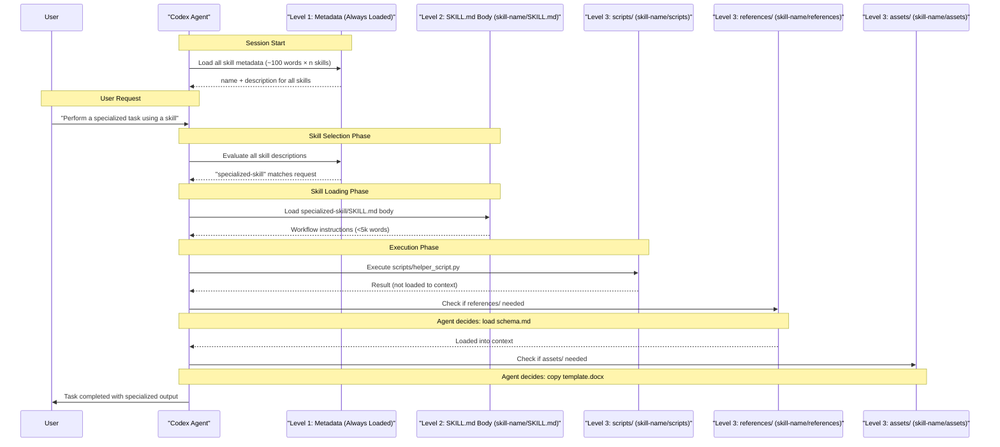

<!-- source: DeepWiki mcp.deepwiki.com · repo openai/skills · page 2.2 Progressive Disclosure Model · fetched 2026-10-30 -->

# Progressive Disclosure Model

<details>
<summary>Relevant source files</summary>

The following files were used as context for generating this wiki page:

- [skills/.system/skill-creator/SKILL.md](skills/.system/skill-creator/SKILL.md)
- [skills/.system/skill-creator/references/openai_yaml.md](skills/.system/skill-creator/references/openai_yaml.md)
- [skills/.system/skill-creator/scripts/generate_openai_yaml.py](skills/.system/skill-creator/scripts/generate_openai_yaml.py)
- [skills/.system/skill-creator/scripts/init_skill.py](skills/.system/skill-creator/scripts/init_skill.py)
- [skills/.system/skill-creator/scripts/quick_validate.py](skills/.system/skill-creator/scripts/quick_validate.py)

</details>


## Overview

The Progressive Disclosure Model is a three-level loading strategy that optimizes context window usage across all installed skills. Instead of loading all skill content into the Codex context window at startup, skills are loaded incrementally based on need: metadata is always present to enable skill selection, instructions are loaded when a skill triggers, and resources are loaded only when the agent determines they're required.

This page details the technical implementation of the three-level loading strategy. For information about how this fits into the complete skill lifecycle, see [Skill Lifecycle](2.3). For detailed file format specifications, see [Skill Anatomy](4.3) and [SKILL.md Format Specification](7.1).

**Sources:** [skills/.system/skill-creator/SKILL.md:127-134]()

## The Three-Level Loading Strategy

Progressive disclosure divides skill content into three levels with different loading behaviors and size constraints:

| Level | Content | Loading Behavior | Size Constraint | Purpose |
|-------|---------|------------------|-----------------|---------|
| **Level 1** | Metadata (`name` + `description`) | Always loaded for all installed skills | ~100 words per skill | Enable skill selection and triggering |
| **Level 2** | `SKILL.md` body (instructions) | Loaded only when skill triggers | <5,000 words | Provide workflow instructions |
| **Level 3** | Bundled resources (`scripts/`, `references/`, `assets/`) | Loaded as needed by agent decision | Unlimited (scripts can execute without reading) | Support execution with code, documentation, and templates |

This design treats the context window as a shared public resource. By keeping Level 1 small and deferring Level 2 and Level 3 loading, the system can support dozens of skills simultaneously without overwhelming the context window.

**Sources:** [skills/.system/skill-creator/SKILL.md:127-134](), [skills/.system/skill-creator/SKILL.md:28-33]()

## Context Window Budget Allocation

The following diagram shows how the progressive disclosure model manages the shared context window across all skills and execution phases.

### Context Window Management Across Loading Levels

```mermaid
graph TD
    subgraph "ContextWindow" ["Codex Context Window (Shared Token Budget)"]
        "SystemPrompt" ["System Prompt"]
        "ConversationHistory" ["Conversation History"]
        "UserRequest" ["Current User Request"]
        "SkillMetadata" ["All Skill Metadata (Level 1)"]
        "TriggeredSkillBody" ["Triggered Skill Body (Level 2)"]
        "LoadedReferences" ["Loaded References (Level 3)"]
    end
    
    subgraph "AllInstalledSkills" ["All Installed Skills (n skills)"]
        "Skill1" ["skill-1/SKILL.md name + description"]
        "Skill2" ["skill-2/SKILL.md name + description"]
        "SkillN" ["skill-n/SKILL.md name + description"]
    end
    
    subgraph "TriggeredSkill" ["Single Triggered Skill"]
        "TriggeredMD" ["triggered-skill/SKILL.md Full markdown body"]
    end
    
    subgraph "BundledResources" ["Bundled Resources (On-Demand)"]
        "ScriptsDir" ["scripts/ Execute without loading"]
        "RefsDir" ["references/ Load when agent decides"]
        "AssetsDir" ["assets/ Use in output, never load"]
    end
    
    "Skill1" -->|"~100 words"| "SkillMetadata"
    "Skill2" -->|"~100 words"| "SkillMetadata"
    "SkillN" -->|"~100 words"| "SkillMetadata"
    
    "TriggeredMD" -->|"<5k words"| "TriggeredSkillBody"
    
    "RefsDir" -.->|"Optional ~1-10k words"| "LoadedReferences"
    "ScriptsDir" -.->|"May read for patching"| "LoadedReferences"
    "AssetsDir" -.->|"Never loaded"| "ContextWindow"
```

**Sources:** [skills/.system/skill-creator/SKILL.md:127-134]()

## Level 1: Metadata (Always Loaded)

Level 1 consists of the YAML frontmatter fields `name` and `description` from every installed skill's `SKILL.md` file. This metadata is always loaded into the context window at the start of any Codex session.

### Content and Structure

The frontmatter is parsed from `SKILL.md`:

```yaml
---
name: skill-name
description: Comprehensive explanation of what the skill does and when to use it
---
```

- **`name`**: Hyphen-case identifier (e.g., `gh-fix-ci`, `notion-meeting-intelligence`).
- **`description`**: The primary triggering mechanism that tells Codex when to activate the skill.

**Sources:** [skills/.system/skill-creator/SKILL.md:68-73](), [skills/.system/skill-creator/scripts/quick_validate.py:51-54]()

### Size Constraints

Each skill's metadata should consume approximately 100 words. This is enforced through validation in `quick_validate.py`:

- **`name`**: Maximum 64 characters [skills/.system/skill-creator/scripts/quick_validate.py:71-76]().
- **`description`**: Maximum 1024 characters [skills/.system/skill-creator/scripts/quick_validate.py:85-89]().

With typical installations of 10-20 skills, Level 1 metadata consumes roughly 1,000-2,000 words (~5-10KB) of the context window.

**Sources:** [skills/.system/skill-creator/scripts/quick_validate.py:12](), [skills/.system/skill-creator/scripts/quick_validate.py:71-89]()

### Purpose: Skill Selection and Triggering

The `description` field is critical because it's the only information Codex reads to determine whether a skill should trigger. The description must include what the skill does and specific scenarios, file types, or tasks that should trigger it.

**Sources:** [skills/.system/skill-creator/SKILL.md:71-72](), [skills/.system/skill-creator/scripts/init_skill.py:26-29]()

## Level 2: SKILL.md Body (Conditional Loading)

Level 2 is the markdown body of `SKILL.md` that follows the YAML frontmatter. This content is loaded into the context window only after a skill has been selected based on its Level 1 metadata.

### Loading Trigger

The `SKILL.md` body is loaded when:

1. Codex evaluates all Level 1 metadata for installed skills.
2. Determines that a specific skill's triggering conditions match the user request.
3. Loads that single skill's body into the context window.

Only one skill's body is typically loaded per request, though multiple skills may trigger if the task requires multiple capabilities.

**Sources:** [skills/.system/skill-creator/SKILL.md:72-73]()

### Content and Size Constraints

The body contains procedural instructions, workflow guidance, and references to bundled resources:

- **Maximum recommended size**: <5,000 words.
- **Content**: Workflow instructions, decision trees, code examples, references to Level 3 resources.
- **Token cost**: Approximately 2-3KB when loaded.

When approaching the 500-line limit, content should be split into separate reference files (Level 3) to keep the `SKILL.md` body lean.

**Sources:** [skills/.system/skill-creator/SKILL.md:130-133](), [skills/.system/skill-creator/SKILL.md:104]()

### Writing Principle: Concise is Key

The documentation emphasizes minimalism for Level 2 content:

> "The context window is a public good. Skills share the context window with everything else Codex needs: system prompt, conversation history, other Skills' metadata, and the actual user request."
>
> "**Default assumption: Codex is already very smart.** Only add context Codex doesn't already have."

**Sources:** [skills/.system/skill-creator/SKILL.md:28-32]()

## Level 3: Bundled Resources (On-Demand Loading)

Level 3 consists of optional resource directories that are loaded or executed only when the agent determines they're needed. These resources have no size limit because scripts can be executed without being read into context.

### Resource Types and Loading Behavior

```mermaid
graph LR
    subgraph "ResourceTypes" ["Level 3 Resource Types"]
        "Scripts" ["scripts/ Python/Bash executables"]
        "References" ["references/ Documentation files"]
        "Assets" ["assets/ Templates and files"]
    end
    
    subgraph "LoadingBehavior" ["Loading Behavior"]
        "ExecuteWithoutLoad" ["Execute without loading Token cost: 0"]
        "LoadIntoContext" ["Load into context Token cost: 1-10KB"]
        "UseInOutput" ["Copy/modify in output Token cost: 0"]
    end
    
    "Scripts" -->|"Primary"| "ExecuteWithoutLoad"
    "Scripts" -.->|"For patching"| "LoadIntoContext"
    "References" --> "LoadIntoContext"
    "Assets" --> "UseInOutput"
```

**Sources:** [skills/.system/skill-creator/SKILL.md:86-114]()

#### `scripts/` Directory

Executable code for deterministic operations:

- **Loading behavior**: Executed without reading into context in most cases.
- **May be read**: When Codex needs to patch or adjust scripts for environment-specific configurations.
- **Examples**: Python scripts, shell scripts, or any executable code for automation.
- **Token efficiency**: High (execution doesn't consume context).

**Sources:** [skills/.system/skill-creator/SKILL.md:86-94](), [skills/.system/skill-creator/scripts/init_skill.py:77-86]()

#### `references/` Directory

Documentation intended to be loaded into context when needed:

- **Loading behavior**: Agent decides when to load based on task requirements.
- **Examples**: Database schemas, API documentation, company policies, detailed workflow guides.
- **Best practice**: For files >10k words, include grep search patterns in `SKILL.md`.
- **Token cost**: Variable (1-10KB when loaded).

**Sources:** [skills/.system/skill-creator/SKILL.md:96-104](), [skills/.system/skill-creator/scripts/init_skill.py:88-97]()

#### `assets/` Directory

Files used in output, not loaded into context:

- **Loading behavior**: Never loaded to context, only used in final output.
- **Examples**: Templates, images, icons, boilerplate code, fonts.
- **Token cost**: Zero (never enters context window).

**Sources:** [skills/.system/skill-creator/SKILL.md:107-113](), [skills/.system/skill-creator/scripts/init_skill.py:98-106]()

## Loading Sequence in Practice

The following diagram shows how the three levels interact during a typical skill invocation.

### Progressive Disclosure Loading Flow



**Sources:** [skills/.system/skill-creator/SKILL.md:127-134]()

## Implementation Details

### Frontmatter Parsing and Validation

The frontmatter is extracted and validated using the logic found in `quick_validate.py`. The system ensures that only specific properties are present in the YAML header.

- **Regex Extraction**: `match = re.match(r"^---\n(.*?)\n---", content, re.DOTALL)` [skills/.system/skill-creator/scripts/quick_validate.py:27-29]()
- **Allowed Properties**: `name`, `description`, `license`, `allowed-tools`, `metadata` [skills/.system/skill-creator/scripts/quick_validate.py:40-49]()
- **Constraints**:
    - **`name`**: Must be hyphen-case and <= 64 characters [skills/.system/skill-creator/scripts/quick_validate.py:61-76]().
    - **`description`**: Must be string and <= 1024 characters [skills/.system/skill-creator/scripts/quick_validate.py:78-89]().

### UI Metadata Generation

While `SKILL.md` drives the agent's logic, `agents/openai.yaml` provides the UI-facing representation. The `generate_openai_yaml.py` script automates this by:
1. Reading the skill name from `SKILL.md` [skills/.system/skill-creator/scripts/generate_openai_yaml.py:106-129]().
2. Formatting a `display_name` (handling acronyms like GH, API, CI via `ACRONYMS`) [skills/.system/skill-creator/scripts/generate_openai_yaml.py:16-28](), [skills/.system/skill-creator/scripts/generate_openai_yaml.py:57-73]().
3. Generating a `short_description` constrained between 25-64 characters [skills/.system/skill-creator/scripts/generate_openai_yaml.py:76-103]().

### Skill Initialization

The `init_skill.py` utility scaffolds the directory structure required for progressive disclosure:
- Creates the `SKILL.md` with required frontmatter [skills/.system/skill-creator/scripts/init_skill.py:26-29]().
- Creates the `agents/openai.yaml` interface via `write_openai_yaml` [skills/.system/skill-creator/scripts/init_skill.py:21](), [skills/.system/skill-creator/scripts/generate_openai_yaml.py:155-186]().
- Optionally creates `scripts/`, `references/`, and `assets/` folders based on the `ALLOWED_RESOURCES` set [skills/.system/skill-creator/scripts/init_skill.py:24](), [skills/.system/skill-creator/scripts/init_skill.py:284-301]().

**Sources:** [skills/.system/skill-creator/scripts/init_skill.py:1-111](), [skills/.system/skill-creator/scripts/quick_validate.py:1-101](), [skills/.system/skill-creator/scripts/generate_openai_yaml.py:1-226]()

---

