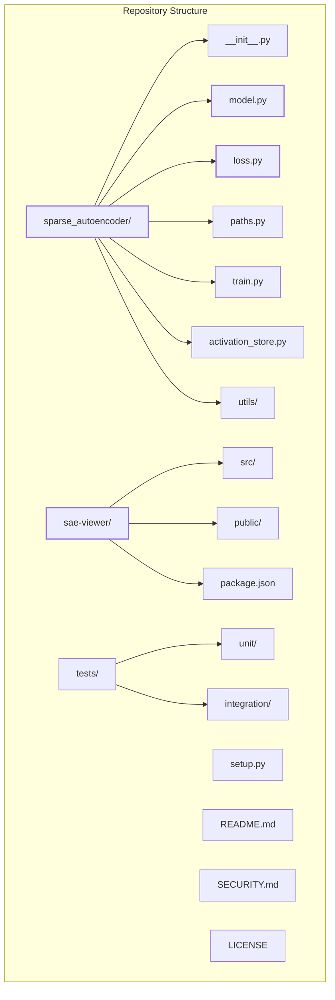
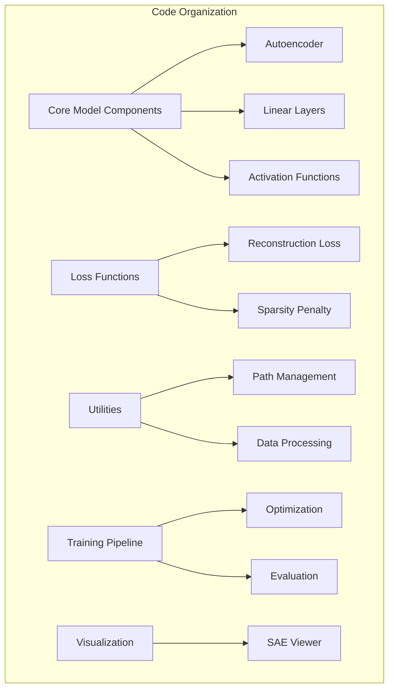
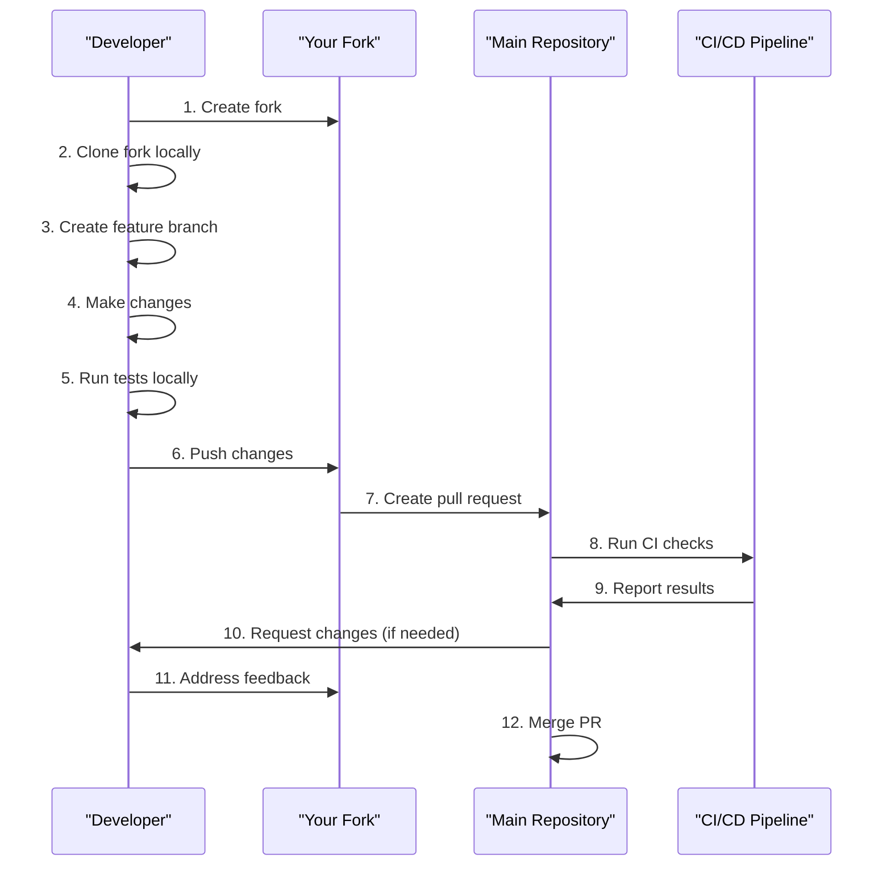
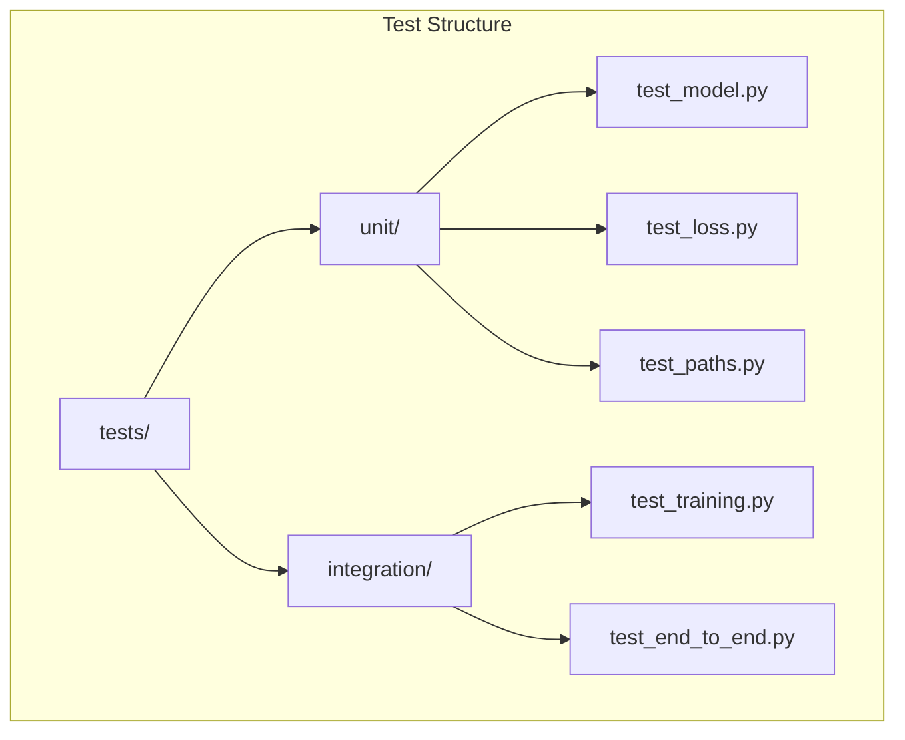

<!-- source: DeepWiki mcp.deepwiki.com · repo openai/sparse_autoencoder · page 6 Development Guide · fetched 2026-10-26 -->

# Development Guide

<details>
<summary>Relevant source files</summary>

The following files were used as context for generating this wiki page:

- [SECURITY.md](SECURITY.md)

</details>


This guide provides essential information for developers who want to contribute to the sparse_autoencoder repository. It covers the repository structure, development setup, and contributions workflow. For details on how to use the sparse_autoencoder package, see [Usage Guide](#4).

## Repository Structure

The sparse_autoencoder repository is organized into several key components that work together to implement and train sparse autoencoders on neural network activations.



Sources: SECURITY.md

### Core Package Structure

The sparse_autoencoder package contains several key modules that implement the core functionality:

| Module | Description |
|--------|-------------|
| `model.py` | Implements the `Autoencoder` class and related components |
| `loss.py` | Contains loss functions for training autoencoders |
| `paths.py` | Utilities for managing file paths and model storage |
| `train.py` | Training pipeline for autoencoders |
| `activation_store.py` | Handles extraction and storage of model activations |
| `utils/` | Helper utilities and common functions |

### Code Organization Principles

The codebase follows these organizational principles:



## Development Environment Setup

To set up a development environment for contributing to sparse_autoencoder, follow these steps:

1. Clone the repository:
   ```bash
   git clone https://github.com/openai/sparse_autoencoder.git
   cd sparse_autoencoder
   ```

2. Install dependencies:
   ```bash
   pip install -e ".[dev]"
   ```

3. Set up pre-commit hooks:
   ```bash
   pre-commit install
   ```

### Code Style and Linting

The project uses various tools to maintain code quality:

- **Black**: For code formatting
- **isort**: For import sorting
- **flake8**: For code linting
- **mypy**: For type checking

These tools are automatically run via pre-commit hooks when you commit changes.

## Contribution Workflow

The recommended workflow for contributing to sparse_autoencoder is outlined below:



### Pull Request Guidelines

When submitting a pull request:

1. Ensure all tests pass
2. Include documentation for new features
3. Follow the code style guidelines
4. Write clear commit messages
5. Reference related issues

## Testing

The sparse_autoencoder repository uses pytest for testing. Tests are organized into unit tests and integration tests.

To run the tests:

```bash
# Run all tests
pytest

# Run with coverage
pytest --cov=sparse_autoencoder

# Run specific test files
pytest tests/unit/test_model.py
```

### Test Organization



## Security and Licensing

### Security Policy

The repository follows OpenAI's Coordinated Vulnerability Disclosure Policy. If you discover a security vulnerability:

1. Do not disclose it publicly
2. Contact OpenAI's security team using the PGP key located at https://cdn.openai.com/security.txt
3. Follow the guidelines in the [Coordinated Vulnerability Disclosure Policy](https://openai.com/security/disclosure)

For more details, see the [SECURITY.md](SECURITY.md) file.

Sources: SECURITY.md

### License

The sparse_autoencoder repository is licensed under a specific license. Please refer to the LICENSE file in the repository for complete information on the terms and conditions for using and modifying the code.

## Developer Tools and Resources

### Dependency Management

The project's dependencies are managed in the `setup.py` file. There are several dependency groups:

- **Core dependencies**: Required to use the sparse_autoencoder package
- **Dev dependencies**: Required for development (testing, linting, etc.)
- **Optional dependencies**: Used for specific features

### Documentation

Documentation for the project includes:

1. In-code documentation (docstrings)
2. README file with basic information
3. Wiki pages for detailed documentation

When contributing, ensure your code includes appropriate docstrings and update relevant documentation if needed.

### Debugging Tips

When debugging issues with the sparse autoencoder, consider these approaches:

1. Use the provided visualization tools to inspect feature activations
2. Enable PyTorch's gradient checking for debugging loss calculations
3. Start with small test cases before scaling to larger models

## Conclusion

This Development Guide provides the essential information needed to start contributing to the sparse_autoencoder repository. If you have any questions or need further guidance, please open an issue in the repository or refer to the other documentation pages.

---

