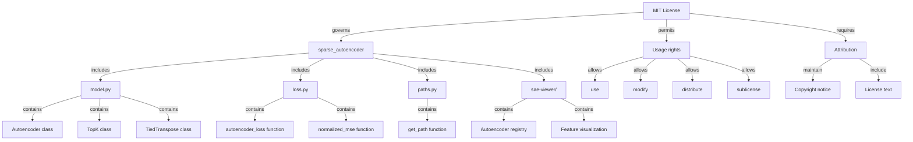
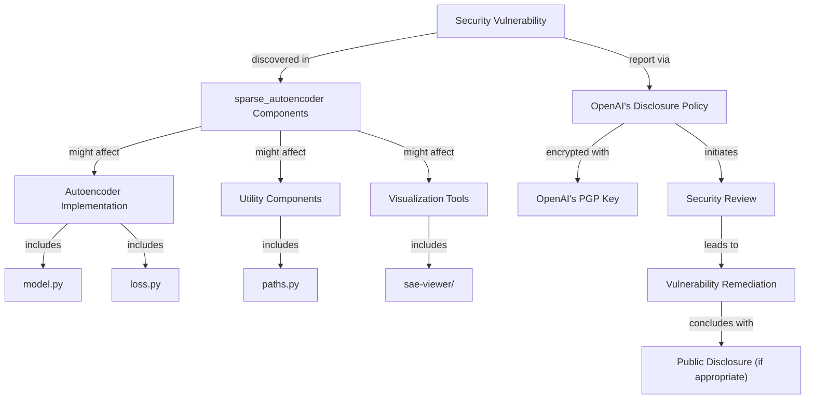

<!-- source: DeepWiki mcp.deepwiki.com · repo openai/sparse_autoencoder · page 6.2 Security and Licensing · fetched 2026-10-26 -->

# Security and Licensing

Relevant source files

The following files were used as context for generating this wiki page:

- [LICENSE](LICENSE)
- [SECURITY.md](SECURITY.md)

## Purpose and Scope

This document outlines the licensing terms and security policies for the sparse_autoencoder repository. It provides details on the MIT License permissions and restrictions, along with the proper procedures for reporting security vulnerabilities. For information about the repository's organizational structure, see [Repository Structure](#6.1).

## License Information

The sparse_autoencoder repository is licensed under the MIT License, a permissive open-source license that applies to all components in the codebase.

### MIT License Terms and Application to Codebase

Sources: [LICENSE]()

The MIT License grants significant freedoms while requiring minimal obligations. The following table summarizes the key provisions of the license as they apply to the sparse_autoencoder repository:

| Permission/Requirement | Description | Application to sparse_autoencoder |
|------------------------|-------------|-----------------------------------|
| Copyright | Copyright (c) 2023 OpenAI | Applies to all repository contents |
| Use | Unrestricted usage | Can use `Autoencoder`, loss functions, etc. for any purpose |
| Modify | Code can be modified | Can modify all repository components |
| Distribute | Can redistribute original and modified code | Can redistribute all repository components |
| Attribution | Must include original copyright and license | Must maintain copyright notice in all files |
| Warranty | No warranty provided | Code provided "AS IS" |
| Liability | No liability for damages | Authors not liable for issues arising from usage |

Sources: [LICENSE]()

### License Compliance for Derivative Works

When creating derivatives of sparse_autoencoder components:

1. Maintain the copyright notice: `Copyright (c) 2023 OpenAI`
2. Include the MIT License text (or reference)
3. You may add your own copyright for modifications

The MIT License permits incorporation into both open-source and proprietary software without requiring derivative works to be open-sourced.

Sources: [LICENSE]()

## Security Policy

The sparse_autoencoder repository follows OpenAI's security policy for vulnerability handling and disclosure.

### Security Reporting Workflow

Sources: [SECURITY.md]()

### Vulnerability Reporting Process

To report security vulnerabilities in the sparse_autoencoder repository:

1. Follow OpenAI's [Coordinated Vulnerability Disclosure Policy](https://openai.com/security/disclosure)
2. Encrypt sensitive communications using OpenAI's PGP key, available at [https://cdn.openai.com/security.txt](https://cdn.openai.com/security.txt)
3. Do not disclose vulnerabilities publicly until authorized by OpenAI

Sources: [SECURITY.md]()

### Security Considerations by Component

The following table outlines security considerations for key components in the sparse_autoencoder repository:

| Component | File Path | Security Considerations |
|-----------|-----------|------------------------|
| `Autoencoder` class | model.py | - Validate input tensors before processing - Exercise caution when loading model parameters from untrusted sources |
| Loss functions | loss.py | - Be aware of potential numerical instabilities with certain inputs - Validate loss calculation results |
| Path utilities | paths.py | - Validate file paths to prevent path traversal issues - Check permissions before accessing files |
| SAE Viewer | sae-viewer/ | - Validate data before visualization - Be cautious with browser rendering of potentially untrusted data |

Sources: [SECURITY.md]()

### Best Practices for Users

When using sparse_autoencoder components:

1. Keep all dependencies updated to benefit from security patches
2. Validate input data before processing with any of the components
3. Follow secure coding practices when integrating with the sparse_autoencoder API
4. Report any security concerns according to the established disclosure policy

Sources: [SECURITY.md]()