# Page: Overview

# Overview

<details>
<summary>Relevant source files</summary>

The following files were used as context for generating this wiki page:

- [README.md](README.md)

</details>


## Purpose and Scope

The `sparse_autoencoder` repository implements sparse autoencoders designed to analyze and interpret activations from transformer models. Specifically, the codebase focuses on:

1. Training sparse autoencoders on GPT2-small model's internal activations
2. Providing tools to visualize and interpret the features learned by these autoencoders

This page provides a high-level overview of the repository's purpose, structure, and components. For detailed information about the system architecture, see [System Architecture](#2), and for specifics about the autoencoder model implementation, see [Autoencoder Model](#3).

Sources: [README.md:1-5]()

## System Components

The `sparse_autoencoder` repository consists of several core components that work together to train, evaluate, and visualize sparse autoencoders.

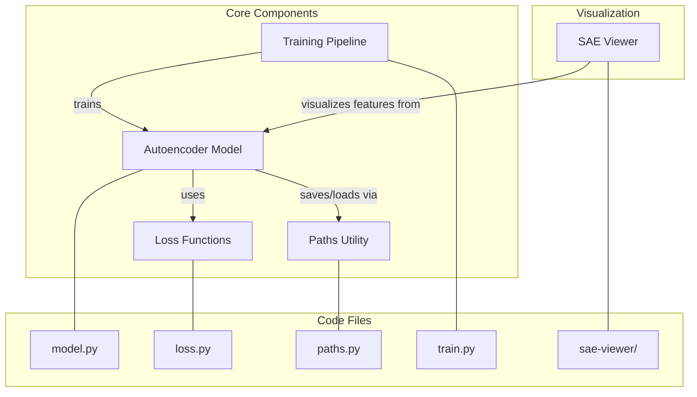

### Key Components:

1. **Autoencoder Model**: The core neural network architecture that encodes input activations into a sparse representation and then decodes them back.
   
2. **Loss Functions**: Specialized loss functions for training sparse autoencoders, including reconstruction loss and L1 sparsity penalties.
   
3. **Paths Utility**: Handles model saving, loading, and management of trained autoencoder checkpoints.
   
4. **Training Pipeline**: Manages the training process for sparse autoencoders on transformer activations.
   
5. **SAE Viewer**: A web-based tool for visualizing and exploring the features learned by the sparse autoencoders.

Sources: [README.md:14-19](), [model.py](), [train.py](), [paths.py]()

## Data Flow

The following diagram illustrates how data flows through the sparse autoencoder system:

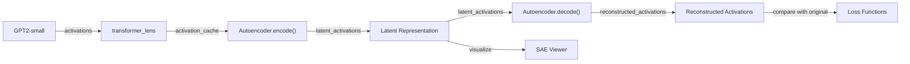

1. Activations are extracted from GPT2-small using the transformer_lens library
2. These activations are fed into the autoencoder's encode method
3. The encode method produces sparse latent activations
4. The latent activations are decoded back to the original activation space
5. Loss functions compare the reconstructed activations with the original ones
6. The SAE Viewer can visualize the learned features in the latent space

Sources: [README.md:23-64]()

## Implementation and Usage

The sparse autoencoder is implemented in PyTorch and designed to work with transformer models through the transformer_lens library. The core `Autoencoder` class serves as the main interface to the system.

### Basic Example:

A typical workflow involves:
1. Extracting activations from a transformer model
2. Loading a pre-trained autoencoder
3. Running the activations through the autoencoder
4. Analyzing the results

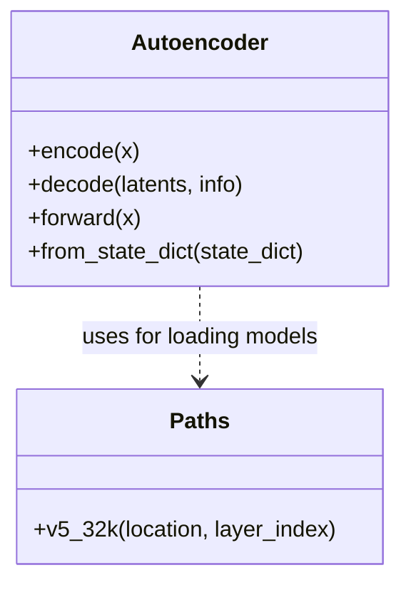

The repository includes pre-trained autoencoders that can be loaded using the `paths` module, which provides functions to retrieve the correct autoencoder for specific layers and locations within the GPT2-small model.

Sources: [README.md:23-64](), [model.py](), [paths.py]()

## System Scope and Boundaries

The `sparse_autoencoder` system is focused on analyzing neural network activations rather than the transformer models themselves:

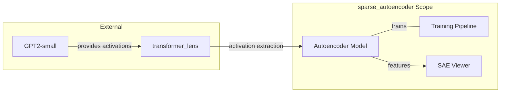

The system does not modify or train the underlying transformer models but rather extracts and analyzes their internal representations through the lens of sparse autoencoders.

For detailed usage instructions and examples, see the [Usage Guide](#4). For information about the visualization capabilities, see the [SAE Viewer](#5) page.

Sources: [README.md]()

---

# Page: System Architecture

# System Architecture

<details>
<summary>Relevant source files</summary>

The following files were used as context for generating this wiki page:

- [README.md](README.md)
- [sparse_autoencoder/__init__.py](sparse_autoencoder/__init__.py)
- [sparse_autoencoder/model.py](sparse_autoencoder/model.py)

</details>


This document describes the high-level architecture of the sparse autoencoder system, outlining its primary components and how they interact with each other. It provides a technical overview of the system design without delving into implementation details of specific components, which are covered in dedicated pages.

For details about the core Autoencoder model implementation, see [Autoencoder Model](#3). For usage instructions, see [Usage Guide](#4).

## System Overview

The sparse autoencoder system is designed to learn interpretable features from neural network activations. Specifically, it focuses on extracting and representing features from GPT2-small model activations using a sparse coding approach.

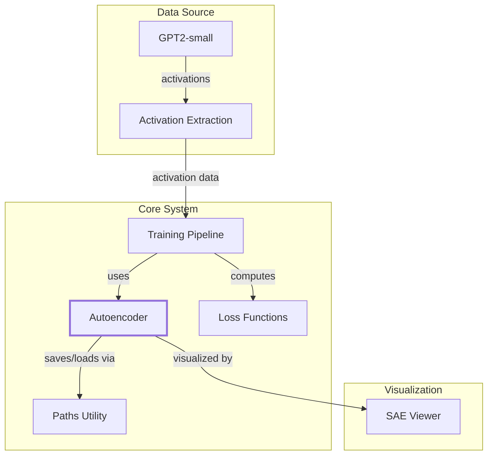

Sources: [sparse_autoencoder/model.py](), [README.md:3-5]()

## Core Components

The system consists of several key components that work together:

| Component | Purpose | Implementation |
|-----------|---------|----------------|
| Autoencoder | Encodes input activations into sparse latent representations and decodes them back | `Autoencoder` class in model.py |
| Loss Functions | Computes reconstruction error and sparsity penalties | Various loss functions for training |
| Paths Utility | Manages model saving, loading, and path resolution | paths.py utility module |
| Training Pipeline | Orchestrates the training process | train.py module |
| Activation Extraction | Extracts activations from transformer models | Uses transformer_lens library |
| SAE Viewer | Visualizes the learned features | Web-based visualization tool |

Sources: [sparse_autoencoder/model.py:16-142](), [README.md:15-19]()

## Component Architecture

The `Autoencoder` class forms the central component of the system, with several related classes supporting its functionality:

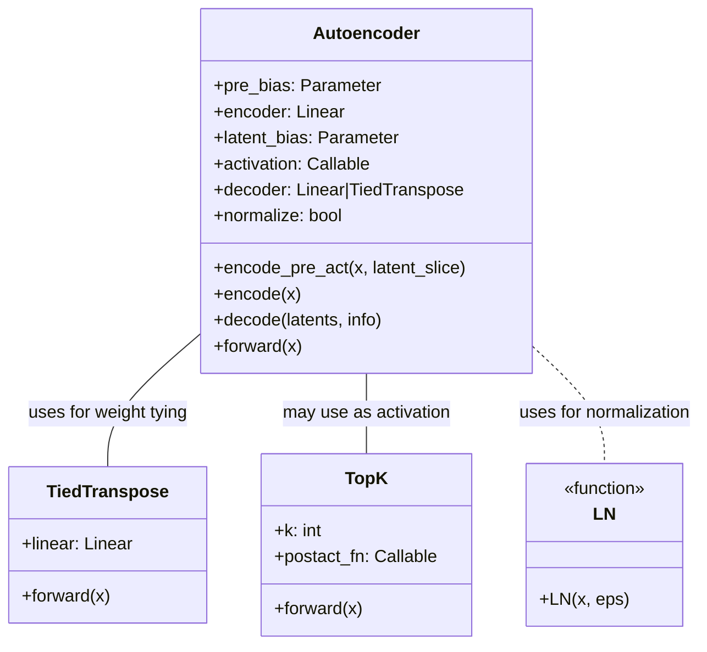

Sources: [sparse_autoencoder/model.py:16-142](), [sparse_autoencoder/model.py:144-155](), [sparse_autoencoder/model.py:162-185]()

### Autoencoder Implementation

The sparse autoencoder implements the following transformation:

1. **Encoding**: `latents = activation(encoder(x - pre_bias) + latent_bias)`
2. **Decoding**: `reconstruction = decoder(latents) + pre_bias`

Key features of the implementation include:
- Optional weight tying between encoder and decoder
- Configurable activation function (default: ReLU)
- Optional layer normalization
- Support for TopK activation for enforcing sparsity

Sources: [sparse_autoencoder/model.py:17-22](), [sparse_autoencoder/model.py:24-44]()

## Data Flow Architecture

The following diagram illustrates how data flows through the system:

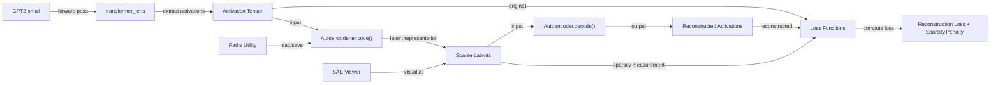

Sources: [README.md:22-64](), [sparse_autoencoder/model.py:74-91]()

### Processing Steps

1. **Activation Extraction**:
   - GPT2-small model is loaded via transformer_lens
   - Text is tokenized and passed through the model
   - Activations are extracted from specific layers and locations

2. **Encoding Process**:
   - Optional normalization of input activations
   - Linear transformation with encoder weights
   - Addition of latent bias
   - Application of activation function (e.g., ReLU or TopK)

3. **Decoding Process**:
   - Linear transformation of latent activations
   - Addition of pre-bias
   - Optional denormalization

4. **Loss Calculation**:
   - Reconstruction error between original and reconstructed activations
   - L1 sparsity penalty on latent activations

Sources: [sparse_autoencoder/model.py:68-104](), [README.md:30-47]()

## Integration with External Systems

The sparse autoencoder system integrates with external libraries to fulfill its functionality:

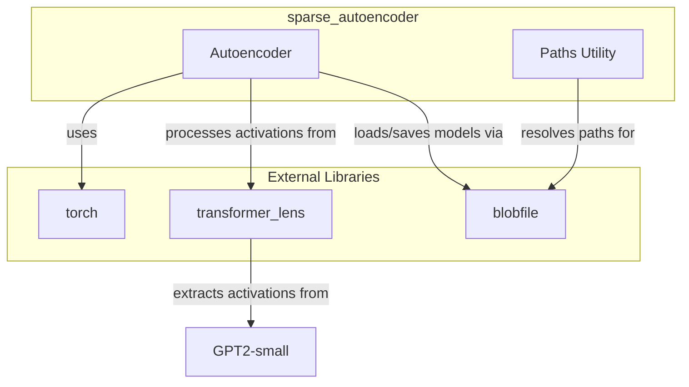

Sources: [sparse_autoencoder/__init__.py:1-4](), [README.md:24-27](), [sparse_autoencoder/model.py:1-5]()

## Package Structure

The sparse autoencoder repository has a focused structure:

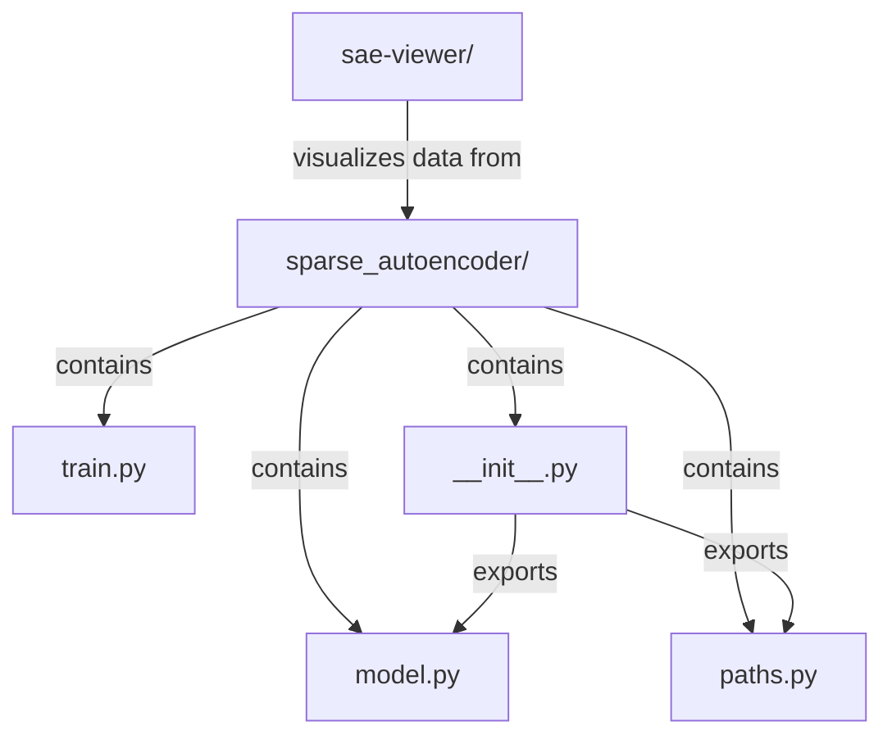

Sources: [README.md:13-19](), [sparse_autoencoder/__init__.py:1-4]()

## Conclusion

The sparse autoencoder system follows a modular architecture centered around the `Autoencoder` class. It leverages transformer_lens to extract activations from GPT2-small, processes them through the sparse autoencoder to learn interpretable features, and provides visualization capabilities through the SAE Viewer. The system's design allows for flexible configuration of the autoencoder's behavior, including different activation functions, weight tying options, and normalization techniques.

For more detailed information about the system's components, see:
- [Component Relationships](#2.1) for details on how components interact
- [Data Flow](#2.2) for a deeper look at how data moves through the system
- [Autoencoder Model](#3) for implementation details of the core autoencoder

---

# Page: Component Relationships

# Component Relationships

<details>
<summary>Relevant source files</summary>

The following files were used as context for generating this wiki page:

- [README.md](README.md)
- [sparse_autoencoder/loss.py](sparse_autoencoder/loss.py)
- [sparse_autoencoder/model.py](sparse_autoencoder/model.py)

</details>


This page describes how different components of the sparse autoencoder system interact with each other. It focuses on the architectural relationships between the core modules, including the Autoencoder model, loss functions, and external dependencies. For information about data flow through the system, see [Data Flow](#2.2).

## Core Component Overview

The sparse autoencoder system consists of several interconnected components that work together to analyze, encode, and visualize neural network activations.

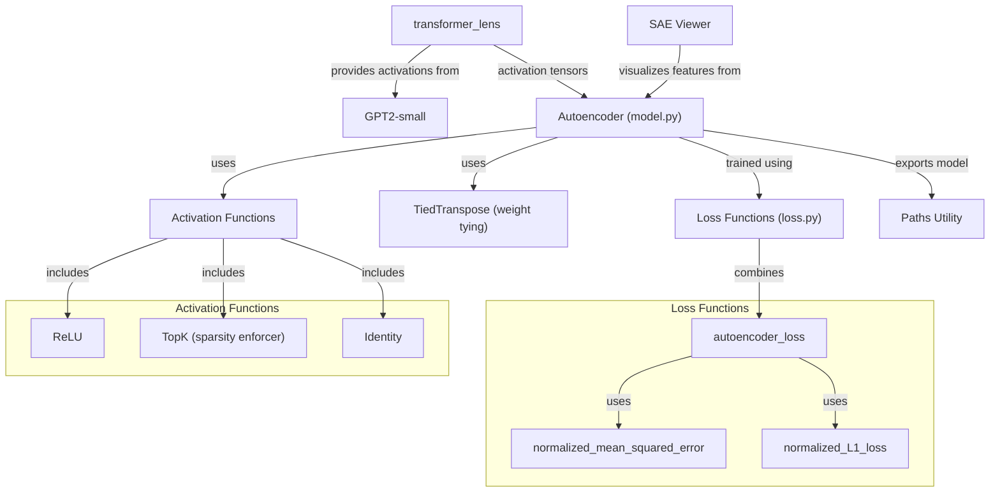

Sources: [sparse_autoencoder/model.py:16-142](), [sparse_autoencoder/loss.py:4-46](), [README.md:3-19]()

## Autoencoder Component Architecture

This diagram illustrates the internal structure of the `Autoencoder` class and how its components interact with each other.

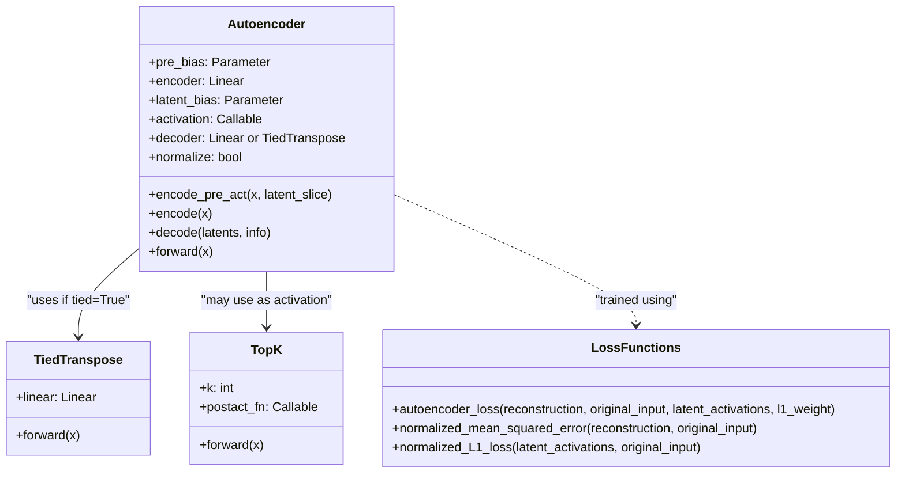

Sources: [sparse_autoencoder/model.py:16-142](), [sparse_autoencoder/model.py:144-155](), [sparse_autoencoder/model.py:162-185](), [sparse_autoencoder/loss.py:4-46]()

## Code to Component Mapping

This diagram maps the code entities to the conceptual components in the system, providing a bridge between the code structure and the functional architecture.

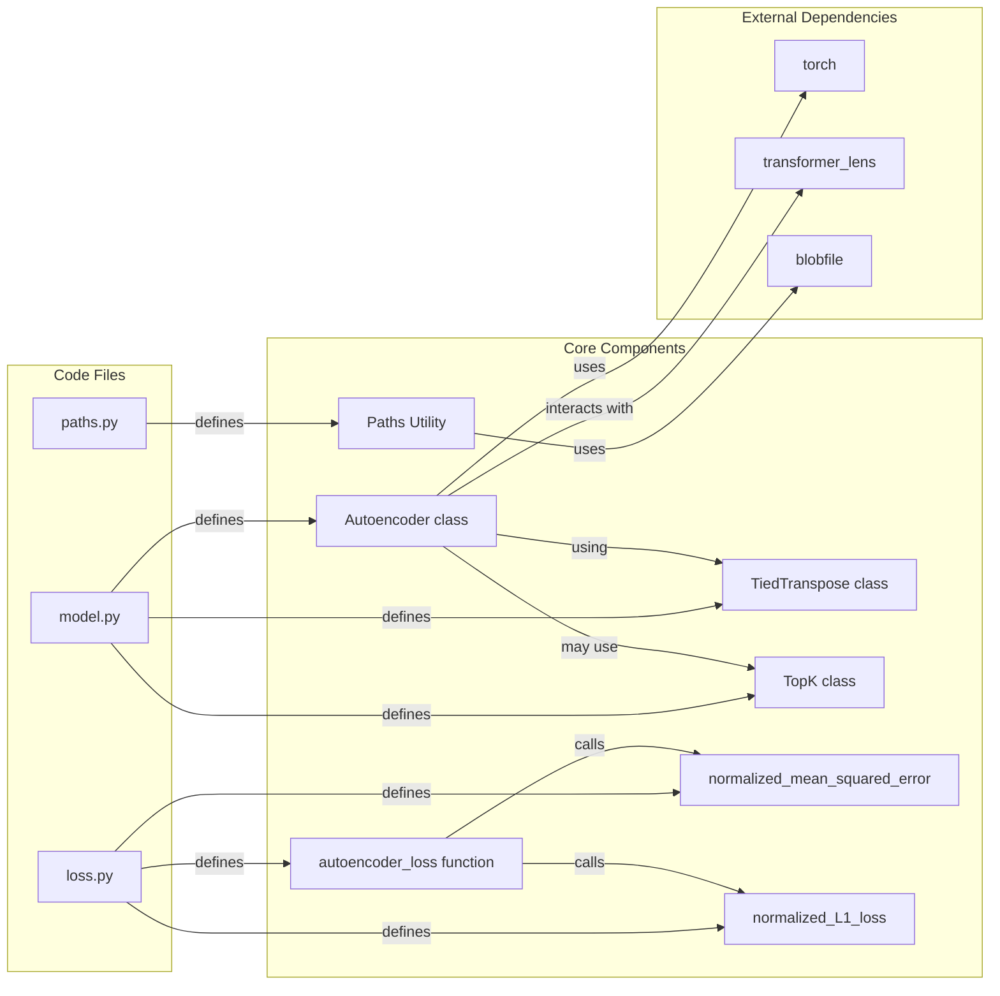

Sources: [sparse_autoencoder/model.py:1-192](), [sparse_autoencoder/loss.py:1-46](), [README.md:15-19]()

## Activation Function Relationships

The `Autoencoder` class supports different activation functions, with `TopK` being particularly significant for enforcing sparsity.

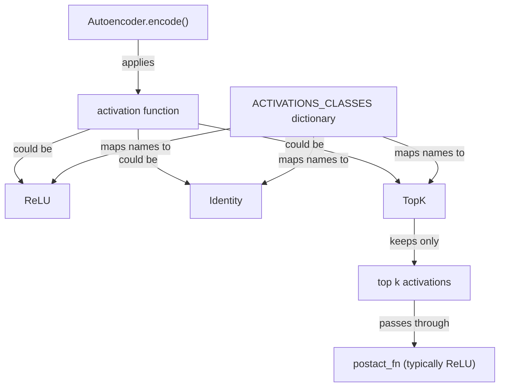

Sources: [sparse_autoencoder/model.py:162-192](), [sparse_autoencoder/model.py:74-80]()

## Loss Function Relationships

The loss functions are a critical component for training the autoencoder, combining reconstruction error with sparsity penalties.

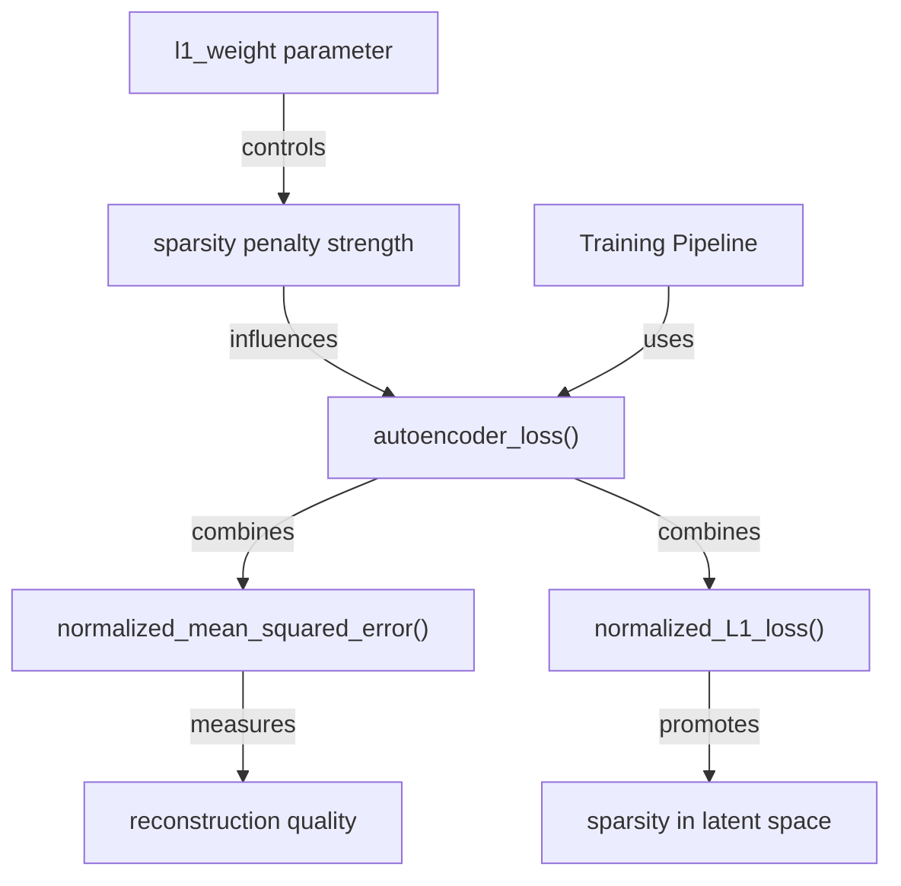

Sources: [sparse_autoencoder/loss.py:4-46]()

## Forward Pass Flow

This diagram illustrates the flow of data through the Autoencoder during a forward pass.

```mermaid
flowchart LR
    A["Input Data x"] -->|"preprocess if normalize=True"| B["Normalized Input"]
    B -->|"subtract pre_bias"| C["Centered Input"]
    C -->|"multiply by encoder.weight"| D["Raw Latents"]
    D -->|"add latent_bias"| E["Latents Pre-Activation"]
    E -->|"apply activation function"| F["Latent Activations"]
    F -->|"multiply by decoder.weight"| G["Raw Reconstruction"]
    G -->|"add pre_bias"| H["Centered Reconstruction"]
    H -->|"apply inverse normalization if needed"| I["Output Reconstruction"]
```

Sources: [sparse_autoencoder/model.py:93-109](), [sparse_autoencoder/model.py:74-91]()

## Component Interface Table

This table outlines the key interfaces between components in the system and how they interact.

| Component A | Component B | Interface Method | Description |
|-------------|-------------|------------------|-------------|
| Autoencoder | Activation Function | `Autoencoder.encode()` | Applies the activation function to the encoded representation |
| Autoencoder | TiedTranspose | `Autoencoder.__init__()` | Uses TiedTranspose when `tied=True` to share weights between encoder and decoder |
| Autoencoder | Loss Functions | External usage | Loss functions evaluate autoencoder outputs during training |
| transformer_lens | Autoencoder | External usage | Provides GPT2 activations that are fed into the autoencoder |
| TopK | Autoencoder | `Autoencoder.activation` | Provides sparse activation by keeping only top-k values |
| Paths Utility | Autoencoder | `Autoencoder.from_state_dict()` | Loads saved autoencoder models from storage |

Sources: [sparse_autoencoder/model.py:16-142](), [README.md:23-64]()

## Usage Flow with External Components

This diagram illustrates how the sparse autoencoder system interacts with external components like transformer_lens in a typical usage flow.

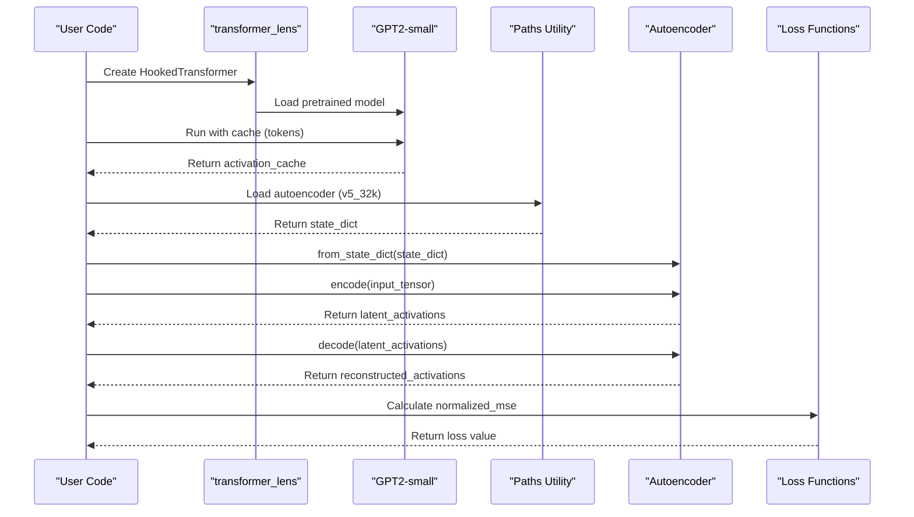

Sources: [README.md:23-64](), [sparse_autoencoder/model.py:111-141]()

## Key Dependencies

The sparse autoencoder system relies on several external libraries to function properly:

1. **torch**: Provides the core tensor operations and neural network building blocks
2. **transformer_lens**: Used to extract activations from GPT2-small
3. **blobfile**: Used for storage and retrieval of trained models

The interaction with these dependencies is essential for the entire pipeline to function correctly, from obtaining activation data to storing and loading trained models.

Sources: [README.md:23-28](), [sparse_autoencoder/model.py:1-5](), [sparse_autoencoder/loss.py:1]()

---

# Page: Data Flow

# Data Flow

<details>
<summary>Relevant source files</summary>

The following files were used as context for generating this wiki page:

- [README.md](README.md)
- [sparse_autoencoder/loss.py](sparse_autoencoder/loss.py)
- [sparse_autoencoder/model.py](sparse_autoencoder/model.py)

</details>


This document describes the end-to-end flow of data through the sparse autoencoder system, from extracting activations from a transformer model to the final reconstruction and loss calculation. For information about component relationships and interactions, see [Component Relationships](#2.1).

## Overview of the Data Flow

The sparse autoencoder system processes data through a sequence of transformations, starting with activation extraction from a transformer model (typically GPT2-small), through encoding and decoding steps, and finally calculating loss values for training.

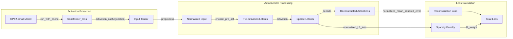

Sources: [README.md:29-62](), [sparse_autoencoder/model.py:16-109](), [sparse_autoencoder/loss.py:4-46]()

## Activation Extraction

The data flow begins with extracting activations from a transformer model (GPT2-small) using the transformer_lens library.

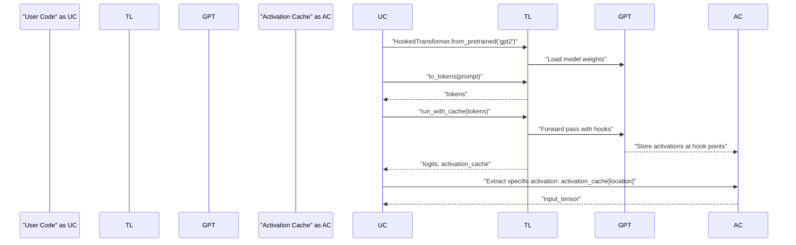

The activation extraction process:

1. Load the GPT2-small model using transformer_lens
2. Convert input text to tokens
3. Run the model with caching enabled to capture intermediate activations
4. Extract specific activations from the cache using a location identifier

The location identifiers map to specific parts of the transformer architecture:
- `mlp_post_act`: Activations after the MLP activation function
- `resid_delta_attn`: Attention output
- `resid_post_attn`: Residual stream after attention
- `resid_delta_mlp`: MLP output
- `resid_post_mlp`: Residual stream after MLP

Sources: [README.md:29-54]()

## Autoencoder Processing

### Preprocessing

Before encoding, input activations may be normalized depending on the autoencoder configuration.

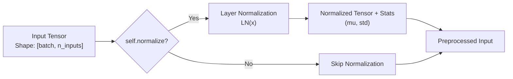

The preprocessing is handled by the `preprocess` method which:
1. Checks if normalization is enabled
2. If enabled, applies Layer Normalization
3. Returns the normalized tensor and normalization statistics

Sources: [sparse_autoencoder/model.py:68-72]()

### Encoding Process

The encoding process transforms input activations into a sparse latent representation.

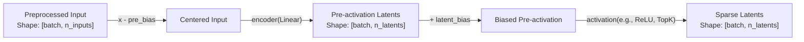

The encoding consists of:
1. Centering the input by subtracting the `pre_bias`
2. Applying a linear transformation with the encoder
3. Adding the `latent_bias`
4. Applying an activation function (ReLU by default, or TopK for enforced sparsity)

Sources: [sparse_autoencoder/model.py:55-80]()

### Decoding Process

The decoding process transforms the sparse latent representation back into reconstructed activations.

```mermaid
flowchart LR
    A["Sparse Latents<br>Shape: [batch, n_latents]"] -->|"decoder(Linear or TiedTranspose)"| B["Decoded Tensor"]
    B -->|"+ pre_bias"| C["Reconstructed Activations"]
    
    subgraph "If normalize=True"
        C -->|"* std + mu"| D["De-normalized Output<br>Shape: [batch, n_inputs]"]
    end
```

The decoding consists of:
1. Applying a linear transformation with the decoder
   - May use weight tying with the encoder if `tied=True`
2. Adding the `pre_bias` (same as was subtracted during encoding)
3. If normalization was applied during preprocessing, undo the normalization

Sources: [sparse_autoencoder/model.py:82-91]()

## Forward Pass and Loss Calculation

The forward pass through the autoencoder combines preprocessing, encoding, and decoding, while also updating some internal statistics.

```mermaid
sequenceDiagram
    participant "User Code" as UC
    participant "Autoencoder" as AE
    participant "Loss Functions" as LF
    
    UC->>AE: "forward(input_tensor)"
    AE->>AE: "preprocess(input_tensor)"
    Note over AE: "Apply normalization if enabled"
    AE->>AE: "encode_pre_act(x)"
    AE->>AE: "activation(latents_pre_act)"
    Note over AE: "Apply ReLU or TopK activation"
    AE->>AE: "decode(latents, info)"
    Note over AE: "Update stats_last_nonzero"
    AE-->>UC: "latents_pre_act, latents, recons"
    
    UC->>LF: "autoencoder_loss(recons, input_tensor, latents, l1_weight)"
    LF->>LF: "normalized_mean_squared_error(recons, input_tensor)"
    LF->>LF: "normalized_L1_loss(latents, input_tensor)"
    Note over LF: "Combine reconstruction error and sparsity penalty"
    LF-->>UC: "total_loss"
```

The loss calculation involves:
1. Reconstruction loss: Normalized mean squared error between reconstructed activations and original input
2. Sparsity penalty: Normalized L1 loss that encourages sparsity in the latent representation
3. Total loss: Weighted combination of reconstruction loss and sparsity penalty

Sources: [sparse_autoencoder/model.py:93-109](), [sparse_autoencoder/loss.py:4-46]()

## Specific Tensor Transformations

This section illustrates the shape and content transformations of the tensors as they flow through the system.

```mermaid
flowchart TD
    A["Input Tensor<br>Shape: [batch, n_inputs]<br>Example: [5, 768]"] --> B["Normalized Input<br>Shape: [batch, n_inputs]<br>Example: [5, 768]"]
    
    B --> C["Latents Pre-activation<br>Shape: [batch, n_latents]<br>Example: [5, 32000]"]
    
    C --> D["Sparse Latents<br>Shape: [batch, n_latents]<br>Example: [5, 32000]<br>(mostly zeros)"]
    
    D --> E["Reconstructed Tensor<br>Shape: [batch, n_inputs]<br>Example: [5, 768]"]
    
    F["Original Input"] --> G["Reconstruction Loss"]
    E --> G
    
    D --> H["Sparsity Penalty<br>(L1 Loss)"]
    
    G --> I["Total Loss<br>Shape: [1]"]
    H -->|"weighted"| I
```

Key tensor transformations:
1. Input tensor: Activations from the transformer model, typically of shape [batch_size, n_inputs]
2. After encoding: Latent representation with higher dimensionality (e.g., 32000 latents) but mostly zeros
3. After decoding: Reconstruction of the original input with the same shape

Sources: [sparse_autoencoder/model.py:94-103](), [sparse_autoencoder/loss.py:4-46]()

## Model State Management

The model's state (weights and biases) can be saved and loaded for future use, maintaining the data flow across sessions.

```mermaid
flowchart LR
    subgraph "Training"
        A["Trained Autoencoder"] -->|"state_dict()"| B["State Dictionary"]
        B -->|"torch.save"| C["Saved Model File"]
    end
    
    subgraph "Inference"
        C -->|"torch.load"| D["Loaded State Dictionary"]
        D -->|"from_state_dict()"| E["Restored Autoencoder"]
        F["New Input Tensor"] -->|"encode/decode"| E
        E -->|"encode/decode"| G["Results"]
    end
```

The state management includes:
1. Saving the model state using `state_dict()` and `torch.save()`
2. Loading the model state using `torch.load()` and `from_state_dict()`
3. Special handling for activation functions like TopK

Sources: [sparse_autoencoder/model.py:111-141](), [README.md:48-63]()

## Complete Data Flow Example

Here's a complete example of the data flow in a typical usage scenario:

```mermaid
sequenceDiagram
    participant "GPT2-small" as GPT
    participant "transformer_lens" as TL
    participant "Autoencoder" as AE
    participant "Loss Functions" as LF
    
    Note over GPT,LF: "1. Activation Extraction"
    GPT->>TL: "Provide model structure"
    TL->>GPT: "Run with hooks"
    GPT-->>TL: "Return activations"
    TL-->>AE: "activation_cache[location]"
    
    Note over GPT,LF: "2. Autoencoder Processing"
    AE->>AE: "preprocess(input)"
    AE->>AE: "encode_pre_act(preprocessed_input)"
    AE->>AE: "activation(latents_pre_act)"
    AE->>AE: "decode(latents, info)"
    
    Note over GPT,LF: "3. Loss Calculation (during training)"
    AE-->>LF: "recons, original_input, latents"
    LF->>LF: "normalized_mean_squared_error()"
    LF->>LF: "normalized_L1_loss()"
    LF->>AE: "total_loss"
    
    Note over GPT,LF: "4. Gradient Updates (not shown)"
```

This sequence diagram shows the complete flow from activation extraction to loss calculation, highlighting the key steps in the process.

Sources: [README.md:29-63](), [sparse_autoencoder/model.py:16-109](), [sparse_autoencoder/loss.py:4-46]()

## Summary

The data flow in the sparse autoencoder system follows a clear path:

1. **Extraction**: Activations are extracted from GPT2-small using transformer_lens
2. **Preprocessing**: Input activations may be normalized
3. **Encoding**: Preprocessed input is encoded into a sparse latent representation
4. **Decoding**: Latent representation is decoded into reconstructed activations
5. **Loss Calculation**: Reconstruction error and sparsity penalty are calculated
6. **Model Management**: Model state can be saved and loaded for future use

This data flow enables the training and utilization of sparse autoencoders to analyze and interpret the internal representations of language models.

Sources: [README.md:3-64](), [sparse_autoencoder/model.py:16-192](), [sparse_autoencoder/loss.py:4-46]()

---

# Page: Autoencoder Model

# Autoencoder Model

<details>
<summary>Relevant source files</summary>

The following files were used as context for generating this wiki page:

- [sparse_autoencoder/__init__.py](sparse_autoencoder/__init__.py)
- [sparse_autoencoder/model.py](sparse_autoencoder/model.py)

</details>


This document details the core Autoencoder model used in the sparse_autoencoder repository. It focuses on the implementation, architecture, and key features of the model. For specific information about encoder and decoder components, see [Encoder and Decoder](#3.1); for activation functions, see [Activation Functions](#3.2); for loss functions, see [Loss Functions](#3.3); and for normalization techniques, see [Normalization](#3.4).

## Overview

The Autoencoder model is the central component of the sparse autoencoder system, designed to learn sparse representations of neural network activations. It implements a standard autoencoder architecture with specific adaptations for sparsity, including support for different activation functions and weight tying options.

```mermaid
graph TD
    subgraph "Autoencoder Model Architecture"
        I["Input Data"] --> P["Preprocessing"]
        P --> B["Bias Subtraction (pre_bias)"]
        B --> E["Encoder Linear Layer"]
        E --> A["Latent Bias + Activation"]
        A --> D["Decoder Linear Layer"]
        D --> PB["Pre-bias Addition"]
        PB --> PP["Post-processing"]
        PP --> O["Output (Reconstruction)"]
    end

    subgraph "Options"
        N["Normalization"]
        T["Weight Tying"]
        S["Activation (e.g., ReLU, TopK)"]
    end

    N -.-> P
    N -.-> PP
    T -.-> D
    S -.-> A
```

Sources: [sparse_autoencoder/model.py:16-141]()

## Core Components

The Autoencoder class is implemented as a PyTorch module with the following core components:

| Component | Type | Description |
|-----------|------|-------------|
| `pre_bias` | Parameter | Bias subtracted from input and added to output |
| `encoder` | Linear Layer | Transforms input data to latent space |
| `latent_bias` | Parameter | Bias added to encoder output before activation |
| `activation` | Callable | Activation function (e.g., ReLU, TopK) |
| `decoder` | Linear Layer or TiedTranspose | Transforms latent representation back to input space |

The model implements the following transformation:
```
latents = activation(encoder(x - pre_bias) + latent_bias)
recons = decoder(latents) + pre_bias
```

Sources: [sparse_autoencoder/model.py:16-54]()

## Implementation Details

### Initialization

The Autoencoder's constructor initializes the model components and sets up tracking buffers for monitoring the activity of latent neurons.

```mermaid
classDiagram
    class Autoencoder {
        +pre_bias: Parameter
        +encoder: Linear
        +latent_bias: Parameter
        +activation: Callable
        +decoder: Linear|TiedTranspose
        +normalize: bool
        +stats_last_nonzero: Tensor
        +latents_activation_frequency: Tensor
        +latents_mean_square: Tensor
        +__init__(n_latents, n_inputs, activation, tied, normalize)
    }
```

Key initialization parameters:
- `n_latents`: Dimension of the latent space
- `n_inputs`: Dimension of the input data
- `activation`: Activation function (default: ReLU)
- `tied`: Whether to tie encoder and decoder weights
- `normalize`: Whether to apply normalization

Sources: [sparse_autoencoder/model.py:24-53]()

### Encoding Process

The encoding process consists of two main steps:
1. Optional normalization of input data
2. Linear transformation followed by bias addition and activation

```mermaid
flowchart LR
    X["Input x"] --> |"Optional"| N["Normalization\nLN(x)"]
    N --> S["Subtract pre_bias\nx - pre_bias"]
    S --> L["Linear transform\nencoder(x)"]
    L --> B["Add latent_bias"]
    B --> A["Apply activation\nfunction"]
    A --> O["Latent representation"]
```

The encoding is implemented through two methods:
- `encode_pre_act`: Computes pre-activation latents
- `encode`: Applies activation to produce final latents

Sources: [sparse_autoencoder/model.py:55-80]()

### Decoding Process

The decoder transforms the latent representation back to the original input space:

```mermaid
flowchart LR
    L["Latent representation"] --> D["Decoder transformation\ndecoder(latents)"]
    D --> A["Add pre_bias"]
    A --> |"Optional"| P["Post-processing\n(denormalization)"]
    P --> O["Reconstructed output"]
```

If normalization was applied during encoding, the corresponding denormalization is applied during decoding.

Sources: [sparse_autoencoder/model.py:82-91]()

### Forward Pass

The forward pass ties together the encoding and decoding steps, and also updates tracking statistics:

```mermaid
flowchart TD
    X["Input x"] --> P["Preprocess\n(normalize if enabled)"]
    P --> E["Encode pre-activation\nlatents_pre_act"]
    E --> A["Apply activation\nlatents"]
    A --> D["Decode\nreconstructions"]
    A --> |"Update"| S["Statistics tracking\n(nonzero latents)"]
    D --> R["Return latents_pre_act,\nlatents, reconstructions"]
```

The method tracks which latent neurons are active by updating the `stats_last_nonzero` buffer, which counts how many batches have passed since each neuron was last active.

Sources: [sparse_autoencoder/model.py:93-109]()

## Supporting Components

### TiedTranspose

The `TiedTranspose` class enables weight tying between encoder and decoder, which reduces the number of parameters and enforces a specific form of regularization:

```mermaid
classDiagram
    class TiedTranspose {
        +linear: Linear
        +forward(x)
        +weight: Tensor
        +bias: Tensor
    }
```

When weight tying is enabled, the decoder's weight matrix is the transpose of the encoder's weight matrix.

Sources: [sparse_autoencoder/model.py:144-159]()

### TopK Activation

The `TopK` activation function is a specialized activation that enforces sparsity by only allowing the K largest values to pass through:

```mermaid
classDiagram
    class TopK {
        +k: int
        +postact_fn: Callable
        +forward(x)
        +state_dict()
        +from_state_dict(state_dict, strict)
    }
```

The function:
1. Identifies the K largest values in each input vector
2. Applies a post-activation function (typically ReLU) to these values
3. Sets all other values to zero

This ensures that only a small subset of latent neurons are active for any given input, promoting sparse representations.

Sources: [sparse_autoencoder/model.py:162-185]()

### Layer Normalization

The `LN` function implements layer normalization, which standardizes input data by centering and scaling it:

```mermaid
flowchart LR
    X["Input x"] --> M["Compute mean\nmu"]
    M --> S1["Subtract mean\nx - mu"]
    S1 --> SD["Compute standard\ndeviation std"]
    SD --> S2["Divide by std\nx / (std + eps)"]
    S2 --> O["Normalized output\n+ mu, std for denormalization"]
```

Layer normalization helps stabilize training by reducing internal covariate shift.

Sources: [sparse_autoencoder/model.py:8-13]()

## State Management

The Autoencoder implements custom state dictionary methods to handle saving and loading, including support for the activation function's state:

```mermaid
flowchart TD
    S["state_dict()"] --> B["Base state dict\n(from PyTorch)"]
    B --> A["Add activation\nclass name"]
    A --> AS["Add activation\nstate dict if available"]
    AS --> R["Return complete\nstate dict"]

    L["from_state_dict()"] --> E["Extract n_latents\nand d_model"]
    E --> EA["Create activation\ninstance"]
    EA --> C["Create autoencoder\ninstance"]
    C --> LS["Load state dict\ninto autoencoder"]
    LS --> RA["Return initialized\nautoencoder"]
```

This implementation ensures that all model components, including the activation function, are properly saved and restored.

Sources: [sparse_autoencoder/model.py:111-141]()

## Available Activation Functions

The model supports several activation functions through the `ACTIVATIONS_CLASSES` dictionary:

| Activation Name | Class | Purpose |
|-----------------|-------|---------|
| ReLU | nn.ReLU | Standard non-linear activation |
| Identity | nn.Identity | Linear activation (no non-linearity) |
| TopK | TopK | Sparse activation (keeps only k largest values) |

Sources: [sparse_autoencoder/model.py:188-192]()

## Integration with System Architecture

The Autoencoder model is exported as the primary interface of the sparse_autoencoder package:

```mermaid
graph TD
    M["sparse_autoencoder/model.py"] --> |"exports"| A["Autoencoder class"]
    I["sparse_autoencoder/__init__.py"] --> |"imports and re-exports"| A
    P["Other modules"] --> |"use"| A
```

This makes the Autoencoder class easily accessible to users of the package without requiring them to import from specific submodules.

Sources: [sparse_autoencoder/__init__.py:1-4]()

---

# Page: Encoder and Decoder

# Encoder and Decoder

<details>
<summary>Relevant source files</summary>

The following files were used as context for generating this wiki page:

- [sparse_autoencoder/model.py](sparse_autoencoder/model.py)

</details>


This page documents the encoder and decoder components of the sparse autoencoder implementation. These are the core neural network components responsible for compressing input data into sparse latent representations and reconstructing the original data from these representations. For information about activation functions used in the autoencoder, see [Activation Functions](#3.2).

## Overview

The encoder-decoder architecture forms the backbone of the sparse autoencoder. The encoder compresses input data (typically neural network activations from GPT-2) into a higher-dimensional latent space, while the decoder attempts to reconstruct the original input from this latent representation.

```mermaid
flowchart LR
    subgraph "Autoencoder"
        X["Input Data\n(n_inputs)"] --> 
        SubBias["Subtract pre_bias"] -->
        Encode["encoder\n(Linear Layer)"] --> 
        AddBias["Add latent_bias"] -->
        Act["activation\n(e.g., ReLU, TopK)"] -->
        Z["Latent\nRepresentation\n(n_latents)"] -->
        Dec["decoder\n(Linear/TiedTranspose)"] -->
        AddPreBias["Add pre_bias"] -->
        Y["Reconstructed\nData\n(n_inputs)"]
    end
```

Sources: [sparse_autoencoder/model.py:16-109]()

## Implementation Details

The encoder and decoder are implemented as part of the `Autoencoder` class with the following components:

- **pre_bias**: A learnable bias subtracted from the input before encoding and added back after decoding
- **encoder**: A linear transformation without bias from input space to latent space
- **latent_bias**: A learnable bias added after the linear encoder transformation
- **decoder**: A linear transformation from latent space back to input space (can use weight tying)

### Encoder

The encoder transforms the input data into a higher-dimensional representation. The encoding process consists of several steps:

1. Subtract `pre_bias` from input data 
2. Apply a linear transformation (without bias)
3. Add `latent_bias`
4. Apply an activation function to introduce sparsity

The encoding process is implemented in two methods:

```mermaid
classDiagram
    class Autoencoder {
        +pre_bias: Parameter
        +encoder: Linear
        +latent_bias: Parameter
        +encode_pre_act(x, latent_slice)
        +encode(x)
    }
```

The `encode_pre_act` method computes the pre-activation values and supports computing only a slice of the latent dimensions. The `encode` method handles preprocessing (if normalization is enabled) and applies the activation function.

Sources: [sparse_autoencoder/model.py:55-80]()

### Decoder

The decoder transforms the latent representation back to the original input space. The decoding process consists of:

1. Apply a linear transformation from latent space to input space
2. Add back the `pre_bias`
3. If normalization was used during encoding, apply inverse normalization

```mermaid
classDiagram
    class Autoencoder {
        +decoder: Linear|TiedTranspose
        +pre_bias: Parameter
        +decode(latents, info)
    }
```

Sources: [sparse_autoencoder/model.py:82-91]()

## Weight Tying Mechanism

The autoencoder supports weight tying between the encoder and decoder, which means the decoder weights are constrained to be the transpose of the encoder weights. This reduces the number of parameters and often improves generalization.

```mermaid
flowchart TD
    subgraph "Untied Weights"
        E1["Encoder Weights\nW (n_inputs × n_latents)"]
        D1["Decoder Weights\nV (n_latents × n_inputs)"]
    end
    
    subgraph "Tied Weights"
        E2["Encoder Weights\nW (n_inputs × n_latents)"]
        D2["Decoder Weights\nWᵀ (n_latents × n_inputs)"]
        E2 -->|"transpose"| D2
    end
```

Weight tying is implemented through the `TiedTranspose` class, which wraps the encoder's linear layer and uses its transposed weight matrix for the forward pass.

Sources: [sparse_autoencoder/model.py:144-159]()

### TiedTranspose Class

When the `tied` parameter is set to `True` during initialization, the decoder uses the `TiedTranspose` module instead of a separate `nn.Linear` layer:

```mermaid
classDiagram
    class TiedTranspose {
        +linear: Linear
        +forward(x)
        +weight
        +bias
    }
    
    class Autoencoder {
        +encoder: Linear
        +decoder: Linear|TiedTranspose
    }
    
    Autoencoder --> TiedTranspose: uses when tied=True
```

The `TiedTranspose` module:
- Takes the encoder's linear layer as input during initialization
- In its forward pass, uses the transpose of the encoder's weight matrix
- Provides weight and bias properties for compatibility with `nn.Linear`

Sources: [sparse_autoencoder/model.py:144-159](), [sparse_autoencoder/model.py:40-43]()

## Data Flow

The complete data flow through the encoder and decoder is implemented in the `forward` method of the `Autoencoder` class:

```mermaid
sequenceDiagram
    participant Input as "Input Data x"
    participant Preproc as "Preprocessing"
    participant EncodePre as "encode_pre_act"
    participant Act as "Activation Function"
    participant Dec as "decode"
    participant Output as "Reconstructed Output"
    
    Input ->> Preproc: x
    Preproc ->> Preproc: Normalize if self.normalize is True
    Preproc ->> EncodePre: x, info
    EncodePre ->> EncodePre: x - pre_bias
    EncodePre ->> EncodePre: Linear(x) + latent_bias
    EncodePre ->> Act: latents_pre_act
    Act ->> Dec: latents
    Dec ->> Dec: decoder(latents) + pre_bias
    Dec ->> Dec: Inverse normalization if needed
    Dec ->> Output: recons
```

The forward method returns three tensors:
1. `latents_pre_act`: The pre-activation values of the latent representation
2. `latents`: The activated latent representation
3. `recons`: The reconstructed output

Sources: [sparse_autoencoder/model.py:93-109]()

## Normalization

The autoencoder optionally supports normalization of the input data. When enabled (`normalize=True`):

1. During encoding, the input is normalized using layer normalization (without learnable parameters)
2. During decoding, the output is denormalized using the stored statistics

The normalization process is implemented in:
- The `LN` function which computes mean and standard deviation, then normalizes the input
- The `preprocess` method which either returns the input unchanged or applies normalization
- The `decode` method which applies inverse normalization if needed

Sources: [sparse_autoencoder/model.py:8-13](), [sparse_autoencoder/model.py:68-72](), [sparse_autoencoder/model.py:82-91]()

## Initialization and State Management

The autoencoder encoder and decoder are initialized in the `__init__` method:

```python
def __init__(
    self, n_latents: int, n_inputs: int, activation: Callable = nn.ReLU(), tied: bool = False,
    normalize: bool = False
) -> None:
```

Key parameters:
- `n_latents`: Dimension of the latent space
- `n_inputs`: Dimension of the input data
- `tied`: Whether to use weight tying between encoder and decoder
- `normalize`: Whether to apply normalization

The class also provides state management through:
- `state_dict`: Saves the model state including activation function information
- `from_state_dict`: Class method to reconstruct an autoencoder from a saved state

Sources: [sparse_autoencoder/model.py:24-45](), [sparse_autoencoder/model.py:111-141]()

## Implementation Equations

The sparse autoencoder encoder and decoder implement the following mathematical operations:

1. **Encoder**:
   - latents = activation(encoder(x - pre_bias) + latent_bias)

2. **Decoder**:
   - recons = decoder(latents) + pre_bias

When normalization is enabled, additional steps are added:
1. Before encoding: x_norm = (x - mean(x)) / std(x)
2. After decoding: recons = recons_raw * std(x) + mean(x)

Sources: [sparse_autoencoder/model.py:16-22](), [sparse_autoencoder/model.py:87-91]()

---

# Page: Activation Functions

# Activation Functions

<details>
<summary>Relevant source files</summary>

The following files were used as context for generating this wiki page:

- [sparse_autoencoder/model.py](sparse_autoencoder/model.py)

</details>


This document details the activation functions used in the sparse autoencoder implementation, focusing on both standard activation functions and the specialized `TopK` activation for enforcing sparsity. For information about loss functions, see [Loss Functions](#3.3).

## Overview

Activation functions in the sparse autoencoder are a critical component that determine how features are represented in the latent space. They are applied after the encoding step and before decoding, controlling which neurons activate in the latent representation.

```mermaid
flowchart LR
    subgraph "Autoencoder.forward()"
        A["Input tensor (x)"] --> B["Preprocess"]
        B --> C["encode_pre_act()"]
        C --> D["activation(latents_pre_act)"]
        D --> E["decode(latents)"]
        E --> F["Reconstruction"]
    end
    
    style D stroke-width:3px
```

Sources: [sparse_autoencoder/model.py:93-109]()

## Supported Activation Functions

The sparse autoencoder supports three main activation functions, defined in the `ACTIVATIONS_CLASSES` dictionary:

```mermaid
classDiagram
    class Activation {
        <<interface>>
        +forward(x: torch.Tensor)
    }
    
    class ReLU {
        +forward(x: torch.Tensor)
    }
    
    class Identity {
        +forward(x: torch.Tensor)
    }
    
    class TopK {
        +k: int
        +postact_fn: Callable
        +forward(x: torch.Tensor)
        +state_dict()
        +from_state_dict(state_dict, strict)
    }
    
    Activation <|-- ReLU
    Activation <|-- Identity
    Activation <|-- TopK
```

Sources: [sparse_autoencoder/model.py:188-192]()

### Standard PyTorch Activations

The system supports standard PyTorch activation functions:

1. **ReLU** (`nn.ReLU`) - The default activation that zeros out negative values
2. **Identity** (`nn.Identity`) - A passthrough function that applies no transformation

When creating an autoencoder, an activation function is passed as a parameter:

```python
# Default initialization uses ReLU
autoencoder = Autoencoder(n_latents=256, n_inputs=768, activation=nn.ReLU())

# Using Identity activation
autoencoder = Autoencoder(n_latents=256, n_inputs=768, activation=nn.Identity())
```

Sources: [sparse_autoencoder/model.py:25-27](), [sparse_autoencoder/model.py:39]()

### TopK Activation

The `TopK` class is a specialized activation function designed specifically for enforcing sparsity in the latent representation. It ensures that only a fixed number of neurons are active for each input.

```mermaid
flowchart TD
    A["Input Tensor (x)"] --> B["TopK.forward()"]
    B --> C["torch.topk(x, k)"]
    C --> D["topk.values"]
    D --> E["Apply postact_fn (e.g., ReLU)"]
    E --> F["Create zeros tensor"]
    F --> G["Place values at original indices"]
    G --> H["Return sparse tensor"]
    
    style C stroke-width:3px
    style G stroke-width:3px
```

Sources: [sparse_autoencoder/model.py:162-185]()

#### Implementation Details

The `TopK` class takes two parameters:
- `k`: The number of neurons to keep active
- `postact_fn`: An optional post-activation function (defaults to ReLU)

Its `forward` method:
1. Finds the top k values in the input tensor along the last dimension
2. Applies the post-activation function to these values
3. Creates a result tensor filled with zeros
4. Places the activated top k values in their original positions

```
# Example of TopK activation with k=10 and ReLU post-activation
topk_activation = TopK(k=10, postact_fn=nn.ReLU())
autoencoder = Autoencoder(n_latents=256, n_inputs=768, activation=topk_activation)
```

Sources: [sparse_autoencoder/model.py:168-174]()

#### State Management

The `TopK` class implements custom state management to save and load its configuration:

- `state_dict()` saves the `k` value and the class name of the post-activation function
- `from_state_dict()` class method reconstructs a `TopK` instance from saved state

Sources: [sparse_autoencoder/model.py:176-185]()

## Usage in the Autoencoder

The activation function is a key component in the autoencoder's operation:

| Method | Role of Activation Function |
|--------|----------------------------|
| `encode(x)` | Applies activation to transform pre-activation latents |
| `forward(x)` | Creates sparse latent representation for decoding |

In the encoding process:
```python
# Inside encode method
latents = self.activation(self.encode_pre_act(x))
```

In the forward pass:
```python
# Inside forward method
latents_pre_act = self.encode_pre_act(x)
latents = self.activation(latents_pre_act)
recons = self.decode(latents, info)
```

Sources: [sparse_autoencoder/model.py:74-80](), [sparse_autoencoder/model.py:93-109]()

## Serialization and Deserialization

The `Autoencoder` class ensures that activation functions are properly saved and restored by:

1. Storing the activation class name in the state dictionary
2. For custom activations like `TopK`, storing additional parameters
3. Using the appropriate class method to reconstruct the activation when loading

```mermaid
flowchart LR
    subgraph "Saving"
        A1["Autoencoder"] --> B1["state_dict()"]
        B1 --> C1["Store activation.__class__.__name__"]
        C1 --> D1["Store activation.state_dict() if available"]
    end
    
    subgraph "Loading"
        A2["state_dict"] --> B2["Autoencoder.from_state_dict()"]
        B2 --> C2["Get activation_class from ACTIVATIONS_CLASSES"]
        C2 --> D2["Create activation instance"]
        D2 --> E2["Create Autoencoder with activation"]
    end
```

Sources: [sparse_autoencoder/model.py:111-141]()

## Integration with Normalization

When using the `TopK` activation, normalization is automatically enabled in the autoencoder. This is handled through the `normalize` flag that affects input preprocessing:

```python
# When creating from state dict
normalize = activation_class_name == "TopK"  # Determine normalization
autoencoder = cls(n_latents, d_model, activation=activation, normalize=normalize)
```

The autoencoder uses the `LN` (Layer Normalization) function to normalize inputs when required.

Sources: [sparse_autoencoder/model.py:8-13](), [sparse_autoencoder/model.py:120]()

## Choosing the Right Activation Function

The choice of activation function depends on the specific requirements:

- **ReLU**: Good for general-purpose autoencoder training with natural sparsity
- **Identity**: Useful for cases where no transformation is needed
- **TopK**: Recommended when strict sparsity control is required, ensuring exactly k features are active

The `TopK` activation is particularly important for sparse autoencoders analyzing neural network activations, as it ensures consistent sparsity patterns that make the learned features more interpretable.

Sources: [sparse_autoencoder/model.py:162-185]()

---

# Page: Loss Functions

# Loss Functions

<details>
<summary>Relevant source files</summary>

The following files were used as context for generating this wiki page:

- [sparse_autoencoder/loss.py](sparse_autoencoder/loss.py)

</details>


This page documents the loss functions implemented in the sparse autoencoder repository. These functions are crucial for training the autoencoder to accurately reconstruct inputs while maintaining sparse activations in the latent space. For information about the autoencoder model itself, see [Autoencoder Model](#3).

## Purpose of Loss Functions

In sparse autoencoders, the loss function serves two primary objectives:
1. **Reconstruction accuracy**: Ensuring the decoded output closely matches the original input
2. **Sparsity promotion**: Encouraging the latent representation to be sparse (having few non-zero elements)

The implementation balances these potentially competing objectives through a weighted combination of specialized loss terms.

## Loss Function Architecture

The sparse autoencoder uses a composite loss function that combines reconstruction error with a sparsity penalty:

```mermaid
flowchart TD
    subgraph "Loss Components"
        A["Reconstruction Loss<br>(Normalized MSE)"] --> C["Combined Loss"]
        B["Sparsity Penalty<br>(Normalized L1)"] --> D["Weighted Sparsity Term"]
        D --> C
        E["l1_weight<br>Hyperparameter"] --> D
    end
    
    F["Autoencoder"] --> G["Original Input"]
    F --> H["Reconstruction"]
    F --> I["Latent Activations"]
    
    G --> A
    H --> A
    G --> B
    I --> B
    
    C --> J["Training Objective"]
```

Sources: [sparse_autoencoder/loss.py:4-20]()

## Combined Autoencoder Loss

The primary loss function that orchestrates the training of the sparse autoencoder is `autoencoder_loss`. This function combines the normalized mean squared error for reconstruction quality with the normalized L1 loss for promoting sparsity.

```python
autoencoder_loss(
    reconstruction: torch.Tensor,  # shape: [batch, n_inputs]
    original_input: torch.Tensor,  # shape: [batch, n_inputs]
    latent_activations: torch.Tensor,  # shape: [batch, n_latents]
    l1_weight: float,  # sparsity weight hyperparameter
) -> torch.Tensor:  # shape: [1]
```

The implementation combines the two loss components with a weighting factor:

```mermaid
flowchart LR
    A["normalized_mean_squared_error"] --> C["autoencoder_loss"]
    B["normalized_L1_loss × l1_weight"] --> C
```

Sources: [sparse_autoencoder/loss.py:4-20]()

## Reconstruction Loss: Normalized Mean Squared Error

The normalized mean squared error measures how accurately the autoencoder reconstructs the original input, while being invariant to the scale of the input:

```mermaid
flowchart TD
    A["reconstruction<br>[batch, n_inputs]"] --> C["(reconstruction - original_input)²"]
    B["original_input<br>[batch, n_inputs]"] --> C
    B --> D["(original_input)²"]
    
    C --> E["mean(dim=1)<br>Average across input dimension"]
    D --> F["mean(dim=1)<br>Average across input dimension"]
    
    E --> G["Division<br>Normalization"]
    F --> G
    
    G --> H["mean()<br>Average across batch"]
```

This function:
1. Computes the squared difference between reconstruction and original input
2. Takes the mean across the input dimension
3. Normalizes by the mean squared value of the original input
4. Takes the mean across the batch dimension

The normalization makes the loss scale-invariant, ensuring that inputs with larger magnitudes don't dominate the loss.

Sources: [sparse_autoencoder/loss.py:23-34]()

## Sparsity Penalty: Normalized L1 Loss

The normalized L1 loss promotes sparsity in the latent space by penalizing the absolute sum of activations, normalized by the norm of the original input:

```mermaid
flowchart TD
    A["latent_activations<br>[batch, n_latents]"] --> B["abs()<br>Absolute values"]
    B --> C["sum(dim=1)<br>L1 norm across latents"]
    
    D["original_input<br>[batch, n_inputs]"] --> E["norm(dim=1)<br>L2 norm across inputs"]
    
    C --> F["Division<br>Normalization"]
    E --> F
    
    F --> G["mean()<br>Average across batch"]
```

This function:
1. Takes the absolute value of all latent activations
2. Sums across the latent dimension to get the L1 norm
3. Normalizes by the L2 norm of the original input
4. Takes the mean across the batch dimension

The normalization ensures that the sparsity penalty scales appropriately with the magnitude of the input.

Sources: [sparse_autoencoder/loss.py:37-46]()

## Mathematical Formulation

The complete loss function can be expressed mathematically as:

| Component | Formula |
|-----------|---------|
| Normalized MSE | mean(((reconstruction - original_input)²).mean(dim=1) / (original_input²).mean(dim=1)) |
| Normalized L1 | mean(abs(latent_activations).sum(dim=1) / original_input.norm(dim=1)) |
| Combined Loss | Normalized MSE + l1_weight × Normalized L1 |

## Usage in Training

During training, the autoencoder loss function is typically used as follows:

```mermaid
sequenceDiagram
    participant Trainer
    participant Autoencoder
    participant Loss as "Loss Functions"
    
    Trainer->>Autoencoder: forward(input_batch)
    Autoencoder-->>Trainer: reconstruction, latent_activations
    Trainer->>Loss: autoencoder_loss(reconstruction, input_batch, latent_activations, l1_weight)
    Loss-->>Trainer: loss_value
    Trainer->>Trainer: optimizer.zero_grad()
    Trainer->>Trainer: loss_value.backward()
    Trainer->>Trainer: optimizer.step()
```

The `l1_weight` hyperparameter is crucial for balancing reconstruction accuracy and sparsity. Higher values encourage more sparsity but may sacrifice reconstruction quality, while lower values prioritize reconstruction at the expense of sparsity.

Sources: [sparse_autoencoder/loss.py:4-46]()

## Integration with the Autoencoder

The loss functions are designed to work directly with the tensors produced and consumed by the `Autoencoder` class:

```mermaid
classDiagram
    class Autoencoder {
        +encode(x): latent_activations
        +decode(latents): reconstruction
        +forward(x): reconstruction, latent_activations
    }
    
    class LossFunctions {
        +autoencoder_loss(reconstruction, original_input, latent_activations, l1_weight): loss
        +normalized_mean_squared_error(reconstruction, original_input): mse_loss
        +normalized_L1_loss(latent_activations, original_input): l1_loss
    }
    
    Autoencoder --> LossFunctions: provides tensors for
```

The tensor shapes are carefully aligned between the autoencoder outputs and the loss function inputs:
- `original_input`: [batch_size, n_inputs]
- `reconstruction`: [batch_size, n_inputs]
- `latent_activations`: [batch_size, n_latents]

Sources: [sparse_autoencoder/loss.py:4-46]()

## Summary

The loss functions in the sparse autoencoder repository provide a balanced approach to training autoencoders that produce both accurate reconstructions and sparse latent representations. The `autoencoder_loss` function combines normalized mean squared error for reconstruction with normalized L1 loss for sparsity, with a tunable weight parameter to control the sparsity-reconstruction trade-off.

---

# Page: Normalization

# Normalization

<details>
<summary>Relevant source files</summary>

The following files were used as context for generating this wiki page:

- [sparse_autoencoder/loss.py](sparse_autoencoder/loss.py)
- [sparse_autoencoder/model.py](sparse_autoencoder/model.py)

</details>


This document describes the normalization techniques implemented in the sparse autoencoder system. Normalization is a preprocessing step that standardizes input data, which can improve training stability and performance. For information about loss functions, see [Loss Functions](#3.3). For information about activation functions, see [Activation Functions](#3.2).

## Overview of Normalization in the Sparse Autoencoder

The sparse autoencoder library implements an optional layer normalization mechanism that can be enabled during model initialization. When enabled, inputs are normalized before encoding and then denormalized after decoding, ensuring that the original scale and distribution of the data is preserved in the output.

```mermaid
flowchart LR
    A["Input Tensor (x)"] --> B["Normalization"]
    B --> C["Encoding"]
    C --> D["Activation"]
    D --> E["Decoding"]
    E --> F["Denormalization"]
    F --> G["Output Tensor"]
    
    subgraph "Normalization Process"
        B
        F
    end
    
    subgraph "Autoencoder Core"
        C
        D
        E
    end
```

Sources: [sparse_autoencoder/model.py:68-72](), [sparse_autoencoder/model.py:82-91]()

## Layer Normalization Implementation

The sparse autoencoder implements layer normalization through the `LN` function, which performs the following operations:

1. Compute the mean of the input tensor along the last dimension
2. Subtract the mean from the input tensor
3. Compute the standard deviation of the mean-subtracted tensor
4. Divide by the standard deviation (with a small epsilon for numerical stability)
5. Return the normalized tensor along with the mean and standard deviation for later denormalization

```mermaid
flowchart TD
    A["Input Tensor (x)"] --> B["Calculate Mean (mu)"]
    A --> C["Subtract Mean (x - mu)"]
    C --> D["Calculate Standard Deviation (std)"]
    C --> E["Divide by Standard Deviation (x / (std + eps))"]
    E --> F["Return Normalized Tensor, Mean, Std"]
```

Sources: [sparse_autoencoder/model.py:8-13]()

## Normalization in the Autoencoder Pipeline

### Enabling Normalization

Normalization is controlled by the `normalize` parameter in the `Autoencoder` class constructor. When set to `True`, the autoencoder will apply normalization during preprocessing. In the codebase, normalization is often enabled implicitly when using the `TopK` activation function.

```python
def __init__(
    self, n_latents: int, n_inputs: int, activation: Callable = nn.ReLU(), 
    tied: bool = False, normalize: bool = False
) -> None:
    # ...
    self.normalize = normalize
    # ...
```

Sources: [sparse_autoencoder/model.py:24-44]()

### Preprocessing with Normalization

The `preprocess` method applies normalization when enabled and returns both the normalized tensor and a dictionary containing the mean and standard deviation needed for denormalization:

```mermaid
flowchart LR
    A["Input Tensor (x)"] --> B{"normalize?"}
    B -->|"Yes"| C["Apply LN Function"]
    C --> D["Return Normalized Tensor + Info Dict"]
    B -->|"No"| E["Return Original Tensor + Empty Dict"]
```

Sources: [sparse_autoencoder/model.py:68-72]()

### Forward Pass with Normalization

During the forward pass, the autoencoder:

1. Preprocesses the input, potentially normalizing it
2. Encodes the (normalized) input to get the latent representation
3. Applies the activation function to the latent representation
4. Decodes the latent representation
5. If normalization was applied, denormalizes the output using the saved mean and standard deviation

```mermaid
sequenceDiagram
    participant I as "Input Tensor"
    participant P as "Preprocess"
    participant E as "Encode"
    participant A as "Activation"
    participant D as "Decode"
    participant O as "Output Tensor"
    
    I->>P: x
    Note over P: if normalize: x, info = LN(x)<br>else: x, info = x, {}
    P->>E: normalized x
    E->>A: latents_pre_act
    A->>D: latents
    Note over D: if normalize: recons = recons * std + mu<br>else: recons = recons
    D->>O: reconstructed x
```

Sources: [sparse_autoencoder/model.py:93-109](), [sparse_autoencoder/model.py:74-80](), [sparse_autoencoder/model.py:82-91]()

## Denormalization during Decoding

To ensure that the reconstructed output matches the scale of the original input, the `decode` method applies denormalization when normalization is enabled:

```python
def decode(self, latents: torch.Tensor, info: dict[str, Any] | None = None) -> torch.Tensor:
    ret = self.decoder(latents) + self.pre_bias
    if self.normalize:
        assert info is not None
        ret = ret * info["std"] + info["mu"]
    return ret
```

This denormalization applies the inverse of the normalization process: multiplying by the standard deviation and adding the mean that were stored during preprocessing.

Sources: [sparse_autoencoder/model.py:82-91]()

## Integration with Model Serialization

The normalization setting is preserved during model serialization and deserialization. When loading a model from a state dictionary, the `from_state_dict` method determines if normalization should be enabled based on the activation function:

```python
# NOTE: hacky way to determine if normalization is enabled
normalize = activation_class_name == "TopK"
```

This approach assumes that models using the `TopK` activation function should have normalization enabled, which is a convention used in the codebase.

Sources: [sparse_autoencoder/model.py:112-134]()

## Relationship with Loss Functions

The normalization process works in conjunction with the loss functions, which themselves use normalization techniques:

1. The `normalized_mean_squared_error` function normalizes the MSE by dividing by the squared norm of the input
2. The `normalized_L1_loss` function normalizes the L1 loss by dividing by the L2 norm of the input

These normalized loss functions are used even when the autoencoder's normalization flag is disabled, ensuring that the loss calculations are well-scaled regardless of the input magnitude.

Sources: [sparse_autoencoder/loss.py:23-46]()

## Summary

Normalization in the sparse autoencoder system:

1. Is an optional feature that can be enabled via the `normalize` parameter
2. Implements layer normalization through the `LN` function
3. Preserves information needed for denormalization during the forward pass
4. Is automatically enabled when using the `TopK` activation function
5. Works in concert with normalized loss functions to ensure stable training

The normalization mechanism helps the autoencoder handle inputs with varying scales and distributions, which is particularly important when analyzing activations from different layers of transformer models like GPT2.

---

# Page: Usage Guide

# Usage Guide

<details>
<summary>Relevant source files</summary>

The following files were used as context for generating this wiki page:

- [README.md](README.md)
- [pyproject.toml](pyproject.toml)

</details>


This guide provides instructions for using the sparse_autoencoder package to work with sparse autoencoders trained on GPT2-small model activations. It covers installation, basic usage patterns, and model management. For details about the autoencoder model architecture, see [Autoencoder Model](#3), and for information about visualizing learned features, see [SAE Viewer](#5).

## Installation

The sparse_autoencoder package can be installed directly from GitHub using pip:

```bash
pip install git+https://github.com/openai/sparse_autoencoder.git
```

This will install the package along with its dependencies, which include:
- blobfile (version 2.0.2)
- torch (version 2.1.0)
- transformer_lens (version 1.9.1)

Sources: [README.md:7-11](), [pyproject.toml:6-10]()

## Basic Usage Workflow

The typical workflow for using sparse_autoencoder involves:
1. Extracting neuron activations from a transformer model
2. Loading a pre-trained sparse autoencoder
3. Encoding the activations to get sparse representations
4. Optionally decoding back to the original activation space
5. Analyzing the results

```mermaid
flowchart LR
    A["Load GPT2 Model"] --> B["Extract Activations"]
    B --> C["Load Pre-trained Autoencoder"]
    C --> D["Encode Activations"]
    D --> E["Get Sparse Representation"]
    D --> F["Decode Back to Original Space"]
    E --> G["Analyze Feature Activations"]
    F --> H["Evaluate Reconstruction Quality"]
```

Sources: [README.md:21-64]()

### Extracting Activations with transformer_lens

First, you need to extract activations from a specific layer and location in the GPT2 model using transformer_lens:

```python
import torch
import transformer_lens

# Load the model
model = transformer_lens.HookedTransformer.from_pretrained("gpt2", center_writing_weights=False)
device = next(model.parameters()).device

# Prepare input
prompt = "This is an example of a prompt that"
tokens = model.to_tokens(prompt)  # (1, n_tokens)

# Extract activations
with torch.no_grad():
    logits, activation_cache = model.run_with_cache(tokens, remove_batch_dim=True)

# Specify layer and location
layer_index = 6
location = "resid_post_mlp"
```

The `location` variable specifies which activations to extract from the model. Common options include:

| Location | Description | Transformer Lens Hook |
|----------|-------------|------------------------|
| mlp_post_act | Activations after MLP hidden layer | blocks.{layer}.mlp.hook_post |
| resid_delta_attn | Attention output before adding to residual stream | blocks.{layer}.hook_attn_out |
| resid_post_attn | Residual stream after attention | blocks.{layer}.hook_resid_mid |
| resid_delta_mlp | MLP output before adding to residual stream | blocks.{layer}.hook_mlp_out |
| resid_post_mlp | Residual stream after MLP | blocks.{layer}.hook_resid_post |

Sources: [README.md:29-47]()

### Loading a Pre-trained Autoencoder

The package provides pre-trained autoencoders that can be loaded using the paths module:

```python
import blobfile as bf
import sparse_autoencoder

# Map location string to transformer_lens hook location
transformer_lens_loc = {
    "mlp_post_act": f"blocks.{layer_index}.mlp.hook_post",
    "resid_delta_attn": f"blocks.{layer_index}.hook_attn_out",
    "resid_post_attn": f"blocks.{layer_index}.hook_resid_mid",
    "resid_delta_mlp": f"blocks.{layer_index}.hook_mlp_out",
    "resid_post_mlp": f"blocks.{layer_index}.hook_resid_post",
}[location]

# Load a pre-trained autoencoder
with bf.BlobFile(sparse_autoencoder.paths.v5_32k(location, layer_index), mode="rb") as f:
    state_dict = torch.load(f)
    autoencoder = sparse_autoencoder.Autoencoder.from_state_dict(state_dict)
    autoencoder.to(device)
```

The `paths.v5_32k()` function returns the path to a pre-trained autoencoder with 32,000 features trained on the specified location and layer.

Sources: [README.md:41-52]()

### Encoding and Decoding Activations

Once you have the activations and the autoencoder, you can encode the activations to get their sparse representation and optionally decode them back:

```python
# Get activations from the cache
input_tensor = activation_cache[transformer_lens_loc]

# No layer normalization is needed for the pre-trained autoencoders
input_tensor_ln = input_tensor

# Encode and decode
with torch.no_grad():
    latent_activations, info = autoencoder.encode(input_tensor_ln)
    reconstructed_activations = autoencoder.decode(latent_activations, info)
```

The `encode` method returns two values:
1. `latent_activations`: The sparse representation of the input
2. `info`: Additional information that might be needed for decoding

Sources: [README.md:54-60]()

## Evaluating Reconstruction Quality

You can evaluate how well the autoencoder reconstructs the original activations by computing the normalized mean squared error:

```python
normalized_mse = (reconstructed_activations - input_tensor).pow(2).sum(dim=1) / (input_tensor).pow(2).sum(dim=1)
print(location, normalized_mse)
```

A lower value indicates better reconstruction quality.

Sources: [README.md:62-63]()

## Autoencoder Integration Architecture

The following diagram illustrates how the sparse autoencoder integrates with transformer_lens and GPT2:

```mermaid
graph TD
    subgraph "transformer_lens"
        A["HookedTransformer"] -->|"runs with cache"| B["activation_cache"]
    end
    
    subgraph "sparse_autoencoder"
        C["Autoencoder"] -->|"encode()"| D["latent_activations"]
        D -->|"decode()"| E["reconstructed_activations"]
        F["paths module"] -->|"provides paths to"| G["pre-trained models"]
        G -->|"loads into"| C
    end
    
    B -->|"extracts tensor at location"| H["input_tensor"]
    H -->|"feeds into"| C
    E -->|"compared with"| H
    
    I["GPT2-small"] -.->|"wrapped by"| A
```

Sources: [README.md:21-64]()

## Model Loading Options

The package provides several pre-trained autoencoders accessible via the `paths` module:

```mermaid
flowchart LR
    A["sparse_autoencoder.paths"] --> B["v5_32k(location, layer)"]
    B --> C["Returns path to pre-trained model with 32k features"]
    
    A --> D["Other model path functions"]
    D --> E["Returns paths to models with different configurations"]
    
    F["blobfile.BlobFile"] --> G["Opens remote model file"]
    G --> H["torch.load()"]
    H --> I["Autoencoder.from_state_dict()"]
```

For more details on available models and how to manage them, see [Model Saving and Loading](#4.3).

Sources: [README.md:49-51](), [README.md:19]()

## Complete Usage Example

Here's a complete example that demonstrates how to use the sparse_autoencoder package:

```python
import torch
import blobfile as bf
import transformer_lens
import sparse_autoencoder

# Extract neuron activations with transformer_lens
model = transformer_lens.HookedTransformer.from_pretrained("gpt2", center_writing_weights=False)
device = next(model.parameters()).device

prompt = "This is an example of a prompt that"
tokens = model.to_tokens(prompt)  # (1, n_tokens)
with torch.no_grad():
    logits, activation_cache = model.run_with_cache(tokens, remove_batch_dim=True)

layer_index = 6
location = "resid_post_mlp"

transformer_lens_loc = {
    "mlp_post_act": f"blocks.{layer_index}.mlp.hook_post",
    "resid_delta_attn": f"blocks.{layer_index}.hook_attn_out",
    "resid_post_attn": f"blocks.{layer_index}.hook_resid_mid",
    "resid_delta_mlp": f"blocks.{layer_index}.hook_mlp_out",
    "resid_post_mlp": f"blocks.{layer_index}.hook_resid_post",
}[location]

with bf.BlobFile(sparse_autoencoder.paths.v5_32k(location, layer_index), mode="rb") as f:
    state_dict = torch.load(f)
    autoencoder = sparse_autoencoder.Autoencoder.from_state_dict(state_dict)
    autoencoder.to(device)

input_tensor = activation_cache[transformer_lens_loc]
input_tensor_ln = input_tensor

with torch.no_grad():
    latent_activations, info = autoencoder.encode(input_tensor_ln)
    reconstructed_activations = autoencoder.decode(latent_activations, info)

normalized_mse = (reconstructed_activations - input_tensor).pow(2).sum(dim=1) / (input_tensor).pow(2).sum(dim=1)
print(location, normalized_mse)
```

This example extracts activations from layer 6's post-MLP residual stream, loads a pre-trained sparse autoencoder, and evaluates how well it can reconstruct the activations.

Sources: [README.md:23-64]()

---

# Page: Installation

# Installation

<details>
<summary>Relevant source files</summary>

The following files were used as context for generating this wiki page:

- [README.md](README.md)
- [pyproject.toml](pyproject.toml)

</details>


This page provides instructions for installing the `sparse_autoencoder` package and its dependencies. For information on how to use the package after installation, see [Basic Usage](#4.2) and [Model Saving and Loading](#4.3).

## System Requirements

The `sparse_autoencoder` package is compatible with systems that support:
- Python 3.x
- PyTorch 2.1.0
- CUDA (optional, for GPU acceleration)

Sources: [pyproject.toml:6-10]()

## Installation Methods

### Using pip (Recommended)

The simplest way to install the package is using pip directly from the GitHub repository:

```
pip install git+https://github.com/openai/sparse_autoencoder.git
```

This command installs the latest version of the package with all required dependencies.

Sources: [README.md:9-11]()

### Manual Installation

For development purposes or if you need to modify the package, you can clone the repository and install it in development mode using standard Python package development practices.

## Dependencies

The `sparse_autoencoder` package has the following dependencies, which are automatically installed when using pip:

| Dependency | Version | Purpose |
|------------|---------|---------|
| blobfile   | 2.0.2   | Used for accessing and storing trained autoencoder models |
| torch      | 2.1.0   | Provides the neural network framework and tensor operations |
| transformer_lens | 1.9.1 | Used to extract activations from GPT2-small model |

Sources: [pyproject.toml:6-10]()

## Verifying Installation

To verify that the installation was successful, you can import the package in Python. If the package is installed correctly, this should not produce any errors.

## Diagram: Installation Architecture and Dependencies

```mermaid
flowchart TD
    A["User System"] -->|"pip install"| B["sparse_autoencoder package"]
    B -->|"requires"| C["Dependencies (pyproject.toml)"]
    C -->|"installs"| D["blobfile==2.0.2"]
    C -->|"installs"| E["torch==2.1.0"]
    C -->|"installs"| F["transformer_lens==1.9.1"]
    B -->|"provides"| G["sparse_autoencoder.Autoencoder"]
    B -->|"provides"| H["sparse_autoencoder.loss module"]
    B -->|"provides"| I["sparse_autoencoder.paths module"]
```

Sources: [pyproject.toml:1-19](), [README.md:7-11]()

## Diagram: Package Integration with External Systems

```mermaid
graph LR
    A["sparse_autoencoder package"] -->|"imports"| B["torch"]
    A -->|"imports"| C["transformer_lens"]
    A -->|"imports"| D["blobfile"]
    
    E["User Code"] -->|"imports"| A
    E -->|"may directly import"| B
    E -->|"may directly import"| C
    
    A -->|"provides"| F["sparse_autoencoder.Autoencoder"]
    F -->|"encode() method"| G["GPT2 Activations tensor"]
    F -->|"decode() method"| H["Reconstructed Activations tensor"]
    
    C -->|"extracts via HookedTransformer"| I["GPT2-small model"]
    I -->|"provides"| G
    
    D -->|"loads/saves models via"| J["sparse_autoencoder.paths.v5_32k()"]
```

Sources: [README.md:23-64]()

## Package Structure

After installation, the package provides the following key components:

| Component | Description |
|-----------|-------------|
| `sparse_autoencoder.Autoencoder` | The main autoencoder class for encoding and decoding neural network activations |
| `sparse_autoencoder.paths` | Utilities for managing file paths for loading and saving models |
| `sparse_autoencoder.loss` | Loss functions used for training the autoencoder |
| `sparse_autoencoder.train` | Functionality for training the autoencoder |

Sources: [README.md:13-19]()

## Troubleshooting

### Common Issues

1. **Version conflicts**: If you encounter version conflicts with existing packages, try creating a virtual environment before installation.

2. **CUDA compatibility**: If using GPU acceleration, ensure your CUDA version is compatible with the installed PyTorch version.

3. **blobfile access issues**: If experiencing problems with blobfile, check your network connection and permissions.

Sources: [README.md:3-19](), [pyproject.toml:1-19]()

---

# Page: Basic Usage

# Basic Usage

<details>
<summary>Relevant source files</summary>

The following files were used as context for generating this wiki page:

- [README.md](README.md)

</details>


This document explains how to use the `sparse_autoencoder` package with `transformer_lens` to analyze GPT2-small model activations. For installation instructions, see [Installation](#4.1). For information on managing saved models, see [Model Saving and Loading](#4.3).

## Basic Workflow Overview

```mermaid
flowchart LR
    A["HookedTransformer\nGPT2-small model"] --> |"run_with_cache()"| B["activation_cache\nmodel activations"]
    B --> |"extract specific location"| C["input_tensor\nactivation tensor"]
    D["paths.v5_32k()\nget path to trained model"] --> |"load state_dict"| E["Autoencoder\ninstance"]
    C --> |"autoencoder.encode()"| F["latent_activations\nsparse representation"]
    F --> |"autoencoder.decode()"| G["reconstructed_activations\nrebuilt tensor"]
    G --> |"compare with input_tensor"| H["normalized_mse\nevaluation metric"]
```

Sources: [README.md:23-64]()

## Setting Up Prerequisites

Before using the sparse autoencoder, you need to import the necessary libraries and initialize the GPT2-small model:

```mermaid
graph TD
    A["Import Libraries"] --> B["torch\ntensor operations"]
    A --> C["blobfile as bf\nblob storage access"]
    A --> D["transformer_lens\ntransformer introspection"]
    A --> E["sparse_autoencoder\ncore package"]
    
    F["Initialize Model"] --> G["HookedTransformer.from_pretrained('gpt2')\nloads GPT2-small model"]
    G --> H["device = next(model.parameters()).device\nget computation device"]
```

Key code components:
- `transformer_lens.HookedTransformer`: Main class for loading and accessing transformer models
- `sparse_autoencoder.Autoencoder`: Core class for encoding and decoding activations
- `sparse_autoencoder.paths`: Module providing access to pre-trained autoencoders

Sources: [README.md:24-31]()

## Extracting Activations from GPT2

The process of extracting activations involves:

```mermaid
flowchart TD
    A["model.to_tokens(prompt)\nconvert text to token IDs"] --> B["model.run_with_cache(tokens)\nrun model and capture activations"]
    B --> C["activation_cache\ndictionary with all activations"]
    
    D["Configure extraction target"] --> E["layer_index\ne.g., 6"]
    D --> F["location\ne.g., 'resid_post_mlp'"]
    
    E --> G["transformer_lens_loc\nmapping to exact cache key"]
    F --> G
    
    C --> H["input_tensor = activation_cache[transformer_lens_loc]\nextract specific activation tensor"]
    G --> H
```

The mapping dictionary maps user-friendly location names to `transformer_lens` internal paths:

| `location` value | `transformer_lens_loc` format | Description |
|------------------|------------------------------|-------------|
| `"mlp_post_act"` | `blocks.{layer_index}.mlp.hook_post` | MLP outputs after activation |
| `"resid_delta_attn"` | `blocks.{layer_index}.hook_attn_out` | Attention contribution to residual stream |
| `"resid_post_attn"` | `blocks.{layer_index}.hook_resid_mid` | Residual stream after attention |
| `"resid_delta_mlp"` | `blocks.{layer_index}.hook_mlp_out` | MLP contribution to residual stream |
| `"resid_post_mlp"` | `blocks.{layer_index}.hook_resid_post` | Residual stream after MLP |

Sources: [README.md:33-47]()

## Loading a Pre-trained Autoencoder

To load a pre-trained autoencoder:

```mermaid
flowchart LR
    A["paths.v5_32k(location, layer_index)\nget path to model file"] --> B["bf.BlobFile(path, mode='rb')\nopen blob storage file"]
    B --> C["torch.load(f)\nload state dictionary"]
    C --> D["Autoencoder.from_state_dict(state_dict)\ncreate autoencoder instance"]
    D --> E["autoencoder.to(device)\nmove to computation device"]
```

The `paths.v5_32k()` function returns a path to a pre-trained sparse autoencoder with 32k features that was trained on activations from the specified layer and location.

Sources: [README.md:49-52]()

## Using the Autoencoder

Once the autoencoder is loaded and activations extracted, you can encode and decode:

```mermaid
flowchart LR
    A["input_tensor\nextracted activation"] --> B["autoencoder.encode(input_tensor)\ngenerate sparse representation"]
    B --> C["latent_activations, info\nsparse code and metadata"]
    C --> D["autoencoder.decode(latent_activations, info)\nreconstruct original input"]
    D --> E["reconstructed_activations\napproximation of input_tensor"]
```

Key methods:
- `autoencoder.encode()`: Converts input activations to a sparse representation, returning both latent activations and an info dictionary
- `autoencoder.decode()`: Reconstructs the original activations from the latent representation and info

Sources: [README.md:54-60]()

## Evaluating Results

To evaluate the autoencoder's performance:

```python
normalized_mse = (reconstructed_activations - input_tensor).pow(2).sum(dim=1) / (input_tensor).pow(2).sum(dim=1)
```

This normalized mean squared error quantifies reconstruction quality. Lower values indicate better reconstruction.

You can also analyze:
1. Sparsity by examining the percentage of zero values in `latent_activations`
2. Feature activations to understand what patterns the autoencoder has learned
3. Distribution of feature usage across different inputs

For visualizing learned features, refer to the [SAE Viewer](#5) documentation.

Sources: [README.md:62-63]()

## Complete Example

The following table outlines the complete workflow:

| Step | Code Component | Purpose |
|------|---------------|---------|
| 1 | `HookedTransformer.from_pretrained("gpt2")` | Initialize GPT2-small model |
| 2 | `model.run_with_cache(tokens)` | Get activations from all model layers |
| 3 | `activation_cache[transformer_lens_loc]` | Extract specific layer/location activations |
| 4 | `paths.v5_32k(location, layer_index)` | Get path to pre-trained autoencoder |
| 5 | `Autoencoder.from_state_dict(state_dict)` | Load autoencoder model |
| 6 | `autoencoder.encode(input_tensor)` | Generate sparse representation |
| 7 | `autoencoder.decode(latent_activations, info)` | Reconstruct activations |
| 8 | Calculate `normalized_mse` | Evaluate reconstruction quality |

Sources: [README.md:23-64]()

---

# Page: Model Saving and Loading

# Model Saving and Loading

<details>
<summary>Relevant source files</summary>

The following files were used as context for generating this wiki page:

- [README.md](README.md)
- [sparse_autoencoder/__init__.py](sparse_autoencoder/__init__.py)

</details>


## Purpose and Overview

This document explains how to save and load sparse autoencoder models in the `sparse_autoencoder` package. It focuses on using the `paths` module to locate saved models and the methods available in the `Autoencoder` class for loading these models.

For information about the autoencoder model architecture itself, see [Autoencoder Model](#3). For basic usage of loaded models, see [Basic Usage](#4.2).

## The paths Module

The `paths` module in the `sparse_autoencoder` package provides utilities for locating saved autoencoder models. It is directly imported in the package's `__init__.py`, making it accessible as `sparse_autoencoder.paths`.

**Model Path Organization**

```mermaid
graph TD
    A["sparse_autoencoder.paths"] -->|provides| B["File path functions"]
    B -->|example| C["v5_32k()"]
    C -->|takes| D["location (string)"]
    C -->|takes| E["layer_index (int)"]
    C -->|returns| F["Blob file path (string)"]
    F -->|used with| G["BlobFile for I/O"]
```

From the README example, we can see that the paths module provides at least one function, `v5_32k`, which generates file paths for models based on:
- The activation location (e.g., "resid_post_mlp")
- The layer index (e.g., 6)

Sources: [sparse_autoencoder/__init__.py:2-2](), [README.md:19](), [README.md:49]()

## Loading Models

Loading a saved autoencoder model involves three steps:

1. Getting the file path using a function from the paths module
2. Opening the file with BlobFile and loading the state dictionary with torch.load
3. Creating an Autoencoder instance using the from_state_dict class method

**Model Loading Sequence**

```mermaid
sequenceDiagram
    participant User
    participant paths as "sparse_autoencoder.paths"
    participant BlobFile
    participant torch
    participant Autoencoder as "sparse_autoencoder.Autoencoder"
    
    User->>paths: v5_32k(location, layer_index)
    paths-->>User: file_path
    User->>BlobFile: BlobFile(file_path, mode="rb")
    BlobFile-->>User: file_handle
    User->>torch: torch.load(file_handle)
    torch-->>User: state_dict
    User->>Autoencoder: from_state_dict(state_dict)
    Autoencoder-->>User: autoencoder_instance
```

Here's the code example from the README that demonstrates this process:

```python
with bf.BlobFile(sparse_autoencoder.paths.v5_32k(location, layer_index), mode="rb") as f:
    state_dict = torch.load(f)
    autoencoder = sparse_autoencoder.Autoencoder.from_state_dict(state_dict)
    autoencoder.to(device)  # Move to appropriate device if using GPU
```

The `from_state_dict` method reconstructs the Autoencoder instance from the saved state dictionary, which contains the model's weights and configuration.

Sources: [README.md:49-52]()

## Activation Locations and Layer Indices

When loading a model, you need to specify both the activation location and the layer index. The README provides a mapping from high-level location names to transformer_lens hook names:

```python
transformer_lens_loc = {
    "mlp_post_act": f"blocks.{layer_index}.mlp.hook_post",
    "resid_delta_attn": f"blocks.{layer_index}.hook_attn_out",
    "resid_post_attn": f"blocks.{layer_index}.hook_resid_mid",
    "resid_delta_mlp": f"blocks.{layer_index}.hook_mlp_out",
    "resid_post_mlp": f"blocks.{layer_index}.hook_resid_post",
}[location]
```

This mapping shows the available activation locations for which pretrained models are likely to be available.

**Location to Hook Name Mapping**

```mermaid
graph LR
    subgraph "Location Names for paths Module"
        A["mlp_post_act"]
        B["resid_delta_attn"]
        C["resid_post_attn"]
        D["resid_delta_mlp"]
        E["resid_post_mlp"]
    end
    
    subgraph "transformer_lens Hook Names"
        F["blocks.{layer_index}.mlp.hook_post"]
        G["blocks.{layer_index}.hook_attn_out"]
        H["blocks.{layer_index}.hook_resid_mid"]
        I["blocks.{layer_index}.hook_mlp_out"]
        J["blocks.{layer_index}.hook_resid_post"]
    end
    
    A --> F
    B --> G
    C --> H
    D --> I
    E --> J
```

The layer index refers to the layer number in the GPT2-small model, which has 12 layers (0-11).

Sources: [README.md:41-47]()

## Complete Usage Example

Below is a complete example that demonstrates the process of loading a model and using it to encode and decode activations:

| Step | Description |
|------|-------------|
| 1 | Extract activations from a transformer model |
| 2 | Load the appropriate autoencoder model |
| 3 | Process the activations with the autoencoder |
| 4 | Evaluate reconstruction quality |

```python
import torch
import blobfile as bf
import transformer_lens
import sparse_autoencoder

# Extract neuron activations with transformer_lens
model = transformer_lens.HookedTransformer.from_pretrained("gpt2", center_writing_weights=False)
device = next(model.parameters()).device

prompt = "This is an example of a prompt that"
tokens = model.to_tokens(prompt)  # (1, n_tokens)
with torch.no_grad():
    logits, activation_cache = model.run_with_cache(tokens, remove_batch_dim=True)

layer_index = 6
location = "resid_post_mlp"

transformer_lens_loc = {
    "mlp_post_act": f"blocks.{layer_index}.mlp.hook_post",
    "resid_delta_attn": f"blocks.{layer_index}.hook_attn_out",
    "resid_post_attn": f"blocks.{layer_index}.hook_resid_mid",
    "resid_delta_mlp": f"blocks.{layer_index}.hook_mlp_out",
    "resid_post_mlp": f"blocks.{layer_index}.hook_resid_post",
}[location]

# Load the autoencoder model
with bf.BlobFile(sparse_autoencoder.paths.v5_32k(location, layer_index), mode="rb") as f:
    state_dict = torch.load(f)
    autoencoder = sparse_autoencoder.Autoencoder.from_state_dict(state_dict)
    autoencoder.to(device)

input_tensor = activation_cache[transformer_lens_loc]
input_tensor_ln = input_tensor  # In this example, no normalization is applied

# Use the autoencoder
with torch.no_grad():
    latent_activations, info = autoencoder.encode(input_tensor_ln)
    reconstructed_activations = autoencoder.decode(latent_activations, info)

# Evaluate reconstruction quality
normalized_mse = (reconstructed_activations - input_tensor).pow(2).sum(dim=1) / (input_tensor).pow(2).sum(dim=1)
print(location, normalized_mse)
```

This example shows the workflow from extracting activations to loading an autoencoder model and using it to encode and decode those activations.

Sources: [README.md:23-64]()

## Model Saving Process

**Standard PyTorch Model Saving Pattern**

```mermaid
flowchart LR
    A["Trained Autoencoder"] -->|"state_dict()"| B["State Dictionary"]
    B -->|"torch.save()"| C["BlobFile"]
    C -->|"write mode"| D["Storage"]
```

While the provided files don't explicitly show how to save models, based on standard PyTorch practices, models would typically be saved by storing their state dictionaries:

```python
# Assuming you have a trained autoencoder
import torch
import blobfile as bf

# Save the model
file_path = "path/to/save/model.pt"
with bf.BlobFile(file_path, mode="wb") as f:
    torch.save(autoencoder.state_dict(), f)
```

If you're adding new models to be accessible via the paths module, you would need to update the module accordingly.

## Summary

The `sparse_autoencoder` package provides a streamlined way to load pretrained autoencoder models for different activation locations and layers of GPT2-small. The key components in this process are:

1. The `paths` module - helps locate model files based on location and layer
2. `BlobFile` - handles file I/O for model storage
3. `Autoencoder.from_state_dict` - reconstructs models from saved state dictionaries

When loading a model, you need to specify both the activation location (e.g., "resid_post_mlp") and the layer index (e.g., 6), which correspond to specific transformer_lens hook points in the GPT2 model.

---

# Page: SAE Viewer

# SAE Viewer

<details>
<summary>Relevant source files</summary>

The following files were used as context for generating this wiki page:

- [sae-viewer/README.md](sae-viewer/README.md)
- [sae-viewer/src/App.tsx](sae-viewer/src/App.tsx)

</details>


The SAE Viewer is a web-based visualization tool for exploring and analyzing activation patterns generated by sparse autoencoders in the sparse_autoencoder repository. It provides an intuitive interface for researchers and developers to examine the features learned by trained sparse autoencoder models, allowing for better understanding and interpretation of neural network internals.

## Overview

The SAE Viewer is designed to visualize the latent representations and activation patterns that have been learned by sparse autoencoders trained on neural network activations. It allows users to view different features across various models and model families through an interactive web interface.

```mermaid
graph TD
    subgraph "Sparse Autoencoder System"
        A["Autoencoder Training"]
        B["Model Storage"]
        C["Trained SAE Models"]
    end
    
    subgraph "SAE Viewer"
        D["Web Application"]
        E["Autoencoder Registry"]
        F["Feature Visualization"]
    end
    
    A --> C
    C --> B
    B --> E
    E --> F
    F --> D
```

Sources: [sae-viewer/README.md:1-16](), [sae-viewer/src/App.tsx:1-31]()

## Accessing the SAE Viewer

### Public Website

The simplest way to use the SAE Viewer is through the public website, which is pre-loaded with a variety of trained sparse autoencoder models:

```
https://openaipublic.blob.core.windows.net/sparse-autoencoder/sae-viewer/index.html
```

### Local Development

For those who want to run the SAE Viewer locally or contribute to its development:

1. Install dependencies:
   ```
   npm install
   ```

2. Run the development server:
   ```
   npm start
   ```

This will start a local development server with the SAE Viewer application.

Sources: [sae-viewer/README.md:7-15]()

## Architecture and Components

The SAE Viewer is built as a React-based single-page application with client-side routing to navigate between different views and features.

```mermaid
classDiagram
    class App {
        +Render()
    }
    
    class HashRouter {
        +Route configuration
    }
    
    class Welcome {
        +Render()
    }
    
    class Feed {
        +Render()
    }
    
    class AUTOENCODER_FAMILIES {
        +family configurations
        +selectors
    }
    
    App --> HashRouter: uses
    HashRouter --> Welcome: routes to
    HashRouter --> Feed: routes to
    Feed --> AUTOENCODER_FAMILIES: uses
```

### Core Components

- **App**: The main application component that sets up routing
- **Welcome**: The landing page component
- **Feed**: The component responsible for displaying feature visualizations
- **AUTOENCODER_FAMILIES**: Configuration object defining the available autoencoder models

Sources: [sae-viewer/src/App.tsx:1-31]()

## Routing System

The SAE Viewer uses React Router to handle navigation between different views. The routing system is designed to accommodate various parameters that specify which model, family, and feature to display.

```mermaid
graph TD
    subgraph "Route Configuration"
        A["/ (Root)"] -->|"renders"| B["Welcome Component"]
        C["/feature/:atom"] -->|"renders"| D["Feed Component"]
        E["Dynamic Routes"] -->|"renders"| F["Feed Component"]
    end
    
    subgraph "Dynamic Route Pattern"
        G["/model/:model/family/:family/{selectors}/feature/:atom"]
    end
    
    E -->|"follows pattern"| G
```

### Route Structure

The application defines the following routes:

1. **Root Route (`/`)**: Displays the welcome page
2. **Feature Route (`/feature/:atom`)**: Displays a specific feature identified by the `atom` parameter
3. **Dynamic Model Routes**: Generated based on the configured autoencoder families, following the pattern:
   ```
   /model/:model/family/:family/{selector1}/:value1/{selector2}/:value2/.../feature/:atom
   ```

The dynamic routes are generated programmatically from the `AUTOENCODER_FAMILIES` configuration, with each family potentially having different selectors that become part of the URL structure.

Sources: [sae-viewer/src/App.tsx:8-27]()

## Autoencoder Registry

The SAE Viewer uses an autoencoder registry to define and organize different families of autoencoder models. This registry (`AUTOENCODER_FAMILIES`) is a central configuration object that specifies how different models are structured and accessed.

```mermaid
graph LR
    A["AUTOENCODER_FAMILIES"] -->|"contains"| B["Family 1"]
    A -->|"contains"| C["Family 2"]
    A -->|"contains"| D["Family n"]
    
    B -->|"has"| E["name: string"]
    B -->|"has"| F["selectors: Array"]
    
    F -->|"contains"| G["Selector 1"]
    F -->|"contains"| H["Selector n"]
    
    G -->|"has"| I["key: string"]
```

Each family in the registry contains:
- A name identifier
- A set of selectors that define the parameters needed to specify a particular model instance within the family

The selectors are used to generate dynamic routes and to filter/select specific model instances when visualizing features.

Sources: [sae-viewer/src/App.tsx:5-22]()

## Visualization Interface

The SAE Viewer provides an interface to visualize the activation patterns and features learned by sparse autoencoders. The visualization component (`Feed`) accepts parameters from the URL and displays the corresponding feature visualizations.

```mermaid
sequenceDiagram
    participant User
    participant Router
    participant Feed
    participant Registry
    participant Visualization
    
    User->>Router: Navigate to feature URL
    Router->>Feed: Route parameters
    Feed->>Registry: Query model info
    Registry->>Feed: Model configuration
    Feed->>Visualization: Render feature visualization
    Visualization->>User: Display feature
```

The visualization typically includes:
- Feature activation patterns
- Neuron activations
- Interactive plots for exploring the feature space

Sources: [sae-viewer/src/App.tsx:2-23]()

## Integration with Sparse Autoencoder System

The SAE Viewer integrates with the broader sparse autoencoder system by visualizing the models that have been trained and saved. It does not perform training itself but serves as a tool for analyzing and understanding the results of training.

```mermaid
graph TD
    subgraph "Training System"
        A["Sparse Autoencoder Model"]
        B["Training Pipeline"]
        C["Activation Extraction"]
        D["Model Storage"]
    end
    
    subgraph "SAE Viewer"
        E["Autoencoder Registry"]
        F["Feature Visualization"]
        G["User Interface"]
    end
    
    A -->|"trained model"| D
    D -->|"loaded by"| E
    E -->|"configures"| F
    F -->|"rendered in"| G
```

This separation of concerns allows the training system to focus on learning and storing models, while the SAE Viewer focuses on providing tools for human understanding and interpretation of the learned features.

Sources: [sae-viewer/README.md:1-5](), [sae-viewer/src/App.tsx:1-31]()

## Conclusion

The SAE Viewer is a crucial component of the sparse autoencoder ecosystem, providing the necessary tools to visualize and understand the features learned by the trained models. By offering both a public website and local development options, it caters to different user needs while maintaining a consistent interface for exploring activation patterns.

Researchers and developers can use the SAE Viewer to gain insights into how sparse autoencoders represent and process information, potentially leading to better understanding of neural network interpretability and more effective model designs.

---

# Page: Viewer Setup

# Viewer Setup

<details>
<summary>Relevant source files</summary>

The following files were used as context for generating this wiki page:

- [sae-viewer/README.md](sae-viewer/README.md)
- [sae-viewer/package.json](sae-viewer/package.json)

</details>


## Purpose

This document provides technical instructions for setting up and running the SAE Viewer, a web-based visualization tool for examining sparse autoencoder activation patterns. The viewer enables researchers and developers to analyze and understand the features learned by sparse autoencoders trained on transformer model activations. For information about using the visualization features of the viewer, see [Visualization Features](#5.3). For details about configuring the autoencoder registry, see [Autoencoder Registry](#5.2).

## Overview of the SAE Viewer

The SAE Viewer is a React-based web application that visualizes activation patterns from sparse autoencoders. It provides interactive interfaces to explore the learned representations of neural network activations.

```mermaid
graph TD
    subgraph "SAE Viewer System"
        A["SAE-Viewer Application"] -->|renders| B["Feature Visualization"]
        A -->|configures| C["Autoencoder Registry"]
        C -->|references| D["Autoencoder Families"]
        A -->|uses| E["React Router"]
        A -->|displays charts via| F["Plotly.js"]
    end
    subgraph "User Interaction"
        G["User"] -->|accesses| A
        G -->|explores| B
        G -->|selects from| D
    end
```

Sources: [sae-viewer/README.md:1-5](), [sae-viewer/package.json:1-20]()

## Access Options

There are two ways to access the SAE Viewer:

1. **Public Website**: The easiest way to view activation patterns without any setup
2. **Local Development**: Run a local instance for development or personal use

### Public Website

The SAE Viewer is publicly accessible at:
```
https://openaipublic.blob.core.windows.net/sparse-autoencoder/sae-viewer/index.html
```

This pre-deployed version allows immediate access to the viewer without any installation requirements.

Sources: [sae-viewer/README.md:3-5](), [sae-viewer/package.json:4]()

## Local Development Setup

For developers who want to run the SAE Viewer locally or contribute to its development, follow these steps:

### Prerequisites

Before setting up the SAE Viewer locally, ensure you have:

1. **Node.js**: The JavaScript runtime environment (recommended version: 14.x or newer)
2. **npm**: Node.js package manager (typically installed with Node.js)

### Component Dependencies

The SAE Viewer relies on several key external libraries:

| Component | Purpose | Source |
|-----------|---------|--------|
| React | UI framework | `react`, `react-dom` |
| Plotly.js | Data visualization | `plotly.js`, `react-plotly.js` |
| Routing | Page navigation | `react-router-dom` |
| UI Framework | Interface components | `@headlessui/react`, `tailwindcss` |
| Data Processing | Utilities | `lodash`, `d3-scale` |

```mermaid
graph LR
    subgraph "SAE-Viewer Dependencies"
        A["npm package"] -->|UI Library| B["React"]
        A -->|Visualization| C["Plotly.js"]
        A -->|Navigation| D["React Router"]
        A -->|Styling| E["Tailwind CSS"]
        A -->|UI Components| F["Headless UI"]
        A -->|Data Manipulation| G["D3-Scale"]
        A -->|Utilities| H["Lodash"]
    end
    I["Developer"] -->|runs npm commands| A
```

Sources: [sae-viewer/package.json:5-19](), [sae-viewer/package.json:35-46]()

### Installation Steps

1. **Clone the Repository** (if not already done):
   ```bash
   git clone https://github.com/openai/sparse_autoencoder.git
   cd sparse_autoencoder
   ```

2. **Navigate to the Viewer Directory**:
   ```bash
   cd sae-viewer
   ```

3. **Install Dependencies**:
   ```bash
   npm install
   ```

Sources: [sae-viewer/README.md:9-11]()

### Running the Viewer

After installation, start the development server:

```bash
npm start
```

This command:
1. Removes any previous build artifacts (`dist` and `.parcel-cache` directories)
2. Uses Parcel to serve the application in development mode
3. Makes the viewer accessible at http://localhost:1234 (default Parcel port)

Sources: [sae-viewer/README.md:13-15](), [sae-viewer/package.json:22]()

### Additional Development Commands

The SAE Viewer provides several npm scripts for different development tasks:

| Command | Purpose |
|---------|---------|
| `npm run build` | Build the application for production |
| `npm run serve` | Serve the application using Parcel |
| `npm run typecheck` | Run TypeScript type checking |

Sources: [sae-viewer/package.json:21-26]()

## SAE Viewer Architecture

The SAE Viewer application follows a component-based architecture typical of React applications:

```mermaid
flowchart TD
    subgraph "Client Browser"
        A["index.html"] -->|entry point| B["React App"]
        B -->|renders routes| C["React Router"]
        C -->|loads components| D["Feature Viewer Components"]
        D -->|displays| E["Activation Visualizations"]
        D -->|uses| F["Plotly Charts"]
        B -->|configures| G["Autoencoder Registry"]
    end
    
    subgraph "SAE Models"
        H["Autoencoder Families"] -->|referenced by| G
    end
    
    I["User"] -->|interacts with| A
    I -->|explores features via| E
```

Sources: [sae-viewer/package.json:5-19]()

## Code to Configuration Relationship

The SAE Viewer connects to sparse autoencoder models through a configuration system:

```mermaid
graph TD
    subgraph "SAE-Viewer Code Structure"
        A["index.html"] -->|entry point| B["App.tsx"]
        B -->|configures| C["AutoencoderRegistry"]
        C -->|defines| D["ModelFamily"]
        D -->|contains| E["FeatureConfig"]
        B -->|renders| F["FeatureViewer"]
        F -->|displays| G["ActivationPatterns"]
        F -->|uses| H["Plotly.js"]
    end
    
    subgraph "External Components"
        I["Sparse Autoencoder Models"] -->|provides data for| G
    end
```

Sources: [sae-viewer/package.json:4-19]()

## Troubleshooting

If you encounter issues while setting up the SAE Viewer:

1. **Dependency Errors**: Make sure you're using a compatible Node.js version
   ```bash
   node --version
   ```

2. **Build Failures**: Clear cache and retry
   ```bash
   rm -rf node_modules
   rm -rf .parcel-cache
   npm install
   npm start
   ```

3. **TypeScript Issues**: Run the typecheck command to identify type errors
   ```bash
   npm run typecheck
   ```

Sources: [sae-viewer/package.json:21-26]()

## Summary

The SAE Viewer provides a crucial visualization layer for the sparse autoencoder system, allowing users to interpret and analyze the learned features of the model. It can be accessed through the public website for immediate use or set up locally for development purposes. The application is built with modern web technologies including React and Plotly.js, providing interactive visualizations of autoencoder activation patterns.

---

# Page: Autoencoder Registry

# Autoencoder Registry

<details>
<summary>Relevant source files</summary>

The following files were used as context for generating this wiki page:

- [sae-viewer/src/autoencoder_registry.tsx](sae-viewer/src/autoencoder_registry.tsx)

</details>


## Purpose and Scope

The Autoencoder Registry is a core configuration component of the SAE Viewer application that defines, organizes, and provides access to different families of sparse autoencoders. It serves as a central registry for various pretrained autoencoder models with different configurations, allowing users to select and visualize features from these models.

For information about visualizing the features themselves, see [Visualization Features](#5.3).

Sources: [sae-viewer/src/autoencoder_registry.tsx:1-114]()

## Registry Architecture

The Autoencoder Registry is structured as a collection of autoencoder families, each representing a set of autoencoders with similar characteristics but different parameters.

```mermaid
classDiagram
    class AutoencoderRegistry {
        +DEFAULT_AUTOENCODER
        +AUTOENCODER_FAMILIES
        +SUBJECT_MODELS
        +pathForFeature(feature)
    }
    
    class AutoencoderFamily {
        +subject: string
        +name: string
        +label: string
        +warning?: string
        +selectors: Selector[]
        +default_H(H): Object
        +get_ae(H): Autoencoder
    }
    
    class Selector {
        +key: string
        +label: string
        +values: string[]
    }
    
    class Autoencoder {
        +subject: string
        +family: string
        +H: Object
        +path: string
        +num_features: number
        +no_effects?: boolean
    }

    AutoencoderRegistry "1" --o "*" AutoencoderFamily: contains
    AutoencoderFamily "1" --o "*" Selector: defines
    AutoencoderFamily --> Autoencoder: produces
```

Sources: [sae-viewer/src/autoencoder_registry.tsx:90-97](), [sae-viewer/src/autoencoder_registry.tsx:5-44]()

## Registry Components

### Autoencoder Families

The registry defines several autoencoder families, each with specific configurations:

| Family Name | Subject | Features | Active Features | Description |
|-------------|---------|----------|----------------|-------------|
| `v5_32k` | gpt2-small | 32,768 | 32 | Covers all layers and locations |
| `v5_128k` | gpt2-small | 131,072 | 32 | Covers all layers and locations |
| `v5_l8_postmlp` | gpt2-small | Varies (2K-2M) | Varies (8-512) | Layer 8, resid post MLP with n/k sweep |
| `v5_latelayer_postmlp` | gpt4 | 16M (65K available) | 256 | Late layer, resid post MLP |

Sources: [sae-viewer/src/autoencoder_registry.tsx:5-81]()

### Family Configuration Structure

Each autoencoder family in the registry is defined with a specific structure that enables flexible configuration and selection.

```mermaid
flowchart TD
    A["Autoencoder Family"] --> B["Subject (e.g., 'gpt2-small')"]
    A --> C["Name (e.g., 'v5_32k')"]
    A --> D["Label (human-readable description)"]
    A --> E["Selectors (configuration options)"]
    A --> F["default_H (default parameters)"]
    A --> G["get_ae (autoencoder factory)"]
    
    E --> E1["Layer Selector"]
    E --> E2["Location Selector"]
    E --> E3["Feature Count Selector"]
    
    G --> H["Autoencoder Configuration"]
    H --> I["Path to model files"]
    H --> J["Number of features"]
    H --> K["Other parameters"]
```

Sources: [sae-viewer/src/autoencoder_registry.tsx:5-44](), [sae-viewer/src/autoencoder_registry.tsx:46-64]()

## Detailed Family Descriptions

### GPT2 Layer Family (32K)

This family contains autoencoders trained on GPT2-small with 32,768 features and 32 active features per input.

```
Configuration:
- subject: gpt2-small
- name: v5_32k
- Selectors:
  - layer: 0-11
  - location: resid_post_attn, resid_post_mlp
- Default: layer 8, resid_post_mlp
```

Sources: [sae-viewer/src/autoencoder_registry.tsx:5-23]()

### GPT2 Layer Family (128K)

This family contains autoencoders trained on GPT2-small with 131,072 features and 32 active features per input.

```
Configuration:
- subject: gpt2-small
- name: v5_128k
- Selectors:
  - layer: 0-11
  - location: resid_post_attn, resid_post_mlp
- Default: layer 8, resid_post_mlp
- Additional: no_effects is true
```

Sources: [sae-viewer/src/autoencoder_registry.tsx:25-44]()

### GPT2 N/K Sweep

This family contains autoencoders trained on layer 8, resid_post_mlp of GPT2-small with varying numbers of total features and active features.

```
Configuration:
- subject: gpt2-small
- name: v5_l8_postmlp
- Selectors:
  - num_features: 2048, 8192, 32768, 131072, 524288, 2097152
  - num_active_features: 8, 16, 32, 64, 128, 256, 512
- Default: 2,097,152 features, 16 active features
```

Sources: [sae-viewer/src/autoencoder_registry.tsx:46-64]()

### GPT4 Model

This family contains an autoencoder trained on GPT4 with 16 million features (though only 65,536 are available for visualization).

```
Configuration:
- subject: gpt4
- name: v5_latelayer_postmlp
- No selectors (fixed configuration)
- Warning: Only 65,536 features available
- Additional: Shows activations on The Pile dataset
```

Sources: [sae-viewer/src/autoencoder_registry.tsx:66-81]()

## Registry Initialization and Default Values

The Autoencoder Registry initializes with a default autoencoder (currently set to the GPT4 model) and collects all families into a single object.

```mermaid
sequenceDiagram
    participant App as "SAE Viewer Application"
    participant Registry as "Autoencoder Registry"
    participant Family as "Autoencoder Family"
    participant Model as "Autoencoder Model"
    
    App->>Registry: Initialize
    Registry->>Registry: Set DEFAULT_AUTOENCODER
    Registry->>Registry: Collect AUTOENCODER_FAMILIES
    App->>Registry: Request autoencoder
    Registry->>Family: Get configuration
    Family->>Family: Apply default_H
    Family->>Model: Create with get_ae
    Model-->>App: Return configured autoencoder
```

Sources: [sae-viewer/src/autoencoder_registry.tsx:83-97]()

## Feature Path Generation

The registry provides a `pathForFeature` function that generates URL paths for specific features of an autoencoder, enabling navigation within the SAE Viewer application.

```mermaid
flowchart LR
    A["Feature"] --> B["pathForFeature()"]
    B --> C["Extract autoencoder info"]
    C --> D["Build base path with subject and family"]
    D --> E["Add selector values"]
    E --> F["Add feature atom"]
    F --> G["Complete URL path"]
    
    G --> H["e.g., /model/gpt2-small/family/v5_32k/layer/8/location/resid_post_mlp/feature/123"]
```

Sources: [sae-viewer/src/autoencoder_registry.tsx:101-112]()

## Integration with SAE Viewer

The Autoencoder Registry integrates with the SAE Viewer application to provide a structured way to access and visualize different autoencoder models.

```mermaid
flowchart TD
    A["SAE Viewer Application"] --> B["Autoencoder Registry"]
    B --> C["GPT2_LAYER_FAMILY_32k"]
    B --> D["GPT2_LAYER_FAMILY_128k"]
    B --> E["GPT2_NK_SWEEP"]
    B --> F["GPT4_16m"]
    
    B --> G["DEFAULT_AUTOENCODER"]
    B --> H["AUTOENCODER_FAMILIES"]
    B --> I["SUBJECT_MODELS"]
    B --> J["pathForFeature()"]
    
    A --> K["Feature Viewer"]
    K --> J
    J --> L["URL Routing"]
```

Sources: [sae-viewer/src/autoencoder_registry.tsx:1-114]()

## Supported Models

The registry currently supports autoencoders trained on the following models:

- GPT2-small: A 124 million parameter transformer model
- GPT4: A large language model with significantly more parameters

These models serve as the "subjects" for the autoencoders in the registry.

Sources: [sae-viewer/src/autoencoder_registry.tsx:99]()

---

# Page: Visualization Features

# Visualization Features

<details>
<summary>Relevant source files</summary>

The following files were used as context for generating this wiki page:

- [sae-viewer/src/App.css](sae-viewer/src/App.css)
- [sae-viewer/src/App.tsx](sae-viewer/src/App.tsx)

</details>


This document describes the visualization capabilities of the SAE Viewer application within the `sparse_autoencoder` repository. The SAE Viewer provides an interactive web interface for exploring and analyzing features learned by sparse autoencoders. This page focuses specifically on the visualization functionality, rendering methods, and user interface elements available for feature exploration.

For information about setting up the SAE Viewer, see [Viewer Setup](#5.1). For details on how the autoencoder registry configures the available models and families, see [Autoencoder Registry](#5.2).

## Navigation and Routing Architecture

The SAE Viewer employs a hierarchical navigation system built with React Router, allowing users to traverse through models, families, and individual features (neuron activations).

```mermaid
flowchart TD
    Root["Root Route '/'"] -->|"Initial access"| Welcome["Welcome Component"]
    Root -->|"/feature/:atom"| SimpleFeed["Feed Component (Simple View)"]
    Root -->|"Complex navigation"| DetailedFeed["Feed Component (Detailed View)"]
    DetailedFeed -->|"/model/:model/family/:family/.../feature/:atom"| DynamicSelectors["Family-specific selectors"]
```

The routing system dynamically generates paths based on the autoencoder families defined in the registry. Each family can have custom selectors that appear as path parameters, allowing fine-grained navigation to specific features.

Sources: [sae-viewer/src/App.tsx:8-28]()

## Feature Visualization Components

The SAE Viewer's main visualization component is the `Feed` component, which renders different views of autoencoder features based on selected parameters.

```mermaid
flowchart TD
    AppComponent["App.tsx"] -->|"Imports"| Registry["AUTOENCODER_FAMILIES"]
    AppComponent -->|"Defines routes"| Routes["Route Components"]
    Routes -->|"/ path"| Welcome["Welcome Component"]
    Routes -->|"/feature/:atom"| Feed["Feed Component"]
    Routes -->|"Dynamic family paths"| Feed
    Registry -->|"Configures"| DynamicRoutes["Dynamic Route Parameters"]
    DynamicRoutes -->|"family.selectors.forEach()"| SelectorParams["Selector Parameters"]
    Feed -->|"Visualizes"| Features["Autoencoder Features"]
```

The SAE Viewer uses feature-specific routing to allow direct linking to particular visualizations. Each feature (or "atom") can be accessed directly via its URL, making it easy to share findings or bookmark interesting features.

Sources: [sae-viewer/src/App.tsx:3-4](), [sae-viewer/src/App.tsx:14-22]()

## Visualization Data Flow

The SAE Viewer follows a specific data flow pattern to transform model data into visual representations:

```mermaid
flowchart LR
    ModelStorage["Saved Autoencoder Models"] -->|"Load"| ViewerApp["SAE Viewer Application"]
    ViewerApp -->|"Parse parameters"| ModelParams["Model & Family Parameters"]
    ModelParams -->|"Select"| TargetFeature["Target Feature/Atom"]
    TargetFeature -->|"Visualize with"| Plotly["Plotly.js Visualization Library"]
    Plotly -->|"Render in"| FeedComponent["Feed Component"]
```

The viewer application loads the appropriate autoencoder model based on URL parameters, extracts the requested feature data, and visualizes it using the Plotly.js library, which renders inside the Feed component.

## UI Components and Styling

The SAE Viewer employs a consistent UI design system with specialized components for different visualization needs:

```mermaid
flowchart TD
    AppCSS["App.css"] -->|"Styles"| ViewComponents["Visualization Components"]
    ViewComponents -->|"Table styles"| ActivationTable["Activations Table"]
    ViewComponents -->|"Button styles"| InteractiveButtons["Interactive Controls"]
    ViewComponents -->|"Alert styles"| Notifications["Success/Error Messages"]
    ViewComponents -->|"Typography"| TextHierarchy["Headings & Text Content"]
    
    ActivationTable -->|"table.activations-table"| DataDisplay["Neuron Activation Data"]
    InteractiveButtons -->|"a.btn, button"| UserActions["Feature Selection Controls"]
    Notifications -->|".flash-alert"| StatusMessages["Processing Status"]
    TextHierarchy -->|"h1-h5 hierarchy"| ContentStructure["Content Organization"]
```

The viewer uses specialized CSS classes for different visualization elements:

1. `activations-table` for displaying numerical activation data in tabular format
2. Button styles for interactive controls
3. Alert components for notification messages
4. Typography hierarchy for organizing content

Sources: [sae-viewer/src/App.css:14-27](), [sae-viewer/src/App.css:196-243]()

## Key Visualization Features

The SAE Viewer provides several specialized visualization capabilities:

### Feature Patterns Visualization

The viewer renders visual representations of the patterns that individual neurons in the sparse autoencoder have learned to detect. These visualizations help researchers understand what specific features the model has extracted from the data.

### Activation Magnitude Display

For each feature, the viewer can display the magnitude of activations, showing how strongly each neuron responds to different inputs. This helps identify the most important features in the model.

### Comparative Feature Analysis

The routing system enables easy comparison between features across different models or families by simply changing URL parameters, facilitating comparative analysis.

### Responsive Layout

Visualizations adapt to different screen sizes using responsive design techniques:

1. Full-width layouts for larger visualizations
2. Tailwind CSS utilities for responsive components
3. Media queries for different device types

Sources: [sae-viewer/src/App.css:28-33](), [sae-viewer/src/App.css:87-92]()

## Integration with Autoencoder Registry

The visualization features are tightly integrated with the autoencoder registry configuration, which defines the structure and organization of available models:

```mermaid
flowchart TD
    AppComponent["App.tsx"] -->|"Imports"| Registry["AUTOENCODER_FAMILIES constant"]
    Registry -->|"Defines"| ModelFamilies["Available Model Families"]
    Registry -->|"Configures"| SelectorParams["Family-specific Selectors"]
    
    AppComponent -->|"Object.values().map()"| DynamicRoutes["Dynamic Routes"]
    DynamicRoutes -->|"family.selectors.forEach()"| RouteParams["URL Parameters"]
    RouteParams -->|"Construct path"| RoutePath["Complete Route Path"]
    
    RoutePath -->|"Rendered by"| FeedComponent["Feed Component"]
    FeedComponent -->|"Displays"| FeatureViz["Feature Visualizations"]
```

The application dynamically generates routes based on the autoencoder families defined in the registry. Each family can specify its own selectors, which become URL parameters that control what data is visualized.

Sources: [sae-viewer/src/App.tsx:5-5](), [sae-viewer/src/App.tsx:16-22]()

## Limitations and Considerations

When using the SAE Viewer's visualization features, keep in mind:

1. Feature rendering depends on having properly configured autoencoder models in the registry
2. Complex visualizations may be computationally intensive, especially with large models
3. Direct URLs to features rely on consistent model availability and paths

## Summary

The SAE Viewer provides powerful visualization capabilities for exploring features learned by sparse autoencoders. Through its dynamic routing system, specialized UI components, and integration with the autoencoder registry, it allows researchers to navigate, analyze, and compare features across different models and families. The visualizations help interpret what patterns the autoencoder has learned to identify, supporting research into how transformer models represent information internally.

Sources: [sae-viewer/src/App.tsx:1-30](), [sae-viewer/src/App.css:1-280]()

---

# Page: Development Guide

# Development Guide

<details>
<summary>Relevant source files</summary>

The following files were used as context for generating this wiki page:

- [SECURITY.md](SECURITY.md)

</details>


This guide provides essential information for developers who want to contribute to the sparse_autoencoder repository. It covers the repository structure, development setup, and contributions workflow. For details on how to use the sparse_autoencoder package, see [Usage Guide](#4).

## Repository Structure

The sparse_autoencoder repository is organized into several key components that work together to implement and train sparse autoencoders on neural network activations.

```mermaid
graph TD
    subgraph "Repository Structure"
        A["sparse_autoencoder/"] --> B["__init__.py"]
        A --> C["model.py"]
        A --> D["loss.py"]
        A --> E["paths.py"]
        A --> F["train.py"]
        A --> G["activation_store.py"]
        A --> H["utils/"]
        
        I["sae-viewer/"] --> J["src/"]
        I --> K["public/"]
        I --> L["package.json"]

        M["tests/"] --> N["unit/"]
        M --> O["integration/"]

        P["setup.py"]
        Q["README.md"]
        R["SECURITY.md"]
        S["LICENSE"]
    end

    style A stroke-width:2px
    style C stroke-width:2px
    style D stroke-width:2px
    style I stroke-width:2px
```

Sources: SECURITY.md

### Core Package Structure

The sparse_autoencoder package contains several key modules that implement the core functionality:

| Module | Description |
|--------|-------------|
| `model.py` | Implements the `Autoencoder` class and related components |
| `loss.py` | Contains loss functions for training autoencoders |
| `paths.py` | Utilities for managing file paths and model storage |
| `train.py` | Training pipeline for autoencoders |
| `activation_store.py` | Handles extraction and storage of model activations |
| `utils/` | Helper utilities and common functions |

### Code Organization Principles

The codebase follows these organizational principles:

```mermaid
flowchart TD
    subgraph "Code Organization"
        A["Core Model Components"] --> B["Autoencoder"]
        A --> C["Linear Layers"]
        A --> D["Activation Functions"]
        
        E["Loss Functions"] --> F["Reconstruction Loss"]
        E --> G["Sparsity Penalty"]
        
        H["Utilities"] --> I["Path Management"]
        H --> J["Data Processing"]
        
        K["Training Pipeline"] --> L["Optimization"]
        K --> M["Evaluation"]
        
        N["Visualization"] --> O["SAE Viewer"]
    end
```

## Development Environment Setup

To set up a development environment for contributing to sparse_autoencoder, follow these steps:

1. Clone the repository:
   ```bash
   git clone https://github.com/openai/sparse_autoencoder.git
   cd sparse_autoencoder
   ```

2. Install dependencies:
   ```bash
   pip install -e ".[dev]"
   ```

3. Set up pre-commit hooks:
   ```bash
   pre-commit install
   ```

### Code Style and Linting

The project uses various tools to maintain code quality:

- **Black**: For code formatting
- **isort**: For import sorting
- **flake8**: For code linting
- **mypy**: For type checking

These tools are automatically run via pre-commit hooks when you commit changes.

## Contribution Workflow

The recommended workflow for contributing to sparse_autoencoder is outlined below:

```mermaid
sequenceDiagram
    participant Dev as "Developer"
    participant Fork as "Your Fork"
    participant Main as "Main Repository"
    participant CI as "CI/CD Pipeline"
    
    Dev->>Fork: 1. Create fork
    Dev->>Dev: 2. Clone fork locally
    Dev->>Dev: 3. Create feature branch
    Dev->>Dev: 4. Make changes
    Dev->>Dev: 5. Run tests locally
    Dev->>Fork: 6. Push changes
    Fork->>Main: 7. Create pull request
    Main->>CI: 8. Run CI checks
    CI->>Main: 9. Report results
    Main->>Dev: 10. Request changes (if needed)
    Dev->>Fork: 11. Address feedback
    Main->>Main: 12. Merge PR
```

### Pull Request Guidelines

When submitting a pull request:

1. Ensure all tests pass
2. Include documentation for new features
3. Follow the code style guidelines
4. Write clear commit messages
5. Reference related issues

## Testing

The sparse_autoencoder repository uses pytest for testing. Tests are organized into unit tests and integration tests.

To run the tests:

```bash
# Run all tests
pytest

# Run with coverage
pytest --cov=sparse_autoencoder

# Run specific test files
pytest tests/unit/test_model.py
```

### Test Organization

```mermaid
graph TD
    subgraph "Test Structure"
        A["tests/"] --> B["unit/"]
        A --> C["integration/"]
        
        B --> D["test_model.py"]
        B --> E["test_loss.py"]
        B --> F["test_paths.py"]
        
        C --> G["test_training.py"]
        C --> H["test_end_to_end.py"]
    end
```

## Security and Licensing

### Security Policy

The repository follows OpenAI's Coordinated Vulnerability Disclosure Policy. If you discover a security vulnerability:

1. Do not disclose it publicly
2. Contact OpenAI's security team using the PGP key located at https://cdn.openai.com/security.txt
3. Follow the guidelines in the [Coordinated Vulnerability Disclosure Policy](https://openai.com/security/disclosure)

For more details, see the [SECURITY.md](SECURITY.md) file.

Sources: SECURITY.md

### License

The sparse_autoencoder repository is licensed under a specific license. Please refer to the LICENSE file in the repository for complete information on the terms and conditions for using and modifying the code.

## Developer Tools and Resources

### Dependency Management

The project's dependencies are managed in the `setup.py` file. There are several dependency groups:

- **Core dependencies**: Required to use the sparse_autoencoder package
- **Dev dependencies**: Required for development (testing, linting, etc.)
- **Optional dependencies**: Used for specific features

### Documentation

Documentation for the project includes:

1. In-code documentation (docstrings)
2. README file with basic information
3. Wiki pages for detailed documentation

When contributing, ensure your code includes appropriate docstrings and update relevant documentation if needed.

### Debugging Tips

When debugging issues with the sparse autoencoder, consider these approaches:

1. Use the provided visualization tools to inspect feature activations
2. Enable PyTorch's gradient checking for debugging loss calculations
3. Start with small test cases before scaling to larger models

## Conclusion

This Development Guide provides the essential information needed to start contributing to the sparse_autoencoder repository. If you have any questions or need further guidance, please open an issue in the repository or refer to the other documentation pages.

---

# Page: Repository Structure

# Repository Structure

<details>
<summary>Relevant source files</summary>

The following files were used as context for generating this wiki page:

- [.gitignore](.gitignore)
- [pyproject.toml](pyproject.toml)

</details>


This document provides a comprehensive overview of the sparse_autoencoder repository structure, file organization, and key components. It serves as a guide for developers who want to understand the codebase layout or contribute to the project. For information about security policies and license terms, see [Security and Licensing](#6.2).

## Overview of Repository Organization

The sparse_autoencoder repository follows a standard Python package structure with a focus on modular design. The repository is organized to separate core functionality, utilities, and development-related files.

```mermaid
graph TD
    subgraph "Repository Root"
        A["sparse_autoencoder/"] --> B["model.py"]
        A --> C["loss.py"]
        A --> D["paths.py"]
        A --> E["__init__.py"]
        F["pyproject.toml"]
        G[".gitignore"]
        H["README.md"]
        I["tests/"]
    end
    
    I --> J["test_model.py"]
    I --> K["test_loss.py"]
```

Sources: [pyproject.toml](), [.gitignore]()

## Package Structure

The `sparse_autoencoder` package is the core of the repository, containing all the functional code for creating, training, and using sparse autoencoders.

```mermaid
classDiagram
    class sparse_autoencoder {
        __init__.py
        model.py
        loss.py
        paths.py
    }
    
    class model {
        +Autoencoder
        +TiedTranspose
        +TopK
    }
    
    class loss {
        +autoencoder_loss()
        +normalized_mean_squared_error()
        +normalized_L1_loss()
    }
    
    class paths {
        +get_model_path()
        +list_models()
    }
    
    sparse_autoencoder --> model : contains
    sparse_autoencoder --> loss : contains
    sparse_autoencoder --> paths : contains
```

The package consists of several key modules:

1. **model.py**: Contains the implementation of the `Autoencoder` class and related components such as `TiedTranspose` and `TopK` activation function
2. **loss.py**: Implements loss functions used for training the autoencoder, including reconstruction loss and L1 sparsity penalty
3. **paths.py**: Provides utilities for managing file paths, saving and loading models
4. **__init__.py**: Exports the main classes and functions, making them available when importing the package

Sources: [pyproject.toml]()

## Dependencies Management

The project's dependencies are defined in the `pyproject.toml` file. The sparse_autoencoder relies on three primary external libraries:

| Dependency | Version | Purpose |
|------------|---------|---------|
| blobfile | 2.0.2 | File operations for model saving/loading |
| torch | 2.1.0 | Deep learning framework for tensor operations |
| transformer_lens | 1.9.1 | Library for accessing and analyzing transformer model activations |

```mermaid
flowchart TD
    A["sparse_autoencoder"] -->|depends on| B["torch 2.1.0"]
    A -->|depends on| C["transformer_lens 1.9.1"]
    A -->|depends on| D["blobfile 2.0.2"]
    
    B -->|used by| E["model.py"]
    B -->|used by| F["loss.py"]
    C -->|used by| G["Activation Extraction"]
    D -->|used by| H["paths.py"]
```

Sources: [pyproject.toml]()

## Code to File Mapping

The following diagram maps the key functional components of the sparse autoencoder system to their corresponding files in the repository structure:

```mermaid
graph TD
    subgraph "Functional Components"
        A["Autoencoder"]
        B["Loss Functions"]
        C["Paths Utility"]
        D["Activation Extraction"]
    end
    
    subgraph "File Structure"
        E["model.py"]
        F["loss.py"]
        G["paths.py"]
    end
    
    A -->|implemented in| E
    B -->|implemented in| F
    C -->|implemented in| G
    D -->|uses| E
    D -->|external: transformer_lens|
```

This mapping shows how the conceptual components of the system are implemented in specific files within the repository.

Sources: [pyproject.toml]()

## Development Infrastructure

The repository includes several files that support the development workflow but are not part of the functional code:

1. **.gitignore**: Specifies intentionally untracked files that Git should ignore, such as:
   - Python bytecode files (`__pycache__/`, `*.pyc`, etc.)
   - Distribution & packaging files (`dist/`, `*.egg-info/`, etc.)
   - Development environment files (`.env`, `venv/`)
   - Testing artifacts (`.coverage`, `.pytest_cache/`)

2. **pyproject.toml**: Contains project metadata and build system configuration:
   - Project name, version, and description
   - Dependencies specification
   - Build system requirements (setuptools)
   - Package discovery settings

3. **README.md**: The main documentation file that provides an overview of the project

4. **tests/**: Directory containing unit tests for the codebase

Sources: [.gitignore](), [pyproject.toml]()

## Project Packaging Configuration

The `pyproject.toml` file sets up the project as a standard Python package, using setuptools as the build backend. The relevant configuration is shown below:

```mermaid
graph TD
    A["pyproject.toml"] -->|defines| B["Project Metadata"]
    A -->|defines| C["Dependencies"]
    A -->|defines| D["Build System"]
    
    B -->|name| E["sparse_autoencoder"]
    B -->|version| F["0.1"]
    B -->|description| G["Sparse autoencoder for GPT2"]
    
    C -->|requires| H["blobfile 2.0.2"]
    C -->|requires| I["torch 2.1.0"]
    C -->|requires| J["transformer_lens 1.9.1"]
    
    D -->|uses| K["setuptools>=64.0"]
    D -->|includes packages| L["sparse_autoencoder*"]
```

Sources: [pyproject.toml]()

## File Exclusion Patterns

The `.gitignore` file specifies files that should be excluded from version control. Below is a summary of the main exclusion patterns:

| Category | Excluded Patterns |
|----------|------------------|
| Python Bytecode | `__pycache__/`, `*.py[cod]`, `*$py.class` |
| Build Artifacts | `build/`, `dist/`, `*.egg-info/` |
| Unit Test Artifacts | `.coverage`, `.pytest_cache/`, `htmlcov/` |
| Development Environments | `.env`, `.venv`, `env/`, `venv/` |
| Caches | `.mypy_cache/`, `.ipynb_checkpoints/` |

These exclusions ensure that only source code and necessary configuration files are tracked in the repository, while generated and environment-specific files are ignored.

Sources: [.gitignore]()

## Integration with System Architecture

The repository structure aligns with the overall system architecture. Here's how the file organization maps to the key functional components:

```mermaid
graph TD
    subgraph "Repository Structure"
        A["sparse_autoencoder/"]
        A -->|contains| B["model.py"]
        A -->|contains| C["loss.py"]
        A -->|contains| D["paths.py"]
        A -->|contains| E["__init__.py"]
    end
    
    subgraph "System Components"
        F["Autoencoder Model"]
        G["Loss Functions"]
        H["Paths Utility"]
        I["Activation Extraction"]
        J["Model Training Pipeline"]
    end
    
    B -.->|implements| F
    C -.->|implements| G
    D -.->|implements| H
    B -.->|supports| I
    F -.->|uses| G
    F -.->|uses| H
    J -.->|uses| F
    J -.->|uses| G
```

This diagram shows how the repository files implement specific components of the overall system architecture, providing a bridge between the code structure and the functional architecture of the sparse autoencoder system.

Sources: [pyproject.toml]()

## Conclusion

The sparse_autoencoder repository follows a clean, modular structure that separates concerns between model implementation, loss functions, and utility features. The simple organization makes it easy to navigate and understand the codebase, with clear mapping between files and functional components of the system.

---

# Page: Security and Licensing

# Security and Licensing

<details>
<summary>Relevant source files</summary>

The following files were used as context for generating this wiki page:

- [LICENSE](LICENSE)
- [SECURITY.md](SECURITY.md)

</details>


## Purpose and Scope

This document outlines the licensing terms and security policies for the sparse_autoencoder repository. It provides details on the MIT License permissions and restrictions, along with the proper procedures for reporting security vulnerabilities. For information about the repository's organizational structure, see [Repository Structure](#6.1).

## License Information

The sparse_autoencoder repository is licensed under the MIT License, a permissive open-source license that applies to all components in the codebase.

### MIT License Terms and Application to Codebase

```mermaid
flowchart TD
    A["MIT License"] -->|"governs"| B["sparse_autoencoder"]
    
    B -->|"includes"| C["model.py"]
    C -->|"contains"| C1["Autoencoder class"]
    C -->|"contains"| C2["TopK class"]
    C -->|"contains"| C3["TiedTranspose class"]
    
    B -->|"includes"| D["loss.py"]
    D -->|"contains"| D1["autoencoder_loss function"]
    D -->|"contains"| D2["normalized_mse function"]
    
    B -->|"includes"| E["paths.py"]
    E -->|"contains"| E1["get_path function"]
    
    B -->|"includes"| F["sae-viewer/"]
    F -->|"contains"| F1["Autoencoder registry"]
    F -->|"contains"| F2["Feature visualization"]
    
    A -->|"permits"| G["Usage rights"]
    G -->|"allows"| G1["use"]
    G -->|"allows"| G2["modify"]
    G -->|"allows"| G3["distribute"]
    G -->|"allows"| G4["sublicense"]
    
    A -->|"requires"| H["Attribution"]
    H -->|"maintain"| H1["Copyright notice"]
    H -->|"include"| H2["License text"]
```

Sources: [LICENSE]()

The MIT License grants significant freedoms while requiring minimal obligations. The following table summarizes the key provisions of the license as they apply to the sparse_autoencoder repository:

| Permission/Requirement | Description | Application to sparse_autoencoder |
|------------------------|-------------|-----------------------------------|
| Copyright | Copyright (c) 2023 OpenAI | Applies to all repository contents |
| Use | Unrestricted usage | Can use `Autoencoder`, loss functions, etc. for any purpose |
| Modify | Code can be modified | Can modify all repository components |
| Distribute | Can redistribute original and modified code | Can redistribute all repository components |
| Attribution | Must include original copyright and license | Must maintain copyright notice in all files |
| Warranty | No warranty provided | Code provided "AS IS" |
| Liability | No liability for damages | Authors not liable for issues arising from usage |

Sources: [LICENSE]()

### License Compliance for Derivative Works

When creating derivatives of sparse_autoencoder components:

1. Maintain the copyright notice: `Copyright (c) 2023 OpenAI`
2. Include the MIT License text (or reference)
3. You may add your own copyright for modifications

The MIT License permits incorporation into both open-source and proprietary software without requiring derivative works to be open-sourced.

Sources: [LICENSE]()

## Security Policy

The sparse_autoencoder repository follows OpenAI's security policy for vulnerability handling and disclosure.

### Security Reporting Workflow

```mermaid
flowchart TD
    A["Security Vulnerability"] -->|"discovered in"| B["sparse_autoencoder Components"]
    
    B -->|"might affect"| C["Autoencoder Implementation"]
    C -->|"includes"| C1["model.py"]
    C -->|"includes"| C2["loss.py"]
    
    B -->|"might affect"| D["Utility Components"]
    D -->|"includes"| D1["paths.py"]
    
    B -->|"might affect"| E["Visualization Tools"]
    E -->|"includes"| E1["sae-viewer/"]
    
    A -->|"report via"| F["OpenAI's Disclosure Policy"]
    F -->|"encrypted with"| G["OpenAI's PGP Key"]
    
    F -->|"initiates"| H["Security Review"]
    H -->|"leads to"| I["Vulnerability Remediation"]
    I -->|"concludes with"| J["Public Disclosure (if appropriate)"]
```

Sources: [SECURITY.md]()

### Vulnerability Reporting Process

To report security vulnerabilities in the sparse_autoencoder repository:

1. Follow OpenAI's [Coordinated Vulnerability Disclosure Policy](https://openai.com/security/disclosure)
2. Encrypt sensitive communications using OpenAI's PGP key, available at [https://cdn.openai.com/security.txt](https://cdn.openai.com/security.txt)
3. Do not disclose vulnerabilities publicly until authorized by OpenAI

Sources: [SECURITY.md]()

### Security Considerations by Component

The following table outlines security considerations for key components in the sparse_autoencoder repository:

| Component | File Path | Security Considerations |
|-----------|-----------|------------------------|
| `Autoencoder` class | model.py | - Validate input tensors before processing<br>- Exercise caution when loading model parameters from untrusted sources |
| Loss functions | loss.py | - Be aware of potential numerical instabilities with certain inputs<br>- Validate loss calculation results |
| Path utilities | paths.py | - Validate file paths to prevent path traversal issues<br>- Check permissions before accessing files |
| SAE Viewer | sae-viewer/ | - Validate data before visualization<br>- Be cautious with browser rendering of potentially untrusted data |

Sources: [SECURITY.md]()

### Best Practices for Users

When using sparse_autoencoder components:

1. Keep all dependencies updated to benefit from security patches
2. Validate input data before processing with any of the components
3. Follow secure coding practices when integrating with the sparse_autoencoder API
4. Report any security concerns according to the established disclosure policy

Sources: [SECURITY.md]()