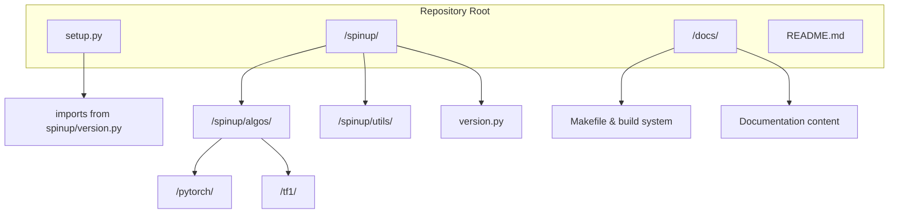
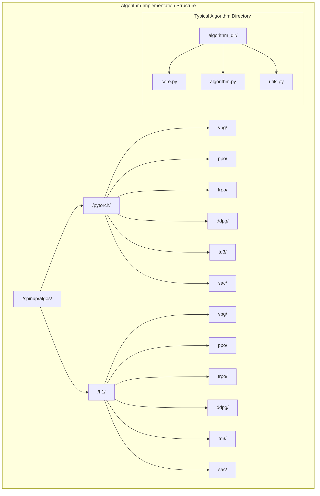
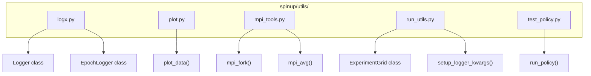
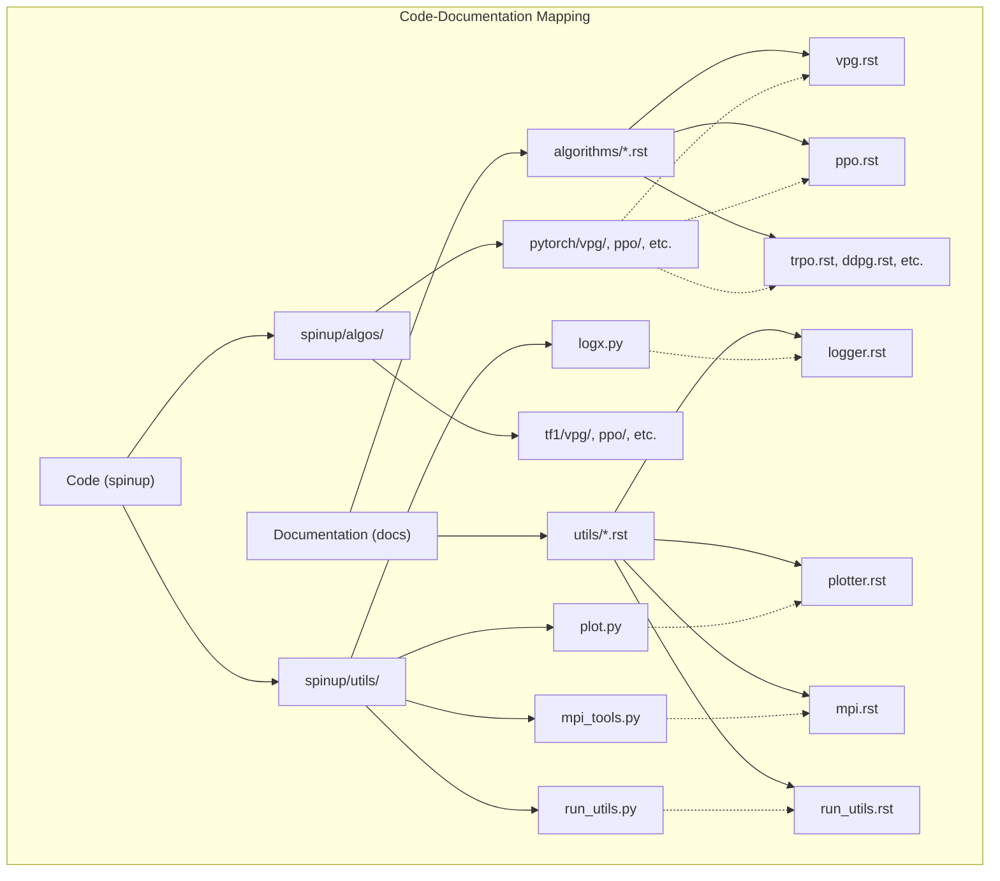

<!-- source: DeepWiki mcp.deepwiki.com · repo openai/spinningup · page 1.1 Repository Structure · fetched 2026-10-26 -->

# Repository Structure

Relevant source files

The following files were used as context for generating this wiki page:

- [.gitignore](.gitignore)
- [docs/Makefile](docs/Makefile)
- [docs/index.rst](docs/index.rst)

This document provides a high-level overview of the Spinning Up repository organization, including main directories and file organization. For information about installation, see [Installation Guide](#2), and for details about the package functionality, see [Package Structure](#6).

## Overview

The Spinning Up repository is structured as a Python package focused on reinforcement learning education and implementation. The codebase organizes algorithms, utilities, and documentation in a modular fashion to support both learning and experimentation.

## Main Components

The repository consists of three primary components:

Sources: [.gitignore:1-10]()

### Core Package (`/spinup`)

This directory contains the actual implementation code including:
- Algorithm implementations (organized by framework)
- Utility modules for logging, visualization, and experimentation
- Version tracking

### Documentation (`/docs`)

This directory contains all educational content and documentation:
- Installation and usage guides
- Introduction to reinforcement learning
- Algorithm documentation
- Utility module references

### Package Definition (`setup.py`)

The root directory contains the package installation definition and related files:
- `setup.py`: Defines the package and its dependencies
- `README.md`: Overview and quick-start guide

## Documentation Structure

The documentation is organized into several key sections as revealed by the `index.rst` file:

```mermaid
graph TD
    subgraph "Documentation Organization"
        index["index.rst"]
        
        user["User Documentation"]
        intro["Introduction to RL"]
        resources["Resources"]
        algo_docs["Algorithms Docs"]
        util_docs["Utilities Docs"]
    end
    
    index --> user
    index --> intro
    index --> resources
    index --> algo_docs
    index --> util_docs
    
    user --> introduction["introduction.rst"]
    user --> installation["installation.rst"]
    user --> algo_usage["algorithms.rst"]
    user --> running["running.rst"]
    user --> saving["saving_and_loading.rst"]
    user --> plotting["plotting.rst"]
    
    intro --> rl_intro["rl_intro1-3.rst"]
    
    resources --> keypapers["keypapers.rst"]
    resources --> exercises["exercises.rst"]
    resources --> bench["bench.rst"]
    
    algo_docs --> vpg["vpg.rst"]
    algo_docs --> trpo["trpo.rst"]
    algo_docs --> ppo["ppo.rst"]
    algo_docs --> ddpg["ddpg.rst"]
    algo_docs --> td3["td3.rst"]
    algo_docs --> sac["sac.rst"]
    
    util_docs --> logger["logger.rst"]
    util_docs --> plotter["plotter.rst"]
    util_docs --> mpi["mpi.rst"]
    util_docs --> run_utils["run_utils.rst"]
```

Sources: [docs/index.rst:11-57]()

The documentation is built using Sphinx, with a standard Makefile for generating HTML and other output formats.

Sources: [docs/Makefile:1-20]()

## Algorithm Organization

The algorithms are organized by framework (PyTorch and TensorFlow) and follow a consistent structure:

Sources: [docs/index.rst:43-48]()

The repository implements six state-of-the-art reinforcement learning algorithms:
- **VPG** (Vanilla Policy Gradient)
- **TRPO** (Trust Region Policy Optimization)
- **PPO** (Proximal Policy Optimization)
- **DDPG** (Deep Deterministic Policy Gradient)
- **TD3** (Twin Delayed DDPG)
- **SAC** (Soft Actor-Critic)

Each implementation exists in both PyTorch and TensorFlow variants, following a consistent design pattern to facilitate comparison and learning.

## Utility Module Structure

The utility modules provide supporting functionality for algorithm implementation, experimentation, and visualization:

Sources: [docs/index.rst:54-57]()

Key utility components include:
- **Logger**: Records and saves experiment statistics
- **Plotter**: Visualizes training results
- **MPI Tools**: Facilitates parallel computing for faster training
- **Run Utilities**: Manages experiment configuration and execution
- **Test Policy**: Tools for evaluating trained policies

## Generated and Ignored Files

The `.gitignore` file provides insight into files generated during repository usage:

| Pattern | Description |
|---------|-------------|
| `*.*~` | Temporary files |
| `__pycache__/` | Python bytecode cache |
| `*.pkl` | Serialized data (models, results) |
| `data/` | Directory for experiment output |
| `**/*.egg-info` | Package installation artifacts |
| `_build/` | Documentation build outputs |

Sources: [.gitignore:1-10]()

These patterns indicate that the repository generates several types of files during normal operation, including trained models, experiment results, and build artifacts that are not tracked in version control.

## Code-Documentation Relationship

The repository structure is deliberately mirrored in the documentation organization:

Sources: [docs/index.rst:11-57]()

This parallel structure ensures that every code component has corresponding documentation, creating a comprehensive educational resource that explains both concepts and implementation details.

---

