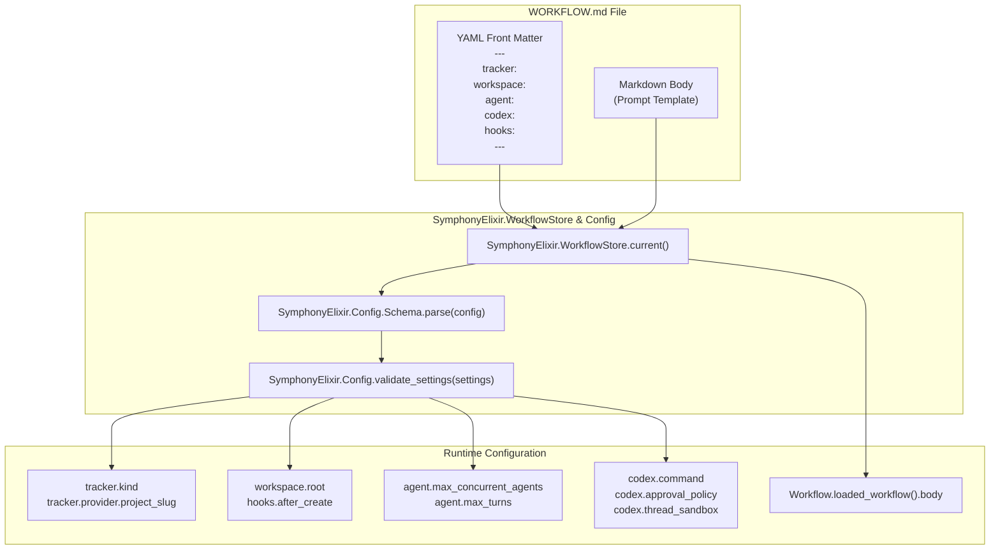
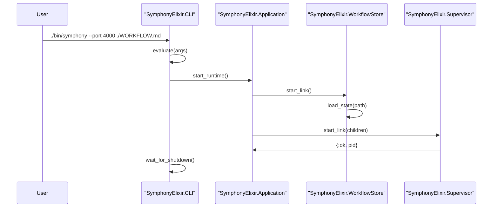

<!-- source: DeepWiki mcp.deepwiki.com · repo openai/symphony · page 2 Getting Started · fetched 2026-10-26 -->

# Getting Started

<details>
<summary>Relevant source files</summary>

The following files were used as context for generating this wiki page:

- [.github/workflows/burrito-release.yml](.github/workflows/burrito-release.yml)
- [elixir/.gitignore](elixir/.gitignore)
- [elixir/README.md](elixir/README.md)
- [elixir/WORKFLOW.md](elixir/WORKFLOW.md)
- [elixir/config/config.exs](elixir/config/config.exs)
- [elixir/lib/symphony_elixir.ex](elixir/lib/symphony_elixir.ex)
- [elixir/lib/symphony_elixir/cli.ex](elixir/lib/symphony_elixir/cli.ex)
- [elixir/lib/symphony_elixir/workflow_store.ex](elixir/lib/symphony_elixir/workflow_store.ex)
- [elixir/mise.toml](elixir/mise.toml)
- [elixir/test/fixtures/startup_workflow.md](elixir/test/fixtures/startup_workflow.md)

</details>


This guide walks through setting up Symphony for the first time, configuring your `WORKFLOW.md` file, and running the orchestrator service. By the end of this guide, you will have Symphony polling Linear for issues and launching Codex agents in isolated workspaces.

For architectural details about how these components interact, see [Architecture](). For in-depth configuration reference, see [Configuration System]().

---

## Prerequisites

Symphony requires three runtime dependencies to function:

| Dependency | Purpose | Installation |
|------------|---------|--------------|
| **Elixir/Erlang** | Runtime platform for Symphony service | Managed via `mise` tool |
| **Codex binary** | AI agent execution engine | Installed separately (see Codex documentation) |
| **Linear API key** | Issue tracker integration | Generated from Linear Settings → Security & access → Personal API keys |

### Installing Elixir/Erlang with mise

Symphony uses [mise](https://mise.jdx.dev) for version management. The repository includes a `mise.toml` file that specifies the required Elixir and Erlang versions [elixir/mise.toml:1-4]().

```bash
# Install mise if not already present
curl https://mise.run | sh

# Navigate to the elixir directory
cd symphony/elixir

# Install required Elixir/Erlang versions
mise install

# Verify installation
mise exec -- elixir --version
```

**Sources:** [elixir/README.md:58-63](), [elixir/mise.toml:1-4]()

### Obtaining a Linear API Key

1. Navigate to Linear Settings → Security & access → Personal API keys [elixir/README.md:42-43]().
2. Create a new personal API key.
3. Store it securely - you will set it as `LINEAR_API_KEY` environment variable.

The API key is required for Symphony's tracker integration to fetch and update issues. Symphony executes tracker tools (like `linear_graphql`) with host-side auth and manages these tokens so the agent does not need a second login [elixir/README.md:24-28]().

**Sources:** [elixir/README.md:24-28](), [elixir/README.md:42-43]()

---

## Installation

### Clone and Build

```bash
# Clone the repository
git clone https://github.com/openai/symphony
cd symphony/elixir

# Trust mise configuration
mise trust

# Install dependencies
mise install

# Run Mix setup task
mise exec -- mix setup

# Build the Symphony binary
mise exec -- mix build
```

The `mix setup` and `mix build` commands prepare the Elixir environment and compile the project [elixir/README.md:67-75](). Symphony also supports building self-contained executables using Burrito for various targets like `macos_arm64` and `linux_x86_64` [elixir/README.md:79-88]().

**Sources:** [elixir/README.md:67-75](), [elixir/README.md:79-88]()

---

## Configuration

Symphony reads its configuration from a `WORKFLOW.md` file using YAML front matter. This file defines tracker settings, workspace behavior, Codex parameters, and the prompt template [elixir/README.md:115-116]().

### Configuration Pipeline



**Diagram: WORKFLOW.md structure and parsing pipeline**

The `SymphonyElixir.WorkflowStore` GenServer caches the last known good workflow and automatically reloads it when `WORKFLOW.md` changes [elixir/lib/symphony_elixir/workflow_store.ex:1-4]().

**Sources:** [elixir/lib/symphony_elixir/workflow_store.ex:1-4](), [elixir/lib/symphony_elixir/workflow_store.ex:157-167](), [elixir/README.md:115-116]()

### Minimal Configuration Example

Create a `WORKFLOW.md` file in your repository root [elixir/README.md:120-141]():

```markdown
---
tracker:
  kind: linear
  provider:
    project_slug: "..."
workspace:
  root: ~/code/workspaces
hooks:
  after_create: |
    git clone git@github.com:your-org/your-repo.git .
agent:
  max_concurrent_agents: 10
  max_turns: 20
codex:
  command: codex app-server
---

You are working on an issue from the configured tracker {{ issue.identifier }}.

Title: {{ issue.title }} Body: {{ issue.description }}
```

**Sources:** [elixir/README.md:120-141]()

### Required Configuration Fields

| Field | Description | Default |
|-------|-------------|---------|
| `tracker.kind` | Issue tracker adapter (e.g., `linear`, `github`, `jira`) | None [elixir/README.md:123]() |
| `tracker.provider.project_slug` | Tracker-specific project identifier | None [elixir/README.md:125]() |
| `workspace.root` | Root directory for issue workspaces | None [elixir/README.md:127]() |
| `hooks.after_create` | Script to bootstrap a fresh workspace (e.g., `git clone`) | None [elixir/README.md:129-130]() |
| `codex.command` | Command to launch Codex app-server | `codex app-server` [elixir/README.md:135]() |

**Sources:** [elixir/README.md:120-135]()

### Security Defaults

When policy fields are omitted, Symphony applies safer defaults to the Codex execution environment:
- `codex.approval_policy`: Defaults to rejecting sandbox approvals, rules, and MCP elicitations [elixir/README.md:153]().
- `codex.thread_sandbox`: Defaults to `workspace-write` [elixir/README.md:154]().
- `codex.turn_sandbox_policy`: Defaults to `workspaceWrite` rooted at the current issue workspace [elixir/README.md:155]().

**Sources:** [elixir/README.md:152-156]()

---

## Running Symphony

### CLI Entrypoint

Symphony is started via the CLI, which handles argument parsing and initializes the OTP application.



**Diagram: Symphony CLI Startup Flow**

The CLI requires an explicit acknowledgement of the "engineering preview" status via a specific flag if running the burrito release [elixir/lib/symphony_elixir/cli.ex:111-120]().

**Sources:** [elixir/lib/symphony_elixir/cli.ex:27-36](), [elixir/lib/symphony_elixir/cli.ex:111-120](), [elixir/lib/symphony_elixir.ex:35-51]()

### Command-Line Options

Pass a custom workflow file path to the binary. If no path is passed, Symphony defaults to `./WORKFLOW.md` [elixir/README.md:102-108]().

- `--logs-root`: Sets the directory for writing logs (default: `./log`) [elixir/README.md:112]().
- `--port`: Starts the Phoenix observability service/dashboard (default: disabled) [elixir/README.md:113]().

**Sources:** [elixir/README.md:102-113]()

---

## Verifying Your Setup

### Enable Dashboard for Visualization

Run Symphony with the `--port` flag to enable the real-time monitoring dashboard [elixir/README.md:113]():

```bash
./bin/symphony ./WORKFLOW.md --port 4000
```

The dashboard (started via `SymphonyElixir.StatusDashboard`) provides a view of active agents, token usage, and blocked states [elixir/lib/symphony_elixir.ex:43](), [elixir/README.md:33-36]().

**Sources:** [elixir/lib/symphony_elixir.ex:43](), [elixir/README.md:33-36](), [elixir/README.md:113]()

### Test with a Linear Issue

1. Create a test issue in Linear.
2. Ensure the issue has the labels required by `tracker.required_labels` if configured [elixir/README.md:149-151]().
3. Set the issue to one of the `active_states` (e.g., `Todo`, `In Progress`) [elixir/WORKFLOW.md:7-11]().
4. Symphony polls every `polling.interval_ms` (default 5000ms) [elixir/WORKFLOW.md:19]().
5. Upon discovery, Symphony creates a workspace and launches Codex [elixir/README.md:16-22]().

**Sources:** [elixir/README.md:16-22](), [elixir/README.md:149-151](), [elixir/WORKFLOW.md:7-19]()

---

## Troubleshooting Common Issues

### Issue: Workflow Reload Errors
If you modify `WORKFLOW.md` and introduce a syntax error, `SymphonyElixir.WorkflowStore` will log the error but continue using the last known good configuration [elixir/lib/symphony_elixir/workflow_store.ex:178-180](). Check the logs to see validation failures.

### Issue: Network Access Denied
If your `hooks.after_create` or Codex turns need to access the internet (e.g., for `npm install`), ensure `networkAccess: true` is set in `codex.turn_sandbox_policy` [elixir/README.md:163-165]().

**Sources:** [elixir/lib/symphony_elixir/workflow_store.ex:178-180](), [elixir/README.md:163-165]()

---

