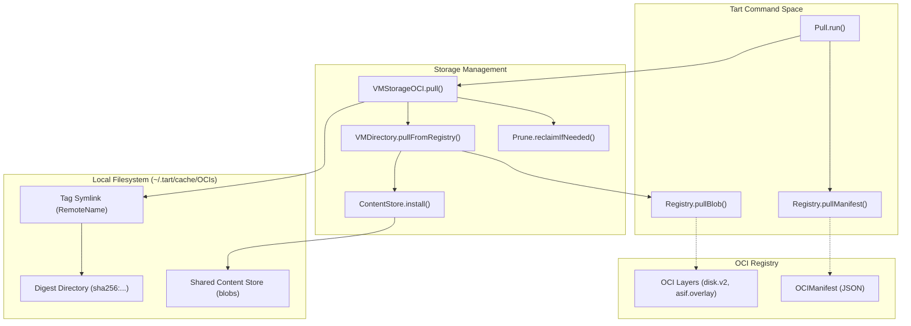

<!-- source: DeepWiki mcp.deepwiki.com · repo openai/tart · page 3.4 Pull, Push, Clone, and Prune · fetched 2026-10-26 -->

# Pull, Push, Clone, and Prune

<details>
<summary>Relevant source files</summary>

The following files were used as context for generating this wiki page:

- [Sources/tart/Commands/Clone.swift](Sources/tart/Commands/Clone.swift)
- [Sources/tart/Commands/Prune.swift](Sources/tart/Commands/Prune.swift)
- [Sources/tart/Commands/Pull.swift](Sources/tart/Commands/Pull.swift)
- [Sources/tart/Commands/Push.swift](Sources/tart/Commands/Push.swift)
- [Sources/tart/Config.swift](Sources/tart/Config.swift)
- [Sources/tart/OCI/Manifest.swift](Sources/tart/OCI/Manifest.swift)
- [Sources/tart/VMDirectory+OCI.swift](Sources/tart/VMDirectory+OCI.swift)
- [Sources/tart/VMDirectory.swift](Sources/tart/VMDirectory.swift)
- [Sources/tart/VMStorageHelper.swift](Sources/tart/VMStorageHelper.swift)
- [Sources/tart/VMStorageLocal.swift](Sources/tart/VMStorageLocal.swift)
- [Sources/tart/VMStorageOCI.swift](Sources/tart/VMStorageOCI.swift)
- [benchmark/README.md](benchmark/README.md)
- [benchmark/internal/command/root.go](benchmark/internal/command/root.go)
- [benchmark/internal/command/stackedoci/stackedoci.go](benchmark/internal/command/stackedoci/stackedoci.go)
- [integration-tests/test_stacked_oci.py](integration-tests/test_stacked_oci.py)

</details>


This section describes the high-level workflows for distributing and managing VM images. It covers the interaction between local storage and OCI registries, the mechanics of APFS-based cloning, and the automatic maintenance of local disk space via the pruning subsystem.

## Image Distribution Workflows

Tart utilizes OCI-compatible registries as its primary distribution mechanism. The logic for managing these remote-sourced images is encapsulated in `VMStorageOCI` [Sources/tart/VMStorageOCI.swift:5](), which handles a cache of images organized by their registry host and namespace.

### Pull Flow

The `Pull` command [Sources/tart/Commands/Pull.swift:5]() serves as the entry point for fetching remote VMs.

1.  **Validation**: It first checks if the name refers to an existing local VM in `VMStorageLocal` [Sources/tart/Commands/Pull.swift:38-42]().
2.  **Registry Interaction**: It initializes a `Registry` client and invokes `VMStorageOCI.pull()` [Sources/tart/Commands/Pull.swift:44-49]().
3.  **Manifest Fetching**: `VMStorageOCI` fetches the OCI manifest to determine the image's content hash (digest) and validates the layout [Sources/tart/VMStorageOCI.swift:155-158](), [Sources/tart/OCI/Manifest.swift:117-127]().
4.  **Locking**: To prevent race conditions during concurrent pulls of the same image, Tart acquires a `FileLock` on the host-specific directory within the OCI cache [Sources/tart/VMStorageOCI.swift:81-82]().
5.  **Optimistic Cache Check**: If the digest-based image already exists and is complete (including all stacked disk groups if applicable), the pull exits early [Sources/tart/VMStorageOCI.swift:83-94]().
6.  **Automatic Pruning**: Before downloading layers, Tart calculates the `requiredDiskStorageBytes` from the manifest and attempts to reclaim space if the host disk is nearly full [Sources/tart/VMStorageOCI.swift:99-119](), [Sources/tart/Commands/Prune.swift:114-153]().

### Push Flow

The `Push` command [Sources/tart/Commands/Push.swift:6]() allows local VMs to be uploaded to OCI registries. 

*   **Lightweight Push**: If the user pushes an image that is already present in the local OCI cache (i.e., a previously pulled image), Tart performs a `lightweightPushToRegistry` [Sources/tart/Commands/Push.swift:105-120](). This only uploads the manifest to the new reference, avoiding redundant blob uploads [Sources/tart/Commands/Push.swift:74-79]().
*   **Standard Push**: For local VMs, `VMDirectory.pushToRegistry` [Sources/tart/VMDirectory+OCI.swift:156]() layerizes the disk using `DiskV2`, skipping zero-blocks and applying LZ4 compression [Sources/tart/VMDirectory+OCI.swift:32-35]().
*   **Cache Population**: If the `--populate-cache` flag is used, Tart materializes the digest-addressed image in the local OCI cache immediately after a successful push [Sources/tart/Commands/Push.swift:91-93](), [Sources/tart/VMStorageOCI.swift:155-190]().

### Data Flow: Registry to Local Cache

The following diagram illustrates the data flow and key code entities involved in the OCI-to-local transition.

**OCI Pull and Storage Entity Mapping**



**Sources:**
* [Sources/tart/Commands/Pull.swift:35-50]()
* [Sources/tart/VMStorageOCI.swift:59-94]()
* [Sources/tart/VMDirectory+OCI.swift:15-113]()
* [Sources/tart/Commands/Prune.swift:114-153]()

---

## Cloning and APFS Copy-on-Write

The `Clone` command [Sources/tart/Commands/Clone.swift:5]() creates a new local VM from either a remote source or an existing local VM.

### Implementation Details
*   **Remote Resolution**: If the source is a `RemoteName` not present in the OCI cache, Tart automatically triggers a `pull` operation [Sources/tart/Commands/Clone.swift:62-84]().
*   **Copy-on-Write (CoW)**: Tart relies on Apple File System (APFS) cloning. When `VMDirectory.clone()` is called, it performs a file-level copy using `FileManager.default.copyItem`, which on APFS does not immediately consume additional disk space [Sources/tart/Commands/Clone.swift:11-12](), [Sources/tart/VMDirectory.swift:207-209]().
*   **Stacked Cloning**: If `--stacked` is used, Tart creates a new VM that uses the source image as an immutable base, creating a small `overlay.asif` instead of copying the full disk [Sources/tart/Commands/Clone.swift:105-112]().
*   **MAC Address Management**: Tart checks if the source VM's MAC address is already in use by another local VM. If so, and the source is not suspended, it generates a new MAC address for the clone to prevent conflicts [Sources/tart/Commands/Clone.swift:102-104]().
*   **Post-Clone Pruning**: Because CoW hides true future space requirements, Tart calculates the difference between the virtual disk size and currently allocated blocks and runs `Prune.reclaimIfNeeded()` [Sources/tart/Commands/Clone.swift:132-149]().

**Sources:**
* [Sources/tart/Commands/Clone.swift:50-153]()
* [Sources/tart/VMDirectory.swift:207-209]()
* [Sources/tart/VMStorageLocal.swift:101-103]()

---

## Automatic Pruning and Space Budgets

Tart manages disk space automatically through the `Prune` subsystem [Sources/tart/Commands/Prune.swift:7]().

### Pruning Strategies
1.  **LRU Eviction**: When space is needed, Tart identifies "prunable" items (OCI cache entries and IPSW files) and sorts them by their last access date [Sources/tart/Commands/Prune.swift:159-164]().
2.  **Space Budget**: Users can enforce a global limit (e.g., `--space-budget=50`) which removes the least recently used entries until the total size fits within the budget [Sources/tart/Commands/Prune.swift:21-24](), [Sources/tart/Commands/Prune.swift:83-112]().
3.  **Retention Policy**: The `--older-than` flag allows pruning based on the number of days since an image was last accessed [Sources/tart/Commands/Prune.swift:13-16](), [Sources/tart/Commands/Prune.swift:77-81]().
4.  **Automatic Reclaim**: Triggered during `pull` or `clone`, this checks `volumeAvailableCapacityForImportantUsageKey` and deletes old cache entries if the required bytes exceed available capacity [Sources/tart/Commands/Prune.swift:114-153]().

### Implementation Entity Bridge

The following diagram maps the high-level pruning concepts to the internal classes and methods that execute them.

**Pruning Implementation Mapping**

```mermaid
graph LR
    subgraph "Triggers"
        PullFlow["Pull/Clone Flow"]
        ManualPrune["tart prune --space-budget"]
        ConfigGC["Config.gc() (Tmp Clean)"]
    end

    subgraph "Logic (Prune.swift)"
        Reclaim["Prune.reclaimIfNeeded()"]
        Budget["Prune.pruneSpaceBudget()"]
        Age["Prune.pruneOlderThan()"]
    end

    subgraph "Entities (VMStorageOCI.swift / IPSWCache.swift)"
        PStorage["PrunableStorage Protocol"]
        OCIStore["VMStorageOCI"]
        IPSW["IPSWCache"]
        LocalStore["VMStorageLocal"]
    end

    PullFlow --> Reclaim
    ManualPrune --> Budget
    ManualPrune --> Age
    ConfigGC --> TmpDir["VMDirectory (Temporary)"]

    Reclaim --> PStorage
    Budget --> PStorage
    Age --> PStorage

    PStorage <|-- OCIStore
    PStorage <|-- IPSW
    PStorage <|-- LocalStore
```

**Sources:**
* [Sources/tart/Commands/Prune.swift:7-112]()
* [Sources/tart/VMStorageOCI.swift:5]()
* [Sources/tart/Config.swift:28-40]()

### Space Calculation
Tart uses `volumeAvailableCapacityForImportantUsageKey` to determine the true available space on the macOS volume [Sources/tart/Commands/Prune.swift:125-132](). If the environment variable `TART_NO_AUTO_PRUNE` is set, all automatic reclaiming logic is bypassed [Sources/tart/Commands/Prune.swift:115-117]().

**Sources:**
* [Sources/tart/Commands/Prune.swift:114-153]()
* [Sources/tart/Config.swift:11-18]()

---

