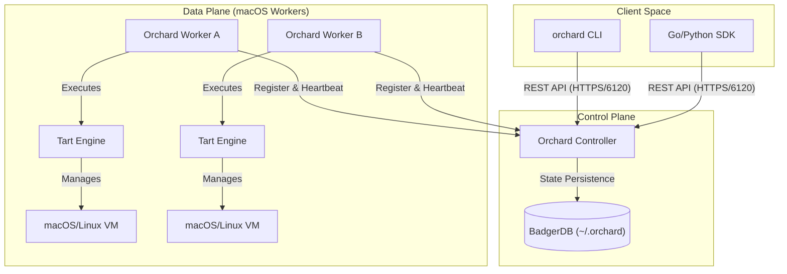
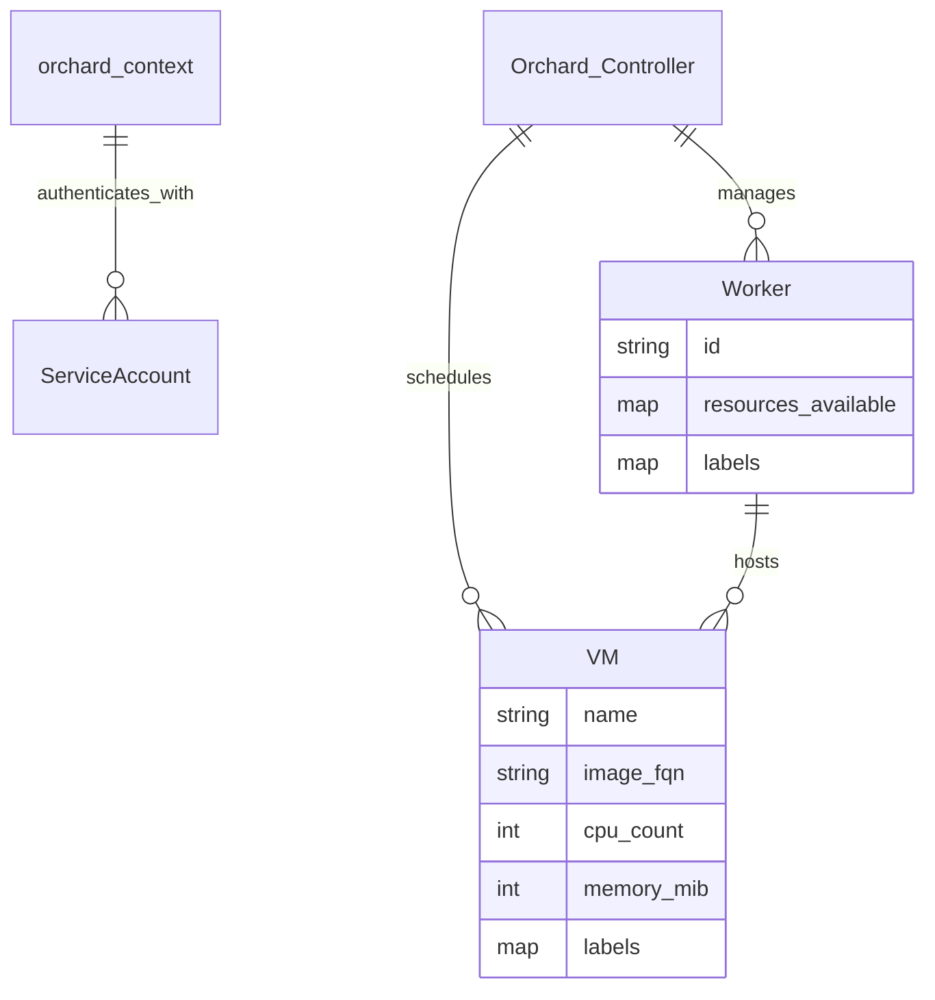

<!-- source: DeepWiki mcp.deepwiki.com · repo openai/tart · page 8.2 Orchard Cluster Orchestration · fetched 2026-10-26 -->

# Orchard Cluster Orchestration

Relevant source files

The following files were used as context for generating this wiki page:

- [docs/assets/images/orchard/orchard-api-documentation-browser.png](docs/assets/images/orchard/orchard-api-documentation-browser.png)
- [docs/integrations/buildkite.md](docs/integrations/buildkite.md)
- [docs/integrations/cirrus-cli.md](docs/integrations/cirrus-cli.md)
- [docs/integrations/gitlab-runner.md](docs/integrations/gitlab-runner.md)
- [docs/orchard/architecture-and-security.md](docs/orchard/architecture-and-security.md)
- [docs/orchard/deploying-controller.md](docs/orchard/deploying-controller.md)
- [docs/orchard/deploying-workers.md](docs/orchard/deploying-workers.md)
- [docs/orchard/integration-guide.md](docs/orchard/integration-guide.md)
- [docs/orchard/managing-cluster.md](docs/orchard/managing-cluster.md)
- [docs/orchard/quick-start.md](docs/orchard/quick-start.md)
- [docs/orchard/using-orchard-cli.md](docs/orchard/using-orchard-cli.md)
- [mkdocs.yml](mkdocs.yml)

The Orchard system is a specialized orchestration layer designed to manage clusters of Tart-capable hosts. While Tart excels at managing virtual machines on a single macOS host, Orchard enables the scaling of these workloads across multiple machines, providing a centralized API for VM lifecycle management, resource scheduling, and secure remote access.

## Architecture and Components

An Orchard cluster consists of three primary architectural components: the **Controller**, the **Worker**, and the **Client**.

### Component Roles

| Component | Role | Platform Support |
| :--- | :--- | :--- |
| **Controller** | The central brain of the cluster. It manages the state database (BadgerDB), handles VM scheduling, and authenticates all requests. | macOS, Linux (Container-ready) |
| **Worker** | The execution node. It runs the actual Tart VMs and reports resource availability back to the Controller. | macOS (requires Virtualization.Framework) |
| **Client** | Any consumer of the Orchard API, typically the `orchard` CLI or custom integrations (Python/Go). | Cross-platform |

### Data Flow and Networking
The Controller acts as the single point of entry for the cluster. In terms of networking requirements, only the Controller needs to be directly accessible from Workers and Clients. Workers and Clients can operate behind NAT or strict firewalls, as they initiate outbound connections to the Controller [docs/orchard/architecture-and-security.md:1-12]().

#### System Architecture Diagram
The following diagram illustrates the relationship between Orchard components and the underlying Tart engine.

Sources: [docs/orchard/architecture-and-security.md:1-12](), [docs/orchard/managing-cluster.md:1-6]()

## Security and PKI Model

Orchard enforces security by default. All API interactions are authenticated via service accounts, and connections are secured using TLS [docs/orchard/deploying-controller.md:7-9]().

### Certificate Handling
Orchard uses a hybrid approach to establish trust:
1.  **Publicly Valid Certificates:** If `--controller-cert` and `--controller-key` are provided, standard PKI validation is used [docs/orchard/architecture-and-security.md:21-22]().
2.  **Self-Signed Certificates:** On the first run, the Controller automatically generates a self-signed certificate. Clients use a "trust on first use" (TOFU) model, where the certificate fingerprint is verified interactively during `orchard context create` [docs/orchard/architecture-and-security.md:23-37]().

### Authentication
*   **Service Accounts:** All requests must include credentials. A `bootstrap-admin` account is created automatically during the first Controller start [docs/orchard/deploying-controller.md:7-9]().
*   **Bootstrap Tokens:** To join a Worker to the cluster, a Bootstrap Token must be generated via the CLI. This token contains the Controller's address and, if using self-signed certs, the certificate itself to establish an immediate secure channel [docs/orchard/architecture-and-security.md:45-50]().

Sources: [docs/orchard/architecture-and-security.md:13-67](), [docs/orchard/deploying-controller.md:7-15]()

## Resource Scheduling

Orchard includes a scheduler that places VMs on Workers based on available resources and constraints.

### Well-Known Resources
Workers automatically report host capabilities to the Controller [docs/orchard/using-orchard-cli.md:79-86]():
*   `org.cirruslabs.tart-vms`: Available VM slots (default is 2 per worker) [docs/orchard/integration-guide.md:181-187]().
*   `org.cirruslabs.logical-cores`: Host CPU count.
*   `org.cirruslabs.memory-mib`: Host RAM in MiB.

### Scheduling Constraints
Users can influence placement using two mechanisms in the `orchard create vm` command:
*   **Labels:** Key-value pairs (e.g., `model=macstudio`) that must match between the VM request and the Worker [docs/orchard/using-orchard-cli.md:41-56]().
*   **Resources:** Finite numerical values (e.g., `bandwidth-mbps=7500`). The scheduler decrements these values on the Worker when a VM is assigned and restores them when the VM terminates [docs/orchard/using-orchard-cli.md:58-78]().

Sources: [docs/orchard/using-orchard-cli.md:41-86](), [docs/orchard/integration-guide.md:181-187]()

## Deployment and Management

### Controller Deployment
The Controller can be deployed as a binary or a container.
*   **Container:** `ghcr.io/cirruslabs/orchard:latest` is provided for Kubernetes or cloud environments [docs/orchard/deploying-controller.md:5-6]().
*   **Persistence:** The directory `~/.orchard/` (or `$ORCHARD_HOME`) must be persisted as it contains the BadgerDB database and TLS keys [docs/orchard/managing-cluster.md:1-6]().
*   **SSH Proxy:** The Controller can act as an SSH jump host, allowing users to connect to VMs via `ssh -J <user>@<controller> <vm-name>` [docs/orchard/deploying-controller.md:34-44]().

### Worker Management
Workers are typically deployed on macOS hosts via `launchd` or Ansible [docs/orchard/deploying-workers.md:25-100]().
1.  Generate a token: `orchard get bootstrap-token <service-account>` [docs/orchard/deploying-workers.md:9-13]().
2.  Run the worker: `orchard worker run --bootstrap-token <token> <controller-url>` [docs/orchard/deploying-workers.md:60-65]().

### CLI Usage Reference
The Orchard CLI manages contexts and cluster resources.

| Command Group | Description |
| :--- | :--- |
| `orchard context` | Manage Controller connections (create, list, default) [docs/orchard/using-orchard-cli.md:11-20](). |
| `orchard create vm` | Provision a new VM from an OCI image [docs/orchard/quick-start.md:24-30](). |
| `orchard ssh vm` | Securely proxy SSH into a running VM [docs/orchard/quick-start.md:46-52](). |
| `orchard vnc vm` | Open a Screen Sharing session to a VM [docs/orchard/quick-start.md:71-77](). |
| `orchard dev` | Run a local-only Controller + Worker in one process [docs/orchard/quick-start.md:9-18](). |

#### Entity Relationship Diagram
This diagram maps CLI operations to the underlying API resources and state.

Sources: [docs/orchard/integration-guide.md:142-153](), [docs/orchard/using-orchard-cli.md:11-86](), [docs/orchard/architecture-and-security.md:1-12]()

## Observability
Orchard components export OpenTelemetry (OTel) metrics with the `org.cirruslabs.orchard` prefix. These include resource utilization and scheduling latency. By default, metrics are sent to `localhost:4317` (gRPC) or `localhost:4318` (HTTP), configurable via the `OTEL_EXPORTER_OTLP_ENDPOINT` environment variable [docs/orchard/managing-cluster.md:15-24]().

Sources: [docs/orchard/managing-cluster.md:15-30]()

---

