# Page: Overview

# Overview

<details>
<summary>Relevant source files</summary>

The following files were used as context for generating this wiki page:

- [README.md](README.md)
- [datasets.md](datasets.md)
- [terminology.md](terminology.md)

</details>


The Transformer Debugger (TDB) is a tool developed by OpenAI's Superalignment team to support investigations into specific behaviors of small language models [README.md:1-5](). It combines automated interpretability techniques with sparse autoencoders to identify specific components—such as neurons, attention heads, and autoencoder latents—that contribute to model behavior [README.md:6-15]().

The tool allows users to intervene in the forward pass to see how it affects specific outputs, helping answer questions like "Why does the model output token A instead of token B?" [README.md:9-12]().

For detailed information about the system architecture, see [System Architecture](#1.1).
For setup instructions, see [Setup and Installation](#1.2).

## Core Components

The repository is organized into several primary functional areas:

| Component | Description | Key Code Entities |
| :--- | :--- | :--- |
| **Neuron Viewer** | A React frontend for TDB and individual model component pages [README.md:27](). | `neuron_viewer/src/` |
| **Activation Server** | A FastAPI backend that performs model inference and serves data from Azure [README.md:28](). | `neuron_explainer/activation_server/` |
| **Model Library** | Inference implementation for GPT-2 and sparse autoencoders with activation hooks [README.md:29](). | `neuron_explainer/models/` |
| **Datasets** | Collated top-activating examples for MLP neurons and attention heads [README.md:30](). | `datasets.md` |

**Sources:** [README.md:25-31](); [datasets.md:1-3]()

## Supported Models and Data

TDB primarily supports the **GPT-2** family of models. It provides pre-computed activation datasets stored on Azure Blob Storage [datasets.md:5-11]().

*   **GPT-2 Small:** Supports MLP neurons (12 layers, 3084 neurons/layer) and Attention heads (12 layers, 12 heads/layer) [datasets.md:15-18](). It also includes extensive **Sparse Autoencoder** latents for MLP and Attention layers [datasets.md:21-47]().
*   **GPT-2 XL:** Supports MLP neurons (48 layers, 6400 neurons/layer) [datasets.md:50-58]().

**Sources:** [datasets.md:7-58]()

## System Conceptual Map

The following diagram bridges high-level interpretability concepts to the specific code entities used in the system.

### Concept to Code Mapping
```mermaid
graph TD
    subgraph "Interpretability Concepts"
        [BehaviorAnalysis] -- "Why token A?" --> [Intervention]
        [Component] -- "What does it do?" --> [Explanation]
        [Circuit] -- "How do they connect?" --> [Tracing]
    end

    subgraph "Code Entity Space"
        [Intervention] --> [InteractiveModel]
        [Explanation] --> [TokenActivationPairExplainer]
        [Component] --> [NeuronRecord]
        [Tracing] --> [DerivedScalarType]
    end

    [InteractiveModel] --- "neuron_explainer/activation_server/interactive_model.py"
    [TokenActivationPairExplainer] --- "neuron_explainer/explanations/explainer.py"
    [NeuronRecord] --- "neuron_explainer/activations/activations.py"
    [DerivedScalarType] --- "neuron_explainer/activations/derived_scalars/scalar_deriver.py"
```
**Sources:** [README.md:9-15](); [terminology.md:3-36](); [neuron_explainer/activation_server/README.md]()

## Data Flow and Communication

The system operates as a client-server architecture where the frontend requests activation data or model inferences from the backend.

### High-Level Data Flow
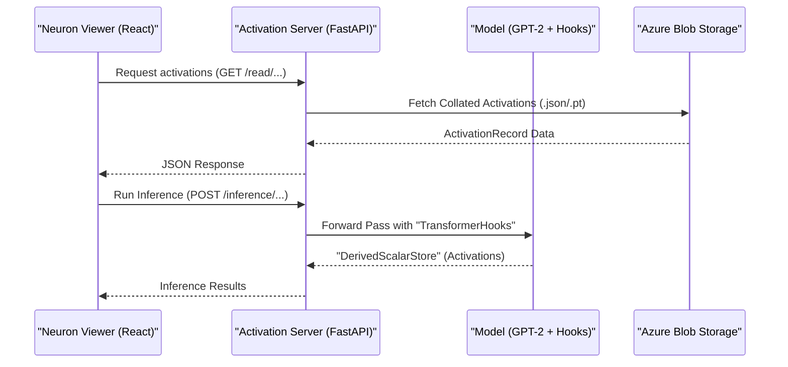
**Sources:** [README.md:27-29](); [datasets.md:5-13](); [neuron_explainer/activation_server/README.md]()

## Terminology Reference

The project uses specific terminology to describe the mechanics of the debugger:
*   **Component:** An attention head, neuron, or autoencoder latent [terminology.md:3-5]().
*   **Node:** A specific invocation of a component at a specific token in a forward pass [terminology.md:13-15]().
*   **Ablate:** To turn off a node (zero-ablation) to observe downstream effects [terminology.md:36-41]().
*   **Latent:** A direction in activation space learned by a sparse autoencoder [terminology.md:31-33]().
*   **Direction of Interest:** The specific vector (e.g., logit difference between target and distractor tokens) used to calculate node importance [terminology.md:48-54]().

**Sources:** [terminology.md:1-102]()

---

# Page: System Architecture

# System Architecture

<details>
<summary>Relevant source files</summary>

The following files were used as context for generating this wiki page:

- [README.md](README.md)
- [neuron_explainer/activation_server/README.md](neuron_explainer/activation_server/README.md)
- [neuron_viewer/README.md](neuron_viewer/README.md)

</details>


## Purpose and Scope

This document provides a comprehensive overview of the Transformer Debugger (TDB) system architecture, describing its main components and how they interact. It covers the core systems that make up the application, their relationships, and data flow from model inference through the activation server to the frontend.

For information about setting up and installing the system, see [Setup and Installation](#1.2). For detailed information about specific subsystems, refer to their dedicated wiki pages: [Transformer Model System](#2), [Neuron Explanation System](#3), [Activation Data Management](#4), [Activation Server](#5), and [Neuron Viewer Frontend](#6).

## High-Level System Overview

The Transformer Debugger is a full-stack application consisting of a React-based frontend, a FastAPI backend, and a specialized transformer inference library.

### Core System Components

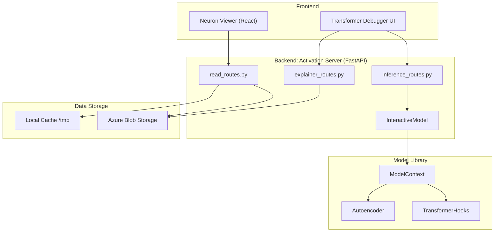

Sources: [README.md:25-31](), [neuron_explainer/activation_server/README.md:64-68](), [neuron_viewer/README.md:40-47]()

The system is divided into three primary layers:
1.  **Neuron Viewer Frontend**: A React application providing the TDB interface and individual node visualization pages [neuron_viewer/README.md:1-5]().
2.  **Activation Server Backend**: A FastAPI server that handles inference, data retrieval from Azure, and explanation generation [neuron_explainer/activation_server/README.md:1-8]().
3.  **Transformer Model Library**: A custom inference implementation for GPT-2 models and autoencoders with hooks for activation interception [README.md:29-29]().

## Detailed Component Architecture

### Model and Inference System

The Model System provides the interface for performing forward and backward passes while capturing internal activations.

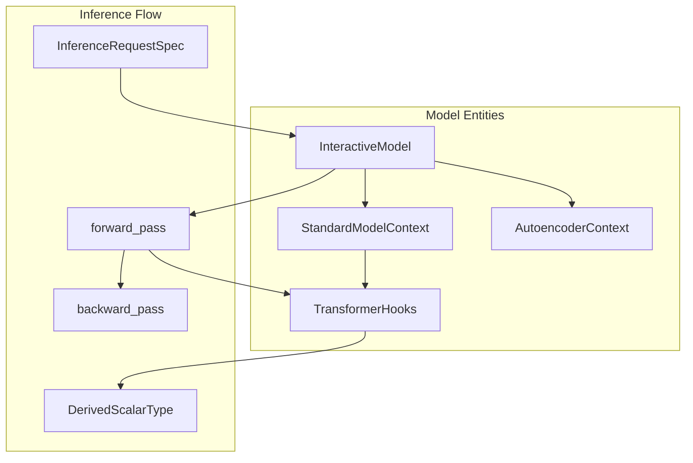

Sources: [neuron_explainer/activation_server/main.py:129-154](), [neuron_explainer/activation_server/README.md:68-68](), [neuron_explainer/models/README.md:29-29]()

Key components include:
*   **InteractiveModel**: The primary orchestrator for inference requests, managing both the subject model and optional autoencoders [neuron_explainer/activation_server/main.py:149-154]().
*   **StandardModelContext**: Manages the lifecycle and weight loading of the transformer model [neuron_explainer/activation_server/main.py:129-131]().
*   **TransformerHooks**: A system for intercepting activations at specific points (e.g., MLP post-activations, attention scores) [README.md:29-29]().
*   **DerivedScalarType**: An enum defining the specific internal values to be captured during inference [neuron_explainer/activation_server/explainer_routes.py:137-156]().

### Neuron Explanation and Scoring

This system automates the generation of human-readable explanations for why specific components (neurons, latents) activate.

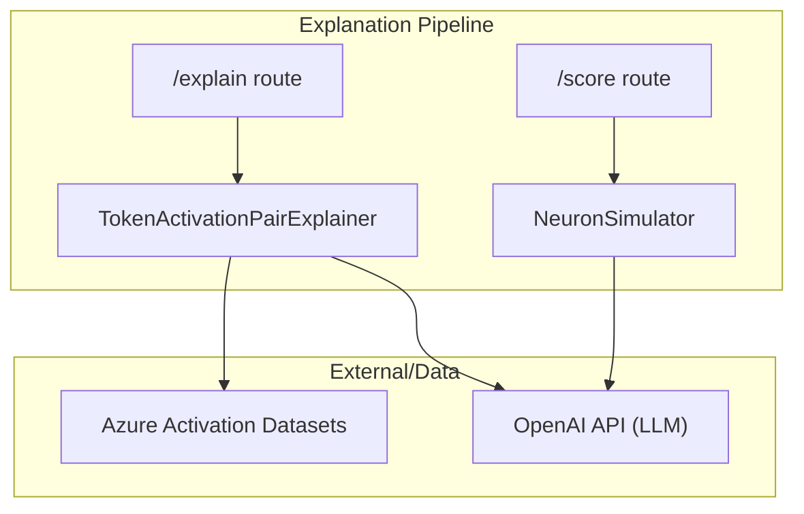

Sources: [neuron_explainer/activation_server/README.md:95-98](), [neuron_explainer/activation_server/explainer_routes.py:60-94]()

*   **TokenActivationPairExplainer**: Formats top-activating examples into prompts for an LLM to summarize behavior [neuron_explainer/activation_server/explainer_routes.py:60-70]().
*   **NeuronSimulator**: Uses an LLM to predict activations on new text based on a generated explanation to validate its accuracy [neuron_explainer/activation_server/README.md:97-98]().

## Data and Request Flow

The following diagram illustrates the end-to-end data flow when a user interacts with the Transformer Debugger UI.

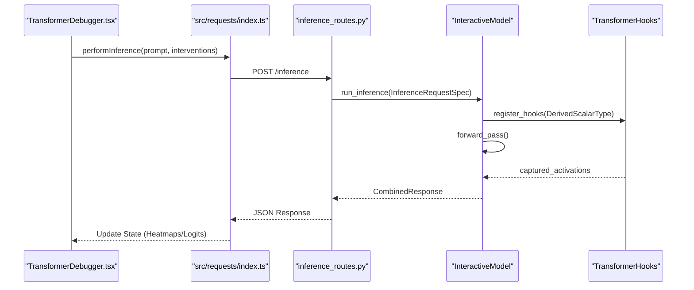

Sources: [neuron_explainer/activation_server/README.md:68-68](), [neuron_viewer/README.md:42-45](), [neuron_explainer/activation_server/main.py:159-170]()

### Key Data Paths:
1.  **Inference Path**: Frontend sends a prompt and optional interventions (ablations) to the `/inference` endpoint. The `InteractiveModel` runs the model, captures `DerivedScalarType` values via `TransformerHooks`, and returns them for visualization [neuron_explainer/activation_server/README.md:5-5]().
2.  **Read Path**: Frontend requests pre-computed data (e.g., top-activating sequences for a neuron) via `/read`. The server fetches this from Azure Blob Storage using `CustomFileHandler` [neuron_explainer/activation_server/README.md:6-6]().
3.  **Explanation Path**: Frontend requests a new explanation via `/explain`. The server retrieves `NeuronRecord` data, formats it for an LLM, and returns the text explanation [neuron_explainer/activation_server/explainer_routes.py:318-350]().

## Server Initialization and Component Registration

The server entry point `main.py` is responsible for wiring these components together based on command-line arguments.

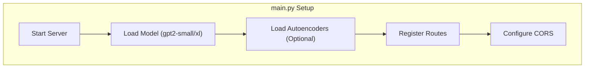

Sources: [neuron_explainer/activation_server/main.py:32-171](), [neuron_explainer/activation_server/README.md:11-24]()

*   **Autoencoder Integration**: If `--mlp_autoencoder_name` or `--attn_autoencoder_name` are provided, the server wraps the standard model with autoencoder latents, allowing the UI to toggle between neurons and latents [neuron_explainer/activation_server/README.md:17-28]().
*   **Client Generation**: The TypeScript client used by the frontend is automatically generated from the FastAPI schema to ensure type safety across the network boundary [neuron_explainer/activation_server/README.md:36-39]().

## Summary

The architecture is designed for interactive interpretability. By separating the heavy lifting of model inference and data management into a Python backend (`activation_server`) and providing a responsive React frontend (`neuron_viewer`), the system allows researchers to explore model internals, perform interventions, and view automated explanations in real-time.

---

# Page: Setup and Installation

# Setup and Installation

<details>
<summary>Relevant source files</summary>

The following files were used as context for generating this wiki page:

- [.pre-commit-config.yaml](.pre-commit-config.yaml)
- [README.md](README.md)
- [setup.py](setup.py)

</details>


This document provides technical instructions for setting up and installing the Transformer Debugger (TDB) repository. It covers the environment configuration for both the Python-based `neuron_explainer` backend and the React-based `neuron_viewer` frontend.

## Installation Overview

The installation process is divided into two main environments: the Python backend (Activation Server) and the Node.js frontend (Neuron Viewer).

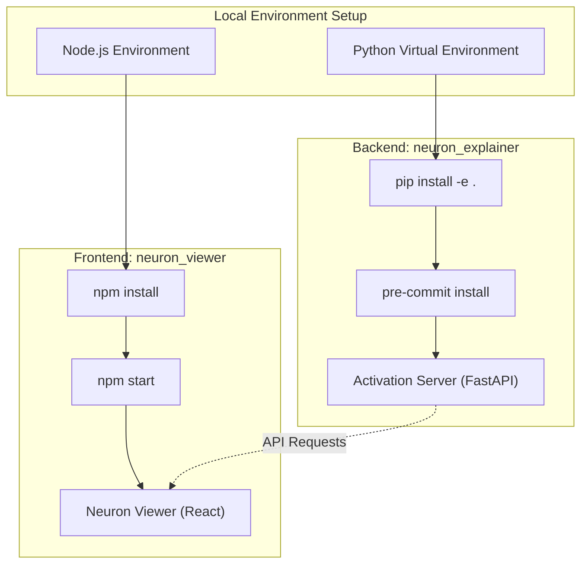
Sources: [README.md:32-64](), [setup.py:1-30]()

## Prerequisites

The system requires the following base technologies:
- **Python**: Version 3.11 or higher is required [setup.py:29-29]().
- **Node.js & npm**: Required for the frontend [README.md:34-34]().
- **Virtual Environment**: Recommended to avoid dependency conflicts [README.md:36-45]().

## Backend Setup: neuron_explainer

The backend consists of the `neuron_explainer` package, which includes the inference engine, activation server, and explanation generation logic.

### 1. Environment and Dependencies
After cloning the repository, create a virtual environment and install the package in editable mode. This allows changes to the source code to be reflected immediately without re-installation.

```bash
python -m venv ~/.virtualenvs/transformer-debugger
source ~/.virtualenvs/transformer-debugger/bin/activate
pip install -e .
```
Sources: [README.md:42-53]()

The `setup.py` file defines the core dependencies, including:
- `fastapi==0.97` and `uvicorn` for the activation server [setup.py:11-25]().
- `torch>=1.13` for model inference [setup.py:24-24]().
- `tiktoken` for GPT-2 tokenization [setup.py:23-23]().
- `pydantic<2.0.0` for data validation [setup.py:18-18]().

### 2. Code Quality Tools
The project uses `pre-commit` to maintain code standards. The hooks are configured in `.pre-commit-config.yaml` and include:
- **Ruff**: For linting and automated fixes [ .pre-commit-config.yaml:2-7]().
- **Black**: For code formatting with a line length of 100 [ .pre-commit-config.yaml:9-13]().
- **isort**: For sorting imports [ .pre-commit-config.yaml:15-19]().

Install the hooks with:
```bash
pre-commit install
```
Sources: [README.md:56-56](), [.pre-commit-config.yaml:1-20]()

## Frontend Setup: neuron_viewer

The `neuron_viewer` is a React application that provides the UI for the Transformer Debugger and individual neuron pages.

```bash
cd neuron_viewer
npm install
```
Sources: [README.md:58-61]()

## Running the System

To use the full Transformer Debugger, both the backend server and frontend client must be running simultaneously.

### 1. Starting the Activation Server
The activation server serves model activations and explanation data. It acts as the bridge between the model weights (often hosted on Azure) and the UI. Detailed instructions for the server are located in `neuron_explainer/activation_server/README.md`.

### 2. Starting the Neuron Viewer
The frontend is started via npm. Detailed instructions for the viewer are located in `neuron_viewer/README.md`.

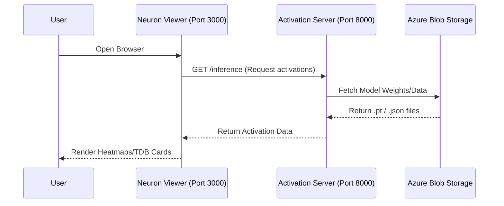
Sources: [README.md:27-30](), [README.md:64-64]()

## Verification and Testing

To ensure the installation was successful, run the following verification suite:

1.  **Backend Tests**: Use `pytest` to run the suite of backend tests [README.md:70-70]().
2.  **Type Checking**: Run `mypy` to verify type safety [README.md:71-71]().
3.  **Integration**: Launch both the server and viewer, then navigate to a local URL (e.g., `http://localhost:3000`) to confirm the TDB interface loads and can perform inference [README.md:72-73]().

Sources: [README.md:68-73]()

---

# Page: Transformer Model System

# Transformer Model System

<details>
<summary>Relevant source files</summary>

The following files were used as context for generating this wiki page:

- [neuron_explainer/models/README.md](neuron_explainer/models/README.md)
- [neuron_explainer/models/transformer.py](neuron_explainer/models/transformer.py)
- [neuron_explainer/scripts/create_hf_test_data.py](neuron_explainer/scripts/create_hf_test_data.py)

</details>


The Transformer Model System provides the core transformer model implementation used throughout the Transformer Debugger. It defines a flexible implementation of the transformer architecture, supporting GPT-2 style models with hooks for introspection of internal activations. This system serves as the foundation for both running transformer models and analyzing their internal behavior.

For information about the autoencoder system that works with transformer activations, see [Autoencoder System](#2.1). For details on the unified interface to models, see [Model Context Interface](#2.2).

## System Overview

The Transformer Model System implements a standard transformer architecture with configurable parameters. It provides:

1. A complete transformer implementation with configurable parameters.
2. Support for GPT-2 family models (small, medium, large, XL).
3. A robust hooks system for capturing and manipulating internal activations via `TransformerHooks` [neuron_explainer/models/hooks.py:108-124]().
4. Utilities for sampling, caching, and processing.
5. Integration with the model loading registry.

### Architecture to Code Mapping
The following diagram bridges the conceptual transformer components to their specific class implementations in the codebase.

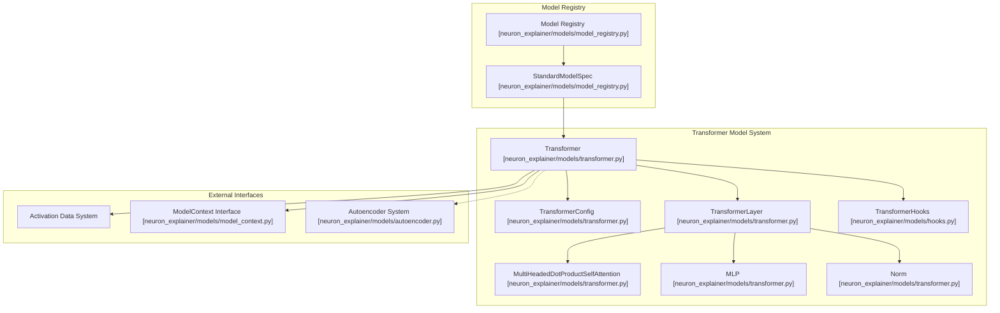

Sources:
- [neuron_explainer/models/transformer.py:496-512]() (Transformer class)
- [neuron_explainer/models/transformer.py:65-77]() (TransformerConfig class)
- [neuron_explainer/models/README.md:1-47]()

## Transformer Architecture

The Transformer Model System implements a standard decoder-only transformer architecture, following the design used in GPT-2. The implementation consists of:

1. Token and position embeddings via `run_embed` [neuron_explainer/models/transformer.py:565-585]().
2. Multiple transformer layers (`TransformerLayer`) [neuron_explainer/models/transformer.py:418-476]().
3. A final layer normalization and unembedding via `run_unembed` [neuron_explainer/models/transformer.py:615-628]().

Each `TransformerLayer` contains:
- Self-attention with configurable number of heads.
- MLP (feed-forward) component.
- Layer normalization and residual connections.

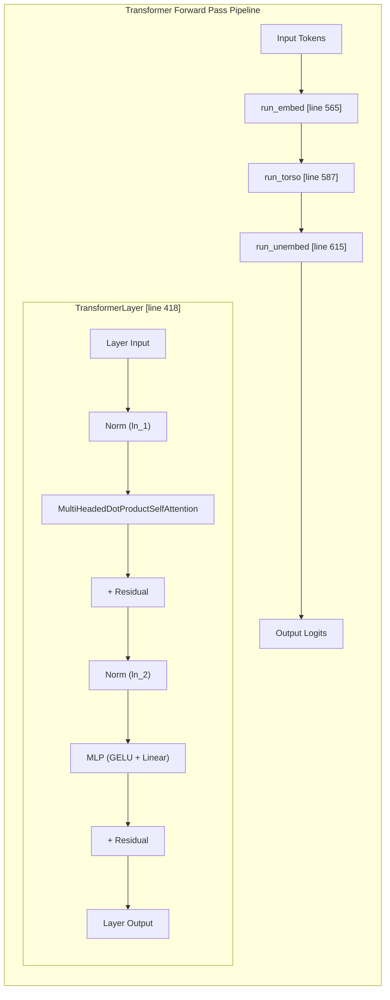

Sources:
- [neuron_explainer/models/transformer.py:418-476]() (TransformerLayer implementation)
- [neuron_explainer/models/transformer.py:496-628]() (Transformer implementation)

## Key Components

### TransformerConfig
The `TransformerConfig` class defines the parameters for the transformer model, including model dimensions (`d_model`), number of layers (`n_layers`), and context window size (`ctx_window`) [neuron_explainer/models/transformer.py:65-97]().

### Transformer
The `Transformer` class is the main implementation. It handles the model lifecycle, including loading via `Transformer.load` [neuron_explainer/models/transformer.py:691-757]() and execution via the `forward` method [neuron_explainer/models/transformer.py:514-542]().

### Attention and MLP
- **MultiHeadedDotProductSelfAttention**: Implements causal self-attention with query, key, and value projections [neuron_explainer/models/transformer.py:294-385]().
- **MLP**: Implements a two-layer feed-forward network with GELU activation [neuron_explainer/models/transformer.py:393-411]().

### Hooks System
The system uses `TransformerHooks` to intercept activations at various points (e.g., `mlp.post_act`, `attn.q_proj`) [neuron_explainer/models/hooks.py:108-124](). This is critical for the "Debugger" aspect of the repository, allowing for ablation or recording of internal states.

Sources:
- [neuron_explainer/models/transformer.py:334-382]() (Attention hooks usage)
- [neuron_explainer/models/transformer.py:406-410]() (MLP hooks usage)

## Model Loading and Usage

### Loading Models
Models can be loaded directly using `Transformer.load(path)` [neuron_explainer/models/transformer.py:691](). The system supports the following variants:
- GPT-2 Small, Medium, Large, and XL [neuron_explainer/scripts/create_hf_test_data.py:14-19]().

### Forward Pass and Sampling
The transformer implementation supports both standard forward pass and text generation through `sample` [neuron_explainer/models/transformer.py:630-689](). The sampling function supports temperature-based sampling and nucleus (top-p) sampling via `nucleus_sample` [neuron_explainer/models/transformer.py:187-206]().

## Integration with Other Systems

The Transformer Model System interacts with several subsystems to enable interpretability:

1. **Model Context Interface**: Provides a unified interface through `StandardModelContext` [neuron_explainer/models/model_context.py:102]().
2. **Activation Data System**: Captures `ActivationRecord` and `NeuronRecord` objects during inference [neuron_explainer/activations/activations.py:10-40]().
3. **Autoencoder System**: Uses `Autoencoder` to map activations into a more interpretable latent space [neuron_explainer/models/autoencoder.py:56]().

### Testing and Validation
The system is validated against Hugging Face reference models using scripts like `create_hf_test_data.py` [neuron_explainer/scripts/create_hf_test_data.py:37-100]() and regression tests in `test_against_data.py`.

Sources:
- [neuron_explainer/tests/test_against_data.py:1-124]()
- [neuron_explainer/scripts/create_hf_test_data.py:1-130]()

## Usage Example

```python
from neuron_explainer.models.transformer import Transformer
from neuron_explainer.models.hooks import TransformerHooks
import torch

# Load model [neuron_explainer/models/README.md:19]
device = torch.device("cuda" if torch.cuda.is_available() else "cpu")
model = Transformer.load("gpt2/small", device=device, dtype=torch.float32)

# Create hooks to capture activations [neuron_explainer/models/README.md:31-40]
activation_store = {}
def store_activation(x, layer, **kwargs):
    activation_store[layer] = x.detach().clone()
    return x

hooks = TransformerHooks()
hooks.mlp.post_act.append_fwd(store_activation)

# Run model sampling [neuron_explainer/models/README.md:43]
result = model.sample("The transformer architecture is", num_tokens=10, hooks=hooks)
```

Sources:
- [neuron_explainer/models/README.md:9-45]()

---

# Page: Autoencoder System

# Autoencoder System

<details>
<summary>Relevant source files</summary>

The following files were used as context for generating this wiki page:

- [neuron_explainer/models/README.md](neuron_explainer/models/README.md)
- [neuron_explainer/models/autoencoder.py](neuron_explainer/models/autoencoder.py)
- [neuron_explainer/models/autoencoder_context.py](neuron_explainer/models/autoencoder_context.py)
- [neuron_explainer/scripts/create_hf_test_data.py](neuron_explainer/scripts/create_hf_test_data.py)

</details>


The Autoencoder System provides an essential component of the Transformer Debugger, designed to expand neural network activation spaces into higher-dimensional, more interpretable representations. This system transforms dense neural activations into sparse, overcomplete representations that are often more semantically meaningful than the original model's neurons.

For information about the overall Transformer Model System, see [Transformer Model System](#2). For details on how the Model Context interfaces with autoencoders, see [Model Context Interface](#2.2).

## System Purpose and Overview

The sparse autoencoders in Transformer Debugger are trained on specific activation types from a transformer model (particularly GPT-2). They serve several key functions:

1. Converting dense activations into sparse, higher-dimensional spaces.
2. Providing more interpretable "directions" in the activation space.
3. Enabling analysis of learned features that may be entangled in the original model.

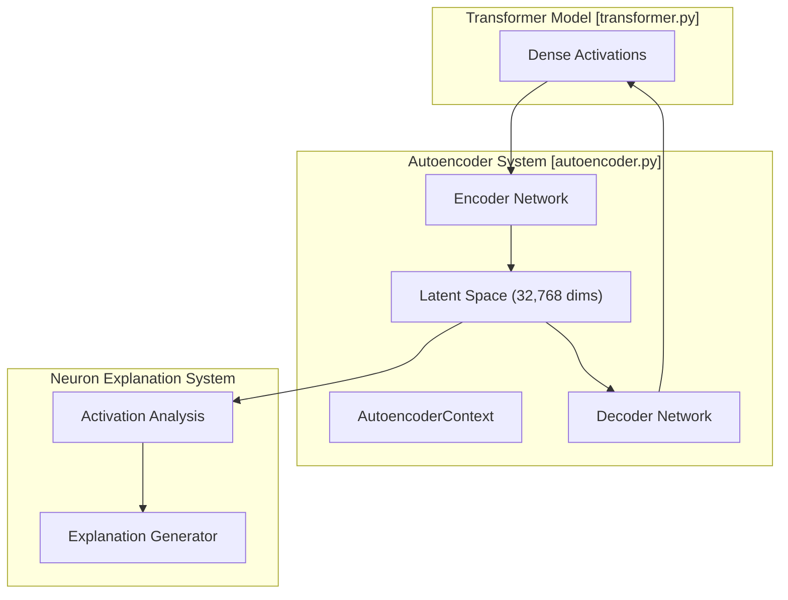

Sources: [neuron_explainer/models/README.md:50-56](), [neuron_explainer/models/autoencoder_context.py:47-68](), [neuron_explainer/models/autoencoder.py:8-14]()

## Autoencoder System Architecture

The autoencoder system consists of several key components that work together to manage, load, and provide access to trained autoencoders.

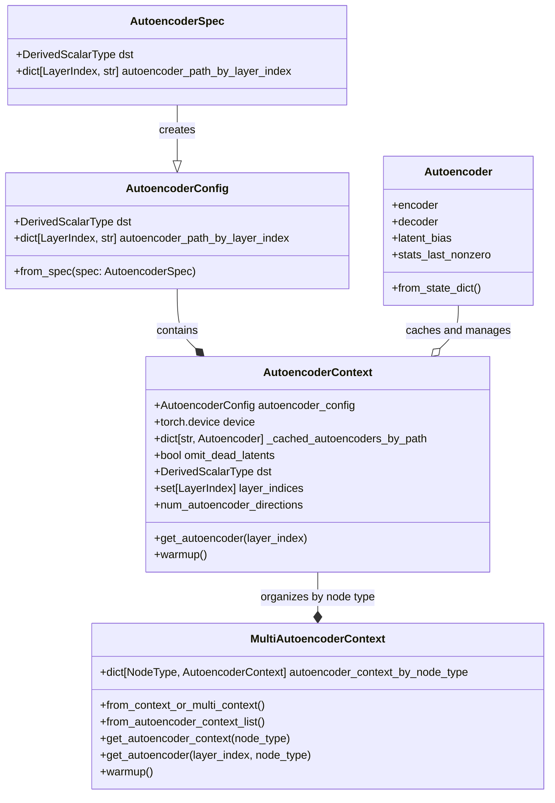

Sources: [neuron_explainer/models/autoencoder_context.py:13-22](), [neuron_explainer/models/autoencoder_context.py:39-44](), [neuron_explainer/models/autoencoder_context.py:47-144](), [neuron_explainer/models/autoencoder_context.py:156-217](), [neuron_explainer/models/autoencoder.py:8-44]()

### Key Classes

1.  **AutoencoderSpec**: Parameters used in the construction of an `AutoencoderConfig` [neuron_explainer/models/autoencoder_context.py:14-18]().
2.  **AutoencoderConfig**: Specifies a set of autoencoders to load from disk for one or more layer indices [neuron_explainer/models/autoencoder_context.py:21-30]().
3.  **AutoencoderContext**: Manages the lifecycle and caching of `Autoencoder` instances for a specific `DerivedScalarType` [neuron_explainer/models/autoencoder_context.py:47-52](). It handles disk caching by copying files from Azure blob storage to `/tmp` [neuron_explainer/models/autoencoder_context.py:97-104]().
4.  **MultiAutoencoderContext**: A container that maps `NodeType` to `AutoencoderContext`, allowing the system to handle different types of latents (e.g., MLP vs. Attention) simultaneously [neuron_explainer/models/autoencoder_context.py:156-158]().
5.  **Autoencoder**: The core `nn.Module` implementing the sparse autoencoder logic [neuron_explainer/models/autoencoder.py:8-14]().

Sources: [neuron_explainer/models/autoencoder_context.py:13-217](), [neuron_explainer/models/autoencoder.py:8-111]()

## Supported Activation Types

The autoencoder system maps `DerivedScalarType` (the source activation) to `NodeType` (the resulting latent type).

| Derived Scalar Type | Node Type | Description |
| :--- | :--- | :--- |
| `MLP_POST_ACT` | `MLP_AUTOENCODER_LATENT` | MLP activations after activation function |
| `RESID_DELTA_MLP` | `MLP_AUTOENCODER_LATENT` | Change in residual stream from MLP |
| `RESID_DELTA_ATTN` | `ATTENTION_AUTOENCODER_LATENT` | Change in residual stream from attention |

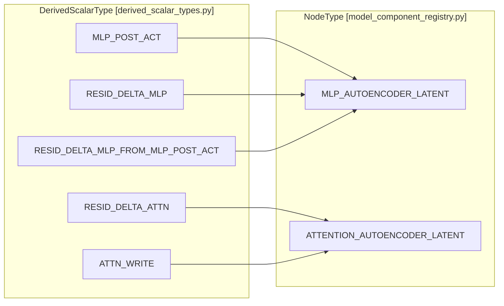

Sources: [neuron_explainer/models/autoencoder_context.py:146-153](), [neuron_explainer/models/README.md:59-66]()

## Autoencoder Loading and Caching

`AutoencoderContext` implements a multi-tier loading strategy. It first checks an in-memory cache, then a local disk cache (`/tmp`), and finally fetches from Azure blob storage if necessary.

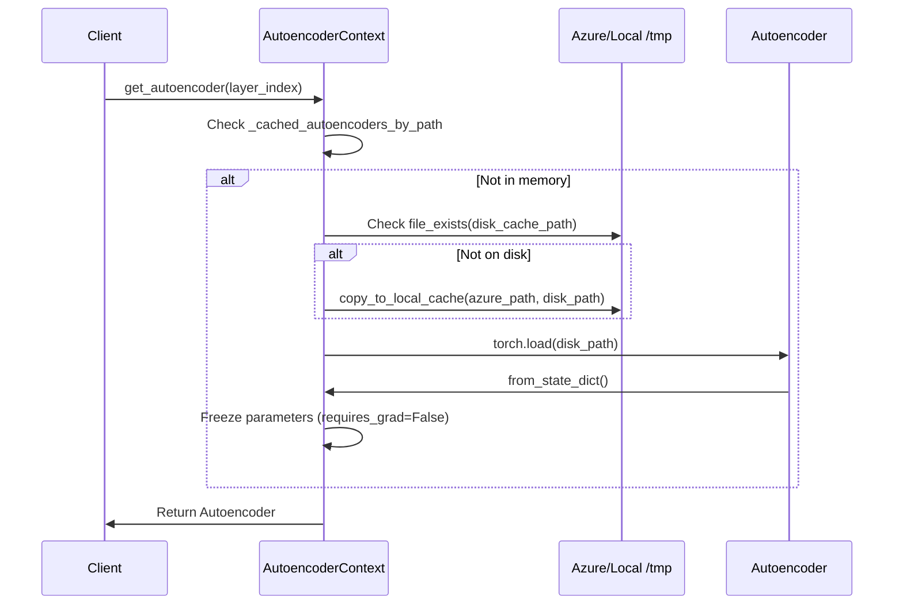

Sources: [neuron_explainer/models/autoencoder_context.py:86-115](), [neuron_explainer/file_utils.py:8-8]()

### Memory Optimization: Dead Latent Omission

To save memory, the system can omit "dead" latents—latents that never activate.

1.  **Warmup**: When `warmup()` is called, all configured autoencoders are loaded [neuron_explainer/models/autoencoder_context.py:117-120]().
2.  **Identification**: If `omit_dead_latents` is True, the system calculates the minimum number of dead latents across all layers to ensure consistent latent indices across the context [neuron_explainer/models/autoencoder_context.py:125-127]().
3.  **Omission**: The `omit_least_active_latents` function creates a new `Autoencoder` instance with reduced dimensions [neuron_explainer/models/autoencoder_context.py:131-133]().

Sources: [neuron_explainer/models/autoencoder_context.py:52-57](), [neuron_explainer/models/autoencoder_context.py:117-134](), [neuron_explainer/models/autoencoder_context.py:252-294]()

## Autoencoder Architecture and Training

The `Autoencoder` class implements a standard sparse autoencoder architecture [neuron_explainer/models/autoencoder.py:8-14]():

*   **Pre-bias**: A parameter subtracted from the input [neuron_explainer/models/autoencoder.py:27-27]().
*   **Encoder**: A linear layer mapping input to latents [neuron_explainer/models/autoencoder.py:28-28]().
*   **Latent Bias**: A bias added to encoded latents [neuron_explainer/models/autoencoder.py:29-29]().
*   **Activation**: Non-linearity (default `ReLU`, supports `TopK`) [neuron_explainer/models/autoencoder.py:30-30](), [neuron_explainer/models/autoencoder.py:139-152]().
*   **Decoder**: A linear layer reconstructing the input [neuron_explainer/models/autoencoder.py:34-34]().

### Statistical Tracking
The class maintains buffers to track latent usage:
*   `stats_last_nonzero`: Steps since last activation [neuron_explainer/models/autoencoder.py:39-39]().
*   `latents_activation_frequency`: Frequency of activation [neuron_explainer/models/autoencoder.py:40-42]().
*   `latents_mean_square`: Mean square of activations [neuron_explainer/models/autoencoder.py:43-43]().

Sources: [neuron_explainer/models/autoencoder.py:16-87](), [neuron_explainer/models/README.md:58-66]()

## Example Usage

### 1. Through the Model Registry
The `model_registry.py` provides a simplified interface to initialize these contexts.

```python
from neuron_explainer.models.model_registry import make_autoencoder_context
import torch

autoencoder_context = make_autoencoder_context(
    model_name="gpt2-small",
    autoencoder_name="ae-mlp-post-act-v4",
    device=torch.device("cuda"),
    omit_dead_latents=True
)
autoencoder_context.warmup()
```

### 2. Manual Inference
You can manually encode activations using the `Autoencoder` class:

```python
# activations: [batch, n_inputs]
latent_activations = autoencoder.encode(activations) # [batch, n_latents]
```

Sources: [neuron_explainer/models/autoencoder.py:58-63](), [neuron_explainer/models/model_registry.py:102-121](), [neuron_explainer/models/README.md:96-146]()

---

# Page: Model Context Interface

# Model Context Interface

<details>
<summary>Relevant source files</summary>

The following files were used as context for generating this wiki page:

- [neuron_explainer/activations/derived_scalars/derived_scalar_store.py](neuron_explainer/activations/derived_scalars/derived_scalar_store.py)
- [neuron_explainer/models/model_context.py](neuron_explainer/models/model_context.py)
- [neuron_explainer/models/model_registry.py](neuron_explainer/models/model_registry.py)
- [neuron_explainer/models/transformer.py](neuron_explainer/models/transformer.py)

</details>


The Model Context Interface provides a unified abstraction layer for interacting with transformer models within the Transformer Debugger system. It acts as an intermediary between the models themselves and the various components that need to access model information, such as weights, dimensions, and tokenization capabilities. This interface enables the rest of the codebase to work with different transformer implementations in a consistent way.

## Overview and Purpose

The `ModelContext` abstract base class defines a standard interface for accessing transformer model properties and functionality. It serves several key purposes:

1.  Provides uniform access to model weights across different transformer implementations via `WeightLocationType`.
2.  Handles tokenization (encoding and decoding text) using `tiktoken`.
3.  Supplies model dimension information (e.g., number of layers, vocabulary size) via `Dimension` enums.
4.  Creates and caches model instances for inference through `get_or_create_model`.

### Natural Language to Code Entity Mapping: Interface

The following diagram maps high-level concepts to the specific classes and methods that implement them.

**Diagram: Interface Mapping**
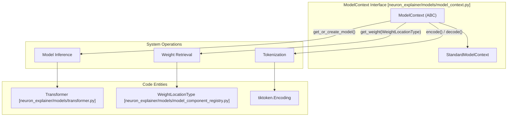

Sources: [neuron_explainer/models/model_context.py:28-168](), [neuron_explainer/models/model_component_registry.py:15-18]().

## Class Hierarchy

The `ModelContext` is an abstract base class with a primary implementation for standard models.

*   `StandardModelContext`: The main implementation used for standard transformer models like GPT-2. It handles the loading of weights from cloud storage and local caches. [neuron_explainer/models/model_context.py:184-195]()

**Diagram: Class Relationships**
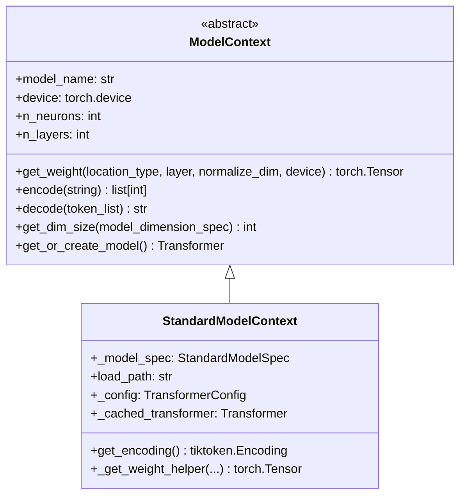

Sources: [neuron_explainer/models/model_context.py:28-168](), [neuron_explainer/models/model_context.py:184-210]().

## Core Functionality

### Model Weight Access via WeightLocationType

The `ModelContext` provides a standardized way to access model weights through the `get_weight` method [neuron_explainer/models/model_context.py:44-76](). This method uses the `WeightLocationType` enum to identify specific parameter matrices.

**Weight Retrieval Flow**
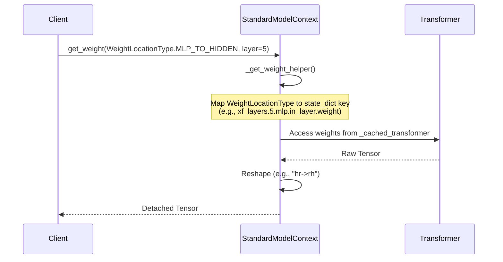

The `StandardModelContext` uses an internal mapping `info_by_type` to translate abstract weight locations into specific layer paths and required tensor transformations [neuron_explainer/models/model_context.py:227-316]().

Sources: [neuron_explainer/models/model_context.py:44-76](), [neuron_explainer/models/model_context.py:227-316]().

### Dimension Information

The interface provides access to model dimension sizes through the `get_dim_size` method [neuron_explainer/models/model_context.py:102-103]() and various convenience properties. These properties map `Dimension` enum types to actual configuration values from `TransformerConfig` [neuron_explainer/models/transformer.py:65-98]().

| Property | Dimension Type | Source in Config |
| :--- | :--- | :--- |
| `n_neurons` | `Dimension.MLP_ACTS` | `self._config.d_ff` |
| `n_layers` | `Dimension.LAYERS` | `self._config.n_layers` |
| `n_vocab` | `Dimension.VOCAB_SIZE` | `encoding.n_vocab` |
| `n_context` | `Dimension.MAX_CONTEXT_LENGTH` | `self._config.ctx_window` |

Sources: [neuron_explainer/models/model_context.py:141-163](), [neuron_explainer/models/model_context.py:212-225]().

### Tokenization and Encoding

`ModelContext` encapsulates `tiktoken` functionality to provide consistent string-to-token conversion. It explicitly allows specific special tokens like `<|endoftext|>` [neuron_explainer/models/model_context.py:21-25]().

*   `encode(string)`: Returns `list[int]` [neuron_explainer/models/model_context.py:84-85]().
*   `decode(token_list)`: Returns `str` [neuron_explainer/models/model_context.py:90-91]().
*   `encode_token_str(token_str)`: Validates that a string results in exactly one token [neuron_explainer/models/model_context.py:93-99]().

Sources: [neuron_explainer/models/model_context.py:81-126]().

## Model Registry and Loading

The `model_registry.py` file contains the `StandardModelSpec` for supported models, primarily the GPT-2 series [neuron_explainer/models/model_registry.py:19-33]().

### Standard Models
The registry points to public Azure blob storage URLs for model weights:
*   `gpt2-small`: `.../subject-models/gpt2/small`
*   `gpt2-xl`: `.../subject-models/gpt2/xl`

### TransformerHooks System
When a model is loaded via `StandardModelContext.get_or_create_model`, the underlying `Transformer` class supports `TransformerHooks` [neuron_explainer/models/transformer.py:19-24](). These hooks allow the system to intercept activations at various points (MLP, Attention, Normalization) without modifying the core model logic.

**Loading and Hooking Diagram**
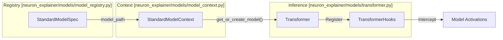

Sources: [neuron_explainer/models/model_registry.py:19-33](), [neuron_explainer/models/model_context.py:318-328](), [neuron_explainer/models/transformer.py:19-24]().

## Usage in Activation Server

The `ModelContext` is a dependency for the `InteractiveModel` used in the activation server. It provides the necessary metadata and weight access for the `DerivedScalarStore` to perform computations like "Logit Lens" or "Trace Upstream" [neuron_explainer/activations/derived_scalars/derived_scalar_store.py:109-118]().

To instantiate a context:
```python
# From neuron_explainer/models/model_context.py:128-140
model_context = ModelContext.from_model_type(
    model_type="gpt2-small",
    device=get_default_device()
)
```

Sources: [neuron_explainer/models/model_context.py:128-140](), [neuron_explainer/activations/derived_scalars/derived_scalar_store.py:109-146]().

---

# Page: Neuron Explanation System

# Neuron Explanation System

<details>
<summary>Relevant source files</summary>

The following files were used as context for generating this wiki page:

- [neuron_explainer/explanations/explanations.py](neuron_explainer/explanations/explanations.py)
- [neuron_explainer/explanations/test_explainer.py](neuron_explainer/explanations/test_explainer.py)

</details>


The Neuron Explanation System is a core component of the Transformer Debugger that generates human-understandable explanations of neuron behavior and validates their accuracy. This system is responsible for explaining what patterns neurons and attention heads detect within a transformer model.

## System Overview

The Neuron Explanation System works by analyzing activation records gathered from a transformer model and using language models to generate explanations for what patterns cause a neuron or attention head to activate. These explanations are then validated by simulating neuron activations and comparing them to actual activations.

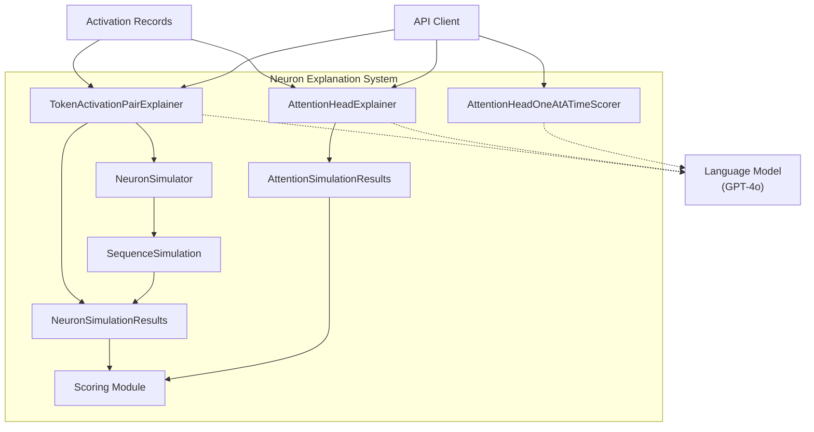

Sources: [neuron_explainer/activation_server/explainer_routes.py:25-30](), [neuron_explainer/activation_server/explainer_routes.py:65-95]()

## Key Components

### Explanation Generators

The system includes two main types of explanation generators. For more details on the logic used to construct these prompts, see [Token Activation Pair Explainer](#3.4).

1. **TokenActivationPairExplainer**: Generates explanations for neurons by analyzing token-activation pairs [neuron_explainer/explanations/explainer.py:4-4]().
2. **AttentionHeadExplainer**: Generates explanations for attention heads by analyzing attention patterns.

Both explainers use language models like GPT-4o to generate natural language explanations of the observed activation patterns.

```mermaid
classDiagram
    class NeuronExplainer {
        <<interface>>
        +generate_explanations()
    }
    
    class TokenActivationPairExplainer {
        -model_name: str
        -cache: bool
        -prompt_format: PromptFormat
        +generate_explanations()
        +make_explanation_prompt()
    }
    
    class AttentionHeadExplainer {
        -model_name: str
        -prompt_format: PromptFormat
        -repeat_strongly_attending_pairs: bool
        +generate_explanations()
    }
    
    NeuronExplainer <|-- TokenActivationPairExplainer
    NeuronExplainer <|-- AttentionHeadExplainer
```

Sources: [neuron_explainer/activation_server/explainer_routes.py:65-70](), [neuron_explainer/activation_server/explainer_routes.py:83-93](), [neuron_explainer/explanations/explainer.py:4-55]()

### Explanation Validators and Scorers

The system includes components for validating and scoring explanations. For details on the simulation mechanics, see [Neuron Simulator](#3.2). For attention-specific scoring, see [Attention Head Scoring](#3.3).

1. **NeuronSimulator**: Simulates neuron activations based on explanations.
2. **AttentionHeadOneAtATimeScorer**: Scores explanations for attention heads using ROC AUC metrics.

Sources: [neuron_explainer/activation_server/explainer_routes.py:83-93](), [neuron_explainer/explanations/explanations.py:186-191]()

### Data Structures

The Neuron Explanation System uses several data structures to represent simulation results and scores. The `ActivationScale` enum defines whether values are raw neuron activations or simulated normalized values (0-10) [neuron_explainer/explanations/explanations.py:18-41]().

```mermaid
classDiagram
    class SequenceSimulation {
        +tokens: list[str]
        +expected_activations: list[float]
        +activation_scale: ActivationScale
        +distribution_values: list[list[float]]
        +distribution_probabilities: list[list[float]]
        +uncalibrated_simulation: SequenceSimulation
    }
    
    class ScoredSequenceSimulation {
        +sequence_simulation: SequenceSimulation
        +true_activations: list[float]
        +ev_correlation_score: float
        +rsquared_score: float
        +absolute_dev_explained_score: float
    }
    
    class ScoredSimulation {
        +scored_sequence_simulations: list[ScoredSequenceSimulation]
        +ev_correlation_score: float
        +rsquared_score: float
        +absolute_dev_explained_score: float
        +get_preferred_score()
    }
    
    class ScoredExplanation {
        +explanation: str
        +scored_simulation: ScoredSimulation
        +get_preferred_score()
    }
    
    class NeuronSimulationResults {
        +neuron_id: NeuronId
        +scored_explanations: list[ScoredExplanation]
    }
    
    SequenceSimulation <-- ScoredSequenceSimulation
    ScoredSequenceSimulation <-- ScoredSimulation
    ScoredSimulation <-- ScoredExplanation
    ScoredExplanation <-- NeuronSimulationResults
```

Sources: [neuron_explainer/explanations/explanations.py:18-175]()

## Explanation Workflow

The explanation workflow consists of two main phases: generation and scoring, exposed via the `/explain` and `/score` endpoints. For details on the API implementation and caching, see [Explainer Routes API](#3.1).

### Explanation Generation Process

The `TokenActivationPairExplainer` constructs prompts using either `PromptFormat.INSTRUCTION_FOLLOWING` or `PromptFormat.CHAT_MESSAGES` [neuron_explainer/explanations/test_explainer.py:53-119]().

```mermaid
sequenceDiagram
    participant Client
    participant ExplainerRoutes as "/explain Endpoint"
    participant TAPEX as "TokenActivationPairExplainer"
    participant AHEX as "AttentionHeadExplainer"
    participant LLM as "Language Model API"
    participant Cache as "Explanation Cache"
    
    Client->>ExplainerRoutes: Request explanation
    ExplainerRoutes->>Cache: Check for existing explanations
    
    alt Explanation exists in cache
        Cache->>ExplainerRoutes: Return cached explanation
    else Generate new explanation
        ExplainerRoutes->>ExplainerRoutes: Determine activation category
        
        alt For neuron
            ExplainerRoutes->>TAPEX: generate_explanations()
            TAPEX->>LLM: Request explanation generation
            LLM->>TAPEX: Return generated explanation
        else For attention head
            ExplainerRoutes->>AHEX: generate_explanations()
            AHEX->>LLM: Request explanation generation
            LLM->>AHEX: Return generated explanation
        end
    end
    
    ExplainerRoutes->>Client: Return explanation(s)
```

Sources: [neuron_explainer/activation_server/explainer_routes.py:296-336](), [neuron_explainer/explanations/test_explainer.py:51-60]()

### Explanation Scoring Process

Scoring involves comparing simulated activations (derived from the explanation) against ground truth activations using metrics like correlation and R-squared [neuron_explainer/explanations/explanations.py:95-106]().

```mermaid
sequenceDiagram
    participant Client
    participant ScoreRoute as "/score Endpoint"
    participant Cache as "Explanation Cache"
    participant NS as "Neuron Scoring"
    participant AHS as "Attention Head Scoring"
    participant LLM as "Language Model API"
    
    Client->>ScoreRoute: Request scoring
    ScoreRoute->>Cache: Check for existing scores
    
    alt Score exists in cache
        Cache->>ScoreRoute: Return cached score
    else Generate new score
        ScoreRoute->>ScoreRoute: Determine activation category
        
        alt For neuron
            ScoreRoute->>NS: _score_neuron()
            NS->>LLM: Request activation simulation
            LLM->>NS: Return simulated activations
            NS->>NS: Calculate correlation scores
        else For attention head
            ScoreRoute->>AHS: _score_attention_head()
            AHS->>LLM: Request attention simulation
            LLM->>AHS: Return simulated attention
            AHS->>AHS: Calculate ROC AUC score
        end
    end
    
    ScoreRoute->>Client: Return score result
```

Sources: [neuron_explainer/activation_server/explainer_routes.py:338-490](), [neuron_explainer/explanations/explanations.py:135-152]()

## Prompt Formats

The system supports two primary prompt formats for interacting with LLMs [neuron_explainer/explanations/test_explainer.py:6-6]():

1. **Instruction-following format**: A single string containing instructions, few-shot examples, and the target activations [neuron_explainer/explanations/test_explainer.py:17-49]().
2. **Chat messages format**: A list of `ChatMessage` objects with defined roles (System, User, Assistant) [neuron_explainer/explanations/test_explainer.py:66-115]().

The activation format used within these prompts is `token<tab>activation`, where activations are normalized to a 0-10 scale [neuron_explainer/explanations/test_explainer.py:19-24]().

Sources: [neuron_explainer/explanations/test_explainer.py:16-133](), [neuron_explainer/explanations/explanations.py:28-32]()

---

# Page: Explainer Routes API

# Explainer Routes API

<details>
<summary>Relevant source files</summary>

The following files were used as context for generating this wiki page:

- [neuron_explainer/activation_server/explainer_routes.py](neuron_explainer/activation_server/explainer_routes.py)
- [neuron_explainer/activation_server/explanation_datasets.py](neuron_explainer/activation_server/explanation_datasets.py)

</details>


This document details the FastAPI endpoints that generate and score explanations for neurons and attention heads in transformer models. The Explainer Routes API provides two key endpoints: `/explain` for generating explanations and `/score` for evaluating explanation quality. These routes serve as the bridge between the Neuron Explanation System and client applications.

## API Architecture

The Explainer Routes API integrates several components to provide explanation services, utilizing a dual-caching strategy that checks both remote Azure storage and local filesystem caches.

```mermaid
graph TD
    subgraph "Explainer Routes API [/neuron_explainer/activation_server/explainer_routes.py]"
        direction TB
        EXPLAIN["/explain [POST]"]
        SCORE["/score [POST]"]
        
        subgraph "Routing Logic"
            AC["ActivationCategory Routing"]
            DR["define_explainer_routes"]
        end
    end

    subgraph "Explanation Generation [neuron_explainer/explanations/]"
        TAPE["TokenActivationPairExplainer"]
        AHE["AttentionHeadExplainer"]
    end

    subgraph "Scoring & Simulation"
        MSS["make_simulator_and_score"]
        AHS["AttentionHeadOneAtATimeScorer"]
    end

    subgraph "Cache & Data Management"
        AER["AZURE_EXPLANATION_DATASET_REGISTRY"]
        LCE["get_local_cached_explanation_directory"]
        CFH["CustomFileHandler"]
    end

    EXPLAIN --> AC
    SCORE --> AC

    AC -- "NEURON" --> TAPE
    AC -- "ATTENTION_HEAD" --> AHE

    SCORE -- "NEURON" --> MSS
    SCORE -- "ATTENTION_HEAD" --> AHS

    EXPLAIN -.-> AER
    EXPLAIN -.-> LCE
    SCORE -.-> AER
    SCORE -.-> LCE
    
    AER --> CFH
    LCE --> CFH
```

Sources: [neuron_explainer/activation_server/explainer_routes.py:122-157](), [neuron_explainer/activation_server/explanation_datasets.py:6-17]()

## API Endpoints

### `/explain` Endpoint

The `/explain` endpoint generates explanations for neurons or attention heads. It follows a "cache-first" strategy, attempting to merge existing explanations from Azure and local storage before falling back to LLM-based generation.

#### Request Format
The request uses `NodeIdAndDatasets` [neuron_explainer/activation_server/read_routes.py:13-19](), which includes the `layer_index`, `activation_index`, and the `dst` (Derived Scalar Type).

#### Implementation Flow
1. **Activation Routing**: The `DerivedScalarType` is mapped to an `ActivationCategory` (NEURON or ATTENTION_HEAD) [neuron_explainer/activation_server/explainer_routes.py:137-156]().
2. **Cache Lookup**: It calls `_check_disk_for_simulation_results` to search both Azure and local paths [neuron_explainer/activation_server/explainer_routes.py:236-258]().
3. **Merging**: If results exist in multiple places, `_merge_simulation_results` combines them, deduplicating by explanation text [neuron_explainer/activation_server/explainer_routes.py:203-234]().
4. **Generation**: If no cached explanations exist, it invokes either `_explain_neuron` or `_explain_attention_head` [neuron_explainer/activation_server/explainer_routes.py:321-331]().

Sources: [neuron_explainer/activation_server/explainer_routes.py:318-336](), [neuron_explainer/activation_server/explainer_routes.py:203-258]()

### `/score` Endpoint

The `/score` endpoint evaluates an explanation's predictive power. It calculates how well an LLM, provided with the explanation, can simulate the actual activations of the node.

#### Scoring Logic
- **Neurons**: Uses `make_simulator_and_score` which creates an `ExplanationNeuronSimulator` to predict activation values (0-10 scale) [neuron_explainer/activation_server/explainer_routes.py:365-375]().
- **Attention Heads**: Uses `AttentionHeadOneAtATimeScorer` to perform binary classification on whether a token pair will have high attention [neuron_explainer/activation_server/explainer_routes.py:404-415]().

Sources: [neuron_explainer/activation_server/explainer_routes.py:436-490](), [neuron_explainer/explanations/scoring.py:38-41]()

## Caching Strategy

The system uses a dual-tier cache to minimize expensive LLM calls and latency.

| Cache Tier | Implementation | Path Logic |
| :--- | :--- | :--- |
| **Azure (Remote)** | `AZURE_EXPLANATION_DATASET_REGISTRY` | Maps neuron dataset URLs to explanation URLs [neuron_explainer/activation_server/explanation_datasets.py:6-9](). |
| **Local (Disk)** | `get_local_cached_explanation_directory` | Stores results in `cached_explanations/{dataset_short_name}/cache_{dst}_{method}/` [neuron_explainer/activation_server/explainer_routes.py:164-175](). |

### Cache Merging Logic
When retrieving cached results, the server performs a deep merge of `NeuronSimulationResults` or `AttentionSimulationResults`. 
- It prioritizes keeping the union of all `ScoredExplanation` objects found across sources [neuron_explainer/activation_server/explainer_routes.py:214-224]().
- It performs ID verification to ensure the cached file matches the requested `layer_index` and `activation_index` [neuron_explainer/activation_server/explainer_routes.py:177-201]().

Sources: [neuron_explainer/activation_server/explainer_routes.py:203-234](), [neuron_explainer/activation_server/explanation_datasets.py:12-17]()

## Explainer Registries

The behavior of the endpoints is determined by registries that define which LLM and prompt format to use for a given `MethodId`.

```python
_NEURON_EXPLAINER_REGISTRY: dict[NeuronExplainAndScoreMethodId, NeuronExplainer] = {
    NeuronExplainAndScoreMethodId.BASELINE: TokenActivationPairExplainer(
        model_name="gpt-4o",
        cache=True,
        prompt_format=PromptFormat.CHAT_MESSAGES,
    ),
}
```

- **Neuron Registry**: Maps `NeuronExplainAndScoreMethodId` to a `NeuronExplainer` implementation [neuron_explainer/activation_server/explainer_routes.py:65-71]().
- **Attention Registry**: Maps `AttentionExplainAndScoreMethodId` to a tuple of `(AttentionHeadExplainer, AttentionHeadOneAtATimeScorer)` [neuron_explainer/activation_server/explainer_routes.py:80-94]().

Sources: [neuron_explainer/activation_server/explainer_routes.py:65-94]()

## Data Flow for Scoring

This diagram traces a scoring request from the API route through the simulation logic.

```mermaid
sequenceDiagram
    participant Client
    participant Route as explainer_routes.py
    participant Registry as Explainer Registries
    participant Scorer as scoring.py / attention_head_scoring.py
    participant LLM as ApiClient (GPT-4o)

    Client->>Route: POST /score (NodeId, Explanation)
    Route->>Route: _map_dst_to_activation_category()
    Route->>Registry: Get Scorer/Explainer for MethodId
    
    alt is NEURON
        Route->>Scorer: make_simulator_and_score()
        Scorer->>LLM: Generate simulated activations
    else is ATTENTION_HEAD
        Route->>Scorer: AttentionHeadOneAtATimeScorer.score()
        Scorer->>LLM: Predict attention pairs
    end
    
    Scorer-->>Route: ScoredExplanation / ScoredAttentionExplanation
    Route->>Route: _cache_simulation_results_locally()
    Route-->>Client: ScoreResult (score, dataset_path)
```

Sources: [neuron_explainer/activation_server/explainer_routes.py:338-422](), [neuron_explainer/activation_server/explainer_routes.py:436-490]()

---

# Page: Neuron Simulator

# Neuron Simulator

<details>
<summary>Relevant source files</summary>

The following files were used as context for generating this wiki page:

- [neuron_explainer/explanations/simulator.py](neuron_explainer/explanations/simulator.py)

</details>


The Neuron Simulator is a core component of the Transformer Debugger's Neuron Explanation System. It predicts how a neuron would activate on a given sequence of tokens based on a natural language explanation of the neuron's behavior. This enables the system to evaluate the quality of explanations and verify whether they accurately capture a neuron's function.

For more information about generating explanations, see [Token Activation Pair Explainer](#3.4). For information about scoring explanations, see [Attention Head Scoring](#3.3).

## Overview

The Neuron Simulator uses a Language Model (LLM) to predict neuron activations based on natural language explanations. It bridges the gap between human-readable explanations and quantifiable activation values, allowing the system to verify explanation quality through simulation.

```mermaid
flowchart LR
    subgraph "Natural Language Space"
        Ex["Explanation (str)"]
        style Ex fill:none
    end
    
    subgraph "Code Entity Space"
        NS["NeuronSimulator (ABC)"]
        SS["SequenceSimulation (dataclass)"]
        style NS fill:none
        style SS fill:none
    end
    
    subgraph "Activation Space"
        RA["Real Activations (ActivationRecord)"]
        PA["Predicted Activations (expected_activations)"]
        style RA fill:none
        style PA fill:none
    end
    
    Ex --> NS
    NS --> SS
    SS --> PA
    RA --> "Scoring Logic"
    PA --> "Scoring Logic"
    "Scoring Logic" --> "Explanation Quality Metric"
```

Sources: [neuron_explainer/explanations/simulator.py:8-11](), [neuron_explainer/explanations/simulator.py:294-300](), [neuron_explainer/explanations/explanations.py:42-69]()

## Simulation Types

The Neuron Simulator supports multiple simulation strategies, defined by the `SimulationType` enum, which correspond to specific subclasses of `NeuronSimulator`:

```mermaid
flowchart TD
    NS["NeuronSimulator\n(Abstract Base Class)"]
    
    ENS["ExplanationNeuronSimulator\n(ALL_AT_ONCE)"]
    ETBTS["ExplanationTokenByTokenSimulator\n(ONE_AT_A_TIME)"]
    LFETS["LogprobFreeExplanationTokenSimulator"]
    EDS["ExplanationDummySimulator"]
    
    NS --> ENS
    NS --> ETBTS
    NS --> LFETS
    NS --> EDS
    
    ENS --> |"Single prompt\nwith logprobs"| "Simulates all tokens\nat once"
    ETBTS --> |"Multiple prompts\nwith logprobs"| "Simulates one\ntoken at a time"
    LFETS --> |"JSON prompt\nno logprobs"| "Temperature=0\nsampling"
    EDS --> "Returns all\nzero activations"
```

Sources: [neuron_explainer/explanations/simulator.py:42-64](), [neuron_explainer/explanations/simulator.py:294-417]()

### ALL_AT_ONCE Simulation
The `ExplanationNeuronSimulator` implementation uses a single prompt containing all tokens, with the activations replaced by `<unknown>`. It then uses the logprobs from the LLM to calculate expected activation values for each token. This approach is efficient as it processes all tokens in a single API call.

Sources: [neuron_explainer/explanations/simulator.py:303-391]()

### ONE_AT_A_TIME Simulation
The `ExplanationTokenByTokenSimulator` makes a separate API call for each token in the sequence. While slower, this approach can be more precise as it focuses on one token at a time, potentially capturing more nuanced patterns in the explanation.

Sources: [neuron_explainer/explanations/simulator.py:420-593]()

### Logprob-Free Simulation
The `LogprobFreeExplanationTokenSimulator` doesn't rely on logprobs for prediction. Instead, it formats the input and expected output as JSON objects and uses temperature=0 sampling. This approach works with API endpoints that do not provide logprobs.

Sources: [neuron_explainer/explanations/simulator.py:680-834]()

## Simulation Process

The core simulation process involves these steps:

```mermaid
sequenceDiagram
    participant E as "Explanation"
    participant T as "Token Sequence"
    participant NS as "NeuronSimulator"
    participant AC as "ApiClient"
    participant SS as "SequenceSimulation"
    
    E->>NS: __init__(explanation)
    T->>NS: simulate(tokens)
    NS->>NS: _make_simulation_prompt(tokens)
    NS->>AC: make_request(prompt)
    AC-->>NS: response (logprobs/completion)
    NS->>NS: _parse_simulation_response()
    NS->>SS: create SequenceSimulation
    SS-->>NS: return result
```

Sources: [neuron_explainer/explanations/simulator.py:323-345](), [neuron_explainer/explanations/simulator.py:444-479](), [neuron_explainer/explanations/simulator.py:716-743](), [neuron_explainer/api_client.py:10-15]()

### Prompt Construction
For all simulator types, the prompt construction follows this general pattern:
1. System message describing the task (predict neuron activations).
2. Few-shot examples of explanations and their activations using `FewShotExampleSet`.
3. The target explanation and tokens for which to predict activations.

The prompt format is managed via the `PromptBuilder` and `PromptFormat` (e.g., `INSTRUCTION_FOLLOWING` or `CHAT_MESSAGES`).

Sources: [neuron_explainer/explanations/simulator.py:26-31](), [neuron_explainer/explanations/simulator.py:350-391](), [neuron_explainer/explanations/simulator.py:536-593](), [neuron_explainer/explanations/simulator.py:749-834]()

### Activation Prediction and Normalization
Activation values are normalized to an integer range of 0-10 (`MAX_NORMALIZED_ACTIVATION = 10`) to standardize the simulation process. 

1. **Logprob-based prediction**: The simulator calls `compute_predicted_activation_stats_for_token`, which analyzes the probability distribution over the tokens "0" through "10" using the LLM's `top_logprobs`.
2. **Expected Value Calculation**: The expected value is calculated as the dot product of the distribution values (0-10) and their normalized probabilities.

Sources: [neuron_explainer/explanations/simulator.py:37-40](), [neuron_explainer/explanations/simulator.py:67-108](), [neuron_explainer/explanations/simulator.py:597-645]()

## Simulation Results and Data Structures

The simulation outputs are structured into a hierarchy of dataclasses in `explanations.py`:

| Class | Description |
|-------|-------------|
| `SequenceSimulation` | Stores the primary output: `tokens`, `expected_activations`, and the probability distributions. |
| `ScoredSequenceSimulation` | Wraps a `SequenceSimulation` with its comparison against `true_activations`, including metrics like `ev_correlation_score`. |
| `ScoredSimulation` | A collection of `ScoredSequenceSimulation` objects for a single explanation across multiple sequences. |
| `ScoredExplanation` | Links an explanation string to its `ScoredSimulation`. |

Sources: [neuron_explainer/explanations/explanations.py:42-195]()

### Activation Scales
The system uses the `ActivationScale` enum to distinguish between different value ranges:
- `NEURON_ACTIVATIONS`: Raw values from the model.
- `SIMULATED_NORMALIZED_ACTIVATIONS`: Values in the [0, 10] range used by the simulator.
- `HUMAN_PREDICTED_ACTIVATIONS`: Values in the [0, 2] range often used in human labeling.

Sources: [neuron_explainer/explanations/explanations.py:18-40]()

## Simulator Implementation Details

### Handling Tokenization Mismatches
A common issue occurs when the subject model and the simulator model use different tokenizers. The simulator handles this in `was_token_split` and `handle_byte_encoding`. If a token from the subject model was split into multiple tokens by the simulator model, the simulator merges the response tokens (potentially handling hex-encoded bytes like `bytes:\x0a`) to ensure the activation prediction aligns with the correct original token.

Sources: [neuron_explainer/explanations/simulator.py:112-185]()

### Response Parsing
The `_parse_simulation_response` methods in subclasses handle the logic of extracting predicted values:
- In `ExplanationNeuronSimulator`, it iterates through the tokens, looking for the `tab` delimiter that precedes the `<unknown>` activation placeholder.
- In `LogprobFreeExplanationTokenSimulator`, it parses the response as JSON to extract a list of integers.

Sources: [neuron_explainer/explanations/simulator.py:188-291](), [neuron_explainer/explanations/simulator.py:755-780]()

## Practical Considerations

### Choosing a Simulator Type
- **`ExplanationNeuronSimulator` (ALL_AT_ONCE)**: Fastest option; requires logprob access. Best for batch evaluation.
- **`ExplanationTokenByTokenSimulator` (ONE_AT_A_TIME)**: Most robust against context window limits for long sequences; requires logprob access.
- **`LogprobFreeExplanationTokenSimulator`**: Essential for models that only provide text completions (e.g., via a JSON mode).
- **`ExplanationDummySimulator`**: Returns zeros; used for baseline testing.

Sources: [neuron_explainer/explanations/simulator.py:42-64](), [neuron_explainer/explanations/simulator.py:394-417]()

### Limitations
1. **Context Window**: Long sequences with few-shot examples can exceed the LLM's context limit, especially in the `ALL_AT_ONCE` mode.
2. **Tokenization**: Complex Unicode or byte-level sequences can still cause alignment issues despite the `handle_byte_encoding` logic.
3. **Scale Calibration**: The 0-10 scale is a heuristic; `expected_activations` must be compared relatively or re-scaled for absolute comparison with raw neuron outputs.

Sources: [neuron_explainer/explanations/simulator.py:153-185](), [neuron_explainer/explanations/simulator.py:347-349]()

---

# Page: Attention Head Scoring

# Attention Head Scoring

<details>
<summary>Relevant source files</summary>

The following files were used as context for generating this wiki page:

- [neuron_explainer/explanations/attention_head_scoring.py](neuron_explainer/explanations/attention_head_scoring.py)

</details>


This document describes the attention head scoring subsystem within the Transformer Debugger, which evaluates how well explanations of attention head behavior predict actual attention patterns. This system is a critical component of the **Neuron Explanation System** [neuron_explainer/explanations/explainer.py:20-24]().

## 1. Purpose and Overview

The attention head scoring system evaluates natural language explanations by measuring their predictive power regarding token-to-token attention. Unlike MLP neurons which activate on single tokens, attention heads operate on pairs. The scoring mechanism:

1.  **Samples token pairs**: Selects a balanced set of "strong" (high activation) and "weak" (low activation) token pairs from `ActivationRecord` data [neuron_explainer/explanations/attention_head_scoring.py:73-98]().
2.  **LLM Simulation**: Uses an LLM to predict the attention strength for these pairs based on the provided explanation [neuron_explainer/explanations/attention_head_scoring.py:109-124]().
3.  **ROC AUC Calculation**: Quantifies the explanation quality by comparing predicted probabilities against ground truth labels [neuron_explainer/explanations/attention_head_scoring.py:158-160]().

**Diagram: Attention Head Scoring System Overview**

```mermaid
flowchart TD
    subgraph "InputData"
        explanation["explanation: str"]
        activationRecords["list[ActivationRecord]"]
        maxActivation["max_activation: float"]
    end
    
    subgraph "TokenPairSelection"
        topPairs["Top Activating Pairs (Label 1)"]
        lowPairs["Low Activating Pairs (Label 0)"]
    end
    
    subgraph "PromptConstruction"
        markers["Token Markers: **to** and [[from]]"]
        fewShot["ATTENTION_HEAD_FEW_SHOT_EXAMPLES"]
        tokenPairPrompt["make_token_pair_prompt()"]
    end
    
    subgraph "Inference"
        apiClient["ApiClient.async_generate"]
        logitExtraction["Logprob Extraction ('0' vs '1')"]
        normalizedProb["Normalized Probability of '1'"]
    end
    
    subgraph "Metrics"
        simResults["AttentionSimulation"]
        rocAuc["roc_auc_score"]
        scoredSim["ScoredAttentionSimulation"]
    end
    
    explanation --> tokenPairPrompt
    activationRecords --> topPairs
    activationRecords --> lowPairs
    
    topPairs --> tokenPairPrompt
    lowPairs --> tokenPairPrompt
    fewShot --> tokenPairPrompt
    markers --> tokenPairPrompt
    
    tokenPairPrompt --> apiClient
    apiClient --> logitExtraction
    logitExtraction --> normalizedProb
    normalizedProb --> simResults
    
    simResults --> rocAuc
    rocAuc --> scoredSim
```

Sources: [neuron_explainer/explanations/attention_head_scoring.py:60-164](), [neuron_explainer/explanations/explanations.py:198-222]()

## 2. Key Components

The system is centered around the `AttentionHeadOneAtATimeScorer` class, which manages the lifecycle of a scoring request.

**Diagram: Attention Head Scoring Class Structure**

```mermaid
classDiagram
    class AttentionHeadOneAtATimeScorer {
        +prompt_format: PromptFormat
        +context_size: ContextSize
        +client: ApiClient
        +score_explanation(explanation, activation_records, max_activation)
        +make_token_pair_prompt(explanation, tokens, token_pair_coords)
    }
    
    class AttentionSimulation {
        +tokens: list[str]
        +token_pair_coords: tuple[int, int]
        +token_pair_label: int
        +simulation_prediction: float
    }
    
    class ScoredAttentionSimulation {
        +attention_simulations: list[AttentionSimulation]
        +roc_auc_score: float
    }
    
    class ScoredAttentionExplanation {
        +explanation: str
        +scored_attention_simulation: ScoredAttentionSimulation
    }
    
    AttentionHeadOneAtATimeScorer ..> ScoredAttentionSimulation : creates
    ScoredAttentionSimulation *-- AttentionSimulation : contains
    ScoredAttentionExplanation *-- ScoredAttentionSimulation : contains
```

Sources: [neuron_explainer/explanations/attention_head_scoring.py:38-59](), [neuron_explainer/explanations/explanations.py:198-254]()

### 2.1 Data Structures

| Class | Purpose |
|-------|-------------|
| `AttentionHeadOneAtATimeScorer` | Orchestrates the scoring process, from prompt building to API calls [neuron_explainer/explanations/attention_head_scoring.py:38](). |
| `AttentionSimulation` | Stores the results for a single token pair evaluation, including the model's predicted probability of activation [neuron_explainer/explanations/explanations.py:198](). |
| `ScoredAttentionSimulation` | Aggregates multiple `AttentionSimulation` results and computes the final `roc_auc_score` [neuron_explainer/explanations/explanations.py:215](). |

## 3. Scoring Process Details

### 3.1 Token Pair Selection

To evaluate an explanation, the scorer selects a balanced set of examples from the `activation_records` [neuron_explainer/explanations/attention_head_scoring.py:73]():

1.  **Strong Activations**: Selects the `num_activations_for_scoring` (default 5) pairs with the highest activation values across all records [neuron_explainer/explanations/attention_head_scoring.py:85-88]().
2.  **Weak Activations**: Identifies pairs where activation is below `low_activation_threshold * max_activation` (default 0.1) and randomly samples an equal number of pairs [neuron_explainer/explanations/attention_head_scoring.py:90-98]().

### 3.2 Prompt Construction with Token Markers

The scorer constructs a prompt for each pair using `make_token_pair_prompt` [neuron_explainer/explanations/attention_head_scoring.py:111](). The prompt uses specific markers to highlight the "to" and "from" tokens:

*   **Target Token**: Wrapped in double asterisks (e.g., `**token**`) to indicate the token being attended **to** [neuron_explainer/explanations/attention_head_scoring.py:204]().
*   **Source Token**: Wrapped in double brackets (e.g., `[[token]]`) to indicate the token attending **from** [neuron_explainer/explanations/attention_head_scoring.py:207]().

The prompt format is strictly `PromptFormat.CHAT_MESSAGES` [neuron_explainer/explanations/attention_head_scoring.py:51-53](), incorporating `ATTENTION_HEAD_FEW_SHOT_EXAMPLES` to guide the simulator [neuron_explainer/explanations/attention_head_scoring.py:29]().

### 3.3 Logprob Extraction and Binary Classification

The scorer performs binary classification by looking at the log-probabilities of the tokens "0" and "1" in the LLM's response [neuron_explainer/explanations/attention_head_scoring.py:127-134]():

1.  **Generate**: Requests 1 token with `logprobs=True` and `top_logprobs=15` [neuron_explainer/explanations/attention_head_scoring.py:119-121]().
2.  **Extract**: Retrieves logprobs for token "0" (weak) and "1" (strong) [neuron_explainer/explanations/attention_head_scoring.py:132-134]().
3.  **Normalize**: Calculates the probability of "1" as `prob("1") / (prob("0") + prob("1"))` [neuron_explainer/explanations/attention_head_scoring.py:138]().

This normalized probability serves as the `simulation_prediction` for the ROC AUC calculation [neuron_explainer/explanations/attention_head_scoring.py:145]().

## 4. Implementation Details

### 4.1 ROC AUC Metric

The final score is calculated using `sklearn.metrics.roc_auc_score` [neuron_explainer/explanations/attention_head_scoring.py:9](). This metric is ideal because it evaluates the model's ability to rank high-activating pairs above low-activating pairs, regardless of the absolute probability values [neuron_explainer/explanations/attention_head_scoring.py:155-160]().

### 4.2 Scoring Parameters

| Parameter | Default | Description |
|-----------|---------|-------------|
| `num_activations_for_scoring` | 5 | Number of positive and negative pairs to sample [neuron_explainer/explanations/attention_head_scoring.py:66](). |
| `low_activation_threshold` | 0.1 | Fraction of `max_activation` used to define "weak" attention [neuron_explainer/explanations/attention_head_scoring.py:69](). |
| `max_concurrent` | 10 | Limits simultaneous API requests via `ApiClient` [neuron_explainer/explanations/attention_head_scoring.py:48](). |

Sources: [neuron_explainer/explanations/attention_head_scoring.py:38-70](), [neuron_explainer/api_client.py:1-20]()

## 5. Usage Example

The following demonstrates initializing the scorer and evaluating an explanation for a specific attention head.

```python
from neuron_explainer.explanations.attention_head_scoring import AttentionHeadOneAtATimeScorer

# 1. Initialize with a target LLM (e.g., gpt-4)
scorer = AttentionHeadOneAtATimeScorer(model_name="gpt-4")

# 2. Provide explanation and activation records
# records: list[ActivationRecord] from load_neuron()
# max_act: max activation value found in dataset
scored_sim = await scorer.score_explanation(
    explanation="Attends from punctuation to the preceding noun",
    activation_records=records,
    max_activation=max_act
)

# 3. Access the ROC AUC score
print(f"Explanation Quality: {scored_sim.roc_auc_score}")
```

Sources: [neuron_explainer/explanations/attention_head_scoring.py:243-263]()

---

# Page: Token Activation Pair Explainer

# Token Activation Pair Explainer

<details>
<summary>Relevant source files</summary>

The following files were used as context for generating this wiki page:

- [neuron_explainer/explanations/explanations.py](neuron_explainer/explanations/explanations.py)
- [neuron_explainer/explanations/test_explainer.py](neuron_explainer/explanations/test_explainer.py)

</details>


## Purpose and Scope

The **Token Activation Pair Explainer** is a core component of the Neuron Explanation System that generates human-readable explanations of neuron behavior by analyzing token-activation pairs. It uses large language models (LLMs) to interpret patterns in neuron activations and produce concise explanations of what features or concepts a neuron is detecting.

This document details the architecture and functionality of the `TokenActivationPairExplainer` class, explaining how it processes activation data and generates explanations. It covers prompt construction logic, the `token<tab>activation` format, and the data structures used to store resulting simulations and scores.

Sources: [neuron_explainer/explanations/test_explainer.py:4-6](), [neuron_explainer/explanations/explanations.py:1-11]()

## Position in the System Architecture

The Token Activation Pair Explainer is a key component within the Transformer Debugger's explanation pipeline, sitting between the Activation Data System and the API layer. It consumes `ActivationRecord` objects and produces prompts for LLMs.

### Natural Language to Code Entity Space: Explainer Flow

The following diagram maps the logical flow of explanation generation to the specific classes and functions in the codebase.

```mermaid
flowchart TD
    subgraph "Activation Data Space"
        AR["ActivationRecord"]
        NR["NeuronRecord"]
    end
    
    subgraph "Code Entity Space: neuron_explainer/explanations/"
        TAPEX["TokenActivationPairExplainer"]
        PF["PromptFormat enum"]
        FSES["FewShotExampleSet enum"]
        MEP["make_explanation_prompt()"]
    end
    
    subgraph "Result Space: neuron_explainer/explanations/explanations.py"
        SE["ScoredExplanation"]
        SS["ScoredSimulation"]
        SEQ["SequenceSimulation"]
    end
    
    NR -->|"contains"| AR
    AR -->|"input to"| MEP
    TAPEX -->|"uses"| PF
    TAPEX -->|"uses"| FSES
    MEP -->|"produces"| Prompt["LLM Prompt (String or ChatMessage)"]
    Prompt -->|"result processed into"| SE
    SE -->|"contains"| SS
    SS -->|"contains"| SEQ
```

Sources: [neuron_explainer/explanations/test_explainer.py:4-6](), [neuron_explainer/explanations/explanations.py:45-193](), [neuron_explainer/explanations/test_explainer.py:51-60]()

## Explanation Generation Process

The `TokenActivationPairExplainer` [neuron_explainer/explanations/explainer.py:4]() analyzes patterns in neuron activations across tokens and uses an LLM to generate hypotheses.

### Prompt Construction Pipeline

The explainer constructs prompts that present token-activation pairs to a language model. The method `make_explanation_prompt` [neuron_explainer/explanations/test_explainer.py:56-60]() handles the construction logic.

1.  **Instruction Injection**: Sets the system context, explaining that values range from 0 to 10.
2.  **Formatting**: Converts raw activation values into the `token<tab>activation` format [neuron_explainer/explanations/test_explainer.py:19-24]().
3.  **Few-Shot Examples**: Injects examples from `FewShotExampleSet` (e.g., `TEST` or `DEFAULT`) [neuron_explainer/explanations/test_explainer.py:54]().
4.  **Target Neuron**: Appends the activation records for the neuron being explained.

### Token-Activation Pair Format

The system uses a specific text-based representation to help the LLM identify patterns. Activation values are normalized to a 0-10 scale.

| Component | Format / Description |
| :--- | :--- |
| **Sequence Start** | `<start>` |
| **Token Pair** | `token<tab>activation` (e.g., `the 0`, `apple 10`) |
| **Sequence End** | `<end>` |
| **Scale** | 0 (no match) to 10 (strong match) |

Example prompt snippet:
```text
Neuron 1
Activations:
<start>
a	10
b	0
c	0
<end>
Explanation of neuron 1 behavior: this neuron activates for vowels.
```

Sources: [neuron_explainer/explanations/test_explainer.py:17-49](), [neuron_explainer/explanations/explanations.py:28-32]()

## Data Structures and Classes

The explanation system relies on several `FastDataclass` objects defined in `explanations.py`.

### Class Diagram: Explanation Entities

```mermaid
classDiagram
    class TokenActivationPairExplainer {
        +model_name: str
        +prompt_format: PromptFormat
        +few_shot_example_set: FewShotExampleSet
        +make_explanation_prompt(all_activations, max_activation, max_tokens_for_completion)
    }
    
    class SequenceSimulation {
        +tokens: list~str~
        +expected_activations: list~float~
        +activation_scale: ActivationScale
        +distribution_values: list~list~float~~
        +distribution_probabilities: list~list~float~~
    }
    
    class ScoredSequenceSimulation {
        +sequence_simulation: SequenceSimulation
        +true_activations: list~float~
        +ev_correlation_score: float
    }
    
    class ScoredSimulation {
        +scored_sequence_simulations: list~ScoredSequenceSimulation~
        +ev_correlation_score: float
        +get_preferred_score()
    }
    
    class ScoredExplanation {
        +explanation: str
        +scored_simulation: ScoredSimulation
    }

    TokenActivationPairExplainer ..> ScoredExplanation : "leads to"
    ScoredExplanation *-- ScoredSimulation
    ScoredSimulation *-- ScoredSequenceSimulation
    ScoredSequenceSimulation *-- SequenceSimulation
```

### Key Components

*   **`ActivationScale`**: An enum defining the units of the simulation. `SIMULATED_NORMALIZED_ACTIVATIONS` refers to the 0-10 scale used in prompts [neuron_explainer/explanations/explanations.py:18-32]().
*   **`SequenceSimulation`**: Stores the predicted activations for a single sequence, including the probability distribution over the top K (usually 15) tokens [neuron_explainer/explanations/explanations.py:45-75]().
*   **`ScoredSimulation`**: Aggregates multiple sequence simulations and calculates the `ev_correlation_score` (Expected Value correlation) [neuron_explainer/explanations/explanations.py:135-153]().
*   **`NeuronSimulationResults`**: The top-level container for a neuron, holding multiple `ScoredExplanation` objects [neuron_explainer/explanations/explanations.py:186-193]().

Sources: [neuron_explainer/explanations/explanations.py:18-193]()

## Prompt Formats

The `PromptFormat` enum [neuron_explainer/explanations/test_explainer.py:6]() determines how the explainer assembles the final string or object for the LLM.

### 1. INSTRUCTION_FOLLOWING
Generates a single raw string. It uses the `<|endofprompt|>` delimiter to separate the context from the completion target [neuron_explainer/explanations/test_explainer.py:16-49]().

### 2. CHAT_MESSAGES
Generates a list of `ChatMessage` objects with roles: `Role.SYSTEM`, `Role.USER`, and `Role.ASSISTANT`. This is preferred for chat-tuned models like GPT-4 [neuron_explainer/explanations/test_explainer.py:65-115]().

```python
# Example of CHAT_MESSAGES format construction
explainer = TokenActivationPairExplainer(
    model_name="gpt-4o",
    prompt_format=PromptFormat.CHAT_MESSAGES,
    few_shot_example_set=FewShotExampleSet.TEST,
)
```

Sources: [neuron_explainer/explanations/test_explainer.py:51-55](), [neuron_explainer/explanations/test_explainer.py:117-121]()

## Scoring and Evaluation

Once an explanation is generated by `TokenActivationPairExplainer`, it is passed to a `NeuronSimulator` to be scored.

1.  **Simulation**: The simulator uses the explanation to predict activations on new sequences [neuron_explainer/explanations/explanations.py:45-47]().
2.  **Comparison**: Predicted activations are compared against `true_activations` [neuron_explainer/explanations/explanations.py:93]().
3.  **Metrics**:
    *   **EV Correlation**: Correlation between expected values of simulated activations and ground truth [neuron_explainer/explanations/explanations.py:95-99]().
    *   **Absolute Deviation Explained**: `1 - mean(abs(real-predicted)) / mean(abs(real))` [neuron_explainer/explanations/explanations.py:102-106]().

Sources: [neuron_explainer/explanations/explanations.py:86-106](), [neuron_explainer/explanations/explanations.py:140-152]()

---

# Page: Activation Data Management

# Activation Data Management

<details>
<summary>Relevant source files</summary>

The following files were used as context for generating this wiki page:

- [neuron_explainer/activations/activations.py](neuron_explainer/activations/activations.py)
- [neuron_explainer/activations/derived_scalars/README.md](neuron_explainer/activations/derived_scalars/README.md)

</details>


## Purpose and Scope

The Activation Data Management system is responsible for storing, accessing, and processing neural network activations in the Transformer Debugger. It provides data structures and utilities to efficiently handle activation values from transformer models, allowing for analysis, explanation, and visualization of neural network behavior.

This page covers the core data structures for activation storage, derived scalar computation, and the APIs for accessing and manipulating activation data.

```mermaid
graph TD
    subgraph "Activation Data System"
        [ActivationRecord]
        [NeuronRecord]
        [DerivedScalarStore]
        [DerivedScalarType]
    end
    
    subgraph "Code Entity Space"
        [activations.py]
        [derived_scalar_store.py]
        [scalar_deriver.py]
    end
    
    [activations.py] -.-> [ActivationRecord]
    [activations.py] -.-> [NeuronRecord]
    [derived_scalar_store.py] -.-> [DerivedScalarStore]
    [scalar_deriver.py] -.-> [DerivedScalarType]
    
    [ModelContext] -->|"provides raw activations"| [ActivationRecord]
    [ActivationRecord] -->|"stored in"| [NeuronRecord]
    [NeuronRecord] -->|"processes into"| [DerivedScalarStore]
    [DerivedScalarType] -->|"defines"| [DerivedScalarStore]
```

Sources: [neuron_explainer/activations/activations.py:12-249](), [neuron_explainer/activations/derived_scalars/derived_scalar_store.py:97-165]().

## Core Data Structures

The system is built around several key data structures that represent activations at different levels of abstraction. For deep technical details on these structures, see [Neuron Records and Activation Records](#4.1).

### ActivationRecord and NeuronId
`ActivationRecord` is the atomic unit, representing raw activation values for a single neuron on a specific sequence of tokens [neuron_explainer/activations/activations.py:12-22](). `NeuronId` provides the unique coordinates (layer and index) for that neuron [neuron_explainer/activations/activations.py:23-37]().

### NeuronRecord
A `NeuronRecord` aggregates activation data for a specific neuron, including summary statistics (mean, variance, skewness, kurtosis) and samples of sequences that activate the neuron [neuron_explainer/activations/activations.py:94-123](). It manages data splits (train, calibration, valid, test) using an interleaved slicing strategy to ensure representative samples for explanation generation [neuron_explainer/activations/activations.py:130-149]().

### DerivedScalarStore
`DerivedScalarStore` manages processed activations and gradients. It maps a combination of `DerivedScalarType` and `PassType` (Forward/Backward) to `ActivationsAndMetadata` [neuron_explainer/activations/derived_scalars/derived_scalar_store.py:109-138](). This structure supports advanced operations like top-k filtering and statistical aggregation across model layers [neuron_explainer/activations/derived_scalars/derived_scalar_store.py:180-296]().

Sources: [neuron_explainer/activations/activations.py:12-149](), [neuron_explainer/activations/derived_scalars/derived_scalar_store.py:109-296]().

## Derived Scalar Computation Pipeline

Derived scalars (DSTs) provide a shared interface for both raw activations (e.g., post-softmax attention) and computed functions of activations (e.g., norm of a write vector). For details on the computation graph, see [Derived Scalar Types](#4.2).

### Computation Flow
1. **Specification**: Users define `ScalarDeriver` objects using `DerivedScalarType` and `DstConfig` [neuron_explainer/activations/derived_scalars/README.md:68]().
2. **Collection**: Raw activations are collected into a `RawActivationStore` [neuron_explainer/activations/derived_scalars/README.md:72]().
3. **Derivation**: The `DerivedScalarStore` executes the deriver's logic, recursively resolving dependencies via `ScalarSource` objects [neuron_explainer/activations/derived_scalars/README.md:74-82]().

```mermaid
sequenceDiagram
    participant U as User/Client
    participant DSS as DerivedScalarStore
    participant SD as ScalarDeriver
    participant RAS as RawActivationStore

    U->>DSS: derive_from_raw(raw_store, derivers)
    loop For each ScalarDeriver
        DSS->>SD: derive_from_raw(raw_store)
        SD->>RAS: Get ActivationLocationType
        RAS-->>SD: Raw Tensors
        SD->>SD: tensor_calculate_derived_scalar_fn()
        SD-->>DSS: ActivationsAndMetadata
    end
    DSS-->>U: DerivedScalarStore
```

Sources: [neuron_explainer/activations/derived_scalars/README.md:1-90](), [neuron_explainer/activations/derived_scalars/derived_scalar_store.py:616-637]().

## Activation Datasets and Access Patterns

The system provides access to large-scale datasets of pre-computed activations, primarily stored in Azure Blob Storage. For a list of available models and paths, see [Activation Datasets](#4.3).

### Access Patterns
- **Collated Datasets**: Activations are often stored in a collated format where each file contains a `NeuronRecord` for a specific neuron [neuron_explainer/activations/activations.py:216-249]().
- **Async Loading**: The `CustomFileHandler` and `read_single_async` utilities are used to fetch these records efficiently over HTTPS [neuron_explainer/activations/activations.py:9]().
- **Slicing**: When loading records for explanation, the system applies `ActivationRecordSliceParams` to select the appropriate subsets of sequences [neuron_explainer/activations/activations.py:85-90]().

Sources: [neuron_explainer/activations/activations.py:216-249](), [neuron_explainer/file_utils.py:1-20]().

## Child Pages
- [Neuron Records and Activation Records](#4.1) — Details on the data structures for storing and slicing neuron activations.
- [Derived Scalar Types](#4.2) — Documentation of the computation pipeline, DST enums, and the dependency graph.
- [Activation Datasets](#4.3) — Overview of available datasets (GPT-2, Autoencoders) and storage formats.

---

# Page: Neuron Records and Activation Records

# Neuron Records and Activation Records

<details>
<summary>Relevant source files</summary>

The following files were used as context for generating this wiki page:

- [neuron_explainer/activations/activations.py](neuron_explainer/activations/activations.py)
- [neuron_explainer/file_utils.py](neuron_explainer/file_utils.py)

</details>


This document describes the core data structures used for storing and managing neuron activation data in the Transformer Debugger system. It explains how activation values from transformer models are captured, organized, and made available for analysis through the `ActivationRecord` and `NeuronRecord` classes.

## Purpose and Role in the System

`ActivationRecord` and `NeuronRecord` serve as the foundational data structures in the Activation Data Management system. They bridge the gap between the raw activations produced by the Model System and the analysis performed by the Neuron Explanation System:

1. `ActivationRecord` stores raw activation values and corresponding tokens for a single sequence.
2. `NeuronRecord` organizes multiple activation records for a specific neuron, along with statistical information.

### Core Data Structure Relationships

```mermaid
graph TD
    subgraph "Activation Data System"
        NR["NeuronRecord"]
        NI["NeuronId"]
        AR["ActivationRecord"]
    end
    
    NR -->|"neuron_id"| NI
    NR -->|"random_sample"| AR
    NR -->|"most_positive_activation_records"| AR
    
    NR -->|"stats"| Mean["mean"]
    NR -->|"stats"| Var["variance"]
    NR -->|"stats"| Skew["skewness"]
    NR -->|"stats"| Kurt["kurtosis"]
```

*Diagram: Core Data Structure Relationships*

Sources: [neuron_explainer/activations/activations.py:12-129]()

## Core Data Structures

### ActivationRecord
The `ActivationRecord` class [neuron_explainer/activations/activations.py:12-21]() is a container that pairs activation values with their corresponding tokens for a single text sequence.

| Field | Type | Description |
| :--- | :--- | :--- |
| `activations` | `list[float]` | Raw activation values for the neuron on each token. |
| `tokens` | `list[str]` | Tokens in the text sequence, represented as strings. |

### NeuronId
The `NeuronId` class [neuron_explainer/activations/activations.py:23-37]() uniquely identifies a neuron within the model. It includes field remapping for backward compatibility (`idx` to `neuron_index` and `layer` to `layer_index`).

| Field | Type | Description |
| :--- | :--- | :--- |
| `neuron_index` | `int` | The neuron's index within its layer (0-indexed). |
| `layer_index` | `int` | The index of the layer (0-indexed). |

### NeuronRecord
The `NeuronRecord` class [neuron_explainer/activations/activations.py:92-129]() is the primary unit of storage for neuron-indexed data. It includes summary statistics and multiple sets of activation records.

- **Statistical Moments**: Includes `mean`, `variance`, `skewness`, and `kurtosis` of the neuron's activations [neuron_explainer/activations/activations.py:113-117]().
- **Top Activations**: `most_positive_activation_records` contains the sequences where the neuron fired most strongly [neuron_explainer/activations/activations.py:119-123]().
- **Random Samples**: `random_sample` provides a baseline of typical behavior [neuron_explainer/activations/activations.py:100-104]().
- **Quantiles**: If enabled, `random_sample_by_quantile` and `quantile_boundaries` store records across the activation distribution [neuron_explainer/activations/activations.py:105-111]().

Sources: [neuron_explainer/activations/activations.py:12-129]()

## Data Splits and Slicing Strategy

To ensure robust evaluation, `NeuronRecord` partitions its records into `train`, `calibration`, `valid`, and `test` splits using an interleaved slicing strategy.

### Interleaved Slicing
The function `get_slices_for_splits` [neuron_explainer/activations/activations.py:62-81]() creates disjoint slices by using a `stride` equal to the number of splits. For example, if there are 4 splits, the first split gets indices [0, 4, 8...], the second gets [1, 5, 9...], and so on. This ensures that the data in each split is representative of the overall sample.

### Split Composition
The system uses different ratios of top-activating vs. random records depending on the split's purpose:

| Split | Source Data | Typical Use Case |
| :--- | :--- | :--- |
| **Train** | Top-activating only | Generating explanations via LLM [neuron_explainer/activations/activations.py:150-161]() |
| **Calibration** | 1:1 Top/Random | Calibrating simulation thresholds [neuron_explainer/activations/activations.py:163-178]() |
| **Valid** | 1:1 Top/Random | Evaluating explanation accuracy [neuron_explainer/activations/activations.py:180-195]() |
| **Test** | 1:1 Top/Random | Final hold-out evaluation [neuron_explainer/activations/activations.py:197-213]() |

Sources: [neuron_explainer/activations/activations.py:40-81](), [neuron_explainer/activations/activations.py:130-213]()

## Data Loading and File Handling

### Async Loading with CustomFileHandler
The system supports loading data from both local paths and remote HTTPS URLs. The `CustomFileHandler` [neuron_explainer/file_utils.py:21-59]() acts as a context manager to abstract these sources.

For high-performance retrieval, `read_single_async` [neuron_explainer/file_utils.py:61-68]() uses `aiohttp` to fetch remote files or standard async I/O for local files. This is used by `load_neuron_async` [neuron_explainer/activations/activations.py:236-249]() to fetch and deserialize `NeuronRecord` JSON files.

### Code-to-System Mapping

```mermaid
graph LR
    subgraph "Storage (Local/HTTPS)"
        File[".json file"]
    end

    subgraph "neuron_explainer/file_utils.py"
        CFH["CustomFileHandler"]
        RSA["read_single_async"]
    end

    subgraph "neuron_explainer/activations/activations.py"
        LNA["load_neuron_async"]
        NR_Class["NeuronRecord (class)"]
    end

    File --> RSA
    RSA --> LNA
    LNA -->|"deserializes into"| NR_Class
    CFH -->|"wraps"| File
```

*Diagram: Data Flow from Storage to NeuronRecord*

Sources: [neuron_explainer/file_utils.py:21-68](), [neuron_explainer/activations/activations.py:236-249]()

## File Structure and Retrieval
`NeuronRecord` objects are typically stored in a nested directory structure: `{dataset_path}/{layer_index}/{neuron_index}.json`.

- `load_neuron`: Synchronous loader that constructs the path and reads the file [neuron_explainer/activations/activations.py:216-234]().
- `load_neuron_from_datasets`: Used by the activation server to search across multiple potential dataset locations (e.g., searching both MLP and Autoencoder datasets) for a specific `NeuronId` [neuron_explainer/activation_server/load_neurons.py:43-68]().

Sources: [neuron_explainer/activations/activations.py:216-234](), [neuron_explainer/activation_server/load_neurons.py:43-68]()

---

# Page: Derived Scalar Types

# Derived Scalar Types

<details>
<summary>Relevant source files</summary>

The following files were used as context for generating this wiki page:

- [neuron_explainer/activations/derived_scalars/README.md](neuron_explainer/activations/derived_scalars/README.md)
- [neuron_explainer/activations/derived_scalars/derived_scalar_store.py](neuron_explainer/activations/derived_scalars/derived_scalar_store.py)
- [neuron_explainer/activations/derived_scalars/tests/test_derived_scalar_types.py](neuron_explainer/activations/derived_scalars/tests/test_derived_scalar_types.py)
- [neuron_explainer/models/model_context.py](neuron_explainer/models/model_context.py)

</details>


## Purpose and Scope

Derived Scalar Types (**DSTs**) provide a unified interface for processing activations that are directly instantiated during a model pass (e.g., post-softmax attention) and functions of those activations that are not directly stored (e.g., the norm of an attention write vector). This system allows for flexible computation across different model architectures and use cases, such as online inference or batch processing.

Sources: [neuron_explainer/activations/derived_scalars/README.md:1-5]()

## Core Concepts and Implementation

The DST system is built on several key abstractions that define how scalars are specified, derived, and stored.

### Key Classes

| Class | Role |
| :--- | :--- |
| `DerivedScalarType` | An enum containing names for all defined derived scalars. [neuron_explainer/activations/derived_scalars/scalar_deriver.py:14]() |
| `PassType` | Enum for `FORWARD` or `BACKWARD` passes, as scalars can depend on activations or gradients. [neuron_explainer/models/model_component_registry.py:25]() |
| `ScalarDeriver` | An object containing the logic to compute a specific `DerivedScalarType`. [neuron_explainer/activations/derived_scalars/scalar_deriver.py:32]() |
| `ActivationsAndMetadata` | A container for PyTorch tensors corresponding to a DST and `PassType` across model layers. [neuron_explainer/activations/derived_scalars/scalar_deriver.py:13]() |
| `DerivedScalarStore` | A collection of `ActivationsAndMetadata` objects, providing methods for top-k analysis and indexing. [neuron_explainer/activations/derived_scalars/derived_scalar_store.py:109-126]() |
| `DstConfig` | A dataclass specifying configuration needed for derivation (e.g., `model_name`, `autoencoder_context`). [neuron_explainer/activations/derived_scalars/scalar_deriver.py:15]() |

Sources: [neuron_explainer/activations/derived_scalars/README.md:16-61]()

## Computation Process and Data Flow

Derived scalars are calculated through a dependency graph where a `ScalarDeriver` may depend on multiple `ScalarSource` objects. A source can be "Raw" (directly from a transformer hook) or "Derived" (requiring another `ScalarDeriver`).

### Natural Language to Code Entity Space: Computation Flow

```mermaid
flowchart TD
    subgraph "Natural Language Space"
        UserReq["User requests 'Attention Write Norm'"]
        Logic["Computation Logic"]
        Data["Stored Activations"]
    end

    subgraph "Code Entity Space"
        SD["ScalarDeriver.derive_from_raw()"]
        SRC["ScalarSource"]
        RAS["RawActivationStore"]
        DSS["DerivedScalarStore"]
        AAM["ActivationsAndMetadata"]
        FN["tensor_calculate_derived_scalar_fn"]
    end

    UserReq --> SD
    Logic --> FN
    Data --> RAS
    RAS --> SD
    SD --> SRC
    SRC --> FN
    FN --> AAM
    AAM --> DSS

    style UserReq stroke-dasharray: 5 5
    style Logic stroke-dasharray: 5 5
    style Data stroke-dasharray: 5 5
```
Sources: [neuron_explainer/activations/derived_scalars/README.md:64-90]()

### Computation Steps
1. **Specification**: User defines `ScalarDeriver` objects using a `DerivedScalarType` and `DstConfig`.
2. **Prerequisites**: The system identifies required `ActivationLocationType` and `PassType` via `scalar_deriver.sub_activation_location_type_and_pass_types`.
3. **Execution**: `DerivedScalarStore.derive_from_raw` iterates through layers and applies the `tensor_calculate_derived_scalar_fn` to the inputs.

Sources: [neuron_explainer/activations/derived_scalars/README.md:64-86]()

## Defining New Scalar Types

Defining a new DST involves two primary steps:

1.  **Specification**: Add the name and output shape (using `Dimension` objects) to the `DerivedScalarType` enum in `derived_scalar_types.py`.
2.  **Implementation**: Create a `make_..._scalar_deriver` function that defines the `ScalarSources` and the calculation function. These are registered in `make_scalar_derivers.py`.

Sources: [neuron_explainer/activations/derived_scalars/README.md:94-112]()

## Derived Scalar Store Operations

The `DerivedScalarStore` is the primary interface for interacting with computed scalars. It supports complex filtering and analysis.

### Top-k Analysis
The `topk` method allows finding the most significant activations across multiple layers and types. It returns `DerivedScalarIndex` objects to pinpoint the exact token and node.

```python
# Example: Finding top 10 activations for MLP post-acts
topk_values, topk_indices = store.topk(
    k=10, 
    dsts=[DerivedScalarType.MLP_POST_ACT]
)
```
Sources: [neuron_explainer/activations/derived_scalars/derived_scalar_store.py:180-227]()

### Relationship with Autoencoders
Autoencoder latents are treated as derived scalars. The system uses factories to create derivers that project raw activations into the latent space.

```mermaid
flowchart LR
    subgraph "Autoencoder Derivation"
        Raw["Raw Activations (e.g. MLP_POST_ACT)"]
        AE_Context["AutoencoderContext"]
        AE_Latent_Deriver["ScalarDeriver (AUTOENCODER_LATENT)"]
        Latents["Latent Tensors"]
    end

    Raw --> AE_Latent_Deriver
    AE_Context --> AE_Latent_Deriver
    AE_Latent_Deriver --> Latents
```
Sources: [neuron_explainer/activations/derived_scalars/tests/test_derived_scalar_types.py:8-11](), [neuron_explainer/activations/derived_scalars/tests/test_derived_scalar_types.py:161-170]()

## Common Derived Scalar Types

| Derived Scalar Type | Source Node Type | Calculation Detail |
| :--- | :--- | :--- |
| `MLP_POST_ACT` | `MLP_NEURON` | Standard MLP activations. |
| `ATTN_WRITE` | `ATTENTION_HEAD` | The vector written to the residual stream. |
| `AUTOENCODER_LATENT` | `AUTOENCODER_LATENT` | Activations of the sparse autoencoder. |
| `RESID_DELTA_MLP` | `RESIDUAL_STREAM_CHANNEL` | Contribution of an MLP layer to the residual stream. |

Sources: [neuron_explainer/activations/derived_scalars/tests/test_derived_scalar_types.py:128-138]()

## Indexing and Persistence

The system uses `DerivedScalarIndex` to provide a coordinate system for values.
*   **Indexing**: `DerivedScalarStore` supports `__getitem__` using these indices. [neuron_explainer/activations/derived_scalars/derived_scalar_store.py:517-547]()
*   **Persistence**: Stores can be serialized to disk using `save_to_file` and reconstructed via `load_from_file`. [neuron_explainer/activations/derived_scalars/derived_scalar_store.py:601-614]()

Sources: [neuron_explainer/activations/derived_scalars/derived_scalar_store.py:652-667]()

---

# Page: Activation Datasets

# Activation Datasets

<details>
<summary>Relevant source files</summary>

The following files were used as context for generating this wiki page:

- [datasets.md](datasets.md)
- [neuron_explainer/activation_server/load_neurons.py](neuron_explainer/activation_server/load_neurons.py)
- [neuron_explainer/activation_server/neuron_datasets.py](neuron_explainer/activation_server/neuron_datasets.py)

</details>


## Purpose and Scope

This page documents the activation datasets available in the Transformer Debugger system, how they're structured, and how to access them. These datasets contain top-activating examples for MLP neurons, attention heads, and autoencoder latents, providing the foundation for visualization and automated interpretability [datasets.md:1-3](). This page covers the Azure Blob Storage paths, the registry system for dataset lookup, and the format of collated activations.

## Dataset Overview

The Transformer Debugger utilizes "collated activation datasets" which store a subset of highly activating sequences for various model components. These are primarily hosted on Azure Blob Storage and accessed via the `blobfile` library [datasets.md:5-6]().

```mermaid
graph TD
    subgraph "Activation Data System"
        ND["Neuron Datasets (Collated)"]
        MC["Model Components"]
    end
    
    subgraph "Storage"
        AB["Azure Blob Storage"]
        LC["Local Cache"]
    end

    subgraph "Components"
        MLP["MLP Neurons"]
        Attn["Attention Heads"]
        AEL["Autoencoder Latents"]
    end
    
    ND --> |"stores"| MLP
    ND --> |"stores"| Attn
    ND --> |"stores"| AEL
    ND --> |"hosted on"| AB
    ND --> |"cached in"| LC
```

Sources: [datasets.md:1-6](), [neuron_explainer/activation_server/neuron_datasets.py:1-24]()

## Neuron Dataset Registry

The system manages datasets through a centralized registry that maps a combination of a `short_name` and a `DerivedScalarType` (DST) to metadata [neuron_explainer/activation_server/neuron_datasets.py:24-37]().

### Neuron Dataset Metadata

Each dataset is described by the `NeuronDatasetMetadata` class:

```mermaid
classDiagram
    class NeuronDatasetMetadata {
        +str short_name
        +str derived_scalar_type
        +str user_visible_name
        +str neuron_dataset_path
    }
```

- **short_name**: Identifier for the model/dataset group (e.g., "gpt2-small") [neuron_explainer/activation_server/neuron_datasets.py:11-12]().
- **derived_scalar_type**: The specific activation type stored (e.g., `mlp_post_act`, `attn_write_norm`) [neuron_explainer/activation_server/neuron_datasets.py:13-14]().
- **neuron_dataset_path**: The base URL on Azure Blob Storage where the `.json` or `.pt` files reside [neuron_explainer/activation_server/neuron_datasets.py:17-18]().

Sources: [neuron_explainer/activation_server/neuron_datasets.py:9-21]()

## Available Datasets and Storage Paths

### GPT-2 Small
GPT-2 small datasets include MLP neurons, attention heads, and multiple versions of autoencoder latents.

| Component | DST | Azure Path Template |
| :--- | :--- | :--- |
| **MLP Neurons** | `mlp_post_act` | `.../gpt2_small_data/collated-activations/{layer}/{neuron}.json` |
| **Attention Heads** | `attn_write_norm` | `.../gpt2_small/attn_write_norm/collated-activations-by-token-pair/{layer}/{head}.json` |
| **MLP Latents (v4)** | `mlp_autoencoder_latent` | `.../autoencoder_latent/mlp_post_act_v4/collated-activations/{layer}/{latent}.pt` |
| **Attn Latents (v4)** | `attention_autoencoder_latent` | `.../autoencoder_latent/resid_delta_attn_v4/collated-activations/{layer}/{latent}.pt` |

Sources: [datasets.md:12-42](), [neuron_explainer/activation_server/neuron_datasets.py:47-93]()

### GPT-2 XL
For GPT-2 XL, currently only MLP neuron activations are available [datasets.md:50-52]().

- **Path**: `https://openaipublic.blob.core.windows.net/neuron-explainer/data/collated-activations/{layer_index}/{neuron_index}.json` [datasets.md:53]()
- **Range**: Layer 0-47, Neuron 0-6399 [datasets.md:56-57]()

Sources: [datasets.md:50-58](), [neuron_explainer/activation_server/neuron_datasets.py:40-45]()

## Accessing and Loading Data

The `load_neurons.py` module provides the logic to resolve these paths and load data asynchronously.

### Resolution Logic
When a request comes in with a dataset string (e.g., "gpt2-small"), `resolve_neuron_dataset` looks up the full Azure path from the registry [neuron_explainer/activation_server/load_neurons.py:21-27]().

```mermaid
sequenceDiagram
    participant Client
    participant LN as load_neurons.py
    participant ND as neuron_datasets.py
    participant Blob as Azure Storage

    Client->>LN: load_neuron_from_datasets(NodeIdAndDatasets)
    LN->>ND: resolve_neuron_dataset("gpt2-small", MLP_POST_ACT)
    ND-->>LN: return "https://.../collated-activations/"
    LN->>LN: construct full path {layer}/{index}.json
    LN->>Blob: load_neuron_async(path)
    Blob-->>LN: NeuronRecord
    LN-->>Client: (path, NeuronRecord)
```

### Loading Strategy
The function `load_neuron_from_datasets` supports a fallback mechanism. It iterates through a list of datasets and returns the `NeuronRecord` from the first one that contains the requested neuron [neuron_explainer/activation_server/load_neurons.py:43-62](). This allows for "patchy" datasets that only cover specific neurons to be used alongside complete datasets.

Sources: [neuron_explainer/activation_server/load_neurons.py:21-69](), [neuron_explainer/activation_server/neuron_datasets.py:100-128]()

## Dataset Format and Attributions

### MLP vs. Attention Format
- **MLP Neurons**: Recorded per token [datasets.md:9]().
- **Attention Heads**: Recorded per token pair to capture the interaction between source and destination tokens [datasets.md:9]().
- **Attention Autoencoders**: Provide both per-token activations and per-token-pair *attributions* [datasets.md:37]().

### Attribution Calculation
For attention latents, attribution to a token pair $(T1, T2)$ is calculated by multiplying the attention pattern $A(T1, T2)$ with the gradient of the latent $L$ with respect to that pattern [datasets.md:37]():
$$attribution\_L(T1, T2) = A(T1, T2) \times \frac{\partial L}{\partial A(T1, T2)}$$

Sources: [datasets.md:35-42]()

---

# Page: Activation Server

# Activation Server

<details>
<summary>Relevant source files</summary>

The following files were used as context for generating this wiki page:

- [neuron_explainer/activation_server/README.md](neuron_explainer/activation_server/README.md)
- [neuron_explainer/activation_server/main.py](neuron_explainer/activation_server/main.py)

</details>


The Activation Server is a FastAPI-based web server that serves as the central backend component for the Transformer Debugger system. It provides API endpoints for accessing model activations, generating and scoring explanations for neurons and attention heads, and performing inference operations on transformer models [neuron_explainer/activation_server/README.md:1-7]().

For information about the specific model inference functionality, see [Interactive Model and Inference Routes](#5.1). For details about file storage and data access, see [File Utilities and Data Access](#5.2). For details on the auto-generated TypeScript clients, see [Client Integration](#5.3).

## Architecture Overview

The Activation Server connects the various subsystems of the Transformer Debugger, including the Model System, Activation Data System, and Neuron Explanation System, and exposes their functionality through a REST API.

### System Mapping: Code to Logic
This diagram bridges the high-level system concepts to the specific Python classes and files that implement them.

```mermaid
graph TD
    subgraph "External/Storage"
        AZ["Azure Blob / Local Disk"]
        LLM["OpenAI API (Explainer/Simulator)"]
    end

    subgraph "Activation Server (FastAPI)"
        Main["main.py (App Entry)"]
        
        subgraph "Route Definitions"
            ER["explainer_routes.py (/explain, /score)"]
            IR["inference_routes.py (/derived_scalars, /batched)"]
            RR["read_routes.py (Data Access)"]
        end
        
        subgraph "Logic & Model Execution"
            IM["InteractiveModel (inference_routes.py)"]
            SMC["StandardModelContext (model_context.py)"]
            MAC["MultiAutoencoderContext (autoencoder_context.py)"]
        end
    end
    
    Main --> ER
    Main --> IR
    Main --> RR
    
    IR --> IM
    IM --> SMC
    IM --> MAC
    ER --> AZ
    ER --> LLM
    RR --> AZ
```
Sources: [neuron_explainer/activation_server/main.py:17-30](), [neuron_explainer/activation_server/README.md:64-69]().

## Server Initialization and Configuration

The server is initialized in `main.py`, which creates the `FastAPI` application [neuron_explainer/activation_server/main.py:49](), sets up `CORSMiddleware` [neuron_explainer/activation_server/main.py:53-59](), and registers routes for inference, reading, and explaining [neuron_explainer/activation_server/main.py:159-170]().

### Initialization Sequence
The following diagram describes how the server prepares its internal state, including model and autoencoder loading.

```mermaid
flowchart TD
    start["main() Entry Point"] --> fastapi["Initialize FastAPI(generate_unique_id_function)"]
    fastapi --> cors["Add CORSMiddleware (Regex for localhost)"]
    cors --> except["Register handle_unhandled_exception"]
    
    subgraph "Model Setup (run_model=True)"
        device["get_default_device()"] --> smc["StandardModelContext(model_name)"]
        smc --> ae_check{Autoencoders?}
        ae_check -->|Yes| mac["MultiAutoencoderContext.from_autoencoder_context_list()"]
        mac --> warmup["multi_autoencoder_context.warmup()"]
        warmup --> im_ae["InteractiveModel.from_standard_model_context_and_autoencoder_context()"]
        ae_check -->|No| im_std["InteractiveModel(standard_model_context)"]
    end
    
    im_ae --> routes["Define Routes (read, explainer, inference)"]
    im_std --> routes
    routes --> uvicorn["uvicorn.run()"]
```
Sources: [neuron_explainer/activation_server/main.py:32-174]().

The server is typically started via CLI:
```sh
python neuron_explainer/activation_server/main.py --model_name gpt2-small --port 8000
```
Key parameters include `mlp_autoencoder_name` and `attn_autoencoder_name` to enable interpretability latents instead of raw neurons/heads [neuron_explainer/activation_server/README.md:17-24]().

## API Route Organization

The server's functionality is partitioned into specialized route groups:

### 1. Explainer Routes
Handled by `define_explainer_routes`, these endpoints manage the lifecycle of neuron explanations.
*   **`/explain`**: Generates natural language explanations using a `NeuronExplainer` [neuron_explainer/activation_server/explainer_routes.py:318-336]().
*   **`/score`**: Evaluates the quality of an explanation using a `NeuronSimulator` or `AttentionHeadOneAtATimeScorer` [neuron_explainer/activation_server/explainer_routes.py:436-490]().

### 2. Inference Routes
Handled by `define_inference_routes`, these provide real-time interaction with the model.
*   **`/derived_scalars`**: Computes activations (e.g., MLP act, Resid Post) for a given prompt [neuron_explainer/activation_server/inference_routes.py:33]().
*   **`/batched_tdb`**: A specialized endpoint for the Transformer Debugger UI to request multiple data types in one round-trip [neuron_explainer/activation_server/inference_routes.py:75]().

### 3. Read Routes
Handled by `define_read_routes`, these provide access to pre-computed datasets stored in Azure or local paths [neuron_explainer/activation_server/main.py:159]().

## Caching and Performance

The server implements a two-tier caching strategy for explanations:
1.  **Remote Cache**: Checked via `_check_disk_for_simulation_results`, typically pointing to Azure blob storage for pre-computed paper results [neuron_explainer/activation_server/explainer_routes.py:158-294]().
2.  **Local Cache**: New explanations generated during a session are stored locally to avoid redundant LLM API calls [neuron_explainer/activation_server/explainer_routes.py:255-265]().

## Error Handling and Debugging

*   **CORS**: Configured to allow `localhost` origins by default [neuron_explainer/activation_server/main.py:51-59]().
*   **CUDA Memory**: If `--cuda_memory_debugging` is enabled, the server records memory history and provides a `/dump_memory_snapshot` endpoint to export `.pkl` traces for the PyTorch memory visualizer [neuron_explainer/activation_server/README.md:70-87](), [neuron_explainer/activation_server/main.py:117-127]().
*   **OOM Protection**: The server explicitly catches `torch.cuda.OutOfMemoryError` and kills its own process with `SIGKILL` to prevent hanging in an inconsistent state [neuron_explainer/activation_server/main.py:89-92]().

## Child Pages
- [Interactive Model and Inference Routes](#5.1) — Details on `InteractiveModel` and the forward/backward pass pipeline.
- [File Utilities and Data Access](#5.2) — Details on `CustomFileHandler` and async reading.
- [Client Integration](#5.3) — Details on generating TypeScript clients and the `neuron_viewer/src/client` structure.

Sources: [neuron_explainer/activation_server/main.py:1-181](), [neuron_explainer/activation_server/README.md:1-98]().

---

# Page: Interactive Model and Inference Routes

# Interactive Model and Inference Routes

<details>
<summary>Relevant source files</summary>

The following files were used as context for generating this wiki page:

- [neuron_explainer/activation_server/inference_routes.py](neuron_explainer/activation_server/inference_routes.py)
- [neuron_explainer/activation_server/interactive_model.py](neuron_explainer/activation_server/interactive_model.py)
- [neuron_explainer/activation_server/requests_and_responses.py](neuron_explainer/activation_server/requests_and_responses.py)

</details>


This document explains the core components that enable real-time inference on transformer models and provide API endpoints for retrieving activation data. The Interactive Model and Inference Routes form the bridge between client applications (such as the Transformer Debugger UI) and the underlying transformer model, allowing users to run inference and examine model internals through a structured API.

## Architecture Overview

The Interactive Model and Inference Routes system consists of two main components:

1.  **`InteractiveModel`**: A class that manages the transformer model and processes inference requests [neuron_explainer/activation_server/interactive_model.py:213-213]().
2.  **Inference Routes**: FastAPI endpoints that expose the `InteractiveModel` functionality to clients [neuron_explainer/activation_server/inference_routes.py:20-81]().

```mermaid
flowchart TD
    subgraph "Client Applications"
        UI["Transformer Debugger UI"]
        Client["API Clients"]
    end
    
    subgraph "Activation Server"
        Routes["inference_routes.py"]
        IM["InteractiveModel"]
        MC["ModelContext"]
        AC["AutoencoderContext"]
        TR["Transformer"]
    end
    
    UI -->|"HTTP POST"| Routes
    Client -->|"HTTP POST"| Routes
    Routes -->|"Method Calls"| IM
    IM -->|"Uses"| MC
    IM -->|"Uses"| AC
    IM -->|"Runs Inference"| TR
    MC -->|"Configures"| TR
    AC -->|"Provides Autoencoders"| IM
```

Sources:
- [neuron_explainer/activation_server/interactive_model.py:213-213]()
- [neuron_explainer/activation_server/inference_routes.py:20-81]()

## Interactive Model

The `InteractiveModel` class handles real-time inference requests. These requests consist of two parts:
- **`InferenceRequestSpec`**: Contains info for computing forward/backward passes (prompt, loss function, ablation info) [neuron_explainer/activation_server/interactive_model.py:6-7]().
- **`XRequestSpec`**: Contains info for computing a derived scalar of type X (DST, layer index, etc.) [neuron_explainer/activation_server/interactive_model.py:8-10]().

```mermaid
classDiagram
    class InteractiveModel {
        +Transformer transformer
        +StandardModelContext _standard_model_context
        +MultiAutoencoderContext _multi_autoencoder_context
        +Lock _batched_request_lock
        +get_model_info()
        +get_derived_scalars(request)
        +get_derived_attention_scalars(request)
        +get_multiple_top_k_derived_scalars(request)
        +handle_batched_request(request)
        +handle_batched_tdb_request(request)
    }
    
    InteractiveModel --> "1" Transformer
    InteractiveModel --> "1" StandardModelContext
    InteractiveModel --> "0..1" MultiAutoencoderContext
```

Sources:
- [neuron_explainer/activation_server/interactive_model.py:5-17]()
- [neuron_explainer/activation_server/interactive_model.py:213-282]()

### Initialization
The `InteractiveModel` is initialized with a `Transformer` model, a `StandardModelContext`, and optionally a `MultiAutoencoderContext` [neuron_explainer/activation_server/interactive_model.py:213-226](). It uses an asynchronous lock `_batched_request_lock` to ensure only one batched request is processed at a time, preventing memory exhaustion [neuron_explainer/activation_server/interactive_model.py:226-226]().

## Inference Routes

Defined in `inference_routes.py`, these endpoints wrap `InteractiveModel` methods.

| Endpoint | InteractiveModel Method | Request Type | Response Type |
| :--- | :--- | :--- | :--- |
| `/derived_scalars` | `get_derived_scalars` | `DerivedScalarsRequest` | `DerivedScalarsResponse` |
| `/derived_attention_scalars` | `get_derived_attention_scalars` | `DerivedAttentionScalarsRequest` | `DerivedAttentionScalarsResponse` |
| `/multiple_top_k_derived_scalars` | `get_multiple_top_k_derived_scalars` | `MultipleTopKDerivedScalarsRequest` | `MultipleTopKDerivedScalarsResponse` |
| `/batched` | `handle_batched_request` | `BatchedRequest` | `BatchedResponse` |
| `/batched_tdb` | `handle_batched_tdb_request` | `BatchedTdbRequest` | `BatchedResponse` |
| `/model_info` | `get_model_info` | N/A | `ModelInfoResponse` |

Sources:
- [neuron_explainer/activation_server/inference_routes.py:33-81]()

## Request Processing Flow

The system uses `CombinedRequestSpec` to group `InferenceRequestSpec` with multiple `XRequestSpec` objects [neuron_explainer/activation_server/interactive_model.py:13-17]().

```mermaid
flowchart TD
    Req["BatchedRequest / BatchedTdbRequest"] --> Lock["Acquire _batched_request_lock"]
    Lock --> Step0["STEP 0: Infer DSTs and Configs"]
    Step0 --> Step1["STEP 1: Run Forward/Backward Pass"]
    Step1 --> DSS["Generate DerivedScalarStore"]
    DSS --> Step2["STEP 2: Compute Scalars & Postprocess"]
    Step2 --> Resp["Build BatchedResponse"]
    Resp --> Unlock["Release Lock"]
```

### Derived Scalar Computation
The core computation happens in `compute_derived_scalar_groups_for_input_token_ints`, which takes `DerivedScalarComputationParams` [neuron_explainer/activation_server/interactive_model.py:27-34](). This includes:
- Constructing loss functions for backward passes using `maybe_construct_loss_fn_for_backward_pass` [neuron_explainer/activation_server/interactive_model.py:33-34]().
- Using `MultiGroupScalarDerivers` to calculate activations across different layers and node types [neuron_explainer/activations/derived_scalars/multi_group.py:59-59]().

Sources:
- [neuron_explainer/activation_server/interactive_model.py:1-17]()
- [neuron_explainer/activation_server/interactive_model.py:944-1149]()

## Request and Response Types

The `requests_and_responses.py` file defines the Pydantic models used for communication.

### InferenceRequestSpec
The minimum specification for a model pass:
- `prompt`: The input text [neuron_explainer/activation_server/requests_and_responses.py:84-84]().
- `ablation_specs`: Optional list of nodes to ablate [neuron_explainer/activation_server/requests_and_responses.py:85-85]().
- `loss_fn_config`: Configuration for the backward pass (e.g., `logit_diff`, `probs`) [neuron_explainer/activation_server/requests_and_responses.py:67-78]().
- `trace_config`: Configuration for tracing gradients from internal points [neuron_explainer/activation_server/requests_and_responses.py:89-89]().

### Top-K Data
For requests that search for the most relevant nodes, the server returns `TopKData`, which includes:
- `activations`: Scalar values [neuron_explainer/activation_server/interactive_model.py:99-99]().
- `node_indices`: `MirroredNodeIndex` objects identifying the nodes [neuron_explainer/activation_server/interactive_model.py:100-100]().
- `vocab_token_strings_for_indices`: Token strings if the node type is `VOCAB_TOKEN` [neuron_explainer/activation_server/interactive_model.py:101-101]().

Sources:
- [neuron_explainer/activation_server/requests_and_responses.py:81-93]()
- [neuron_explainer/activation_server/interactive_model.py:96-104]()

## TDB Integration

The `/batched_tdb` endpoint is specifically designed for the Transformer Debugger UI. It uses `convert_tdb_request_spec_to_inference_sub_request` to translate UI-specific `TdbRequestSpec` objects into standard `InferenceSubRequest` and `ProcessingRequestSpec` objects [neuron_explainer/activation_server/interactive_model.py:46-48]().

This translation allows the UI to remain decoupled from the internal complexity of the inference pipeline while still providing fine-grained control over ablations and gradient tracing.

Sources:
- [neuron_explainer/activation_server/interactive_model.py:930-942]()
- [neuron_explainer/activation_server/tdb_conversions.py:47-48]()

---

# Page: File Utilities and Data Access

# File Utilities and Data Access

<details>
<summary>Relevant source files</summary>

The following files were used as context for generating this wiki page:

- [neuron_explainer/activation_server/load_neurons.py](neuron_explainer/activation_server/load_neurons.py)
- [neuron_explainer/file_utils.py](neuron_explainer/file_utils.py)

</details>


This document explains how the Transformer Debugger handles file operations and data access across local and remote storage systems. It covers the utilities for working with files, the dataset resolution logic, and the mechanisms for caching and accessing data efficiently.

The file utilities and data access components provide a unified interface for working with both local files and remote resources (such as Azure Blob Storage via HTTPS), enabling seamless access to model weights, activations, and explanations.

## File Handling Architecture

The Transformer Debugger implements a flexible file handling system that transparently works with local files and remote resources.

### System Data Flow

```mermaid
flowchart TD
    subgraph "Application Code"
        AS["Activation Server"]
        MC["ModelContext"]
    end

    subgraph "File Handling System [neuron_explainer/file_utils.py]"
        CFH["CustomFileHandler"]
        RSA["read_single_async()"]
        CTLC["copy_to_local_cache()"]
    end

    subgraph "Storage Locations"
        LF["Local Filesystem"]
        RS["Remote Storage (HTTPS)"]
    end

    AS --> RSA
    MC --> CFH
    MC --> CTLC
    
    CFH -- "urllib.request" --> RS
    CFH -- "open()" --> LF
    RSA -- "aiohttp" --> RS
    CTLC -- "urllib.request" --> RS
```

Sources: [neuron_explainer/file_utils.py:1-81]()

### CustomFileHandler

The `CustomFileHandler` class [neuron_explainer/file_utils.py:21-58]() serves as a context manager for file operations, providing a consistent interface for both local and remote files. It is particularly important for loading model weights and autoencoder state dicts.

**Key features:**
- **Remote Access**: Uses `urllib.request.urlopen` to fetch data from HTTPS URLs [neuron_explainer/file_utils.py:29-31]().
- **Automatic Directory Creation**: For local writes, it creates subdirectories if they do not exist [neuron_explainer/file_utils.py:39-41]().
- **Seekability Handling**: For binary modes, it ensures the file object is seekable (required by `torch.load`) by reading non-seekable streams into a `io.BytesIO` buffer [neuron_explainer/file_utils.py:43-50]().
- **Mode Support**: Supports both text and binary modes (`r`, `rb`, `w`, `wb`).

### Async Read Utilities

For high-performance activation loading, the system provides `read_single_async` [neuron_explainer/file_utils.py:61-68](). This function uses `aiohttp` to perform non-blocking reads from remote storage, which is critical for the FastAPI server's responsiveness when fetching `NeuronRecord` data.

Sources: [neuron_explainer/file_utils.py:21-58](), [neuron_explainer/file_utils.py:61-68]()

## Dataset Resolution and Neuron Loading

The system uses a resolution layer to map human-readable dataset names (e.g., "gpt2-small") to specific file paths.

### Dataset Mapping

The `resolve_neuron_dataset` function [neuron_explainer/activation_server/load_neurons.py:21-27]() determines if a string is already a URL or if it needs to be looked up in the `NEURON_DATASET_METADATA_REGISTRY`.

```mermaid
flowchart LR
    Request["NodeIdAndDatasets"] --> Resolve["resolve_neuron_dataset()"]
    Resolve --> Check{Is HTTPS?}
    Check -- "Yes" --> Path["Direct URL Path"]
    Check -- "No" --> Registry["NEURON_DATASET_METADATA_REGISTRY"]
    Registry --> Path
    Path --> LNA["load_neuron_async()"]
```

### Loading Neurons from Multiple Datasets

The `load_neuron_from_datasets` function [neuron_explainer/activation_server/load_neurons.py:43-68]() implements a fallback strategy. It accepts a `NodeIdAndDatasets` object containing a list of potential datasets. It attempts to load the `NeuronRecord` from each dataset in order, returning the first one that successfully resolves. This allows the system to try specialized datasets (e.g., small subsets) before falling back to large, comprehensive ones.

Sources: [neuron_explainer/activation_server/load_neurons.py:21-68](), [neuron_explainer/activation_server/neuron_datasets.py:4-6]()

## Caching and Weights Management

To avoid repeated expensive downloads of large model files, the system employs a `/tmp` caching pattern.

### Local Cache Management

The `copy_to_local_cache` utility [neuron_explainer/file_utils.py:71-81]() is used to move remote assets to a local disk. This is frequently used during model initialization:
1. The system checks if a weight file exists locally.
2. If not, it downloads the file from the remote source to a local cache directory.
3. Subsequent loads use the local copy.

### Read Routes API

The `read_routes.py` (referenced in the purpose) provides the server-side endpoints for these operations.

| Endpoint | Logic |
|----------|-------|
| `/get_neuron_dataset_metadata` | Returns metadata from `NEURON_DATASET_METADATA_REGISTRY`. |
| `/get_neuron_record` | Uses `load_neuron_from_datasets` to fetch activation data for a specific node. |

Sources: [neuron_explainer/file_utils.py:71-81](), [neuron_explainer/activation_server/load_neurons.py:43-68]()

## Data Access Summary

| Component | Code Entity | Storage Support |
|-----------|-------------|-----------------|
| **File Context** | `CustomFileHandler` | Local, HTTPS |
| **Async Fetch** | `read_single_async` | Local, HTTPS (via aiohttp) |
| **Dataset Registry** | `NEURON_DATASET_METADATA_REGISTRY` | Metadata mapping |
| **Neuron Loader** | `load_neuron_async` | Binary `NeuronRecord` files |
| **Cache Utility** | `copy_to_local_cache` | Source to Local Disk |

Sources: [neuron_explainer/file_utils.py:21-81](), [neuron_explainer/activation_server/load_neurons.py:43-68]()

---

# Page: Client Integration

# Client Integration

<details>
<summary>Relevant source files</summary>

The following files were used as context for generating this wiki page:

- [neuron_explainer/activation_server/requests_and_responses.py](neuron_explainer/activation_server/requests_and_responses.py)
- [neuron_viewer/src/client/models/ModelInfoResponse.ts](neuron_viewer/src/client/models/ModelInfoResponse.ts)

</details>


This page provides a technical guide for integrating client applications with the Activation Server. It covers the auto-generated TypeScript client libraries, the request/response architecture, and the network layers used by the Neuron Viewer frontend to communicate with the FastAPI backend.

## 1. Client-Server Communication Architecture

The integration between the React-based Neuron Viewer and the Python Activation Server is built on a contract-first approach. The backend defines Pydantic models which are then used to generate TypeScript interfaces, ensuring type safety across the network boundary.

### Data Flow and Layering
The client-side communication is organized into three distinct layers:
1.  **Model Layer**: Auto-generated TypeScript interfaces in `neuron_viewer/src/client/models` that mirror Python dataclasses.
2.  **Request Layer**: Hand-written wrapper functions in `neuron_viewer/src/requests` that encapsulate `fetch` calls, URL construction, and error handling.
3.  **UI/Consumer Layer**: React components (e.g., `TransformerDebugger.tsx`) that use the request layer to populate state.

```mermaid
flowchart TD
    subgraph "Python Backend"
        PM["Pydantic Models
        requests_and_responses.py"]
        API["FastAPI Routes
        inference_routes.py
        read_routes.py"]
    end

    subgraph "TypeScript Frontend"
        TM["TS Interfaces
        src/client/models/*.ts"]
        RL["Request Layer
        src/requests/*.ts"]
        UI["React Components"]
    end

    PM -- "Auto-generation Script" --> TM
    API -- "HTTP/JSON" --> RL
    TM -- "Type Definitions" --> RL
    RL -- "Async Data" --> UI
```

Sources: [neuron_explainer/activation_server/requests_and_responses.py:1-20](), [neuron_viewer/src/client/models/ModelInfoResponse.ts:1-11]()

## 2. Auto-generated Client Libraries

The repository uses a generation pipeline to keep frontend types in sync with the backend. These files are located in `neuron_viewer/src/client/models` and should not be edited manually.

### Regeneration Process
When changes are made to the Pydantic models in `neuron_explainer/activation_server/requests_and_responses.py`, the TypeScript models must be regenerated.
- **Command**: See instructions in `neuron_explainer/activation_server/README.md`.
- **Target**: Files like `ModelInfoResponse.ts` are updated to reflect changes in the backend `CamelCaseBaseModel`.

### Example: ModelInfoResponse
The `ModelInfoResponse` interface provides the frontend with the structural configuration of the loaded model, such as the number of layers and available autoencoders.

| Field | Type | Description |
| :--- | :--- | :--- |
| `modelName` | `string` (optional) | The identifier of the loaded transformer. |
| `nLayers` | `number` | Total number of layers in the model. |
| `hasMlpAutoencoder` | `boolean` | Indicates if an MLP autoencoder is available for this model. |

Sources: [neuron_viewer/src/client/models/ModelInfoResponse.ts:1-19]()

## 3. Request and Response Structures

The core of the integration lies in the `InferenceRequestSpec` and its derivatives, which define how the model should be run and how activations should be processed.

### Inference and Processing Specification
Requests to the `InteractiveModel` are split into two logical parts:
1.  **InferenceRequestSpec**: Specifies the forward/backward pass (prompt, ablations, loss functions).
2.  **ProcessingRequestSpec**: Specifies how to transform raw activations into `DerivedScalarType` values for the UI.

```mermaid
classDiagram
    class InferenceRequestSpec {
        +string prompt
        +list ablation_specs
        +LossFnConfig loss_fn_config
        +MirroredTraceConfig trace_config
    }
    class InferenceSubRequest {
        +InferenceRequestSpec inference_request_spec
        +dict processing_request_spec_by_name
    }
    class BatchedRequest {
        +list inference_sub_requests
    }
    InferenceSubRequest *-- InferenceRequestSpec
    BatchedRequest o-- InferenceSubRequest
```

Sources: [neuron_explainer/activation_server/requests_and_responses.py:5-20](), [neuron_explainer/activation_server/requests_and_responses.py:81-93](), [neuron_explainer/activation_server/requests_and_responses.py:592-602]()

### Specialized Request Types
The system uses a `SpecType` enum to route processing logic.

| SpecType | Purpose |
| :--- | :--- |
| `TDB_REQUEST_SPEC` | Used by the Transformer Debugger UI to request a standard set of activations. |
| `DERIVED_SCALARS_REQUEST_SPEC` | Requests specific scalar values (e.g., MLP activations) for a node. |
| `TOKEN_PAIR_ATTRIBUTION_REQUEST_SPEC` | Used for attention head analysis between specific token pairs. |

Sources: [neuron_explainer/activation_server/requests_and_responses.py:49-56]()

## 4. Tensor Serialization

Since JSON does not natively support multi-dimensional arrays with high performance, the system uses a `TorchableTensor` wrapper. This allows the backend to send tensors of various dimensions (0D to 3D) in a format the frontend can easily parse and the backend can convert back to `torch.Tensor`.

```mermaid
flowchart LR
    subgraph "Backend (Python)"
        T[torch.Tensor] --> TT[TorchableTensor]
        TT --> J[JSON]
    end
    subgraph "Frontend (TypeScript)"
        J --> TS[Tensor Interface]
        TS --> V[Value Array]
    end
```

Sources: [neuron_explainer/activation_server/requests_and_responses.py:163-195]()

## 5. The Requests Layer (`neuron_viewer/src/requests`)

While the `client/models` directory contains the types, the `neuron_viewer/src/requests` directory (referenced in the system overview) contains the logic for interacting with specific API groups.

### Key Integration Points

1.  **Inference Requests**:
    - These calls target `inference_routes.py`.
    - They typically send a `BatchedRequest` and receive a `BatchedResponse`.
    - The `BatchedResponse` contains an `InferenceAndTokenData` object which includes the tokenized version of the prompt (`tokens_as_strings`).

2.  **Data Access (Read) Requests**:
    - Target `read_routes.py`.
    - Used to fetch pre-computed activations or token-level metadata like `TokenAndAttentionScalars`.

3.  **Explanation Requests**:
    - Target `explainer_routes.py`.
    - Used to request new LLM-generated explanations for specific nodes identified by `NodeIdAndDatasets`.

### Error Handling and Validation
The client-side request layer is responsible for:
- Handling 422 Unprocessable Entity errors when a `DerivedScalarType` is requested that the model doesn't support.
- Managing the `CamelCase` conversion; while Python uses `snake_case`, the generated TS models and the FastAPI configuration allow the frontend to use `camelCase` exclusively.

Sources: [neuron_explainer/activation_server/requests_and_responses.py:109-117](), [neuron_explainer/activation_server/requests_and_responses.py:41-42](), [neuron_viewer/src/client/models/ModelInfoResponse.ts:7-11]()

---

# Page: Neuron Viewer Frontend

# Neuron Viewer Frontend

<details>
<summary>Relevant source files</summary>

The following files were used as context for generating this wiki page:

- [neuron_viewer/README.md](neuron_viewer/README.md)
- [neuron_viewer/package-lock.json](neuron_viewer/package-lock.json)
- [neuron_viewer/src/welcome.tsx](neuron_viewer/src/welcome.tsx)

</details>


The **Neuron Viewer** is a React-based application that provides a graphical interface for exploring transformer model internals. It serves two primary functions: visualizing static activation data for specific model components (neurons, attention heads, and autoencoder latents) and providing an interactive environment called the **Transformer Debugger (TDB)** for real-time model steering and analysis.

The frontend is built with React, TypeScript, and Tailwind CSS, using [Parcel](https://parceljs.org) as the build tool [neuron_viewer/package-lock.json:38-38](). It communicates with the [Activation Server](5.-Activation-Server) to fetch model weights, activations, and generated explanations.

### Application Structure

The application is divided into two main functional areas:

1.  **Transformer Debugger (TDB):** An interactive tool for "debugging" model behavior on specific prompts. It allows users to view activations, ablate nodes, and trace influences across layers. For details, see [Transformer Debugger UI](#6.1).
2.  **Node Pages:** Static-style pages that display comprehensive information about a specific model node (e.g., MLP Neuron 5 in Layer 10), including dataset examples and LLM-generated explanations. For details, see [Neuron Viewer Pages and Panes](#6.2).

### System Integration and Data Flow

The frontend does not perform model inference or heavy data processing locally. Instead, it acts as a thin client for the Activation Server.

#### Backend Connectivity
The frontend connects to the backend using an auto-generated TypeScript client [neuron_viewer/README.md:42-42](). Network requests are abstracted into a `requests` layer:
*   **Inference Requests:** Handled via `src/requests/inferenceRequests.ts` for TDB operations [neuron_viewer/src/welcome.tsx:6-6]().
*   **Read Requests:** Handled via `src/requests/readRequests.ts` for fetching metadata and pre-computed activation records [neuron_viewer/src/welcome.tsx:5-5]().

#### Natural Language to Code Mapping
The following diagram illustrates how UI concepts map to the underlying codebase entities.

**UI to Code Entity Mapping**
```mermaid
graph TD
    subgraph "UI View Layer"
        "Welcome[Welcome.tsx]" -- "Navigates to" --> "NodePage[NodePage.tsx]"
        "Welcome[Welcome.tsx]" -- "Links to" --> "TDB[TransformerDebugger.tsx]"
    end

    subgraph "State & Routing"
        "Router[App.tsx]" -- "URL Pattern" --> "NodeParams[/:model/:nodeType/:layer/:index]"
        "Router[App.tsx]" -- "URL Pattern" --> "TdbParams[/:model/tdb_alpha]"
    end

    subgraph "Data Fetching Layer"
        "TDB[TransformerDebugger.tsx]" --> "InfReq[inferenceRequests.ts]"
        "NodePage[NodePage.tsx]" --> "ReadReq[readRequests.ts]"
        "InfReq[inferenceRequests.ts]" --> "Client[src/client/index.ts]"
        "ReadReq[readRequests.ts]" --> "Client[src/client/index.ts]"
    end

    "Client[src/client/index.ts]" -- "HTTP/JSON" --> "FastAPI[Activation Server]"
```
Sources: [neuron_viewer/src/welcome.tsx:1-61](), [neuron_viewer/README.md:40-46]()

### Routing and Entry Points

The application uses `react-router-dom` to manage navigation [neuron_viewer/package-lock.json:26-26](). The primary entry point is the `Welcome` component, which dynamically discovers available models and datasets from the backend [neuron_viewer/src/welcome.tsx:18-52]().

| Route Pattern | Component | Description |
| :--- | :--- | :--- |
| `/` | `Welcome` | Landing page; lists available datasets and links to TDB [neuron_viewer/src/welcome.tsx:8-8](). |
| `/:model/:nodeType/:layer/:index` | `NodePage` | Visualizes a specific neuron or latent [neuron_viewer/src/welcome.tsx:60-60](). |
| `/:model/tdb_alpha` | `TransformerDebugger` | The interactive debugger interface [neuron_viewer/src/welcome.tsx:36-42](). |

### Technology Stack

The frontend utilizes several key libraries for its interface:
*   **NextUI & Tailwind CSS:** For the component library and styling [neuron_viewer/package-lock.json:13-13]().
*   **Ag-Grid:** Used for high-performance data tables in TDB [neuron_viewer/package-lock.json:17-18]().
*   **Framer Motion:** For UI transitions and animations [neuron_viewer/package-lock.json:21-21]().
*   **Observable Plot:** For rendering activation charts and histograms [neuron_viewer/package-lock.json:30-30]().

**Frontend Communication Architecture**
```mermaid
graph LR
    subgraph "Neuron Viewer (React)"
        direction TB
        "UI_Components[src/panes/]" 
        "TDB_Logic[src/TransformerDebugger/]"
        "Request_Lib[src/requests/]"
        "Generated_Client[src/client/]"
    end

    subgraph "External"
        "Server[Activation Server]"
        "Env[NEURON_VIEWER_ACTIVATION_SERVER_URL]"
    end

    "UI_Components[src/panes/]" --> "Request_Lib[src/requests/]"
    "TDB_Logic[src/TransformerDebugger/]" --> "Request_Lib[src/requests/]"
    "Request_Lib[src/requests/]" --> "Generated_Client[src/client/]"
    "Generated_Client[src/client/]" -- "Axios" --> "Server[Activation Server]"
    "Env[NEURON_VIEWER_ACTIVATION_SERVER_URL]" -. "Configures" .-> "Generated_Client[src/client/]"
```
Sources: [neuron_viewer/README.md:40-55](), [neuron_viewer/package-lock.json:19-19]()

### Development and Deployment

The frontend is served locally using Parcel's development server. It expects the Activation Server to be running (typically on port 8000) to function correctly [neuron_viewer/README.md:7-24]().

*   **Setup:** `npm install` [neuron_viewer/README.md:12-12]()
*   **Run:** `npm start` [neuron_viewer/README.md:18-18]()
*   **Build:** `npm run build` [neuron_viewer/README.md:62-62]()

For details on the specific views, see:
*   [Transformer Debugger UI](#6.1)
*   [Neuron Viewer Pages and Panes](#6.2)

Sources: [neuron_viewer/package-lock.json:1-43](), [neuron_viewer/src/welcome.tsx:1-125](), [neuron_viewer/README.md:1-64]()

---

# Page: Transformer Debugger UI

# 6.1 Transformer Debugger UI

<details>
<summary>Relevant source files</summary>

The following files were used as context for generating this wiki page:

- [neuron_viewer/src/client/models/ModelInfoResponse.ts](neuron_viewer/src/client/models/ModelInfoResponse.ts)
- [neuron_viewer/src/welcome.tsx](neuron_viewer/src/welcome.tsx)

</details>


The Transformer Debugger UI is the core interactive interface within the neuron_viewer frontend designed for detailed exploration and debugging of transformer models. This UI supports analyzing activations and neuron behaviors by displaying rich, interpretable visualizations, comparison modes, and fetching explanations to help users understand model internals.

This page documents the internal implementation and data flow of the Transformer Debugger interface, focusing on the top-level React component `TransformerDebugger.tsx` and its key UI building blocks. It also explains the URL-driven state management, two-prompt comparison feature, card-based layout, and integration with the explanation fetcher system that dynamically loads neuron explanations from the backend.

---

## Overview of TransformerDebugger.tsx Component

The Transformer Debugger interface is architected around a top-level React functional component `TransformerDebugger.tsx`. This component orchestrates the UI, manages stateful logic including URL parameters, handles comparison modes, and renders primary content cards that visualize model internics.

- **Component Role:** Acts as the parent container and the entry point for the transformer debugger view.
- **State Management:** URL query parameters encode essential UI state such as prompts, selected nodes, filters, and comparison toggles. The component derives internal state on initial render and synchronizes user interactions with URL changes to enable sharable debug sessions.
- **Two-Prompt Comparison Mode:** Supports displaying side-by-side activations and model responses for two different input prompts, enabling users to visually compare neuron activation patterns and logits.
- **Explanation Fetcher Integration:** Connects to the backend explanation API to asynchronously load human-readable explanations describing neuron or node behavior in the transformer model.

By centralizing these concerns, `TransformerDebugger.tsx` provides a modular, extensible debug interface that can incorporate multiple sub-components and data visualizations.

---

## Card-based Layout and Primary Visualization Components

The UI is composed of multiple interactive “cards,” each focusing on a distinct aspect of the transformer model debug session:

1. **NodeTable**
    - Displays a list or table of neurons or nodes sorted by selected criteria.
    - Allows filtering and inspection of activation statistics.
2. **LogitsDisplay**
    - Shows the model's predicted logits or token probabilities for the prompt, reflecting how activations influence output distribution.
3. **BySequenceTokenDisplay**
    - Visualizes token-wise activations or metrics, providing a heatmap or token-by-token activation overview.
4. **InferenceParamsDisplay**
    - Summarizes the current inference parameters such as selected input prompt, model configuration, and node selections.

Each card is designed as a reusable React component with clearly defined props and state integration managed by the top-level component. This modularity enables easy extension or replacement of individual visualization cards without disrupting the main debugger flow.

---

## URL Parameter State Management

The Transformer Debugger UI uses URL query parameters extensively to encode and restore its state. This design offers:

- **Deep Linking:** Users can share URLs with specific configurations including selected nodes, prompts, and comparison mode.
- **State Persistence:** On page reload, the component parses URL parameters to restore the previous view.
- **Synced UI State:** Any user interaction updates the URL parameters so changes can be bookmarked or revisited.

Typical URL parameters include:

- `prompt` (for main input prompt)
- `prompt2` (for second prompt in comparison mode)
- Node and layer selections identifying the neuron or component under inspection
- Filters or configuration options relevant to activation display

This ensures that the entire debug session state is captured externally in the URL rather than internal React state alone.

---

## Two-Prompt Comparison Mode

A central feature of the Transformer Debugger UI is its two-prompt comparison mode. This mode allows users to:

- Provide two distinct input sequences (`prompt` and `prompt2`).
- Observe side-by-side activations for each prompt on identical neurons or nodes.
- Compare logits, activations, or explanation differences visually.

This is particularly useful for understanding how changes in input affect neuron responses and output predictions, aiding causal and interpretability analyses.

The comparison mode logic is encapsulated within the `TransformerDebugger.tsx` component, which manages fetching and rendering activations and logits for both prompts independently while synchronizing UI controls between them.

---

## Explanation Fetcher Integration

To enhance interpretability, the Transformer Debugger UI integrates an explanation fetcher subsystem that asynchronously retrieves neuron explanations from the backend API.

- The explanations describe neuron functionality or behavior in natural language.
- Explanations are displayed within dedicated cards or panels linked to the currently selected neuron or node.
- This integration leverages a client API module for backend communication and caches explanation data for responsiveness.

This automatic explanation retrieval allows users to seamlessly transition between quantitative activation data and qualitative textual interpretations without leaving the debug interface.

---

## Mermaid Diagram: System Overview Bridging Natural Language to Code Entities

```mermaid
flowchart TD
  NL1["User Input: Enter Prompts & Node Selection"]
  NL2["Toggle Comparison Mode"]
  NL3["Interact with Visual Cards (NodeTable, LogitsDisplay, TokenDisplay)"]
  NL4["Request Explanations for Selected Neuron"]

  CE1[/"TransformerDebugger.tsx"/]
  CE2["URL Parameter State Management Logic"]
  CE3["Two-prompt Comparison Logic"]
  CE4["NodeTable Component"]
  CE5["LogitsDisplay Component"]
  CE6["BySequenceTokenDisplay Component"]
  CE7["InferenceParamsDisplay Component"]
  CE8["Explanation Fetcher API Client"]

  NL1 --> CE2
  NL1 --> CE3
  NL2 --> CE3
  CE2 --> CE1
  CE3 --> CE1
  CE1 --> CE4
  CE1 --> CE5
  CE1 --> CE6
  CE1 --> CE7
  NL4 --> CE8
  CE8 --> CE1
```

*Description:* This diagram shows how user interactions in natural language map onto code entities within the `TransformerDebugger.tsx` component. The URL parameter management and two-prompt comparison logic feed state to the main component, which renders several card components and interfaces with the explanation fetcher.

---

## Mermaid Diagram: UI Component Layout and Data Flow

```mermaid
graph LR
  TransformerDebugger["TransformerDebugger.tsx"]
  NodeTable["NodeTable"]
  LogitsDisplay["LogitsDisplay"]
  TokenDisplay["BySequenceTokenDisplay"]
  ParamsDisplay["InferenceParamsDisplay"]
  ExplanationFetcher["ExplanationFetcher (API Client)"]
  URLState["URL State Management"]
  TwoPromptLogic["Two-prompt Comparison Logic"]

  TransformerDebugger --> URLState
  TransformerDebugger --> TwoPromptLogic
  TransformerDebugger --> NodeTable
  TransformerDebugger --> LogitsDisplay
  TransformerDebugger --> TokenDisplay
  TransformerDebugger --> ParamsDisplay
  TransformerDebugger --> ExplanationFetcher

  URLState -- Provides --> TransformerDebugger
  TwoPromptLogic -- Provides prompts and activations for --> TransformerDebugger
  ExplanationFetcher -- Supplies natural language explanations to --> TransformerDebugger

  subgraph VisualCards
    NodeTable
    LogitsDisplay
    TokenDisplay
    ParamsDisplay
  end
```

*Description:* Internal composition of the Transformer Debugger UI showing `TransformerDebugger.tsx` as the container managing URL state, two-prompt logic, visualization cards, and the explanation fetcher.

---

## Summary

- The **TransformerDebugger.tsx** component is the top-level React container managing the Transformer Debugger UI, integrating URL-driven state, two-prompt comparison, and explanation fetching.
- The UI is organized into multiple **visual card components** (NodeTable, LogitsDisplay, BySequenceTokenDisplay, InferenceParamsDisplay) each responsible for showing aspects of neuron activations and inference.
- **URL parameters drive state management** allowing persistent, shareable debug sessions.
- **Two-prompt comparison mode** enables side-by-side analysis of activations and logits for two input prompts.
- The **explanation fetcher** connects to the backend to provide human-readable neuron behavior descriptions, integrated seamlessly in the UI.

These design and implementation details support a powerful, extensible debugging tool for transformer model interpretability and neuron analysis within the neuron_viewer frontend.

---

## Sources

- neuron_viewer/src/welcome.tsx: Entire file for UI linking and URL management concepts [neuron_viewer/src/welcome.tsx:1-125]()
- neuron_viewer/src/client/models/ModelInfoResponse.ts: Model info data shapes related to debugger URL generation [neuron_viewer/src/client/models/ModelInfoResponse.ts:1-20]()

---

# Page: Neuron Viewer Pages and Panes

# Neuron Viewer Pages and Panes

<details>
<summary>Relevant source files</summary>

The following files were used as context for generating this wiki page:

- [neuron_viewer/README.md](neuron_viewer/README.md)
- [neuron_viewer/src/welcome.tsx](neuron_viewer/src/welcome.tsx)

</details>


The Neuron Viewer is a React-based interface designed to visualize and analyze individual components of a transformer model, such as MLP neurons, attention heads, and autoencoder latents. While the Transformer Debugger provides a holistic view of model behavior, the **NodePage** and its associated **Panes** focus on deep-dives into specific nodes [neuron_viewer/README.md:3-4]().

## URL Routing and Navigation

The Neuron Viewer uses a structured URL pattern to identify specific model components. The `Welcome` component facilitates navigation by fetching dataset metadata and allowing users to input specific indices [neuron_viewer/src/welcome.tsx:8-12]().

### Routing Pattern
The standard routing pattern for a node deep-dive is:
`/:model/:nodeTypeStr/:layerIndex/:nodeIndex`

*   **model**: The short name of the model (e.g., `gpt2-small`).
*   **nodeTypeStr**: The type of node, derived from the `DerivedScalarType` (e.g., `mlp_post_act`, `autoencoder_latent`) [neuron_viewer/src/welcome.tsx:63-65]().
*   **layerIndex**: The integer index of the model layer.
*   **nodeIndex**: The integer index of the specific neuron or latent within that layer.

### Code-to-Entity Mapping: Routing
The following diagram illustrates how the frontend routes requests to specific node visualizations based on user input.

**Neuron Viewer Routing Flow**
```mermaid
graph TD
    subgraph "Natural Language Space"
        User["User Input (Layer:Node)"]
        Dataset["Dataset Selection"]
    end

    subgraph "Code Entity Space (neuron_viewer/src)"
        W["Welcome.tsx"]
        H["handleSubmit()"]
        NAV["useNavigate()"]
        NP["NodePage.tsx"]
    end

    User --> W
    Dataset --> W
    W -- "process input" --> H
    H -- "trigger route" --> NAV
    NAV -- "/:model/:nodeType/:layer/:node" --> NP
```
Sources: [neuron_viewer/src/welcome.tsx:54-61](), [neuron_viewer/src/welcome.tsx:63-65]()

## NodePage Architecture

The `NodePage` component serves as the primary container for individual node analysis. It orchestrates data fetching from the Activation Server and distributes that data to various "Panes"—reusable UI components that visualize different aspects of the node's behavior.

### Data Flow
1.  **Initialization**: The page extracts parameters from the URL.
2.  **Requests**: It uses functions in `src/requests/` to communicate with the FastAPI backend [neuron_viewer/README.md:44]().
3.  **State Management**: Data is stored in React state and passed down as props to specific panes.

## Reusable Pane Components

Panes are modular UI elements located in `src/panes/` [neuron_viewer/README.md:43](). They are designed to be composable, allowing the `NodePage` to display different information depending on the node type.

| Pane Component | Description | Data Source |
| :--- | :--- | :--- |
| `activationsForPrompt` | Visualizes how a specific node fires across a user-provided prompt. | Inference Routes |
| `datasetExamples` | Shows top-activating examples from a pre-computed dataset (e.g., Neuroscope-style). | Read Routes |
| `explanation` | Displays the natural language explanation generated by the explainer system. | Explanation Routes |
| `scoreExplanation` | Shows the simulation score and ROC AUC for a given explanation. | Scoring Routes |
| `logitLens` | Visualizes the direct contribution of the node to the output vocabulary (Logit Lens). | Inference Routes |

Sources: [neuron_viewer/README.md:42-46]()

## Visualization Grids

The Neuron Viewer utilizes specialized grid components to render activation intensities across tokens.

### HeatmapGrid
Used for **scalar-per-token** activations. This is the standard view for MLP neurons or autoencoder latents where each token in a sequence has a single activation value.
*   **Implementation**: Maps a 1D array of scalars to a sequence of colored token boxes.
*   **Usage**: Found in `datasetExamples` and `activationsForPrompt`.

### HeatmapGrid2d
Used for **token-pair** activations. This is primarily used for attention head visualizations where activations exist between "to" and "from" token pairs.
*   **Implementation**: Renders a 2D matrix where the X and Y axes represent the sequence tokens.
*   **Usage**: Visualizing attention patterns or head-specific behaviors.

## Integration with Activation Server

The panes rely on the auto-generated client in `src/client/` to ensure type safety when communicating with the backend [neuron_viewer/README.md:42]().

**Pane Data Acquisition Flow**
```mermaid
graph LR
    subgraph "UI Panes (src/panes)"
        EP["explanation"]
        DE["datasetExamples"]
        AP["activationsForPrompt"]
    end

    subgraph "Request Layer (src/requests)"
        ER["explanationRequests.ts"]
        RR["readRequests.ts"]
        IR["inferenceRequests.ts"]
    end

    subgraph "Backend (FastAPI)"
        S["Activation Server"]
    end

    EP --> ER
    DE --> RR
    AP --> IR
    ER & RR & IR --> S
```
Sources: [neuron_viewer/README.md:42-46](), [neuron_viewer/src/welcome.tsx:5-6]()

---

# Page: Testing Infrastructure

# Testing Infrastructure

<details>
<summary>Relevant source files</summary>

The following files were used as context for generating this wiki page:

- [neuron_explainer/activations/derived_scalars/tests/utils.py](neuron_explainer/activations/derived_scalars/tests/utils.py)
- [neuron_explainer/tests/test_against_data.py](neuron_explainer/tests/test_against_data.py)
- [neuron_explainer/tests/test_all_dsts.py](neuron_explainer/tests/test_all_dsts.py)

</details>


The **Transformer Debugger** codebase employs a multi-layered testing strategy to ensure the correctness of transformer implementations, the accuracy of derived scalar computations, and the integrity of the frontend user interface. The infrastructure spans Python-based backend tests using `pytest`, TypeScript type checking for the frontend, and specialized data generation scripts for regression testing.

## Backend Testing Overview

The backend testing suite is built on `pytest` and focuses on verifying the `neuron_explainer` Python package. It includes unit tests for individual components and complex integration tests that compare model outputs against reference data.

Key testing areas include:
*   **Model Correctness**: Validating that the internal `Transformer` implementation matches reference outputs from standard libraries (e.g., Hugging Face).
*   **Derived Scalar Type (DST) Verification**: Ensuring that the complex mathematical derivations for activations and gradients are consistent across different model components.
*   **Regression Testing**: Using stored `.pt` files to ensure changes to the codebase do not break existing functionality.

For detailed information on Python test suites and fixtures, see [Backend Tests](#7.1).

### Test Data Generation
The repository includes scripts to generate ground-truth data from external models. For example, `create_hf_test_data.py` is used to pull activations and logits from Hugging Face models to create the reference files used in `test_against_data.py` [neuron_explainer/tests/test_against_data.py:43-48]().

## Frontend and Code Quality

The frontend testing infrastructure relies primarily on static analysis and type safety. The React-based Neuron Viewer uses TypeScript to catch errors at compile-time, ensuring that the complex data structures returned by the Activation Server (like `DerivedScalarStore`) are handled correctly.

Code quality is enforced via a robust set of pre-commit hooks and linting tools:
*   **Linting & Formatting**: `ruff`, `black`, and `isort` maintain a consistent Python style.
*   **Type Checking**: `mypy` provides static type analysis for the Python backend, while `npm` scripts handle TypeScript checks for the frontend.

For details on linting configurations and pre-commit setup, see [Code Quality and Formatting](#7.2).

## Core Testing Components

The following diagram illustrates how the testing infrastructure interacts with the core system entities to validate the "Natural Language Space" (prompts/explanations) against the "Code Entity Space" (tensors/models).

### System Validation Flow
This diagram shows how `test_against_data.py` and `test_all_dsts.py` bridge the gap between model definitions and expected numerical outputs.

```mermaid
graph TD
    subgraph "Testing Infrastructure"
        TAD["test_against_data.py"]
        TADST["test_all_dsts.py"]
        REF_DATA[("test_data.pt (Reference)")]
    end

    subgraph "Code Entity Space (Backend)"
        TRANS["Transformer Class"]
        DST_COMP["DerivedScalarStore"]
        ACT_SRV["Activation Server"]
    end

    TAD -- "loads" --> REF_DATA
    TAD -- "compares logits/KL" --> TRANS
    TADST -- "validates" --> DST_COMP
    ACT_SRV -- "uses" --> DST_COMP
    
    style TAD stroke-width:2px
    style TADST stroke-width:2px
    style TRANS stroke-dasharray: 5 5
```
**Sources:** [neuron_explainer/tests/test_against_data.py:10-18](), [neuron_explainer/tests/test_all_dsts.py:39-43]()

### Derived Scalar Validation Mapping
The system uses specific utilities to ensure that the shapes and values of activations generated by the code match the theoretical dimensions defined in the `DerivedScalarType` enum.

```mermaid
graph LR
    subgraph "Code Entity Space"
        DST_ENUM["DerivedScalarType (Enum)"]
        GET_SHAPE["get_activation_shape()"]
        STD_CTX["StandardModelContext"]
    end

    subgraph "Validation Logic"
        DST_ENUM --> GET_SHAPE
        STD_CTX --> GET_SHAPE
        GET_SHAPE -- "returns" --> TUPLE["tuple[int, ...]"]
    end

    TUPLE -- "asserts against" --> ACT_TENSOR["Actual Activation Tensor"]
```
**Sources:** [neuron_explainer/activations/derived_scalars/tests/utils.py:17-23](), [neuron_explainer/activations/derived_scalars/tests/utils.py:36-47]()

## Key Test Categories

| Category | Description | Key Files |
| :--- | :--- | :--- |
| **Model Parity** | Compares `Transformer` outputs (logits, KL divergence) against Hugging Face reference data. | `test_against_data.py` |
| **DST Consistency** | Verifies that all `DerivedScalarType` values can be computed for various `PassType` (Forward/Backward) settings. | `test_all_dsts.py` |
| **Autoencoder Tests** | Validates the loading and inference of sparse autoencoders using test state dicts. | `utils.py` |
| **Static Analysis** | Ensures type safety and style compliance across Python and TypeScript. | `pyproject.toml`, `package.json` |

**Sources:** [neuron_explainer/tests/test_against_data.py:43-48](), [neuron_explainer/tests/test_all_dsts.py:38-43](), [neuron_explainer/activations/derived_scalars/tests/utils.py:8-14]()

---

# Page: Backend Tests

# Backend Tests

<details>
<summary>Relevant source files</summary>

The following files were used as context for generating this wiki page:

- [neuron_explainer/activations/derived_scalars/tests/test_derived_scalar_types.py](neuron_explainer/activations/derived_scalars/tests/test_derived_scalar_types.py)
- [neuron_explainer/models/README.md](neuron_explainer/models/README.md)
- [neuron_explainer/scripts/create_hf_test_data.py](neuron_explainer/scripts/create_hf_test_data.py)
- [neuron_explainer/tests/test_against_data.py](neuron_explainer/tests/test_against_data.py)
- [neuron_explainer/tests/test_all_dsts.py](neuron_explainer/tests/test_all_dsts.py)

</details>


This page documents the Python test suite for the `transformer-debugger` backend. It covers regression testing against reference data, comprehensive testing of derived scalar types, the utility fixtures used in tests, and the script for generating HuggingFace reference data.

## Regression Testing with `test_against_data.py`

The `test_against_data.py` module [neuron_explainer/tests/test_against_data.py:1-124]() is responsible for verifying that the `Transformer` model implementation correctly loads and behaves like pre-trained HuggingFace models. It does this by comparing the outputs of our `Transformer` class with reference data generated from HuggingFace models.

The core test function is `test_pretrained_models_against_reference_data` [neuron_explainer/tests/test_against_data.py:44-124](). This test is parameterized over several GPT-2 models (`gpt2/small`, `gpt2/medium`, `gpt2/large`, `gpt2/xl`) [neuron_explainer/tests/test_against_data.py:13-18]().

### Test Data Acquisition

Reference test data is stored remotely at `https://openaipublic.blob.core.windows.net/neuron-explainer/test-data/test-reference-data/test_data.pt` [neuron_explainer/tests/test_against_data.py:10](). Before running the tests, this data is copied to a local cache directory (`/tmp/neuron_explainer_reference_test_data.pt`) [neuron_explainer/tests/test_against_data.py:11, 50-51](). If the file already exists locally, it's reused to avoid re-downloading [neuron_explainer/tests/test_against_data.py:52-53](). The data is then loaded using `torch.load` [neuron_explainer/tests/test_against_data.py:54-56]().

### Test Procedure

For each `model_name` in `REFERENCE_MODELS`:
1.  The `Transformer` model is loaded using `Transformer.load(model_name, dtype=torch.float32)` [neuron_explainer/tests/test_against_data.py:59]().
2.  A forward pass is performed with random input tensors (`X`) from the reference data [neuron_explainer/tests/test_against_data.py:61-65]().
3.  The resulting logits (`Y`) are compared against `target_logits_slice` from the reference data [neuron_explainer/tests/test_against_data.py:70-71]().

### Assertions and Tolerances

The test performs several assertions based on predefined `Tolerances` [neuron_explainer/tests/test_against_data.py:28-32]():
*   **Absolute Logits Differences**:
    *   Maximum absolute difference between computed and target logits (`abs_diff.max()`) must be less than `max_logits_diff` [neuron_explainer/tests/test_against_data.py:88-89]().
    *   Mean absolute difference (`abs_diff.mean()`) must be less than `mean_logits_diff` [neuron_explainer/tests/test_against_data.py:90-91]().
*   **Kullback-Leibler Divergence**:
    *   Maximum KL divergence (`kl.max()`) between computed and target logits must be less than `max_kl` [neuron_explainer/tests/test_against_data.py:102]().
    *   Mean KL divergence (`kl.mean()`) must be less than `mean_kl` [neuron_explainer/tests/test_against_data.py:103](). The `KL` function [neuron_explainer/tests/test_against_data.py:35-40]() calculates the KL divergence.
*   **Temperature=0 Sampling**:
    *   The model's sampling behavior at `temperature=0` is tested against reference completions. The number of exact matches must be greater than or equal to `len(prompts) - sampling_tolerance` [neuron_explainer/tests/test_against_data.py:118-120]().

### Diagram: `test_against_data.py` Flow

```mermaid
graph TD
    A[Start test_pretrained_models_against_reference_data] --> B{Is test_data.pt local?};
    B -- No --> C[Copy SRC_TEST_DATA_FNAME to DST_TEST_DATA_FNAME];
    B -- Yes --> D[Reuse local test_data.pt];
    C --> E[Load test_data.pt];
    D --> E;
    E --> F{For each model_name in REFERENCE_MODELS};
    F --> G[Load Transformer model: Transformer.load(model_name)];
    G --> H[Perform forward pass with X from test_data];
    H --> I[Get computed logits Y];
    I --> J[Compare Y against target_logits_slice];
    J --> K[Assert abs_diff.max() < max_logits_diff];
    K --> L[Assert abs_diff.mean() < mean_logits_diff];
    L --> M[Calculate KL divergence];
    M --> N[Assert kl.max() < max_kl];
    N --> O[Assert kl.mean() < mean_kl];
    O --> P[Perform temperature=0 sampling for test_prompts];
    P --> Q[Compare sampled tokens with target tokens];
    Q --> R[Assert sum(results) >= len(prompts) - sampling_tolerance];
    R --> F;
    F -- All models tested --> S[End];

    style A fill:#ace,stroke:#333,stroke-width:2px;
    style S fill:#ace,stroke:#333,stroke-width:2px;
```
Sources:
* [neuron_explainer/tests/test_against_data.py:1-124]()

## Derived Scalar Type Coverage with `test_all_dsts.py`

The `test_all_dsts.py` module [neuron_explainer/tests/test_all_dsts.py:1-25]() focuses on ensuring the consistency and correctness of all `DerivedScalarType` computations. It primarily uses a `pytest.mark.parametrize` decorator to run tests for different gradient locations (`mlp` and `attn`) [neuron_explainer/tests/test_all_dsts.py:38]().

The main test function `test_dsts_consistency` [neuron_explainer/tests/test_all_dsts.py:38-249]() checks that the computed derived scalars match a set of reference values.

### Test Setup
1.  **Reference Data**: The test uses reference `DerivedScalarStore` objects stored remotely, specified by `REFERENCE_DS_STORE_PATH_BY_GRAD_LOCATION` [neuron_explainer/tests/test_all_dsts.py:26-29]().
2.  **Model and Autoencoder Contexts**: It leverages `standard_model_context` and `standard_autoencoder_context` fixtures (described below) to provide the necessary model and autoencoder configurations [neuron_explainer/tests/test_all_dsts.py:39-40]().
3.  **Activation Index for Gradient**: An `ActivationIndex` [neuron_explainer/tests/test_all_dsts.py:53-66]() is constructed to specify the exact location in the model from which gradients are traced. This index varies based on whether `grad_location` is `mlp` or `attn`.
4.  **Derived Scalar Type List**: A comprehensive list of `DerivedScalarType` values is generated, excluding certain types that require specific autoencoder settings or activation indices, or are related to edge attribution (which are tested separately) [neuron_explainer/tests/test_all_dsts.py:90-121]().
5.  **`DstConfig`**: A `DstConfig` object [neuron_explainer/tests/test_all_dsts.py:125-131]() is created for each `DerivedScalarType`, providing the `ModelContext`, `AutoencoderContext`, and `TraceConfig` necessary for scalar derivation.

### Test Execution
The test iterates through the allowed `DerivedScalarType` values and computes them using `get_derived_scalars_for_prompt` [neuron_explainer/tests/test_all_dsts.py:242](). The computed `DerivedScalarStore` is then compared against the loaded reference `DerivedScalarStore` [neuron_explainer/tests/test_all_dsts.py:245-249]().

### Diagram: `test_all_dsts.py` Flow

```mermaid
graph TD
    A[Start test_dsts_consistency] --> B{Parameterized by grad_location: "mlp" or "attn"};
    B --> C[Load reference_ds_store_path];
    C --> D[Initialize StandardModelContext and AutoencoderContext];
    D --> E[Define ActivationIndex for gradient tracing];
    E --> F[Filter DerivedScalarType list based on disallow_list];
    F --> G[Create DstConfig for each allowed DST];
    G --> H{For each DST in allowed_dst_list};
    H --> I[Call get_derived_scalars_for_prompt(prompt, dst_config)];
    I --> J[Get computed_ds_store];
    J --> K[Assert computed_ds_store == reference_ds_store];
    K --> H;
    H -- All DSTs tested --> L[End];
```
Sources:
* [neuron_explainer/tests/test_all_dsts.py:1-25]()
* [neuron_explainer/tests/test_all_dsts.py:38-249]()
* [neuron_explainer/tests/test_all_dsts.py:26-29]()
* [neuron_explainer/tests/test_all_dsts.py:39-40]()
* [neuron_explainer/tests/test_all_dsts.py:53-66]()
* [neuron_explainer/tests/test_all_dsts.py:90-121]()
* [neuron_explainer/tests/test_all_dsts.py:125-131]()
* [neuron_explainer/tests/test_all_dsts.py:242]()
* [neuron_explainer/tests/test_all_dsts.py:245-249]()

## Derived Scalar Type Unit Tests with `test_derived_scalar_types.py`

The `test_derived_scalar_types.py` module [neuron_explainer/activations/derived_scalars/tests/test_derived_scalar_types.py:1-200]() contains unit tests for specific derived scalar type functionalities and helper functions.

### `test_flatten_lower_triangle`
This test [neuron_explainer/activations/derived_scalars/tests/test_derived_scalar_types.py:29-59]() verifies the `flatten_lower_triangle` function [neuron_explainer/activations/derived_scalars/attention.py](), which transforms a tensor by flattening its lower triangular entries. It checks the output shape and values against expected results for different input tensor dimensions.

### `test_dst_values_equal_to_names`
This simple test [neuron_explainer/activations/derived_scalars/tests/test_derived_scalar_types.py:62-65]() ensures that the `value` attribute of each `DerivedScalarType` enum member is equal to its lowercased `name`. This is a convention check for the enum definition.

### `test_autoencoder_scalar_deriver`
This parameterized test [neuron_explainer/activations/derived_scalars/tests/test_derived_scalar_types.py:128-200]() checks the functionality of autoencoder-related scalar derivers, specifically `make_autoencoder_latent_scalar_deriver_factory` and `make_autoencoder_write_norm_scalar_deriver_factory`.
1.  It iterates through various `DerivedScalarType` values that can be autoencoded (e.g., `MLP_POST_ACT`, `RESID_DELTA_MLP_FROM_MLP_POST_ACT`).
2.  It sets up a `ModelContext` and `AutoencoderContext`.
3.  A test autoencoder is created or loaded using `_get_autoencoder_test_path_maybe_saving_new_autoencoder` [neuron_explainer/activations/derived_scalars/tests/test_derived_scalar_types.py:95-125](). This helper function ensures an autoencoder exists for testing, creating a dummy one if necessary.
4.  It then instantiates `ScalarDeriver` objects using the factories and calls their `derive_scalar_for_layer` method with fake activations.
5.  Assertions are made on the shape and type of the derived scalars.

### `make_fake_activations_and_metadata_tuple`
This helper function [neuron_explainer/activations/derived_scalars/tests/test_derived_scalar_types.py:68-92]() creates mock `ActivationsAndMetadata` objects for testing. It generates random tensors with shapes appropriate for the given `DerivedScalarType` and `ModelContext`.

### Diagram: `test_derived_scalar_types.py` Autoencoder Test Flow

```mermaid
graph TD
    A[Start test_autoencoder_scalar_deriver] --> B{Parameterized by DST};
    B --> C[Initialize ModelContext and AutoencoderContext];
    C --> D[Call _get_autoencoder_test_path_maybe_saving_new_autoencoder];
    D --> E{If autoencoder path exists};
    E -- Yes --> F[Load autoencoder];
    E -- No --> G[Create dummy Autoencoder and save];
    F --> H[Create AutoencoderConfig and AutoencoderContext];
    G --> H;
    H --> I{For each scalar deriver factory (latent, write_norm)};
    I --> J[Create DstConfig];
    J --> K[Instantiate ScalarDeriver];
    K --> L[Generate fake ActivationsAndMetadata];
    L --> M[Call scalar_deriver.derive_scalar_for_layer];
    M --> N[Assert shape and type of derived scalar];
    N --> I;
    I -- All factories tested --> B;
    B -- All DSTs tested --> O[End];
```
Sources:
* [neuron_explainer/activations/derived_scalars/tests/test_derived_scalar_types.py:1-200]()
* [neuron_explainer/activations/derived_scalars/tests/test_derived_scalar_types.py:29-59]()
* [neuron_explainer/activations/derived_scalars/attention.py]()
* [neuron_explainer/activations/derived_scalars/tests/test_derived_scalar_types.py:62-65]()
* [neuron_explainer/activations/derived_scalars/tests/test_derived_scalar_types.py:128-200]()
* [neuron_explainer/activations/derived_scalars/tests/test_derived_scalar_types.py:95-125]()
* [neuron_explainer/activations/derived_scalars/tests/test_derived_scalar_types.py:68-92]()

## `conftest.py` Fixtures

The `conftest.py` file provides pytest fixtures that are shared across multiple test files, promoting reusability and consistent test environments.

### `standard_model_context`
This fixture [neuron_explainer/tests/conftest.py:10-15]() provides a `StandardModelContext` instance for a `gpt2-small` model.
*   It loads the `gpt2-small` model using `ModelContext.from_model_type` [neuron_explainer/tests/conftest.py:13]().
*   It sets the device to the default (e.g., CUDA if available, otherwise CPU) using `get_default_device()` [neuron_explainer/tests/conftest.py:12]().
*   This fixture is crucial for tests that need to interact with a loaded transformer model, such as `test_all_dsts.py`.

### `standard_autoencoder_context`
This fixture [neuron_explainer/tests/conftest.py:18-30]() provides an `AutoencoderContext` instance configured for `gpt2-small` and `MLP_POST_ACT` autoencoders.
*   It defines an `AutoencoderConfig` [neuron_explainer/tests/conftest.py:20-26]() that specifies the `DerivedScalarType` as `MLP_POST_ACT` and provides a mapping of layer indices to autoencoder paths. These paths point to publicly hosted autoencoder state dicts.
*   It initializes `AutoencoderContext` with this configuration and the default device [neuron_explainer/tests/conftest.py:27-28]().
*   This fixture is used by tests that involve autoencoder-derived scalars, like `test_all_dsts.py`.

### Diagram: `conftest.py` Fixture Provisioning

```mermaid
graph TD
    A[pytest Test Session] --> B(conftest.py);
    B --> C(standard_model_context fixture);
    C --> D[Call ModelContext.from_model_type("gpt2-small", device=get_default_device())];
    D --> E[Yield StandardModelContext instance];
    B --> F(standard_autoencoder_context fixture);
    F --> G[Define AutoencoderConfig for MLP_POST_ACT];
    G --> H[Initialize AutoencoderContext with config and device];
    H --> I[Yield AutoencoderContext instance];
    E --> J(Tests requiring ModelContext);
    I --> K(Tests requiring AutoencoderContext);
```
Sources:
* [neuron_explainer/tests/conftest.py:10-15]()
* [neuron_explainer/tests/conftest.py:13]()
* [neuron_explainer/tests/conftest.py:12]()
* [neuron_explainer/tests/conftest.py:18-30]()
* [neuron_explainer/tests/conftest.py:20-26]()
* [neuron_explainer/tests/conftest.py:27-28]()

## HuggingFace Test Data Generation with `create_hf_test_data.py`

The `create_hf_test_data.py` script [neuron_explainer/scripts/create_hf_test_data.py:1-131]() is a utility for generating reference test data from HuggingFace models. This data is then used by `test_against_data.py` for regression testing.

### Purpose
The script's main goal is to create a `.pt` file containing:
*   Random input tensors (`inputs`).
*   Logits from a forward pass (`logits_slice`).
*   Temperature-zero samples (`samples`) for a set of predefined prompts.

This data serves as a ground truth for verifying the `Transformer` implementation.

### `create_hf_test_data` Function
This function [neuron_explainer/scripts/create_hf_test_data.py:37-100]() orchestrates the data generation:
1.  **Tokenizer**: Initializes a `GPT2Tokenizer` [neuron_explainer/scripts/create_hf_test_data.py:48]() to encode test prompts.
2.  **Model Iteration**: Loops through a list of `ALL_MODELS` (GPT-2 small, medium, large, xl) [neuron_explainer/scripts/create_hf_test_data.py:14-19]().
3.  **Model Loading**: For each model, it loads the HuggingFace model using `get_hf_model` [neuron_explainer/scripts/create_hf_test_data.py:57]() and moves it to CUDA if available [neuron_explainer/scripts/create_hf_test_data.py:58]().
4.  **Forward Pass Data**:
    *   Generates random input tensors `X` [neuron_explainer/scripts/create_hf_test_data.py:63]().
    *   Performs a forward pass to get logits `Y` [neuron_explainer/scripts/create_hf_test_data.py:64]().
    *   Extracts a slice of logits (`logits_slice`) for comparison [neuron_explainer/scripts/create_hf_test_data.py:68]().
5.  **Temperature-Zero Sampling**:
    *   For each `test_prompt` [neuron_explainer/scripts/create_hf_test_data.py:22-29](), it uses the HuggingFace model's `generate` method with `temperature=0` to produce deterministic completions [neuron_explainer/scripts/create_hf_test_data.py:77-78]().
    *   It asserts that two consecutive temperature-zero generations yield identical results, ensuring determinism [neuron_explainer/scripts/create_hf_test_data.py:83-85]().
    *   The generated tokens and decoded completions are stored [neuron_explainer/scripts/create_hf_test_data.py:88-91]().
6.  **Cleanup**: After processing each model, it moves the model back to CPU and deletes it to free up GPU memory [neuron_explainer/scripts/create_hf_test_data.py:97-99]().

### `make_and_save_test_data` Command
This `click` command [neuron_explainer/scripts/create_hf_test_data.py:103-124]() wraps the `create_hf_test_data` function, allowing it to be run from the command line with configurable parameters like `savedir`, `num_examples`, `seq_len`, `sample_len`, and `last_n`.
*   It saves the generated `test_data` dictionary to a local file named `test_data.pt` [neuron_explainer/scripts/create_hf_test_data.py:125]().
*   Optionally, it copies this file to a remote Azure Blob Storage location specified by `savedir` [neuron_explainer/scripts/create_hf_test_data.py:126]().

### Diagram: `create_hf_test_data.py` Workflow

```mermaid
graph TD
    A[Start make_and_save_test_data command] --> B{Call create_hf_test_data};
    B --> C[Initialize GPT2Tokenizer];
    C --> D{For each model_name in ALL_MODELS};
    D --> E[Load HuggingFace model (get_hf_model)];
    E --> F[Generate random input tensors X];
    F --> G[Perform model(X) to get logits Y];
    G --> H[Extract logits_slice];
    H --> I{For each test_prompt};
    I --> J[Generate temperature=0 samples (model.generate)];
    J --> K[Assert determinism of samples];
    K --> L[Store prompt, completion, tokens];
    L --> I;
    I -- All prompts sampled --> M[Store model_data];
    M --> N[Free GPU memory (model.cpu(), del model)];
    N --> D;
    D -- All models processed --> O[Return test_data dictionary];
    O --> P[Save test_data to local "test_data.pt"];
    P --> Q[Copy "test_data.pt" to remote savedir];
    Q --> R[End];
```
Sources:
* [neuron_explainer/scripts/create_hf_test_data.py:1-131]()
* [neuron_explainer/scripts/create_hf_test_data.py:37-100]()
* [neuron_explainer/scripts/create_hf_test_data.py:48]()
* [neuron_explainer/scripts/create_hf_test_data.py:14-19]()
* [neuron_explainer/scripts/create_hf_test_data.py:57]()
* [neuron_explainer/scripts/create_hf_test_data.py:58]()
* [neuron_explainer/scripts/create_hf_test_data.py:63]()
* [neuron_explainer/scripts/create_hf_test_data.py:64]()
* [neuron_explainer/scripts/create_hf_test_data.py:68]()
* [neuron_explainer/scripts/create_hf_test_data.py:22-29]()
* [neuron_explainer/scripts/create_hf_test_data.py:77-78]()
* [neuron_explainer/scripts/create_hf_test_data.py:83-85]()
* [neuron_explainer/scripts/create_hf_test_data.py:88-91]()
* [neuron_explainer/scripts/create_hf_test_data.py:97-99]()
* [neuron_explainer/scripts/create_hf_test_data.py:103-124]()
* [neuron_explainer/scripts/create_hf_test_data.py:125]()
* [neuron_explainer/scripts/create_hf_test_data.py:126]()

---

# Page: Code Quality and Formatting

# Code Quality and Formatting

<details>
<summary>Relevant source files</summary>

The following files were used as context for generating this wiki page:

- [.pre-commit-config.yaml](.pre-commit-config.yaml)
- [setup.py](setup.py)

</details>


The `transformer-debugger` repository maintains code health and consistency through a multi-layered validation strategy. This includes automated Git hooks for Python styling, static type analysis for both the backend and frontend, and strict dependency management. The primary goal is to ensure that the `neuron_explainer` backend and the `neuron_viewer` frontend adhere to modern software engineering standards.

### Python Code Quality Pipeline

The backend Python code (primarily within the `neuron_explainer` package) is governed by a `pre-commit` configuration that orchestrates several tools to enforce style and correctness before code is committed to the repository.

#### Pre-commit Hook Configuration
The system uses the `pre-commit` framework, which is listed as a required dependency in `setup.py` [setup.py:17-17](). The configuration defined in `.pre-commit-config.yaml` manages the execution of `ruff`, `black`, and `isort`.

| Tool | Purpose | Configuration Details |
| :--- | :--- | :--- |
| **Ruff** | Linting and quick fixes | Targets the `neuron_explainer` directory; configured to automatically apply safe and unsafe fixes [ .pre-commit-config.yaml:2-7](). |
| **Black** | Deterministic formatting | Enforces a `--line-length=100` standard using 6 parallel workers for performance [.pre-commit-config.yaml:9-13](). |
| **isort** | Import sorting | Uses the `black` profile to ensure compatibility with the formatter and follows settings in `.isort.cfg` [.pre-commit-config.yaml:15-19](). |

#### Python Type Checking
Static type checking is performed using `mypy`. The project specifies a strict version (`1.7.1`) in the installation requirements to ensure consistent analysis across different development environments [setup.py:14-14]().

**Backend Validation Data Flow**

The following diagram illustrates how a developer's local changes are processed by the quality tools before becoming part of the codebase.

Title: Backend Code Quality Flow
```mermaid
graph TD
    subgraph "Developer Environment"
        "Local_Changes"["Local Code Changes"]
        "Git_Commit"["git commit command"]
    end

    subgraph "Pre-commit Hooks (.pre-commit-config.yaml)"
        "Ruff_Hook"["ruff --fix"]
        "Black_Hook"["black --line-length=100"]
        "Isort_Hook"["isort --profile=black"]
    end

    subgraph "Static Analysis"
        "Mypy_Check"["mypy (version 1.7.1)"]
    end

    "Local_Changes" --> "Git_Commit"
    "Git_Commit" --> "Ruff_Hook"
    "Ruff_Hook" --> "Black_Hook"
    "Black_Hook" --> "Isort_Hook"
    "Isort_Hook" --> "Mypy_Check"
    "Mypy_Check" --> "Final_Commit"["Commit Accepted"]

```
Sources: [.pre-commit-config.yaml:1-20](), [setup.py:14-17]()

### Frontend Quality Control

The `neuron_viewer` frontend, built with React and TypeScript, utilizes npm-based tooling for quality assurance. While the Python backend uses `pre-commit` for style, the frontend relies on the TypeScript compiler (`tsc`) and associated linting tools to ensure type safety across the UI components.

#### TypeScript and Client Generation
A critical aspect of frontend quality is the synchronization between the FastAPI backend and the TypeScript client. The system uses automated generation for the client libraries located in `neuron_viewer/src/client`. 

1.  **Type Safety**: The frontend uses TypeScript to validate props and state within components like `TransformerDebugger.tsx` and `NodePage.tsx`.
2.  **API Consistency**: Changes to the Pydantic models in the backend (e.g., `InferenceRequestSpec`) must be reflected in the generated TypeScript client to prevent runtime errors during network calls.

**Natural Language to Code Entity Mapping: Quality Tools**

The following diagram maps the conceptual quality requirements to the specific tools and configuration files used in the repository.

Title: Quality Tooling Mapping
```mermaid
graph LR
    subgraph "Natural Language Concepts"
        "Style"["Code Style & Formatting"]
        "Lint"["Bug Detection & Linting"]
        "Types"["Type Safety"]
        "Deps"["Dependency Management"]
    end

    subgraph "Code Entities"
        "Black_Tool"["black (.pre-commit-config.yaml)"]
        "Ruff_Tool"["ruff (.pre-commit-config.yaml)"]
        "Mypy_Tool"["mypy (setup.py)"]
        "Setup_Py"["setup.py"]
        "TS_Config"["tsconfig.json"]
    end

    "Style" --- "Black_Tool"
    "Lint" --- "Ruff_Tool"
    "Types" --- "Mypy_Tool"
    "Types" --- "TS_Config"
    "Deps" --- "Setup_Py"
```
Sources: [.pre-commit-config.yaml:1-20](), [setup.py:8-26]()

### Implementation Details

#### Linting and Formatting Execution
The tools are configured to run automatically on staged files, but can be invoked manually:
*   **Ruff**: Acts as a fast replacement for multiple legacy tools (Flake8, autoflake). It is configured with `--exit-non-zero-on-fix` to ensure that the pre-commit hook fails if it had to change any files, forcing the developer to review the automated fixes [.pre-commit-config.yaml:6-6]().
*   **Black**: Standardizes the "look" of the code. The `--line-length=100` setting is a project-wide standard for all Python files [.pre-commit-config.yaml:13-13]().

#### Environment Requirements
The project requires Python 3.11 or higher [setup.py:29-29](). This version requirement is enforced during the `pip install` process and ensures that the codebase can utilize modern Python features like advanced type hinting and `asyncio` improvements used throughout the activation server.

Sources: [.pre-commit-config.yaml:1-20](), [setup.py:1-31]()

---

# Page: Glossary

# Glossary

<details>
<summary>Relevant source files</summary>

The following files were used as context for generating this wiki page:

- [README.md](README.md)
- [neuron_explainer/activations/derived_scalars/README.md](neuron_explainer/activations/derived_scalars/README.md)
- [neuron_explainer/explanations/simulator.py](neuron_explainer/explanations/simulator.py)
- [terminology.md](terminology.md)

</details>


This page provides definitions for the specialized terminology, jargon, and abbreviations used throughout the Transformer Debugger (TDB) codebase. It covers core interpretability concepts, the derived scalar computation system, and model architecture abstractions.

## Core TDB Terminology

These terms describe the fundamental entities and operations within the Transformer Debugger interface and its underlying analysis logic.

| Term | Definition | Code Pointer |
| :--- | :--- | :--- |
| **Component** | A static model element (e.g., an attention head, MLP neuron, or autoencoder latent). Components have fixed weights. | `neuron_explainer/activations/derived_scalars/derived_scalar_types.py` |
| **Node** | A specific invocation of a **Component** at a particular token (or token pair for attention). Nodes represent dynamic activations. | [terminology.md:13-21]() |
| **Latent** | A feature direction learned by a sparse autoencoder (SAE). Latents often correspond to more semantically meaningful concepts than raw neurons. | [terminology.md:31-35]() |
| **Circuit** | A subgraph of **Nodes** that work together to produce a specific model behavior or reasoning path. | [terminology.md:27-29]() |
| **Ablate** | The process of zeroing out a node's contribution during a forward pass to observe downstream effects. | [terminology.md:36-42]() |
| **Trace Upstream** | The act of identifying which previous nodes contributed most significantly to the activation of a current node. | [terminology.md:43-47]() |
| **Direction of Interest** | A vector in the residual stream (often the difference between target and distractor token unembeddings) used to score node importance. | [terminology.md:48-55]() |

### Natural Language to Code Entity Mapping: TDB Concepts

The following diagram maps high-level TDB concepts to their specific implementations in the Python backend.

```mermaid
graph TD
    subgraph "Natural Language Space"
        A["Direction of Interest"]
        B["Ablation"]
        C["Upstream Tracing"]
    end

    subgraph "Code Entity Space"
        A1["InferenceRequestSpec.dst_configs"]
        A2["DerivedScalarType.ACT_TIMES_GRAD"]
        B1["InferenceRequestSpec.ablation_specs"]
        C1["InferenceRequestSpec.upstream_node_index"]
    end

    A --> A1
    A --> A2
    B --> B1
    C --> C1
```
**Sources:** [neuron_explainer/activation_server/inference_routes.py:1-50](), [terminology.md:48-80]()

---

## Derived Scalar Terminology (DST)

The DST system is the mathematical engine of TDB, responsible for calculating activations, gradients, and their interactions.

*   **DST (DerivedScalarType):** An enum member representing a specific quantity to be computed (e.g., `BASE_ACTIVATION`, `ACT_TIMES_GRAD`). Defined in `DerivedScalarType` [[neuron_explainer/activations/derived_scalars/derived_scalar_types.py:18-20]]().
*   **PassType:** Specifies whether a scalar depends on the `FORWARD` pass activations or `BACKWARD` pass gradients [[neuron_explainer/activations/derived_scalars/README.md:22-24]]().
*   **ScalarDeriver:** The execution logic for a DST. It defines how to transform raw activations into the desired scalar using `tensor_calculate_derived_scalar_fn` [[neuron_explainer/activations/derived_scalars/README.md:30-33]]().
*   **ScalarSource:** Defines the input dependencies for a deriver. A source can be "Raw" (direct from a hook) or "Derived" (the output of another `ScalarDeriver`) [[neuron_explainer/activations/derived_scalars/README.md:40-47]]().
*   **ActivationsAndMetadata:** A container that holds the resulting tensors for a DST across all layers [[neuron_explainer/activations/derived_scalars/README.md:26-29]]().

### Data Flow: Scalar Derivation Pipeline

```mermaid
graph LR
    subgraph "Input"
        RS["RawActivationStore"]
    end

    subgraph "Processing"
        SD["ScalarDeriver"]
        SS["ScalarSource"]
        LI["LayerIndexer"]
    end

    subgraph "Output"
        DSS["DerivedScalarStore"]
        AM["ActivationsAndMetadata"]
    end

    RS --> SS
    SS --> LI
    LI --> SD
    SD --> AM
    AM --> DSS
```
**Sources:** [neuron_explainer/activations/derived_scalars/README.md:63-88]()

---

## Model Architecture Terms

Terms related to the GPT-2 style transformer and the integrated Autoencoder system.

*   **StandardModelContext:** The primary interface for interacting with the transformer, handling hooks and weight retrieval [[neuron_explainer/models/model_context.py:50-100]]().
*   **AutoencoderContext:** Manages the lifecycle and state of sparse autoencoders associated with specific model layers [[neuron_explainer/models/autoencoder_context.py:10-40]]().
*   **Write Vector:** The vector added to the residual stream by a component (e.g., the output of an attention head before it is summed into the stream) [[terminology.md:23-25]]().
*   **Unembedding:** The linear transformation (matrix $W_U$) that maps the final residual stream to logit scores for each token in the vocabulary.

### Natural Language to Code Entity Mapping: Architecture

```mermaid
graph TD
    subgraph "Natural Language Space"
        M["Transformer Model"]
        AE["Sparse Autoencoder"]
        H["Activation Hooks"]
    end

    subgraph "Code Entity Space"
        M1["StandardModelContext"]
        AE1["AutoencoderContext"]
        H1["TransformerHooks"]
    end

    M --> M1
    AE --> AE1
    H --> H1
```
**Sources:** [neuron_explainer/models/model_context.py:1-50](), [neuron_explainer/models/autoencoder_context.py:1-30]()

---

## Neuron Explanation Jargon

Terms used in the automated explanation and simulation pipeline.

*   **Activation Record:** A snippet of text and its corresponding activation values for a specific neuron [[neuron_explainer/activations/activation_records.py:15-21]]().
*   **Simulation (All-at-once vs. One-at-a-time):**
    *   `ALL_AT_ONCE`: The simulator model predicts activations for all tokens in a sequence in a single prompt using logprobs [[neuron_explainer/explanations/simulator.py:45-50]]().
    *   `ONE_AT_A_TIME`: The simulator model is prompted separately for every single token [[neuron_explainer/explanations/simulator.py:52-57]]().
*   **EV (Expected Value):** In the context of simulation, this is the sum of activation values (0-10) weighted by the simulator's predicted probabilities [[neuron_explainer/explanations/simulator.py:67-77]]().
*   **Token Splitting:** Occurs when the subject model and the simulator model use different tokenizers, requiring the alignment of activation data [[neuron_explainer/explanations/simulator.py:154-180]]().

**Sources:** [neuron_explainer/explanations/simulator.py:35-110](), [neuron_explainer/activations/activation_records.py:15-21]()