# Page: Overview

# Overview

<details>
<summary>Relevant source files</summary>

The following files were used as context for generating this wiki page:

- [README.md](README.md)
- [cmd/client/main.go](cmd/client/main.go)
- [docs/README.md](docs/README.md)
- [docs/architecture.md](docs/architecture.md)
- [docs/connectors.md](docs/connectors.md)
- [docs/deployment/docker.md](docs/deployment/docker.md)
- [docs/deployment/kubernetes-dedicated.md](docs/deployment/kubernetes-dedicated.md)
- [docs/deployment/kubernetes-sidecar.md](docs/deployment/kubernetes-sidecar.md)
- [docs/deployment/overview.md](docs/deployment/overview.md)
- [docs/enterprise-customer-onboarding.md](docs/enterprise-customer-onboarding.md)
- [docs/onboarding.md](docs/onboarding.md)
- [docs/troubleshooting.md](docs/troubleshooting.md)
- [go.mod](go.mod)
- [go.sum](go.sum)

</details>


The `tunnel-client` is a secure, outbound-only agent designed to connect private Model Context Protocol (MCP) servers to OpenAI-hosted products such as ChatGPT, Codex, the Responses API, and AgentKit [README.md:1-6](). It allows these products to reach MCP servers located on local machines, private virtual machines, or within Kubernetes clusters without requiring any inbound firewall rules or public internet exposure for the customer's infrastructure [README.md:8-15]().

The client functions as a bridge, long-polling the OpenAI tunnel service for MCP work, forwarding that work to the local MCP server, and returning the results back through the same established outbound connection [docs/architecture.md:3-7]().

### System Topology

The system operates in a three-tier architecture that maintains a strict trust boundary between the OpenAI public edge and the customer's private environment.

#### High-Level Request Flow
The following diagram illustrates how an OpenAI product reaches a private MCP server via the tunnel-client.

**Diagram: Three-Tier Tunnel Topology**
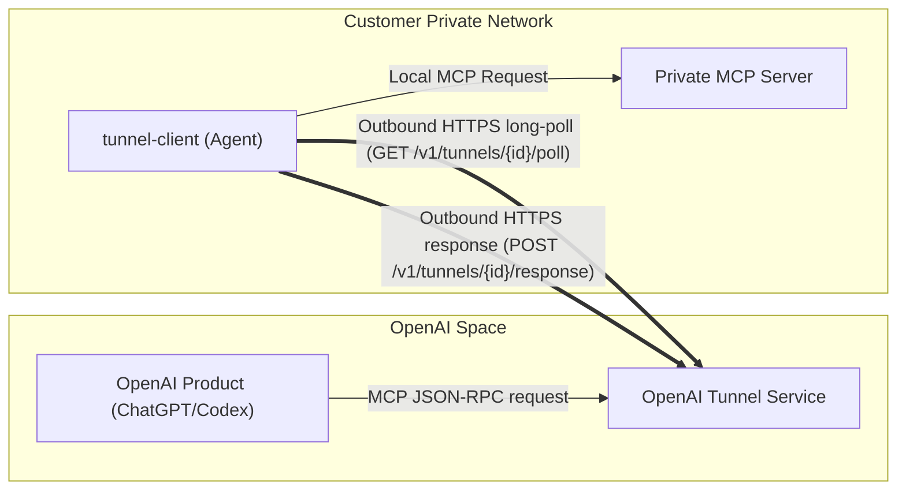
Sources: [docs/architecture.md:23-48](), [docs/enterprise-customer-onboarding.md:18-41]()

### Core Subsystems and Code Entities

The `tunnel-client` is composed of several modular subsystems wired together using the `fx` dependency injection framework [go.mod:21]().

| Subsystem | Key Code Entities | Responsibility |
| :--- | :--- | :--- |
| **Control Plane** | `TunnelServiceClient` | Manages the `Poll` and `PostResponse` calls with the OpenAI service [docs/enterprise-customer-onboarding.md:76-82](). |
| **Dispatcher** | `mcpProcessor` | Routes incoming commands to workers and handles JSON-RPC notifications [docs/connectors.md:101-107](). |
| **MCP Client** | `ForwardingTransport` | Implements transports for Streamable HTTP, stdio, and in-memory MCP servers [docs/connectors.md:70-80](). |
| **Harpoon** | `harpoon` channel | An embedded proxy for allowlisted outbound HTTP requests from the MCP server [docs/connectors.md:88-91](). |
| **Admin & Ops** | `adminui`, `health` | Provides a local web UI, `/healthz`, `/readyz`, and Prometheus `/metrics` [docs/troubleshooting.md:62-86](). |

**Diagram: Internal Code Entity Relationships**
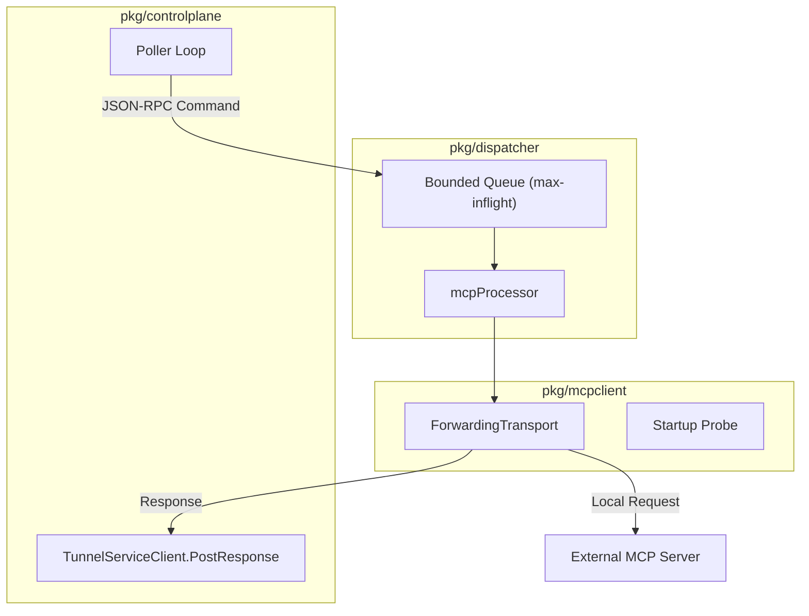
Sources: [docs/architecture.md:59-82](), [docs/connectors.md:9-25](), [docs/troubleshooting.md:101-110]()

### Key Technical Concepts

*   **Outbound-Only Connectivity**: All traffic to OpenAI is initiated by the `tunnel-client` via HTTPS. No inbound ports need to be opened on the customer firewall [docs/architecture.md:11-12]().
*   **Readyz Gating**: The `/readyz` endpoint is used for orchestration, returning `503` while OAuth discovery is pending or MCP probes are failing, and `200 OK` only when ready [docs/troubleshooting.md:72-79]().
*   **Channel Routing**: The client supports multiple "channels" (e.g., `main`, `harpoon`). Traffic with an empty channel is normalized to `main` [docs/connectors.md:67-68]().
*   **Supervision and Runtimes**: For long-lived local execution, the client provides a `runtimes` command tree to manage background processes without relying on `nohup` [README.md:120-123]().

### Detailed Documentation Sections

For deeper technical dives, refer to the following child pages:

*   **[Architecture and Request Lifecycle](#1.1)**: Details the three-tier topology, the polling mechanism, and the trust boundaries between OpenAI and the customer environment.
*   **[Getting Started and Onboarding](#1.2)**: A guide for setting up prerequisites like `tunnel_id` and API keys, and using the `init` and `doctor` commands to validate connectivity.

Sources: [README.md:22-50](), [docs/onboarding.md:1-14](), [docs/architecture.md:1-20]()

---

# Page: Architecture and Request Lifecycle

# Architecture and Request Lifecycle

<details>
<summary>Relevant source files</summary>

The following files were used as context for generating this wiki page:

- [README.md](README.md)
- [docs/README.md](docs/README.md)
- [docs/architecture.md](docs/architecture.md)
- [docs/connectors.md](docs/connectors.md)
- [docs/deployment/docker.md](docs/deployment/docker.md)
- [docs/deployment/kubernetes-dedicated.md](docs/deployment/kubernetes-dedicated.md)
- [docs/deployment/kubernetes-sidecar.md](docs/deployment/kubernetes-sidecar.md)
- [docs/deployment/overview.md](docs/deployment/overview.md)
- [docs/enterprise-customer-onboarding.md](docs/enterprise-customer-onboarding.md)
- [docs/onboarding.md](docs/onboarding.md)
- [docs/openapi.json](docs/openapi.json)
- [docs/protocol.md](docs/protocol.md)
- [docs/troubleshooting.md](docs/troubleshooting.md)
- [pkg/controlplane/wiretypes/openapi_contract_test.go](pkg/controlplane/wiretypes/openapi_contract_test.go)

</details>


The `tunnel-client` serves as an outbound-only agent that bridges OpenAI products (like ChatGPT or Codex) to private MCP servers. It eliminates the need for inbound firewall rules by initiating all control-plane traffic as outbound HTTPS requests to OpenAI [README.md:3-15]().

## Three-Tier Topology

The system operates across three distinct trust boundaries. The `tunnel-client` acts as the pivot point, translating public control-plane commands into private network requests [docs/architecture.md:21-48]().

1.  **OpenAI Product Tier**: ChatGPT, Codex, or the Responses API sends MCP JSON-RPC requests to the OpenAI Tunnel Service [docs/architecture.md:25-28]().
2.  **OpenAI Tunnel Service**: Acts as a buffer and relay, holding queued commands for the `tunnel_id` and streaming responses back to the product [docs/architecture.md:59-76]().
3.  **Customer Network**: The `tunnel-client` runs here, polling for work and forwarding it to the **Private MCP Server** via stdio, HTTP, or in-memory transports [docs/architecture.md:30-40]().

### System Topology Diagram

This diagram illustrates the flow from the OpenAI product tier through the client to the private MCP instance.

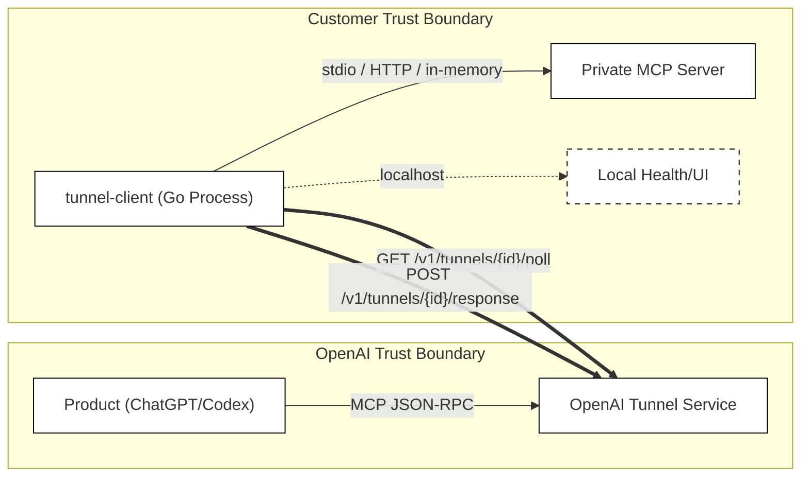
Sources: [docs/architecture.md:23-48](), [docs/enterprise-customer-onboarding.md:18-41](), [docs/protocol.md:25-30]()

---

## Request Lifecycle and Polling Loop

The `tunnel-client` utilizes a long-polling mechanism to receive work. This ensures that the customer network remains secure without exposing any listening ports to the public internet [docs/protocol.md:153-174]().

### The Poll-Response Sequence

1.  **Long-poll**: The `tunnel-client` initiates a `GET /v1/tunnels/{tunnel_id}/poll` request. It includes `limit` (max 25) and `timeout_ms` hints [docs/protocol.md:153-165]().
2.  **Command Delivery**: The Tunnel Service returns a `200 OK` with a JSON envelope containing a list of `commands`. If no work is available, it returns `204 No Content` [docs/protocol.md:172-180]().
3.  **Dispatcher Processing**: The client records the receipt time and dispatches commands to the appropriate MCP channel (e.g., `main` or `harpoon`) [docs/protocol.md:180-190]().
4.  **MCP Execution**: The command is forwarded to the configured MCP server. For stdio, this is a child process; for HTTP, it is a `POST` request [docs/connectors.md:70-80]().
5.  **Response Posting**: Results are posted back to `/v1/tunnels/{tunnel_id}/response`. For streaming, intermediate notifications are posted with `resp_type=jsonrpc_notify` [docs/protocol.md:220-235]().

### Sequence Diagram: Code Entities

This diagram maps the natural language lifecycle to specific system components and wire protocol operations.

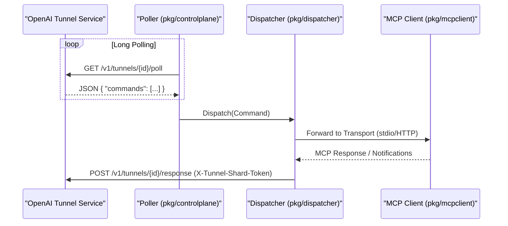
Sources: [docs/architecture.md:61-76](), [docs/protocol.md:153-240](), [docs/connectors.md:100-110]()

---

## Command and Response Models

The communication protocol distinguishes between standard RPC calls, OAuth metadata discovery, and session management [docs/protocol.md:180-215]().

### Command Types (`command_type`)
| Type | Purpose |
| :--- | :--- |
| `jsonrpc` | Standard MCP tool calls, resource fetches, or list requests [docs/protocol.md:184](). |
| `oauth_discovery` | Requests to probe the MCP server for OAuth protected resource metadata [docs/protocol.md:200-210](). |
| `session_termination` | Explicit signal to close a Streamable HTTP session [docs/protocol.md:212-215](). |

### Response Types (`resp_type`)
| Type | Description |
| :--- | :--- |
| `jsonrpc_response` | A final response to a JSON-RPC request [docs/protocol.md:230](). |
| `jsonrpc_notify` | Used for streaming; maps to JSON-RPC notifications without an ID [docs/protocol.md:231](). |
| `oauth_discovery` | Returns discovered OAuth protected resource metadata [docs/protocol.md:232](). |

---

## Backpressure and Flow Control

The client implements a backpressure model to ensure it does not overwhelm the local MCP server or the system's memory.

*   **Poll Limit**: The `limit` parameter in the poll request (max 25) hints to the service how many commands the client is ready to receive in one batch [docs/protocol.md:163-165]().
*   **Shard Tokens**: Every command includes a `shard_token`. The client **must** echo this token back in the `X-Tunnel-Shard-Token` HTTP header when responding [docs/protocol.md:220-225](). This ensures the response is routed to the correct upstream worker.
*   **Connection TTL**: The connection window for Streamable HTTP is bounded by `MCP_CONNECTION_MAX_TTL` (default 10m) [docs/connectors.md:113-116]().

---

## Trust Boundaries and Security

The architecture is designed with strict isolation of credentials and network paths [docs/architecture.md:85-113]().

| Component | Security Property |
| :--- | :--- |
| **Outbound Only** | The agent initiates all traffic. No inbound firewall rules are required for the MCP server [docs/architecture.md:11-12](). |
| **API Key Isolation** | The `CONTROL_PLANE_API_KEY` is used only between the client and OpenAI. It is never forwarded to the MCP server [docs/architecture.md:126](). |
| **Private MCP URL** | The internal address of the MCP server is never shared with OpenAI; it exists only in the local client configuration [docs/architecture.md:13-14](). |
| **Header Blocking** | OpenAI-internal, IP-forwarding, and hop-by-hop auth headers are blocked at the tunnel boundary [docs/architecture.md:125](). |

### Network Path Detail

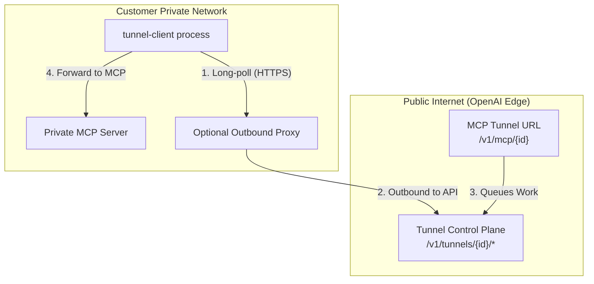
Sources: [docs/architecture.md:85-113](), [docs/enterprise-customer-onboarding.md:18-41](), [docs/protocol.md:11-30]()

---

# Page: Getting Started and Onboarding

# Getting Started and Onboarding

<details>
<summary>Relevant source files</summary>

The following files were used as context for generating this wiki page:

- [README.md](README.md)
- [cmd/client/help_topics/doctor.txt](cmd/client/help_topics/doctor.txt)
- [cmd/client/help_topics/quickstart.txt](cmd/client/help_topics/quickstart.txt)
- [cmd/client/init_command.go](cmd/client/init_command.go)
- [cmd/client/profile_samples/sample_mcp_enterprise_proxy.yaml.tmpl](cmd/client/profile_samples/sample_mcp_enterprise_proxy.yaml.tmpl)
- [cmd/client/profile_samples/sample_mcp_remote_no_auth.yaml.tmpl](cmd/client/profile_samples/sample_mcp_remote_no_auth.yaml.tmpl)
- [cmd/client/profile_samples/sample_mcp_stdio_local.yaml.tmpl](cmd/client/profile_samples/sample_mcp_stdio_local.yaml.tmpl)
- [cmd/client/profile_samples/sample_mcp_with_dcr.yaml.tmpl](cmd/client/profile_samples/sample_mcp_with_dcr.yaml.tmpl)
- [docs/README.md](docs/README.md)
- [docs/architecture.md](docs/architecture.md)
- [docs/connectors.md](docs/connectors.md)
- [docs/deployment/docker.md](docs/deployment/docker.md)
- [docs/deployment/kubernetes-dedicated.md](docs/deployment/kubernetes-dedicated.md)
- [docs/deployment/kubernetes-sidecar.md](docs/deployment/kubernetes-sidecar.md)
- [docs/deployment/overview.md](docs/deployment/overview.md)
- [docs/enterprise-customer-onboarding.md](docs/enterprise-customer-onboarding.md)
- [docs/onboarding.md](docs/onboarding.md)
- [docs/troubleshooting.md](docs/troubleshooting.md)

</details>


This page provides a step-by-step technical guide for new users and operators to initialize, validate, and run the `tunnel-client`. It covers the transition from obtaining credentials in the OpenAI Platform to running a production-ready daemon.

## Prerequisites and Key Concepts

Before running the client, three primary components must be configured: a **Tunnel ID**, **API Keys** with appropriate permissions, and a target **MCP Server**.

### 1. Tunnel ID (`tunnel_id`)
A logical identifier that binds the ChatGPT connector to a specific `tunnel-client` instance [docs/enterprise-customer-onboarding.md:48-50](). It follows the format `tunnel_` followed by 32 lowercase hexadecimal characters [docs/enterprise-customer-onboarding.md:56-56]().

### 2. API Keys and Permissions
The system distinguishes between **Runtime** and **Admin** operations. It is a security best practice to never provide the Admin key to the long-lived daemon [cmd/client/help_topics/quickstart.txt:35-36]().

| Key Type | Environment Variable | Required Permissions | Usage |
| :--- | :--- | :--- | :--- |
| **Runtime Key** | `CONTROL_PLANE_API_KEY` | Tunnels **Read** + **Use** | `doctor`, `run`, `health` |
| **Admin Key** | `OPENAI_ADMIN_KEY` | Tunnels **Read** + **Manage** | `admin tunnels [create\|list\|delete]` |

Sources: [docs/onboarding.md:41-47](), [cmd/client/help_topics/quickstart.txt:30-36](), [docs/enterprise-customer-onboarding.md:123-136]()

### 3. MCP Server
The client requires a destination to forward requests. This can be:
*   **Local stdio**: A command executed by the client (e.g., `python server.py`) [cmd/client/help_topics/quickstart.txt:52-53]().
*   **Remote HTTP**: A URL reachable from the client host [cmd/client/help_topics/quickstart.txt:55-56]().
*   **In-Memory**: Used when embedding the client as a Go SDK [README.md:41-45]().

## Onboarding Data Flow

The following diagram illustrates the relationship between the OpenAI Platform entities and the local code entities during the onboarding process.

**Onboarding Entity Mapping**
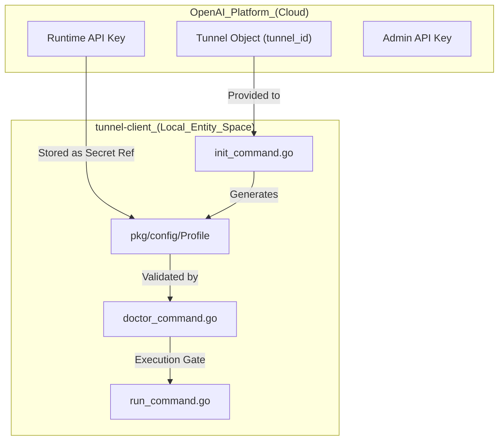
Sources: [cmd/client/init_command.go:32-85](), [docs/onboarding.md:15-30](), [docs/enterprise-customer-onboarding.md:108-122]()

## First-Run Paths

### 1. Quickstart (One-Command Demo)
For testing without a real MCP server, the client includes an embedded stub.
```bash
health_url_file="$(mktemp "${TMPDIR:-/tmp}/tunnel-client-health.XXXXXX.url")"
tunnel-client run \
  --embedded-mcp-stub \
  --control-plane.tunnel-id tunnel_0123456789abcdef0123456789abcdef \
  --health.listen-addr 127.0.0.1:0 \
  --health.url-file "$health_url_file"
```
Sources: [docs/onboarding.md:62-69](), [cmd/client/help_topics/quickstart.txt:46-50]()

### 2. Initialization (`init`)
The `init` command generates a YAML profile from built-in templates. It performs preflight checks on stdio commands and validates the `tunnel_id` format [cmd/client/init_command.go:64-71]().

**Common Init Patterns:**
*   **Local Stdio**: `tunnel-client init --sample sample_mcp_stdio_local --profile local-stdio --tunnel-id tunnel_... --mcp-command "python server.py"` [docs/onboarding.md:95-96]()
*   **Remote HTTP**: `tunnel-client init --sample sample_mcp_remote_no_auth --profile remote-http --tunnel-id tunnel_... --mcp-server-url https://mcp.example.com/mcp` [docs/onboarding.md:117-118]()
*   **Enterprise (Proxy/CA)**: `tunnel-client init --sample sample_mcp_enterprise_proxy --profile corp-proxy ...` [docs/onboarding.md:119-123]()

Sources: [cmd/client/init_command.go:89-101](), [cmd/client/help_topics/quickstart.txt:52-66]()

### 3. Validation (`doctor`)
Before starting the daemon, `doctor` validates connectivity and configuration. It is the primary tool for debugging "403 Forbidden" or "Tunnel ID required" errors [cmd/client/help_topics/doctor.txt:1-6]().

**Key Checks:**
*   Resolution of secret references (e.g., `env:VAR` or `file:PATH`) [cmd/client/help_topics/doctor.txt:28-28]().
*   MCP OAuth/PRMD metadata contract (fetching `/.well-known/oauth-protected-resource/mcp`) [cmd/client/help_topics/doctor.txt:30-32]().
*   Control plane reachability and permission verification using the Runtime Key [cmd/client/help_topics/doctor.txt:39-41]().

## Operational Health and Readiness

Once running, the client exposes a health server. Understanding the difference between `/healthz` (liveness) and `/readyz` (readiness gating) is critical for deployment [docs/troubleshooting.md:71-72]().

**Health Lifecycle State Machine**
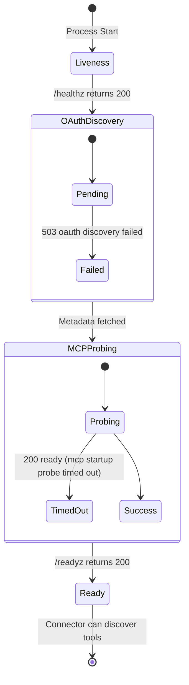
Sources: [docs/troubleshooting.md:62-80](), [docs/connectors.md:60-64]()

### Diagnostic Commands
*   **Structured Probe**: `tunnel-client health --url-file "$health_url_file"` is the fastest probe for a running daemon [docs/troubleshooting.md:67-70]().
*   **Log Export**: `curl -fsSJO "http://127.0.0.1:8080/api/logs/export?minutes=30"` returns a redacted archive containing logs, metrics, and system status for support [docs/troubleshooting.md:89-95]().

## Troubleshooting Common Startup Issues

| Error Message | Cause | Resolution |
| :--- | :--- | :--- |
| `control plane API key is required` | Missing `CONTROL_PLANE_API_KEY` | Set the env var or use `--control-plane.api-key=env:...` [docs/troubleshooting.md:5-7](). |
| `invalid tunnel ID` | Format mismatch | Ensure ID is `tunnel_` followed by 32 hex chars [docs/troubleshooting.md:12-13](). |
| `503 oauth discovery pending` | Metadata fetch in flight | Check network access to the MCP server's `.well-known` path [docs/troubleshooting.md:73-73](). |
| `unsupported_channel` | Routing mismatch | Ensure `main` channel is configured or Harpoon targets are registered [docs/troubleshooting.md:133-138](). |

Sources: [docs/troubleshooting.md:3-30](), [docs/troubleshooting.md:133-149]()

---

# Page: Configuration System

# Configuration System

<details>
<summary>Relevant source files</summary>

The following files were used as context for generating this wiki page:

- [docs/configuration.md](docs/configuration.md)
- [pkg/config/config.go](pkg/config/config.go)
- [pkg/config/config_test.go](pkg/config/config_test.go)
- [pkg/config/file_config.go](pkg/config/file_config.go)
- [pkg/config/profile.go](pkg/config/profile.go)

</details>


The `tunnel-client` configuration system is designed for flexibility across local development, enterprise proxy environments, and automated deployments. It utilizes a multi-layered approach where settings can be defined via CLI flags, environment variables, or YAML-based profiles.

## Configuration Precedence

The system follows a strict hierarchy when resolving configuration values. If a value is defined in multiple layers, the highest-priority source wins.

1.  **CLI Flags**: Highest precedence [docs/configuration.md:6-6]().
2.  **Environment Variables**: Overrides file-based settings [docs/configuration.md:6-6]().
3.  **YAML Config / Profiles**: Settings loaded from a disk-based configuration [pkg/config/profile.go:68-98]().
4.  **Defaults**: Hard-coded internal fallbacks [pkg/config/config.go:48-68]().

### Configuration Loading Flow

The diagram below illustrates how the `pkg/config` package resolves the final `Config` struct used by the application.

**Config Resolution Logic**
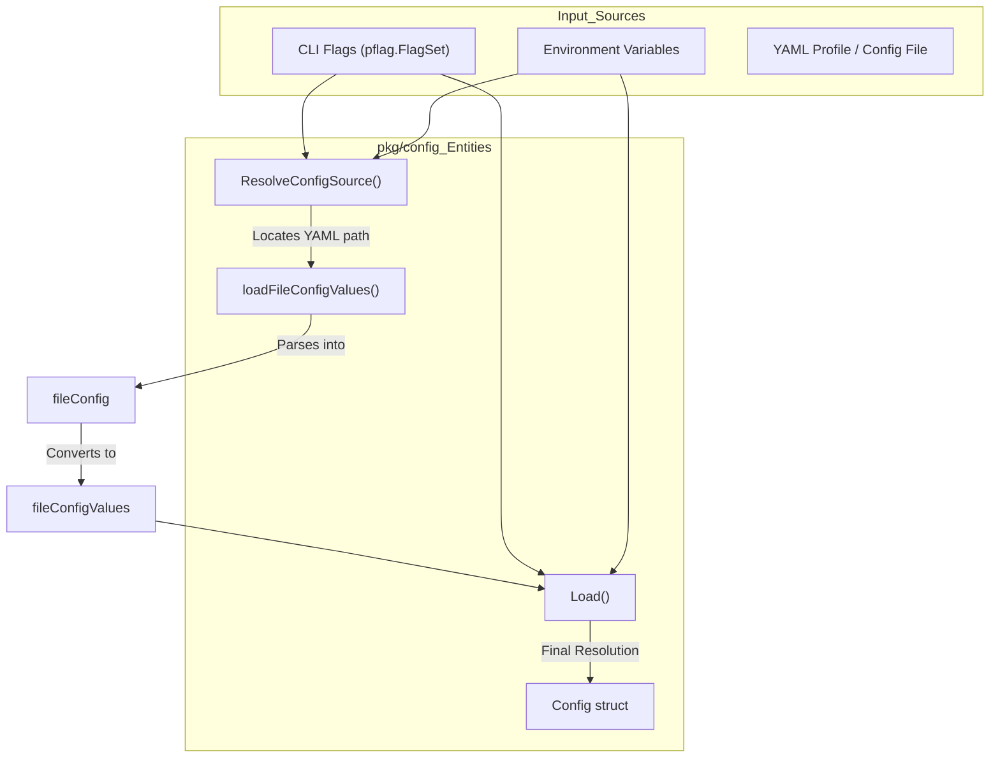
Sources: [pkg/config/config.go:129-141](), [pkg/config/profile.go:36-100](), [pkg/config/file_config.go:136-180]()

## Configuration Layers

### 1. YAML Profiles and Files
Users can point the client to a specific YAML file using `--config` or use named profiles. Profiles are YAML files stored in a standard directory.

*   **Named Profile**: `--profile <name>` loads `<name>.yaml` from the profile directory [pkg/config/profile.go:143-153]().
*   **Direct File**: `--profile-file <path>` or `--config <path>` [pkg/config/profile.go:68-76]().
*   **Default Directory**: Follows XDG standards, typically `$XDG_CONFIG_HOME/tunnel-client` or `~ ~/.config/tunnel-client` [pkg/config/profile.go:117-140]().

For details, see [Profiles and YAML Configuration Files](#2.2).

Sources: [docs/configuration.md:65-100](), [pkg/config/profile.go:13-19]()

### 2. Environment Variables
Most configuration options have a corresponding environment variable, typically prefixed with `CONTROL_PLANE_`, `MCP_`, or `LOG_`. For example, `CONTROL_PLANE_TUNNEL_ID` maps to the `control-plane.tunnel-id` flag [pkg/config/config_test.go:88-111]().

Sources: [pkg/config/profile.go:13-17](), [pkg/config/config_test.go:88-111]()

### 3. CLI Flags
The client provides extensive flags for overriding any setting at runtime. The `commonFlagAliases` map provides shorter aliases for nested configuration paths [pkg/config/config.go:111-126]().

Sources: [pkg/config/config.go:105-126]()

## Secret Resolution (`env:` and `file:`)

To prevent sensitive data from leaking into process trees or version control, `tunnel-client` supports dynamic resolution for secret-bearing fields like `api_key` and `extra_headers` [docs/configuration.md:169-178]().

*   **`env:VAR_NAME`**: The value is read from the specified environment variable at startup.
*   **`file:/path/to/secret`**: The value is read from the specified file on disk.

This mechanism ensures secrets stay out of `argv` and checked-in YAML files [docs/configuration.md:173-177]().

Sources: [docs/configuration.md:169-178](), [pkg/config/file_config.go:166-179]()

## Major Configuration Areas

The configuration is partitioned into several functional areas, each represented by a specific struct in `pkg/config/config.go`:

| Area | Struct | Key Responsibilities |
| :--- | :--- | :--- |
| **Control Plane** | `ControlPlaneConfig` | Base URL, Tunnel ID, Polling timeouts, and API keys [pkg/config/config.go:170-184](). |
| **MCP** | `MCPConfig` | Channel bindings, server URLs, and stdio commands [pkg/config/config.go:217-230](). |
| **Harpoon** | `HarpoonConfig` | Outbound allowlists, proxy targets, and payload capture [pkg/config/config.go:264-282](). |
| **Networking** | `ProxyHealthConfig` | Global and per-service HTTP proxy settings [pkg/config/config.go:285-288](). |
| **Observability** | `LoggingConfig` | Log levels (`slog.Level`), formats, and file paths [pkg/config/config.go:203-209](). |
| **Admin UI** | `AdminUIConfig` | Browser behavior and log buffer sizing for the embedded dashboard [pkg/config/config.go:155-167](). |

For a full list of options and validation rules, see [Configuration Reference](#2.1).

Sources: [pkg/config/config.go:129-141](), [pkg/config/config.go:170-288]()

## Diagnostic and Initialization Tools

The configuration system includes built-in commands to help users validate their setup:

*   **`init`**: Interactive generator for profiles based on templates [docs/configuration.md:23-23]().
*   **`doctor`**: Performs a pre-flight check, validating configuration syntax and connectivity [docs/configuration.md:24-25]().
*   **`profiles samples list`**: Shows all available sample templates [docs/configuration.md:26-26]().

Sources: [docs/configuration.md:20-36]()

## Networking and Security

The client supports complex networking requirements:
*   **Hierarchical Proxies**: Proxies can be defined globally (`http_proxy` in YAML root), per-service (in `control_plane` or `mcp`), or inherited from the environment [pkg/config/file_config.go:27-48]().
*   **mTLS**: Automatic switching to `https://mtls.api.openai.com` when `client_cert` and `client_key` are provided for the control plane [docs/configuration.md:112-115](), [pkg/config/config.go:49-50]().
*   **CA Bundles**: Extension of the system trust store via `ca_bundle` for intercepting enterprise proxies [pkg/config/file_config.go:27-27]().

For details, see [Networking: Proxies, TLS, and mTLS](#2.3).

Sources: [docs/configuration.md:112-115](), [pkg/config/config.go:49-50](), [pkg/config/file_config.go:27-48]()

---

# Page: Configuration Reference

# Configuration Reference

<details>
<summary>Relevant source files</summary>

The following files were used as context for generating this wiki page:

- [cmd/client/admin/admin_command.go](cmd/client/admin/admin_command.go)
- [docs/configuration.md](docs/configuration.md)
- [pkg/config/admin.go](pkg/config/admin.go)
- [pkg/config/admin_test.go](pkg/config/admin_test.go)
- [pkg/config/config.go](pkg/config/config.go)
- [pkg/config/config_test.go](pkg/config/config_test.go)
- [pkg/config/file_config.go](pkg/config/file_config.go)
- [pkg/config/http_headers.go](pkg/config/http_headers.go)
- [pkg/config/http_headers_test.go](pkg/config/http_headers_test.go)
- [pkg/config/profile.go](pkg/config/profile.go)

</details>


The `tunnel-client` utilizes a multi-layered configuration system designed for flexibility across local development and enterprise production environments. Configuration is managed via the `Config` struct defined in `pkg/config/config.go`, which aggregates settings for the control plane, MCP (Model Context Protocol), health monitoring, and logging.

### Configuration Precedence and Resolution
The client resolves configuration using the following order of precedence (highest to lowest):
1.  **CLI Flags**: Explicitly passed arguments.
2.  **Environment Variables**: Prefixed with `TUNNEL_CLIENT_` or specific keys like `CONTROL_PLANE_API_KEY`.
3.  **YAML Profile/Config File**: Loaded via `--profile` or `--config`.
4.  **Defaults**: Hardcoded internal defaults.

[docs/configuration.md:6-8](), [pkg/config/config.go:128-141]()

#### Secret Resolution
To prevent secret leakage in process trees or checked-in YAML files, fields that support secrets (like `api_key` or `extra_headers`) support prefix-based resolution via the `dereferenceKey` logic:
*   `env:VAR_NAME`: Fetches the value from the specified environment variable. [pkg/config/admin.go:128-139]()
*   `file:/path/to/secret`: Reads the value from the specified file path and trims whitespace. [pkg/config/admin.go:140-153]()

This is supported for control-plane, MCP runtime, and MCP discovery/probe extra headers. [docs/configuration.md:169-177]()

---

## Configuration Data Flow

The following diagram illustrates how the `Config` entity is populated and consumed by the system modules.

### Config Initialization Lifecycle
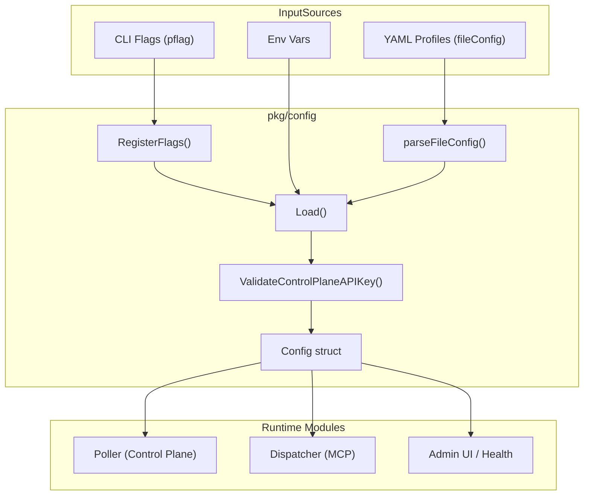
**Sources:** [pkg/config/config.go:128-141](), [pkg/config/file_config.go:190-201](), [pkg/config/config.go:92-103]()

---

## Configuration Sections

### 1. ControlPlaneConfig
Defines the connection parameters for the OpenAI Tunnel Control Plane.

| Field | Flag / Env Var | Default | Validation / Notes |
| :--- | :--- | :--- | :--- |
| `BaseURL` | `--control-plane.base-url` | `https://api.openai.com` | Automatically switches to `mtls.api.openai.com` if client certs are provided. [pkg/config/config.go:171](), [docs/configuration.md:112-113]() |
| `TunnelID` | `--control-plane.tunnel-id` | Required | Must match regex `^tunnel_[a-z0-9]{32}$`. [pkg/config/config.go:82]() |
| `APIKey` | `CONTROL_PLANE_API_KEY` | Required | Supports `env:` and `file:` prefixes. [pkg/config/config.go:176]() |
| `PollTimeout` | `--control-plane.poll-timeout` | `30s` | Max allowed: `10m` (including guardrail). [pkg/config/config.go:53-56]() |
| `MaxInFlight` | `--control-plane.max-inflight-requests` | `20` | Max allowed: `10000`. [pkg/config/config.go:51-52]() |

[pkg/config/config.go:49-56](), [pkg/config/config.go:170-190]()

### 2. MCPConfig
Configures how the client interacts with Model Context Protocol servers.

| Field | Flag / Env Var | Default | Description |
| :--- | :--- | :--- | :--- |
| `ServerURL` | `--mcp.server-url` | N/A | URL for HTTP-streamable MCP servers. [pkg/config/config.go:215]() |
| `Command` | `--mcp.command` | N/A | Command string for `stdio` based MCP servers. [pkg/config/config.go:217]() |
| `ExtraHeaders` | `--mcp.extra-headers` | N/A | Map of headers sent to the MCP server. [pkg/config/config.go:224]() |
| `ConnectionMaxTTL` | `--mcp.connection-max-ttl` | `10m` | Max lifetime of an MCP connection. [pkg/config/config.go:64]() |

[pkg/config/config.go:214-231](), [pkg/config/config.go:64-65]()

### 3. HarpoonConfig
Controls the embedded Harpoon outbound proxy server.

| Field | Flag | Default | Description |
| :--- | :--- | :--- | :--- |
| `Targets` | `--harpoon.target` | N/A | List of allowlisted target URLs. [pkg/config/config.go:240]() |
| `MaxRedirects` | N/A | `5` | Maximum HTTP redirects followed. [pkg/config/config.go:67]() |
| `MaxResponseBytes`| N/A | `102400` | Max bytes buffered from a target response. [pkg/config/config.go:66]() |

[pkg/config/config.go:239-254](), [pkg/config/config.go:66-67](), [pkg/config/config.go:76]()

---

## Code Entity Mapping

This diagram maps the natural language configuration categories to their specific Go structs and validation logic in the codebase.

### Configuration Entity Space
```mermaid
classDiagram
    class Config {
        +ControlPlaneConfig ControlPlane
        +MCPConfig MCP
        +HarpoonConfig Harpoon
        +LoggingConfig Logging
        +AdminUIConfig AdminUI
    }
    class ControlPlaneConfig {
        +url.URL BaseURL
        +types.TunnelID TunnelID
        +string APIKey
        +Duration PollTimeout
    }
    class MCPConfig {
        +url.URL ServerURL
        +string Command
        +map[string]string ExtraHeaders
    }
    class HarpoonConfig {
        +[]HarpoonTarget Targets
        +int MaxRedirects
        +int MaxResponseBytes
    }
    class AdminUIConfig {
        +bool AllowRemote
        +bool OpenBrowser
        +int LogBufferEvents
    }

    Config *-- ControlPlaneConfig : [pkg/config/config.go:130]
    Config *-- MCPConfig : [pkg/config/config.go:135]
    Config *-- HarpoonConfig : [pkg/config/config.go:137]
    Config *-- AdminUIConfig : [pkg/config/config.go:136]
    
    ControlPlaneConfig ..> tunnelIDPattern : [pkg/config/config.go:82]
    HarpoonConfig ..> harpoonLabelPattern : [pkg/config/config.go:76]
```
**Sources:** [pkg/config/config.go:128-141](), [pkg/config/config.go:155-167](), [pkg/config/config.go:170-190](), [pkg/config/config.go:214-231]()

---

## Validation Rules and Guardrails

The configuration system enforces strict limits to ensure client stability and prevent control plane abuse:

1.  **Tunnel ID Format**: Validated using `tunnelIDPattern`. Must match `^tunnel_[a-z0-9]{32}$`. [pkg/config/config.go:82]()
2.  **Poll Timing**: 
    *   The sum of `PollTimeout` and `PollDeadlineGuardrail` cannot exceed `10 minutes`. [pkg/config/config.go:72]()
    *   `PollDeadlineGuardrail` must be at least `1ms` and less than `1 minute`. [pkg/config/config.go:73-74]()
3.  **Concurrency**: `MaxInFlightRequests` is capped at `10,000`. [pkg/config/config.go:52]()
4.  **Logging**: `LogFormat` supports `json` and `struct-text`. [pkg/config/config.go:23-30](), [pkg/config/config.go:83-86]()
5.  **HTTP Headers**: `NormalizeExtraHeaders` ensures header names are valid HTTP tokens and values are wire-safe (no NUL or DEL characters). [pkg/config/http_headers.go:15-41]()

### Flag Aliasing
For CLI convenience, many nested configuration fields have kebab-case aliases defined in `commonFlagAliases`:
*   `--control-plane.tunnel-id` can be written as `--control-plane-tunnel-id`.
*   `--mcp.server-url` can be written as `--mcp-server-url`.
*   `--health.listen-addr` can be written as `--health-listen-addr`.

[pkg/config/config.go:111-126]()

**Sources:** [pkg/config/config.go:48-87](), [pkg/config/http_headers.go:88-115](), [pkg/config/config_test.go:30-69]()

---

# Page: Profiles and YAML Configuration Files

# Profiles and YAML Configuration Files

<details>
<summary>Relevant source files</summary>

The following files were used as context for generating this wiki page:

- [cmd/client/help_topics/samples.txt](cmd/client/help_topics/samples.txt)
- [cmd/client/init_command.go](cmd/client/init_command.go)
- [cmd/client/profile_samples.go](cmd/client/profile_samples.go)
- [cmd/client/profile_samples/sample_mcp_enterprise_proxy.yaml.tmpl](cmd/client/profile_samples/sample_mcp_enterprise_proxy.yaml.tmpl)
- [cmd/client/profile_samples/sample_mcp_remote_no_auth.yaml.tmpl](cmd/client/profile_samples/sample_mcp_remote_no_auth.yaml.tmpl)
- [cmd/client/profile_samples/sample_mcp_stdio_local.yaml.tmpl](cmd/client/profile_samples/sample_mcp_stdio_local.yaml.tmpl)
- [cmd/client/profile_samples/sample_mcp_with_dcr.yaml.tmpl](cmd/client/profile_samples/sample_mcp_with_dcr.yaml.tmpl)
- [cmd/client/profiles_command_test.go](cmd/client/profiles_command_test.go)
- [docs/configuration.md](docs/configuration.md)
- [pkg/config/config.go](pkg/config/config.go)
- [pkg/config/config_alias_test.go](pkg/config/config_alias_test.go)
- [pkg/config/config_test.go](pkg/config/config_test.go)
- [pkg/config/file_config.go](pkg/config/file_config.go)
- [pkg/config/profile.go](pkg/config/profile.go)
- [pkg/config/profile_test.go](pkg/config/profile_test.go)

</details>


The `tunnel-client` utilizes a YAML-based configuration system designed to simplify the management of multiple tunnels and complex networking environments. Profiles allow users to encapsulate control-plane credentials, MCP server definitions, and proxy settings into named files that can be easily invoked via the CLI.

## Profile Resolution and Precedence

The configuration system employs a multi-layered precedence model. Profiles are loaded first, but their values can be overridden by explicit environment variables or CLI flags.

### Resolution Logic
The `ResolveConfigSource` function in `pkg/config/profile.go` determines which configuration file to use based on the following priority:

1.  **CLI Flags**: `--config`, `--profile`, or `--profile-file`. [pkg/config/profile.go:41-43]()
2.  **Environment Variables**: `TUNNEL_CLIENT_CONFIG`, `TUNNEL_CLIENT_PROFILE`, or `TUNNEL_CLIENT_PROFILE_FILE`. [pkg/config/profile.go:78-80]()

Profile lookup uses the following directory precedence if a directory is not explicitly provided:
1.  `--profile-dir` flag. [pkg/config/profile.go:44]()
2.  `TUNNEL_CLIENT_PROFILE_DIR` environment variable. [pkg/config/profile.go:16]()
3.  `$XDG_CONFIG_HOME/tunnel-client`. [pkg/config/profile.go:121-126]()
4.  `~/.config/tunnel-client`. [pkg/config/profile.go:128-133]()

### Precedence Diagram: Natural Language to Code Entities
This diagram illustrates how the `config` package resolves input sources into a `ConfigSource` struct.

"Configuration Resolution Flow"
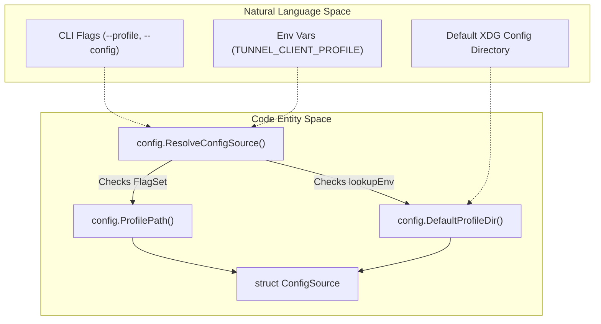
Sources: [pkg/config/profile.go:27-100](), [pkg/config/profile.go:117-140](), [docs/configuration.md:82-88]()

## YAML Structure and Data Flow

Profiles are parsed into a `fileConfig` struct which mirrors the YAML hierarchy. This struct is then converted into a flat environment map via `toEnv()` to be merged with the system environment.

### Key Configuration Sections
| Section | Purpose | Code Entity |
| :--- | :--- | :--- |
| `control_plane` | Tunnel ID, API Keys, and Polling settings | `fileControlPlaneConfig` [pkg/config/file_config.go:40]() |
| `mcp` | List of server URLs or local commands | `fileMCPConfig` [pkg/config/file_config.go:85]() |
| `harpoon` | Outbound HTTP proxy allowlist targets | `fileHarpoonConfig` [pkg/config/file_config.go:111]() |
| `health` | Admin UI and metrics listener address | `fileHealthConfig` [pkg/config/file_config.go:62]() |

### Implementation of Loading
The `loadFileConfigValues` function performs the following steps:
1.  **Read**: Reads the file from the path determined by `ResolveConfigSource`. [pkg/config/file_config.go:145]()
2.  **Parse**: Unmarshals YAML into `fileConfig` using `yaml.v3` with `KnownFields(true)` to prevent silent typos. [pkg/config/file_config.go:190-201]()
3.  **Resolve Secrets**: Identifies strings prefixed with `env:` or `file:` and resolves them at runtime. [docs/configuration.md:169-177]()
4.  **Inject**: Values from the file are injected into the process environment lookup via `lookupEnvWithFileValues`. [pkg/config/file_config.go:203-205]()

Sources: [pkg/config/file_config.go:25-131](), [pkg/config/file_config.go:136-180](), [pkg/config/file_config.go:190-201]()

## Profile Generation and Samples

The `init` command and `profiles add` command leverage embedded templates to generate starting configurations for common use cases.

### Sample Templates
Templates are stored in `cmd/client/profile_samples/` and embedded into the binary.

*   **Enterprise Proxy (`sample_mcp_enterprise_proxy`)**: Configures `ca_bundle` and `http_proxy` using environment variable references (e.g., `env:HTTPS_PROXY`). [cmd/client/profile_samples/sample_mcp_enterprise_proxy.yaml.tmpl:11-12]()
*   **Local Stdio (`sample_mcp_stdio_local`)**: Designed for fast-path setup using a local command instead of a network URL. [cmd/client/profile_samples/sample_mcp_stdio_local.yaml.tmpl:22-24]()
*   **DCR/OAuth (`sample_mcp_with_dcr`)**: Standard template for HTTP MCP servers that support Dynamic Client Registration. [cmd/client/profile_samples/sample_mcp_with_dcr.yaml.tmpl:1-30]()
*   **Remote No-Auth (`sample_mcp_remote_no_auth`)**: For simple remote MCP servers without complex metadata discovery. [cmd/client/profile_samples/sample_mcp_remote_no_auth.yaml.tmpl:22-24]()

### The `init` Command Workflow
The `newInitCommand` provides an interactive experience to create a runnable profile. It validates the provided `tunnel-id` and performs a "preflight" check if a `mcp-command` is provided to ensure the executable exists. [cmd/client/init_command.go:33-71]()

Sources: [cmd/client/init_command.go:13-102](), [cmd/client/profile_samples/sample_mcp_enterprise_proxy.yaml.tmpl:1-42]()

## Profiles CLI Subcommand

The `profiles` command group provides administrative utilities for managing the local profile directory.

### Command Structure
"Profiles Command Entity Mapping"
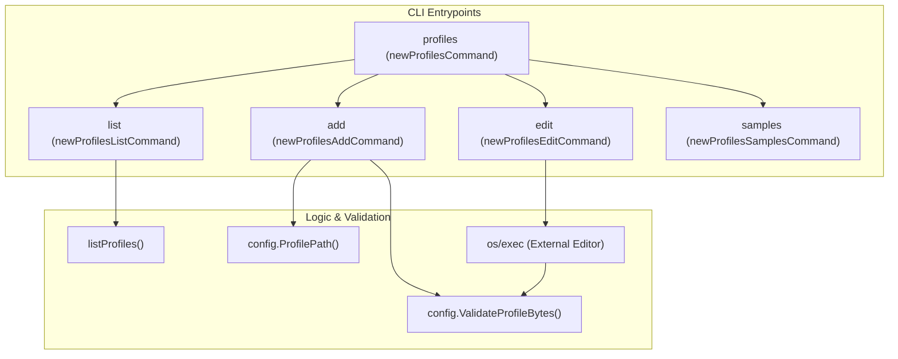

### Key Functionalities
*   **Listing**: Scans the profile directory for `.yaml` files and returns names and paths. Can output JSON for machine readability. [cmd/client/profiles_command_test.go:35-43]()
*   **Adding**: Supports creating profiles from a file (`--from-file`) or a built-in sample (`--sample`). It enforces a `--force` flag to prevent accidental overwrites. [cmd/client/profiles_command_test.go:79-97]()
*   **Editing**: Opens the profile in the user's defined `$EDITOR`. It validates the YAML syntax and version (must be `config_version: 1`) before saving changes. [cmd/client/profiles_command_test.go:128-159]()
*   **Validation**: `ValidateProfileBytes` ensures that the configuration is syntactically correct and matches the supported version schema. [pkg/config/profile.go:180-189]()

Sources: [cmd/client/profiles_command_test.go:15-43](), [cmd/client/profiles_command_test.go:128-159](), [pkg/config/profile.go:143-168](), [pkg/config/profile.go:180-189]()

---

# Page: Networking: Proxies, TLS, and mTLS

# Networking: Proxies, TLS, and mTLS

<details>
<summary>Relevant source files</summary>

The following files were used as context for generating this wiki page:

- [docs/configuration.md](docs/configuration.md)
- [pkg/config/config.go](pkg/config/config.go)
- [pkg/config/config_test.go](pkg/config/config_test.go)
- [pkg/config/file_config.go](pkg/config/file_config.go)
- [pkg/config/profile.go](pkg/config/profile.go)
- [pkg/dispatcher/fxmodule.go](pkg/dispatcher/fxmodule.go)
- [pkg/dispatcher/fxmodule_test.go](pkg/dispatcher/fxmodule_test.go)
- [pkg/harpoon/metrics.go](pkg/harpoon/metrics.go)
- [pkg/harpoon/metrics_test.go](pkg/harpoon/metrics_test.go)
- [pkg/oauth/discovery_retry_policy.go](pkg/oauth/discovery_retry_policy.go)
- [pkg/proxyhealth/checker.go](pkg/proxyhealth/checker.go)
- [pkg/proxyhealth/checker_test.go](pkg/proxyhealth/checker_test.go)
- [pkg/tlsconfig/client_certificate.go](pkg/tlsconfig/client_certificate.go)
- [pkg/tlsconfig/client_certificate_test.go](pkg/tlsconfig/client_certificate_test.go)

</details>


The `tunnel-client` provides a robust networking layer designed to operate in restrictive corporate environments. It supports multi-layered proxy configurations, custom trust anchors via CA bundles, and mutual TLS (mTLS) for both the Control Plane and Model Context Protocol (MCP) connections.

## Proxy Configuration Hierarchy

The client supports a hierarchical proxy resolution model. Proxies can be configured globally, per service (Control Plane vs. MCP), or specifically for individual MCP channels.

### Precedence Rules
When determining which proxy to use for a specific outbound request, the client follows this order of precedence:
1.  **Channel-specific proxy**: Defined in `fileMCPServerURL.HTTPProxy` [pkg/config/file_config.go:101]().
2.  **Service-specific proxy**: Defined in `fileControlPlaneConfig.HTTPProxy` [pkg/config/file_config.go:48]() or `fileMCPConfig.HTTPProxy` [pkg/config/file_config.go:88]().
3.  **Global Proxy**: Defined at the top level of the configuration file [pkg/config/file_config.go:28]().
4.  **Global Environment Variables**: Standard `HTTP_PROXY`, `HTTPS_PROXY`, and `NO_PROXY`.

### Proxy Health Checking
The `proxyhealth.Checker` component performs periodic background checks on configured proxy routes [pkg/proxyhealth/checker.go:72-85](). It validates connectivity by attempting a `CONNECT` handshake through the proxy to the target host [pkg/proxyhealth/checker.go:246-252]().

Title: Proxy Route Resolution and Health Monitoring
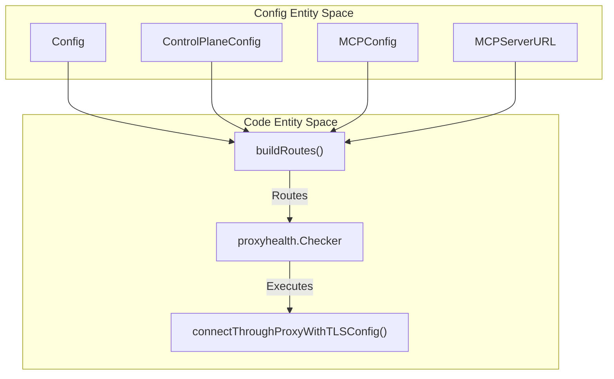
Sources: [pkg/config/config.go:129-141](), [pkg/config/file_config.go:25-38](), [pkg/proxyhealth/checker.go:117-146](), [pkg/proxyhealth/checker.go:246-265]()

## TLS and CA Bundle Extension

To support internal services using private Certificate Authorities (CAs), `tunnel-client` allows extending the system trust store using a CA bundle.

### Implementation Details
The `tlsconfig.Bundle` struct holds parsed root certificates [pkg/config/config.go:139](). The client loads PEM-encoded data provided via the `ca_bundle` field in the YAML config [pkg/config/file_config.go:27]() or the `--ca-bundle` CLI flag.

*   **Trust Extension**: The bundle is used to initialize `tls.Config` objects for both the Control Plane and MCP transports.
*   **Proxy TLS**: When connecting to an HTTPS proxy, the `proxyTLSConfig` helper ensures the custom CA bundle is used to verify the proxy's identity [pkg/proxyhealth/checker.go:251]().

### Data Flow: CA Bundle Application
Title: CA Bundle Loading and TLS Verification
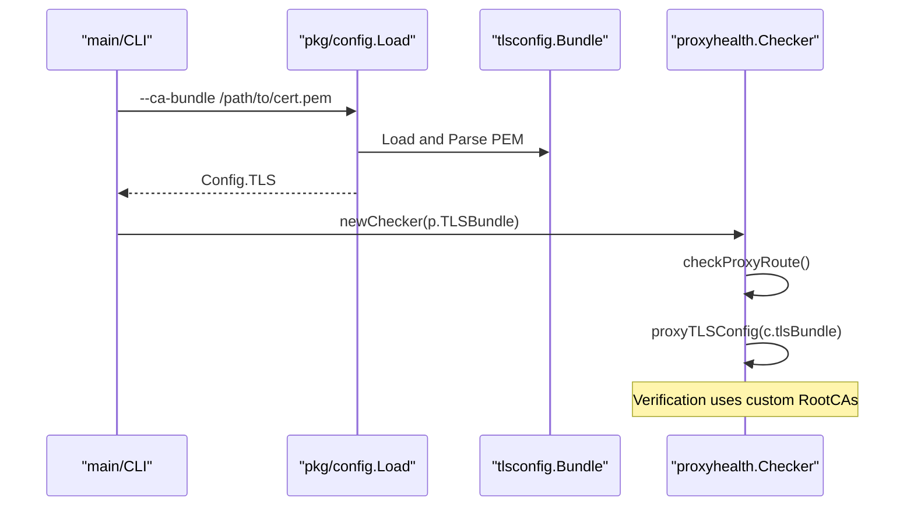
Sources: [pkg/config/config.go:139](), [pkg/config/file_config.go:27](), [pkg/proxyhealth/checker.go:117-130](), [pkg/proxyhealth/checker.go:246-252]()

## Mutual TLS (mTLS)

The client supports mTLS for high-security environments, specifically for the connection to the OpenAI Control Plane and downstream MCP servers.

### Control Plane mTLS and Automatic Switching
The client features an "automatic switching" mechanism for OpenAI endpoints. If the `control_plane.base_url` is set to the default `https://api.openai.com` [pkg/config/config.go:49]() and client certificates are provided, the client automatically uses the mTLS base URL `https://mtls.api.openai.com` [pkg/config/config.go:50](), [docs/configuration.md:112-115]().

### Configuration
mTLS is configured using `client_cert` and `client_key` fields. These fields support `file:` and `env:` resolution [docs/configuration.md:169-172]().

| Field | Description | YAML Path |
| :--- | :--- | :--- |
| `ClientCert` | Path to the client certificate (PEM) | `control_plane.client_cert` [pkg/config/file_config.go:46]() |
| `ClientKey` | Path to the private key (PEM) | `control_plane.client_key` [pkg/config/file_config.go:47]() |

### Code Implementation
The `ControlPlaneConfig` and `MCPConfig` structs store `ClientCertificate` references [pkg/config/config.go:184-185](), [pkg/config/config.go:204-205](). These are resolved at startup from the `fileControlPlaneConfig` and `fileMCPConfig` types [pkg/config/file_config.go:40-53](), [pkg/config/file_config.go:85-95]().

Title: mTLS Certificate Configuration Mapping
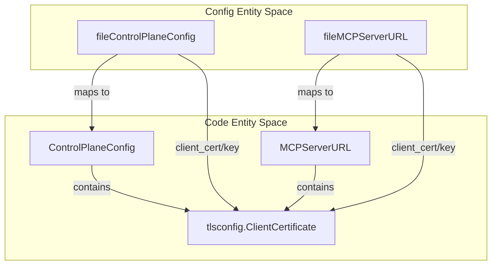
Sources: [pkg/config/config.go:184-185](), [pkg/config/config.go:204-205](), [pkg/config/file_config.go:46-47](), [pkg/config/file_config.go:102-103]()

## Static Header Injection

`tunnel-client` supports injecting static headers for authentication. To keep secrets out of configuration files, these fields support `env:VARNAME` or `file:/path` prefixes [docs/configuration.md:169-177]().

*   **Control Plane Headers**: Defined in `control_plane.extra_headers` [pkg/config/file_config.go:52]().
*   **MCP Runtime Headers**: Defined in `mcp.extra_headers` [pkg/config/file_config.go:91]().
*   **MCP Discovery Headers**: Used during OAuth discovery probes, defined in `mcp.discovery_extra_headers` [pkg/config/file_config.go:92]().

Sources: [docs/configuration.md:106-121](), [pkg/config/file_config.go:52](), [pkg/config/file_config.go:91-92]()

---

# Page: Core Runtime Architecture

# Core Runtime Architecture

<details>
<summary>Relevant source files</summary>

The following files were used as context for generating this wiki page:

- [client.go](client.go)
- [client_test.go](client_test.go)
- [cmd/client/main_test.go](cmd/client/main_test.go)
- [pkg/adminui/startup.go](pkg/adminui/startup.go)
- [pkg/adminui/startup_test.go](pkg/adminui/startup_test.go)
- [pkg/app/app.go](pkg/app/app.go)
- [pkg/app/app_test.go](pkg/app/app_test.go)
- [pkg/controlplane/fx/fxmodule.go](pkg/controlplane/fx/fxmodule.go)
- [pkg/controlplane/fx/fxmodule_test.go](pkg/controlplane/fx/fxmodule_test.go)
- [pkg/health/health.go](pkg/health/health.go)
- [pkg/health/health_test.go](pkg/health/health_test.go)

</details>


The `tunnel-client` is built as a modular Go application using the [Uber fx](https://github.com/uber-go/fx) dependency injection framework. This architecture allows for a decoupled design where major subsystems (polling, dispatching, MCP communication, and OAuth discovery) are composed into a single runtime through a central module registry.

## Application Lifecycle and Composition

The application entry point is in `cmd/client/main.go`, which invokes the `run` command. The `run` command initializes the configuration and constructs an `fx.App` via the `pkg/app` package [pkg/app/app.go:120-128]().

The `pkg/app.Options` function defines the core graph of the system, supplying configuration structs and registering the functional modules that make up the client [pkg/app/app.go:48-73]().

### Main Application Modules

| Module | Responsibility |
| :--- | :--- |
| `log.Module` | Structured logging (`slog`) with support for live level changes [pkg/log/log.go:17-26](). |
| `controlplane.Module` | The long-polling client that communicates with the OpenAI Tunnel Service [pkg/controlplane/fx/fxmodule.go:25-29](). |
| `dispatcher.Module` | The command processor and in-memory queue that routes requests to MCP workers [pkg/dispatcher/dispatcher.go:21-27](). |
| `mcpclient.Module` | Transport factory for connecting to local/remote MCP servers (stdio, HTTP, etc.) [pkg/mcpclient/mcpclient.go:20-25](). |
| `oauth.Module` | Automated discovery of OAuth protected resource metadata from MCP servers [pkg/oauth/oauth.go:22-27](). |
| `harpoon.Module` | The embedded Harpoon proxy for allowlisted outbound HTTP requests [pkg/harpoon/harpoon.go:26-32](). |
| `adminui.Module` | The embedded Svelte-based web interface and management API [pkg/adminui/adminui.go:20-25](). |
| `health.HealthMuxModule` | The health/readiness server and Prometheus metrics exporter [pkg/health/health.go:32-44](). |

**Sources:** [pkg/app/app.go:48-89]()

## Runtime Dependency Graph

The following diagram illustrates how the core components are wired together via `fx`. The `Config` object acts as the root provider, while the `Dispatcher` serves as the central hub connecting the outbound poller to the local MCP transports.

### System Wiring Diagram
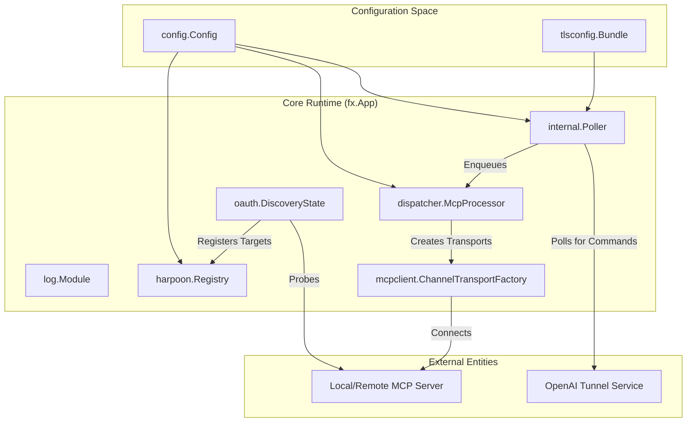
**Sources:** [pkg/app/app.go:48-67](), [pkg/controlplane/fx/fxmodule.go:25-29](), [pkg/health/health.go:106-117]()

## Subsystem Overviews

### Control Plane Client and Poller
The `controlplane` subsystem is the client's "ear." It maintains a long-polling connection to the OpenAI Tunnel Service via `internal.Poller` [pkg/controlplane/fx/fxmodule.go:195-196](). It handles shard tokens, backpressure, and ensures that the client remains connected even under varying network conditions.
*   For details, see [Control Plane Client and Poller](#3.1).

### Dispatcher and Command Processing
The `dispatcher` acts as the "brain." It receives JSON-RPC commands from the poller and places them into a bounded in-memory queue (`PolledCommandQueue`). It manages a pool of workers that route these commands to the appropriate MCP channel and handles the lifecycle of those sessions.
*   For details, see [Dispatcher and Command Processing](#3.2).

### MCP Client and Transport Layer
The `mcpclient` package provides the "hands" of the client. It implements the Model Context Protocol (MCP) and supports multiple transport types: `stdio` (for local binaries), `HTTP SSE` (for remote servers), and `in-memory` (for internal tools like Harpoon) [pkg/controlplane/fx/fxmodule.go:164-172]().
*   For details, see [MCP Client and Transport Layer](#3.3).

### OAuth Discovery and Metadata
The `oauth` subsystem enables the client to dynamically discover how to authenticate with MCP servers. It probes servers for `WWW-Authenticate` headers and `/.well-known/oauth-protected-resource` metadata to facilitate secure tool calls [pkg/health/health.go:127]().
*   For details, see [OAuth Discovery and Protected Resource Metadata](#3.4).

## Initialization Sequence

When `tunnel-client run` is executed, the following sequence occurs:
1.  **Config Loading**: Flags, environment variables, and YAML profiles are merged.
2.  **Module Wiring**: `fx` resolves the dependency graph and starts each module in order [pkg/app/app.go:48-90]().
3.  **Trust Report**: The system logs a summary of the loaded CA bundles and TLS configuration [pkg/app/app.go:71]().
4.  **Metadata Fetch**: The client attempts to fetch its tunnel metadata from the control plane [pkg/controlplane/fx/fxmodule.go:28]().
5.  **Ready State**: The `/readyz` endpoint becomes healthy once `OAuthState`, `MCPProbeState`, and `CloudflaredState` report readiness [pkg/health/health.go:127](), [pkg/health/health.go:160-164]().

### Component Readiness Mapping
| Code Entity | System Role |
| :--- | :--- |
| `oauth.DiscoveryState` | Tracks if OAuth metadata has been successfully retrieved from the MCP server. |
| `mcpclient.ProbeState` | Tracks the success of the initial MCP `initialize` handshake. |
| `cloudflared.State` | Tracks the connectivity status of the managed Cloudflare tunnel (if enabled). |
| `health.Service` | Aggregates states to expose `/healthz` and `/readyz` [pkg/health/health.go:47-52](). |

**Sources:** [pkg/app/app.go:48-90](), [pkg/health/health.go:156-217](), [pkg/adminui/startup.go:76-138]()

---

# Page: Control Plane Client and Poller

# Control Plane Client and Poller

<details>
<summary>Relevant source files</summary>

The following files were used as context for generating this wiki page:

- [docs/openapi.json](docs/openapi.json)
- [docs/protocol.md](docs/protocol.md)
- [pkg/controlplane/internal/command_parser.go](pkg/controlplane/internal/command_parser.go)
- [pkg/controlplane/internal/command_parser_test.go](pkg/controlplane/internal/command_parser_test.go)
- [pkg/controlplane/internal/command_types.go](pkg/controlplane/internal/command_types.go)
- [pkg/controlplane/internal/poller.go](pkg/controlplane/internal/poller.go)
- [pkg/controlplane/internal/poller_test.go](pkg/controlplane/internal/poller_test.go)
- [pkg/controlplane/internal/retry_after.go](pkg/controlplane/internal/retry_after.go)
- [pkg/controlplane/internal/retry_after_test.go](pkg/controlplane/internal/retry_after_test.go)
- [pkg/controlplane/internal/roundtripper.go](pkg/controlplane/internal/roundtripper.go)
- [pkg/controlplane/internal/roundtripper_test.go](pkg/controlplane/internal/roundtripper_test.go)
- [pkg/controlplane/internal/tunnel_service_client.go](pkg/controlplane/internal/tunnel_service_client.go)
- [pkg/controlplane/internal/tunnel_service_client_test.go](pkg/controlplane/internal/tunnel_service_client_test.go)
- [pkg/controlplane/polled_command.go](pkg/controlplane/polled_command.go)
- [pkg/controlplane/wiretypes/openapi_contract_test.go](pkg/controlplane/wiretypes/openapi_contract_test.go)
- [pkg/controlplane/wiretypes/wire.go](pkg/controlplane/wiretypes/wire.go)
- [pkg/controlplane/wiretypes/wire_test.go](pkg/controlplane/wiretypes/wire_test.go)
- [testsupport/mocktunnelservice/mock_tunnel_service_test.go](testsupport/mocktunnelservice/mock_tunnel_service_test.go)

</details>


The Control Plane subsystem is responsible for maintaining the outbound-only connection to the OpenAI Tunnel Service. It manages the long-polling lifecycle, command ingestion, and result delivery. This subsystem ensures that the client respects the capacity of the local dispatcher while maintaining high availability through robust retry and backoff mechanisms.

## TunnelServiceClient

The `TunnelServiceClient` is the low-level HTTP client that communicates with the OpenAI Tunnel Service API. It implements the `Fetcher` and `Responder` interfaces [pkg/controlplane/internal/tunnel_service_client.go:48-50]().

### Core Operations
*   **Poll**: Executes long-polling requests to `GET /v1/tunnels/{tunnel_id}/poll`. It requests a batch of commands (up to `limit`) and uses a configured timeout (default 20s) [pkg/controlplane/internal/tunnel_service_client.go:35|331-334]().
*   **PostResponse**: Delivers MCP results back to the control plane via `POST /v1/tunnels/{tunnel_id}/response` [pkg/controlplane/internal/tunnel_service_client.go:37|415-418]().
*   **FetchTunnelMetadata**: Retrieves tunnel details (name, description) at startup to populate logs and the Admin UI [pkg/controlplane/internal/tunnel_service_client.go:38|264-268]().
*   **FetchManagedCloudflareRuntime**: Fetches the runtime token for bundled `cloudflared` companions [pkg/controlplane/internal/tunnel_service_client.go:39|530-534]().

### Implementation Details
The client uses a custom `controlPlaneRoundTripper` to inject required headers into every request, including `Authorization` (Bearer token), `User-Agent`, `X-Tunnel-Client-Name`, and `X-Tunnel-Client-Version` [pkg/controlplane/internal/roundtripper.go:101-105](). It also includes the `X-Tunnel-MCP-Server-Info` header to declare channel affinity (e.g., stdio vs streamable HTTP) [pkg/controlplane/internal/roundtripper.go:107-115]().

### Request and Entity Mapping
The following diagram maps the logical control plane operations to the internal code entities and wire types.

**Control Plane Entity Mapping**
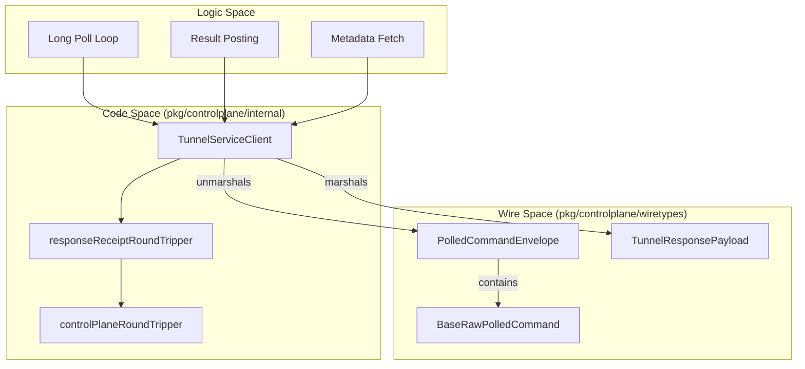
Sources: [pkg/controlplane/internal/tunnel_service_client.go:50-69](), [pkg/controlplane/internal/roundtripper.go:54-61](), [pkg/controlplane/internal/roundtripper.go:72-81](), [pkg/controlplane/wiretypes/wire.go:79-137]()

---

## The Poller Loop

The `poller` is a high-level coordinator that runs the infinite polling loop. It bridges the `TunnelServiceClient` (the Fetcher) and the `dispatcher` (the Queue) [pkg/controlplane/internal/poller.go:44-55]().

### Backpressure and Backoff
The poller implements a pull-based backpressure model:
1.  **Capacity Check**: Before polling, it calculates available slots in the dispatcher queue using `availableSlots()` [pkg/controlplane/internal/poller.go:128-129]().
2.  **Limit Calculation**: It requests a batch size equal to the available queue slots, capped by `maxPollBatchSize` (25) [pkg/controlplane/internal/poller.go:24|136]().
3.  **Backpressure Delay**: If the queue is full, the poller calls `waitForQueue()` which sleeps for `defaultQueueFullDelay` (100ms) [pkg/controlplane/internal/poller.go:21|265-274]().
4.  **Exponential Backoff**: On network errors or 5xx responses, it uses an exponential backoff (200ms to 10s) [pkg/controlplane/internal/poller.go:22-23|91-96](). It also honors the `Retry-After` header if provided by the service [pkg/controlplane/internal/poller.go:158-160]().

### Shard Tokens and Routing
Every command received from the control plane includes a `shard_token` [pkg/controlplane/wiretypes/wire.go:99](). This token is opaque to the client but is critical for the Tunnel Service to route responses back to the correct internal shard. The client must echo it back in the `X-Tunnel-Shard-Token` header during `PostResponse` [pkg/controlplane/internal/tunnel_service_client.go:427]().

### Poll Deadline Guardrail
To prevent requests from hanging indefinitely, the client implements a "guardrail" mechanism. The HTTP client timeout is set to a `pollDeadline` calculated as `PollTimeout` + `PollDeadlineGuardrail` [pkg/controlplane/internal/tunnel_service_client.go:102-104|118](). This ensures the client-side timeout is always slightly longer than the server-side long-poll duration (default 20s), allowing the server to close the connection gracefully first.

**Poller Data Flow**
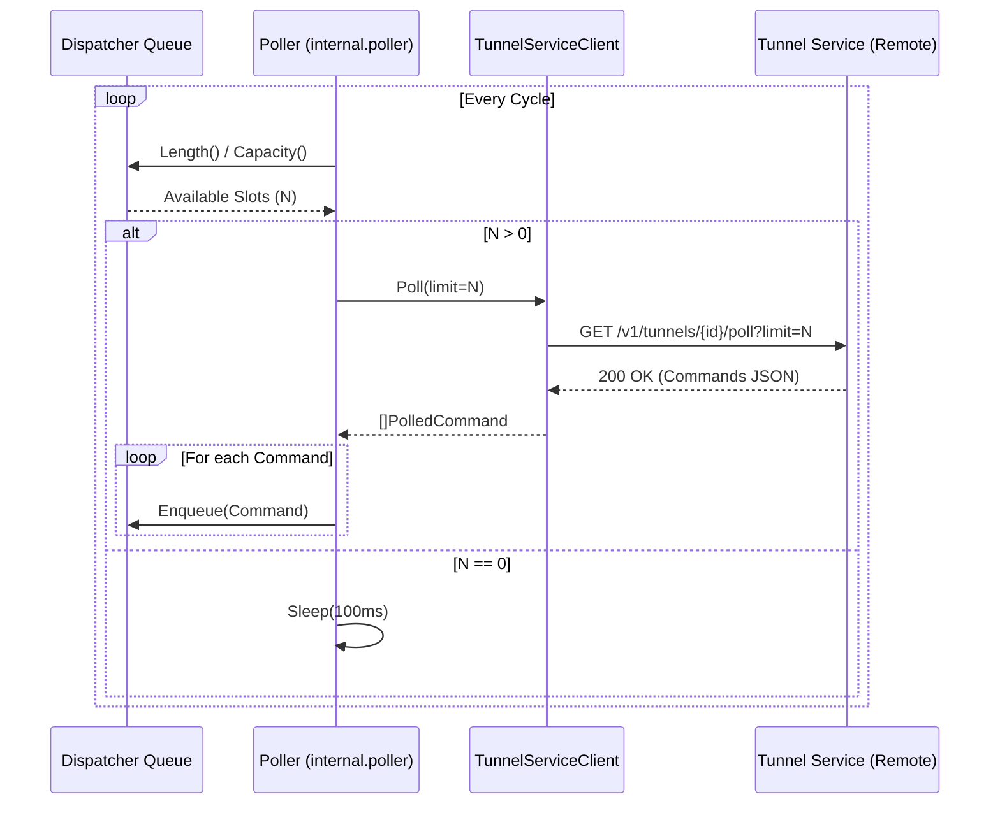
Sources: [pkg/controlplane/internal/poller.go:121-147](), [pkg/controlplane/internal/poller.go:224-250](), [pkg/controlplane/internal/tunnel_service_client.go:331-350]()

---

## Observability and Metrics

The poller and client are instrumented with OpenTelemetry to provide visibility into the health of the tunnel connection.

### Key Metrics
| Metric Name | Type | Description |
| :--- | :--- | :--- |
| `tunnel_client.controlplane.commands_polled` | Counter | Total number of commands received from the service [pkg/controlplane/internal/metrics.go:61](). |
| `tunnel_client.controlplane.poll_errors` | Counter | Count of failed poll requests, labeled by `error_kind` [pkg/controlplane/internal/metrics.go:63](). |
| `tunnel_client.controlplane.poll_latency` | Histogram | Duration of poll requests in seconds [pkg/controlplane/internal/metrics.go:64](). |
| `tunnel_client.controlplane.commands_age` | Histogram | Time elapsed between command creation at the service and receipt at the client [pkg/controlplane/internal/metrics.go:62](). |
| `tunnel_client.controlplane.queue_length` | Gauge | Current number of commands waiting in the dispatcher queue [pkg/controlplane/internal/metrics.go:81-83](). |

### Error Handling
The client parses structured error bodies from the control plane into `APIStatusError` [pkg/controlplane/internal/tunnel_service_client.go:162-172](). These errors include the HTTP status code, an internal error code (e.g., `rate_limit_exceeded`), and a human-readable message, which are then propagated to the logs and metrics [pkg/controlplane/internal/poller.go:170-184]().

Sources: [pkg/controlplane/internal/metrics.go:19-66](), [pkg/controlplane/internal/tunnel_service_client.go:173-196](), [pkg/controlplane/internal/poller.go:154-160]()

---

# Page: Dispatcher and Command Processing

# Dispatcher and Command Processing

<details>
<summary>Relevant source files</summary>

The following files were used as context for generating this wiki page:

- [e2e/tunnel_failure_wire_e2e_test.go](e2e/tunnel_failure_wire_e2e_test.go)
- [pkg/dispatcher/fxmodule.go](pkg/dispatcher/fxmodule.go)
- [pkg/dispatcher/fxmodule_test.go](pkg/dispatcher/fxmodule_test.go)
- [pkg/dispatcher/internal/metrics.go](pkg/dispatcher/internal/metrics.go)
- [pkg/dispatcher/internal/processor.go](pkg/dispatcher/internal/processor.go)
- [pkg/dispatcher/internal/processor_test.go](pkg/dispatcher/internal/processor_test.go)
- [pkg/dispatcher/internal/queue_listener.go](pkg/dispatcher/internal/queue_listener.go)
- [pkg/dispatcher/internal/queue_listener_test.go](pkg/dispatcher/internal/queue_listener_test.go)
- [pkg/dispatcher/internal/tunnel_failure.go](pkg/dispatcher/internal/tunnel_failure.go)
- [pkg/dispatcher/internal/tunnel_failure_test.go](pkg/dispatcher/internal/tunnel_failure_test.go)
- [pkg/harpoon/metrics.go](pkg/harpoon/metrics.go)
- [pkg/harpoon/metrics_test.go](pkg/harpoon/metrics_test.go)
- [pkg/mcpclient/forwarding_transport.go](pkg/mcpclient/forwarding_transport.go)
- [pkg/mcpclient/forwarding_transport_impl.go](pkg/mcpclient/forwarding_transport_impl.go)
- [pkg/mcpclient/forwarding_transport_impl_test.go](pkg/mcpclient/forwarding_transport_impl_test.go)
- [pkg/mcpclient/internal/context.go](pkg/mcpclient/internal/context.go)
- [pkg/mcpclient/internal/roundtripper.go](pkg/mcpclient/internal/roundtripper.go)
- [pkg/mcpclient/internal/roundtripper_test.go](pkg/mcpclient/internal/roundtripper_test.go)
- [pkg/mcpclient/serialized_forwarding_transport.go](pkg/mcpclient/serialized_forwarding_transport.go)
- [pkg/mcpclient/serialized_forwarding_transport_test.go](pkg/mcpclient/serialized_forwarding_transport_test.go)
- [pkg/mcpclient/shared_connection_transport.go](pkg/mcpclient/shared_connection_transport.go)
- [pkg/mcpclient/shared_connection_transport_test.go](pkg/mcpclient/shared_connection_transport_test.go)
- [pkg/oauth/discovery_retry_policy.go](pkg/oauth/discovery_retry_policy.go)
- [pkg/proxyhealth/checker.go](pkg/proxyhealth/checker.go)
- [pkg/proxyhealth/checker_test.go](pkg/proxyhealth/checker_test.go)
- [pkg/types/channel.go](pkg/types/channel.go)

</details>


The Dispatcher is the core orchestration layer of the `tunnel-client`. It provides a bounded in-memory queue that decouples the high-frequency polling of the OpenAI Control Plane from the execution of commands on downstream MCP servers. This decoupling ensures that network latency or slow MCP server responses do not block the polling loop, while providing a backpressure mechanism to prevent resource exhaustion.

## Work Queue and Decoupling

The dispatcher implements a producer-consumer pattern using a Go channel of type `PolledCommandQueue` [pkg/dispatcher/fxmodule.go:39-39]().

1.  **Queue Sizing**: The queue size is determined by the `MaxInFlightRequests` configuration [pkg/dispatcher/fxmodule.go:44-46]().
2.  **Producer**: The Poller (see Section 3.1) fetches commands from the tunnel service and pushes them into this channel.
3.  **Consumer**: The `QueueListener` drains the queue and distributes work to a worker pool [pkg/dispatcher/internal/queue_listener.go:45-51]().

### Worker Pool Implementation
The `QueueListener` utilizes a bounded worker pool (via the `ants` library) to limit concurrent execution [pkg/dispatcher/internal/queue_listener.go:106-113](). If the worker pool is saturated, the listener will block until a worker becomes available, naturally applying backpressure to the Poller [pkg/dispatcher/internal/queue_listener_test.go:193-215]().

### Diagram: Command Flow and Worker Decoupling
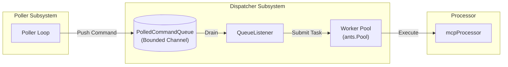
**Sources:** [pkg/dispatcher/fxmodule.go:42-51](), [pkg/dispatcher/internal/queue_listener.go:47-55](), [pkg/dispatcher/internal/queue_listener_test.go:193-215]()

---

## The mcpProcessor and Routing Logic

The `mcpProcessor` is the concrete implementation of the `Processor` interface [pkg/dispatcher/internal/processor.go:74-86](). It is responsible for routing a `PolledCommand` to the correct MCP transport based on the command's "channel" attribute.

### Channel Bindings
Channels allow the tunnel to multiplex different types of traffic. Every `tunnel-client` must support at least two required channels:
*   **MAIN** (`types.DefaultChannel`): Standard MCP traffic (JSON-RPC) and OAuth discovery [pkg/dispatcher/internal/processor.go:37-37]().
*   **harpoon**: Traffic destined for the embedded Harpoon outbound proxy [pkg/dispatcher/internal/processor.go:38-38]().

Each channel is configured via a `ChannelBinding` struct [pkg/dispatcher/internal/processor.go:52-59]():
*   **Transport**: The `mcpclient.ForwardingTransport` used to communicate with the target [pkg/dispatcher/internal/processor.go:53-53]().
*   **SupportsMCP**: Gates normal JSON-RPC forwarding [pkg/dispatcher/internal/processor.go:56-56]().
*   **SupportsOAuth**: Restricted to the main channel; gates OAuth discovery derived from the primary MCP URL [pkg/dispatcher/internal/processor.go:57-57]().
*   **SupportsSessionTermination**: Used for HTTP-based transports to signal session end [pkg/dispatcher/internal/processor.go:58-58]().

### Command Routing Logic
When `Process()` is called, the dispatcher performs the following steps:
1.  **Channel Resolution**: Identifies the target channel from the command metadata.
2.  **Routability Check**: Validates if the channel is currently active (e.g., Harpoon is only routable if it has registered targets) [pkg/dispatcher/fxmodule.go:146-148]().
3.  **Method Dispatch**:
    *   **JSON-RPC**: If the command contains a JSON-RPC request, it is forwarded via the channel's transport [pkg/dispatcher/internal/processor_test.go:189-191]().
    *   **OAuth Discovery**: The processor performs OAuth discovery probes if the channel supports it [pkg/dispatcher/internal/processor.go:57-57]().
    *   **Session Termination**: Closes the underlying transport session if supported, specifically using `terminateStreamableSession` for HTTP transports to preserve context deadlines [pkg/mcpclient/forwarding_transport_impl.go:95-118]().

**Sources:** [pkg/dispatcher/internal/processor.go:36-59](), [pkg/dispatcher/fxmodule.go:105-125](), [pkg/dispatcher/fxmodule.go:162-200]()

---

## Response Forwarding and Error Propagation

The dispatcher maintains a response loop for every command it processes. It translates MCP transport responses back into the wire format required by the OpenAI Control Plane.

### JSON-RPC Processing
For standard tool calls or notifications:
1.  **Headers**: The dispatcher propagates headers from the control plane to the MCP server via `ContextWithHeaders` [pkg/mcpclient/forwarding_transport_impl.go:139-142]().
2.  **Serialization**: Stdio and Harpoon channels use `NewSerializedForwardingTransport` to ensure only one request lifecycle is active at a time on the shared connection [pkg/dispatcher/fxmodule.go:188-190]().
3.  **Write/Read**: It writes the JSON-RPC request and waits for a response [pkg/mcpclient/forwarding_transport_impl.go:135-166]().
4.  **Error Preservation**: If the MCP server returns a non-2xx HTTP status, the dispatcher attempts to extract a valid JSON-RPC error from the body using `preservedMCPError` [pkg/mcpclient/forwarding_transport_impl.go:178-222]().

### Error Propagation
If an error occurs during processing (e.g., transport failure), the dispatcher generates a terminal JSON-RPC error response [pkg/dispatcher/internal/processor_test.go:51-68](). This ensures the Control Plane receives a definitive status. Terminal failures are structured as `tunnelFailure` data within the JSON-RPC error [pkg/dispatcher/internal/processor_test.go:70-80]().

### Diagram: Processor Entity Space
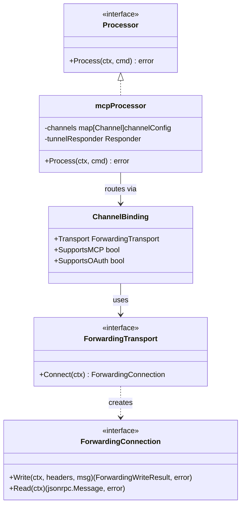
**Sources:** [pkg/dispatcher/internal/processor.go:44-59](), [pkg/mcpclient/forwarding_transport.go:15-32](), [pkg/mcpclient/forwarding_transport_impl.go:124-166]()

---

## Metrics and Observability

The dispatcher exports several OpenTelemetry metrics to monitor the health of the worker pool and command processing:

| Metric Name | Type | Description |
| :--- | :--- | :--- |
| `dispatcher_worker_pool_capacity` | Gauge | Total size of the worker pool (`MaxConcurrentRequests`) [pkg/dispatcher/internal/queue_listener_test.go:229-229](). |
| `dispatcher_worker_pool_occupancy` | Gauge | Number of workers currently processing a command [pkg/dispatcher/internal/queue_listener_test.go:230-230](). |
| `dispatcher_command_processing_duration` | Histogram | Time taken from queue drain to final response delivery [pkg/dispatcher/internal/metrics.go:1-30](). |

**Sources:** [pkg/dispatcher/internal/queue_listener.go:45-100](), [pkg/dispatcher/internal/queue_listener_test.go:226-231]()

---

# Page: MCP Client and Transport Layer

# MCP Client and Transport Layer

<details>
<summary>Relevant source files</summary>

The following files were used as context for generating this wiki page:

- [examples/go-sdk-inmemory/README.md](examples/go-sdk-inmemory/README.md)
- [examples/go-sdk-inmemory/main.go](examples/go-sdk-inmemory/main.go)
- [examples/go-sdk-inmemory/main_test.go](examples/go-sdk-inmemory/main_test.go)
- [examples/go-sdk-inmemory/ready_file_health_check.sh](examples/go-sdk-inmemory/ready_file_health_check.sh)
- [pkg/adminui/channel_status.go](pkg/adminui/channel_status.go)
- [pkg/adminui/status_test.go](pkg/adminui/status_test.go)
- [pkg/adminui/system.go](pkg/adminui/system.go)
- [pkg/adminui/system_test.go](pkg/adminui/system_test.go)
- [pkg/dispatcher/internal/processor.go](pkg/dispatcher/internal/processor.go)
- [pkg/dispatcher/internal/processor_test.go](pkg/dispatcher/internal/processor_test.go)
- [pkg/mcpclient/channel_transport_factory.go](pkg/mcpclient/channel_transport_factory.go)
- [pkg/mcpclient/channel_transport_factory_test.go](pkg/mcpclient/channel_transport_factory_test.go)
- [pkg/mcpclient/forwarding_transport_impl.go](pkg/mcpclient/forwarding_transport_impl.go)
- [pkg/mcpclient/forwarding_transport_impl_test.go](pkg/mcpclient/forwarding_transport_impl_test.go)
- [pkg/mcpclient/fxmodule.go](pkg/mcpclient/fxmodule.go)
- [pkg/mcpclient/fxmodule_test.go](pkg/mcpclient/fxmodule_test.go)
- [pkg/mcpclient/probe_state.go](pkg/mcpclient/probe_state.go)
- [pkg/mcpclient/probe_state_test.go](pkg/mcpclient/probe_state_test.go)
- [pkg/mcpclient/serialized_forwarding_transport.go](pkg/mcpclient/serialized_forwarding_transport.go)
- [pkg/mcpclient/serialized_forwarding_transport_test.go](pkg/mcpclient/serialized_forwarding_transport_test.go)
- [pkg/mcpclient/shared_connection_transport.go](pkg/mcpclient/shared_connection_transport.go)
- [pkg/mcpclient/shared_connection_transport_test.go](pkg/mcpclient/shared_connection_transport_test.go)
- [pkg/mcpclient/stdio_command.go](pkg/mcpclient/stdio_command.go)
- [pkg/mcpclient/stdio_command_test.go](pkg/mcpclient/stdio_command_test.go)
- [pkg/mcpclient/transport_provider.go](pkg/mcpclient/transport_provider.go)
- [pkg/mcpclient/transport_provider_fx.go](pkg/mcpclient/transport_provider_fx.go)
- [pkg/transport/default.go](pkg/transport/default.go)
- [pkg/transport/default_test.go](pkg/transport/default_test.go)
- [plugins/tunnel-mcp/skills/tunnel-mcp/references/binary.md](plugins/tunnel-mcp/skills/tunnel-mcp/references/binary.md)

</details>


The `mcpclient` package implements the communication bridge between the `tunnel-client` and Model Context Protocol (MCP) servers. It abstracts various communication methods—local processes, remote HTTP services, and in-memory providers—into a unified transport interface, while managing complex networking requirements like mTLS, proxies, and request serialization.

## Transport Architecture

The `mcpclient` package uses a provider-based architecture to instantiate transports based on the `TransportKind` defined in the configuration [pkg/config/config.go:138-144]().

### Transport Kinds

| Kind | Code Entity | Description |
| :--- | :--- | :--- |
| `http-streamable` | `mcp.StreamableClientTransport` | Standard MCP over HTTP using Server-Sent Events (SSE) for downstream communication [pkg/mcpclient/fxmodule.go:102](). |
| `stdio` | `stdioCommandTransport` | Manages a local child process, communicating via `stdin` and `stdout` [pkg/mcpclient/stdio_command.go:27](). |
| `in-memory` | `sharedConnectionTransport` | Facilitates direct in-process communication, primarily used for the internal Harpoon service [pkg/mcpclient/shared_connection_transport.go:14](). |

### Entity Mapping: Configuration to Implementation
The following diagram maps configuration symbols to the specific Go structs and functions responsible for transport lifecycle.

**Transport Resolution Logic**
```mermaid
graph TD
    subgraph "Natural Language Space"
        CFG["MCP Configuration"]
        BIND["Channel Binding"]
    end

    subgraph "Code Entity Space: mcpclient"
        CTF["ChannelTransportFactory.Build()"]
        STP["streamableTransportProvider"]
        STDTP["stdioTransportProvider"]
        ITP["injectableTransportProvider"]
        
        CTF -- "selects" --> STP
        CTF -- "selects" --> STDTP
        CTF -- "selects" --> ITP
        
        STP -- "instantiates" --> MCT["mcp.StreamableClientTransport"]
        STDTP -- "manages" --> SCT["stdioCommandTransport"]
        ITP -- "wraps" --> SHCT["sharedConnectionTransport"]
    end

    CFG --> BIND
    BIND -- "TransportKind" --> CTF
```
Sources: [pkg/mcpclient/channel_transport_factory.go:98-158](), [pkg/mcpclient/transport_provider.go:12-23](), [pkg/mcpclient/transport_provider.go:35-43]()

## ChannelTransportFactory

The `ChannelTransportFactory` is the central coordinator for all transports. It ensures that logical tunnel channels (e.g., `default`, `harpoon`) map to stable, cached transport instances [pkg/mcpclient/channel_transport_factory.go:30-44]().

### Key Responsibilities
- **Concurrency Control**: Uses `singleflight.Group` to ensure that simultaneous requests for a new channel (like a cold-start `stdio` process) only trigger a single initialization routine [pkg/mcpclient/channel_transport_factory.go:114-149]().
- **HTTP Client Scoping**: Builds specialized `http.Client` instances for each binding, applying specific proxy settings, Unix domain socket dialers, or mTLS certificates [pkg/mcpclient/channel_transport_factory.go:174-206]().
- **Transport Decoration**: Wraps base transports in a `mcp.LoggingTransport` if `HTTPRawUnsafe` is enabled in `LoggingConfig`, allowing for raw JSON-RPC inspection in debug logs [pkg/mcpclient/channel_transport_factory.go:160-172]().

Sources: [pkg/mcpclient/channel_transport_factory.go:61-73](), [pkg/mcpclient/channel_transport_factory.go:98-106](), [pkg/mcpclient/channel_transport_factory.go:188]()

## Stdio Transport Implementation

The `stdioCommandTransport` manages the lifecycle of local MCP server processes.

- **Process Lifecycle**: It integrates with `fx.Lifecycle` to start the process on application boot and ensure it is killed on shutdown [pkg/mcpclient/stdio_command.go:53-85]().
- **Error Propagation**: If the child process exits unexpectedly, the transport triggers a global application shutdown via `fx.Shutdowner` [pkg/mcpclient/stdio_command.go:89-125]().
- **Runtime Monitoring**: It provides `StdioRuntimeInfo`, exposing the process PID and command arguments to the Admin UI for monitoring [pkg/mcpclient/stdio_command.go:162-189]().

Sources: [pkg/mcpclient/stdio_command.go:27-50](), [pkg/mcpclient/stdio_command.go:182-184]()

## Forwarding and Serialized Transport

The `ForwardingTransport` interface allows the `dispatcher` to send raw JSON-RPC messages without maintaining a full `mcp.Client` session for every request.

### SerializedForwardingTransport
Certain transports (like those multiplexing over a single stream) require strict request-response ordering. The `serializedForwardingTransport` wrapper enforces this using a "lifecycle slot" [pkg/mcpclient/serialized_forwarding_transport.go:11-27]().

**Request Serialization Flow**
```mermaid
sequenceDiagram
    participant P as mcpProcessor
    participant S as SerializedForwardingTransport
    participant C as Base Connection

    P->>S: Write(Request ID: 1)
    Note over S: Acquire Lifecycle Slot
    S->>C: Write(Request ID: 1)
    
    P->>S: Write(Request ID: 2)
    Note over S: Blocked: Slot Held by ID 1
    
    C->>S: Read(Response ID: 1)
    Note over S: Release Lifecycle Slot
    S->>P: Response ID: 1
    
    Note over S: ID 2 proceeds to Acquire Slot
    S->>C: Write(Request ID: 2)
```
Sources: [pkg/mcpclient/serialized_forwarding_transport.go:64-79](), [pkg/mcpclient/serialized_forwarding_transport.go:94-114](), [pkg/mcpclient/serialized_forwarding_transport.go:168-191]()

## Probe State and Connectivity

At startup, the `mcpclient` package invokes `probeMcpServer` to verify the primary MCP server is reachable [pkg/mcpclient/fxmodule.go:40]().

- **ProbeState**: Stores the result of the startup handshake. It can be queried by the health system or Admin UI to determine if the client is "Ready" [pkg/mcpclient/probe_state.go:13-19]().
- **Auth Discovery**: If the probe fails with an `HTTP 401 Unauthorized`, `IsAuthRequiredProbeError` identifies that the server requires OAuth discovery [pkg/mcpclient/probe_state.go:98-101]().
- **Timeout**: The probe defaults to a 2-second timeout [pkg/mcpclient/fxmodule.go:43]().

Sources: [pkg/mcpclient/fxmodule.go:128-180](), [pkg/mcpclient/probe_state.go:40-51](), [pkg/mcpclient/probe_state.go:137-163]()

## Header Forwarding

The transport layer handles two categories of headers:
1. **Static Headers**: `ExtraHeaders` and `DiscoveryExtraHeaders` defined in `MCPConfig` are applied to all outbound HTTP requests [pkg/mcpclient/channel_transport_factory.go:188]().
2. **Forwarded Headers**: Headers received from the Control Plane (such as `Authorization` or `Openai-Organization`) are scoped to the specific MCP channel that received the command, preventing credential leakage across logical channels [pkg/mcpclient/fxmodule_test.go:216-223]().

Sources: [pkg/mcpclient/channel_transport_factory.go:188](), [pkg/mcpclient/fxmodule.go:183-195]()

---

# Page: OAuth Discovery and Protected Resource Metadata

# OAuth Discovery and Protected Resource Metadata

<details>
<summary>Relevant source files</summary>

The following files were used as context for generating this wiki page:

- [e2e/notification_forwarding_e2e_test.go](e2e/notification_forwarding_e2e_test.go)
- [e2e/oauth_discovery_e2e_test.go](e2e/oauth_discovery_e2e_test.go)
- [e2e/oauth_protection_e2e_test.go](e2e/oauth_protection_e2e_test.go)
- [pkg/adminui/oauth.go](pkg/adminui/oauth.go)
- [pkg/adminui/oauth_test.go](pkg/adminui/oauth_test.go)
- [pkg/harpoon/host_registration.go](pkg/harpoon/host_registration.go)
- [pkg/harpoon/host_registration_test.go](pkg/harpoon/host_registration_test.go)
- [pkg/harpoon/hostbus/hostbus.go](pkg/harpoon/hostbus/hostbus.go)
- [pkg/harpoon/metadata.go](pkg/harpoon/metadata.go)
- [pkg/oauth/auth_meta.go](pkg/oauth/auth_meta.go)
- [pkg/oauth/auth_meta_test.go](pkg/oauth/auth_meta_test.go)
- [pkg/oauth/discovery.go](pkg/oauth/discovery.go)
- [pkg/oauth/discovery_failure.go](pkg/oauth/discovery_failure.go)
- [pkg/oauth/discovery_failure_test.go](pkg/oauth/discovery_failure_test.go)
- [pkg/oauth/discovery_test.go](pkg/oauth/discovery_test.go)
- [pkg/oauth/hostbundle.go](pkg/oauth/hostbundle.go)
- [pkg/oauth/hostbundle_test.go](pkg/oauth/hostbundle_test.go)
- [pkg/oauth/module.go](pkg/oauth/module.go)
- [pkg/oauth/module_test.go](pkg/oauth/module_test.go)
- [pkg/oauth/resource_meta.go](pkg/oauth/resource_meta.go)
- [pkg/oauth/resource_meta_test.go](pkg/oauth/resource_meta_test.go)
- [pkg/oauth/state.go](pkg/oauth/state.go)
- [testsupport/mocktunnelservice/doc.go](testsupport/mocktunnelservice/doc.go)

</details>


The `tunnel-client` implements automated OAuth discovery to identify authorization servers and protected resource boundaries associated with an MCP server. This process allows the client to dynamically configure its security context and register necessary endpoints with the Harpoon outbound proxy.

## Overview

Discovery is a background process triggered at startup for HTTP-based MCP servers [pkg/oauth/module.go:67-75](). It follows the Model Context Protocol (MCP) OAuth extension patterns, specifically searching for **Protected Resource Metadata (PRMD)**.

The discovery flow involves:
1.  **Probing**: Checking the MCP server for `WWW-Authenticate` headers or well-known metadata paths [pkg/oauth/module.go:82-87]().
2.  **Fetching**: Retrieving the PRMD JSON document [pkg/oauth/discovery.go:25-30]().
3.  **Enrichment**: Resolving RFC 8414 Authorization Server metadata for the discovered issuers [pkg/oauth/hostbundle.go:140-156]().
4.  **Registration**: Publishing the resulting URLs to the `HostRegistrationBus` for Harpoon allowlisting [pkg/oauth/module.go:129-133]().

### Discovery Data Flow

The following diagram illustrates the lifecycle of discovery from the initial probe to host registration.

**Discovery to Registration Pipeline**
```mermaid
sequenceDiagram
    participant M as "oauth.startOAuthDiscovery [pkg/oauth/module.go]"
    participant P as "WWWAuthenticateProbe [pkg/oauth/resource_meta.go]"
    participant F as "oauth.FetchOAuthMetadata [pkg/oauth/discovery.go]"
    participant B as "oauth.buildURLBundleFromPRMDWithAuthServerMetadata [pkg/oauth/hostbundle.go]"
    participant Bus as "hostbus.HostRegistrationBus [pkg/harpoon/hostbus/hostbus.go]"

    M->>P: BuildOAuthDiscoveryCandidates(serverURL)
    P-->>M: candidates (headers + well-known)
    M->>F: FetchOAuthMetadata(candidates)
    F-->>M: PRMD Payload (Resource + Auth Servers)
    M->>B: buildURLBundleFromPRMDWithAuthServerMetadata
    Note over B: Fetches /.well-known/oauth-authorization-server
    B-->>M: hostbus.URLBundle
    M->>Bus: Publish(bundle)
```
Sources: [pkg/oauth/module.go:77-135](), [pkg/oauth/discovery.go:25-30](), [pkg/oauth/hostbundle.go:110-165]()

## Discovery Mechanisms

The client uses several strategies to find the PRMD document, governed by `BuildOAuthDiscoveryCandidates` [pkg/oauth/resource_meta.go:34-45]().

### 1. WWW-Authenticate Probe
The client performs a `GET` request to the MCP server root. If the server responds with a `401 Unauthorized` containing a `WWW-Authenticate` header, the client parses the `resource_metadata` parameter to find the PRMD URL [pkg/oauth/resource_meta.go:78-85]().

### 2. Well-Known Paths
If the probe does not yield a URL, the client tries standardized paths relative to the MCP server URL [pkg/oauth/resource_meta.go:12-25]():
-   `/.well-known/oauth-protected-resource/{path_to_mcp}`
-   `/.well-known/oauth-protected-resource`

### 3. Authorization Server Metadata
Once a PRMD is retrieved, the client identifies the primary authorization server (`authorization_servers[0]`) [pkg/oauth/hostbundle.go:128-135](). It then attempts to fetch RFC 8414 metadata (e.g., `token_endpoint`, `jwks_uri`) by trying [pkg/oauth/auth_meta.go:71-74]():
-   `/.well-known/oauth-authorization-server`
-   `/.well-known/openid-configuration` (fallback)

Sources: [pkg/oauth/resource_meta.go:12-25](), [pkg/oauth/auth_meta.go:71-74](), [pkg/oauth/hostbundle.go:110-165]()

## Implementation Details

### DiscoveryState
The `DiscoveryState` struct tracks the background progress and stores the final `DiscoveryResult` [pkg/oauth/state.go:29-37](). It uses a `sync.Once` and a `done` channel to allow other subsystems (like the Health check or Admin UI) to wait for discovery completion [pkg/oauth/state.go:58-81]().

### Retry Policy and Timeouts
Discovery uses a two-pass execution model:
1.  **Initial Pass**: Attempts all candidates with a standard timeout [pkg/oauth/discovery.go:54-61]().
2.  **Retry Pass**: If the first pass fails solely due to timeouts, it retries with an exponential backoff strategy (`doWithRetryForTimeout`) [pkg/oauth/discovery.go:66-77](), [pkg/oauth/discovery.go:209-220]().

### Host Bundle Construction
The `buildURLBundleFromPRMDWithAuthServerMetadata` function converts the raw PRMD and resolved auth metadata into a `hostbus.URLBundle` [pkg/oauth/hostbundle.go:110-165]().

**Entity Mapping: OAuth Metadata to HostBus**
| Code Entity | Role in Discovery | Source |
| :--- | :--- | :--- |
| `oauthex.ProtectedResourceMetadata` | Schema for the PRMD JSON payload. | [pkg/oauth/hostbundle.go:119]() |
| `oauth.AuthServerMetadataFetchResult` | Result of resolving endpoints (token, jwks, etc.). | [pkg/oauth/auth_meta.go:19-27]() |
| `hostbus.URLRecord` | A single URL with metadata tags (e.g., `role: token-endpoint`). | [pkg/oauth/hostbundle.go:197-232]() |
| `hostbus.URLBundle` | Collection of records published to Harpoon. | [pkg/harpoon/hostbus/hostbus.go:21-25]() |

Sources: [pkg/oauth/state.go:13-26](), [pkg/oauth/discovery.go:209-220](), [pkg/oauth/hostbundle.go:110-165]()

## Integration with Harpoon

The `oauth.Module` is wired via `fx` to receive a `hostbus.HostRegistrationBus` [pkg/oauth/module.go:34](). Once discovery succeeds and the bundle is built, it is published to the bus [pkg/oauth/module.go:131-133](). 

Harpoon listens to this bus via `startHostRegistration` to dynamically update its allowlist, ensuring that the `tunnel-client` can reach the newly discovered OAuth endpoints [pkg/harpoon/host_registration.go:58-101]().

**Component Interaction Diagram**
```mermaid
graph TD
    subgraph "oauth package"
        DS["DiscoveryState [pkg/oauth/state.go]"]
        DM["startOAuthDiscovery [pkg/oauth/module.go]"]
        HB["buildURLBundleFromPRMDWithAuthServerMetadata [pkg/oauth/hostbundle.go]"]
    end

    subgraph "harpoon package"
        HRB["HostRegistrationBus [pkg/harpoon/hostbus/hostbus.go]"]
        Registry["Registry [pkg/harpoon/registry.go]"]
        SHR["startHostRegistration [pkg/harpoon/host_registration.go]"]
    end

    DM -- "updates" --> DS
    DM -- "triggers" --> HB
    HB -- "returns bundle" --> DM
    DM -- "Publish(bundle)" --> HRB
    HRB -- "notifies" --> SHR
    SHR -- "RegisterTarget" --> Registry
```
Sources: [pkg/oauth/module.go:20-24](), [pkg/oauth/module.go:125-133](), [pkg/harpoon/host_registration.go:75-89](), [pkg/oauth/state.go:29-37]()

## Error Handling

Discovery is considered **optional** for standard MCP servers. The function `IsOptionalDiscoveryFailure` determines if a failure should block system readiness [pkg/oauth/discovery_failure.go:11-15](). 
-   **Optional**: 404 Not Found on all well-known paths, or discovery being disabled for `stdio` transports [pkg/oauth/discovery_failure.go:21-43]().
-   **Critical**: Malformed PRMD JSON or 5xx errors on paths that were explicitly advertised via `WWW-Authenticate` [pkg/oauth/discovery.go:187-200]().

Sources: [pkg/oauth/discovery_failure.go:8-44](), [pkg/oauth/discovery.go:165-185]()

---

# Page: Harpoon Subsystem

# Harpoon Subsystem

<details>
<summary>Relevant source files</summary>

The following files were used as context for generating this wiki page:

- [pkg/harpoon/fxmodule.go](pkg/harpoon/fxmodule.go)
- [pkg/harpoon/fxmodule_test.go](pkg/harpoon/fxmodule_test.go)
- [pkg/harpoon/integration_test.go](pkg/harpoon/integration_test.go)
- [pkg/harpoon/registry.go](pkg/harpoon/registry.go)
- [pkg/harpoon/registry_test.go](pkg/harpoon/registry_test.go)
- [pkg/harpoon/server.go](pkg/harpoon/server.go)
- [pkg/harpoon/server_test.go](pkg/harpoon/server_test.go)

</details>


The Harpoon subsystem is an embedded Model Context Protocol (MCP) server within the `tunnel-client` that acts as an allowlisted outbound HTTP proxy. It enables OpenAI models to securely interact with internal services or protected resources by providing a controlled interface for making HTTP requests.

The subsystem enforces strict security boundaries by only permitting requests to targets registered in its `Registry` [pkg/harpoon/registry.go:35-47]() and applying transformations to outbound headers and response bodies [pkg/harpoon/server.go:45-81]().

## System Overview

The Harpoon subsystem is integrated into the client's runtime via the `fx` module system [pkg/harpoon/fxmodule.go:29-33](). It exposes two primary MCP tools: `list_targets` and `call_target` [pkg/harpoon/server.go:127-134]().

### Component Architecture

The following diagram illustrates how the Harpoon components interact with the central `Dispatcher` and the external network.

**Harpoon Code Entity Map**
```mermaid
graph TD
    subgraph "Dispatcher Space"
        D["Dispatcher (pkg/dispatcher/Dispatcher)"]
    end

    subgraph "Harpoon Subsystem"
        S["Server (pkg/harpoon/Server)"]
        R["Registry (pkg/harpoon/Registry)"]
        CB["CallBuffer (pkg/harpoon/CallBuffer)"]
        HRB["HostRegistrationBus (pkg/harpoon/hostbus/Bus)"]
    end

    subgraph "Network Space"
        Target["Internal Service / Protected Resource"]
    end

    D -- "MCP Request" --> S
    S -- "Lookup Label" --> R
    S -- "HTTP Request" --> Target
    S -- "Log Call" --> CB
    HRB -- "Register New Host" --> R
```
Sources: [pkg/harpoon/server.go:87-96](), [pkg/harpoon/fxmodule.go:69-106](), [pkg/harpoon/registry.go:35-47](), [pkg/harpoon/call_buffer.go:30-35]()

## Integration with Dispatcher

The Harpoon server is connected to the `Dispatcher` using an in-memory transport [pkg/harpoon/fxmodule.go:107-109](). When the Control Plane sends a command targeting the `harpoon` channel, the `Dispatcher` routes the JSON-RPC request to the embedded `Server.MCPServer()` [pkg/harpoon/fxmodule.go:107-158]().

Key integration points include:
*   **In-Memory Transport**: Provides low-latency communication between the client's core and the embedded server [pkg/harpoon/fxmodule.go:66-67](), [pkg/harpoon/fxmodule.go:157-158]().
*   **HTTP Streamable Transport**: Optionally exposes the Harpoon MCP server over a local HTTP endpoint (typically restricted to loopback) via `mcp.NewStreamableHTTPHandler` [pkg/harpoon/fxmodule.go:190-219]().
*   **Target Registration**: Programmatic registration during startup via `TargetRegistrar` [pkg/harpoon/fxmodule.go:35-43]().

## Core Components

### Harpoon Server and Registry
The `Server` handles the execution of MCP tools. It uses the `Registry` to validate that the requested `label` corresponds to an allowlisted `BaseURL` [pkg/harpoon/server.go:87-96](). It enforces security by blocking specific headers (e.g., `Cookie`, `Authorization`, `X-Forwarded-For`) [pkg/harpoon/server.go:45-81]() and manages request timeouts and redirects [pkg/harpoon/server.go:31-33]().

For details, see [Harpoon Server and Registry](#4.1).

### Harpoon Host Registration
While targets can be statically configured via `HarpoonConfig` [pkg/harpoon/fxmodule.go:77](), Harpoon supports dynamic registration. The `HostRegistrationBus` allows other subsystems, such as OAuth Discovery, to publish newly discovered protected resources as `URLBundle` objects, which are then added to the `Registry` [pkg/harpoon/fxmodule.go:186-188](), [pkg/harpoon/fxmodule.go:222-243]().

For details, see [Harpoon Host Registration](#4.2).

## Request Lifecycle

The following sequence shows the path of a `call_target` request:

**Call Target Sequence**
```mermaid
sequenceDiagram
    participant C as Control Plane
    participant D as Dispatcher
    participant S as Harpoon Server (pkg/harpoon/Server)
    participant R as Registry (pkg/harpoon/Registry)
    participant T as Target Host

    C->>D: MCP Call (call_target, label="api")
    D->>S: Dispatch via in-memory transport
    S->>R: Lookup(label)
    R-->>S: Return Target (BaseURL)
    S->>S: filterHeaders(requestHeaders)
    S->>T: http.RoundTrip(req)
    T-->>S: http.Response
    S->>S: Read and Truncate Body
    S-->>D: mcp.CallToolResult (Base64 Body)
    D-->>C: Response via Tunnel
```
Sources: [pkg/harpoon/server.go:98-115](), [pkg/harpoon/server.go:217-223](), [pkg/harpoon/registry.go:217-226](), [pkg/harpoon/server_test.go:217-223]()

## Observability

Harpoon provides visibility into its operations, which is consumed by the Admin UI and metrics systems:
*   **Registry Summary**: The `Registry` provides a summary of all allowed targets, categories, and sources [pkg/harpoon/registry.go:195-204]().
*   **Call History**: The `CallBuffer` maintains a record of recent tool executions for diagnostic purposes [pkg/harpoon/call_buffer.go:12-27]().
*   **Metrics**: The server tracks metrics such as call counts, durations, and response sizes using OpenTelemetry [pkg/harpoon/server.go:93](), [pkg/harpoon/fxmodule.go:91-93]().

Sources: [pkg/harpoon/server.go:87-96](), [pkg/harpoon/fxmodule.go:127-144](), [pkg/harpoon/call_buffer.go:30-35]()

---

# Page: Harpoon Server and Registry

# Harpoon Server and Registry

<details>
<summary>Relevant source files</summary>

The following files were used as context for generating this wiki page:

- [e2e/harpoon_connection_ttl_e2e_test.go](e2e/harpoon_connection_ttl_e2e_test.go)
- [pkg/adminui/harpoon.go](pkg/adminui/harpoon.go)
- [pkg/adminui/harpoon_integration_test.go](pkg/adminui/harpoon_integration_test.go)
- [pkg/adminui/harpoon_test.go](pkg/adminui/harpoon_test.go)
- [pkg/harpoon/call_buffer.go](pkg/harpoon/call_buffer.go)
- [pkg/harpoon/fxmodule.go](pkg/harpoon/fxmodule.go)
- [pkg/harpoon/inmemory_transport.go](pkg/harpoon/inmemory_transport.go)
- [pkg/harpoon/inmemory_transport_test.go](pkg/harpoon/inmemory_transport_test.go)
- [pkg/harpoon/integration_test.go](pkg/harpoon/integration_test.go)
- [pkg/harpoon/registry.go](pkg/harpoon/registry.go)
- [pkg/harpoon/registry_test.go](pkg/harpoon/registry_test.go)
- [pkg/harpoon/server.go](pkg/harpoon/server.go)
- [pkg/harpoon/server_test.go](pkg/harpoon/server_test.go)
- [pkg/harpoon/transform.go](pkg/harpoon/transform.go)
- [pkg/harpoon/transform_test.go](pkg/harpoon/transform_test.go)

</details>


The Harpoon subsystem implements an embedded Model Context Protocol (MCP) server that acts as a constrained, allowlisted outbound HTTP proxy. It allows the OpenAI product to interact with internal services via the `tunnel-client` without requiring full network exposure. The Harpoon server enforces security policies such as target allowlisting, header sanitization, and response size limits.

## Harpoon MCP Server

The Harpoon server is implemented in `pkg/harpoon/server.go` and exposes two primary MCP tools: `list_targets` and `call_target`. It is wired into the application using Uber's `fx` library [pkg/harpoon/fxmodule.go:29-33]().

### MCP Tools

| Tool | Purpose | Request Type | Response Type |
| :--- | :--- | :--- | :--- |
| `list_targets` | Returns available allowlisted targets and their metadata. | `listTargetsRequest` | `listTargetsResponse` |
| `call_target` | Executes an HTTP request against a specific allowlisted target. | `callTargetRequest` | `callTargetResponse` |

Sources: [pkg/harpoon/server.go:87-96](), [pkg/harpoon/server.go:98-125](), [pkg/harpoon/server.go:136-170]()

### Call Flow Diagram
This diagram illustrates the flow of a `call_target` request from the MCP transport through the Harpoon `Server` to the final destination.

Title: Harpoon Call Flow Implementation
```mermaid
sequenceDiagram
    participant MCP as "mcp.Transport"
    participant S as "harpoon.Server"
    participant R as "harpoon.Registry"
    participant B as "harpoon.CallBuffer"
    participant HTTP as "http.RoundTripper"

    MCP->>S: callTargetRequest(label, method, body, ...)
    S->>R: Lookup(label)
    alt Label Not Found
        R-->>S: bool(false)
        S-->>MCP: Error: unknown target
    else Target Found
        R-->>S: Target{BaseURL, ...}
        S->>S: transformHeaders() (Sanitize)
        S->>HTTP: RoundTrip(req)
        HTTP-->>S: http.Response
        S->>S: transformJSONBody() (URL Rewriting)
        S->>B: RecordCall(CallEntry)
        S-->>MCP: callTargetResponse{StatusCode, BodyBase64, ...}
    end
```
Sources: [pkg/harpoon/server.go:87-96](), [pkg/harpoon/registry.go:217-226](), [pkg/harpoon/transform.go:112-131](), [pkg/harpoon/server.go:200-222]()

---

## Target Registry

The `Registry` is the central authority for allowlisted targets. It stores `Target` objects keyed by a unique label. Targets can be seeded via configuration or registered dynamically (e.g., via OAuth discovery) [pkg/harpoon/registry.go:35-47]().

### Target Validation and Constraints
When a target is registered via `RegisterTarget`, the registry enforces several safety checks:
*   **Label Format**: Must match `^[a-z0-9][a-z0-9_-]{0,63}$` [pkg/harpoon/registry.go:16]().
*   **Scheme**: Defaults to requiring `https` unless `AllowPlaintextHTTP` is explicitly enabled in `HarpoonConfig` [pkg/harpoon/registry.go:124-126]().
*   **Path Traversal**: Rejects base URLs containing invalid segments [pkg/harpoon/registry.go:131-133]().
*   **Normalization**: Normalizes the scheme and host to lowercase and absolute paths [pkg/harpoon/registry.go:135-150]().
*   **Duplicate Prevention**: Rejects duplicate labels or duplicate URLs that attempt to use a different transport (e.g., switching between TCP and Unix Sockets) [pkg/harpoon/registry.go:154-159]().

### Registry Entities
Title: Harpoon Registry Code Entities
```mermaid
classDiagram
    class Registry {
        -targets map[string]Target
        -ordered []Target
        -targetURLKeys map[string]struct{}
        +RegisterTarget(Target) error
        +Lookup(string) (Target, bool)
        +Resolve(string) (*url.URL, error)
        +AllowsURL(*url.URL) bool
        +ExplainBlockedRedirect(*url.URL) *redirectMismatchDetails
    }
    class Target {
        +Label string
        +Description string
        +Category string
        +Source string
        +Tags []string
        +BaseURL *url.URL
        +UnixSocketPath string
    }
    Registry "1" *-- "n" Target : manages
```
Sources: [pkg/harpoon/registry.go:23-32](), [pkg/harpoon/registry.go:35-47](), [pkg/harpoon/registry.go:107-169]()

---

## Request and Response Transformation

To maintain the abstraction of the Harpoon "Natural Language Space," the server performs transformations on requests and responses to hide internal URLs and replace them with `harpoon://` URIs.

### URL Rewriting
The `urlRewriter` scans response bodies (specifically JSON) and headers for internal URLs that match registered targets.
*   **JSON Bodies**: Recursively traverses JSON structures via `rewriteJSONValue`. If a string value matches a registered `Target.BaseURL`, it is replaced with `harpoon://<label>` [pkg/harpoon/transform.go:133-166]().
*   **Headers**: Rewrites `Location`, `Link`, and `Content-Location` headers using `transformHeaders` [pkg/harpoon/transform.go:11-15](), [pkg/harpoon/transform.go:168-193]().
*   **OAuth Context**: When multiple targets share a URL (common in OAuth metadata), the rewriter uses JSON key hints (e.g., `token_endpoint`) to select the target with the most appropriate tag [pkg/harpoon/transform.go:47-55](), [pkg/harpoon/transform.go:97-110]().

### Blocked Headers
Harpoon maintains a `blockedOutboundHeaders` list to prevent the model from manipulating low-level HTTP transport headers or leaking sensitive client identity. Blocked headers include:
*   Transport: `Host`, `Connection`, `Content-Length`, `Transfer-Encoding`, `Upgrade`, `Via`.
*   Identity: `Cookie`, `Proxy-Authorization`, `X-OpenAI-Authorization`, `X-Forwarded-For`.
*   Cloudflare/Envoy: `CF-Connecting-IP`, `X-Envoy-External-Address`.

Sources: [pkg/harpoon/server.go:45-81](), [pkg/harpoon/transform.go:112-131](), [pkg/harpoon/transform.go:168-193]()

---

## CallBuffer and History

The `CallBuffer` provides a thread-safe, in-memory circular buffer of recent `call_target` tool invocations. It is primarily used by the Admin UI to provide visibility into Harpoon activity.

*   **Snapshotting**: Returns a slice of `CallEntry` objects, supporting filtering by `label` and result `limit` [pkg/adminui/harpoon.go:139-174]().
*   **Payload Capture**: If `CapturePayloads` is enabled in `HarpoonConfig`, the buffer stores the full request and response bodies, including transformed versions [pkg/adminui/harpoon.go:159-170]().
*   **Admin Integration**: The buffer is exposed via the `/api/harpoon/calls` endpoint [pkg/adminui/harpoon.go:71-80]().

Sources: [pkg/harpoon/fxmodule.go:89](), [pkg/adminui/harpoon.go:42-57](), [pkg/adminui/harpoon.go:139-174]()

---

## Controls and Metrics

### Timeout and Redirects
Harpoon provides granular control over request execution via `callTargetRequest` parameters:
*   **Timeout**: Defaults to 30s, configurable between 100ms and 120s [pkg/harpoon/server.go:31-33]().
*   **Redirects**: Controlled via `FollowRedirects`. If enabled, Harpoon only follows redirects to URLs that are also present in the `Registry` [pkg/harpoon/server.go:105-106]().
*   **Redirect Explanation**: The `Registry` includes an `ExplainBlockedRedirect` method to diagnose why a redirect was rejected (e.g., `scheme_mismatch_https_to_http` or `path_mismatch`) [pkg/harpoon/registry.go:49-71](), [pkg/harpoon/registry.go:229-254]().

### Metrics
The server exports OpenTelemetry metrics [pkg/harpoon/fxmodule.go:91-93]():
*   `harpoon_call_total`: Counter of tool calls, partitioned by `label`, `status_class`, and `outcome`.
*   `harpoon_call_latency_milliseconds`: Histogram of request duration.
*   `harpoon_response_size_bytes`: Histogram of response body sizes.

Sources: [pkg/harpoon/server.go:31-33](), [pkg/harpoon/registry.go:229-254](), [pkg/harpoon/fxmodule.go:91-93]()

---

# Page: Harpoon Host Registration

# Harpoon Host Registration

<details>
<summary>Relevant source files</summary>

The following files were used as context for generating this wiki page:

- [pkg/harpoon/fxmodule.go](pkg/harpoon/fxmodule.go)
- [pkg/harpoon/host_registration.go](pkg/harpoon/host_registration.go)
- [pkg/harpoon/host_registration_test.go](pkg/harpoon/host_registration_test.go)
- [pkg/harpoon/hostbus/hostbus.go](pkg/harpoon/hostbus/hostbus.go)
- [pkg/harpoon/integration_test.go](pkg/harpoon/integration_test.go)
- [pkg/harpoon/metadata.go](pkg/harpoon/metadata.go)
- [pkg/harpoon/registry.go](pkg/harpoon/registry.go)
- [pkg/harpoon/registry_test.go](pkg/harpoon/registry_test.go)
- [pkg/harpoon/server.go](pkg/harpoon/server.go)
- [pkg/harpoon/server_test.go](pkg/harpoon/server_test.go)
- [pkg/oauth/auth_meta.go](pkg/oauth/auth_meta.go)
- [pkg/oauth/auth_meta_test.go](pkg/oauth/auth_meta_test.go)
- [pkg/oauth/hostbundle.go](pkg/oauth/hostbundle.go)
- [pkg/oauth/hostbundle_test.go](pkg/oauth/hostbundle_test.go)
- [pkg/oauth/module.go](pkg/oauth/module.go)
- [pkg/oauth/module_test.go](pkg/oauth/module_test.go)

</details>


Harpoon Host Registration is a dynamic subsystem within the `tunnel-client` that automatically allowlists network targets discovered during the OAuth discovery process. By utilizing a dedicated `HostRegistrationBus`, the client can observe metadata from protected resources and authorize the Harpoon proxy to communicate with them, provided they meet specific safety criteria defined by a host classifier.

## Overview and Purpose

The primary goal of dynamic registration is to support complex OAuth flows where authorization servers, issuers, and protected resources may reside on internal networks. Instead of requiring manual configuration for every possible endpoint, the `tunnel-client` leverages discovery results to auto-populate the Harpoon `Registry`.

### Key Components

| Component | Role | Definition |
| :--- | :--- | :--- |
| `HostRegistrationBus` | A transport-agnostic bus for publishing discovered URLs. | [pkg/harpoon/hostbus/hostbus.go:44-47]() |
| `HostClassifier` | Evaluates whether a host is safe to register (e.g., private vs public). | [pkg/harpoon/internal/hostclassifier/hostclassifier.go:18-24]() |
| `URLBundle` | A collection of discovered `URLRecord` objects with associated metadata tags. | [pkg/harpoon/hostbus/hostbus.go:13-16]() |
| `Registry` | The central store of allowlisted Harpoon targets. | [pkg/harpoon/registry.go:35-47]() |

---

## Host Registration Data Flow

The registration process begins when an external discovery mechanism (such as the OAuth discovery probe) identifies a set of URLs. These are bundled and published to the `HostRegistrationBus`.

### Data Flow Diagram: Discovery to Registry

This diagram illustrates how a `URLBundle` moves from the "Natural Language Space" of discovery into the "Code Entity Space" of the Harpoon Registry.

```mermaid
graph TD
    subgraph "Discovery Phase"
        A["OAuth Discovery Result"] -- "processed by" --> B["BuildURLBundleFromPRMDWithAuthServerMetadata"]
        B -- "creates" --> C["hostbus.URLBundle"]
    end

    subgraph "Bus Processing"
        C -- "sent to" --> D["hostbus.HostRegistrationBus.Publish"]
        D -- "consumed by" --> E["startHostRegistration loop"]
    end

    subgraph "Registration Logic"
        E -- "calls" --> F["registerHostBundle"]
        F -- "queries" --> G["hostclassifier.HostClassifier"]
        G -- "validates" --> H["shouldRegisterURLRecord"]
        H -- "authorized" --> I["Registry.RegisterTarget"]
    end

    subgraph "Storage"
        I --> J["harpoon.Registry"]
    end
```
**Sources:** [pkg/harpoon/host_registration.go:58-90](), [pkg/harpoon/host_registration.go:103-120](), [pkg/harpoon/hostbus/hostbus.go:66-78](), [pkg/oauth/hostbundle.go:110-165]()

---

## Host Classification and Safety

To prevent accidental exposure of public internet resources or sensitive internal infrastructure, every discovered URL must pass through the `HostClassifier`.

### Classification Rules
The classifier determines if a host should be registered based on the `HarpoonHostClassifierConfig`.
1.  **RFC1918 / Loopback:** By default, private IP ranges and loopback addresses are identified as candidates for registration [pkg/harpoon/host_registration.go:70-71]().
2.  **Suffix Matching:** Custom configuration can include specific internal domain suffixes (e.g., `.internal`, `.corp`) [pkg/harpoon/host_registration_test.go:21-24]().
3.  **Regex Overrides:** Custom regular expressions can be used to allowlist specific host patterns via the `HostClassifier` [pkg/harpoon/internal/hostclassifier/hostclassifier.go:18-24]().

### The `shouldRegisterURLRecord` Logic
This function evaluates each `URLRecord` against the classifier and the `oauthProtectedResourceHostPolicy` [pkg/harpoon/host_registration.go:119-119](). If a host is deemed "public" and no specific policy allows it, registration is skipped to maintain a tight security boundary [pkg/harpoon/host_registration.go:120-128]().

---

## Implementation Details

### Host Registration Bus
The bus is implemented as a single-subscriber channel-based system using `fx` for dependency injection.

*   **Publishing:** Components call `Publish(ctx, bundle)` to send new URLs to Harpoon [pkg/harpoon/hostbus/hostbus.go:66-78]().
*   **Subscribing:** The Harpoon subsystem starts a long-running goroutine in `startHostRegistration` that listens on the subscriber channel [pkg/harpoon/host_registration.go:75-89]().

### Auto-Labeling and Collision Resolution
Registered targets require a unique `Label`. Harpoon generates these deterministically from the URL metadata:
1.  **Prefix:** Usually starts with `oauth` [pkg/harpoon/host_registration.go:22-22]().
2.  **Role/Index:** Uses tags like `TagKeyRole` and `TagKeyIndex` to create descriptive labels (e.g., `oauth-issuer-0`) [pkg/harpoon/host_registration_test.go:139-146]().
3.  **Collision Handling:** If a label already exists in the `Registry`, `resolveAutoLabelCollision` appends a deterministic suffix (e.g., `-1`, `-2`) [pkg/harpoon/host_registration.go:141-152]().

### Class Interaction Diagram

This diagram maps the code entities involved in the registration lifecycle.

```mermaid
classDiagram
    class HostRegistrationBus {
        <<interface>>
        +Publish(context.Context, URLBundle) error
        +Close() error
    }
    class hostRegistrationBus {
        -subscriber chan URLBundle
        -done chan struct{}
    }
    class URLBundle {
        +FetchedAt time.Time
        +URLs []URLRecord
    }
    class URLRecord {
        +URL *url.URL
        +Description string
        +Tags []Tag
        +UnixSocketPath string
    }
    class Registry {
        +RegisterTarget(Target) error
        +Lookup(string) (Target, bool)
        +Targets() []Target
    }
    class HostClassifier {
        +IsPrivate(string) bool
        +Matches(string) bool
    }

    HostRegistrationBus <|-- hostRegistrationBus
    hostRegistrationBus ..> URLBundle : carries
    URLBundle "1" *-- "many" URLRecord : contains
    Registry <.. hostRegistrationBus : updates via registerHostBundle
```
**Sources:** [pkg/harpoon/hostbus/hostbus.go:11-47](), [pkg/harpoon/registry.go:35-47](), [pkg/harpoon/internal/hostclassifier/hostclassifier.go:18-24](), [pkg/harpoon/host_registration.go:165-174]()

---

## Metadata and Tagging

When a host is registered, it carries metadata tags that help the Harpoon server and Admin UI categorize the target.

| Tag Key | Description | Example Value |
| :--- | :--- | :--- |
| `TagKeySource` | The origin of the discovery. | `oauth` |
| `TagKeyRole` | The functional role of the URL. | `issuer`, `prmd-resource` |
| `TagKeyGroup` | Logical grouping for related endpoints. | `auth-server:0` |

**Role-based Tag Mapping:**
The system maps internal role strings to human-readable tags:
*   `prmd-auth-server` → `authorization-server` [pkg/harpoon/host_registration_test.go:132-132]().
*   `issuer` → `auth-server-metadata` [pkg/harpoon/host_registration_test.go:84-84]().

**Sources:** [pkg/harpoon/hostbus/hostbus.go:28-40](), [pkg/harpoon/host_registration.go:160-163](), [pkg/harpoon/host_registration_test.go:64-64](), [pkg/oauth/hostbundle.go:226-232]()

---

# Page: Admin UI and Observability

# Admin UI and Observability

<details>
<summary>Relevant source files</summary>

The following files were used as context for generating this wiki page:

- [cmd/client/main_test.go](cmd/client/main_test.go)
- [pkg/adminui/assets/app.js](pkg/adminui/assets/app.js)
- [pkg/adminui/assets/index.html](pkg/adminui/assets/index.html)
- [pkg/adminui/assets/styles.css](pkg/adminui/assets/styles.css)
- [pkg/adminui/fxmodule.go](pkg/adminui/fxmodule.go)
- [pkg/adminui/startup.go](pkg/adminui/startup.go)
- [pkg/adminui/startup_test.go](pkg/adminui/startup_test.go)
- [pkg/app/app.go](pkg/app/app.go)
- [pkg/health/health.go](pkg/health/health.go)
- [pkg/health/health_test.go](pkg/health/health_test.go)

</details>


The `tunnel-client` includes a comprehensive observability suite designed for real-time monitoring, debugging, and supportability. This system is centered around an embedded Admin UI and a set of health and metrics endpoints that provide visibility into the tunnel's internal state, connection health, and traffic flow.

## Overview of Observability Components

The observability stack is composed of three primary layers:

1.  **Admin API (Go Backend):** A set of HTTP handlers that expose internal state (e.g., active channels, OAuth status, Harpoon logs) and provide management functions like live log-level changes and support bundle generation [pkg/adminui/fxmodule.go:116-154]().
2.  **Admin UI (Svelte Frontend):** A modern, browser-based interface that consumes the Admin API to provide a visual dashboard for operators [pkg/adminui/assets/app.js:1-110]().
3.  **Health & Metrics Infrastructure:** Standardized Prometheus metrics and Kubernetes-compatible health/readiness probes [pkg/health/health.go:126-128]().

### System Architecture

The following diagram illustrates how the `adminui` package integrates with the rest of the system to provide observability.

**Observability Data Flow**
```mermaid
graph TD
    subgraph "Admin Interface"
        UI["Svelte Admin UI"]
        API["Admin API (pkg/adminui)"]
    end

    subgraph "Core Runtime Entities"
        LS["LogBuffer (pkg/adminui)"]
        LC["LevelController (pkg/log)"]
        MS["MetadataState (pkg/controlplane)"]
        OS["DiscoveryState (pkg/oauth)"]
        HB["CallBuffer (pkg/harpoon)"]
        PS["ProbeState (pkg/mcpclient)"]
        CB["CodexBridge (pkg/codexappserver)"]
    end

    subgraph "External Monitoring"
        PROM["Prometheus"]
        K8S["K8s Liveness/Readiness"]
    end

    UI -- "REST/SSE" --> API
    API -- "Snapshot" --> LS
    API -- "Query" --> MS
    API -- "Query" --> OS
    API -- "Query" --> HB
    API -- "Query" --> PS
    API -- "Control" --> LC
    API -- "RPC" --> CB

    PROM -- "GET /metrics" --> API
    K8S -- "GET /healthz" --> API
```
Sources: [pkg/adminui/fxmodule.go:42-67](), [pkg/adminui/fxmodule.go:116-154]()

---

## Admin API Backend
The backend observability logic is encapsulated in the `adminui` package. It leverages the `fx` dependency injection framework to gather references to all major system components [pkg/adminui/fxmodule.go:30-40]().

Key capabilities include:
*   **Status Reporting:** Aggregated view of tunnel version, uptime, configuration, and channel-specific status [pkg/adminui/fxmodule.go:69-89]().
*   **Log Management:** An in-memory `LogBuffer` stores recent logs for the UI and export [pkg/adminui/fxmodule.go:33-36](). The `LevelController` allows changing the log level (e.g., `DEBUG` to `INFO`) at runtime via `/api/log-level` [pkg/adminui/fxmodule.go:126-126]().
*   **Support Bundles:** The `/api/logs/export` endpoint generates a `.tar.gz` archive containing redacted logs, a metrics snapshot, and system state for troubleshooting [pkg/adminui/fxmodule.go:127-143]().
*   **Codex Integration:** Specialized endpoints for managing Codex sessions, device login, and event streaming [pkg/adminui/fxmodule.go:148-154]().

For details, see [Admin API Backend](#5.1).

---

## Admin UI Frontend (Svelte)
The client includes an embedded Svelte-based web interface. By default, it is served on the health port (typically `localhost:17777/ui`) [pkg/adminui/startup.go:97-105](). The frontend assets are compiled into the binary using Go's `embed` functionality.

The UI provides several specialized panels:
*   **Overview:** Real-time status of the Control Plane and MCP connections [pkg/adminui/fxmodule.go:118-120]().
*   **Harpoon:** Visibility into the embedded HTTP proxy, including allowlisted targets and recent call history [pkg/adminui/fxmodule.go:145-147]().
*   **Logs:** A live-streaming log viewer using Server-Sent Events (SSE) [pkg/adminui/fxmodule.go:144-144]().
*   **System:** Deep-dive into internal routing, TLS bundles, and proxy health [pkg/adminui/fxmodule.go:121-121]().

For details, see [Admin UI Frontend (Svelte)](#5.2).

---

## Health, Readiness, and Metrics
The `tunnel-client` implements a robust health system to support production deployments in containerized environments [pkg/health/health.go:32-44]().

### Code-to-Entity Mapping

| System Name | Code Entity | Purpose |
| :--- | :--- | :--- |
| **Liveness Probe** | `/healthz` | Returns `live` to indicate the process is running [pkg/health/health.go:126-126](). |
| **Readiness Probe** | `/readyz` | Checks `OAuthState`, `MCPProbeState`, and `CloudflaredState` to ensure the client can process requests [pkg/health/health.go:127-127](). |
| **Metrics** | `/metrics` | Prometheus-formatted OpenTelemetry metrics (e.g., `liveness`, `readiness`) [pkg/health/health.go:128-144](). |
| **Health Service** | `health.Service` | Manages the HTTP server lifecycle and listener binding [pkg/health/health.go:47-52](). |

### Redaction and Security
Observability data is strictly redacted before being exposed. The system automatically masks sensitive information in the log export and UI views to prevent credential leakage.
*   **Loopback Restriction:** By default, the Admin UI and API are restricted to loopback addresses unless `--allow-remote-ui` is set [pkg/adminui/fxmodule.go:110-114]().
*   **Same-Origin Policy:** Unsafe operations (like Codex turn/thread starts) are protected by a same-origin check [pkg/adminui/fxmodule.go:167-172]().
*   **Redacted Snapshots:** The log export process includes snapshots of status and system data that have been processed for security [pkg/adminui/fxmodule.go:131-142]().

For details, see [Health, Readiness, and Metrics](#5.3).

Sources: [pkg/adminui/fxmodule.go:42-67](), [pkg/adminui/fxmodule.go:116-154](), [pkg/health/health.go:119-154](), [pkg/adminui/startup.go:76-105](), [pkg/app/app.go:75-83]()

---

# Page: Admin API Backend

# Admin API Backend

<details>
<summary>Relevant source files</summary>

The following files were used as context for generating this wiki page:

- [adminui/src/components/HarpoonPanel.svelte](adminui/src/components/HarpoonPanel.svelte)
- [adminui/src/components/__tests__/HarpoonPanel.test.ts](adminui/src/components/__tests__/HarpoonPanel.test.ts)
- [adminui/src/lib/types.ts](adminui/src/lib/types.ts)
- [pkg/adminui/assets/app.js](pkg/adminui/assets/app.js)
- [pkg/adminui/assets/index.html](pkg/adminui/assets/index.html)
- [pkg/adminui/assets/styles.css](pkg/adminui/assets/styles.css)
- [pkg/adminui/channel_status.go](pkg/adminui/channel_status.go)
- [pkg/adminui/fxmodule.go](pkg/adminui/fxmodule.go)
- [pkg/adminui/log_export.go](pkg/adminui/log_export.go)
- [pkg/adminui/log_export_test.go](pkg/adminui/log_export_test.go)
- [pkg/adminui/status_test.go](pkg/adminui/status_test.go)
- [pkg/adminui/system.go](pkg/adminui/system.go)
- [pkg/adminui/system_test.go](pkg/adminui/system_test.go)
- [pkg/log/fxmodule.go](pkg/log/fxmodule.go)
- [pkg/log/fxmodule_test.go](pkg/log/fxmodule_test.go)
- [pkg/log/logger.go](pkg/log/logger.go)
- [pkg/log/logger_test.go](pkg/log/logger_test.go)
- [pkg/log/tee_handler.go](pkg/log/tee_handler.go)
- [pkg/mcpclient/probe_state.go](pkg/mcpclient/probe_state.go)
- [pkg/mcpclient/probe_state_test.go](pkg/mcpclient/probe_state_test.go)

</details>


The Admin API Backend is a Go-based service within the `adminui` package that provides a RESTful interface for observability, diagnostics, and runtime control of the `tunnel-client`. It serves the embedded Svelte frontend and provides a specialized log export pipeline for troubleshooting.

## Architecture and Route Registration

The backend is wired using the `fx` dependency injection framework [pkg/adminui/fxmodule.go:30-40](). It utilizes an `http.ServeMux` (specifically an `admin_mux`) to register routes that expose internal state from various subsystems like Harpoon, OAuth discovery, and the Control Plane poller [pkg/adminui/fxmodule.go:42-67]().

Access is restricted to the loopback interface by default using `httpguard.NewGuardedMux`, unless the `AdminUIConfig.AllowRemote` flag is set [pkg/adminui/fxmodule.go:110-114]().

### API Route Mapping

| Route | Function | Description |
| :--- | :--- | :--- |
| `/api/status` | `buildStatus` | High-level client health, uptime, and tunnel metadata [pkg/adminui/fxmodule.go:118-120](). |
| `/api/system` | `handleSystem` | System-level probe statuses (Main Channel, TLS trust, Proxy Health) [pkg/adminui/fxmodule.go:121](). |
| `/api/logs` | `handleLogsJSON` | Paginated retrieval of redacted in-memory logs [pkg/adminui/fxmodule.go:125](). |
| `/api/logs/stream` | `handleLogsStream` | Server-Sent Events (SSE) stream for live log updates [pkg/adminui/fxmodule.go:144](). |
| `/api/logs/export` | `handleLogsExport` | Generates a `.tar.gz` bundle for support [pkg/adminui/fxmodule.go:127-143](). |
| `/api/log-level` | `handleLogLevel` | GET/PUT for live log level changes via `LevelController` [pkg/adminui/fxmodule.go:126](). |
| `/api/harpoon/status` | `handleHarpoonStatus` | Harpoon proxy configuration and routing health [pkg/adminui/fxmodule.go:145](). |
| `/api/harpoon/calls` | `handleHarpoonCalls` | Recent outbound call history from `HarpoonBuffer` [pkg/adminui/fxmodule.go:147](). |
| `/api/codex/*` | `handleCodex...` | Integration routes for Codex plugin management and device login [pkg/adminui/fxmodule.go:148-154](). |

### Data Flow: Request to Code Entity

This diagram maps the HTTP API surface to the internal Go structures and logic providers.

"Natural Language Space" to "Code Entity Space" (API Layer)
```mermaid
graph TD
    subgraph "HTTP API Surface"
        R1["/api/status"]
        R2["/api/logs/export"]
        R3["/api/log-level"]
        R4["/api/harpoon/calls"]
    end

    subgraph "adminui Package Entities"
        P1["routeParams struct"]
        F1["buildStatus()"]
        F2["handleLogsExport()"]
        F3["handleLogLevel()"]
        F4["buildHarpoonCalls()"]
    end

    subgraph "Core Subsystems"
        S1["ControlPlaneConfig"]
        S2["LogBuffer"]
        S3["LevelController"]
        S4["harpoon.CallBuffer"]
    end

    R1 --> F1
    R2 --> F2
    R3 --> F3
    R4 --> F4

    P1 --"Provides"--> F1
    P1 --"Provides"--> F2
    
    F1 --"Reads"--> S1
    F2 --"Reads"--> S2
    F3 --"Updates"--> S3
    F4 --"Reads"--> S4
```
Sources: [pkg/adminui/fxmodule.go:42-67](), [pkg/adminui/fxmodule.go:116-154](), [pkg/adminui/log_export.go:132-170]()

## Log Export Pipeline

The backend implements a diagnostic export pipeline that aggregates logs, metrics, and configuration into a compressed `tar.gz` bundle [pkg/adminui/log_export.go:132-170]().

### Bundle Contents
The export includes several files to provide a complete "point-in-time" snapshot of the client [pkg/adminui/log_export.go:216-226]():
*   `manifest.json`: Metadata about the export (window, event count, redaction status) [pkg/adminui/log_export.go:32-43]().
*   `tunnel-client.logs.ndjson`: Redacted logs in Newline Delimited JSON format [pkg/adminui/log_export.go:220]().
*   `tunnel-client.runtime.yaml`: Redacted environment variables, CLI arguments, and effective configuration [pkg/adminui/log_export.go:45-51]().
*   `tunnel-client.metrics.prom`: A snapshot of Prometheus metrics captured from the metrics exporter [pkg/adminui/log_export.go:28]().
*   `admin/*.json`: Snapshots of the various Admin API status endpoints (status, system, oauth, harpoon) [pkg/adminui/log_export.go:225]().

### Redaction and Security
Security is enforced through a strict redaction layer that processes all data before it enters the `LogBuffer` or the export bundle. 
*   **Environment Redaction**: `collectLogExportRuntime` masks sensitive environment variables referenced in the config (e.g., API keys) [pkg/adminui/log_export.go:94-98]().
*   **Log Redaction**: The `LogBuffer` (referenced as `tclog.Sink`) handles redaction of secrets within log records [pkg/adminui/fxmodule.go:36]().
*   **URL Redaction**: URLs in Harpoon call history are redacted to remove sensitive credentials or tokens [pkg/adminui/log_export_test.go:165-168]().

Sources: [pkg/adminui/log_export.go:1-170](), [pkg/adminui/log_export.go:216-226](), [pkg/adminui/fxmodule.go:36]()

## Logging and Level Control

### In-Memory Log Buffer
The `LogBuffer` (configured via `newConfiguredLogBuffer`) maintains a fixed-size ring buffer of logs [pkg/adminui/fxmodule.go:33-36](). It allows the UI to fetch logs within a specific time window via `/api/logs` or stream them in real-time [pkg/adminui/fxmodule.go:125,144]().

### LevelController
The `LevelController` (from `pkg/log`) enables live modification of the logging threshold. The `/api/log-level` endpoint allows the UI to query supported levels and update the current global level dynamically [pkg/adminui/fxmodule.go:126]().

"Natural Language Space" to "Code Entity Space" (Log Flow)
```mermaid
graph LR
    subgraph "Application Logic"
        A["slog.Logger"]
    end

    subgraph "Log Pipeline"
        B["LogBuffer (tclog.Sink)"]
        C["LevelController"]
    end

    subgraph "Egress"
        D["/api/logs/stream (SSE)"]
        E["/api/logs/export (Tar)"]
    end

    A --"Writes to"--> B
    C --"Filters"--> A
    B --"Feeds"--> D
    B --"Bundled into"--> E
```
Sources: [pkg/adminui/fxmodule.go:36,49](), [pkg/adminui/log_export.go:132-143](), [pkg/log/logger.go:57-63]()

## System and Probe Status

The `/api/system` endpoint aggregates health information from across the client:
*   **TLS Trust**: A `TrustReport` generated from the `TLSBundle` [pkg/adminui/system.go:23]().
*   **Proxy Health**: Connectivity status and identity mapping for outbound proxies [pkg/adminui/system.go:24-27]().
*   **Main Channel Probe**: The status of the initial MCP connection (`pending`, `ok`, `auth-required`, `timeout`, or `failed`) [pkg/adminui/system.go:28-45]().

Sources: [pkg/adminui/system.go:13-47](), [pkg/mcpclient/probe_state.go:13-19]()

---

# Page: Admin UI Frontend (Svelte)

# Admin UI Frontend (Svelte)

<details>
<summary>Relevant source files</summary>

The following files were used as context for generating this wiki page:

- [Dockerfile](Dockerfile)
- [adminui/README.md](adminui/README.md)
- [adminui/package.json](adminui/package.json)
- [adminui/pnpm-workspace.yaml](adminui/pnpm-workspace.yaml)
- [adminui/src/App.svelte](adminui/src/App.svelte)
- [adminui/src/components/LogsPanel.svelte](adminui/src/components/LogsPanel.svelte)
- [adminui/src/components/__tests__/App.test.ts](adminui/src/components/__tests__/App.test.ts)
- [adminui/src/components/__tests__/LogsPanel.test.ts](adminui/src/components/__tests__/LogsPanel.test.ts)
- [adminui/src/lib/__tests__/badges.test.ts](adminui/src/lib/__tests__/badges.test.ts)
- [adminui/src/lib/api.ts](adminui/src/lib/api.ts)
- [adminui/src/lib/badges.ts](adminui/src/lib/badges.ts)
- [adminui/src/test/mockFetch.ts](adminui/src/test/mockFetch.ts)
- [docs/images/adminui-log-level-toggle.png](docs/images/adminui-log-level-toggle.png)
- [docs/screenshots/admin-log-export.webp](docs/screenshots/admin-log-export.webp)
- [package.json](package.json)
- [pkg/adminui/log_buffer.go](pkg/adminui/log_buffer.go)
- [pkg/adminui/log_buffer_test.go](pkg/adminui/log_buffer_test.go)
- [pkg/adminui/log_level.go](pkg/adminui/log_level.go)
- [scripts/build_admin_ui.sh](scripts/build_admin_ui.sh)

</details>


The `tunnel-client` includes an embedded Admin UI built with **Svelte 4** and **TypeScript**. This frontend provides a real-time operational view of the client's internal state, including connection health, OAuth discovery progress, Harpoon proxy activity, and live system logs.

## Overview and Architecture

The frontend is a Single Page Application (SPA) that communicates with the Go `adminui` backend via a REST API. It is built using **Vite** and bundled into the Go binary as static assets.

### Data Flow and Lifecycle
The application follows a polling-based model for most panels, while using a streaming-like approach for logs.

1.  **Initialization**: On mount, the app determines the active tab from the URL hash [adminui/src/App.svelte:71-71]().
2.  **Health Monitoring**: A global interval (5 seconds) fetches `/healthz` and `/readyz` to update the status badges in the top bar [adminui/src/App.svelte:74-75]().
3.  **Panel Updates**: Each panel (Overview, Harpoon, etc.) manages its own polling lifecycle, typically starting when the panel becomes `active` and stopping when it is hidden [adminui/src/App.svelte:123-149]().
4.  **API Interaction**: The `lib/api.ts` module provides wrappers for `fetch` to handle JSON and text responses with consistent error handling [adminui/src/lib/api.ts:7-26]().

### Code Entity Map: Frontend to Backend
The following diagram maps Svelte components to the Go API endpoints they consume.

**UI Component to API Mapping**
```mermaid
graph TD
    subgraph "Svelte Frontend Space (adminui/src/components)"
        App["App.svelte"]
        OP["OverviewPanel.svelte"]
        HP["HarpoonPanel.svelte"]
        SP["SystemPanel.svelte"]
        LP["LogsPanel.svelte"]
        OAP["OAuthPanel.svelte"]
        CP["CodexPanel.svelte"]
    end

    subgraph "Go Backend Space (pkg/adminui)"
        Health["/healthz & /readyz"]
        Status["/api/status"]
        Harpoon["/api/harpoon/*"]
        System["/api/system"]
        Logs["/api/logs & /api/log-level"]
        OAuth["/api/oauth"]
        Codex["/api/codex/*"]
    end

    App -- "refreshHealth()" --> Health
    OP -- "fetchJSON('/api/status')" --> Status
    HP -- "fetchJSON('/api/harpoon/status')" --> Harpoon
    SP -- "fetchJSON('/api/system')" --> System
    LP -- "fetchJSON('/api/logs')" --> Logs
    LP -- "PUT /api/log-level" --> Logs
    OAP -- "fetchJSON('/api/oauth')" --> OAuth
    CP -- "fetchJSON('/api/codex/status')" --> Codex
```
**Sources:** [adminui/src/App.svelte:47-61](), [adminui/src/components/LogsPanel.svelte:166-207](), [adminui/src/lib/api.ts:7-42]()

## Layout and Navigation

The UI uses a tab-based layout managed in `App.svelte` [adminui/src/App.svelte:14-22]().

| Tab | Label | Purpose | Key Data Entities |
| :--- | :--- | :--- | :--- |
| `overview` | Overview | General status of the client and channels. | `StatusResponse`, Uptime, Tunnel Metadata [adminui/src/components/__tests__/App.test.ts:24-64](). |
| `metrics` | Metrics | Real-time Prometheus metrics view. | `/metrics` endpoint raw text [adminui/src/App.svelte:118-121](). |
| `oauth` | OAuth | Progress of OAuth discovery and metadata. | `DiscoveryState`, `WWW-Authenticate` results [adminui/src/components/__tests__/App.test.ts:175-191](). |
| `harpoon` | Harpoon | Outbound proxy monitoring. | `HarpoonStatus`, `CallBuffer` history [adminui/src/components/__tests__/App.test.ts:192-239](). |
| `system` | System | Environment and security state. | `TLSConfig`, `ProxyIdentityMap`, `ProxyHealth` [adminui/src/components/__tests__/App.test.ts:66-123](). |
| `codex` | Assistant | Codex/Assistant integration state. | `CodexStatus`, Account Info, Thread ID [adminui/src/components/__tests__/App.test.ts:125-141](). |
| `logs` | Logs | Live log viewer and level control. | `LogEvent`, `LogLevelResponse` [adminui/src/components/LogsPanel.svelte:1-25](). |

**Sources:** [adminui/src/App.svelte:14-22](), [adminui/src/components/LogsPanel.svelte:4-25](), [adminui/src/components/__tests__/App.test.ts:24-141]()

## Component Implementation Details

### Badge System
The UI features a badge system for immediate visual feedback in the `topbar` [adminui/src/App.svelte:91-103]().
*   **Health Badge**: Derived from `/healthz`. Indicates if the HTTP server is responsive [adminui/src/App.svelte:49-49]().
*   **Ready Badge**: Derived from `/readyz`. Indicates if the client has completed initialization (e.g., OAuth discovery, MCP handshakes) [adminui/src/App.svelte:57-57]().
*   **Logs Badge**: Indicates the state of the log event stream [adminui/src/App.svelte:63-68]().
*   **Badge States**: Uses `BadgeKind` (`ok`, `warn`, `bad`) to apply CSS classes for semantic coloring [adminui/src/lib/badges.ts:1-20]().

### Log Viewer (`LogsPanel.svelte`)
The `LogsPanel` provides a sophisticated interface for interacting with the client's internal logs.
*   **Streaming**: Uses `EventSource` to receive real-time updates from the backend log buffer [adminui/src/components/LogsPanel.svelte:32-32]().
*   **Redaction**: Logs are automatically redacted in the Go backend (`pkg/adminui/log_buffer.go`) for sensitive fields like `Authorization` headers, `sk-` keys, and `Cookie` values before reaching the frontend [pkg/adminui/log_buffer.go:21-31]().
*   **Runtime Level Control**: Allows changing the client's log level (e.g., switching from `info` to `debug`) at runtime via `PUT /api/log-level` [adminui/src/components/LogsPanel.svelte:191-207]().
*   **Export**: Provides a "Download Logs" feature that triggers a `tar.gz` bundle generation from the backend [adminui/src/components/LogsPanel.svelte:137-154]().

### API Client (`lib/api.ts`)
A standardized API client ensures consistent request handling:
*   `fetchJSON<T>`: Standard GET request for JSON data [adminui/src/lib/api.ts:15-17]().
*   `postJSON<T>`: POST request with automatic JSON body serialization [adminui/src/lib/api.ts:36-42]().
*   `fetchTextResponse`: Used for health/readiness probes to capture status codes and raw text [adminui/src/lib/api.ts:19-26]().

## Build Pipeline and Integration

The frontend build is integrated into the client binary build via `pnpm` and Go's `embed` functionality.

**Build Workflow**
```mermaid
graph LR
    subgraph "Node.js Build (ui-builder stage)"
        Src["adminui/src/"]
        Vite["Vite + pnpm build"]
        Assets["pkg/adminui/assets/"]
    end

    subgraph "Go Build (builder stage)"
        GoSrc["pkg/adminui/assets.go"]
        Embed["//go:embed assets/*"]
        Bin["tunnel-client binary"]
    end

    Src --> Vite
    Vite --> Assets
    Assets -- "via Dockerfile COPY" --> GoSrc
    GoSrc --> Embed
    Embed --> Bin
```

1.  **Dependency Management**: Managed via `pnpm` with a frozen lockfile for reproducible builds [Dockerfile:50-50]().
2.  **Asset Generation**: The `pnpm build` command runs a custom build script that outputs `app.js`, `styles.css`, and `index.html` to the Go package directory [adminui/package.json:7-7](), [adminui/README.md:28-40]().
3.  **Docker Integration**: The multi-stage `Dockerfile` uses a `node:22-alpine` image to build the UI before passing assets to the `golang` builder stage [Dockerfile:9-52]().
4.  **Verification**: A script `scripts/verify_admin_ui.sh` is used in CI to ensure the committed assets match the source code [adminui/README.md:42-48]().

**Sources:** [Dockerfile:9-70](), [adminui/package.json:1-22](), [scripts/build_admin_ui.sh:1-25]()

## Development Workflow

To work on the frontend without rebuilding the Go binary:
1.  Start the Go backend (e.g., `tunnel-client run`).
2.  Navigate to the `adminui` directory.
3.  Run `pnpm dev` [adminui/README.md:12-12]().
4.  The Vite dev server proxies API requests to `http://127.0.0.1:8080` by default [adminui/README.md:17-20]().

### Testing
Frontend tests are executed using **Vitest**.
*   **Unit Tests**: Located in `src/lib/__tests__` and `src/components/__tests__` [adminui/src/components/__tests__/App.test.ts:1-4]().
*   **Mocking**: The `mockFetch` utility provides a simulated backend for testing UI components in isolation [adminui/src/test/mockFetch.ts:1-10]().
*   **CI**: Tests are run via `make admin-ui-test` [adminui/README.md:60-62]().

**Sources:** [adminui/package.json:9-9](), [adminui/README.md:5-26](), [adminui/src/components/__tests__/App.test.ts:1-10]()

---

# Page: Health, Readiness, and Metrics

# Health, Readiness, and Metrics

<details>
<summary>Relevant source files</summary>

The following files were used as context for generating this wiki page:

- [cmd/client/health_command.go](cmd/client/health_command.go)
- [cmd/client/health_command_test.go](cmd/client/health_command_test.go)
- [cmd/client/help_topics.go](cmd/client/help_topics.go)
- [cmd/client/help_topics/troubleshooting.txt](cmd/client/help_topics/troubleshooting.txt)
- [cmd/client/help_topics_test.go](cmd/client/help_topics_test.go)
- [cmd/client/main_test.go](cmd/client/main_test.go)
- [pkg/adminui/startup.go](pkg/adminui/startup.go)
- [pkg/adminui/startup_test.go](pkg/adminui/startup_test.go)
- [pkg/app/app.go](pkg/app/app.go)
- [pkg/dispatcher/fxmodule.go](pkg/dispatcher/fxmodule.go)
- [pkg/dispatcher/fxmodule_test.go](pkg/dispatcher/fxmodule_test.go)
- [pkg/harpoon/metrics.go](pkg/harpoon/metrics.go)
- [pkg/harpoon/metrics_test.go](pkg/harpoon/metrics_test.go)
- [pkg/health/health.go](pkg/health/health.go)
- [pkg/health/health_test.go](pkg/health/health_test.go)
- [pkg/metrics/http_attributes.go](pkg/metrics/http_attributes.go)
- [pkg/metrics/http_attributes_test.go](pkg/metrics/http_attributes_test.go)
- [pkg/oauth/discovery_retry_policy.go](pkg/oauth/discovery_retry_policy.go)
- [pkg/proxyhealth/checker.go](pkg/proxyhealth/checker.go)
- [pkg/proxyhealth/checker_test.go](pkg/proxyhealth/checker_test.go)
- [testsupport/itest/tunnel_client_profile_preflight_probe.sh](testsupport/itest/tunnel_client_profile_preflight_probe.sh)

</details>


The `tunnel-client` provides a dedicated health server that exposes endpoints for liveness, readiness, and Prometheus-formatted metrics. This subsystem is critical for container orchestration (e.g., Kubernetes probes), monitoring via OpenTelemetry, and operational diagnostics.

## Health Server Implementation

The health server is managed by the `health` package and is wired into the application via the `HealthMuxModule` [pkg/health/health.go:32-44](). It utilizes an `http.ServeMux` (annotated as `admin_mux`) to host its endpoints [pkg/health/health.go:36-38]().

### Configuration and Lifecycle
The server's behavior is governed by `HealthConfig`, which defines the `ListenAddr`, `UnixSocket`, and an optional `URLFile` [pkg/health/health.go:106-117]().
*   **Startup**: Upon starting, the service binds to the configured TCP address or Unix socket. If a random port is requested (e.g., `:0`), it resolves the actual bound address [pkg/health/health.go:172-176]().
*   **URL Persistence**: If `URLFile` is configured, the client writes the fully qualified health URL to that file (e.g., `http://localhost:12345` or `unix://...`) and removes it on shutdown [pkg/health/health.go:181-204](), [pkg/health/health.go:215]().
*   **Binding Signal**: The `healthService` uses a `boundCh` channel and a `sync.Once` to signal when the listener is ready, allowing other components to wait for the server via the `Addr()` method [pkg/health/health.go:62-95]().

### Data Flow: Health Server Initialization
The following diagram illustrates how the `healthService` is initialized within the `fx` lifecycle and how it interacts with the configuration and networking layers.

**Diagram: Health Service Lifecycle and Binding**
```mermaid
sequenceDiagram
    participant FX as "fx.Lifecycle"
    participant HS as "health.healthService (pkg/health/health.go)"
    participant NET as "net.Listen"
    participant OS as "os.WriteFile"

    FX->>HS: "OnStart(ctx)"
    HS->>NET: "listenHealth(config)"
    NET-->>HS: "net.Listener (resolved addr)"
    HS->>HS: "markBound() (closes boundCh)"
    alt "URLFile is configured"
        HS->>OS: "writePrivateURLFile(URLFile, healthURL)"
    end
    HS->>HS: "Start http.Server.Serve(ln)"
    FX->>HS: "OnStop(ctx)"
    HS->>HS: "srv.Shutdown(ctx)"
    HS->>OS: "removeURLFile() / removeSocket()"
```
Sources: [pkg/health/health.go:156-217](), [pkg/health/health.go:221-241]()

---

## Readiness Gating

The `/readyz` endpoint provides a signal that the client is fully operational and capable of processing requests. Unlike `/healthz`, which simply returns `live` [pkg/health/health.go:126](), readiness is gated by several subsystem states.

### Readiness Criteria
Readiness is determined by the `isReady` function [pkg/health/health.go:260-263](), which evaluates:
1.  **OAuth Discovery**: The `OAuthState` must not be pending. If discovery fails with a terminal error, it may still report ready if the failure is non-blocking for the transport [pkg/health/health.go:276-283]().
2.  **MCP Startup Probe**: If an MCP probe is active, the `MCPProbeState` must transition out of the pending state [pkg/health/health.go:227-242]().
3.  **Cloudflared State**: If embedded `cloudflared` is used, it must report that it is ready [pkg/health/health.go:290-297]().

### Readiness Status Mapping
| Status Code | Body | Condition |
| :--- | :--- | :--- |
| `200 OK` | `ready` | All gates passed. |
| `503 Service Unavailable` | `oauth discovery pending` | OAuth metadata fetch in progress [pkg/health/health.go:277](). |
| `503 Service Unavailable` | `mcp startup probe pending` | Initial handshake with MCP server not finished [pkg/health/health.go:234](). |
| `503 Service Unavailable` | `cloudflared starting` | Embedded tunnel process is not yet ready [pkg/health/health.go:293](). |

Sources: [pkg/health/health.go:127](), [pkg/health/health.go:260-300](), [pkg/health/health_test.go:235-270]()

---

## Prometheus Metrics

Metrics are exported via the `/metrics` endpoint using OpenTelemetry. The `MetricExporter` is registered directly to the admin mux [pkg/health/health.go:128]().

### Core Metrics
The client tracks several categories of metrics to monitor process status and poll performance.

| Metric Name | Type | Description |
| :--- | :--- | :--- |
| `liveness` | Gauge | Reports `1` while the process is live [pkg/health/health.go:131-137](). |
| `readiness` | Gauge | Reports `1` when `/readyz` would return `200` [pkg/health/health.go:138-144](). |
| `commands_poll_last_successful_timestamp_seconds` | Gauge | Unix timestamp of the last successful control plane poll. Used by CLI health checks [cmd/client/health_command.go:137-138](). |
| `harpoon_registry_targets` | Gauge | Number of targets currently in the Harpoon registry [pkg/harpoon/metrics.go:23-29](). |

### Metric Callbacks
Liveness and readiness gauges are updated via a `RegisterCallback` that executes whenever metrics are scraped [pkg/health/health.go:158-166]().

Sources: [pkg/health/health.go:128-171](), [pkg/harpoon/metrics.go:13-35]()

---

## Proxy Health Checker

The client includes a `proxyhealth.Checker` responsible for monitoring the availability of outbound HTTP proxies configured for various routes.

### Implementation Details
*   **Connectivity Probes**: The checker performs `CONNECT` requests through the proxy to the target host (e.g., `api.openai.com:443`). It captures the response status category (e.g., `2xx`, `4xx`) and duration [pkg/proxyhealth/checker_test.go:72-104]().
*   **Health State**: Routes transition between `HealthStateHealthy` and `HealthStateUnhealthy` based on probe results [pkg/proxyhealth/checker.go:34-46]().
*   **History**: The checker maintains a rolling history of `CheckRecord` entries, limited by `maxHistoryEntries` [pkg/proxyhealth/checker_test.go:19-32]().

**Diagram: Proxy Health Checking Logic**
```mermaid
graph TD
    subgraph "pkg/proxyhealth"
        A["Checker.recordResult()"] --> B{"Success?"}
        B -- "Yes" --> C["HealthStateHealthy"]
        B -- "No" --> D["HealthStateUnhealthy"]
        C --> E["Update routeStatus map"]
        D --> E
        E --> F["Prune History to maxHistoryEntries"]
    end
    
    subgraph "pkg/proxy"
        G["ResolveRoute()"] --> H["Route (Direct or Proxy)"]
    end

    H --> A
```
Sources: [pkg/proxyhealth/checker.go:15-60](), [pkg/proxyhealth/checker_test.go:19-70]()

---

## Operational CLI: `health` command

The `tunnel-client health` command allows operators to probe a running daemon from the CLI [cmd/client/health_command.go:62-68]().

### Features
*   **Locators**: Probes can target a daemon via `--url`, `--url-file`, or `--port` [cmd/client/health_command.go:97-99]().
*   **Cross-checks**: Optional PID validation via `--pid` or `--pid-file` ensures the health signals belong to the expected process [cmd/client/health_command.go:100-101]().
*   **Poll Verification**: The `--require-control-plane-poll` flag checks the `/metrics` endpoint to ensure the daemon has successfully contacted the OpenAI control plane at least once [cmd/client/health_command.go:102-107]().

**Diagram: CLI Health Probe Flow**
```mermaid
flowchart TD
    CLI["tunnel-client health"] --> LOC["resolveHealthLocator()"]
    LOC --> URL["GET /healthz & /readyz"]
    
    subgraph "Probes"
        URL --> HZ["Healthz: live?"]
        URL --> RZ["Readyz: ready?"]
        CLI -- "--require-control-plane-poll" --> MET["GET /metrics"]
        MET --> CP["Check commands_poll_last_successful_timestamp_seconds > 0"]
    end
    
    CLI -- "--pid-file" --> PID["resolveHealthProcess()"]
    PID --> RUN["Check if PID is running"]
    
    HZ & RZ & CP & RUN --> RES["healthReport.Result"]
    RES --> EXIT["Exit 0 (OK) or 2 (FAIL)"]
```
Sources: [cmd/client/health_command.go:111-150](), [cmd/client/health_command.go:178-215](), [cmd/client/health_command_test.go:21-42]()

---

## Startup Summary and Admin UI

The `adminui` package utilizes health information to display a startup summary in the logs and populate the web interface.

*   **URL Discovery**: During startup, the `adminui` waits for the `health.Service` to bind and then constructs the base URL for the Web UI [pkg/adminui/startup.go:77-86]().
*   **Summary Logging**: It logs a structured "startup summary" including the UI URL, metrics URL, and the first failing dependency if the client is not yet ready [pkg/adminui/startup.go:101-123]().
*   **Dependency Tracking**: The `startupFirstFailingDependency` function inspects `ProbeState` and `OAuthState` to identify exactly why a client is stuck in a non-ready state [pkg/adminui/startup.go:199]().

Sources: [pkg/adminui/startup.go:56-141](), [pkg/adminui/startup.go:172-201]()

---

# Page: CLI Commands Reference

# CLI Commands Reference

<details>
<summary>Relevant source files</summary>

The following files were used as context for generating this wiki page:

- [cmd/client/doctor_command.go](cmd/client/doctor_command.go)
- [cmd/client/doctor_command_test.go](cmd/client/doctor_command_test.go)
- [cmd/client/root_command.go](cmd/client/root_command.go)
- [cmd/client/run_command.go](cmd/client/run_command.go)
- [cmd/client/run_command_test.go](cmd/client/run_command_test.go)
- [cmd/client/ux_command_test.go](cmd/client/ux_command_test.go)
- [pkg/codexappserver/bridge.go](pkg/codexappserver/bridge.go)
- [pkg/codexappserver/bridge_test.go](pkg/codexappserver/bridge_test.go)

</details>


The `tunnel-client` provides a multi-layered Command Line Interface (CLI) built on the `cobra` library. It is designed to serve three primary personas: **Operators** (running the daemon), **Administrators** (managing tunnels and profiles), and **Developers** (testing and local integration).

### Command Organization

The CLI is structured into several top-level subcommands. The root command [cmd/client/root_command.go:14-20]() acts as the entry point, providing access to operational, administrative, and plugin-related tools.

| Category | Commands | Purpose |
| :--- | :--- | :--- |
| **Operational** | `run`, `doctor`, `init`, `health` | Core lifecycle: setup, validation, and execution. |
| **Admin** | `admin`, `admin-profiles`, `runtimes` | Management of remote tunnel resources and local process lifecycles. |
| **Integration** | `codex`, `plugin` | Tools for Codex integration and plugin management. |
| **Development** | `dev` | Local testing utilities and MCP stubs. |

### CLI Structure and Code Entities

The following diagram maps the logical CLI command groups to their corresponding implementation entry points in the codebase.

**CLI Command Mapping**
```mermaid
graph TD
    subgraph "CLI Entry Point"
        ROOT["tunnel-client (root)"]
    end

    subgraph "Operational Group"
        RUN["run"] --> RUN_FN["runTunnel()"]
        DOC["doctor"] --> DOC_FN["newDoctorCommand()"]
        INIT["init"] --> INIT_FN["newInitCommand()"]
        HEALTH["health"] --> HEALTH_FN["newHealthCommand()"]
    end

    subgraph "Admin Group"
        ADM["admin"] --> ADM_PKG["admincmd.NewAdminCommand()"]
        APROF["admin-profiles"] --> APROF_FN["newAdminProfilesCommand()"]
        RT["runtimes"] --> RT_FN["newRuntimesCommand()"]
    end

    subgraph "Integration Group"
        CDX["codex"] --> CDX_FN["newCodexCommand()"]
        PLG["plugin"] --> PLG_FN["newPluginCommand()"]
    end

    ROOT --> RUN
    ROOT --> DOC
    ROOT --> INIT
    ROOT --> HEALTH
    ROOT --> ADM
    ROOT --> APROF
    ROOT --> RT
    ROOT --> CDX
    ROOT --> PLG

    style ROOT stroke-width:4px
```
Sources: [cmd/client/root_command.go:27-38](), [cmd/client/run_command.go:85-112]()

---

### Operational Commands
Operational commands are used to manage the primary `tunnel-client` daemon process. The `run` command [cmd/client/run_command.go:91-97]() is the primary execution mode, initiating the poll-response loop that connects local MCP servers to the OpenAI Control Plane.

*   **`run`**: Starts the long-polling daemon. Supports an `--embedded-mcp-stub` flag [cmd/client/run_command.go:99-99]() for instant local testing without an external MCP server.
*   **`doctor`**: Performs preflight checks on configuration, credentials, and network connectivity [cmd/client/doctor_command.go:57-83](). It validates tunnel IDs, API keys, and MCP server reachability [cmd/client/doctor_command.go:150-189]().
*   **`init`**: An interactive wizard for generating YAML configuration profiles [cmd/client/ux_command_test.go:122-152]().
*   **`health`**: Probes a running daemon's `/healthz` and `/readyz` endpoints.

For details, see [Operational Commands: run, doctor, init, health](#6.1).

---

### Admin Commands
Administrative commands interact with the OpenAI Admin API or manage the local runtime environment for managed processes.

*   **`admin`**: Provides CRUD operations for tunnels (e.g., `admin tunnels create`).
*   **`admin-profiles`**: Manages sets of administrative credentials used by the `admin` command [cmd/client/root_command.go:35-35]().
*   **`runtimes`**: Manages the lifecycle of `tunnel-client` processes running in the background (create, list, stop, status) [cmd/client/root_command.go:36-36]().

For details, see [Admin Commands: tunnels, admin-profiles, runtimes](#6.2).

---

### Codex and Integration Commands
These commands facilitate the use of `tunnel-client` as a backend for AI assistants and plugins.

*   **`codex`**: Includes an interactive assistant REPL and an app-server bridge for local development [pkg/codexappserver/bridge.go:206-234]().
*   **`plugin`**: Handles the installation and management of the `tunnel-mcp` plugin for the Codex environment [cmd/client/ux_command_test.go:98-110]().

For details, see [Codex and Assistant Commands](#6.3).

---

### Help and Troubleshooting
The CLI includes an "agent-first" help system. In addition to standard `--help` flags, it provides dedicated help topics such as `quickstart` and `doctor` [cmd/client/ux_command_test.go:15-35]().

**Help Topic Resolution**
```mermaid
graph LR
    USER["User Input: 'help quickstart'"] --> HELP_CMD["newHelpCommand()"]
    HELP_CMD --> LOAD["loadHelpTopic()"]
    LOAD --> TOPICS["availableHelpTopics()"]
    TOPICS --> RENDER["renderHelpTopicForOS()"]
    RENDER --> OUTPUT["Stdout"]
```
Sources: [cmd/client/ux_command_test.go:37-65](), [cmd/client/ux_command_test.go:86-96]()

*   **Standard Help**: Accessible via `tunnel-client --help` or `tunnel-client [subcommand] --help` [cmd/client/run_command_test.go:26-39]().
*   **Topic Help**: Accessible via `tunnel-client help [topic]`. Common topics include `quickstart`, `doctor`, and `plugin` [cmd/client/ux_command_test.go:37-84]().

Sources: [cmd/client/root_command.go:13-41](), [cmd/client/run_command.go:1-112](), [cmd/client/doctor_command.go:1-197](), [cmd/client/ux_command_test.go:1-165]()

---

# Page: Operational Commands: run, doctor, init, health

# Operational Commands: run, doctor, init, health

<details>
<summary>Relevant source files</summary>

The following files were used as context for generating this wiki page:

- [cmd/client/doctor_command.go](cmd/client/doctor_command.go)
- [cmd/client/doctor_command_test.go](cmd/client/doctor_command_test.go)
- [cmd/client/health_command.go](cmd/client/health_command.go)
- [cmd/client/health_command_test.go](cmd/client/health_command_test.go)
- [cmd/client/help_topics.go](cmd/client/help_topics.go)
- [cmd/client/help_topics/doctor.txt](cmd/client/help_topics/doctor.txt)
- [cmd/client/help_topics/quickstart.txt](cmd/client/help_topics/quickstart.txt)
- [cmd/client/help_topics/troubleshooting.txt](cmd/client/help_topics/troubleshooting.txt)
- [cmd/client/help_topics_test.go](cmd/client/help_topics_test.go)
- [cmd/client/init_command.go](cmd/client/init_command.go)
- [cmd/client/profile_samples/sample_mcp_enterprise_proxy.yaml.tmpl](cmd/client/profile_samples/sample_mcp_enterprise_proxy.yaml.tmpl)
- [cmd/client/profile_samples/sample_mcp_remote_no_auth.yaml.tmpl](cmd/client/profile_samples/sample_mcp_remote_no_auth.yaml.tmpl)
- [cmd/client/profile_samples/sample_mcp_stdio_local.yaml.tmpl](cmd/client/profile_samples/sample_mcp_stdio_local.yaml.tmpl)
- [cmd/client/profile_samples/sample_mcp_with_dcr.yaml.tmpl](cmd/client/profile_samples/sample_mcp_with_dcr.yaml.tmpl)
- [cmd/client/root_command.go](cmd/client/root_command.go)
- [cmd/client/run_command.go](cmd/client/run_command.go)
- [cmd/client/run_command_test.go](cmd/client/run_command_test.go)
- [cmd/client/stdio_preflight.go](cmd/client/stdio_preflight.go)
- [cmd/client/ux_command_test.go](cmd/client/ux_command_test.go)
- [docs/assistantkb.go](docs/assistantkb.go)
- [pkg/codexappserver/bridge.go](pkg/codexappserver/bridge.go)
- [pkg/codexappserver/bridge_test.go](pkg/codexappserver/bridge_test.go)
- [pkg/config/proxy.go](pkg/config/proxy.go)
- [pkg/process/process_test.go](pkg/process/process_test.go)
- [plugins/assistantkb.go](plugins/assistantkb.go)
- [plugins/bundle_test.go](plugins/bundle_test.go)
- [testsupport/itest/tunnel_client_profile_preflight_probe.sh](testsupport/itest/tunnel_client_profile_preflight_probe.sh)

</details>


This section provides a detailed technical reference for the primary operational commands of the `tunnel-client` CLI. These commands form the lifecycle of a tunnel: from interactive setup (`init`) and preflight validation (`doctor`) to active execution (`run`) and runtime monitoring (`health`).

## 1. The `run` Command

The `run` command is the entry point for the long-lived daemon process. It initializes the `fx` dependency injection graph and starts the control-plane poller and MCP dispatcher.

### Implementation and Data Flow
When `run` is executed, it performs the following steps:
1.  **Configuration Loading**: Loads the active profile and environment variables using `config.LoadFromFlagSet` [cmd/client/run_command.go:127-133]().
2.  **Embedded MCP Stub (Optional)**: If `--embedded-mcp-stub` is provided, it starts a local MCP server and automatically reconfigures the `main` channel to point to this local instance [cmd/client/run_command.go:187-205]().
3.  **App Initialization**: Constructs the core application using `app.New(cfg, ...)` [cmd/client/run_command.go:136-142]().
4.  **Lifecycle Logging**: A specialized `tunnelEventLogger` monitors the `fx` startup sequence, logging the Tunnel ID, the resolved Control Plane URL, and discovered OAuth metadata URLs once the tunnel metadata is successfully fetched [cmd/client/run_command.go:39-83]().

### Embedded MCP Stub
The embedded stub provides a "zero-config" path for testing. It includes a local OAuth server and a set of demo tools (e.g., `echo`, `uppercase`).
*   **Conflict Prevention**: The command rejects combinations of `--embedded-mcp-stub` with explicit `--mcp.command` or `--mcp.server-url` to prevent ambiguous routing [cmd/client/run_command.go:191-196]().

**Sources:** [cmd/client/run_command.go:1-185](), [cmd/client/run_command.go:187-205]()

---

## 2. The `doctor` Command

The `doctor` command performs a comprehensive "preflight" check of the environment and configuration without starting the full poller loop.

### Validation Checks
`doctor` executes a series of `doctorCheck` functions, returning a `doctorReport` [cmd/client/doctor_command.go:42-47]().

| Check ID | Purpose | Implementation Detail |
| :--- | :--- | :--- |
| `config_source` | Validates that a profile or environment is set. | [cmd/client/doctor_command.go:86-103]() |
| `profile_load` | Ensures the YAML profile is readable and syntactically valid. | [cmd/client/doctor_command.go:111-140]() |
| `tunnel_id` | Validates the Tunnel ID format. | [cmd/client/doctor_command.go:150-154]() |
| `mcp_target` | Checks if the MCP target (URL or Command) is defined. | [cmd/client/doctor_command.go:162-190]() |
| `mcp_server_reachable` | Probes network reachability for HTTP-based MCP servers. | [cmd/client/doctor_command.go:170-170]() |
| `oauth_metadata` | Validates the presence of OAuth protected resource metadata. | [cmd/client/doctor_command.go:171-171]() |
| `health_listener` | Checks if the configured health port is available. | [cmd/client/doctor_command.go:192-193]() |

### Stdio Preflight
For MCP servers running via `stdio`, `doctor` performs deep inspection of the command:
1.  **Path Resolution**: Uses `exec.LookPath` to find the executable [cmd/client/stdio_preflight.go:48-51]().
2.  **Permissions**: Verifies the file is not a directory and has the `+x` bit set [cmd/client/stdio_preflight.go:60-72]().
3.  **Shebang Inspection**: For scripts, it reads the shebang line and recursively validates the interpreter (e.g., `/usr/bin/env python3`) up to a depth of 4 [cmd/client/stdio_preflight.go:74-134]().

### Diagnostics to Code Mapping
The following diagram shows how `doctor` results map to internal logic.

**Doctor Preflight Logic Map**
```mermaid
graph TD
    subgraph "CLI_Space"
        CMD["'tunnel-client doctor'"]
    end

    subgraph "Code_Entity_Space_doctor_command"
        RUN["runDoctor()"]
        REPORT["doctorReport"]
        CHECK["doctorCheck"]
    end

    subgraph "Validation_Logic_stdio_preflight"
        STDIO["preflightStdioCommand()"]
        SHEBANG["readShebangLine()"]
    end

    CMD --> RUN
    RUN --> STDIO
    STDIO --> SHEBANG
    RUN --> REPORT
    REPORT --> CHECK
```
**Sources:** [cmd/client/doctor_command.go:85-197](), [cmd/client/stdio_preflight.go:17-45]()

---

## 3. The `init` Command

The `init` command is an interactive/automated profile generator designed to bootstrap new users.

### Profile Generation
It uses Go templates located in `cmd/client/profile_samples/` to generate YAML profiles based on user input or flags [cmd/client/init_command.go:29-86]().

*   **Sample Selection**: It automatically selects `sample_mcp_stdio_local` if a `--mcp-command` is provided, otherwise it defaults to `sample_mcp_with_dcr` [cmd/client/init_command.go:104-109]().
*   **Validation**: Before writing the file, it validates the generated bytes against the schema using `config.ValidateProfileBytes` [cmd/client/ux_command_test.go:141-141]().
*   **Standard Templates**:
    *   `sample_mcp_with_dcr`: Standard setup for Dynamic Client Registration.
    *   `sample_mcp_enterprise_proxy`: Includes `ca_bundle` and `http_proxy` configurations [cmd/client/profile_samples/sample_mcp_enterprise_proxy.yaml.tmpl:1-12]().

**Sources:** [cmd/client/init_command.go:29-86](), [cmd/client/ux_command_test.go:122-152]()

---

## 4. The `health` Command

The `health` command is a diagnostic tool used to probe a running `tunnel-client` daemon.

### Functionality
*   **Discovery**: It can discover the local daemon's health endpoint via a `--url-file` (typically written by the daemon at `/tmp/tunnel-client-health.url`) [cmd/client/health_command.go:26-30]().
*   **Probing**: It queries the `/healthz` (liveness) and `/readyz` (readiness) endpoints of the running process [cmd/client/health_command.go:50-70]().
*   **Output**: Supports JSON output for automated health checks in container orchestrators or scripts [cmd/client/health_command.go:39-40]().

### Operational Flow: Init to Run
The following diagram illustrates the standard operational sequence from configuration to a running, healthy state.

**Command Lifecycle and State Flow**
```mermaid
sequenceDiagram
    participant User
    participant CLI as "tunnel-client CLI"
    participant FS as "Local Filesystem"
    participant CP as "OpenAI Control Plane"

    User->>CLI: "init --tunnel-id <id>"
    CLI->>FS: "Write profile.yaml"
    User->>CLI: "doctor --profile profile"
    CLI->>FS: "Read profile.yaml"
    CLI->>CLI: "preflightStdioCommand()"
    CLI-->>User: "RESULT ok"
    User->>CLI: "run --profile profile"
    CLI->>CP: "Poll(tunnel_id)"
    CP-->>CLI: "200 OK (Command)"
    User->>CLI: "health --url-file ..."
    CLI-->>User: "Status: Healthy (Ready)"
```

**Sources:** [cmd/client/init_command.go:75-84](), [cmd/client/doctor_command.go:217-232](), [cmd/client/health_command.go:15-45]()

---

# Page: Admin Commands: tunnels, admin-profiles, runtimes

# Admin Commands: tunnels, admin-profiles, runtimes

<details>
<summary>Relevant source files</summary>

The following files were used as context for generating this wiki page:

- [cmd/client/admin/admin_command.go](cmd/client/admin/admin_command.go)
- [cmd/client/admin/tunnels_command.go](cmd/client/admin/tunnels_command.go)
- [cmd/client/admin/tunnels_command_test.go](cmd/client/admin/tunnels_command_test.go)
- [cmd/client/help_topics/plugin.txt](cmd/client/help_topics/plugin.txt)
- [cmd/client/root_command_test.go](cmd/client/root_command_test.go)
- [cmd/client/runtimes_command.go](cmd/client/runtimes_command.go)
- [cmd/client/runtimes_command_test.go](cmd/client/runtimes_command_test.go)
- [pkg/config/admin.go](pkg/config/admin.go)
- [pkg/config/admin_test.go](pkg/config/admin_test.go)
- [pkg/controlplane/admin/client_test.go](pkg/controlplane/admin/client_test.go)
- [pkg/controlplane/admin/tunnel_client.go](pkg/controlplane/admin/tunnel_client.go)
- [pkg/controlplane/admin/types.go](pkg/controlplane/admin/types.go)
- [plugins/tunnel-mcp/README.md](plugins/tunnel-mcp/README.md)
- [plugins/tunnel-mcp/skills/tunnel-mcp/SKILL.md](plugins/tunnel-mcp/skills/tunnel-mcp/SKILL.md)
- [plugins/tunnel-mcp/skills/tunnel-mcp/references/runtime-flows.md](plugins/tunnel-mcp/skills/tunnel-mcp/references/runtime-flows.md)

</details>


Administrative CLI commands provide a suite of tools for managing the tunnel lifecycle, from remote resource creation on the OpenAI control plane to local process management on the host machine. These commands are categorized into three functional groups:

1.  **`admin tunnels`**: Direct CRUD operations against the OpenAI Tunnel Management API.
2.  **`admin-profiles`**: Local management of named credential sets (Admin Keys and Base URLs).
3.  **`runtimes`**: Lifecycle management for local `tunnel-client` processes, including process supervision via `tmux` or background PIDs.

## 1. Admin Tunnels (Remote CRUD)

The `admin tunnels` subcommand is a thin wrapper around the `AdminTunnelClient` [pkg/controlplane/admin/tunnel_client.go:58-63](). It facilitates metadata management for tunnels stored in the OpenAI control plane.

### Implementation and Data Flow
The CLI uses an `AdminConfig` [pkg/config/admin.go:20-27]() to initialize the client. Authentication requires an `OPENAI_ADMIN_KEY`, which must be provided via the `--admin-key` flag (using `env:` or `file:` prefixes) or the `OPENAI_ADMIN_KEY` environment variable [cmd/client/admin/tunnels_command.go:33-37]().

**Command Hierarchy:**
*   `create`: Requires `--name`, `--description`, and at least one scope (`--organization-id` or `--workspace-id`) [cmd/client/admin/tunnels_command.go:82-95]().
*   `get <tunnel_id>`: Read-only metadata lookup. Can function with either an Admin Key or a standard Runtime Key [cmd/client/admin/tunnels_command.go:133-138]().
*   `list`: Requires exactly one scope filter (org, workspace, or tenant) [cmd/client/admin/tunnels_command.go:192-205]().
*   `update`: Allows partial updates using pointer fields to distinguish between omitting a field and clearing it [pkg/controlplane/admin/types.go:46-52]().
*   `delete`: Requires the `--confirm` flag to prevent accidental removal [cmd/client/admin/tunnels_command.go:264-270]().

### Admin API Data Flow
The following diagram illustrates the interaction between the CLI, the internal `AdminTunnelClient`, and the OpenAI Control Plane.

**Title: Admin Tunnel CRUD Sequence**
```mermaid
sequenceDiagram
    participant CLI as "cmd/client/admin/tunnels_command.go"
    participant AC as "pkg/controlplane/admin/AdminTunnelClient"
    participant CP as "OpenAI Control Plane (v1/tunnels)"

    CLI->>AC: "NewAdminTunnelClient(cfg)"
    CLI->>AC: "CreateTunnel(ctx, req)"
    AC->>AC: "do(http.MethodPost, tunnelsPath, ...)"
    AC->>CP: "POST /v1/tunnels (Authorization: Bearer <AdminKey>)"
    CP-->>AC: "201 Created (Tunnel JSON + x-request-id)"
    AC-->>CLI: "*admin.Tunnel"
    CLI->>CLI: "printTunnel(stdout)"
```
Sources: [pkg/controlplane/admin/tunnel_client.go:83-89](), [pkg/controlplane/admin/tunnel_client.go:92-98](), [pkg/controlplane/admin/tunnel_client.go:173-188](), [cmd/client/admin/tunnels_command.go:106-113]()

## 2. Admin Profiles (Local Credentials)

`admin-profiles` manage named sets of administrative credentials stored locally. This allows users to switch between different environments (e.g., `prod` vs `sandbox`) without re-entering keys.

### Operations and Logic
Administrative profiles are managed by the `Manager` class [cmd/client/runtimes_command.go:27](), which handles persistence and retrieval of credential sets.

| Command | Logic | Source |
| :--- | :--- | :--- |
| `set` | Validates secret references and saves the named profile. | [cmd/client/runtimes_command_test.go:27-30]() |
| `list` | Returns all profiles and highlights the active one. | [cmd/client/runtimes_command_test.go:33-36]() |
| `delete` | Removes the profile entry from local storage. | [cmd/client/runtimes_command_test.go:39-42]() |

Sources: [cmd/client/runtimes_command.go:36-40](), [cmd/client/runtimes_command_test.go:17-43]()

## 3. Runtimes (Process Lifecycle)

The `runtimes` command family manages the lifecycle of local `tunnel-client run` processes. It acts as a process supervisor, ensuring that the client is running, healthy, and correctly associated with a remote tunnel.

### Implementation: The `session.Runtime`
The CLI uses a `session.Runtime` abstraction to interact with the OS [cmd/client/runtimes_command.go:26](). 
1.  **Supervision**: It prefers `tmux` if available to provide a persistent, inspectable session [cmd/client/runtimes_command_test.go:100-112]().
2.  **Fallback**: If `tmux` is missing, it starts a detached background process [cmd/client/runtimes_command_test.go:125-128]().

### Core Commands
*   **`create`**: Performs the remote `admin tunnels create` and records a local alias [cmd/client/runtimes_command.go:47-75]().
*   **`connect`**: The primary "up" command. It generates a local YAML profile, launches the `tunnel-client run` process, and waits for the `/readyz` endpoint to return success [cmd/client/runtimes_command.go:95-149]().
*   **`status`**: Aggregates data from the local process (PID/tmux), the local Admin UI, and the remote Control Plane. It reports `control_plane_poll_health` separately from local health [plugins/tunnel-mcp/README.md:203-205](), [plugins/tunnel-mcp/skills/tunnel-mcp/SKILL.md:66-69]().
*   **`cleanup`**: Scans for "stale" aliases where the process is dead. Using `--apply` removes entries classified as `stale_alias` [plugins/tunnel-mcp/skills/tunnel-mcp/references/runtime-flows.md:33-34](), [plugins/tunnel-mcp/skills/tunnel-mcp/references/runtime-flows.md:51-53]().

### Runtime Process Mapping
The following diagram bridges the logical "Alias" used by the user to the physical entities and code paths involved in process management.

**Title: Runtime Alias to Code Entity Mapping**
```mermaid
graph TD
    subgraph "User Space"
        A["Alias (e.g., 'docs-mcp')"]
    end

    subgraph "Manager (pkg/codexplugin/Manager)"
        B["CreateOptions"]
        C["ConnectOptions"]
    end

    subgraph "Process Space (pkg/codexplugin/session/Runtime)"
        D["tmux new-session -s t-docs-mcp"]
        E["tunnel-client run --profile ..."]
    end

    A --> B
    B --> C
    C --> D
    D --> E
```
Sources: [cmd/client/runtimes_command.go:54-64](), [cmd/client/runtimes_command.go:106-125](), [cmd/client/runtimes_command_test.go:110-117]()

### Repair Actions
The `status` command returns structured `repair_actions` if the runtime is unhealthy, providing guidance on how to fix common issues like dead processes or stale health URLs [plugins/tunnel-mcp/README.md:23-24](), [plugins/tunnel-mcp/skills/tunnel-mcp/references/runtime-flows.md:47-49]().

Sources: [plugins/tunnel-mcp/README.md:203-206](), [plugins/tunnel-mcp/skills/tunnel-mcp/references/runtime-flows.md:39-49]()

---

# Page: Codex and Assistant Commands

# Codex and Assistant Commands

<details>
<summary>Relevant source files</summary>

The following files were used as context for generating this wiki page:

- [adminui/src/components/CodexPanel.svelte](adminui/src/components/CodexPanel.svelte)
- [cmd/client/codex_assistant_command.go](cmd/client/codex_assistant_command.go)
- [cmd/client/codex_assistant_kb.go](cmd/client/codex_assistant_kb.go)
- [cmd/client/codex_command.go](cmd/client/codex_command.go)
- [cmd/client/codex_command_test.go](cmd/client/codex_command_test.go)
- [cmd/client/dev_command.go](cmd/client/dev_command.go)
- [cmd/client/dev_command_test.go](cmd/client/dev_command_test.go)
- [cmd/client/plugin_command.go](cmd/client/plugin_command.go)
- [docs/assistantkb_test.go](docs/assistantkb_test.go)
- [examples/python-mcp-tunnel-client-proxy/example.py](examples/python-mcp-tunnel-client-proxy/example.py)
- [pkg/adminui/codex.go](pkg/adminui/codex.go)
- [pkg/adminui/codex_test.go](pkg/adminui/codex_test.go)
- [pkg/codexplugin/codexplugin.go](pkg/codexplugin/codexplugin.go)
- [pkg/codexplugin/codexplugin_test.go](pkg/codexplugin/codexplugin_test.go)
- [pkg/localproxy/localproxy.go](pkg/localproxy/localproxy.go)
- [pkg/localproxy/localproxy_test.go](pkg/localproxy/localproxy_test.go)
- [plugins/tunnel-mcp/AGENTS.md](plugins/tunnel-mcp/AGENTS.md)
- [plugins/tunnel-mcp/scripts/tunnel_mcp](plugins/tunnel-mcp/scripts/tunnel_mcp)
- [plugins/tunnel-mcp/skills/tunnel-mcp/references/setup-and-install.md](plugins/tunnel-mcp/skills/tunnel-mcp/references/setup-and-install.md)
- [testsupport/itest/dev_proxy_health_check.py](testsupport/itest/dev_proxy_health_check.py)
- [testsupport/itest/run_tunnel_client_profile_itest_service.sh](testsupport/itest/run_tunnel_client_profile_itest_service.sh)
- [wrappers/mcp-tunnel-client-proxy/python/mcp_tunnel_client_proxy.py](wrappers/mcp-tunnel-client-proxy/python/mcp_tunnel_client_proxy.py)
- [wrappers/mcp-tunnel-client-proxy/typescript/mcp_tunnel_client_proxy.ts](wrappers/mcp-tunnel-client-proxy/typescript/mcp_tunnel_client_proxy.ts)

</details>


The `tunnel-client` includes a comprehensive suite of commands and internal bridges to integrate with the OpenAI Codex assistant environment. This includes an embedded Codex plugin (`tunnel-mcp`), a bridge to the Codex `app-server`, a local REPL for interacting with the assistant, and a specialized knowledge base to guide the assistant in managing tunnels.

## Codex Plugin Management

The `tunnel-client` binary embeds the source code and manifest for the `tunnel-mcp` Codex plugin. This allows the client to self-install or export the plugin without requiring external downloads.

### Plugin Installation and Export
The `codex plugin` command family handles the lifecycle of the plugin within the `CODEX_HOME` environment (typically `~/.codex`).

*   **Install**: `tunnel-client codex plugin install` extracts the embedded plugin to the Codex cache and updates the Codex `config.toml` to enable it [pkg/codexplugin/codexplugin.go:154-194](). It also persists a `.tunnel-client-bin` hint so the plugin knows which binary to invoke for runtime operations [pkg/codexplugin/codexplugin.go:170-183]().
*   **Export**: `tunnel-client codex plugin export --dir <path>` writes the plugin bundle to a directory for manual inspection or distribution [pkg/codexplugin/codexplugin.go:57-74]().
*   **Detection**: The `pkg/codexplugin` package implements `Detect` to identify existing installations, identify stale configuration entries, and verify if the plugin's binary hint matches the current executable [pkg/codexplugin/codexplugin.go:74-124]().

### Data Flow: Plugin Installation
The following diagram illustrates the transition from the `tunnel-client` binary to an active Codex plugin.

Title: Codex Plugin Installation Flow
```mermaid
graph TD
    subgraph "tunnel-client Binary"
        A["cmd/client/plugin_command.go"] --> B["pkg/codexplugin.InstallForMarketplace"]
        B --> C["pluginsbundle.TunnelMCPExportToDir"]
    end

    subgraph "Codex Home (~/.codex)"
        C --> D["plugins/cache/debug/tunnel-mcp/local/"]
        D --> E[".codex-plugin/plugin.json"]
        D --> F["scripts/tunnel_mcp"]
        D --> G[".tunnel-client-bin (Binary Hint)"]
        B --> H["config.toml (Enable Plugin)"]
    end

    F -- "Executes" --> A
```
Sources: [cmd/client/plugin_command.go:53-85](), [pkg/codexplugin/codexplugin.go:158-194](), [pkg/codexplugin/codexplugin.go:17-21](), [plugins/tunnel-mcp/scripts/tunnel_mcp:130-144]()

## Codex App-Server Bridge

The `codexappserver.Bridge` provides a Go interface for communicating with the Codex `app-server` via JSON-RPC over standard I/O. This bridge is the foundation for the CLI assistant REPL.

### Key Components
*   **Bridge**: Manages the lifecycle of the `codex app-server` process, handling input/output streams and JSON-RPC message ID tracking [cmd/client/codex_assistant_command.go:99-108]().
*   **Snapshot**: Provides a point-in-time view of the assistant's state, including the logged-in account, active thread, and current turn status [cmd/client/codex_command.go:30-62]().
*   **Device Code Login**: If Codex requires authentication, the bridge facilitates the `account/login/start` flow, providing a verification URL and user code [cmd/client/codex_assistant_command.go:133-184]().

### Assistant REPL and One-Shot
The `tunnel-client codex assistant` command provides two modes:
1.  **Interactive REPL**: If started in a TTY without arguments, it enters a loop where users can chat with the assistant [cmd/client/codex_assistant_command.go:201-240]().
2.  **One-Shot**: If prompts are passed as arguments or piped via stdin, it executes a single "turn" and exits [cmd/client/codex_assistant_command.go:186-199]().

Title: Assistant Command Interaction
```mermaid
sequenceDiagram
    participant User
    participant CLI as "cmd/client/codex_assistant_command.go"
    participant Bridge as "pkg/codexappserver/Bridge"
    participant AppServer as "codex app-server"

    User->>CLI: tunnel-client codex assistant "help"
    CLI->>Bridge: EnsureStarted()
    Bridge->>AppServer: Spawn process
    CLI->>Bridge: StartThread(CWD, Sandbox)
    Bridge->>AppServer: {"method": "thread/start", ...}
    AppServer-->>Bridge: {"id": 1, "result": {"thread": {"id": "thread_cli"}}}
    CLI->>Bridge: StartTurn(T1, "help")
    Bridge->>AppServer: {"method": "turn/start", ...}
    AppServer-->>Bridge: {"method": "item/agentMessage/delta", "params": {...}}
    Bridge-->>CLI: Stream text to stdout
    AppServer-->>Bridge: {"method": "turn/completed"}
    CLI->>User: Exit
```
Sources: [cmd/client/codex_assistant_command.go:87-131](), [cmd/client/codex_command_test.go:43-85]()

## Assistant Knowledge Base

To ensure the assistant provides accurate technical guidance, `tunnel-client` injects a "Knowledge Base" (KB) into the conversation. This KB is sourced from the `docs/` and `plugins/tunnel-mcp/skills/` directories, which are embedded into the binary.

### Integration Points
*   **Search**: The `assistantkb.Search` function performs keyword-based lookups across the embedded documentation [docs/assistantkb.go:153-170]().
*   **Prompt Context**: When starting a turn, the client calls `BuildPromptContext` to find relevant snippets (e.g., how to connect to ChatGPT, troubleshooting `readyz` failures) and formats them as context for the model [docs/assistantkb.go:9-28]().
*   **Deterministic Guidance**: For critical failures like a missing `tunnel-client` binary, the KB provides OS-specific instructions via `BinaryAcquisitionGuidanceForOS` (PowerShell for Windows, Shell for Unix) [docs/assistantkb.go:64-95]().

Sources: [docs/assistantkb_test.go:9-43](), [pkg/adminui/codex_test.go:44-71](), [pkg/adminui/codex_test.go:99-137]()

## Developer MCP Stub

For local testing and development, the `tunnel-client dev mcp-stub` command allows running a mock MCP server that simulates tool calls and resource access without requiring a full external MCP server.

*   **Implementation**: Located in `cmd/client/dev_command.go`, it establishes a local MCP environment for testing the client's ability to route and execute tools.
*   **Usage**: Useful for verifying the `tunnel-client` poll-response loop or the Codex plugin's routing logic in a controlled environment.

| Feature | Implementation | Command |
| :--- | :--- | :--- |
| **Plugin Install** | `pkg/codexplugin.Install` | `codex plugin install` |
| **App-Server Bridge** | `pkg/codexappserver.Bridge` | `codex assistant` |
| **Knowledge Base** | `docs/assistantkb.go` | (Internal to assistant commands) |
| **Local Testing** | `cmd/client/dev_command.go` | `dev mcp-stub` |

Sources: [cmd/client/codex_command.go:93-114](), [pkg/codexplugin/codexplugin.go:154-194](), [cmd/client/codex_assistant_command.go:51-85]()

---

# Page: Codex Plugin (tunnel-mcp)

# Codex Plugin (tunnel-mcp)

<details>
<summary>Relevant source files</summary>

The following files were used as context for generating this wiki page:

- [cmd/client/help_topics/plugin.txt](cmd/client/help_topics/plugin.txt)
- [cmd/client/runtimes_command.go](cmd/client/runtimes_command.go)
- [cmd/client/runtimes_command_test.go](cmd/client/runtimes_command_test.go)
- [plugins/bundle.go](plugins/bundle.go)
- [plugins/tunnel-mcp/.codex-plugin/plugin.json](plugins/tunnel-mcp/.codex-plugin/plugin.json)
- [plugins/tunnel-mcp/README.md](plugins/tunnel-mcp/README.md)
- [plugins/tunnel-mcp/assets/tunnel-mcp-logo.png](plugins/tunnel-mcp/assets/tunnel-mcp-logo.png)
- [plugins/tunnel-mcp/scripts/install_plugin.py](plugins/tunnel-mcp/scripts/install_plugin.py)
- [plugins/tunnel-mcp/skills/tunnel-mcp/SKILL.md](plugins/tunnel-mcp/skills/tunnel-mcp/SKILL.md)
- [plugins/tunnel-mcp/skills/tunnel-mcp/references/runtime-flows.md](plugins/tunnel-mcp/skills/tunnel-mcp/references/runtime-flows.md)

</details>


The `tunnel-mcp` plugin is a local Codex extension designed to manage secure MCP tunnels via the `tunnel-client` binary. It provides a thin routing layer that bridges the Codex natural language interface and MCP tool calls to the native Go-based runtime management system.

The plugin is intentionally architected to be "thin": it delegates the heavy lifting—such as tunnel protocol logic, process lifecycle management, and control-plane polling—to the `tunnel-client` binary [plugins/tunnel-mcp/README.md:3-8]().

### Thin-Router Architecture

The plugin operates as a bridge between the Codex environment and the local operating system. Instead of reimplementing the tunnel protocol, the plugin uses a router script (`scripts/tunnel_mcp`) to invoke the native `tunnel-client` command trees, specifically `runtimes` and `admin-profiles` [plugins/tunnel-mcp/skills/tunnel-mcp/SKILL.md:8-11]().

**Core Responsibilities:**
*   **Codex Integration:** Exposes MCP tools for runtime orchestration such as `create_tunnel_runtime` and `connect_stdio_mcp` [plugins/tunnel-mcp/README.md:13-18]().
*   **Delegation:** Forwards operational actions to `tunnel-client runtimes ...` [plugins/tunnel-mcp/skills/tunnel-mcp/SKILL.md:39-40]().
*   **State Management:** Relies on the Go binary to manage `aliases.yaml`, `processes.yaml`, and `admin_profiles.yaml` [plugins/tunnel-mcp/README.md:5-8]().
*   **Diagnostic Routing:** Provides `self-check` and `diagnose` commands to verify binary and plugin compatibility [plugins/tunnel-mcp/README.md:46-47]().

#### System Topology: Natural Language to Code Entities

The following diagram illustrates how a user's natural language request flows through the plugin layers into the core Go entities.

**Request Flow: Natural Language to Go Runtime**
```mermaid
graph TD
    User["User Request (e.g., 'Connect my MCP server')"] --> Codex["Codex Assistant"]
    Codex --> Skill["tunnel-mcp SKILL.md"]
    Skill --> Tool["connect_stdio_mcp (MCP Tool)"]
    
    subgraph "Plugin Router Layer"
        Tool --> RouterScript["scripts/tunnel_mcp"]
        RouterScript --> BinaryEnv["TUNNEL_CLIENT_BIN"]
    end
    
    subgraph "tunnel-client (Go Entity Space)"
        BinaryEnv --> RuntimeCmd["cmd/client: runtimes connect"]
        RuntimeCmd --> Manager["codexplugin: Manager.Connect"]
        Manager --> Profile["pkg/config: Profile"]
        Manager --> Process["session: Runtime"]
    end
```
Sources: [plugins/tunnel-mcp/skills/tunnel-mcp/SKILL.md:8-25](), [plugins/tunnel-mcp/README.md:92-95](), [cmd/client/runtimes_command.go:27-106](), [cmd/client/runtimes_command.go:26-27]()

### Skill Guidance System

The plugin includes a curated set of "skills" (found in `skills/tunnel-mcp/`) that provide the Codex LLM with precise instructions and references. This system ensures the assistant uses the most efficient command patterns and adheres to security rules, such as never passing literal API keys [plugins/tunnel-mcp/skills/tunnel-mcp/SKILL.md:63-65]().

| Reference File | Purpose |
| :--- | :--- |
| `binary.md` | Guidance on finding, building, or acquiring the `tunnel-client` binary [plugins/tunnel-mcp/README.md:32](). |
| `setup-and-install.md` | Instructions for plugin installation, exports, and resets [plugins/tunnel-mcp/README.md:33](). |
| `profiles-state-and-keys.md` | Documentation of directory layouts and the split between admin/runtime keys [plugins/tunnel-mcp/README.md:34](). |
| `runtime-flows.md` | Step-by-step logic for creating, connecting, and stopping runtimes [plugins/tunnel-mcp/README.md:35](). |
| `troubleshooting.md` | Health check (`/healthz`) and log inspection procedures [plugins/tunnel-mcp/README.md:36](). |

### Key Components and Interactions

The plugin's functionality is partitioned into tool execution and lifecycle management. The `plugin.json` manifest defines the capabilities, while the `scripts/` directory contains the execution logic.

**Plugin Structure and Entity Mapping**
```mermaid
graph LR
    subgraph "Codex Manifest Space"
        Manifest["plugin.json"] -- defines --> Capabilities["Interactive, Shell, Read, Write"]
        Manifest -- points to --> MCPTools[".mcp.json"]
    end

    subgraph "Script & Runtime Space"
        MCPTools -- invokes --> Router["scripts/tunnel_mcp"]
        Router -- manages --> Aliases["aliases.yaml"]
        Router -- executes --> Binary["tunnel-client binary"]
    end

    subgraph "Installation Space"
        InstallSH["install_plugin.sh"] -- configures --> CodexHome["CODEX_HOME/config.toml"]
        InstallSH -- persists --> BinHint[".tunnel-client-bin"]
    end
```
Sources: [plugins/tunnel-mcp/.codex-plugin/plugin.json:21-32](), [plugins/tunnel-mcp/README.md:107-112](), [plugins/bundle.go:91-107]()

### Details and Implementation

For in-depth technical details on the specific tools and installation procedures, refer to the following child pages:

*   **[Plugin Tools and Runtime Management](#7.1)**: Covers the MCP tool definitions (e.g., `create_tunnel_runtime`, `runtime_status`), the `Manager` implementation in `pkg/codexplugin`, and the internal state directory layout [cmd/client/runtimes_command.go:27-148]().
*   **[Plugin Installation and Scripts](#7.2)**: Covers the installation workflows for Bash and PowerShell, the Python-based installer logic in `scripts/tunnel_mcp_installer/`, and how the `TUNNEL_CLIENT_BIN` environment variable is used to anchor the plugin to a specific binary [plugins/tunnel-mcp/README.md:38-70](), [plugins/tunnel-mcp/scripts/install_plugin.py:1-15]().

Sources: [plugins/tunnel-mcp/README.md:10-26](), [plugins/tunnel-mcp/README.md:38-70](), [cmd/client/runtimes_command.go:27-28]()

---

# Page: Plugin Tools and Runtime Management

# Plugin Tools and Runtime Management

<details>
<summary>Relevant source files</summary>

The following files were used as context for generating this wiki page:

- [cmd/client/help_topics/plugin.txt](cmd/client/help_topics/plugin.txt)
- [cmd/client/runtimes_command.go](cmd/client/runtimes_command.go)
- [cmd/client/runtimes_command_test.go](cmd/client/runtimes_command_test.go)
- [pkg/codexplugin/manager.go](pkg/codexplugin/manager.go)
- [pkg/codexplugin/manager_test.go](pkg/codexplugin/manager_test.go)
- [pkg/codexplugin/session/process_unix.go](pkg/codexplugin/session/process_unix.go)
- [pkg/codexplugin/session/process_windows.go](pkg/codexplugin/session/process_windows.go)
- [pkg/codexplugin/session/session.go](pkg/codexplugin/session/session.go)
- [pkg/codexplugin/session/session_test.go](pkg/codexplugin/session/session_test.go)
- [plugins/tunnel-mcp/README.md](plugins/tunnel-mcp/README.md)
- [plugins/tunnel-mcp/mcp/server.cjs](plugins/tunnel-mcp/mcp/server.cjs)
- [plugins/tunnel-mcp/mcp/server.test.cjs](plugins/tunnel-mcp/mcp/server.test.cjs)
- [plugins/tunnel-mcp/skills/tunnel-mcp/SKILL.md](plugins/tunnel-mcp/skills/tunnel-mcp/SKILL.md)
- [plugins/tunnel-mcp/skills/tunnel-mcp/references/runtime-flows.md](plugins/tunnel-mcp/skills/tunnel-mcp/references/runtime-flows.md)
- [plugins/tunnel-mcp/skills/tunnel-mcp/references/troubleshooting.md](plugins/tunnel-mcp/skills/tunnel-mcp/references/troubleshooting.md)

</details>


The Codex Plugin (`tunnel-mcp`) provides a set of high-level tools designed to manage the lifecycle of local `tunnel-client` instances. It acts as a thin orchestration layer over the native `tunnel-client runtimes` command family, providing automated configuration, process management via `tmux` or background processes, and structured health monitoring [plugins/tunnel-mcp/README.md:3-8]().

## Plugin Tools Overview

The plugin exposes several MCP tools through its app server implementation [plugins/tunnel-mcp/mcp/server.cjs:45-130](). These tools delegate operations to the `Manager` class, which interacts with the local filesystem and the `tunnel-client` binary [pkg/codexplugin/manager.go:29-32]().

| Tool Name | Purpose | Code Reference |
| :--- | :--- | :--- |
| `install_or_select_tunnel_client` | Configures the path to the native binary and persists a `.tunnel-client-bin` hint. | [plugins/tunnel-mcp/mcp/server.cjs:48-82]() |
| `create_tunnel_runtime` | Creates or reuses a remote tunnel alias through `runtimes create`. | [plugins/tunnel-mcp/mcp/server.cjs:84-93]() |
| `connect_stdio_mcp` | Launches a local runtime and connects it to a stdio MCP command. | [plugins/tunnel-mcp/mcp/server.cjs:95-104]() |
| `list_runtime_aliases` | Lists local aliases and their current runtime states. | [plugins/tunnel-mcp/mcp/server.cjs:106-111]() |
| `runtime_status` | Detailed inspection of health, readiness, and repair actions. | [plugins/tunnel-mcp/mcp/server.cjs:113-121]() |
| `stop_runtime` | Terminates a local runtime process without deleting the alias. | [plugins/tunnel-mcp/mcp/server.cjs:123-128]() |

**Sources:** [plugins/tunnel-mcp/mcp/server.cjs:45-130](), [pkg/codexplugin/manager.go:29-32](), [plugins/tunnel-mcp/README.md:13-26]()

## Manager Implementation and Data Flow

The `Manager` struct in `pkg/codexplugin` is the central coordinator for all runtime operations. It handles environment resolution, state persistence, and process execution via a `session.Runtime` interface [pkg/codexplugin/manager.go:29-32]().

### Logical Entity Mapping
The following diagram bridges the tool definitions to the internal Go structures and methods.

Title: Tool to Manager Entity Mapping
```mermaid
graph TD
    subgraph "Natural Language Space (MCP Tools)"
        T1["install_or_select_tunnel_client"]
        T2["create_tunnel_runtime"]
        T3["connect_stdio_mcp"]
        T4["runtime_status"]
    end

    subgraph "Code Entity Space (pkg/codexplugin)"
        M["Manager (struct)"]
        M_Create["Manager.Create()"]
        M_Connect["Manager.Connect()"]
        M_Status["Manager.Status()"]
        
        S["session.Runtime (interface)"]
        S_Run["Runtime.Run()"]
        S_Start["Runtime.Start()"]
    end

    T1 --> M
    T2 --> M_Create
    T3 --> M_Connect
    T4 --> M_Status

    M_Connect --> S_Run
    M_Connect --> S_Start
    M_Status --> M_Status_Reconcile["Status Reconciliation Logic"]
```
**Sources:** [pkg/codexplugin/manager.go:29-120](), [pkg/codexplugin/session/session.go:96-100](), [plugins/tunnel-mcp/mcp/server.cjs:230-245]()

## Session and Process Lifecycle

The plugin manages runtimes in two primary modes: `tmux` (preferred on Unix) and `process` (fallback or Windows) [pkg/codexplugin/session/session_test.go:81-106]().

### Process Launch Sequence
1.  **Profile Generation**: `WriteRuntimeProfile` writes a YAML profile containing control-plane and health configuration to the profile directory [pkg/codexplugin/session/session.go:154-220]().
2.  **Execution Mode Selection**: `StartOrReuse` checks for `tmux` availability. If present, it creates a named session via `TmuxSessionName` [pkg/codexplugin/session/session.go:227-230](), [pkg/codexplugin/session/session.go:343-356]().
3.  **Environment Injection**: Secrets (like `runtime_api_key`) are injected into the tmux session via `tmux source-file -` and `set-environment` to avoid exposure in the global process list [pkg/codexplugin/session/session.go:440-455]().
4.  **Health Monitoring**: The manager polls the local `/healthz` and `/readyz` endpoints using `ProbeHealthEndpoints` until they report success or reach the `launchHealthTimeout` [pkg/codexplugin/session/session.go:28-31](), [pkg/codexplugin/session/session.go:503-535]().

### Runtime State Transitions
Title: Runtime Lifecycle and State Transitions
```mermaid
stateDiagram-v2
    [*] --> AliasCreated: create_tunnel_runtime
    AliasCreated --> ProfileWritten: connect_stdio_mcp
    ProfileWritten --> TmuxSession: tmux detected
    ProfileWritten --> BackgroundProcess: no tmux
    
    TmuxSession --> Healthy: /readyz returns 200
    BackgroundProcess --> Healthy: /readyz returns 200
    
    Healthy --> Stopped: stop_runtime
    Stopped --> Healthy: connect_stdio_mcp (reuse)
    
    Healthy --> Stale: Process killed / Port closed
    Stale --> Healthy: status (reconcile) or connect
```
**Sources:** [pkg/codexplugin/session/session.go:343-410](), [pkg/codexplugin/manager.go:264-320](), [plugins/tunnel-mcp/skills/tunnel-mcp/references/troubleshooting.md:45-53]()

## State Directory Layout

The plugin maintains state in a dedicated directory resolved via `ResolveRoot` [pkg/codexplugin/state/state.go:110-132]().

| File / Directory | Content Description | Struct Reference |
| :--- | :--- | :--- |
| `aliases.yaml` | Map of user-friendly names to Tunnel IDs and config paths. | `AliasRecord` [pkg/codexplugin/state/state.go:41-56]() |
| `processes.yaml` | Records of active/last-known PIDs, log paths, and launch modes. | `ProcessRecord` [pkg/codexplugin/state/state.go:58-75]() |
| `admin_profiles.yaml` | Credentials and base URLs for control-plane management. | `AdminProfilesFile` [pkg/codexplugin/state/state.go:85-88]() |
| `health/` | Contains `.url` files with dynamic admin UI ports (e.g., `docs-mcp.url`). | [pkg/codexplugin/session/session.go:223-225]() |
| `logs/` | Local logs captured for background processes. | [pkg/codexplugin/state/state.go:166]() |

**Sources:** [pkg/codexplugin/manager.go:123-152](), [pkg/codexplugin/session/session.go:223-225](), [pkg/codexplugin/state/state.go:41-88]()

## Status and Repair Actions

The `Status` tool performs "live-admin reconciliation." If a stored health URL is stale, it scans the `health/` directory for live admin UI instances and maps them back to the alias via the `control_plane_tunnel_id` [pkg/codexplugin/manager.go:465-490]().

Structured `repair_actions` are returned in the status payload, allowing the calling assistant to fix common issues [pkg/codexplugin/manager.go:98-102]():
*   `refresh_stale_health_url`: Updates the local alias to point at a running instance's new port [pkg/codexplugin/manager.go:487]().
*   `repair_control_plane_proxy`: Suggested if `control_plane_poll_health` indicates proxy failure despite local readiness [plugins/tunnel-mcp/skills/tunnel-mcp/references/troubleshooting.md:37-39]().

**Sources:** [pkg/codexplugin/manager.go:440-520](), [plugins/tunnel-mcp/skills/tunnel-mcp/references/troubleshooting.md:10-24](), [plugins/tunnel-mcp/mcp/server.cjs:19-32]()

---

# Page: Plugin Installation and Scripts

# Plugin Installation and Scripts

<details>
<summary>Relevant source files</summary>

The following files were used as context for generating this wiki page:

- [cmd/client/codex_command.go](cmd/client/codex_command.go)
- [cmd/client/plugin_command.go](cmd/client/plugin_command.go)
- [pkg/codexplugin/codexplugin.go](pkg/codexplugin/codexplugin.go)
- [pkg/codexplugin/codexplugin_test.go](pkg/codexplugin/codexplugin_test.go)
- [plugins/bundle.go](plugins/bundle.go)
- [plugins/tunnel-mcp/.codex-plugin/plugin.json](plugins/tunnel-mcp/.codex-plugin/plugin.json)
- [plugins/tunnel-mcp/assets/tunnel-mcp-logo.png](plugins/tunnel-mcp/assets/tunnel-mcp-logo.png)
- [plugins/tunnel-mcp/scripts/install_plugin.py](plugins/tunnel-mcp/scripts/install_plugin.py)
- [plugins/tunnel-mcp/scripts/install_plugin.sh](plugins/tunnel-mcp/scripts/install_plugin.sh)
- [plugins/tunnel-mcp/scripts/tunnel_mcp](plugins/tunnel-mcp/scripts/tunnel_mcp)
- [plugins/tunnel-mcp/scripts/tunnel_mcp.ps1](plugins/tunnel-mcp/scripts/tunnel_mcp.ps1)
- [plugins/tunnel-mcp/scripts/tunnel_mcp_installer/__init__.py](plugins/tunnel-mcp/scripts/tunnel_mcp_installer/__init__.py)
- [plugins/tunnel-mcp/scripts/tunnel_mcp_installer/bazel_binary.py](plugins/tunnel-mcp/scripts/tunnel_mcp_installer/bazel_binary.py)
- [plugins/tunnel-mcp/scripts/tunnel_mcp_installer/binary.py](plugins/tunnel-mcp/scripts/tunnel_mcp_installer/binary.py)
- [plugins/tunnel-mcp/scripts/tunnel_mcp_installer/cli.py](plugins/tunnel-mcp/scripts/tunnel_mcp_installer/cli.py)
- [plugins/tunnel-mcp/scripts/tunnel_mcp_installer/config.py](plugins/tunnel-mcp/scripts/tunnel_mcp_installer/config.py)
- [plugins/tunnel-mcp/scripts/tunnel_mcp_installer/core.py](plugins/tunnel-mcp/scripts/tunnel_mcp_installer/core.py)
- [plugins/tunnel-mcp/scripts/tunnel_mcp_installer/manifest.py](plugins/tunnel-mcp/scripts/tunnel_mcp_installer/manifest.py)
- [plugins/tunnel-mcp/skills/tunnel-mcp/references/setup-and-install.md](plugins/tunnel-mcp/skills/tunnel-mcp/references/setup-and-install.md)

</details>


The `tunnel-mcp` plugin is designed as a thin router that delegates complex protocol logic and runtime management to the `tunnel-client` binary. Installation involves deploying the plugin manifest to the Codex environment, configuring the plugin to find the native binary, and setting up the `tunnel_mcp` router script to facilitate communication between the AI assistant and the tunnel client.

## Installation Overview

Installation can be performed via the native `tunnel-client` CLI or using standalone scripts provided in the plugin bundle. The process ensures that the plugin is registered in the Codex configuration and that a "hint" file exists to point the plugin to the correct `tunnel-client` executable.

### Installation Flow
The following diagram illustrates the data flow during a plugin installation using the Python-based installer.

**Diagram: Plugin Installation Data Flow**
```mermaid
graph TD
    subgraph "Source Bundle"
        SRC[".codex-plugin/plugin.json"]
        SCR["scripts/tunnel_mcp"]
    end

    subgraph "Installer (Python/SH/PS1)"
        INST["install_plugin()"]
        DISC["discover_tunnel_client_bin()"]
    end

    subgraph "Codex Home (~/.codex)"
        CONF["config.toml"]
        CACHE["plugins/cache/debug/tunnel-mcp/local/"]
        HINT[".tunnel-client-bin"]
    end

    INST -- "Reads name" --> SRC
    INST -- "Discovers bin" --> DISC
    INST -- "Copies bundle" --> CACHE
    DISC -- "Writes path" --> HINT
    INST -- "Enables plugin" --> CONF
```
Sources: [plugins/tunnel-mcp/scripts/tunnel_mcp_installer/core.py:17-43](), [plugins/tunnel-mcp/scripts/tunnel_mcp_installer/cli.py:49-74](), [pkg/codexplugin/codexplugin.go:158-183]()

## Installer Implementation

The primary installation logic resides in the `tunnel_mcp_installer` Python package and the Go `codexplugin` package. It handles directory management, configuration updates, and binary discovery.

### Binary Discovery Logic
The installer uses a prioritized search to locate the `tunnel-client` binary:
1.  **Explicit Flag**: The `--tunnel-client-bin` argument [plugins/tunnel-mcp/scripts/tunnel_mcp_installer/binary.py:63-64]().
2.  **Environment Variable**: The `TUNNEL_CLIENT_BIN` variable [plugins/tunnel-mcp/scripts/tunnel_mcp_installer/binary.py:66-68]().
3.  **Local Hint**: An existing `.tunnel-client-bin` file in the source directory [plugins/tunnel-mcp/scripts/tunnel_mcp_installer/binary.py:70-72]().
4.  **Adjacent Build Outputs**: Searching parent directories for common build patterns like `bin/tunnel-client` or `bazel-bin/` paths [plugins/tunnel-mcp/scripts/tunnel_mcp_installer/binary.py:74-76]().
5.  **System PATH**: Searching for `tunnel-client` or `tunnel-client.exe` in the system path [plugins/tunnel-mcp/scripts/tunnel_mcp_installer/binary.py:78-81]().

In the Go implementation, `codexplugin.InstallForMarketplace` uses `currentExecutablePath()` to identify the binary when triggered via the CLI [cmd/client/plugin_command.go:64-64]().

### Configuration Management
The Go implementation uses `updateConfig` to manage the Codex `config.toml` [pkg/codexplugin/codexplugin.go:181-183](). It ensures the plugin is enabled by adding a section formatted as `[plugins."tunnel-mcp@<marketplace>"]` with `enabled = true` [pkg/codexplugin/codexplugin_test.go:31-32]().

Sources: [plugins/tunnel-mcp/scripts/tunnel_mcp_installer/binary.py:62-83](), [pkg/codexplugin/codexplugin.go:158-194](), [cmd/client/plugin_command.go:53-85]()

## The tunnel_mcp Router Script

The `tunnel_mcp` script (available as a shell script for Unix, a `.cmd` for Windows, and a PowerShell script) acts as the entry point for all plugin actions. It resolves the `tunnel-client` binary at runtime and translates plugin commands into native CLI calls.

### Command Routing Mapping
The router maps simplified commands to the full `tunnel-client` command structure:

| Plugin Command | Native Command | Purpose |
| :--- | :--- | :--- |
| `create` | `runtimes create --json` | Provision a new tunnel instance |
| `connect` | `runtimes connect --json` | Establish a connection to an MCP server |
| `list` | `runtimes list --json` | List all local tunnel runtimes |
| `status` | `runtimes status --json` | Check health of active runtimes |
| `diagnose` | `codex diagnose --json` | Perform environment diagnostics |
| `admin-profiles`| `admin-profiles --json` | Manage control plane credentials |

Sources: [plugins/tunnel-mcp/scripts/tunnel_mcp:181-193](), [plugins/tunnel-mcp/scripts/tunnel_mcp.ps1:132-150]()

### Binary Resolution at Runtime
The router script implements a strict resolution strategy. It prefers the `.tunnel-client-bin` hint file created during installation [plugins/tunnel-mcp/scripts/tunnel_mcp:130-144](). If a binary is found on the `PATH` but no hint exists, the script logs a warning and refuses to execute unless `TUNNEL_CLIENT_BIN` is explicitly set [plugins/tunnel-mcp/scripts/tunnel_mcp:158-171]().

**Diagram: Runtime Command Routing**
```mermaid
sequenceDiagram
    participant C as "Codex/Assistant"
    participant R as "tunnel_mcp (Router Script)"
    participant H as ".tunnel-client-bin (Hint File)"
    participant B as "tunnel-client (Go Binary)"

    C->>R: "tunnel_mcp status"
    R->>H: "Read binary path"
    H-->>R: "/path/to/tunnel-client"
    R->>R: "is_executable_file()"
    R->>B: "exec runtimes status --json"
    B-->>R: "JSON Output"
    R-->>C: "JSON Output"
```
Sources: [plugins/tunnel-mcp/scripts/tunnel_mcp:173-179](), [plugins/tunnel-mcp/scripts/tunnel_mcp.ps1:80-90]()

## Diagnostic and Self-Check

The plugin provides diagnostic tools to verify installation integrity and binary compatibility.

### Self-Check Diagnostic
The `self-check` command performs a multi-step verification:
1.  **Binary Presence**: Validates that the resolved `tunnel-client` binary exists and is executable [plugins/tunnel-mcp/scripts/tunnel_mcp:21-23]().
2.  **Version Compatibility**: Checks if the binary supports modern flags like `--plugin-root` [plugins/tunnel-mcp/scripts/tunnel_mcp:195-198]().
3.  **JSON Compatibility**: On systems where the binary might output non-JSON errors, the router wraps execution in a Python shim (`run_python_compat_json`) to ensure the assistant always receives valid JSON [plugins/tunnel-mcp/scripts/tunnel_mcp:200-212]().

### The .codex-plugin/plugin.json Manifest
This manifest defines the metadata for Codex, including the plugin version, skills location, and MCP server configuration [plugins/tunnel-mcp/.codex-plugin/plugin.json:1-44](). Codex uses this file to understand the plugin's capabilities (Interactive, Read, Write, Shell) [plugins/tunnel-mcp/.codex-plugin/plugin.json:27-32]().

**Diagram: Plugin Metadata Association**
```mermaid
classDiagram
    class "plugin.json" {
        name: "tunnel-mcp"
        version: "0.1.3"
        skills: "./skills/"
        mcpServers: "./.mcp.json"
    }
    class "Detection" {
        PluginInstalled: bool
        PluginBinaryHint: string
        PluginDir: string
        PluginKey: string
    }
    "plugin.json" ..> "Detection" : "Informs metadata"
```
Sources: [plugins/tunnel-mcp/.codex-plugin/plugin.json:1-20](), [pkg/codexplugin/codexplugin.go:29-46]()

Sources: [plugins/tunnel-mcp/skills/tunnel-mcp/references/setup-and-install.md:34-38](), [plugins/tunnel-mcp/scripts/tunnel_mcp:212-249](), [pkg/codexplugin/codexplugin.go:74-124]()

---

# Page: Deployment

# Deployment

<details>
<summary>Relevant source files</summary>

The following files were used as context for generating this wiki page:

- [Dockerfile](Dockerfile)
- [adminui/package.json](adminui/package.json)
- [adminui/pnpm-workspace.yaml](adminui/pnpm-workspace.yaml)
- [docs/deployment/docker.md](docs/deployment/docker.md)
- [docs/deployment/kubernetes-dedicated.md](docs/deployment/kubernetes-dedicated.md)
- [docs/deployment/kubernetes-sidecar.md](docs/deployment/kubernetes-sidecar.md)
- [docs/enterprise-customer-onboarding.md](docs/enterprise-customer-onboarding.md)

</details>


This page provides a high-level overview of the deployment models supported by `tunnel-client` and the fundamental network requirements for establishing a secure tunnel. The `tunnel-client` is designed to be a portable, lightweight binary that can run in diverse environments ranging from developer laptops to hardened enterprise Kubernetes clusters.

## Network Requirements

The `tunnel-client` operates on an outbound-only connectivity model [docs/enterprise-customer-onboarding.md:14-16](). It does not require any inbound ports to be opened on your firewall for core tunneling functionality.

### Egress Requirements
The client must be able to make outbound HTTPS connections to the OpenAI Control Plane.
*   **Control Plane Host**: Defaults to `api.openai.com` [docs/enterprise-customer-onboarding.md:89-91]().
*   **Port**: `443/TCP`.
*   **Key Operations**: 
    *   Long-polling: `GET /v1/tunnels/{tunnel_id}/poll` [docs/enterprise-customer-onboarding.md:80]().
    *   Posting responses: `POST /v1/tunnels/{tunnel_id}/response` [docs/enterprise-customer-onboarding.md:81]().

### Internal Connectivity
The client must have network line-of-sight to your private MCP servers, configured via the `MCP_SERVER_URL` environment variable or profile setting [docs/enterprise-customer-onboarding.md:97-98]().

### Deployment Topology
The following diagram illustrates the relationship between the code entities and the network boundaries:

**Network Connectivity Flow**
```mermaid
graph LR
    subgraph "CustomerNetwork"["Customer Network"]
        [tunnel-client]:::codeEntity
        [Private_MCP_Server]:::networkEntity
    end

    subgraph "OpenAICloud"["OpenAI Cloud"]
        [Tunnel_Control_Plane]:::networkEntity
    end

    [tunnel-client] -- "Poll/PostResponse" --> [Tunnel_Control_Plane]
    [tunnel-client] -- "JSON-RPC" --> [Private_MCP_Server]

    classDef codeEntity stroke-dasharray: 5 5
```
**Sources:** [docs/enterprise-customer-onboarding.md:18-41](), [docs/enterprise-customer-onboarding.md:76-82]()

## Deployment Patterns

The `tunnel-client` is distributed as a statically linked binary (via `CGO_ENABLED=0`) [Dockerfile:68](), making it highly compatible with containerized and virtualized environments.

### Containerization (Docker and Kubernetes)
The project includes a multi-stage `Dockerfile` that builds the `adminui` Svelte frontend and embeds the assets into the final Go binary [Dockerfile:9-70]().
*   **Docker**: Multi-architecture images (amd64/arm64) are published to `ghcr.io/openai/tunnel-client` [docs/deployment/docker.md:5-6]().
*   **Kubernetes Sidecar**: Deploying as a sidecar container allows the client to reach the MCP server over `localhost` [docs/deployment/kubernetes-sidecar.md:3]().
*   **Kubernetes Dedicated Pod**: Running as a standalone Deployment for active-active scaling, provided the MCP backend is stateless or session-aware [docs/deployment/kubernetes-dedicated.md:3-55]().

For details, see [Docker and Kubernetes Deployment](#8.1).

### Virtual Machines and Bare Metal
For environments not using containers, the `tunnel-client` can be managed as a standard background service.
*   **Systemd**: On Linux, a systemd unit file is the recommended way to manage the process lifecycle and logging.
*   **Environment Files**: Configuration is typically managed via environment variables or YAML profiles.

For details, see [Systemd and VM Deployment](#8.2).

## Health and Observability

The `tunnel-client` exposes a health server (defaulting to `:8080`) that provides endpoints for orchestration and monitoring [docs/deployment/docker.md:82-84]().

| Endpoint | Purpose |
| :--- | :--- |
| `/healthz` | Liveness check for the process [docs/deployment/kubernetes-dedicated.md:41]() |
| `/readyz` | Readiness check (validates control plane connectivity) [docs/deployment/kubernetes-dedicated.md:44]() |
| `/metrics` | Prometheus-formatted metrics |

**Sources:** [docs/deployment/kubernetes-dedicated.md:40-46](), [Dockerfile:101]()

## Build and Runtime Entities

The following diagram maps the build-time stages to the resulting runtime entities.

**Build to Runtime Mapping**
```mermaid
graph TD
    subgraph "BuildStage"["Build Stage (Dockerfile)"]
        [ui-builder] -- "pnpm build" --> [assets]
        [builder] -- "go build -ldflags" --> [tunnel-client_binary]
        [assets] -- "pkg/adminui/assets" --> [tunnel-client_binary]
    end

    subgraph "RuntimeExecution"["Runtime Execution"]
        [tunnel-client_binary] -- "cmd/client/run" --> [Runtime_Process]
        [Runtime_Process] -- "Listen" --> [Health_Port_8080]
    end
```
**Sources:** [Dockerfile:9-70](), [adminui/package.json:7](), [Dockerfile:101-103]()

## Summary of Child Pages
*   **[Docker and Kubernetes Deployment](#8.1)**: Detailed instructions on using the `Dockerfile`, image builds, and K8s manifests for sidecar or dedicated pod patterns.
*   **[Systemd and VM Deployment](#8.2)**: Guide for setting up the client on traditional Linux distributions using systemd and environment file management.

---

# Page: Docker and Kubernetes Deployment

# Docker and Kubernetes Deployment

<details>
<summary>Relevant source files</summary>

The following files were used as context for generating this wiki page:

- [.github/workflows/release.yml](.github/workflows/release.yml)
- [Dockerfile](Dockerfile)
- [Makefile](Makefile)
- [adminui/package.json](adminui/package.json)
- [adminui/pnpm-workspace.yaml](adminui/pnpm-workspace.yaml)
- [docs/deployment/docker.md](docs/deployment/docker.md)
- [docs/deployment/kubernetes-dedicated.md](docs/deployment/kubernetes-dedicated.md)
- [docs/deployment/kubernetes-sidecar.md](docs/deployment/kubernetes-sidecar.md)
- [docs/development.md](docs/development.md)
- [docs/enterprise-customer-onboarding.md](docs/enterprise-customer-onboarding.md)
- [scripts/build_distribution_package.sh](scripts/build_distribution_package.sh)

</details>


This page provides technical details on containerizing the `tunnel-client` and deploying it within Kubernetes environments. The `tunnel-client` is designed to be cloud-native, supporting environment-variable-driven configuration and standard health probe endpoints for orchestration.

## Docker Containerization

The `tunnel-client` uses a multi-stage Docker build process to ensure a small runtime footprint and a secure, reproducible build environment.

### Multi-Stage Build Process

The `Dockerfile` is structured into four primary stages:

1.  **UI Builder (`ui-builder`)**: Uses `node:22-alpine` to compile the Svelte-based Admin UI. It utilizes `pnpm` for dependency management and runs `pnpm build` to generate static assets [Dockerfile:9-51]().
2.  **Go Builder (`builder`)**: Uses `golang:1.26.2-alpine`. It copies the compiled UI assets from the first stage [Dockerfile:65]() and builds the Go binary with `CGO_ENABLED=0` for static linking [Dockerfile:68-70](). It injects the Git SHA into the version package via `-ldflags` [Dockerfile:69]().
3.  **Cloudflared Builder (`cloudflared-builder`)**: A specialized stage that uses a Python script `build_cloudflared.sh` to compile or fetch the pinned version of the `cloudflared` proxy required for certain tunnel operations [Dockerfile:72-87]().
4.  **Runtime (`runtime-base`)**: A minimal `alpine:3.22` image containing the final `tunnel-client` binary and the `cloudflared` binary [Dockerfile:89-93]().

### Build and Run
The image should be built with `DOCKER_BUILDKIT=1` to take advantage of the build cache mounts for Go modules and build artifacts [Dockerfile:61, 66-67]().

**Build Command:**
```bash
DOCKER_BUILDKIT=1 docker build \
  --build-arg GIT_SHA="$(git rev-parse HEAD)" \
  --build-arg PNPM_PACKAGE_MANAGER="pnpm@9.x" \
  -t tunnel-client:latest \
  -f Dockerfile .
```
[docs/deployment/docker.md:32-39]()

**Execution:**
The container's `ENTRYPOINT` is configured to execute `tunnel-client run` by default [Dockerfile:103](). Configuration is typically injected via environment variables.

```bash
docker run --rm \
  -e CONTROL_PLANE_API_KEY="sk-..." \
  -e CONTROL_PLANE_TUNNEL_ID="tunnel_0123456789abcdef0123456789abcdef" \
  -e MCP_SERVER_URL="https://mcp.internal.example.com/mcp" \
  -e HEALTH_LISTEN_ADDR=":8080" \
  -p 8080:8080 \
  ghcr.io/openai/tunnel-client:v1.2.3
```
[docs/deployment/docker.md:43-53]()

### Docker Build Data Flow
The following diagram illustrates how source code and assets flow through the Docker build stages to produce the final image.

**Title: Docker Image Assembly Flow**
```mermaid
graph TD
    subgraph "ui-builder (NodeJS)"
        UI_SRC["adminui/"] --> PNPM["pnpm build"]
        PNPM --> UI_ASSETS["pkg/adminui/assets"]
    end

    subgraph "cloudflared-builder"
        MANIFEST["pkg/cloudflared/manifest.json"] --> BASH_SCRIPT["scripts/build_cloudflared.sh"]
        BASH_SCRIPT --> CF_BIN["/usr/local/bin/cloudflared"]
    end

    subgraph "builder (Golang)"
        GO_SRC["cmd/client/ & pkg/"] --> GO_BUILD["go build -ldflags"]
        UI_ASSETS --> GO_BUILD
        GO_BUILD --> BINARY["/usr/local/bin/tunnel-client"]
    end

    subgraph "runtime (Alpine)"
        BINARY --> FINAL_TC["/usr/bin/tunnel-client"]
        CF_BIN --> FINAL_CF["/usr/bin/cloudflared"]
        ENTRY["ENTRYPOINT [run]"]
    end
```
Sources: [Dockerfile:1-103](), [adminui/package.json:5-10](), [scripts/build_cloudflared.sh:1-10]()

---

## Kubernetes Deployment Patterns

There are two primary patterns for deploying `tunnel-client` in Kubernetes: the **Dedicated Deployment** and the **Sidecar Pattern**.

### Dedicated Deployment
This pattern is used when the `tunnel-client` needs to connect to an MCP server that is already exposed as a Kubernetes Service within the cluster.

*   **Connectivity**: The client connects to the MCP server via its internal DNS name (e.g., `http://mcp-server.default.svc.cluster.local:3000/mcp`) [docs/deployment/kubernetes-dedicated.md:29]().
*   **Scalability**: Supports `replicas > 1` (active-active) provided the MCP server target is stateless or supports sticky sessions [docs/deployment/kubernetes-dedicated.md:53-68]().
*   **Probes**: Kubernetes `livenessProbe` and `readinessProbe` target the `/healthz` and `/readyz` endpoints [docs/deployment/kubernetes-dedicated.md:40-45]().

### Sidecar Pattern
This pattern is preferred when the MCP server is a private service that should not be exposed via a Kubernetes Service. The `tunnel-client` runs in the same Pod as the MCP server.

*   **Connectivity**: The client communicates with the MCP server over `127.0.0.1` [docs/deployment/kubernetes-sidecar.md:26]().
*   **Security**: Lock down egress with `NetworkPolicy` to allow only `api.openai.com:443` and local MCP traffic [docs/deployment/kubernetes-sidecar.md:58]().

### Kubernetes Resource Mapping
The following diagram maps Kubernetes resource definitions to the internal runtime components of the `tunnel-client`.

**Title: Kubernetes to Code Entity Mapping**
```mermaid
graph LR
    subgraph "Kubernetes Pod"
        direction TB
        ENV_ID["env: CONTROL_PLANE_TUNNEL_ID"]
        ENV_KEY["env: CONTROL_PLANE_API_KEY"]
        LIVENESS["livenessProbe: /healthz"]
        READINESS["readinessProbe: /readyz"]
    end

    subgraph "tunnel-client (cmd/client)"
        direction TB
        CFG["pkg/config.ControlPlaneConfig"]
        HEALTH["pkg/health.Server"]
        POLLER["pkg/controlplane.Poller"]
    end

    ENV_ID --> CFG
    ENV_KEY --> CFG
    LIVENESS --> HEALTH
    READINESS --> HEALTH
    CFG --> POLLER
```
Sources: [docs/deployment/kubernetes-dedicated.md:23-45](), [docs/deployment/kubernetes-sidecar.md:20-53](), [Dockerfile:103]()

---

## Network and Security Considerations

### Health Endpoint Configuration
By default, the `tunnel-client` binds its health listener to `127.0.0.1:8080` [docs/deployment/docker.md:82](). In a Kubernetes environment, this must be changed to `:8080` so that the Kubelet can reach the probes on the Pod IP [docs/deployment/kubernetes-dedicated.md:48-50]().

### Secret Management
While environment variables are common, the `tunnel-client` supports loading secrets from files to avoid leaking credentials in process listings.
*   **Flag Syntax**: Use `--control-plane.api-key=file:/path/to/token` to read the key from a mounted volume [docs/deployment/docker.md:77]().

### Multi-Architecture Support
The release pipeline builds images for both `linux/amd64` and `linux/arm64` [.github/workflows/release.yml:73-79](). These are published as multi-architecture manifests to `ghcr.io/openai/tunnel-client` [docs/deployment/docker.md:5-6]().

Sources: [docs/deployment/docker.md:1-86](), [docs/deployment/kubernetes-dedicated.md:1-69](), [docs/deployment/kubernetes-sidecar.md:1-62](), [.github/workflows/release.yml:1-167]()

---

# Page: Systemd and VM Deployment

# Systemd and VM Deployment

<details>
<summary>Relevant source files</summary>

The following files were used as context for generating this wiki page:

- [docs/deployment/docker.md](docs/deployment/docker.md)
- [docs/deployment/kubernetes-dedicated.md](docs/deployment/kubernetes-dedicated.md)
- [docs/deployment/kubernetes-sidecar.md](docs/deployment/kubernetes-sidecar.md)
- [docs/deployment/systemd-vm.md](docs/deployment/systemd-vm.md)
- [docs/enterprise-customer-onboarding.md](docs/enterprise-customer-onboarding.md)

</details>


This page details the process of deploying `tunnel-client` as a persistent background service on Virtual Machines (VMs) or bare-metal hosts using `systemd`. This deployment model is ideal for environments where a container orchestrator like Kubernetes is not available or where the `tunnel-client` needs to run alongside legacy services on a dedicated host.

## Overview

In a VM-based deployment, the `tunnel-client` binary is typically managed by a service supervisor. The `systemd` init system provides lifecycle management, including automatic restarts on failure, logging via `journald`, and dependency management (ensuring the network is up before starting).

The `tunnel-client` is designed to be self-healing; if the connection to the OpenAI Control Plane is lost, the internal poller loop implements backoff strategies to reconnect without requiring a service restart.

### Data Flow and Service Interaction

The following diagram illustrates how the `systemd` service interacts with the host environment and the external OpenAI Control Plane.

**Systemd Service Interaction Diagram**

```mermaid
graph TD
    subgraph "Host_VM_(Linux)"
        [SD] "systemd (PID 1)"
        [ENV] "/etc/default/tunnel-client (EnvFile)"
        [LOG] "journald / syslog"
        
        subgraph "tunnel-client_Process"
            [RUN] "run command"
            [HEALTH] "Health Server (:8080)"
            [POLL] "Control Plane Poller"
        end
    end

    subgraph "External"
        [CP] "OpenAI Control Plane (api.openai.com)"
        [MCP] "Internal MCP Server"
    end

    [SD] -- "executes" --> [RUN]
    [RUN] -- "loads" --> [ENV]
    [RUN] -- "writes logs" --> [LOG]
    [POLL] -- "Long Poll (HTTPS)" --> [CP]
    [RUN] -- "JSON-RPC" --> [MCP]
    [SD] -- "Liveness check (Optional)" --> [HEALTH]
```

Sources: [docs/deployment/systemd-vm.md:5-30](), [docs/enterprise-customer-onboarding.md:18-41]()

## Systemd Unit Configuration

To run `tunnel-client` as a service, a unit file must be created (typically at `/etc/systemd/system/tunnel-client.service`). The service should be configured as `Type=simple` since the binary does not fork itself.

### Example Unit File

The following configuration ensures the service starts after the network is online and restarts automatically if it crashes.

```ini
[Unit]
Description=OpenAI tunnel client
After=network-online.target
Wants=network-online.target

[Service]
Type=simple
User=tunnel-user
Group=tunnel-group
WorkingDirectory=/opt/tunnel-client
ExecStart=/opt/tunnel-client/tunnel-client run --log.level=info --log.format=json
Restart=always
RestartSec=2

# Environment variables can be defined here or in a separate file
EnvironmentFile=/etc/default/tunnel-client

[Install]
WantedBy=multi-user.target
```

Sources: [docs/deployment/systemd-vm.md:5-30](), [docs/deployment/docker.md:85-85]()

## Environment and Secret Management

The `tunnel-client` requires several sensitive configuration values to authenticate with the OpenAI Control Plane. While these can be placed directly in the `systemd` unit file using the `Environment=` directive, it is recommended to use an `EnvironmentFile` or the `file:` prefix for secrets.

### Environment File (`/etc/default/tunnel-client`)

Using an environment file keeps secrets out of the process listing (`ps`) and allows for easier rotation.

| Variable | Description | Source |
| :--- | :--- | :--- |
| `CONTROL_PLANE_TUNNEL_ID` | The unique ID for the tunnel (format: `tunnel_` + 32 hex chars) | [docs/deployment/systemd-vm.md:23-23](), [docs/enterprise-customer-onboarding.md:51-56]() |
| `CONTROL_PLANE_API_KEY` | The OpenAI API key used for authentication | [docs/deployment/systemd-vm.md:25-25]() |
| `MCP_SERVER_URL` | The local or internal URL of the MCP server | [docs/deployment/systemd-vm.md:24-24]() |
| `HEALTH_LISTEN_ADDR` | Address for the health/metrics server (default `127.0.0.1:8080`) | [docs/deployment/systemd-vm.md:26-26]() |

### Secure Secret Loading
For enhanced security, `tunnel-client` supports loading secrets from files. Instead of providing the raw key in an environment variable, you can point to a file:
`CONTROL_PLANE_API_KEY=file:/etc/tunnel/api-key.txt`

Sources: [docs/deployment/systemd-vm.md:22-26](), [docs/deployment/docker.md:77-77]()

## Log Integration and Observability

When running under `systemd`, `tunnel-client` logs are captured by `journald`. It is recommended to use the `--log.format=json` flag to facilitate parsing by log aggregators.

### Log Management
- **Viewing Logs**: Use `journalctl -u tunnel-client -f` to tail the logs.
- **Log Level**: The log level can be adjusted via `--log.level` or the `LOG_LEVEL` environment variable. Supported values include `debug`, `info`, `warn`, and `error`.

### Health Monitoring
The `tunnel-client` exposes health and readiness endpoints that can be used by monitoring agents on the VM.
- **Liveness**: `GET /healthz` returns 200 OK if the process is running.
- **Readiness**: `GET /readyz` returns 200 OK once the client has successfully performed its initial handshake and MCP probes.

If `HEALTH_LISTEN_ADDR` is set to `:0`, the OS assigns an ephemeral port. In this case, configure `HEALTH_URL_FILE` so probes can discover the resolved base URL.

Sources: [docs/deployment/systemd-vm.md:18-18](), [docs/deployment/docker.md:48-51](), [docs/deployment/docker.md:84-84]()

## Deployment Workflow

To deploy the service on a new VM:

1.  **Binary Placement**: Download or build the `tunnel-client` binary and place it in `/opt/tunnel-client/`.
2.  **Permissions**: Ensure the binary is executable (`chmod +x`) and owned by a non-root user if possible.
3.  **Configuration**: Create the `/etc/default/tunnel-client` file with the required `CONTROL_PLANE_TUNNEL_ID` and `CONTROL_PLANE_API_KEY`.
4.  **Unit File**: Create `/etc/systemd/system/tunnel-client.service`.
5.  **Activation**:
    ```bash
    sudo systemctl daemon-reload
    sudo systemctl enable --now tunnel-client
    ```

### Code Entity Mapping

This diagram maps the deployment configuration to the internal code structures responsible for handling these inputs.

**Configuration to Code Entity Map**

```mermaid
classDiagram
    class SystemdUnit {
        +ExecStart
        +EnvironmentFile
    }
    class RunCommand {
        +Execute(ctx)
    }
    class ControlPlaneConfig {
        +TunnelID string
        +APIKey string
    }
    class HealthConfig {
        +ListenAddr string
    }

    SystemdUnit --> RunCommand : "triggers CLI entrypoint"
    RunCommand --> ControlPlaneConfig : "populates ControlPlaneConfig"
    RunCommand --> HealthConfig : "populates HealthConfig"
    ControlPlaneConfig ..> "CONTROL_PLANE_TUNNEL_ID" : "bound to env/flag"
    HealthConfig ..> "HEALTH_LISTEN_ADDR" : "bound to env/flag"
```

Sources: [docs/deployment/systemd-vm.md:18-26](), [docs/deployment/docker.md:45-50]()

---

# Page: Testing Infrastructure

# Testing Infrastructure

<details>
<summary>Relevant source files</summary>

The following files were used as context for generating this wiki page:

- [e2e/harpoon_channel_tools_list_e2e_test.go](e2e/harpoon_channel_tools_list_e2e_test.go)
- [e2e/proxy_e2e_test.go](e2e/proxy_e2e_test.go)
- [e2e/simple_tool_e2e_call_test.go](e2e/simple_tool_e2e_call_test.go)
- [e2e/static_headers_e2e_test.go](e2e/static_headers_e2e_test.go)
- [testsupport/e2e/harness.go](testsupport/e2e/harness.go)
- [testsupport/mockmcpserver/doc.go](testsupport/mockmcpserver/doc.go)
- [testsupport/mockmcpserver/mock_mcp_server.go](testsupport/mockmcpserver/mock_mcp_server.go)
- [testsupport/mockmcpserver/mock_mcp_server_test.go](testsupport/mockmcpserver/mock_mcp_server_test.go)
- [testsupport/mocktunnelservice/mock_tunnel_service.go](testsupport/mocktunnelservice/mock_tunnel_service.go)

</details>


The `tunnel-client` testing infrastructure is designed to provide high-fidelity simulation of the entire three-tier topology (OpenAI Control Plane → `tunnel-client` → MCP Server). The strategy combines standard Go unit tests with a sophisticated End-to-End (E2E) harness that uses mock services to verify complex asynchronous behaviors, such as long-polling, OAuth discovery, and multi-channel command dispatching.

## Testing Strategy Overview

The codebase utilizes four primary testing layers:

| Layer | Implementation | Scope |
| :--- | :--- | :--- |
| **Unit Tests** | Standard `testing` package | Isolated logic in packages like `config`, `tlsconfig`, and `harpoon`. |
| **E2E Harness** | `testsupport/e2e.Harness` | Full lifecycle testing of the client using `fxtest.App`. |
| **Mock Services** | `mocktunnelservice` & `mockmcpserver` | Scriptable simulations of external HTTP and Stdio dependencies. |
| **Integration Scripts** | `Makefile` & Shell scripts | Validation of CLI binaries and build artifacts. |

Sources: [testsupport/e2e/harness.go:192-212](), [testsupport/mocktunnelservice/mock_tunnel_service.go:220-240]()

## The E2E Test Harness

The `Harness` struct in `testsupport/e2e` is the central entity for integration testing. It orchestrates the lifecycle of the mock control plane, the mock MCP server, and the `tunnel-client` application itself via Uber's `fxtest` framework.

### Harness Architecture

The diagram below illustrates how the `Harness` bridges the gap between the test code and the running system components.

**Harness Component Mapping**
```mermaid
graph TD
    subgraph "Test Execution Space"
        T["testing.T"]
        S["Scenario Script"]
    end

    subgraph "Harness [testsupport/e2e/harness.go]"
        H["Harness struct"]
        CP["MockTunnelService [testsupport/mocktunnelservice]"]
        MCP["MockMCPServer [testsupport/mockmcpserver]"]
        App["fxtest.App [go.uber.org/fx/fxtest]"]
    end

    subgraph "System Under Test"
        TC["tunnel-client (Core Runtime)"]
    end

    T --> H
    S --> CP
    H --> CP
    H --> MCP
    H --> App
    App --> TC
    TC -- "Long Polling (Poll/PostResponse)" --> CP
    TC -- "JSON-RPC (mcpclient)" --> MCP
```
Sources: [testsupport/e2e/harness.go:192-212](), [testsupport/e2e/harness.go:235-265]()

### Transport Injection Patterns
The harness supports testing different MCP transport layers by injecting specific configurations via `HarnessOption`:
*   **HTTP Streamable:** The default mode using `httptest.Server` [testsupport/mockmcpserver/mock_mcp_server.go:235-265]().
*   **Stdio:** Simulates local process execution using pipes [testsupport/mockmcpserver/mock_mcp_server.go:223-232]().
*   **In-Memory:** Uses `mcp.InMemoryTransport` for high-speed, same-process testing [testsupport/mockmcpserver/mock_mcp_server.go:185-221]().

For details, see [E2E Test Harness](#9.1).

## Mock Services

To facilitate deterministic testing of asynchronous loops, the infrastructure provides two primary mock services that allow for "scripted" interactions.

### MockTunnelService (Control Plane)
Simulates the OpenAI Tunnel Service. It allows tests to queue `CommandResponse` objects that define what the client should receive during its next long-poll cycle and what assertions should be made on the client's subsequent response.

**Key Entity: Command-Response Loop**
```mermaid
sequenceDiagram
    participant T as Test Code
    participant M as MockTunnelService [testsupport/mocktunnelservice]
    participant C as tunnel-client (Poller) [pkg/controlplane]

    T->>M: WithCommandResponses(CommandResponse)
    C->>M: GET /v1/tunnels/{tunnel_id}/poll
    M-->>C: 200 OK (polledCommandEnvelope)
    C->>C: Process Command (Dispatcher)
    C->>M: POST /v1/tunnels/{tunnel_id}/response
    M->>M: Assert(ReceivedResponse)
```
Sources: [testsupport/mocktunnelservice/mock_tunnel_service.go:187-196](), [testsupport/mocktunnelservice/mock_tunnel_service.go:220-240]()

### MockMCPServer
Hosts an MCP server (HTTP, Stdio, or In-Memory) that can be configured with specific tool behaviors. It supports:
*   **DynamicResult:** Function-based handlers for tool calls [testsupport/mockmcpserver/mock_mcp_server.go:38-38]().
*   **Progress Notifications:** Emitting `ProgressUpdate` notifications during tool execution [testsupport/mockmcpserver/mock_mcp_server.go:49-53]().
*   **OAuth Metadata:** Serving `/.well-known/oauth-protected-resource` to test discovery [testsupport/mockmcpserver/mock_mcp_server.go:128-136]().

For details, see [Mock Services: MockMCPServer and MockTunnelService](#9.2).

## Key Test Scenarios

The infrastructure is used to validate several critical client behaviors:

*   **Simple Tool Calls:** Verifies the end-to-end path from a poll command to an MCP tool execution and response post-back [e2e/simple_tool_e2e_call_test.go:18-41]().
*   **Static Headers:** Ensures that `ExtraHeaders` and `DiscoveryExtraHeaders` are correctly scoped to MCP runtime or discovery requests and not leaked to the control plane [e2e/static_headers_e2e_test.go:23-64]().
*   **Proxy and TLS:** Validates that the client can reach both the control plane and MCP servers through an HTTP proxy, including mTLS and custom CA bundle trust [e2e/proxy_e2e_test.go:17-72]().
*   **Harpoon Integration:** Validates the routing of commands to the internal `harpoon` channel and the listing of Harpoon targets [e2e/harpoon_channel_tools_list_e2e_test.go:17-213]().

Sources: [e2e/simple_tool_e2e_call_test.go:43-54](), [e2e/static_headers_e2e_test.go:172-184](), [e2e/proxy_e2e_test.go:31-46]()

---

# Page: E2E Test Harness

# E2E Test Harness

<details>
<summary>Relevant source files</summary>

The following files were used as context for generating this wiki page:

- [e2e/ca_bundle_e2e_test.go](e2e/ca_bundle_e2e_test.go)
- [e2e/harpoon_channel_tools_list_e2e_test.go](e2e/harpoon_channel_tools_list_e2e_test.go)
- [e2e/max_inflight_e2e_test.go](e2e/max_inflight_e2e_test.go)
- [e2e/notification_forwarding_e2e_test.go](e2e/notification_forwarding_e2e_test.go)
- [e2e/oauth_discovery_e2e_test.go](e2e/oauth_discovery_e2e_test.go)
- [e2e/oauth_protection_e2e_test.go](e2e/oauth_protection_e2e_test.go)
- [e2e/parallel_limit_test.go](e2e/parallel_limit_test.go)
- [e2e/proxy_e2e_test.go](e2e/proxy_e2e_test.go)
- [e2e/session_termination_e2e_test.go](e2e/session_termination_e2e_test.go)
- [e2e/simple_tool_e2e_call_test.go](e2e/simple_tool_e2e_call_test.go)
- [e2e/static_headers_e2e_test.go](e2e/static_headers_e2e_test.go)
- [e2e/testdata/test_ca_bundle.pem](e2e/testdata/test_ca_bundle.pem)
- [e2e/testdata/test_server_cert.pem](e2e/testdata/test_server_cert.pem)
- [e2e/testdata/test_server_key.pem](e2e/testdata/test_server_key.pem)
- [testsupport/e2e/harness.go](testsupport/e2e/harness.go)
- [testsupport/mockmcpserver/doc.go](testsupport/mockmcpserver/doc.go)
- [testsupport/mockmcpserver/mock_mcp_server.go](testsupport/mockmcpserver/mock_mcp_server.go)
- [testsupport/mockmcpserver/mock_mcp_server_test.go](testsupport/mockmcpserver/mock_mcp_server_test.go)
- [testsupport/mockmcpserver/parallel_limit_test.go](testsupport/mockmcpserver/parallel_limit_test.go)
- [testsupport/mocktunnelservice/doc.go](testsupport/mocktunnelservice/doc.go)
- [testsupport/mocktunnelservice/mock_tunnel_service.go](testsupport/mocktunnelservice/mock_tunnel_service.go)
- [testsupport/mocktunnelservice/parallel_limit_test.go](testsupport/mocktunnelservice/parallel_limit_test.go)
- [testsupport/testctx/deadline.go](testsupport/testctx/deadline.go)
- [testsupport/testctx/deadline_test.go](testsupport/testctx/deadline_test.go)

</details>


The `tunnel-client` End-to-End (E2E) test infrastructure provides a comprehensive framework for validating the entire request lifecycle, from the OpenAI Control Plane through the tunnel to local MCP servers. The core of this infrastructure is the `Harness` struct, which orchestrates the lifecycle of mock services and the client application itself.

## Harness Architecture and Lifecycle

The `Harness` struct integrates three primary components into a single testable unit:
1.  **Mock Control Plane (`MockTunnelService`)**: Simulates the OpenAI tunnel service endpoints (`/poll`, `/response`) [testsupport/mocktunnelservice/mock_tunnel_service.go:220-240]().
2.  **Mock MCP Server (`MockMCPServer`)**: Simulates the local tool-providing server with support for HTTP, Stdio, and In-Memory transports [testsupport/mockmcpserver/mock_mcp_server.go:179-213]().
3.  **Tunnel Client App**: The actual `tunnel-client` binary logic, wired via `fxtest.App` to enable dependency injection and lifecycle hooks [testsupport/e2e/harness.go:192-212]().

### Component Interaction Diagram

This diagram illustrates how the `Harness` wires the system components using specific code entities.

"Harness Component Wiring"
```mermaid
graph TD
    subgraph "Test Harness [e2e.Harness]"
        direction TB
        MTS["Mock Control Plane [mocktunnelservice.MockTunnelService]"]
        MCP["Mock MCP Server [mockmcpserver.MockMCPServer]"]
        APP["Client App [fxtest.App]"]
        
        APP -- "GET /v1/tunnels/{id}/poll" --> MTS
        APP -- "POST /v1/tunnels/{id}/response" --> MTS
        APP -- "MCP Transport (HTTP/Stdio/In-Mem)" --> MCP
    end

    MTS -- "CommandResponse" --> APP
    APP -- "ReceivedResponse" --> MTS
    MCP -- "Call / ProgressUpdate" --> APP
```
Sources: [testsupport/e2e/harness.go:192-212](), [testsupport/mocktunnelservice/mock_tunnel_service.go:220-240](), [testsupport/mockmcpserver/mock_mcp_server.go:179-213]()

### Lifecycle Management
The `Harness` manages startup and shutdown sequences to ensure clean test execution:
*   **Startup**: Mocks are initialized first. The `Harness` then derives a `config.Config` that points the client to the local mock listeners [testsupport/e2e/harness.go:345-420]().
*   **Execution**: Tests use `ExecuteScenarious(t)` which starts the `fxtest.App`, waits for scripted commands to be processed, and then stops the app [testsupport/e2e/harness.go:503-540]().
*   **Hooks**: Provides `WithBeforeClientStart`, `WithAfterClientStart`, and `WithBeforeClientStop` hooks for fine-grained state manipulation [testsupport/e2e/harness.go:123-141]().

## Transport Injection Patterns

The harness supports multiple transport modes to validate different deployment scenarios:

| Transport Kind | Harness Option | Implementation Detail |
| :--- | :--- | :--- |
| **HTTP Streamable** | Default | Uses `httptest.Server` and `mcp.StreamableClientTransport` [testsupport/mockmcpserver/mock_mcp_server.go:235-267]() |
| **Stdio** | `WithMCPCommand` | Simulates a subprocess by piping stdin/stdout to the mock via `StartStdio` [testsupport/mockmcpserver/mock_mcp_server.go:303-334]() |
| **In-Memory** | `WithInMemoryMCPTransport` | Uses `mcp.InMemoryTransport` for high-performance, direct-call testing [testsupport/e2e/harness.go:169-173]() |
| **Harpoon** | `WithHarpoonInMemoryTransport` | Routes traffic to the internal `harpoon.Registry` instead of an external mock [testsupport/e2e/harness.go:176-181]() |

Sources: [testsupport/e2e/harness.go:169-189](), [testsupport/mockmcpserver/mock_mcp_server.go:235-334]()

## Scenario Scripting

Testing logic is driven by "scripting" the mocks to expect certain sequences of events.

### CommandResponse and WaitUntilIdle
The `MockTunnelService` uses `CommandResponse` to define what the client should receive when it polls and what the mock expects in return [testsupport/mocktunnelservice/mock_tunnel_service.go:187-196]().

"Scenario Data Flow"
```mermaid
sequenceDiagram
    participant T as Test Function
    participant MTS as MockTunnelService
    participant C as Tunnel Client
    participant MCP as MockMCPServer

    T->>MTS: WithCommandResponses(CommandResponse{Command, ExpectedResponses})
    T->>MCP: WithCalls(Call{Tool, Result})
    T->>C: ExecuteScenarious()
    
    C->>MTS: GET /poll
    MTS-->>C: json.RawMessage (Command)
    C->>MCP: CallTool(name)
    MCP-->>C: Result
    C->>MTS: POST /response (ReceivedResponse)
    MTS->>MTS: Assert(ReceivedResponse)
```
Sources: [testsupport/mocktunnelservice/mock_tunnel_service.go:187-196](), [testsupport/mockmcpserver/mock_mcp_server.go:35-42](), [e2e/simple_tool_e2e_call_test.go:114-132]()

## Key E2E Test Scenarios

### 1. OAuth Discovery and Protection
Validates that the client can discover OAuth metadata from an MCP server and report it back to the control plane. It also tests 401 challenge handling.
*   **Entities**: `NewOAuthDiscoveryCommand`, `WithOAuthDiscoveryResources`, `WithOAuthProtection`.
*   **Verification**: Ensures `wiretypes.ResponsePayloadOAuth` contains correct resource metadata and that the client forwards `WWW-Authenticate` headers [e2e/oauth_discovery_e2e_test.go:22-77](), [e2e/oauth_protection_e2e_test.go:17-74]().

### 2. Session Termination
Tests the ability to close specific MCP sessions via control plane commands.
*   **Flow**: Control plane sends `ResponsePayloadSessionTermination` -> Client sends `DELETE` to MCP server with the session ID.
*   **Verification**: Validates that for Stdio transports, the client returns `405 Method Not Allowed` as sessions are tied to process lifecycle [e2e/session_termination_e2e_test.go:16-83](), [e2e/session_termination_e2e_test.go:85-196]().

### 3. Max-Inflight and Proxy Configuration
Ensures the client respects concurrency limits and correctly routes traffic through proxies.
*   **Logic**: Tests `MaxInFlightRequests` capping [e2e/max_inflight_e2e_test.go:17-29]().
*   **Proxy**: Validates `HTTP_PROXY` and `CA_BUNDLE` integration using `mockproxy` and `tlsconfig.Bundle` [e2e/proxy_e2e_test.go:17-72](), [e2e/ca_bundle_e2e_test.go:23-57]().

### 4. Notifications and Progress
Validates asynchronous events like MCP progress notifications.
*   **Implementation**: `MockMCPServer` emits `ProgressUpdate` [testsupport/mockmcpserver/mock_mcp_server.go:49-53](); the client must forward these as `ResponsePayloadJSONRPCNotify` to the control plane [e2e/notification_forwarding_e2e_test.go:16-111]().

## Operational Constraints
To prevent resource exhaustion and port conflicts during CI, the harness enforces parallel execution limits:
*   **TestMain**: Caps `test.parallel` to 2 in the `e2e` and `mockmcpserver` packages to avoid listener binding collisions.
*   **Sources**: [e2e/parallel_limit_test.go:12-23](), [testsupport/mockmcpserver/parallel_limit_test.go:12-23]()

---

# Page: Mock Services: MockMCPServer and MockTunnelService

# Mock Services: MockMCPServer and MockTunnelService

<details>
<summary>Relevant source files</summary>

The following files were used as context for generating this wiki page:

- [e2e/redundant_pollers_e2e_test.go](e2e/redundant_pollers_e2e_test.go)
- [e2e/simple_tool_e2e_call_test.go](e2e/simple_tool_e2e_call_test.go)
- [pkg/controlplane/internal/command_parser.go](pkg/controlplane/internal/command_parser.go)
- [pkg/controlplane/internal/command_parser_test.go](pkg/controlplane/internal/command_parser_test.go)
- [pkg/controlplane/internal/command_types.go](pkg/controlplane/internal/command_types.go)
- [pkg/controlplane/polled_command.go](pkg/controlplane/polled_command.go)
- [pkg/controlplane/wiretypes/wire.go](pkg/controlplane/wiretypes/wire.go)
- [pkg/controlplane/wiretypes/wire_test.go](pkg/controlplane/wiretypes/wire_test.go)
- [testsupport/e2e/harness.go](testsupport/e2e/harness.go)
- [testsupport/mockmcpserver/doc.go](testsupport/mockmcpserver/doc.go)
- [testsupport/mockmcpserver/mock_mcp_server.go](testsupport/mockmcpserver/mock_mcp_server.go)
- [testsupport/mockmcpserver/mock_mcp_server_test.go](testsupport/mockmcpserver/mock_mcp_server_test.go)
- [testsupport/mockmcpserver/stdio_server.sh](testsupport/mockmcpserver/stdio_server.sh)
- [testsupport/mocktunnelservice/mock_tunnel_service.go](testsupport/mocktunnelservice/mock_tunnel_service.go)
- [testsupport/mocktunnelservice/mock_tunnel_service_test.go](testsupport/mocktunnelservice/mock_tunnel_service_test.go)

</details>


The `tunnel-client` testing infrastructure relies on two primary mock services to simulate the three-tier topology (OpenAI → Tunnel Service → Tunnel Client → MCP Server). These mocks allow for hermetic E2E and unit testing by scripting behaviors, asserting on received payloads, and simulating network conditions like OAuth challenges or SSE keepalives.

### Relationship Overview

The `Harness` struct in the `e2e` package wires these mocks together with a running instance of the client.

| Entity | Role | Code Entity |
| :--- | :--- | :--- |
| **Mock Control Plane** | Simulates the OpenAI Tunnel Service; provides commands via long-polling. | `mocktunnelservice.MockTunnelService` [testsupport/mocktunnelservice/mock_tunnel_service.go:220]() |
| **Mock MCP Server** | Simulates a customer's MCP server; executes scripted tool calls. | `mockmcpserver.MockMCPServer` [testsupport/mockmcpserver/mock_mcp_server.go:179]() |
| **Test Orchestrator** | Manages lifecycles, configures dependency injection, and executes scenarios. | `e2e.Harness` [testsupport/e2e/harness.go:192]() |

#### Data Flow: Natural Language to Code Entities

This diagram illustrates how a test scenario (Natural Language Space) translates into specific code entities and interactions (Code Entity Space).

**Test Execution Flow**
```mermaid
graph TD
    subgraph "Natural-Language-Space"
        Scenario["Test-Harness-Scenario"]
    end

    subgraph "Code-Entity-Space"
        H["e2e.Harness"]
        MTS["mocktunnelservice.MockTunnelService"]
        MMS["mockmcpserver.MockMCPServer"]
        TC["fxtest.App (tunnel-client)"]

        Scenario -->|configures| H
        H -->|NewMockTunnelService| MTS
        H -->|NewMockMCPServer| MMS
        H -->|fxtest.New| TC

        TC -->|GET-v1-tunnels-id-poll| MTS
        MTS -->|wiretypes.PolledCommandEnvelope| TC
        TC -->|MCP-CallTool| MMS
        MMS -->|ProgressUpdate| TC
        TC -->|POST-v1-tunnels-id-response| MTS
    end
```
Sources: [testsupport/e2e/harness.go:192-212](), [testsupport/mockmcpserver/mock_mcp_server.go:224-232](), [testsupport/mocktunnelservice/mock_tunnel_service.go:243-252](), [testsupport/mocktunnelservice/mock_tunnel_service.go:80-86]()

---

## MockMCPServer

`MockMCPServer` hosts a Model Context Protocol (MCP) server. It is highly configurable via `Option` functions and supports multiple transport layers.

### Key Capabilities
*   **Scripted Tool Calls**: Pre-define responses for specific tool names using `Call` objects [testsupport/mockmcpserver/mock_mcp_server.go:35-42]().
*   **Dynamic Results**: Provide a function to generate responses based on incoming arguments via `DynamicResult` [testsupport/mockmcpserver/mock_mcp_server.go:38-38]().
*   **Progress Notifications**: Simulate long-running tasks by emitting `ProgressUpdate` events during a streaming response [testsupport/mockmcpserver/mock_mcp_server.go:49-53]().
*   **OAuth Protection**: Middleware to simulate `WWW-Authenticate` probes and protected resource metadata via `WithWWWAuthenticateProbe` and `WithProtectedResourceMetadata` [testsupport/mockmcpserver/mock_mcp_server.go:120-136]().
*   **Keepalive Pings**: Injects SSE keepalive ping events ahead of responses to test client connection stability [testsupport/mockmcpserver/mock_mcp_server.go:94-99]().

### Transport Modes
The mock can be started in three modes to test different `tunnel-client` transport implementations:
1.  **Streamable HTTP**: Standard mode using `httptest.Server` [testsupport/mockmcpserver/mock_mcp_server.go:235-263]().
2.  **In-Memory**: Uses `mcp.InMemoryTransport` for high-performance, local-process testing [testsupport/mockmcpserver/mock_mcp_server_test.go:185-196]().
3.  **Stdio**: Uses a helper to simulate a sub-process MCP server over standard input/output [testsupport/mockmcpserver/mock_mcp_server_test.go:223-232]().

**MockMCPServer Implementation Detail**
```mermaid
classDiagram
    class MockMCPServer {
        -calls []*Call
        -received []IncomingRequest
        -httpServer *httptest.Server
        +Start(t testing.TB)
        +StartInMemory(t testing.TB)
        +StartStdio(t testing.TB)
        +ReceivedRequests() []IncomingRequest
    }
    class Call {
        +Tool string
        +Result json.RawMessage
        +Progress []ProgressUpdate
        +DynamicResult func(json.RawMessage)
    }
    MockMCPServer "1" *-- "many" Call : scripts
```
Sources: [testsupport/mockmcpserver/mock_mcp_server.go:179-213](), [testsupport/mockmcpserver/mock_mcp_server.go:35-42]()

---

## MockTunnelService

`MockTunnelService` simulates the OpenAI-side control plane. Its primary role is to manage the poll-response queue that the `tunnel-client` consumes.

### Command Scripting
Tests use `CommandResponse` to define what the client should receive when it polls, and what the mock expects back.

*   **Poll Queue**: Commands are queued as `scriptedCommand` objects and delivered to the client during its `GET /poll` loop [testsupport/mocktunnelservice/mock_tunnel_service.go:198-207]().
*   **Response Assertion**: Each `CommandResponse` includes an `ExpectedResponse` slice with an `Assert` function to validate the client's POSTed output [testsupport/mocktunnelservice/mock_tunnel_service.go:81-86]().
*   **Session Header Propagation**: Automatically propagates `Mcp-Session-Id` between responses and subsequent commands when enabled via `WithSessionHeaderPropagation` [testsupport/mocktunnelservice/mock_tunnel_service.go:58-64]().

### Wire Types and Parsing
The mock uses `wiretypes` to ensure the JSON structure matches the production control plane:
*   `PolledCommandEnvelope`: The top-level container for commands [pkg/controlplane/wiretypes/wire.go:135-137]().
*   `BaseRawPolledCommand`: Contains common fields like `request_id`, `shard_token`, and `created_at` [pkg/controlplane/wiretypes/wire.go:91-108]().
*   `ResponseTimeoutDuration`: Handles parsing of duration strings (e.g., "30s", "4500ms") for command lifecycles [pkg/controlplane/wiretypes/wire.go:42-56]().

**Command Life Cycle**
```mermaid
sequenceDiagram
    participant TC as tunnel-client
    participant MTS as MockTunnelService
    participant MS as SharedStorage

    TC->>MTS: GET /v1/tunnels/{id}/poll
    MTS->>MTS: Match next scriptedCommand
    MTS->>TC: 200 OK (PolledCommandEnvelope)
    TC->>MTS: POST /v1/tunnels/{id}/response
    MTS->>MTS: Run ExpectedResponse.Assert
    MTS->>MS: Run ResponsePostProcessor (Update state)
```
Sources: [testsupport/mocktunnelservice/mock_tunnel_service.go:187-196](), [testsupport/mocktunnelservice/mock_tunnel_service.go:109-112](), [pkg/controlplane/wiretypes/wire.go:79-86]()

---

## Stdio Helpers and Utilities

### Stdio Server Helper
The `stdio_server.sh` and associated helpers facilitate testing the `stdio` transport. It allows the Go-based `MockMCPServer` to be executed as a child process, bridging standard I/O to the mock's logic [testsupport/mockmcpserver/mock_mcp_server_test.go:232]().

### Test Context and Deadlines
To prevent tests from hanging indefinitely in CI, the harness respects timeouts. The `testDeadlineReserve` (5 seconds) is used to ensure there is room for failure state dumps and cleanup before the outer runner stops the test [testsupport/e2e/harness.go:36-36]().

| Function / Const | Purpose |
| :--- | :--- |
| `WithUnixSocketPath` | Configures mocks to serve over Unix-domain sockets instead of TCP [testsupport/mockmcpserver/mock_mcp_server.go:173-177](). |
| `WithPollWaitLimit` | Overrides the block time for `GET /poll` before returning an empty list [testsupport/mocktunnelservice/mock_tunnel_service.go:52-56](). |
| `SharedStorage` | Concurrency-safe map for passing state between command mutators and response processors [testsupport/mocktunnelservice/mock_tunnel_service.go:113-117](). |

Sources: [testsupport/mocktunnelservice/mock_tunnel_service.go:144-180](), [testsupport/e2e/harness.go:35-36]()

---

# Page: Build, Release, and Development

# Build, Release, and Development

<details>
<summary>Relevant source files</summary>

The following files were used as context for generating this wiki page:

- [.gitattributes](.gitattributes)
- [.github/workflows/release.yml](.github/workflows/release.yml)
- [Makefile](Makefile)
- [docs/development.md](docs/development.md)
- [pkg/version/VERSION](pkg/version/VERSION)
- [pkg/version/version.go](pkg/version/version.go)
- [pkg/version/version_test.go](pkg/version/version_test.go)
- [scripts/build_distribution_package.sh](scripts/build_distribution_package.sh)
- [scripts/release_tag.sh](scripts/release_tag.sh)
- [scripts/release_tag_test.sh](scripts/release_tag_test.sh)

</details>


This page provides a high-level overview of the `tunnel-client` build system, release automation, and the workflow for contributors. The project uses a combination of `make` for local development and GitHub Actions for cross-platform distribution.

## Development Workflow

The development environment centers around a standard Go toolchain and a `Makefile` that orchestrates common tasks. Developers primarily interact with the `cmd/client` entrypoint [cmd/client:1-1]() and the `adminui` frontend.

### Build and Test
The default build target creates a statically linked binary with `CGO_ENABLED=0` by default [Makefile:123](). Before contributing, developers are expected to run formatting, dependency tidying, and testing checks via the `all` target [Makefile:32]().

| Task | Command | Description |
| :--- | :--- | :--- |
| **Full Build** | `make all` | Cleans, tidies modules, formats, tests, and builds the binary [Makefile:32](). |
| **Unit Tests** | `make test` | Runs `go test -race ./...` after admin UI tests [Makefile:65-66](). |
| **Admin UI** | `make admin-ui` | Compiles Svelte assets using `scripts/build_admin_ui.sh` [Makefile:90-92](). |
| **Docker** | `make build-image` | Packages the binary into a container image with `GIT_SHA` tagging [Makefile:136-141](). |

### Repository Structure
- `cmd/client`: The main CLI application entrypoint [docs/development.md:131]().
- `pkg/`: Core implementation logic and libraries [docs/development.md:132]().
- `adminui/`: Source code for the Svelte-based administrative dashboard [Makefile:9]().
- `scripts/`: Automation scripts for UI builds, versioning, and packaging [docs/development.md:8,21,134]().
- `e2e/`: End-to-end tests using in-repo mocks [docs/development.md:133]().

**Sources:** [Makefile:30-64](), [docs/development.md:5-24](), [docs/development.md:129-135]()

---

## Release Pipeline

The release process is automated via GitHub Actions and supports multiple operating systems and architectures.

### CI/CD Architecture
The pipeline is triggered by pushes to `master` or tags matching the `v*` pattern [.github/workflows/release.yml:3-8](). It utilizes a build matrix to generate binaries for Linux, Darwin (macOS), and Windows across both `amd64` and `arm64` architectures [.github/workflows/release.yml:70-91]().

### Build Artifacts and Distribution
1. **Binary Compilation**: Binaries are built with `-trimpath` and custom `-ldflags` to inject `GitSHA` and `semanticVersion` [.github/workflows/release.yml:108-118]().
2. **Bundled Components**: The release includes a pinned version of `cloudflared` managed via `scripts/build_cloudflared.sh` [.github/workflows/release.yml:119-122]().
3. **Packaging**: Individual platform assets are zipped with the binary, `cloudflared`, a manifest, and the license [.github/workflows/release.yml:151-158]().
4. **Distribution Package**: The `scripts/build_distribution_package.sh` script aggregates all platform binaries into a single "all" archive [.github/workflows/release.yml:180-184]().

For a deep dive into Makefile targets and GitHub Actions steps, see **[Build System and CI/CD Pipeline](#10.1)**.

### Release Pipeline Flow
Title: Release Pipeline Sequence
```mermaid
graph TD
    "TagPush[git push v1.2.3]" --> "TestJob[Job: Test]"
    "TestJob" --> "CheckTag[scripts/release_tag.sh check-source-version]"
    "CheckTag" --> "BuildMatrix[Job: Build Matrix]"
    "BuildMatrix" --> "LDFlags[Inject GitSHA & Version]"
    "LDFlags" --> "PkgBin[Package Individual Zips]"
    "PkgBin" --> "ReleaseJob[Job: Release]"
    "ReleaseJob" --> "DistScript[scripts/build_distribution_package.sh]"
    "DistScript" --> "Checksum[Generate SHA256SUMS.txt]"
    "Checksum" --> "AzureUpload[az storage blob upload-batch]"
```
**Sources:** [.github/workflows/release.yml:1-190](), [scripts/build_distribution_package.sh:1-21]()

---

## Versioning and Metadata

`tunnel-client` uses a specialized versioning scheme to ensure traceability between binaries and the source code.

### Versioning Strategy
- **Semantic Versioning**: Releases follow SemVer (e.g., `1.2.3`) [scripts/release_tag.sh:33-39]().
- **Source Tracking**: The `pkg/version` package embeds a `VERSION` file [pkg/version/version.go:29-30]().
- **Git SHA Detection**: The system attempts to detect the Git SHA from the build metadata, the environment, or by walking the filesystem to find the `.git` directory [pkg/version/version.go:50-55](), [pkg/version/version.go:145-157]().

### Metadata Injection
The build system uses Go's `ldflags` to override `semanticVersion` and `GitSHA` in `pkg/version`. This ensures that `tunnel-client --version` accurately reports the release version and commit [.github/workflows/release.yml:108-112](). CI also validates that the built binary's `--version` output matches the expected release tag [.github/workflows/release.yml:123-132]().

For details on the tag format and the `pkg/version` logic, see **[Versioning and Release Tagging](#10.2)**.

### Version Entity Association
Title: Version Metadata Mapping
```mermaid
graph LR
    subgraph "Code Entities"
        V_VAR["pkg/version.SemanticVersion"]
        S_VAR["pkg/version.GitSHA"]
        V_FILE["pkg/version/VERSION"]
    end

    subgraph "Build Process"
        TAG["v1.2.3"]
        LDF["-X ...GitSHA=${GITHUB_SHA}"]
        SRC_VER["make release-source-version"]
    end

    TAG -- "parsed by release_tag.sh" --> V_VAR
    LDF -- "overwrites" --> S_VAR
    SRC_VER -- "updates" --> V_FILE
    V_FILE -- "embedded in" --> V_VAR
```
**Sources:** [pkg/version/version.go:19-41](), [scripts/release_tag.sh:109-121](), [.github/workflows/release.yml:108-114]()

---

## Sub-pages
- **[Build System and CI/CD Pipeline](#10.1)**: Details on `Makefile` targets, GitHub Actions matrix builds, `cloudflared` bundling, and distribution packaging.
- **[Versioning and Release Tagging](#10.2)**: Details on the release tag conventions, `scripts/release_tag.sh` parsing logic, and the `pkg/version` metadata provider.

---

# Page: Build System and CI/CD Pipeline

# Build System and CI/CD Pipeline

<details>
<summary>Relevant source files</summary>

The following files were used as context for generating this wiki page:

- [.github/workflows/homebrew-formula-smoke.yml](.github/workflows/homebrew-formula-smoke.yml)
- [.github/workflows/release.yml](.github/workflows/release.yml)
- [Dockerfile](Dockerfile)
- [Makefile](Makefile)
- [adminui/README.md](adminui/README.md)
- [adminui/package.json](adminui/package.json)
- [adminui/pnpm-workspace.yaml](adminui/pnpm-workspace.yaml)
- [adminui/src/components/__tests__/App.test.ts](adminui/src/components/__tests__/App.test.ts)
- [docs/development.md](docs/development.md)
- [scripts/build_admin_ui.sh](scripts/build_admin_ui.sh)
- [scripts/build_distribution_package.sh](scripts/build_distribution_package.sh)
- [scripts/generate_homebrew_formula.sh](scripts/generate_homebrew_formula.sh)
- [scripts/generate_homebrew_formula_test.sh](scripts/generate_homebrew_formula_test.sh)
- [scripts/publish_homebrew_formula.sh](scripts/publish_homebrew_formula.sh)
- [scripts/publish_homebrew_formula_test.sh](scripts/publish_homebrew_formula_test.sh)

</details>


The `tunnel-client` build system is designed to produce statically linked, cross-platform binaries with embedded assets. It leverages a standard `Makefile` for local development and a complex GitHub Actions workflow for automated releases. The pipeline ensures that every release includes a complete set of binaries for major operating systems and architectures, accompanied by cryptographic checksums and distribution metadata.

## Makefile Architecture

The `Makefile` serves as the primary interface for development tasks, abstracting the Go toolchain and frontend build processes. It manages environment-specific variables like `GOOS` and `GOARCH` to facilitate cross-compilation from a local workstation.

### Key Targets

| Target | Purpose | Implementation |
|:---|:---|:---|
| `all` | Default target; cleans, tidies, formats, and builds the binary. | [Makefile:32-32]() |
| `test` | Executes Go tests (with race detection) and admin UI tests. | [Makefile:65-66]() |
| `admin-ui` | Invokes `scripts/build_admin_ui.sh` to compile Svelte assets. | [Makefile:90-92]() |
| `release-tag` | Generates a formatted release tag (e.g., `v1.2.3`) via `release_tag.sh`. | [Makefile:114-120]() |
| `build-image` | Constructs a Docker image containing the compiled binary and UI. | [Makefile:136-141]() |
| `$(TARGET)` | The core build logic; sets `CGO_ENABLED=0` and injects `ldflags`. | [Makefile:122-124]() |
| `release-source-version` | Writes the version string into `pkg/version/VERSION` for source dists. | [Makefile:107-112]() |

### Metadata Injection
The build system uses Go's `-ldflags` to inject build-time metadata into the `pkg/version` package. This allows the binary to report its exact Git SHA and version string when queried via the `--version` flag. Specifically, it populates `github.com/openai/tunnel-client/pkg/version.GitSHA` [Makefile:28-28]().

**Sources:**
- [Makefile:1-141]()
- [docs/development.md:5-24]()

---

## CI/CD Release Pipeline

The GitHub Actions workflow defined in `.github/workflows/release.yml` automates the end-to-end release process. It triggers on pushes to `master` or when a tag matching `v*` is pushed [ .github/workflows/release.yml:3-8 ]().

### Build Matrix and Environment
The pipeline performs a matrix build across six combinations of operating systems and architectures:
- **OS:** `linux`, `darwin`, `windows`
- **Arch:** `amd64`, `arm64`

All builds are performed with `CGO_ENABLED: 0` to ensure the resulting binaries are statically linked and have no external library dependencies [ .github/workflows/release.yml:102-102 ](). The pipeline also builds a pinned version of `cloudflared` for each platform using `scripts/build_cloudflared.sh` [ .github/workflows/release.yml:119-122 ]().

### Data Flow: Build to Release

The following diagram illustrates how the CI pipeline transforms source code into distributed artifacts.

**CI/CD Artifact Pipeline**
```mermaid
graph TD
    subgraph "Build Stage (Matrix)"
        A["Source Code"] --> B["go build (cmd/client)"]
        CL["scripts/build_cloudflared.sh"] --> CLB["cloudflared binary"]
        D["adminui/ (Svelte)"] --> E["pnpm build"]
        E --> F["pkg/adminui/assets"]
        F --> B
    end

    subgraph "Packaging Stage"
        B --> G["zip / tar.gz"]
        CLB --> G
        G --> H["dist/public/"]
        H --> I["SHA256SUMS.txt"]
    end

    subgraph "Distribution"
        I --> J["Azure Blob Storage"]
        J --> K["persistent.oaistatic.com"]
    end

    subgraph "Metadata Injection"
        RT["scripts/release_tag.sh"] -- "parse version" --> B
        B -- "ldflags: GitSHA/semanticVersion" --> B
    end
```
**Sources:**
- [.github/workflows/release.yml:66-160]()
- [.github/workflows/release.yml:17-28]()

---

## Distribution Packaging

The `scripts/build_distribution_package.sh` script is responsible for creating "all-in-one" distribution bundles. These bundles contain the source tree alongside binaries for all supported platforms.

### Package Composition
1. **Source Tree:** The script uses `git archive` to export the current source tree, respecting `.gitattributes` `export-ignore` rules [ scripts/build_distribution_package.sh:77-77 ]().
2. **Platform Binaries:** It iterates through the `binary-dir`, parsing the OS and architecture from filenames, and organizes them into a structured `bin/` directory within the bundle [ scripts/build_distribution_package.sh:84-110 ]().
3. **Companion Binaries:** It ensures that the matching `cloudflared` binary for each platform is included in the package [ scripts/build_distribution_package.sh:106-108 ]().
4. **Archive Generation:** The resulting directory is compressed into both `.tar.gz` and `.zip` formats [ scripts/build_distribution_package.sh:114-118 ]().

**Sources:**
- [scripts/build_distribution_package.sh:1-119]()
- [.github/workflows/release.yml:151-158]()

---

## Docker Build System

The `Dockerfile` utilizes a multi-stage build process to separate frontend, backend, and companion binary concerns.

### Build Stages
1. **`ui-builder`**: Uses `node:22-alpine` and `corepack enable pnpm` to compile the Svelte frontend into static assets [ Dockerfile:9-51 ]().
2. **`builder`**: Uses `golang:1.26.2-alpine`. It copies the compiled UI assets from `ui-builder` and performs the Go build for the target platform [ Dockerfile:53-70 ]().
3. **`cloudflared-builder`**: A specialized stage that runs `scripts/build_cloudflared.sh` to fetch and build the pinned version of the cloudflared proxy [ Dockerfile:72-87 ]().
4. **`runtime-base`**: The final production image based on `alpine:3.22`, containing both `tunnel-client` and `cloudflared` [ Dockerfile:89-93 ]().

The final image defaults to the `run` command, making it ready for deployment in containerized environments [ Dockerfile:103-103 ]().

**Entity Mapping: Build Tools to Code**
```mermaid
graph LR
    subgraph "Toolchain"
        MAKE["Makefile"]
        PNPM["pnpm"]
        GO["go build"]
        DOCKER["Dockerfile"]
    end

    subgraph "Code Entities"
        UI["adminui/src/"]
        CMD["cmd/client/main.go"]
        VER["pkg/version/"]
        CF["pkg/cloudflared/manifest.json"]
    end

    MAKE -- "triggers" --> PNPM
    PNPM -- "builds" --> UI
    MAKE -- "triggers" --> GO
    GO -- "compiles" --> CMD
    GO -- "references" --> VER
    DOCKER -- "references" --> CF
    DOCKER -- "copies assets" --> UI
```

**Sources:**
- [Dockerfile:1-103]()
- [adminui/package.json:1-22]()
- [Makefile:136-141]()

---

# Page: Versioning and Release Tagging

# Versioning and Release Tagging

<details>
<summary>Relevant source files</summary>

The following files were used as context for generating this wiki page:

- [.gitattributes](.gitattributes)
- [.github/workflows/release.yml](.github/workflows/release.yml)
- [Makefile](Makefile)
- [docs/development.md](docs/development.md)
- [pkg/version/VERSION](pkg/version/VERSION)
- [pkg/version/version.go](pkg/version/version.go)
- [pkg/version/version_test.go](pkg/version/version_test.go)
- [scripts/build_distribution_package.sh](scripts/build_distribution_package.sh)
- [scripts/release_tag.sh](scripts/release_tag.sh)
- [scripts/release_tag_test.sh](scripts/release_tag_test.sh)

</details>


The `tunnel-client` uses a structured versioning system that combines semantic versioning (SemVer) with Git metadata and source-level version files. This system ensures that every build—whether a local development binary, a CI artifact, or a formal release—can be uniquely identified and traced back to its source code and build context.

## Release Tag Convention

Release tags follow a specific format: `v<semver>` [scripts/release_tag.sh:82](). Note that while earlier versions or internal tools might refer to an "operator-word" suffix, the current implementation in `release_tag.sh` focuses on valid SemVer strings prefixed with `v`.

*   **`<semver>`**: A standard semantic version (e.g., `1.2.3` or `0.0.11-dev`) [scripts/release_tag.sh:33]().
*   **Validation**: The version must not include double-hyphens (`--`) as these are reserved for internal release-word logic [scripts/release_tag.sh:37]().

This convention is enforced by the `scripts/release_tag.sh` script and checked during the GitHub Actions release workflow [.github/workflows/release.yml:43-44]().

## The `pkg/version` Package

The `pkg/version` package is the central authority for version metadata within the Go binary. It resolves the version string using a hierarchy of sources: build-time flags, an embedded `VERSION` file, and Git metadata.

### Data Flow and Initialization

When the application starts, the `init()` function calls `initVersion` to populate global variables used throughout the system (e.g., for the `--version` flag and HTTP `User-Agent` headers) [pkg/version/version.go:43-45]().

| Variable | Description | Source |
| :--- | :--- | :--- |
| `GitSHA` | The Git commit hash of the build. | `-ldflags`, `vcs.revision` build info, or local `.git` [pkg/version/version.go:34, 50-55](). |
| `SemanticVersion` | The clean SemVer string (e.g., `1.2.3`). | `-ldflags` or `pkg/version/VERSION` [pkg/version/version.go:36, 62-75](). |
| `Version` | The full version string including build metadata. | `SemanticVersion + "+" + GitSHA` [pkg/version/version.go:38, 190-195](). |
| `UserAgent` | The string used for outbound requests. | `oai-tunnel-client/<Version>` [pkg/version/version.go:40, 59](). |

### Version Resolution Logic

The package determines the "effective" semantic version using the following precedence [pkg/version/version.go:62-75]():
1.  **LDFLAGS**: Values passed via `-X pkg/version.semanticVersion=...` during `go build`.
2.  **Embedded File**: The contents of `pkg/version/VERSION` (embedded via `go:embed`) [pkg/version/version.go:29-30]().
3.  **Fallback**: Defaults to `0.0.1` [pkg/version/version.go:16]().

### Versioning Logic Flow
The following diagram illustrates how the `pkg/version` package determines the final version strings.

"Version Resolution Logic"
```mermaid
graph TD
    subgraph "Input_Sources"
        A["-ldflags_semanticVersion"]
        B["pkg/version/VERSION_file"]
        C["debug.ReadBuildInfo"]
        D["git_rev-parse_HEAD"]
    end

    subgraph "Logic_initVersion"
        E{"GitSHA_via_ldflags?"}
        F["detectBuildGitSHAFrom"]
        G["detectCheckoutGitSHA"]
        H["effectiveSemanticVersion"]
    end

    A --> H
    B --> H
    C --> F
    D --> G
    
    E -- "No" --> F
    F -- "Empty" --> G
    
    H --> I["SemanticVersion_Global"]
    I --> J["buildVersion_func"]
    G --> J
    F --> J
    
    J --> K["Version_Global"]
    K --> L["UserAgent_Global"]
end
```
Sources: [pkg/version/version.go:49-75](), [pkg/version/version.go:190-195]()

## Release Tooling and Scripts

### `scripts/release_tag.sh`
This script is the primary utility for managing tags and validating the environment during the release process.

*   **`make <version>`**: Generates a formatted tag string like `v1.2.3` [scripts/release_tag.sh:79-83]().
*   **`parse <tag>`**: Deconstructs a tag into components (version, prerelease status, blob paths) and exports them as environment variables for CI [scripts/release_tag.sh:85-107]().
*   **`check-source-version <tag>`**: Ensures that the version in the tag matches the version recorded in `pkg/version/VERSION` [scripts/release_tag.sh:71-78]().

### `Makefile` Integration
The `Makefile` provides high-level targets for developers to prepare releases:

*   **`make release-source-version VERSION=x.y.z`**: Updates the `pkg/version/VERSION` file on disk using `release_tag.sh set-source-version` [Makefile:107-112]().
*   **`make release-tag VERSION=x.y.z`**: Validates the source version and creates the Git tag [Makefile:114-120]().

## CI/CD Release Pipeline

The GitHub Actions workflow [.github/workflows/release.yml]() automates the build and distribution process.

### Build and Metadata Injection
During the `build` job, the pipeline injects metadata into the binary using `-ldflags` [.github/workflows/release.yml:108-114]():
*   `GitSHA`: Set to `${GITHUB_SHA}`.
*   `semanticVersion`: Parsed from the Git tag using `release_tag.sh parse` (if triggered by a tag).

### Binary Validation
The CI pipeline performs a "self-check" on the compiled binary to prevent mislabeled releases. It executes the newly built binary with the `--version` flag and compares the output against the expected string [.github/workflows/release.yml:123-132]():
`expected_version="${release_version}+${GITHUB_SHA} (git sha: ${GITHUB_SHA})"`

### Distribution Packaging
Formal releases use `scripts/build_distribution_package.sh` to create standardized archives [.github/workflows/release.yml:151-159](). This script bundles the binary with its specific `cloudflared` dependency and a `manifest.json` [scripts/build_distribution_package.sh:103-109]().

"Release Build Pipeline"
```mermaid
sequenceDiagram
    participant G as "GitHub_Actions_Workflow"
    participant S as "release_tag.sh"
    participant V as "pkg/version"
    participant B as "go_build_process"
    
    G->>S: "parse_${GITHUB_REF_NAME}"
    S-->>G: "release_version, release_tag"
    G->>B: "go_build_-ldflags_GitSHA_semanticVersion"
    B->>V: "Injects_values_into_vars"
    G->>B: "./tunnel-client_--version"
    B-->>G: "Returns_1.2.3+sha..."
    G->>G: "Validate_actual_vs_expected"
```
Sources: [.github/workflows/release.yml:98-132](), [scripts/release_tag.sh:85-107]()

## Summary of Version Files
| File | Role |
| :--- | :--- |
| `pkg/version/version.go` | Implementation of version detection and global variable storage [pkg/version/version.go:1-41](). |
| `pkg/version/VERSION` | Static file containing the current development or release version [pkg/version/VERSION:1](). |
| `scripts/release_tag.sh` | CLI tool for tag generation, parsing, and consistency checks [scripts/release_tag.sh:1-26](). |
| `scripts/build_distribution_package.sh` | Bundles binaries for multiple platforms into a single release archive [scripts/build_distribution_package.sh:1-20](). |

Sources: [pkg/version/version.go:1-41](), [pkg/version/VERSION:1](), [scripts/release_tag.sh:1-26](), [scripts/build_distribution_package.sh:1-20]()

---

# Page: Glossary

# Glossary

<details>
<summary>Relevant source files</summary>

The following files were used as context for generating this wiki page:

- [README.md](README.md)
- [docs/README.md](docs/README.md)
- [docs/architecture.md](docs/architecture.md)
- [docs/configuration.md](docs/configuration.md)
- [docs/connectors.md](docs/connectors.md)
- [docs/deployment/overview.md](docs/deployment/overview.md)
- [docs/onboarding.md](docs/onboarding.md)
- [docs/openapi.json](docs/openapi.json)
- [docs/protocol.md](docs/protocol.md)
- [docs/troubleshooting.md](docs/troubleshooting.md)
- [pkg/adminui/oauth.go](pkg/adminui/oauth.go)
- [pkg/adminui/oauth_test.go](pkg/adminui/oauth_test.go)
- [pkg/config/config.go](pkg/config/config.go)
- [pkg/config/config_test.go](pkg/config/config_test.go)
- [pkg/config/file_config.go](pkg/config/file_config.go)
- [pkg/config/profile.go](pkg/config/profile.go)
- [pkg/controlplane/internal/tunnel_service_client.go](pkg/controlplane/internal/tunnel_service_client.go)
- [pkg/controlplane/internal/tunnel_service_client_test.go](pkg/controlplane/internal/tunnel_service_client_test.go)
- [pkg/controlplane/wiretypes/openapi_contract_test.go](pkg/controlplane/wiretypes/openapi_contract_test.go)
- [pkg/dispatcher/internal/processor.go](pkg/dispatcher/internal/processor.go)
- [pkg/dispatcher/internal/processor_test.go](pkg/dispatcher/internal/processor_test.go)
- [pkg/harpoon/fxmodule.go](pkg/harpoon/fxmodule.go)
- [pkg/harpoon/integration_test.go](pkg/harpoon/integration_test.go)
- [pkg/harpoon/registry.go](pkg/harpoon/registry.go)
- [pkg/harpoon/registry_test.go](pkg/harpoon/registry_test.go)
- [pkg/harpoon/server.go](pkg/harpoon/server.go)
- [pkg/harpoon/server_test.go](pkg/harpoon/server_test.go)
- [pkg/mcpclient/forwarding_transport_impl.go](pkg/mcpclient/forwarding_transport_impl.go)
- [pkg/mcpclient/forwarding_transport_impl_test.go](pkg/mcpclient/forwarding_transport_impl_test.go)
- [pkg/mcpclient/serialized_forwarding_transport.go](pkg/mcpclient/serialized_forwarding_transport.go)
- [pkg/mcpclient/serialized_forwarding_transport_test.go](pkg/mcpclient/serialized_forwarding_transport_test.go)
- [pkg/mcpclient/shared_connection_transport.go](pkg/mcpclient/shared_connection_transport.go)
- [pkg/mcpclient/shared_connection_transport_test.go](pkg/mcpclient/shared_connection_transport_test.go)
- [pkg/oauth/discovery.go](pkg/oauth/discovery.go)
- [pkg/oauth/discovery_failure.go](pkg/oauth/discovery_failure.go)
- [pkg/oauth/discovery_failure_test.go](pkg/oauth/discovery_failure_test.go)
- [pkg/oauth/discovery_test.go](pkg/oauth/discovery_test.go)
- [pkg/oauth/state.go](pkg/oauth/state.go)

</details>


This glossary defines the core domain concepts, architectural components, and technical terminology used within the `tunnel-client` codebase.

## Core Domain Concepts

### Tunnel
A logical connection between an OpenAI-hosted product (e.g., ChatGPT, Codex) and a private environment. It is identified by a unique `TunnelID`.
*   **Code Entity:** `types.TunnelID` [pkg/config/config.go:174-174]()
*   **Validation:** Must match the regex `^tunnel_[a-z0-9]{32}$` [pkg/config/config.go:82-82]()

### Control Plane
The OpenAI-hosted service (part of the Secure MCP Tunnel infrastructure) that manages tunnel metadata and acts as the rendezvous point for commands and responses. The client connects to the Control Plane via outbound long-polling.
*   **Primary Interface:** `controlplane.Fetcher` and `controlplane.Responder` [pkg/controlplane/internal/tunnel_service_client.go:48-49]()
*   **Implementation:** `TunnelServiceClient` [pkg/controlplane/internal/tunnel_service_client.go:50-69]()

### MCP (Model Context Protocol)
The protocol used to communicate between the OpenAI product and the customer-provided server. The `tunnel-client` acts as a proxy, unwrapping JSON-RPC payloads from Control Plane commands and forwarding them to the MCP server.
*   **Transports:** Supports `stdio`, `http-streamable`, and `in-memory` [pkg/config/config.go:35-39]()
*   **Code Entity:** `mcpclient.ForwardingTransport` [pkg/dispatcher/internal/processor.go:53-53]()

### Channel
A named routing path within a single tunnel. Different channels can route to different MCP servers or specialized internal services.
*   **Main Channel:** The default channel for standard MCP traffic [pkg/dispatcher/internal/processor.go:37-37]()
*   **Harpoon Channel:** A dedicated channel for the Harpoon outbound proxy [pkg/dispatcher/internal/processor.go:38-38]()
*   **Code Entity:** `types.Channel` [pkg/dispatcher/internal/processor.go:29-29]()

---

## Architectural Components

### Poller
The long-polling loop that requests new commands from the Control Plane. It implements backpressure by capping the poll limit based on available capacity in the Dispatcher's queue.
*   **Logic:** `TunnelServiceClient.Poll` [pkg/controlplane/internal/tunnel_service_client.go:235-245]()
*   **Backpressure:** The poll limit is determined by the `Dispatcher` capacity [pkg/controlplane/internal/poller_test.go:157-167]()

### Dispatcher (Processor)
The component responsible for routing `PolledCommand` objects to the correct `ChannelBinding`. It handles JSON-RPC execution, session termination, and OAuth discovery probes.
*   **Logic:** `mcpProcessor.Process` [pkg/dispatcher/internal/processor.go:45-45]()
*   **Code Entity:** `Processor` interface [pkg/dispatcher/internal/processor.go:44-46]()

### Harpoon
An embedded MCP server within `tunnel-client` that acts as an allowlisted outbound HTTP proxy. It allows OpenAI products to reach specific internal web services through the tunnel.
*   **Implementation:** `harpoon.Server` [pkg/harpoon/server.go:1-50]()
*   **Configuration:** `HarpoonConfig` [pkg/config/config.go:240-252]()

### Admin UI
An embedded Svelte-based web interface served by the `tunnel-client` daemon for monitoring health, logs, and OAuth status.
*   **Configuration:** `AdminUIConfig` [pkg/config/config.go:155-167]()
*   **Backend:** `pkg/adminui` package [pkg/adminui/oauth.go:1-20]()

---

## System Flow Diagrams

### Request Lifecycle: Control Plane to MCP Server
The following diagram illustrates how a request flows from the OpenAI Control Plane through the client's internal components to a downstream MCP server.

**Data Flow: Polled Command Processing**
```mermaid
graph TD
    subgraph "OpenAI Cloud"
        CP["Control Plane (api.openai.com)"]
    end

    subgraph "tunnel-client Daemon"
        TS["TunnelServiceClient"]
        PL["Poller Loop"]
        DQ["Dispatcher Queue (chan)"]
        PR["mcpProcessor"]
        CB["ChannelBinding"]
    end

    subgraph "Local Environment"
        MS["MCP Server (Stdio/HTTP)"]
    end

    PL -- "Poll(limit)" --> TS
    TS -- "GET /v1/tunnels/{id}/poll" --> CP
    CP -- "200 OK (Commands)" --> TS
    TS -- "PolledCommand" --> PL
    PL -- "Enqueue" --> DQ
    DQ -- "Dequeue" --> PR
    PR -- "Route by Channel" --> CB
    CB -- "ForwardingTransport.Forward" --> MS
```
*Sources: [pkg/controlplane/internal/tunnel_service_client.go:35-69](), [pkg/dispatcher/internal/processor.go:43-59](), [docs/architecture.md:61-76]()*

---

## Technical Terms & Abbreviations

| Term | Definition | Code Pointer |
| :--- | :--- | :--- |
| **DCR** | Dynamic Client Registration. Part of the OAuth discovery flow. | `pkg/oauth/discovery.go` |
| **PRMD** | Protected Resource Metadata. Metadata discovered via `/.well-known/oauth-protected-resource`. | `pkg/oauth/discovery.go` |
| **Shard Token** | An opaque token provided by the Control Plane to maintain affinity for specific request sequences. | `wiretypes.JsonRpcCommand.ShardToken` [pkg/controlplane/wiretypes/wire.go:1-50]() |
| **Guardrail** | Specifically the `PollDeadlineGuardrail`, a safety buffer subtracted from the HTTP timeout to ensure the client closes the connection before the server does. | `config.ControlPlaneConfig.PollDeadlineGuardrail` [pkg/config/config.go:179-179]() |
| **mTLS** | Mutual TLS. Used for high-security connections to `mtls.api.openai.com`. | `pkg/tlsconfig/bundle.go` |
| **Fx** | The dependency injection framework used to wire the application components at startup. | `pkg/dispatcher/internal/processor.go:20-20]()` |

---

## Mapping: Natural Language to Code Entities

This diagram maps common operational terms used in documentation to the specific Go types and file paths that implement them.

**Entity Mapping Diagram**
```mermaid
graph LR
    subgraph "Natural Language Concept"
        C1["API Key"]
        C2["Tunnel ID"]
        C3["Profile"]
        C4["Command"]
    end

    subgraph "Code Entity Space"
        E1["config.ControlPlaneConfig.APIKey"]
        E2["types.TunnelID"]
        E3["config.RuntimeConfig.ProfileName"]
        E4["controlplane.PolledCommand"]
    end

    C1 --- E1
    C2 --- E2
    C3 --- E3
    C4 --- E4

    style E1 stroke-dasharray: 5 5
    style E2 stroke-dasharray: 5 5
    style E3 stroke-dasharray: 5 5
    style E4 stroke-dasharray: 5 5
```
*Sources: [pkg/config/config.go:129-152](), [pkg/dispatcher/internal/processor.go:45-45](), [pkg/controlplane/internal/tunnel_service_client.go:50-69]()*

---

## Configuration Precedence
The configuration system resolves values in the following order (highest to lowest):
1.  **CLI Flags** (e.g., `--control-plane.tunnel-id`) [docs/configuration.md:6-6]()
2.  **Environment Variables** (e.g., `CONTROL_PLANE_TUNNEL_ID`) [docs/configuration.md:6-6]()
3.  **YAML Profile/Config File** [docs/configuration.md:6-6]()
4.  **Hardcoded Defaults** [pkg/config/config.go:49-68]()

*Sources: [docs/configuration.md:1-9](), [pkg/config/config.go:111-126](), [pkg/config/config_test.go:88-187]()*