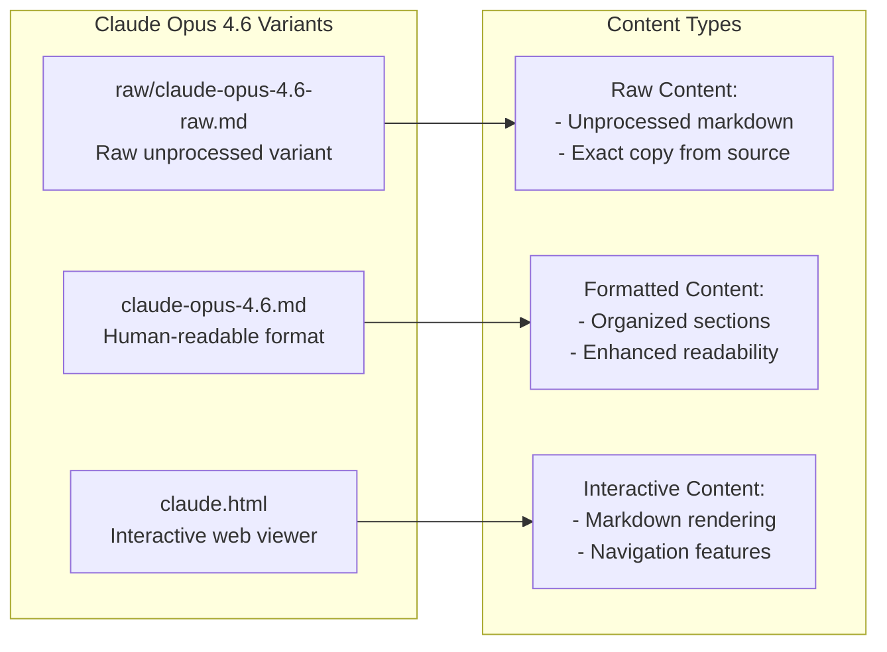
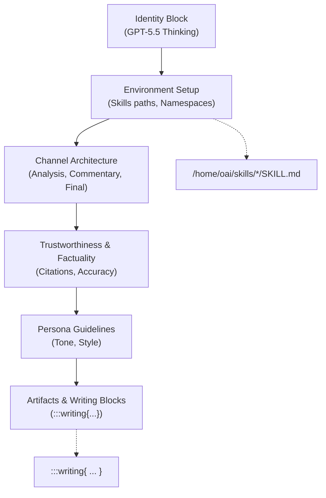

<!-- source: DeepWiki mcp.deepwiki.com · repo asgeirtj/system_prompts_leaks · page 1 Repository Overview · fetched 2026-11-09 -->

# Repository Overview

Relevant source files

The following files were used as context for generating this wiki page:

- [.github/FUNDING.yml](.github/FUNDING.yml)
- [LICENSE](LICENSE)
- [README.md](README.md)

This repository (`system_prompts_leaks`) serves as a comprehensive archive of system prompts, system messages, and developer messages from major AI providers. It documents the internal instructions and architectural specifications that define how large language models behave, including their tool integrations, safety constraints, memory systems, and behavioral guidelines [README.md:1-5]().

The repository is organized by AI provider (OpenAI, Anthropic, Google, xAI, Perplexity, and Miscellaneous) and contains both raw system prompt documents and supporting infrastructure for prompt collection and visualization.

## Purpose and Scope

The repository documents system prompts from four major AI providers and several independent developers, including the newest flagship models such as **Claude Fable 5** (the first Claude 5 family model) [README.md:21](), **GPT-5.5 Thinking** [README.md:26](), and **Claude Opus 4.8** [README.md:22]().

| Provider | Systems Documented | Primary Models |
|----------|-------------------|----------------|
| **Anthropic** | Claude Fable 5, Opus 4.8, Opus 4.7, Claude Cowork, Claude Code | `claude-fable-5`, `claude-opus-4.8`, `claude-code-2.1.172` |
| **OpenAI** | GPT-5.5 Thinking, GPT-5.4 Thinking, GPT-5.3 Codex, GPT-5 Personalities | `gpt-5.5-thinking`, `gpt-5.5-instant`, `o3`, `o4-mini` |
| **Google** | Gemini 3.5 Flash, Gemini 3.1 Pro, Antigravity CLI | `gemini-3.5-flash`, `gemini-3.1-pro`, `antigravity-cli` |
| **xAI** | Grok Expert, Grok 4.3 Beta, Grok 4.2 Team, Grok 3 | `grok-expert`, `grok-4.3-beta`, `grok-3` |
| **Perplexity** | Perplexity Computer, Comet Browser, Voice Assistant | `perplexity-computer`, `comet-browser-assistant` |
| **Misc** | VS Code Copilot Agent, Docker Gordon AI, Zed AI, Amp Code | `vscode-copilot-agent`, `docker-gordon-ai`, `zed`, `amp-code` |

Each documented system includes specifications for:
- Identity and context (model name, knowledge cutoff, capabilities)
- Behavioral guidelines and personality directives
- Tool definitions and namespace organization (e.g., OpenAI's 17+ namespaces)
- Memory and personalization systems (e.g., `tool-memory-bio`, `tool-advanced-memory`)
- Safety constraints and copyright compliance rules
- External integrations (Gmail, Slack, Google Workspace, etc.)

For detailed documentation of specific AI systems, see: [Anthropic Claude Systems](#2), [OpenAI GPT Systems](#3), [Google Gemini Systems](#4), [xAI Grok Systems](#5), and [Third-Party and Miscellaneous AI Systems](#6). For analysis of common patterns across providers, see [Cross-System Analysis and Patterns](#7).

**Sources:** [README.md:15-132]()

## Repository Structure

The repository follows a provider-based organization structure with development tools and visualization infrastructure. It includes root-level files for emerging models alongside established provider folders.

### System Mapping: Providers to Code Entities

This diagram bridges the natural language names of the providers with the specific file entities and directory structures used in the codebase.

```mermaid
graph TB
    Root["Repository Root<br/>(system_prompts_leaks)"]
    
    Readme["README.md<br/>Collection overview"]
    LooseFiles["Root Loose Files<br/>(grok-3.md, claude_37_v0.9.md)"]
    
    OpenAI["OpenAI/<br/>GPT model prompts"]
    Anthropic["Anthropic/<br/>Claude model prompts"]
    Google["Google/<br/>Gemini model prompts"]
    xAI["xAI/<br/>Grok model prompts"]
    Perplexity["Perplexity/<br/>Comet, Computer"]
    Misc["Misc/<br/>Mistral, Zed, Docker"]
    
    DevTools["Development Infrastructure"]
    
    Firecrawl[".firecrawl/<br/>Web scraping config"]
    Playwright[".playwright-mcp/<br/>Browser automation"]
    Worktrees[".claude/worktrees/<br/>Git workflow mgmt"]
    
    GPT55["gpt-5.5-thinking.md"]
    GPT54["gpt-5.4-thinking.md"]
    API_Sub["API/<br/>o3, o4-mini, gpt-5-reasoning-effort-high"]
    
    ClaudeFable5["claude-fable-5.md"]
    ClaudeOpus48["claude-opus-4.8.md"]
    ClaudeHTML["claude.html<br/>System Prompt Explorer"]
    ClaudeCode["Claude Code/<br/>claude-code-opus-4.8.md"]
    Official_Anth["Official/<br/>Anthropic platform archives"]
    
    GeminiFlash["gemini-3.5-flash.md"]
    
    GrokExpert["grok-expert.md"]
    
    Root --> Readme
    Root --> LooseFiles
    Root --> OpenAI
    Root --> Anthropic
    Root --> Google
    Root --> xAI
    Root --> Perplexity
    Root --> Misc
    Root --> DevTools
    
    DevTools -.-> Firecrawl
    DevTools -.-> Playwright
    DevTools -.-> Worktrees
    
    OpenAI --> GPT55
    OpenAI --> GPT54
    OpenAI --> API_Sub
    
    Anthropic --> ClaudeFable5
    Anthropic --> ClaudeOpus48
    Anthropic --> ClaudeHTML
    Anthropic --> ClaudeCode
    Anthropic --> Official_Anth
    
    Google --> GeminiFlash
    
    xAI --> GrokExpert
```

For details on file organization, API subdirectories, and the overall taxonomy, see [Repository Structure and Organization](#1.1).

**Sources:** [README.md:15-132](), [README.md:35-62]()

## Content Organization Patterns

### Raw vs. Processed Versions

The repository maintains different representations of the same system prompts to serve different use cases:

**Format Purposes:**
- **Raw versions** (`Anthropic/raw/*.md`): Unprocessed system prompts as extracted from the source [README.md:59]().
- **Human-readable versions** (`*.md`): Formatted with clear section headers and explanatory comments.
- **Visualization tools** (`Anthropic/claude.html` or `Anthropic/visualize.md`): Interactive tools for navigating complex architectures [README.md:60]().
- **Official Archives**: The `Anthropic/Official/` directory contains platform-provided system prompt archives spanning Claude 3 through Claude 4.8, including the newest entries for Claude 4.5 and 4.6 [README.md:57]().

**Sources:** [README.md:57-60]()

## System Prompt Components

All system prompts in the repository share a common architectural structure, though implementations vary by provider. The GPT-5.5 Thinking system prompt demonstrates the newest canonical structure mapping natural language concepts to internal code-like definitions.

### GPT-5.5 Architectural Mapping

This diagram maps the high-level system components to the specific headers and file paths referenced within the GPT-5.5 system prompt ecosystem.

**Core Components in GPT-5.5 Thinking:**
- **Identity**: Model name (`GPT-5.5 Thinking`) and latest knowledge cutoff [README.md:26]().
- **Environment**: Skill directory paths (referenced in [README.md:79]()).
- **Tools**: Specialized namespaces like `tool-web-search.md`, `tool-deep-research.md`, and `tool-python.md` [README.md:79]().
- **Policies**: Integrated image safety and automation context protocols [README.md:80]().

**Sources:** [README.md:26](), [README.md:71-80]()

## Development Infrastructure and Tools

The repository utilizes a modern automation stack for prompt extraction and workflow management:

- **Firecrawl**: Used for web scraping configuration to collect prompts from provider UIs.
- **Playwright**: Browser automation for dynamic content extraction.
- **Claude Worktrees**: Management of Git workflows for parallel development.
- **GitHub Actions**: CI/CD pipelines for validating and deploying updates, such as the traffic data badge generator [.github/workflows/traffic-to-badge.yml:1-49]().

For details on the development environment and collection methodology, see [Development Infrastructure and Tools](#1.2).

**Sources:** [README.md:1-20](), [.github/workflows/traffic-to-badge.yml:1-49]()

## Visualization and Documentation Tools

The repository includes specialized tools for exploring complex prompts, most notably the **Claude System Prompt Explorer** (`Anthropic/claude.html`) and the **Imagine Visual Creation Suite** (`Anthropic/visualize.md`). These tools provide markdown rendering and navigation for navigating the extensive Claude architectures, including the new **Claude Fable 5** [README.md:21, 60]().

**Sources:** [README.md:21, 60]()

---

